# Technical Analysis Alert on Nifty 500 - charts for Fri 13 Nov 2026

Scroll through all charts. Tap **Set alert** under any chart to get an email alert in the 8 AM report when your price/condition triggers on the daily close.

## 1. ANURAS - BULLISH
**1,300.60** (+8.22%) | vol 3.8x | RSI 73 | H 1,306.00 / L 1,204.40  
Bullish Marubozu, Close above 200 DMA, Volume spike 3.8x

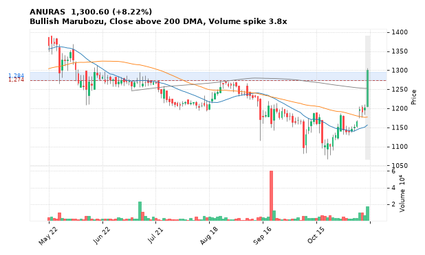

[🔔 Set alert on ANURAS](https://claude.ai/artifact/Ewc5hHTPX6WkU1nVcDNQzq?s=ANURAS&c=close%20above%201306.00) &nbsp;|&nbsp; [📈 Live chart (TradingView)](https://www.tradingview.com/chart/?symbol=NSE:ANURAS) &nbsp;|&nbsp; [alert by email](mailto:?subject=ALERT%20ANURAS&body=Alert%20me%20when%3A%20close%20above%201306.00%0A%0AEdit%20the%20line%20above%20if%20you%20want%2C%20then%20press%20Send.%20Checked%20on%20every%20day%27s%20closing%20data%3B%20a%20triggered%20alert%20appears%20at%20the%20top%20of%20the%208%20AM%20Technical%20Analysis%20email.%0A%0AExamples%20you%20can%20write%3A%0A%20%20close%20above%201150%20%20%7C%20%20close%20below%201080%20%20%7C%20%20high%20above%201200%20%20%7C%20%20low%20below%201050%0A%20%20close%20crosses%20above%20200%20DMA%20%20%7C%20%20close%20below%2050%20DMA%20%20%7C%20%20RSI%20below%2030%20%20%7C%20%20RSI%20above%2070%0A%20%20volume%20above%202x%20%20%7C%20%20change%20above%205%25%20%20%7C%20%20change%20below%20-4%25%20%20%7C%20%2052-week%20high%20%20%7C%20%20golden%20cross%0A%20%20combine%20with%20%27and%27%2C%20e.g.%20%20close%20above%201150%20and%20volume%20above%201.5x%0A%0AReference%3A%20ANURAS%20closed%201300.60%20%28high%201306.00%2C%20low%201204.40%29.%0ATo%20cancel%20later%2C%20send%20an%20email%20with%20subject%3A%20CANCEL%20ALERT%20ANURAS)

---

## 2. AMBER - BULLISH
**6,772.00** (+9.07%) | vol 13.9x | RSI 58 | H 6,980.00 / L 6,000.00  
Bullish Engulfing, Volume spike 13.9x

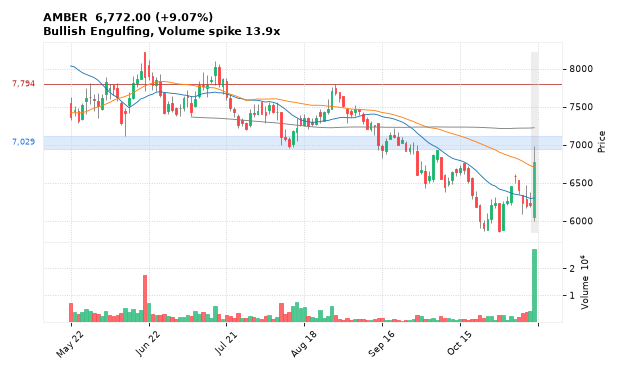

[🔔 Set alert on AMBER](https://claude.ai/artifact/Ewc5hHTPX6WkU1nVcDNQzq?s=AMBER&c=close%20above%206980.00) &nbsp;|&nbsp; [📈 Live chart (TradingView)](https://www.tradingview.com/chart/?symbol=NSE:AMBER) &nbsp;|&nbsp; [alert by email](mailto:?subject=ALERT%20AMBER&body=Alert%20me%20when%3A%20close%20above%206980.00%0A%0AEdit%20the%20line%20above%20if%20you%20want%2C%20then%20press%20Send.%20Checked%20on%20every%20day%27s%20closing%20data%3B%20a%20triggered%20alert%20appears%20at%20the%20top%20of%20the%208%20AM%20Technical%20Analysis%20email.%0A%0AExamples%20you%20can%20write%3A%0A%20%20close%20above%201150%20%20%7C%20%20close%20below%201080%20%20%7C%20%20high%20above%201200%20%20%7C%20%20low%20below%201050%0A%20%20close%20crosses%20above%20200%20DMA%20%20%7C%20%20close%20below%2050%20DMA%20%20%7C%20%20RSI%20below%2030%20%20%7C%20%20RSI%20above%2070%0A%20%20volume%20above%202x%20%20%7C%20%20change%20above%205%25%20%20%7C%20%20change%20below%20-4%25%20%20%7C%20%2052-week%20high%20%20%7C%20%20golden%20cross%0A%20%20combine%20with%20%27and%27%2C%20e.g.%20%20close%20above%201150%20and%20volume%20above%201.5x%0A%0AReference%3A%20AMBER%20closed%206772.00%20%28high%206980.00%2C%20low%206000.00%29.%0ATo%20cancel%20later%2C%20send%20an%20email%20with%20subject%3A%20CANCEL%20ALERT%20AMBER)

---

## 3. POWERINDIA - BULLISH
**31,595.00** (+10.68%) | vol 5.8x | RSI 61 | H 32,250.00 / L 29,950.00  
Close above 200 DMA, Volume spike 5.8x

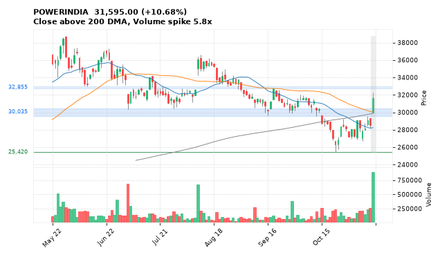

[🔔 Set alert on POWERINDIA](https://claude.ai/artifact/Ewc5hHTPX6WkU1nVcDNQzq?s=POWERINDIA&c=close%20above%2032250.00) &nbsp;|&nbsp; [📈 Live chart (TradingView)](https://www.tradingview.com/chart/?symbol=NSE:POWERINDIA) &nbsp;|&nbsp; [alert by email](mailto:?subject=ALERT%20POWERINDIA&body=Alert%20me%20when%3A%20close%20above%2032250.00%0A%0AEdit%20the%20line%20above%20if%20you%20want%2C%20then%20press%20Send.%20Checked%20on%20every%20day%27s%20closing%20data%3B%20a%20triggered%20alert%20appears%20at%20the%20top%20of%20the%208%20AM%20Technical%20Analysis%20email.%0A%0AExamples%20you%20can%20write%3A%0A%20%20close%20above%201150%20%20%7C%20%20close%20below%201080%20%20%7C%20%20high%20above%201200%20%20%7C%20%20low%20below%201050%0A%20%20close%20crosses%20above%20200%20DMA%20%20%7C%20%20close%20below%2050%20DMA%20%20%7C%20%20RSI%20below%2030%20%20%7C%20%20RSI%20above%2070%0A%20%20volume%20above%202x%20%20%7C%20%20change%20above%205%25%20%20%7C%20%20change%20below%20-4%25%20%20%7C%20%2052-week%20high%20%20%7C%20%20golden%20cross%0A%20%20combine%20with%20%27and%27%2C%20e.g.%20%20close%20above%201150%20and%20volume%20above%201.5x%0A%0AReference%3A%20POWERINDIA%20closed%2031595.00%20%28high%2032250.00%2C%20low%2029950.00%29.%0ATo%20cancel%20later%2C%20send%20an%20email%20with%20subject%3A%20CANCEL%20ALERT%20POWERINDIA)

---

## 4. BALRAMCHIN - BULLISH
**654.80** (+0.62%) | vol 0.6x | RSI 49 | H 672.00 / L 647.60  
Inverted Hammer, Bullish Engulfing

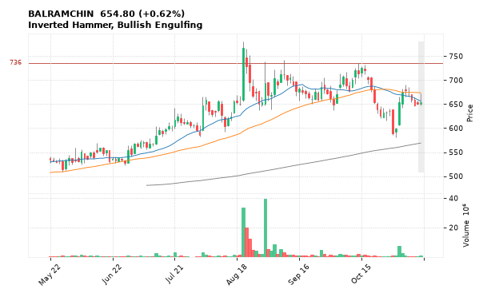

[🔔 Set alert on BALRAMCHIN](https://claude.ai/artifact/Ewc5hHTPX6WkU1nVcDNQzq?s=BALRAMCHIN&c=close%20above%20672.00) &nbsp;|&nbsp; [📈 Live chart (TradingView)](https://www.tradingview.com/chart/?symbol=NSE:BALRAMCHIN) &nbsp;|&nbsp; [alert by email](mailto:?subject=ALERT%20BALRAMCHIN&body=Alert%20me%20when%3A%20close%20above%20672.00%0A%0AEdit%20the%20line%20above%20if%20you%20want%2C%20then%20press%20Send.%20Checked%20on%20every%20day%27s%20closing%20data%3B%20a%20triggered%20alert%20appears%20at%20the%20top%20of%20the%208%20AM%20Technical%20Analysis%20email.%0A%0AExamples%20you%20can%20write%3A%0A%20%20close%20above%201150%20%20%7C%20%20close%20below%201080%20%20%7C%20%20high%20above%201200%20%20%7C%20%20low%20below%201050%0A%20%20close%20crosses%20above%20200%20DMA%20%20%7C%20%20close%20below%2050%20DMA%20%20%7C%20%20RSI%20below%2030%20%20%7C%20%20RSI%20above%2070%0A%20%20volume%20above%202x%20%20%7C%20%20change%20above%205%25%20%20%7C%20%20change%20below%20-4%25%20%20%7C%20%2052-week%20high%20%20%7C%20%20golden%20cross%0A%20%20combine%20with%20%27and%27%2C%20e.g.%20%20close%20above%201150%20and%20volume%20above%201.5x%0A%0AReference%3A%20BALRAMCHIN%20closed%20654.80%20%28high%20672.00%2C%20low%20647.60%29.%0ATo%20cancel%20later%2C%20send%20an%20email%20with%20subject%3A%20CANCEL%20ALERT%20BALRAMCHIN)

---

## 5. PWL - BULLISH
**131.58** (+2.30%) | vol 2.3x | RSI 52 | H 135.44 / L 128.10  
MACD bullish cross, Volume spike 2.3x

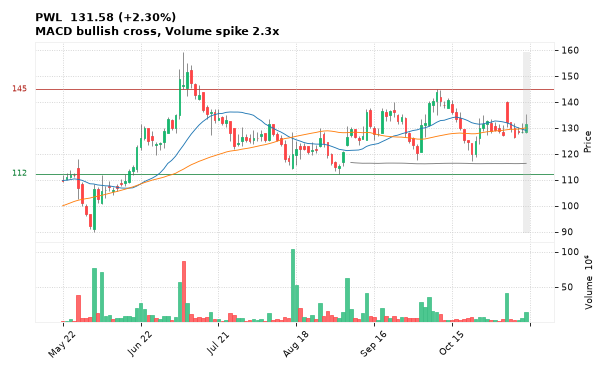

[🔔 Set alert on PWL](https://claude.ai/artifact/Ewc5hHTPX6WkU1nVcDNQzq?s=PWL&c=close%20above%20135.44) &nbsp;|&nbsp; [📈 Live chart (TradingView)](https://www.tradingview.com/chart/?symbol=NSE:PWL) &nbsp;|&nbsp; [alert by email](mailto:?subject=ALERT%20PWL&body=Alert%20me%20when%3A%20close%20above%20135.44%0A%0AEdit%20the%20line%20above%20if%20you%20want%2C%20then%20press%20Send.%20Checked%20on%20every%20day%27s%20closing%20data%3B%20a%20triggered%20alert%20appears%20at%20the%20top%20of%20the%208%20AM%20Technical%20Analysis%20email.%0A%0AExamples%20you%20can%20write%3A%0A%20%20close%20above%201150%20%20%7C%20%20close%20below%201080%20%20%7C%20%20high%20above%201200%20%20%7C%20%20low%20below%201050%0A%20%20close%20crosses%20above%20200%20DMA%20%20%7C%20%20close%20below%2050%20DMA%20%20%7C%20%20RSI%20below%2030%20%20%7C%20%20RSI%20above%2070%0A%20%20volume%20above%202x%20%20%7C%20%20change%20above%205%25%20%20%7C%20%20change%20below%20-4%25%20%20%7C%20%2052-week%20high%20%20%7C%20%20golden%20cross%0A%20%20combine%20with%20%27and%27%2C%20e.g.%20%20close%20above%201150%20and%20volume%20above%201.5x%0A%0AReference%3A%20PWL%20closed%20131.58%20%28high%20135.44%2C%20low%20128.10%29.%0ATo%20cancel%20later%2C%20send%20an%20email%20with%20subject%3A%20CANCEL%20ALERT%20PWL)

---

## 6. MCX - BULLISH
**3,720.00** (+2.63%) | vol 1.5x | RSI 69 | H 3,767.40 / L 3,595.00  
52-week high breakout

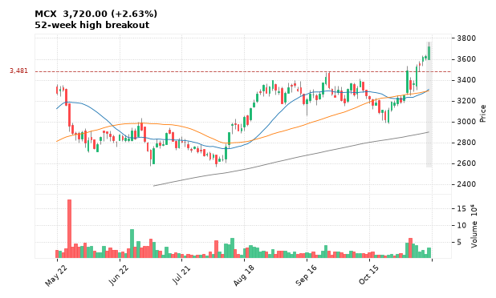

[🔔 Set alert on MCX](https://claude.ai/artifact/Ewc5hHTPX6WkU1nVcDNQzq?s=MCX&c=close%20above%203767.40) &nbsp;|&nbsp; [📈 Live chart (TradingView)](https://www.tradingview.com/chart/?symbol=NSE:MCX) &nbsp;|&nbsp; [alert by email](mailto:?subject=ALERT%20MCX&body=Alert%20me%20when%3A%20close%20above%203767.40%0A%0AEdit%20the%20line%20above%20if%20you%20want%2C%20then%20press%20Send.%20Checked%20on%20every%20day%27s%20closing%20data%3B%20a%20triggered%20alert%20appears%20at%20the%20top%20of%20the%208%20AM%20Technical%20Analysis%20email.%0A%0AExamples%20you%20can%20write%3A%0A%20%20close%20above%201150%20%20%7C%20%20close%20below%201080%20%20%7C%20%20high%20above%201200%20%20%7C%20%20low%20below%201050%0A%20%20close%20crosses%20above%20200%20DMA%20%20%7C%20%20close%20below%2050%20DMA%20%20%7C%20%20RSI%20below%2030%20%20%7C%20%20RSI%20above%2070%0A%20%20volume%20above%202x%20%20%7C%20%20change%20above%205%25%20%20%7C%20%20change%20below%20-4%25%20%20%7C%20%2052-week%20high%20%20%7C%20%20golden%20cross%0A%20%20combine%20with%20%27and%27%2C%20e.g.%20%20close%20above%201150%20and%20volume%20above%201.5x%0A%0AReference%3A%20MCX%20closed%203720.00%20%28high%203767.40%2C%20low%203595.00%29.%0ATo%20cancel%20later%2C%20send%20an%20email%20with%20subject%3A%20CANCEL%20ALERT%20MCX)

---

## 7. PAYTM - BULLISH
**1,939.90** (+0.77%) | vol 1.4x | RSI 72 | H 1,960.00 / L 1,903.00  
52-week high breakout

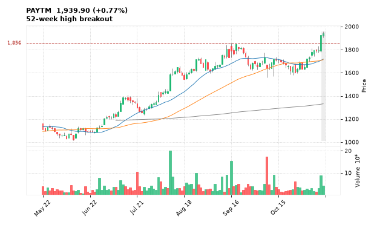

[🔔 Set alert on PAYTM](https://claude.ai/artifact/Ewc5hHTPX6WkU1nVcDNQzq?s=PAYTM&c=close%20above%201960.00) &nbsp;|&nbsp; [📈 Live chart (TradingView)](https://www.tradingview.com/chart/?symbol=NSE:PAYTM) &nbsp;|&nbsp; [alert by email](mailto:?subject=ALERT%20PAYTM&body=Alert%20me%20when%3A%20close%20above%201960.00%0A%0AEdit%20the%20line%20above%20if%20you%20want%2C%20then%20press%20Send.%20Checked%20on%20every%20day%27s%20closing%20data%3B%20a%20triggered%20alert%20appears%20at%20the%20top%20of%20the%208%20AM%20Technical%20Analysis%20email.%0A%0AExamples%20you%20can%20write%3A%0A%20%20close%20above%201150%20%20%7C%20%20close%20below%201080%20%20%7C%20%20high%20above%201200%20%20%7C%20%20low%20below%201050%0A%20%20close%20crosses%20above%20200%20DMA%20%20%7C%20%20close%20below%2050%20DMA%20%20%7C%20%20RSI%20below%2030%20%20%7C%20%20RSI%20above%2070%0A%20%20volume%20above%202x%20%20%7C%20%20change%20above%205%25%20%20%7C%20%20change%20below%20-4%25%20%20%7C%20%2052-week%20high%20%20%7C%20%20golden%20cross%0A%20%20combine%20with%20%27and%27%2C%20e.g.%20%20close%20above%201150%20and%20volume%20above%201.5x%0A%0AReference%3A%20PAYTM%20closed%201939.90%20%28high%201960.00%2C%20low%201903.00%29.%0ATo%20cancel%20later%2C%20send%20an%20email%20with%20subject%3A%20CANCEL%20ALERT%20PAYTM)

---

## 8. KSB - BULLISH
**653.10** (+2.56%) | vol 1.2x | RSI 36 | H 655.80 / L 633.00  
RSI up through 30, MACD bullish cross

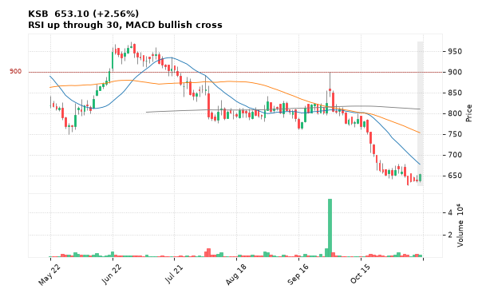

[🔔 Set alert on KSB](https://claude.ai/artifact/Ewc5hHTPX6WkU1nVcDNQzq?s=KSB&c=close%20above%20655.80) &nbsp;|&nbsp; [📈 Live chart (TradingView)](https://www.tradingview.com/chart/?symbol=NSE:KSB) &nbsp;|&nbsp; [alert by email](mailto:?subject=ALERT%20KSB&body=Alert%20me%20when%3A%20close%20above%20655.80%0A%0AEdit%20the%20line%20above%20if%20you%20want%2C%20then%20press%20Send.%20Checked%20on%20every%20day%27s%20closing%20data%3B%20a%20triggered%20alert%20appears%20at%20the%20top%20of%20the%208%20AM%20Technical%20Analysis%20email.%0A%0AExamples%20you%20can%20write%3A%0A%20%20close%20above%201150%20%20%7C%20%20close%20below%201080%20%20%7C%20%20high%20above%201200%20%20%7C%20%20low%20below%201050%0A%20%20close%20crosses%20above%20200%20DMA%20%20%7C%20%20close%20below%2050%20DMA%20%20%7C%20%20RSI%20below%2030%20%20%7C%20%20RSI%20above%2070%0A%20%20volume%20above%202x%20%20%7C%20%20change%20above%205%25%20%20%7C%20%20change%20below%20-4%25%20%20%7C%20%2052-week%20high%20%20%7C%20%20golden%20cross%0A%20%20combine%20with%20%27and%27%2C%20e.g.%20%20close%20above%201150%20and%20volume%20above%201.5x%0A%0AReference%3A%20KSB%20closed%20653.10%20%28high%20655.80%2C%20low%20633.00%29.%0ATo%20cancel%20later%2C%20send%20an%20email%20with%20subject%3A%20CANCEL%20ALERT%20KSB)

---

## 9. EMCURE - BULLISH
**2,361.70** (+2.04%) | vol 1.0x | RSI 82 | H 2,395.00 / L 2,315.40  
52-week high breakout

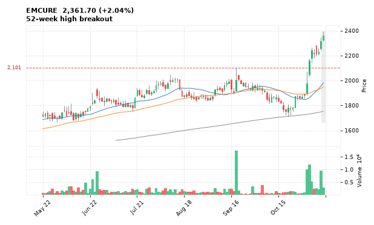

[🔔 Set alert on EMCURE](https://claude.ai/artifact/Ewc5hHTPX6WkU1nVcDNQzq?s=EMCURE&c=close%20above%202395.00) &nbsp;|&nbsp; [📈 Live chart (TradingView)](https://www.tradingview.com/chart/?symbol=NSE:EMCURE) &nbsp;|&nbsp; [alert by email](mailto:?subject=ALERT%20EMCURE&body=Alert%20me%20when%3A%20close%20above%202395.00%0A%0AEdit%20the%20line%20above%20if%20you%20want%2C%20then%20press%20Send.%20Checked%20on%20every%20day%27s%20closing%20data%3B%20a%20triggered%20alert%20appears%20at%20the%20top%20of%20the%208%20AM%20Technical%20Analysis%20email.%0A%0AExamples%20you%20can%20write%3A%0A%20%20close%20above%201150%20%20%7C%20%20close%20below%201080%20%20%7C%20%20high%20above%201200%20%20%7C%20%20low%20below%201050%0A%20%20close%20crosses%20above%20200%20DMA%20%20%7C%20%20close%20below%2050%20DMA%20%20%7C%20%20RSI%20below%2030%20%20%7C%20%20RSI%20above%2070%0A%20%20volume%20above%202x%20%20%7C%20%20change%20above%205%25%20%20%7C%20%20change%20below%20-4%25%20%20%7C%20%2052-week%20high%20%20%7C%20%20golden%20cross%0A%20%20combine%20with%20%27and%27%2C%20e.g.%20%20close%20above%201150%20and%20volume%20above%201.5x%0A%0AReference%3A%20EMCURE%20closed%202361.70%20%28high%202395.00%2C%20low%202315.40%29.%0ATo%20cancel%20later%2C%20send%20an%20email%20with%20subject%3A%20CANCEL%20ALERT%20EMCURE)

---

## 10. NETWEB - BULLISH
**4,196.20** (+1.07%) | vol 1.0x | RSI 44 | H 4,272.00 / L 4,074.10  
Close above 200 DMA, MACD bullish cross

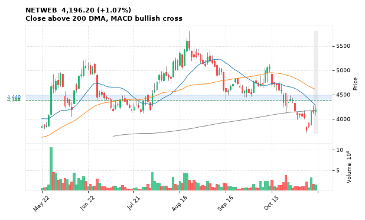

[🔔 Set alert on NETWEB](https://claude.ai/artifact/Ewc5hHTPX6WkU1nVcDNQzq?s=NETWEB&c=close%20above%204272.00) &nbsp;|&nbsp; [📈 Live chart (TradingView)](https://www.tradingview.com/chart/?symbol=NSE:NETWEB) &nbsp;|&nbsp; [alert by email](mailto:?subject=ALERT%20NETWEB&body=Alert%20me%20when%3A%20close%20above%204272.00%0A%0AEdit%20the%20line%20above%20if%20you%20want%2C%20then%20press%20Send.%20Checked%20on%20every%20day%27s%20closing%20data%3B%20a%20triggered%20alert%20appears%20at%20the%20top%20of%20the%208%20AM%20Technical%20Analysis%20email.%0A%0AExamples%20you%20can%20write%3A%0A%20%20close%20above%201150%20%20%7C%20%20close%20below%201080%20%20%7C%20%20high%20above%201200%20%20%7C%20%20low%20below%201050%0A%20%20close%20crosses%20above%20200%20DMA%20%20%7C%20%20close%20below%2050%20DMA%20%20%7C%20%20RSI%20below%2030%20%20%7C%20%20RSI%20above%2070%0A%20%20volume%20above%202x%20%20%7C%20%20change%20above%205%25%20%20%7C%20%20change%20below%20-4%25%20%20%7C%20%2052-week%20high%20%20%7C%20%20golden%20cross%0A%20%20combine%20with%20%27and%27%2C%20e.g.%20%20close%20above%201150%20and%20volume%20above%201.5x%0A%0AReference%3A%20NETWEB%20closed%204196.20%20%28high%204272.00%2C%20low%204074.10%29.%0ATo%20cancel%20later%2C%20send%20an%20email%20with%20subject%3A%20CANCEL%20ALERT%20NETWEB)

---

## 11. WELCORP - BULLISH
**2,230.40** (+3.46%) | vol 1.0x | RSI 41 | H 2,250.00 / L 2,138.00  
Bullish Engulfing, Inside Bar

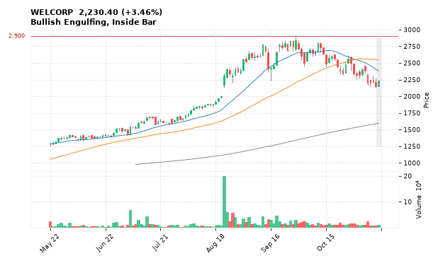

[🔔 Set alert on WELCORP](https://claude.ai/artifact/Ewc5hHTPX6WkU1nVcDNQzq?s=WELCORP&c=close%20above%202250.00) &nbsp;|&nbsp; [📈 Live chart (TradingView)](https://www.tradingview.com/chart/?symbol=NSE:WELCORP) &nbsp;|&nbsp; [alert by email](mailto:?subject=ALERT%20WELCORP&body=Alert%20me%20when%3A%20close%20above%202250.00%0A%0AEdit%20the%20line%20above%20if%20you%20want%2C%20then%20press%20Send.%20Checked%20on%20every%20day%27s%20closing%20data%3B%20a%20triggered%20alert%20appears%20at%20the%20top%20of%20the%208%20AM%20Technical%20Analysis%20email.%0A%0AExamples%20you%20can%20write%3A%0A%20%20close%20above%201150%20%20%7C%20%20close%20below%201080%20%20%7C%20%20high%20above%201200%20%20%7C%20%20low%20below%201050%0A%20%20close%20crosses%20above%20200%20DMA%20%20%7C%20%20close%20below%2050%20DMA%20%20%7C%20%20RSI%20below%2030%20%20%7C%20%20RSI%20above%2070%0A%20%20volume%20above%202x%20%20%7C%20%20change%20above%205%25%20%20%7C%20%20change%20below%20-4%25%20%20%7C%20%2052-week%20high%20%20%7C%20%20golden%20cross%0A%20%20combine%20with%20%27and%27%2C%20e.g.%20%20close%20above%201150%20and%20volume%20above%201.5x%0A%0AReference%3A%20WELCORP%20closed%202230.40%20%28high%202250.00%2C%20low%202138.00%29.%0ATo%20cancel%20later%2C%20send%20an%20email%20with%20subject%3A%20CANCEL%20ALERT%20WELCORP)

---

## 12. NYKAA - BULLISH
**365.20** (+1.36%) | vol 0.8x | RSI 65 | H 366.70 / L 356.85  
52-week high breakout

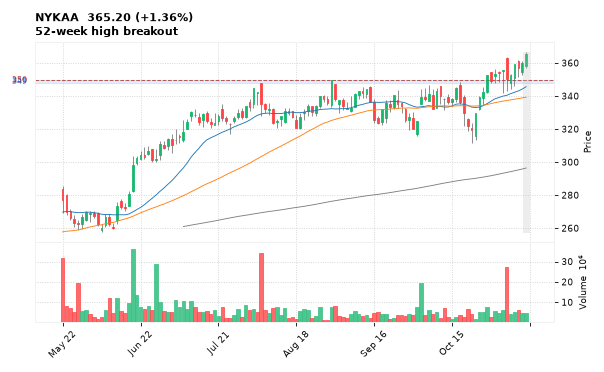

[🔔 Set alert on NYKAA](https://claude.ai/artifact/Ewc5hHTPX6WkU1nVcDNQzq?s=NYKAA&c=close%20above%20366.70) &nbsp;|&nbsp; [📈 Live chart (TradingView)](https://www.tradingview.com/chart/?symbol=NSE:NYKAA) &nbsp;|&nbsp; [alert by email](mailto:?subject=ALERT%20NYKAA&body=Alert%20me%20when%3A%20close%20above%20366.70%0A%0AEdit%20the%20line%20above%20if%20you%20want%2C%20then%20press%20Send.%20Checked%20on%20every%20day%27s%20closing%20data%3B%20a%20triggered%20alert%20appears%20at%20the%20top%20of%20the%208%20AM%20Technical%20Analysis%20email.%0A%0AExamples%20you%20can%20write%3A%0A%20%20close%20above%201150%20%20%7C%20%20close%20below%201080%20%20%7C%20%20high%20above%201200%20%20%7C%20%20low%20below%201050%0A%20%20close%20crosses%20above%20200%20DMA%20%20%7C%20%20close%20below%2050%20DMA%20%20%7C%20%20RSI%20below%2030%20%20%7C%20%20RSI%20above%2070%0A%20%20volume%20above%202x%20%20%7C%20%20change%20above%205%25%20%20%7C%20%20change%20below%20-4%25%20%20%7C%20%2052-week%20high%20%20%7C%20%20golden%20cross%0A%20%20combine%20with%20%27and%27%2C%20e.g.%20%20close%20above%201150%20and%20volume%20above%201.5x%0A%0AReference%3A%20NYKAA%20closed%20365.20%20%28high%20366.70%2C%20low%20356.85%29.%0ATo%20cancel%20later%2C%20send%20an%20email%20with%20subject%3A%20CANCEL%20ALERT%20NYKAA)

---

## 13. ATHERENERG - BULLISH
**1,945.00** (+1.14%) | vol 0.6x | RSI 75 | H 1,958.00 / L 1,910.00  
52-week high breakout, NR7 (narrowest range in 7)

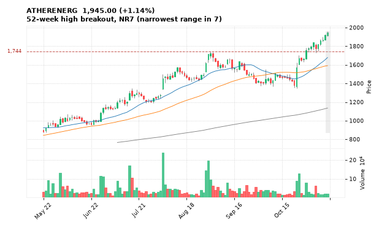

[🔔 Set alert on ATHERENERG](https://claude.ai/artifact/Ewc5hHTPX6WkU1nVcDNQzq?s=ATHERENERG&c=close%20above%201958.00) &nbsp;|&nbsp; [📈 Live chart (TradingView)](https://www.tradingview.com/chart/?symbol=NSE:ATHERENERG) &nbsp;|&nbsp; [alert by email](mailto:?subject=ALERT%20ATHERENERG&body=Alert%20me%20when%3A%20close%20above%201958.00%0A%0AEdit%20the%20line%20above%20if%20you%20want%2C%20then%20press%20Send.%20Checked%20on%20every%20day%27s%20closing%20data%3B%20a%20triggered%20alert%20appears%20at%20the%20top%20of%20the%208%20AM%20Technical%20Analysis%20email.%0A%0AExamples%20you%20can%20write%3A%0A%20%20close%20above%201150%20%20%7C%20%20close%20below%201080%20%20%7C%20%20high%20above%201200%20%20%7C%20%20low%20below%201050%0A%20%20close%20crosses%20above%20200%20DMA%20%20%7C%20%20close%20below%2050%20DMA%20%20%7C%20%20RSI%20below%2030%20%20%7C%20%20RSI%20above%2070%0A%20%20volume%20above%202x%20%20%7C%20%20change%20above%205%25%20%20%7C%20%20change%20below%20-4%25%20%20%7C%20%2052-week%20high%20%20%7C%20%20golden%20cross%0A%20%20combine%20with%20%27and%27%2C%20e.g.%20%20close%20above%201150%20and%20volume%20above%201.5x%0A%0AReference%3A%20ATHERENERG%20closed%201945.00%20%28high%201958.00%2C%20low%201910.00%29.%0ATo%20cancel%20later%2C%20send%20an%20email%20with%20subject%3A%20CANCEL%20ALERT%20ATHERENERG)

---

## 14. HCLTECH - BULLISH
**1,378.00** (-0.20%) | vol 0.5x | RSI 51 | H 1,396.70 / L 1,368.50  
Doji (indecision), Golden Cross (50/200 DMA)

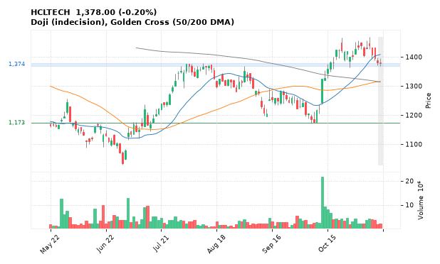

[🔔 Set alert on HCLTECH](https://claude.ai/artifact/Ewc5hHTPX6WkU1nVcDNQzq?s=HCLTECH&c=close%20above%201396.70) &nbsp;|&nbsp; [📈 Live chart (TradingView)](https://www.tradingview.com/chart/?symbol=NSE:HCLTECH) &nbsp;|&nbsp; [alert by email](mailto:?subject=ALERT%20HCLTECH&body=Alert%20me%20when%3A%20close%20above%201396.70%0A%0AEdit%20the%20line%20above%20if%20you%20want%2C%20then%20press%20Send.%20Checked%20on%20every%20day%27s%20closing%20data%3B%20a%20triggered%20alert%20appears%20at%20the%20top%20of%20the%208%20AM%20Technical%20Analysis%20email.%0A%0AExamples%20you%20can%20write%3A%0A%20%20close%20above%201150%20%20%7C%20%20close%20below%201080%20%20%7C%20%20high%20above%201200%20%20%7C%20%20low%20below%201050%0A%20%20close%20crosses%20above%20200%20DMA%20%20%7C%20%20close%20below%2050%20DMA%20%20%7C%20%20RSI%20below%2030%20%20%7C%20%20RSI%20above%2070%0A%20%20volume%20above%202x%20%20%7C%20%20change%20above%205%25%20%20%7C%20%20change%20below%20-4%25%20%20%7C%20%2052-week%20high%20%20%7C%20%20golden%20cross%0A%20%20combine%20with%20%27and%27%2C%20e.g.%20%20close%20above%201150%20and%20volume%20above%201.5x%0A%0AReference%3A%20HCLTECH%20closed%201378.00%20%28high%201396.70%2C%20low%201368.50%29.%0ATo%20cancel%20later%2C%20send%20an%20email%20with%20subject%3A%20CANCEL%20ALERT%20HCLTECH)

---

## 15. GODREJIND - BULLISH
**1,117.15** (+3.05%) | vol 17.8x | RSI 68 | H 1,177.80 / L 1,074.30  
Volume spike 17.8x

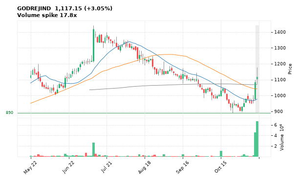

[🔔 Set alert on GODREJIND](https://claude.ai/artifact/Ewc5hHTPX6WkU1nVcDNQzq?s=GODREJIND&c=close%20above%201177.80) &nbsp;|&nbsp; [📈 Live chart (TradingView)](https://www.tradingview.com/chart/?symbol=NSE:GODREJIND) &nbsp;|&nbsp; [alert by email](mailto:?subject=ALERT%20GODREJIND&body=Alert%20me%20when%3A%20close%20above%201177.80%0A%0AEdit%20the%20line%20above%20if%20you%20want%2C%20then%20press%20Send.%20Checked%20on%20every%20day%27s%20closing%20data%3B%20a%20triggered%20alert%20appears%20at%20the%20top%20of%20the%208%20AM%20Technical%20Analysis%20email.%0A%0AExamples%20you%20can%20write%3A%0A%20%20close%20above%201150%20%20%7C%20%20close%20below%201080%20%20%7C%20%20high%20above%201200%20%20%7C%20%20low%20below%201050%0A%20%20close%20crosses%20above%20200%20DMA%20%20%7C%20%20close%20below%2050%20DMA%20%20%7C%20%20RSI%20below%2030%20%20%7C%20%20RSI%20above%2070%0A%20%20volume%20above%202x%20%20%7C%20%20change%20above%205%25%20%20%7C%20%20change%20below%20-4%25%20%20%7C%20%2052-week%20high%20%20%7C%20%20golden%20cross%0A%20%20combine%20with%20%27and%27%2C%20e.g.%20%20close%20above%201150%20and%20volume%20above%201.5x%0A%0AReference%3A%20GODREJIND%20closed%201117.15%20%28high%201177.80%2C%20low%201074.30%29.%0ATo%20cancel%20later%2C%20send%20an%20email%20with%20subject%3A%20CANCEL%20ALERT%20GODREJIND)

---

## 16. HDFCAMC - BEARISH
**2,663.00** (-2.45%) | vol 1.1x | RSI 67 | H 2,753.90 / L 2,657.50  
Bearish Engulfing, Evening Star, RSI down through 70

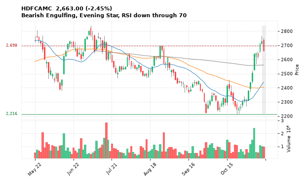

[🔔 Set alert on HDFCAMC](https://claude.ai/artifact/Ewc5hHTPX6WkU1nVcDNQzq?s=HDFCAMC&c=close%20below%202657.50) &nbsp;|&nbsp; [📈 Live chart (TradingView)](https://www.tradingview.com/chart/?symbol=NSE:HDFCAMC) &nbsp;|&nbsp; [alert by email](mailto:?subject=ALERT%20HDFCAMC&body=Alert%20me%20when%3A%20close%20below%202657.50%0A%0AEdit%20the%20line%20above%20if%20you%20want%2C%20then%20press%20Send.%20Checked%20on%20every%20day%27s%20closing%20data%3B%20a%20triggered%20alert%20appears%20at%20the%20top%20of%20the%208%20AM%20Technical%20Analysis%20email.%0A%0AExamples%20you%20can%20write%3A%0A%20%20close%20above%201150%20%20%7C%20%20close%20below%201080%20%20%7C%20%20high%20above%201200%20%20%7C%20%20low%20below%201050%0A%20%20close%20crosses%20above%20200%20DMA%20%20%7C%20%20close%20below%2050%20DMA%20%20%7C%20%20RSI%20below%2030%20%20%7C%20%20RSI%20above%2070%0A%20%20volume%20above%202x%20%20%7C%20%20change%20above%205%25%20%20%7C%20%20change%20below%20-4%25%20%20%7C%20%2052-week%20high%20%20%7C%20%20golden%20cross%0A%20%20combine%20with%20%27and%27%2C%20e.g.%20%20close%20above%201150%20and%20volume%20above%201.5x%0A%0AReference%3A%20HDFCAMC%20closed%202663.00%20%28high%202753.90%2C%20low%202657.50%29.%0ATo%20cancel%20later%2C%20send%20an%20email%20with%20subject%3A%20CANCEL%20ALERT%20HDFCAMC)

---

## 17. MANAPPURAM - BEARISH
**308.00** (-3.73%) | vol 7.3x | RSI 47 | H 327.00 / L 304.65  
Bearish Engulfing, Close below 200 DMA, Volume spike 7.3x

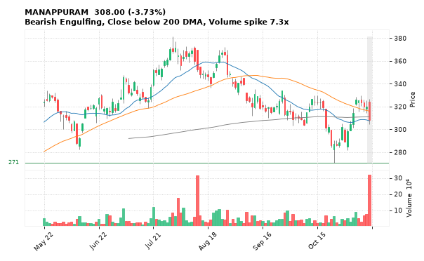

[🔔 Set alert on MANAPPURAM](https://claude.ai/artifact/Ewc5hHTPX6WkU1nVcDNQzq?s=MANAPPURAM&c=close%20below%20304.65) &nbsp;|&nbsp; [📈 Live chart (TradingView)](https://www.tradingview.com/chart/?symbol=NSE:MANAPPURAM) &nbsp;|&nbsp; [alert by email](mailto:?subject=ALERT%20MANAPPURAM&body=Alert%20me%20when%3A%20close%20below%20304.65%0A%0AEdit%20the%20line%20above%20if%20you%20want%2C%20then%20press%20Send.%20Checked%20on%20every%20day%27s%20closing%20data%3B%20a%20triggered%20alert%20appears%20at%20the%20top%20of%20the%208%20AM%20Technical%20Analysis%20email.%0A%0AExamples%20you%20can%20write%3A%0A%20%20close%20above%201150%20%20%7C%20%20close%20below%201080%20%20%7C%20%20high%20above%201200%20%20%7C%20%20low%20below%201050%0A%20%20close%20crosses%20above%20200%20DMA%20%20%7C%20%20close%20below%2050%20DMA%20%20%7C%20%20RSI%20below%2030%20%20%7C%20%20RSI%20above%2070%0A%20%20volume%20above%202x%20%20%7C%20%20change%20above%205%25%20%20%7C%20%20change%20below%20-4%25%20%20%7C%20%2052-week%20high%20%20%7C%20%20golden%20cross%0A%20%20combine%20with%20%27and%27%2C%20e.g.%20%20close%20above%201150%20and%20volume%20above%201.5x%0A%0AReference%3A%20MANAPPURAM%20closed%20308.00%20%28high%20327.00%2C%20low%20304.65%29.%0ATo%20cancel%20later%2C%20send%20an%20email%20with%20subject%3A%20CANCEL%20ALERT%20MANAPPURAM)

---

## 18. SHREECEM - BEARISH
**24,655.00** (-2.18%) | vol 0.5x | RSI 62 | H 25,165.00 / L 24,560.00  
Evening Star, Close below 200 DMA, RSI down through 70

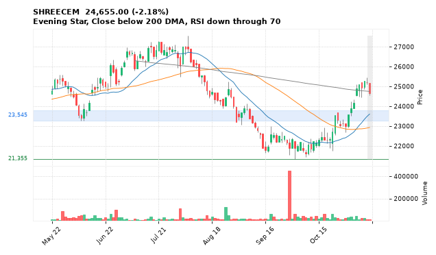

[🔔 Set alert on SHREECEM](https://claude.ai/artifact/Ewc5hHTPX6WkU1nVcDNQzq?s=SHREECEM&c=close%20below%2024560.00) &nbsp;|&nbsp; [📈 Live chart (TradingView)](https://www.tradingview.com/chart/?symbol=NSE:SHREECEM) &nbsp;|&nbsp; [alert by email](mailto:?subject=ALERT%20SHREECEM&body=Alert%20me%20when%3A%20close%20below%2024560.00%0A%0AEdit%20the%20line%20above%20if%20you%20want%2C%20then%20press%20Send.%20Checked%20on%20every%20day%27s%20closing%20data%3B%20a%20triggered%20alert%20appears%20at%20the%20top%20of%20the%208%20AM%20Technical%20Analysis%20email.%0A%0AExamples%20you%20can%20write%3A%0A%20%20close%20above%201150%20%20%7C%20%20close%20below%201080%20%20%7C%20%20high%20above%201200%20%20%7C%20%20low%20below%201050%0A%20%20close%20crosses%20above%20200%20DMA%20%20%7C%20%20close%20below%2050%20DMA%20%20%7C%20%20RSI%20below%2030%20%20%7C%20%20RSI%20above%2070%0A%20%20volume%20above%202x%20%20%7C%20%20change%20above%205%25%20%20%7C%20%20change%20below%20-4%25%20%20%7C%20%2052-week%20high%20%20%7C%20%20golden%20cross%0A%20%20combine%20with%20%27and%27%2C%20e.g.%20%20close%20above%201150%20and%20volume%20above%201.5x%0A%0AReference%3A%20SHREECEM%20closed%2024655.00%20%28high%2025165.00%2C%20low%2024560.00%29.%0ATo%20cancel%20later%2C%20send%20an%20email%20with%20subject%3A%20CANCEL%20ALERT%20SHREECEM)

---

## 19. PETRONET - BEARISH
**324.05** (-3.27%) | vol 2.8x | RSI 65 | H 332.00 / L 324.05  
Bearish Marubozu, RSI down through 70, Volume spike 2.8x

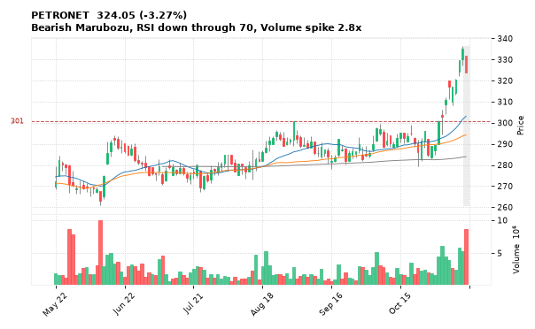

[🔔 Set alert on PETRONET](https://claude.ai/artifact/Ewc5hHTPX6WkU1nVcDNQzq?s=PETRONET&c=close%20below%20324.05) &nbsp;|&nbsp; [📈 Live chart (TradingView)](https://www.tradingview.com/chart/?symbol=NSE:PETRONET) &nbsp;|&nbsp; [alert by email](mailto:?subject=ALERT%20PETRONET&body=Alert%20me%20when%3A%20close%20below%20324.05%0A%0AEdit%20the%20line%20above%20if%20you%20want%2C%20then%20press%20Send.%20Checked%20on%20every%20day%27s%20closing%20data%3B%20a%20triggered%20alert%20appears%20at%20the%20top%20of%20the%208%20AM%20Technical%20Analysis%20email.%0A%0AExamples%20you%20can%20write%3A%0A%20%20close%20above%201150%20%20%7C%20%20close%20below%201080%20%20%7C%20%20high%20above%201200%20%20%7C%20%20low%20below%201050%0A%20%20close%20crosses%20above%20200%20DMA%20%20%7C%20%20close%20below%2050%20DMA%20%20%7C%20%20RSI%20below%2030%20%20%7C%20%20RSI%20above%2070%0A%20%20volume%20above%202x%20%20%7C%20%20change%20above%205%25%20%20%7C%20%20change%20below%20-4%25%20%20%7C%20%2052-week%20high%20%20%7C%20%20golden%20cross%0A%20%20combine%20with%20%27and%27%2C%20e.g.%20%20close%20above%201150%20and%20volume%20above%201.5x%0A%0AReference%3A%20PETRONET%20closed%20324.05%20%28high%20332.00%2C%20low%20324.05%29.%0ATo%20cancel%20later%2C%20send%20an%20email%20with%20subject%3A%20CANCEL%20ALERT%20PETRONET)

---

## 20. ASTERDM - BEARISH
**722.50** (-1.82%) | vol 1.1x | RSI 56 | H 740.00 / L 718.60  
Bearish Engulfing, Death Cross (50/200 DMA)

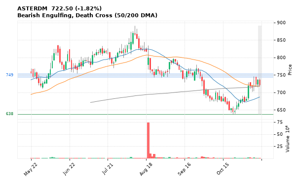

[🔔 Set alert on ASTERDM](https://claude.ai/artifact/Ewc5hHTPX6WkU1nVcDNQzq?s=ASTERDM&c=close%20below%20718.60) &nbsp;|&nbsp; [📈 Live chart (TradingView)](https://www.tradingview.com/chart/?symbol=NSE:ASTERDM) &nbsp;|&nbsp; [alert by email](mailto:?subject=ALERT%20ASTERDM&body=Alert%20me%20when%3A%20close%20below%20718.60%0A%0AEdit%20the%20line%20above%20if%20you%20want%2C%20then%20press%20Send.%20Checked%20on%20every%20day%27s%20closing%20data%3B%20a%20triggered%20alert%20appears%20at%20the%20top%20of%20the%208%20AM%20Technical%20Analysis%20email.%0A%0AExamples%20you%20can%20write%3A%0A%20%20close%20above%201150%20%20%7C%20%20close%20below%201080%20%20%7C%20%20high%20above%201200%20%20%7C%20%20low%20below%201050%0A%20%20close%20crosses%20above%20200%20DMA%20%20%7C%20%20close%20below%2050%20DMA%20%20%7C%20%20RSI%20below%2030%20%20%7C%20%20RSI%20above%2070%0A%20%20volume%20above%202x%20%20%7C%20%20change%20above%205%25%20%20%7C%20%20change%20below%20-4%25%20%20%7C%20%2052-week%20high%20%20%7C%20%20golden%20cross%0A%20%20combine%20with%20%27and%27%2C%20e.g.%20%20close%20above%201150%20and%20volume%20above%201.5x%0A%0AReference%3A%20ASTERDM%20closed%20722.50%20%28high%20740.00%2C%20low%20718.60%29.%0ATo%20cancel%20later%2C%20send%20an%20email%20with%20subject%3A%20CANCEL%20ALERT%20ASTERDM)

---

## 21. J&KBANK - BEARISH
**137.27** (-0.30%) | vol 0.4x | RSI 58 | H 137.95 / L 135.61  
Doji (indecision), Bearish Harami, Death Cross (50/200 DMA), Close below 200 DMA, Inside Bar

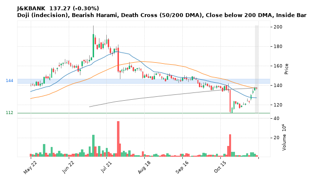

[🔔 Set alert on J&KBANK](https://claude.ai/artifact/Ewc5hHTPX6WkU1nVcDNQzq?s=J%26KBANK&c=close%20below%20135.61) &nbsp;|&nbsp; [📈 Live chart (TradingView)](https://www.tradingview.com/chart/?symbol=NSE:J%26KBANK) &nbsp;|&nbsp; [alert by email](mailto:?subject=ALERT%20J%26KBANK&body=Alert%20me%20when%3A%20close%20below%20135.61%0A%0AEdit%20the%20line%20above%20if%20you%20want%2C%20then%20press%20Send.%20Checked%20on%20every%20day%27s%20closing%20data%3B%20a%20triggered%20alert%20appears%20at%20the%20top%20of%20the%208%20AM%20Technical%20Analysis%20email.%0A%0AExamples%20you%20can%20write%3A%0A%20%20close%20above%201150%20%20%7C%20%20close%20below%201080%20%20%7C%20%20high%20above%201200%20%20%7C%20%20low%20below%201050%0A%20%20close%20crosses%20above%20200%20DMA%20%20%7C%20%20close%20below%2050%20DMA%20%20%7C%20%20RSI%20below%2030%20%20%7C%20%20RSI%20above%2070%0A%20%20volume%20above%202x%20%20%7C%20%20change%20above%205%25%20%20%7C%20%20change%20below%20-4%25%20%20%7C%20%2052-week%20high%20%20%7C%20%20golden%20cross%0A%20%20combine%20with%20%27and%27%2C%20e.g.%20%20close%20above%201150%20and%20volume%20above%201.5x%0A%0AReference%3A%20J%26KBANK%20closed%20137.27%20%28high%20137.95%2C%20low%20135.61%29.%0ATo%20cancel%20later%2C%20send%20an%20email%20with%20subject%3A%20CANCEL%20ALERT%20J%26KBANK)

---

## 22. CANBK - BEARISH
**130.91** (-1.57%) | vol 0.8x | RSI 65 | H 132.88 / L 130.00  
Evening Star, Close below 200 DMA

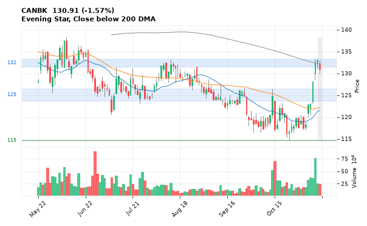

[🔔 Set alert on CANBK](https://claude.ai/artifact/Ewc5hHTPX6WkU1nVcDNQzq?s=CANBK&c=close%20below%20130.00) &nbsp;|&nbsp; [📈 Live chart (TradingView)](https://www.tradingview.com/chart/?symbol=NSE:CANBK) &nbsp;|&nbsp; [alert by email](mailto:?subject=ALERT%20CANBK&body=Alert%20me%20when%3A%20close%20below%20130.00%0A%0AEdit%20the%20line%20above%20if%20you%20want%2C%20then%20press%20Send.%20Checked%20on%20every%20day%27s%20closing%20data%3B%20a%20triggered%20alert%20appears%20at%20the%20top%20of%20the%208%20AM%20Technical%20Analysis%20email.%0A%0AExamples%20you%20can%20write%3A%0A%20%20close%20above%201150%20%20%7C%20%20close%20below%201080%20%20%7C%20%20high%20above%201200%20%20%7C%20%20low%20below%201050%0A%20%20close%20crosses%20above%20200%20DMA%20%20%7C%20%20close%20below%2050%20DMA%20%20%7C%20%20RSI%20below%2030%20%20%7C%20%20RSI%20above%2070%0A%20%20volume%20above%202x%20%20%7C%20%20change%20above%205%25%20%20%7C%20%20change%20below%20-4%25%20%20%7C%20%2052-week%20high%20%20%7C%20%20golden%20cross%0A%20%20combine%20with%20%27and%27%2C%20e.g.%20%20close%20above%201150%20and%20volume%20above%201.5x%0A%0AReference%3A%20CANBK%20closed%20130.91%20%28high%20132.88%2C%20low%20130.00%29.%0ATo%20cancel%20later%2C%20send%20an%20email%20with%20subject%3A%20CANCEL%20ALERT%20CANBK)

---

## 23. ICICIAMC - BEARISH
**3,040.40** (-2.68%) | vol 0.8x | RSI 57 | H 3,108.60 / L 3,035.00  
Evening Star, Close below 200 DMA

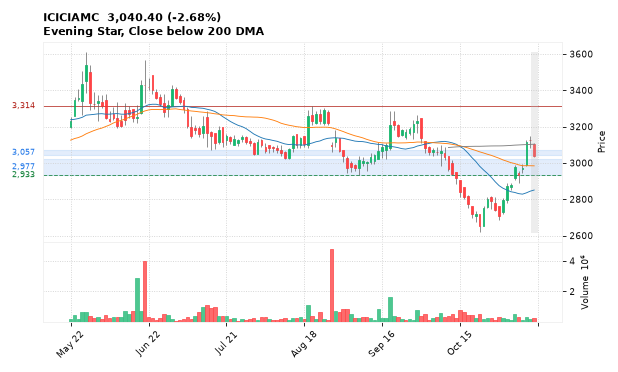

[🔔 Set alert on ICICIAMC](https://claude.ai/artifact/Ewc5hHTPX6WkU1nVcDNQzq?s=ICICIAMC&c=close%20below%203035.00) &nbsp;|&nbsp; [📈 Live chart (TradingView)](https://www.tradingview.com/chart/?symbol=NSE:ICICIAMC) &nbsp;|&nbsp; [alert by email](mailto:?subject=ALERT%20ICICIAMC&body=Alert%20me%20when%3A%20close%20below%203035.00%0A%0AEdit%20the%20line%20above%20if%20you%20want%2C%20then%20press%20Send.%20Checked%20on%20every%20day%27s%20closing%20data%3B%20a%20triggered%20alert%20appears%20at%20the%20top%20of%20the%208%20AM%20Technical%20Analysis%20email.%0A%0AExamples%20you%20can%20write%3A%0A%20%20close%20above%201150%20%20%7C%20%20close%20below%201080%20%20%7C%20%20high%20above%201200%20%20%7C%20%20low%20below%201050%0A%20%20close%20crosses%20above%20200%20DMA%20%20%7C%20%20close%20below%2050%20DMA%20%20%7C%20%20RSI%20below%2030%20%20%7C%20%20RSI%20above%2070%0A%20%20volume%20above%202x%20%20%7C%20%20change%20above%205%25%20%20%7C%20%20change%20below%20-4%25%20%20%7C%20%2052-week%20high%20%20%7C%20%20golden%20cross%0A%20%20combine%20with%20%27and%27%2C%20e.g.%20%20close%20above%201150%20and%20volume%20above%201.5x%0A%0AReference%3A%20ICICIAMC%20closed%203040.40%20%28high%203108.60%2C%20low%203035.00%29.%0ATo%20cancel%20later%2C%20send%20an%20email%20with%20subject%3A%20CANCEL%20ALERT%20ICICIAMC)

---

## 24. ALKEM - BEARISH
**5,114.00** (-3.55%) | vol 2.7x | RSI 45 | H 5,300.50 / L 5,103.50  
Bearish Marubozu, Volume spike 2.7x

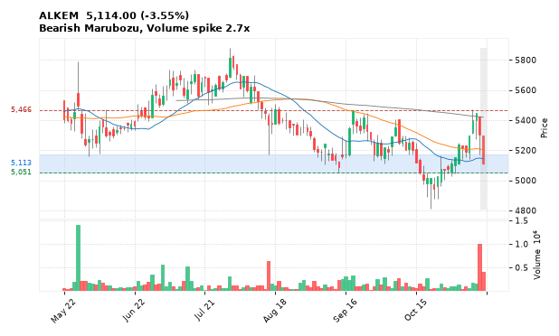

[🔔 Set alert on ALKEM](https://claude.ai/artifact/Ewc5hHTPX6WkU1nVcDNQzq?s=ALKEM&c=close%20below%205103.50) &nbsp;|&nbsp; [📈 Live chart (TradingView)](https://www.tradingview.com/chart/?symbol=NSE:ALKEM) &nbsp;|&nbsp; [alert by email](mailto:?subject=ALERT%20ALKEM&body=Alert%20me%20when%3A%20close%20below%205103.50%0A%0AEdit%20the%20line%20above%20if%20you%20want%2C%20then%20press%20Send.%20Checked%20on%20every%20day%27s%20closing%20data%3B%20a%20triggered%20alert%20appears%20at%20the%20top%20of%20the%208%20AM%20Technical%20Analysis%20email.%0A%0AExamples%20you%20can%20write%3A%0A%20%20close%20above%201150%20%20%7C%20%20close%20below%201080%20%20%7C%20%20high%20above%201200%20%20%7C%20%20low%20below%201050%0A%20%20close%20crosses%20above%20200%20DMA%20%20%7C%20%20close%20below%2050%20DMA%20%20%7C%20%20RSI%20below%2030%20%20%7C%20%20RSI%20above%2070%0A%20%20volume%20above%202x%20%20%7C%20%20change%20above%205%25%20%20%7C%20%20change%20below%20-4%25%20%20%7C%20%2052-week%20high%20%20%7C%20%20golden%20cross%0A%20%20combine%20with%20%27and%27%2C%20e.g.%20%20close%20above%201150%20and%20volume%20above%201.5x%0A%0AReference%3A%20ALKEM%20closed%205114.00%20%28high%205300.50%2C%20low%205103.50%29.%0ATo%20cancel%20later%2C%20send%20an%20email%20with%20subject%3A%20CANCEL%20ALERT%20ALKEM)

---

## 25. ICICILIFE - BEARISH
**455.55** (-2.44%) | vol 0.8x | RSI 59 | H 471.05 / L 454.45  
Bearish Marubozu, Dark Cloud Cover

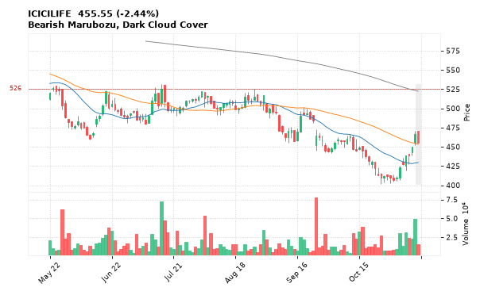

[🔔 Set alert on ICICILIFE](https://claude.ai/artifact/Ewc5hHTPX6WkU1nVcDNQzq?s=ICICILIFE&c=close%20below%20454.45) &nbsp;|&nbsp; [📈 Live chart (TradingView)](https://www.tradingview.com/chart/?symbol=NSE:ICICILIFE) &nbsp;|&nbsp; [alert by email](mailto:?subject=ALERT%20ICICILIFE&body=Alert%20me%20when%3A%20close%20below%20454.45%0A%0AEdit%20the%20line%20above%20if%20you%20want%2C%20then%20press%20Send.%20Checked%20on%20every%20day%27s%20closing%20data%3B%20a%20triggered%20alert%20appears%20at%20the%20top%20of%20the%208%20AM%20Technical%20Analysis%20email.%0A%0AExamples%20you%20can%20write%3A%0A%20%20close%20above%201150%20%20%7C%20%20close%20below%201080%20%20%7C%20%20high%20above%201200%20%20%7C%20%20low%20below%201050%0A%20%20close%20crosses%20above%20200%20DMA%20%20%7C%20%20close%20below%2050%20DMA%20%20%7C%20%20RSI%20below%2030%20%20%7C%20%20RSI%20above%2070%0A%20%20volume%20above%202x%20%20%7C%20%20change%20above%205%25%20%20%7C%20%20change%20below%20-4%25%20%20%7C%20%2052-week%20high%20%20%7C%20%20golden%20cross%0A%20%20combine%20with%20%27and%27%2C%20e.g.%20%20close%20above%201150%20and%20volume%20above%201.5x%0A%0AReference%3A%20ICICILIFE%20closed%20455.55%20%28high%20471.05%2C%20low%20454.45%29.%0ATo%20cancel%20later%2C%20send%20an%20email%20with%20subject%3A%20CANCEL%20ALERT%20ICICILIFE)

---

## 26. PATANJALI - BEARISH
**421.00** (-2.27%) | vol 0.7x | RSI 68 | H 433.50 / L 420.10  
Close below 200 DMA, RSI down through 70

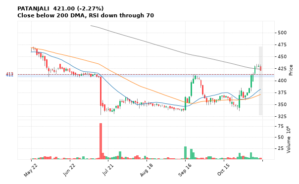

[🔔 Set alert on PATANJALI](https://claude.ai/artifact/Ewc5hHTPX6WkU1nVcDNQzq?s=PATANJALI&c=close%20below%20420.10) &nbsp;|&nbsp; [📈 Live chart (TradingView)](https://www.tradingview.com/chart/?symbol=NSE:PATANJALI) &nbsp;|&nbsp; [alert by email](mailto:?subject=ALERT%20PATANJALI&body=Alert%20me%20when%3A%20close%20below%20420.10%0A%0AEdit%20the%20line%20above%20if%20you%20want%2C%20then%20press%20Send.%20Checked%20on%20every%20day%27s%20closing%20data%3B%20a%20triggered%20alert%20appears%20at%20the%20top%20of%20the%208%20AM%20Technical%20Analysis%20email.%0A%0AExamples%20you%20can%20write%3A%0A%20%20close%20above%201150%20%20%7C%20%20close%20below%201080%20%20%7C%20%20high%20above%201200%20%20%7C%20%20low%20below%201050%0A%20%20close%20crosses%20above%20200%20DMA%20%20%7C%20%20close%20below%2050%20DMA%20%20%7C%20%20RSI%20below%2030%20%20%7C%20%20RSI%20above%2070%0A%20%20volume%20above%202x%20%20%7C%20%20change%20above%205%25%20%20%7C%20%20change%20below%20-4%25%20%20%7C%20%2052-week%20high%20%20%7C%20%20golden%20cross%0A%20%20combine%20with%20%27and%27%2C%20e.g.%20%20close%20above%201150%20and%20volume%20above%201.5x%0A%0AReference%3A%20PATANJALI%20closed%20421.00%20%28high%20433.50%2C%20low%20420.10%29.%0ATo%20cancel%20later%2C%20send%20an%20email%20with%20subject%3A%20CANCEL%20ALERT%20PATANJALI)

---

## 27. CEMPRO - BEARISH
**1,314.80** (-0.81%) | vol 0.6x | RSI 60 | H 1,330.00 / L 1,282.00  
Hanging Man, Bearish Engulfing

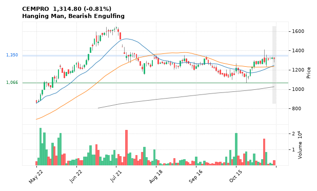

[🔔 Set alert on CEMPRO](https://claude.ai/artifact/Ewc5hHTPX6WkU1nVcDNQzq?s=CEMPRO&c=close%20below%201282.00) &nbsp;|&nbsp; [📈 Live chart (TradingView)](https://www.tradingview.com/chart/?symbol=NSE:CEMPRO) &nbsp;|&nbsp; [alert by email](mailto:?subject=ALERT%20CEMPRO&body=Alert%20me%20when%3A%20close%20below%201282.00%0A%0AEdit%20the%20line%20above%20if%20you%20want%2C%20then%20press%20Send.%20Checked%20on%20every%20day%27s%20closing%20data%3B%20a%20triggered%20alert%20appears%20at%20the%20top%20of%20the%208%20AM%20Technical%20Analysis%20email.%0A%0AExamples%20you%20can%20write%3A%0A%20%20close%20above%201150%20%20%7C%20%20close%20below%201080%20%20%7C%20%20high%20above%201200%20%20%7C%20%20low%20below%201050%0A%20%20close%20crosses%20above%20200%20DMA%20%20%7C%20%20close%20below%2050%20DMA%20%20%7C%20%20RSI%20below%2030%20%20%7C%20%20RSI%20above%2070%0A%20%20volume%20above%202x%20%20%7C%20%20change%20above%205%25%20%20%7C%20%20change%20below%20-4%25%20%20%7C%20%2052-week%20high%20%20%7C%20%20golden%20cross%0A%20%20combine%20with%20%27and%27%2C%20e.g.%20%20close%20above%201150%20and%20volume%20above%201.5x%0A%0AReference%3A%20CEMPRO%20closed%201314.80%20%28high%201330.00%2C%20low%201282.00%29.%0ATo%20cancel%20later%2C%20send%20an%20email%20with%20subject%3A%20CANCEL%20ALERT%20CEMPRO)

---

## 28. ZENTEC - BEARISH
**1,743.70** (-0.63%) | vol 0.5x | RSI 59 | H 1,784.20 / L 1,733.00  
Gravestone Doji, Evening Star

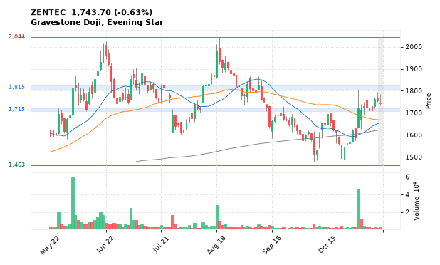

[🔔 Set alert on ZENTEC](https://claude.ai/artifact/Ewc5hHTPX6WkU1nVcDNQzq?s=ZENTEC&c=close%20below%201733.00) &nbsp;|&nbsp; [📈 Live chart (TradingView)](https://www.tradingview.com/chart/?symbol=NSE:ZENTEC) &nbsp;|&nbsp; [alert by email](mailto:?subject=ALERT%20ZENTEC&body=Alert%20me%20when%3A%20close%20below%201733.00%0A%0AEdit%20the%20line%20above%20if%20you%20want%2C%20then%20press%20Send.%20Checked%20on%20every%20day%27s%20closing%20data%3B%20a%20triggered%20alert%20appears%20at%20the%20top%20of%20the%208%20AM%20Technical%20Analysis%20email.%0A%0AExamples%20you%20can%20write%3A%0A%20%20close%20above%201150%20%20%7C%20%20close%20below%201080%20%20%7C%20%20high%20above%201200%20%20%7C%20%20low%20below%201050%0A%20%20close%20crosses%20above%20200%20DMA%20%20%7C%20%20close%20below%2050%20DMA%20%20%7C%20%20RSI%20below%2030%20%20%7C%20%20RSI%20above%2070%0A%20%20volume%20above%202x%20%20%7C%20%20change%20above%205%25%20%20%7C%20%20change%20below%20-4%25%20%20%7C%20%2052-week%20high%20%20%7C%20%20golden%20cross%0A%20%20combine%20with%20%27and%27%2C%20e.g.%20%20close%20above%201150%20and%20volume%20above%201.5x%0A%0AReference%3A%20ZENTEC%20closed%201743.70%20%28high%201784.20%2C%20low%201733.00%29.%0ATo%20cancel%20later%2C%20send%20an%20email%20with%20subject%3A%20CANCEL%20ALERT%20ZENTEC)

---

## 29. IOC - BEARISH
**144.04** (-1.46%) | vol 0.4x | RSI 64 | H 145.38 / L 143.24  
Close below 200 DMA, RSI down through 70, NR7 (narrowest range in 7)

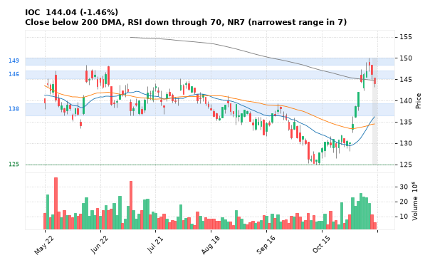

[🔔 Set alert on IOC](https://claude.ai/artifact/Ewc5hHTPX6WkU1nVcDNQzq?s=IOC&c=close%20below%20143.24) &nbsp;|&nbsp; [📈 Live chart (TradingView)](https://www.tradingview.com/chart/?symbol=NSE:IOC) &nbsp;|&nbsp; [alert by email](mailto:?subject=ALERT%20IOC&body=Alert%20me%20when%3A%20close%20below%20143.24%0A%0AEdit%20the%20line%20above%20if%20you%20want%2C%20then%20press%20Send.%20Checked%20on%20every%20day%27s%20closing%20data%3B%20a%20triggered%20alert%20appears%20at%20the%20top%20of%20the%208%20AM%20Technical%20Analysis%20email.%0A%0AExamples%20you%20can%20write%3A%0A%20%20close%20above%201150%20%20%7C%20%20close%20below%201080%20%20%7C%20%20high%20above%201200%20%20%7C%20%20low%20below%201050%0A%20%20close%20crosses%20above%20200%20DMA%20%20%7C%20%20close%20below%2050%20DMA%20%20%7C%20%20RSI%20below%2030%20%20%7C%20%20RSI%20above%2070%0A%20%20volume%20above%202x%20%20%7C%20%20change%20above%205%25%20%20%7C%20%20change%20below%20-4%25%20%20%7C%20%2052-week%20high%20%20%7C%20%20golden%20cross%0A%20%20combine%20with%20%27and%27%2C%20e.g.%20%20close%20above%201150%20and%20volume%20above%201.5x%0A%0AReference%3A%20IOC%20closed%20144.04%20%28high%20145.38%2C%20low%20143.24%29.%0ATo%20cancel%20later%2C%20send%20an%20email%20with%20subject%3A%20CANCEL%20ALERT%20IOC)

---

## 30. BSOFT - BEARISH
**324.65** (-0.96%) | vol 0.2x | RSI 56 | H 333.00 / L 322.40  
Bearish Engulfing, MACD bearish cross

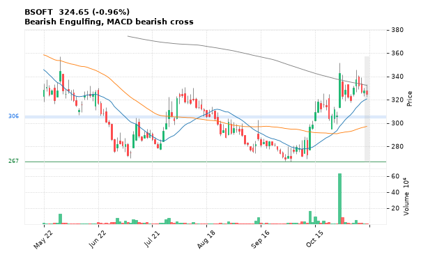

[🔔 Set alert on BSOFT](https://claude.ai/artifact/Ewc5hHTPX6WkU1nVcDNQzq?s=BSOFT&c=close%20below%20322.40) &nbsp;|&nbsp; [📈 Live chart (TradingView)](https://www.tradingview.com/chart/?symbol=NSE:BSOFT) &nbsp;|&nbsp; [alert by email](mailto:?subject=ALERT%20BSOFT&body=Alert%20me%20when%3A%20close%20below%20322.40%0A%0AEdit%20the%20line%20above%20if%20you%20want%2C%20then%20press%20Send.%20Checked%20on%20every%20day%27s%20closing%20data%3B%20a%20triggered%20alert%20appears%20at%20the%20top%20of%20the%208%20AM%20Technical%20Analysis%20email.%0A%0AExamples%20you%20can%20write%3A%0A%20%20close%20above%201150%20%20%7C%20%20close%20below%201080%20%20%7C%20%20high%20above%201200%20%20%7C%20%20low%20below%201050%0A%20%20close%20crosses%20above%20200%20DMA%20%20%7C%20%20close%20below%2050%20DMA%20%20%7C%20%20RSI%20below%2030%20%20%7C%20%20RSI%20above%2070%0A%20%20volume%20above%202x%20%20%7C%20%20change%20above%205%25%20%20%7C%20%20change%20below%20-4%25%20%20%7C%20%2052-week%20high%20%20%7C%20%20golden%20cross%0A%20%20combine%20with%20%27and%27%2C%20e.g.%20%20close%20above%201150%20and%20volume%20above%201.5x%0A%0AReference%3A%20BSOFT%20closed%20324.65%20%28high%20333.00%2C%20low%20322.40%29.%0ATo%20cancel%20later%2C%20send%20an%20email%20with%20subject%3A%20CANCEL%20ALERT%20BSOFT)

---

## 31. AADHARHFC - LEVEL TEST
**432.50** (-0.45%) | vol 0.6x | RSI 46 | H 436.15 / L 427.05  
Level test

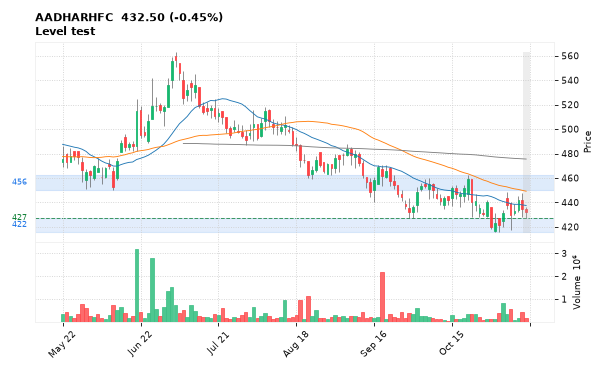

[🔔 Set alert on AADHARHFC](https://claude.ai/artifact/Ewc5hHTPX6WkU1nVcDNQzq?s=AADHARHFC&c=close%20below%20427.05) &nbsp;|&nbsp; [📈 Live chart (TradingView)](https://www.tradingview.com/chart/?symbol=NSE:AADHARHFC) &nbsp;|&nbsp; [alert by email](mailto:?subject=ALERT%20AADHARHFC&body=Alert%20me%20when%3A%20close%20above%20436.15%0A%0AEdit%20the%20line%20above%20if%20you%20want%2C%20then%20press%20Send.%20Checked%20on%20every%20day%27s%20closing%20data%3B%20a%20triggered%20alert%20appears%20at%20the%20top%20of%20the%208%20AM%20Technical%20Analysis%20email.%0A%0AExamples%20you%20can%20write%3A%0A%20%20close%20above%201150%20%20%7C%20%20close%20below%201080%20%20%7C%20%20high%20above%201200%20%20%7C%20%20low%20below%201050%0A%20%20close%20crosses%20above%20200%20DMA%20%20%7C%20%20close%20below%2050%20DMA%20%20%7C%20%20RSI%20below%2030%20%20%7C%20%20RSI%20above%2070%0A%20%20volume%20above%202x%20%20%7C%20%20change%20above%205%25%20%20%7C%20%20change%20below%20-4%25%20%20%7C%20%2052-week%20high%20%20%7C%20%20golden%20cross%0A%20%20combine%20with%20%27and%27%2C%20e.g.%20%20close%20above%201150%20and%20volume%20above%201.5x%0A%0AReference%3A%20AADHARHFC%20closed%20432.50%20%28high%20436.15%2C%20low%20427.05%29.%0ATo%20cancel%20later%2C%20send%20an%20email%20with%20subject%3A%20CANCEL%20ALERT%20AADHARHFC)

---

## 32. AARTIIND - LEVEL TEST
**481.95** (-0.40%) | vol 0.6x | RSI 58 | H 492.80 / L 478.80  
Level test

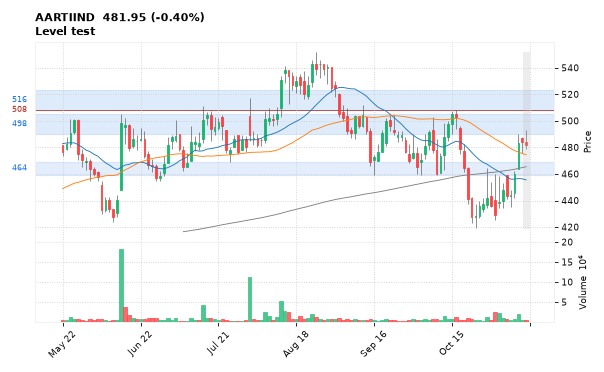

[🔔 Set alert on AARTIIND](https://claude.ai/artifact/Ewc5hHTPX6WkU1nVcDNQzq?s=AARTIIND&c=close%20below%20478.80) &nbsp;|&nbsp; [📈 Live chart (TradingView)](https://www.tradingview.com/chart/?symbol=NSE:AARTIIND) &nbsp;|&nbsp; [alert by email](mailto:?subject=ALERT%20AARTIIND&body=Alert%20me%20when%3A%20close%20above%20492.80%0A%0AEdit%20the%20line%20above%20if%20you%20want%2C%20then%20press%20Send.%20Checked%20on%20every%20day%27s%20closing%20data%3B%20a%20triggered%20alert%20appears%20at%20the%20top%20of%20the%208%20AM%20Technical%20Analysis%20email.%0A%0AExamples%20you%20can%20write%3A%0A%20%20close%20above%201150%20%20%7C%20%20close%20below%201080%20%20%7C%20%20high%20above%201200%20%20%7C%20%20low%20below%201050%0A%20%20close%20crosses%20above%20200%20DMA%20%20%7C%20%20close%20below%2050%20DMA%20%20%7C%20%20RSI%20below%2030%20%20%7C%20%20RSI%20above%2070%0A%20%20volume%20above%202x%20%20%7C%20%20change%20above%205%25%20%20%7C%20%20change%20below%20-4%25%20%20%7C%20%2052-week%20high%20%20%7C%20%20golden%20cross%0A%20%20combine%20with%20%27and%27%2C%20e.g.%20%20close%20above%201150%20and%20volume%20above%201.5x%0A%0AReference%3A%20AARTIIND%20closed%20481.95%20%28high%20492.80%2C%20low%20478.80%29.%0ATo%20cancel%20later%2C%20send%20an%20email%20with%20subject%3A%20CANCEL%20ALERT%20AARTIIND)

---

## 33. ATGL - LEVEL TEST
**575.40** (-0.86%) | vol 0.6x | RSI 52 | H 581.00 / L 573.05  
Level test

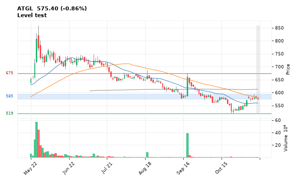

[🔔 Set alert on ATGL](https://claude.ai/artifact/Ewc5hHTPX6WkU1nVcDNQzq?s=ATGL&c=close%20below%20573.05) &nbsp;|&nbsp; [📈 Live chart (TradingView)](https://www.tradingview.com/chart/?symbol=NSE:ATGL) &nbsp;|&nbsp; [alert by email](mailto:?subject=ALERT%20ATGL&body=Alert%20me%20when%3A%20close%20above%20581.00%0A%0AEdit%20the%20line%20above%20if%20you%20want%2C%20then%20press%20Send.%20Checked%20on%20every%20day%27s%20closing%20data%3B%20a%20triggered%20alert%20appears%20at%20the%20top%20of%20the%208%20AM%20Technical%20Analysis%20email.%0A%0AExamples%20you%20can%20write%3A%0A%20%20close%20above%201150%20%20%7C%20%20close%20below%201080%20%20%7C%20%20high%20above%201200%20%20%7C%20%20low%20below%201050%0A%20%20close%20crosses%20above%20200%20DMA%20%20%7C%20%20close%20below%2050%20DMA%20%20%7C%20%20RSI%20below%2030%20%20%7C%20%20RSI%20above%2070%0A%20%20volume%20above%202x%20%20%7C%20%20change%20above%205%25%20%20%7C%20%20change%20below%20-4%25%20%20%7C%20%2052-week%20high%20%20%7C%20%20golden%20cross%0A%20%20combine%20with%20%27and%27%2C%20e.g.%20%20close%20above%201150%20and%20volume%20above%201.5x%0A%0AReference%3A%20ATGL%20closed%20575.40%20%28high%20581.00%2C%20low%20573.05%29.%0ATo%20cancel%20later%2C%20send%20an%20email%20with%20subject%3A%20CANCEL%20ALERT%20ATGL)

---

## 34. ABCAPITAL - LEVEL TEST
**408.00** (-2.74%) | vol 1.2x | RSI 62 | H 416.05 / L 407.05  
Level test

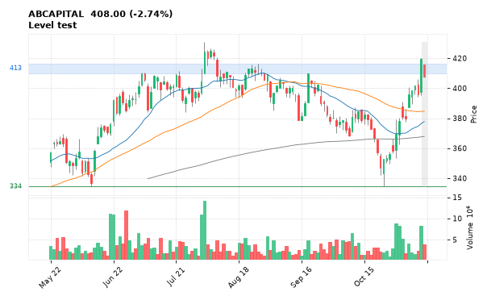

[🔔 Set alert on ABCAPITAL](https://claude.ai/artifact/Ewc5hHTPX6WkU1nVcDNQzq?s=ABCAPITAL&c=close%20below%20407.05) &nbsp;|&nbsp; [📈 Live chart (TradingView)](https://www.tradingview.com/chart/?symbol=NSE:ABCAPITAL) &nbsp;|&nbsp; [alert by email](mailto:?subject=ALERT%20ABCAPITAL&body=Alert%20me%20when%3A%20close%20above%20416.05%0A%0AEdit%20the%20line%20above%20if%20you%20want%2C%20then%20press%20Send.%20Checked%20on%20every%20day%27s%20closing%20data%3B%20a%20triggered%20alert%20appears%20at%20the%20top%20of%20the%208%20AM%20Technical%20Analysis%20email.%0A%0AExamples%20you%20can%20write%3A%0A%20%20close%20above%201150%20%20%7C%20%20close%20below%201080%20%20%7C%20%20high%20above%201200%20%20%7C%20%20low%20below%201050%0A%20%20close%20crosses%20above%20200%20DMA%20%20%7C%20%20close%20below%2050%20DMA%20%20%7C%20%20RSI%20below%2030%20%20%7C%20%20RSI%20above%2070%0A%20%20volume%20above%202x%20%20%7C%20%20change%20above%205%25%20%20%7C%20%20change%20below%20-4%25%20%20%7C%20%2052-week%20high%20%20%7C%20%20golden%20cross%0A%20%20combine%20with%20%27and%27%2C%20e.g.%20%20close%20above%201150%20and%20volume%20above%201.5x%0A%0AReference%3A%20ABCAPITAL%20closed%20408.00%20%28high%20416.05%2C%20low%20407.05%29.%0ATo%20cancel%20later%2C%20send%20an%20email%20with%20subject%3A%20CANCEL%20ALERT%20ABCAPITAL)

---

## 35. AEGISLOG - LEVEL TEST
**1,224.40** (-1.26%) | vol 0.4x | RSI 47 | H 1,258.90 / L 1,215.10  
Level test

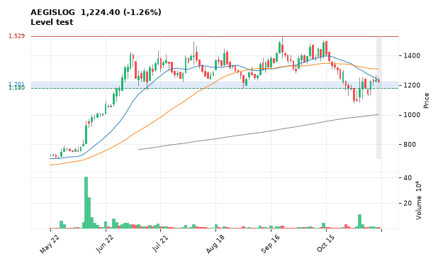

[🔔 Set alert on AEGISLOG](https://claude.ai/artifact/Ewc5hHTPX6WkU1nVcDNQzq?s=AEGISLOG&c=close%20below%201215.10) &nbsp;|&nbsp; [📈 Live chart (TradingView)](https://www.tradingview.com/chart/?symbol=NSE:AEGISLOG) &nbsp;|&nbsp; [alert by email](mailto:?subject=ALERT%20AEGISLOG&body=Alert%20me%20when%3A%20close%20above%201258.90%0A%0AEdit%20the%20line%20above%20if%20you%20want%2C%20then%20press%20Send.%20Checked%20on%20every%20day%27s%20closing%20data%3B%20a%20triggered%20alert%20appears%20at%20the%20top%20of%20the%208%20AM%20Technical%20Analysis%20email.%0A%0AExamples%20you%20can%20write%3A%0A%20%20close%20above%201150%20%20%7C%20%20close%20below%201080%20%20%7C%20%20high%20above%201200%20%20%7C%20%20low%20below%201050%0A%20%20close%20crosses%20above%20200%20DMA%20%20%7C%20%20close%20below%2050%20DMA%20%20%7C%20%20RSI%20below%2030%20%20%7C%20%20RSI%20above%2070%0A%20%20volume%20above%202x%20%20%7C%20%20change%20above%205%25%20%20%7C%20%20change%20below%20-4%25%20%20%7C%20%2052-week%20high%20%20%7C%20%20golden%20cross%0A%20%20combine%20with%20%27and%27%2C%20e.g.%20%20close%20above%201150%20and%20volume%20above%201.5x%0A%0AReference%3A%20AEGISLOG%20closed%201224.40%20%28high%201258.90%2C%20low%201215.10%29.%0ATo%20cancel%20later%2C%20send%20an%20email%20with%20subject%3A%20CANCEL%20ALERT%20AEGISLOG)

---

## 36. AJANTPHARM - LEVEL TEST
**3,284.00** (-1.20%) | vol 1.1x | RSI 41 | H 3,342.30 / L 3,265.00  
Level test

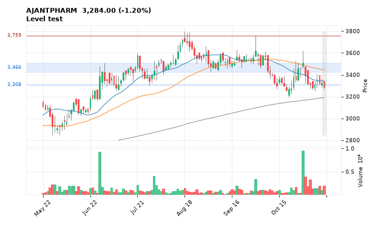

[🔔 Set alert on AJANTPHARM](https://claude.ai/artifact/Ewc5hHTPX6WkU1nVcDNQzq?s=AJANTPHARM&c=close%20below%203265.00) &nbsp;|&nbsp; [📈 Live chart (TradingView)](https://www.tradingview.com/chart/?symbol=NSE:AJANTPHARM) &nbsp;|&nbsp; [alert by email](mailto:?subject=ALERT%20AJANTPHARM&body=Alert%20me%20when%3A%20close%20above%203342.30%0A%0AEdit%20the%20line%20above%20if%20you%20want%2C%20then%20press%20Send.%20Checked%20on%20every%20day%27s%20closing%20data%3B%20a%20triggered%20alert%20appears%20at%20the%20top%20of%20the%208%20AM%20Technical%20Analysis%20email.%0A%0AExamples%20you%20can%20write%3A%0A%20%20close%20above%201150%20%20%7C%20%20close%20below%201080%20%20%7C%20%20high%20above%201200%20%20%7C%20%20low%20below%201050%0A%20%20close%20crosses%20above%20200%20DMA%20%20%7C%20%20close%20below%2050%20DMA%20%20%7C%20%20RSI%20below%2030%20%20%7C%20%20RSI%20above%2070%0A%20%20volume%20above%202x%20%20%7C%20%20change%20above%205%25%20%20%7C%20%20change%20below%20-4%25%20%20%7C%20%2052-week%20high%20%20%7C%20%20golden%20cross%0A%20%20combine%20with%20%27and%27%2C%20e.g.%20%20close%20above%201150%20and%20volume%20above%201.5x%0A%0AReference%3A%20AJANTPHARM%20closed%203284.00%20%28high%203342.30%2C%20low%203265.00%29.%0ATo%20cancel%20later%2C%20send%20an%20email%20with%20subject%3A%20CANCEL%20ALERT%20AJANTPHARM)

---

## 37. ABDL - LEVEL TEST
**757.70** (-0.04%) | vol 1.3x | RSI 66 | H 764.00 / L 748.80  
Level test

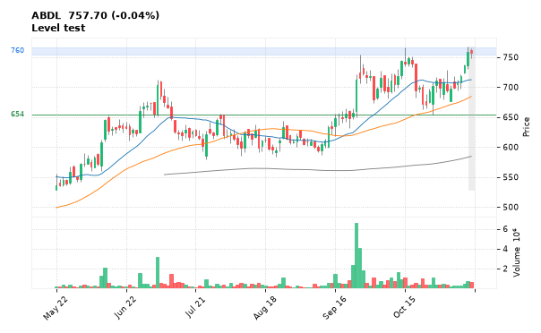

[🔔 Set alert on ABDL](https://claude.ai/artifact/Ewc5hHTPX6WkU1nVcDNQzq?s=ABDL&c=close%20below%20748.80) &nbsp;|&nbsp; [📈 Live chart (TradingView)](https://www.tradingview.com/chart/?symbol=NSE:ABDL) &nbsp;|&nbsp; [alert by email](mailto:?subject=ALERT%20ABDL&body=Alert%20me%20when%3A%20close%20above%20764.00%0A%0AEdit%20the%20line%20above%20if%20you%20want%2C%20then%20press%20Send.%20Checked%20on%20every%20day%27s%20closing%20data%3B%20a%20triggered%20alert%20appears%20at%20the%20top%20of%20the%208%20AM%20Technical%20Analysis%20email.%0A%0AExamples%20you%20can%20write%3A%0A%20%20close%20above%201150%20%20%7C%20%20close%20below%201080%20%20%7C%20%20high%20above%201200%20%20%7C%20%20low%20below%201050%0A%20%20close%20crosses%20above%20200%20DMA%20%20%7C%20%20close%20below%2050%20DMA%20%20%7C%20%20RSI%20below%2030%20%20%7C%20%20RSI%20above%2070%0A%20%20volume%20above%202x%20%20%7C%20%20change%20above%205%25%20%20%7C%20%20change%20below%20-4%25%20%20%7C%20%2052-week%20high%20%20%7C%20%20golden%20cross%0A%20%20combine%20with%20%27and%27%2C%20e.g.%20%20close%20above%201150%20and%20volume%20above%201.5x%0A%0AReference%3A%20ABDL%20closed%20757.70%20%28high%20764.00%2C%20low%20748.80%29.%0ATo%20cancel%20later%2C%20send%20an%20email%20with%20subject%3A%20CANCEL%20ALERT%20ABDL)

---

## 38. ANGELONE - LEVEL TEST
**349.00** (+2.35%) | vol 2.0x | RSI 73 | H 353.15 / L 337.05  
Level test

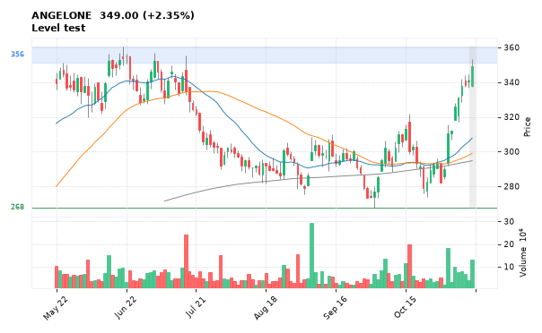

[🔔 Set alert on ANGELONE](https://claude.ai/artifact/Ewc5hHTPX6WkU1nVcDNQzq?s=ANGELONE&c=close%20below%20337.05) &nbsp;|&nbsp; [📈 Live chart (TradingView)](https://www.tradingview.com/chart/?symbol=NSE:ANGELONE) &nbsp;|&nbsp; [alert by email](mailto:?subject=ALERT%20ANGELONE&body=Alert%20me%20when%3A%20close%20above%20353.15%0A%0AEdit%20the%20line%20above%20if%20you%20want%2C%20then%20press%20Send.%20Checked%20on%20every%20day%27s%20closing%20data%3B%20a%20triggered%20alert%20appears%20at%20the%20top%20of%20the%208%20AM%20Technical%20Analysis%20email.%0A%0AExamples%20you%20can%20write%3A%0A%20%20close%20above%201150%20%20%7C%20%20close%20below%201080%20%20%7C%20%20high%20above%201200%20%20%7C%20%20low%20below%201050%0A%20%20close%20crosses%20above%20200%20DMA%20%20%7C%20%20close%20below%2050%20DMA%20%20%7C%20%20RSI%20below%2030%20%20%7C%20%20RSI%20above%2070%0A%20%20volume%20above%202x%20%20%7C%20%20change%20above%205%25%20%20%7C%20%20change%20below%20-4%25%20%20%7C%20%2052-week%20high%20%20%7C%20%20golden%20cross%0A%20%20combine%20with%20%27and%27%2C%20e.g.%20%20close%20above%201150%20and%20volume%20above%201.5x%0A%0AReference%3A%20ANGELONE%20closed%20349.00%20%28high%20353.15%2C%20low%20337.05%29.%0ATo%20cancel%20later%2C%20send%20an%20email%20with%20subject%3A%20CANCEL%20ALERT%20ANGELONE)

---

## 39. APOLLOHOSP - LEVEL TEST
**8,526.00** (+0.13%) | vol 1.1x | RSI 58 | H 8,640.00 / L 8,490.00  
Level test

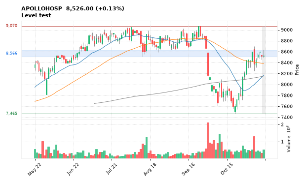

[🔔 Set alert on APOLLOHOSP](https://claude.ai/artifact/Ewc5hHTPX6WkU1nVcDNQzq?s=APOLLOHOSP&c=close%20below%208490.00) &nbsp;|&nbsp; [📈 Live chart (TradingView)](https://www.tradingview.com/chart/?symbol=NSE:APOLLOHOSP) &nbsp;|&nbsp; [alert by email](mailto:?subject=ALERT%20APOLLOHOSP&body=Alert%20me%20when%3A%20close%20above%208640.00%0A%0AEdit%20the%20line%20above%20if%20you%20want%2C%20then%20press%20Send.%20Checked%20on%20every%20day%27s%20closing%20data%3B%20a%20triggered%20alert%20appears%20at%20the%20top%20of%20the%208%20AM%20Technical%20Analysis%20email.%0A%0AExamples%20you%20can%20write%3A%0A%20%20close%20above%201150%20%20%7C%20%20close%20below%201080%20%20%7C%20%20high%20above%201200%20%20%7C%20%20low%20below%201050%0A%20%20close%20crosses%20above%20200%20DMA%20%20%7C%20%20close%20below%2050%20DMA%20%20%7C%20%20RSI%20below%2030%20%20%7C%20%20RSI%20above%2070%0A%20%20volume%20above%202x%20%20%7C%20%20change%20above%205%25%20%20%7C%20%20change%20below%20-4%25%20%20%7C%20%2052-week%20high%20%20%7C%20%20golden%20cross%0A%20%20combine%20with%20%27and%27%2C%20e.g.%20%20close%20above%201150%20and%20volume%20above%201.5x%0A%0AReference%3A%20APOLLOHOSP%20closed%208526.00%20%28high%208640.00%2C%20low%208490.00%29.%0ATo%20cancel%20later%2C%20send%20an%20email%20with%20subject%3A%20CANCEL%20ALERT%20APOLLOHOSP)

---

## 40. ASIANPAINT - LEVEL TEST
**2,550.00** (+0.53%) | vol 0.6x | RSI 65 | H 2,580.00 / L 2,495.20  
Level test

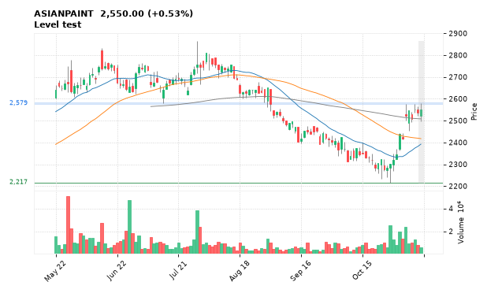

[🔔 Set alert on ASIANPAINT](https://claude.ai/artifact/Ewc5hHTPX6WkU1nVcDNQzq?s=ASIANPAINT&c=close%20below%202495.20) &nbsp;|&nbsp; [📈 Live chart (TradingView)](https://www.tradingview.com/chart/?symbol=NSE:ASIANPAINT) &nbsp;|&nbsp; [alert by email](mailto:?subject=ALERT%20ASIANPAINT&body=Alert%20me%20when%3A%20close%20above%202580.00%0A%0AEdit%20the%20line%20above%20if%20you%20want%2C%20then%20press%20Send.%20Checked%20on%20every%20day%27s%20closing%20data%3B%20a%20triggered%20alert%20appears%20at%20the%20top%20of%20the%208%20AM%20Technical%20Analysis%20email.%0A%0AExamples%20you%20can%20write%3A%0A%20%20close%20above%201150%20%20%7C%20%20close%20below%201080%20%20%7C%20%20high%20above%201200%20%20%7C%20%20low%20below%201050%0A%20%20close%20crosses%20above%20200%20DMA%20%20%7C%20%20close%20below%2050%20DMA%20%20%7C%20%20RSI%20below%2030%20%20%7C%20%20RSI%20above%2070%0A%20%20volume%20above%202x%20%20%7C%20%20change%20above%205%25%20%20%7C%20%20change%20below%20-4%25%20%20%7C%20%2052-week%20high%20%20%7C%20%20golden%20cross%0A%20%20combine%20with%20%27and%27%2C%20e.g.%20%20close%20above%201150%20and%20volume%20above%201.5x%0A%0AReference%3A%20ASIANPAINT%20closed%202550.00%20%28high%202580.00%2C%20low%202495.20%29.%0ATo%20cancel%20later%2C%20send%20an%20email%20with%20subject%3A%20CANCEL%20ALERT%20ASIANPAINT)

---

## 41. AIIL - LEVEL TEST
**576.75** (-1.69%) | vol 0.3x | RSI 60 | H 591.00 / L 572.00  
Level test

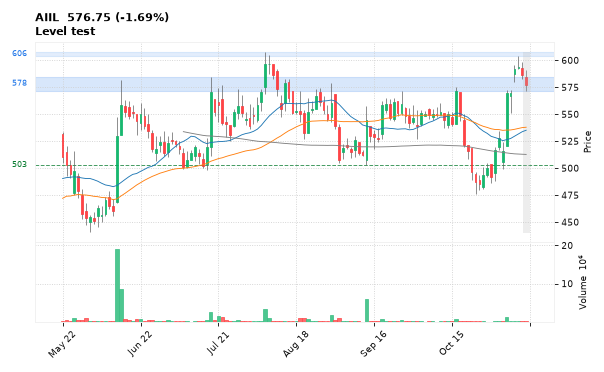

[🔔 Set alert on AIIL](https://claude.ai/artifact/Ewc5hHTPX6WkU1nVcDNQzq?s=AIIL&c=close%20below%20572.00) &nbsp;|&nbsp; [📈 Live chart (TradingView)](https://www.tradingview.com/chart/?symbol=NSE:AIIL) &nbsp;|&nbsp; [alert by email](mailto:?subject=ALERT%20AIIL&body=Alert%20me%20when%3A%20close%20above%20591.00%0A%0AEdit%20the%20line%20above%20if%20you%20want%2C%20then%20press%20Send.%20Checked%20on%20every%20day%27s%20closing%20data%3B%20a%20triggered%20alert%20appears%20at%20the%20top%20of%20the%208%20AM%20Technical%20Analysis%20email.%0A%0AExamples%20you%20can%20write%3A%0A%20%20close%20above%201150%20%20%7C%20%20close%20below%201080%20%20%7C%20%20high%20above%201200%20%20%7C%20%20low%20below%201050%0A%20%20close%20crosses%20above%20200%20DMA%20%20%7C%20%20close%20below%2050%20DMA%20%20%7C%20%20RSI%20below%2030%20%20%7C%20%20RSI%20above%2070%0A%20%20volume%20above%202x%20%20%7C%20%20change%20above%205%25%20%20%7C%20%20change%20below%20-4%25%20%20%7C%20%2052-week%20high%20%20%7C%20%20golden%20cross%0A%20%20combine%20with%20%27and%27%2C%20e.g.%20%20close%20above%201150%20and%20volume%20above%201.5x%0A%0AReference%3A%20AIIL%20closed%20576.75%20%28high%20591.00%2C%20low%20572.00%29.%0ATo%20cancel%20later%2C%20send%20an%20email%20with%20subject%3A%20CANCEL%20ALERT%20AIIL)

---

## 42. BLS - LEVEL TEST
**229.49** (+1.01%) | vol 0.4x | RSI 57 | H 230.49 / L 224.20  
Level test

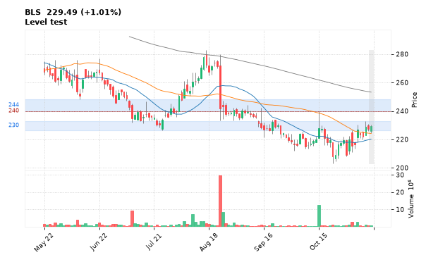

[🔔 Set alert on BLS](https://claude.ai/artifact/Ewc5hHTPX6WkU1nVcDNQzq?s=BLS&c=close%20below%20224.20) &nbsp;|&nbsp; [📈 Live chart (TradingView)](https://www.tradingview.com/chart/?symbol=NSE:BLS) &nbsp;|&nbsp; [alert by email](mailto:?subject=ALERT%20BLS&body=Alert%20me%20when%3A%20close%20above%20230.49%0A%0AEdit%20the%20line%20above%20if%20you%20want%2C%20then%20press%20Send.%20Checked%20on%20every%20day%27s%20closing%20data%3B%20a%20triggered%20alert%20appears%20at%20the%20top%20of%20the%208%20AM%20Technical%20Analysis%20email.%0A%0AExamples%20you%20can%20write%3A%0A%20%20close%20above%201150%20%20%7C%20%20close%20below%201080%20%20%7C%20%20high%20above%201200%20%20%7C%20%20low%20below%201050%0A%20%20close%20crosses%20above%20200%20DMA%20%20%7C%20%20close%20below%2050%20DMA%20%20%7C%20%20RSI%20below%2030%20%20%7C%20%20RSI%20above%2070%0A%20%20volume%20above%202x%20%20%7C%20%20change%20above%205%25%20%20%7C%20%20change%20below%20-4%25%20%20%7C%20%2052-week%20high%20%20%7C%20%20golden%20cross%0A%20%20combine%20with%20%27and%27%2C%20e.g.%20%20close%20above%201150%20and%20volume%20above%201.5x%0A%0AReference%3A%20BLS%20closed%20229.49%20%28high%20230.49%2C%20low%20224.20%29.%0ATo%20cancel%20later%2C%20send%20an%20email%20with%20subject%3A%20CANCEL%20ALERT%20BLS)

---

## 43. BAJAJ-AUTO - LEVEL TEST
**10,850.00** (-0.87%) | vol 0.7x | RSI 57 | H 10,950.00 / L 10,791.00  
Level test

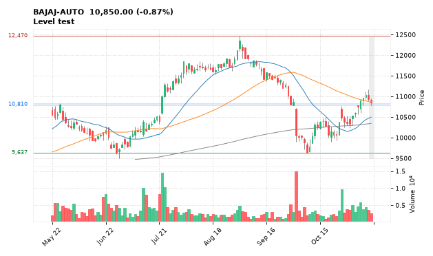

[🔔 Set alert on BAJAJ-AUTO](https://claude.ai/artifact/Ewc5hHTPX6WkU1nVcDNQzq?s=BAJAJ-AUTO&c=close%20below%2010791.00) &nbsp;|&nbsp; [📈 Live chart (TradingView)](https://www.tradingview.com/chart/?symbol=NSE:BAJAJ-AUTO) &nbsp;|&nbsp; [alert by email](mailto:?subject=ALERT%20BAJAJ-AUTO&body=Alert%20me%20when%3A%20close%20above%2010950.00%0A%0AEdit%20the%20line%20above%20if%20you%20want%2C%20then%20press%20Send.%20Checked%20on%20every%20day%27s%20closing%20data%3B%20a%20triggered%20alert%20appears%20at%20the%20top%20of%20the%208%20AM%20Technical%20Analysis%20email.%0A%0AExamples%20you%20can%20write%3A%0A%20%20close%20above%201150%20%20%7C%20%20close%20below%201080%20%20%7C%20%20high%20above%201200%20%20%7C%20%20low%20below%201050%0A%20%20close%20crosses%20above%20200%20DMA%20%20%7C%20%20close%20below%2050%20DMA%20%20%7C%20%20RSI%20below%2030%20%20%7C%20%20RSI%20above%2070%0A%20%20volume%20above%202x%20%20%7C%20%20change%20above%205%25%20%20%7C%20%20change%20below%20-4%25%20%20%7C%20%2052-week%20high%20%20%7C%20%20golden%20cross%0A%20%20combine%20with%20%27and%27%2C%20e.g.%20%20close%20above%201150%20and%20volume%20above%201.5x%0A%0AReference%3A%20BAJAJ-AUTO%20closed%2010850.00%20%28high%2010950.00%2C%20low%2010791.00%29.%0ATo%20cancel%20later%2C%20send%20an%20email%20with%20subject%3A%20CANCEL%20ALERT%20BAJAJ-AUTO)

---

## 44. BAJAJHLDNG - LEVEL TEST
**11,096.00** (-1.50%) | vol 0.3x | RSI 55 | H 11,295.00 / L 11,050.00  
Level test

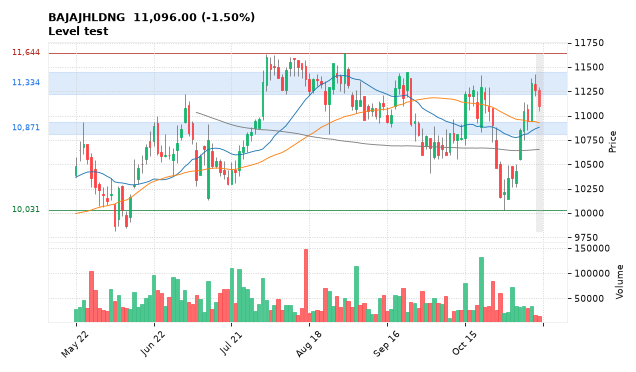

[🔔 Set alert on BAJAJHLDNG](https://claude.ai/artifact/Ewc5hHTPX6WkU1nVcDNQzq?s=BAJAJHLDNG&c=close%20below%2011050.00) &nbsp;|&nbsp; [📈 Live chart (TradingView)](https://www.tradingview.com/chart/?symbol=NSE:BAJAJHLDNG) &nbsp;|&nbsp; [alert by email](mailto:?subject=ALERT%20BAJAJHLDNG&body=Alert%20me%20when%3A%20close%20above%2011295.00%0A%0AEdit%20the%20line%20above%20if%20you%20want%2C%20then%20press%20Send.%20Checked%20on%20every%20day%27s%20closing%20data%3B%20a%20triggered%20alert%20appears%20at%20the%20top%20of%20the%208%20AM%20Technical%20Analysis%20email.%0A%0AExamples%20you%20can%20write%3A%0A%20%20close%20above%201150%20%20%7C%20%20close%20below%201080%20%20%7C%20%20high%20above%201200%20%20%7C%20%20low%20below%201050%0A%20%20close%20crosses%20above%20200%20DMA%20%20%7C%20%20close%20below%2050%20DMA%20%20%7C%20%20RSI%20below%2030%20%20%7C%20%20RSI%20above%2070%0A%20%20volume%20above%202x%20%20%7C%20%20change%20above%205%25%20%20%7C%20%20change%20below%20-4%25%20%20%7C%20%2052-week%20high%20%20%7C%20%20golden%20cross%0A%20%20combine%20with%20%27and%27%2C%20e.g.%20%20close%20above%201150%20and%20volume%20above%201.5x%0A%0AReference%3A%20BAJAJHLDNG%20closed%2011096.00%20%28high%2011295.00%2C%20low%2011050.00%29.%0ATo%20cancel%20later%2C%20send%20an%20email%20with%20subject%3A%20CANCEL%20ALERT%20BAJAJHLDNG)

---

## 45. BAJAJHFL - LEVEL TEST
**81.46** (-1.26%) | vol 0.4x | RSI 51 | H 82.50 / L 81.33  
Level test

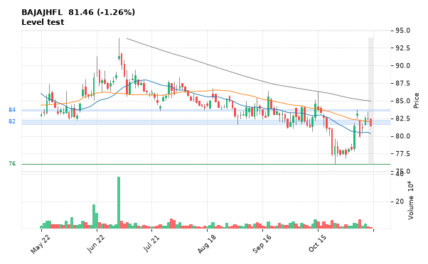

[🔔 Set alert on BAJAJHFL](https://claude.ai/artifact/Ewc5hHTPX6WkU1nVcDNQzq?s=BAJAJHFL&c=close%20below%2081.33) &nbsp;|&nbsp; [📈 Live chart (TradingView)](https://www.tradingview.com/chart/?symbol=NSE:BAJAJHFL) &nbsp;|&nbsp; [alert by email](mailto:?subject=ALERT%20BAJAJHFL&body=Alert%20me%20when%3A%20close%20above%2082.50%0A%0AEdit%20the%20line%20above%20if%20you%20want%2C%20then%20press%20Send.%20Checked%20on%20every%20day%27s%20closing%20data%3B%20a%20triggered%20alert%20appears%20at%20the%20top%20of%20the%208%20AM%20Technical%20Analysis%20email.%0A%0AExamples%20you%20can%20write%3A%0A%20%20close%20above%201150%20%20%7C%20%20close%20below%201080%20%20%7C%20%20high%20above%201200%20%20%7C%20%20low%20below%201050%0A%20%20close%20crosses%20above%20200%20DMA%20%20%7C%20%20close%20below%2050%20DMA%20%20%7C%20%20RSI%20below%2030%20%20%7C%20%20RSI%20above%2070%0A%20%20volume%20above%202x%20%20%7C%20%20change%20above%205%25%20%20%7C%20%20change%20below%20-4%25%20%20%7C%20%2052-week%20high%20%20%7C%20%20golden%20cross%0A%20%20combine%20with%20%27and%27%2C%20e.g.%20%20close%20above%201150%20and%20volume%20above%201.5x%0A%0AReference%3A%20BAJAJHFL%20closed%2081.46%20%28high%2082.50%2C%20low%2081.33%29.%0ATo%20cancel%20later%2C%20send%20an%20email%20with%20subject%3A%20CANCEL%20ALERT%20BAJAJHFL)

---

## 46. BALKRISIND - LEVEL TEST
**2,271.40** (-1.10%) | vol 0.4x | RSI 58 | H 2,302.30 / L 2,251.20  
Level test

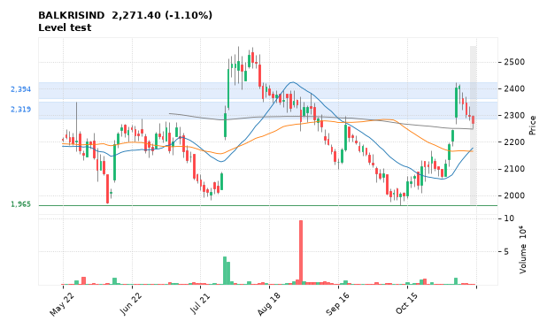

[🔔 Set alert on BALKRISIND](https://claude.ai/artifact/Ewc5hHTPX6WkU1nVcDNQzq?s=BALKRISIND&c=close%20below%202251.20) &nbsp;|&nbsp; [📈 Live chart (TradingView)](https://www.tradingview.com/chart/?symbol=NSE:BALKRISIND) &nbsp;|&nbsp; [alert by email](mailto:?subject=ALERT%20BALKRISIND&body=Alert%20me%20when%3A%20close%20above%202302.30%0A%0AEdit%20the%20line%20above%20if%20you%20want%2C%20then%20press%20Send.%20Checked%20on%20every%20day%27s%20closing%20data%3B%20a%20triggered%20alert%20appears%20at%20the%20top%20of%20the%208%20AM%20Technical%20Analysis%20email.%0A%0AExamples%20you%20can%20write%3A%0A%20%20close%20above%201150%20%20%7C%20%20close%20below%201080%20%20%7C%20%20high%20above%201200%20%20%7C%20%20low%20below%201050%0A%20%20close%20crosses%20above%20200%20DMA%20%20%7C%20%20close%20below%2050%20DMA%20%20%7C%20%20RSI%20below%2030%20%20%7C%20%20RSI%20above%2070%0A%20%20volume%20above%202x%20%20%7C%20%20change%20above%205%25%20%20%7C%20%20change%20below%20-4%25%20%20%7C%20%2052-week%20high%20%20%7C%20%20golden%20cross%0A%20%20combine%20with%20%27and%27%2C%20e.g.%20%20close%20above%201150%20and%20volume%20above%201.5x%0A%0AReference%3A%20BALKRISIND%20closed%202271.40%20%28high%202302.30%2C%20low%202251.20%29.%0ATo%20cancel%20later%2C%20send%20an%20email%20with%20subject%3A%20CANCEL%20ALERT%20BALKRISIND)

---

## 47. BANKINDIA - LEVEL TEST
**154.10** (+1.78%) | vol 1.9x | RSI 72 | H 155.25 / L 149.32  
Level test

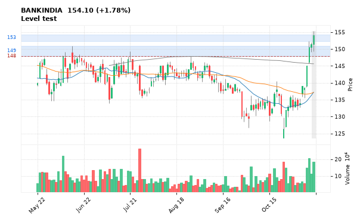

[🔔 Set alert on BANKINDIA](https://claude.ai/artifact/Ewc5hHTPX6WkU1nVcDNQzq?s=BANKINDIA&c=close%20below%20149.32) &nbsp;|&nbsp; [📈 Live chart (TradingView)](https://www.tradingview.com/chart/?symbol=NSE:BANKINDIA) &nbsp;|&nbsp; [alert by email](mailto:?subject=ALERT%20BANKINDIA&body=Alert%20me%20when%3A%20close%20above%20155.25%0A%0AEdit%20the%20line%20above%20if%20you%20want%2C%20then%20press%20Send.%20Checked%20on%20every%20day%27s%20closing%20data%3B%20a%20triggered%20alert%20appears%20at%20the%20top%20of%20the%208%20AM%20Technical%20Analysis%20email.%0A%0AExamples%20you%20can%20write%3A%0A%20%20close%20above%201150%20%20%7C%20%20close%20below%201080%20%20%7C%20%20high%20above%201200%20%20%7C%20%20low%20below%201050%0A%20%20close%20crosses%20above%20200%20DMA%20%20%7C%20%20close%20below%2050%20DMA%20%20%7C%20%20RSI%20below%2030%20%20%7C%20%20RSI%20above%2070%0A%20%20volume%20above%202x%20%20%7C%20%20change%20above%205%25%20%20%7C%20%20change%20below%20-4%25%20%20%7C%20%2052-week%20high%20%20%7C%20%20golden%20cross%0A%20%20combine%20with%20%27and%27%2C%20e.g.%20%20close%20above%201150%20and%20volume%20above%201.5x%0A%0AReference%3A%20BANKINDIA%20closed%20154.10%20%28high%20155.25%2C%20low%20149.32%29.%0ATo%20cancel%20later%2C%20send%20an%20email%20with%20subject%3A%20CANCEL%20ALERT%20BANKINDIA)

---

## 48. BATAINDIA - LEVEL TEST
**642.15** (-0.99%) | vol 0.5x | RSI 52 | H 654.60 / L 639.70  
Level test

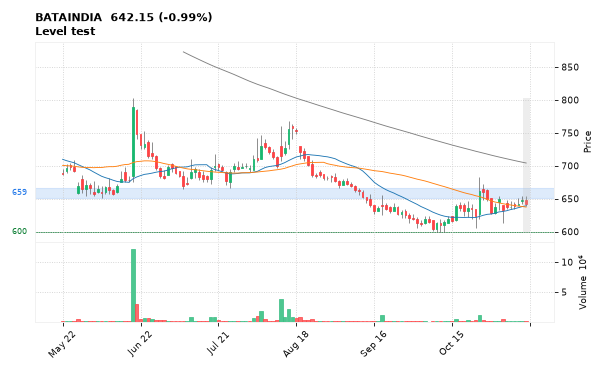

[🔔 Set alert on BATAINDIA](https://claude.ai/artifact/Ewc5hHTPX6WkU1nVcDNQzq?s=BATAINDIA&c=close%20below%20639.70) &nbsp;|&nbsp; [📈 Live chart (TradingView)](https://www.tradingview.com/chart/?symbol=NSE:BATAINDIA) &nbsp;|&nbsp; [alert by email](mailto:?subject=ALERT%20BATAINDIA&body=Alert%20me%20when%3A%20close%20above%20654.60%0A%0AEdit%20the%20line%20above%20if%20you%20want%2C%20then%20press%20Send.%20Checked%20on%20every%20day%27s%20closing%20data%3B%20a%20triggered%20alert%20appears%20at%20the%20top%20of%20the%208%20AM%20Technical%20Analysis%20email.%0A%0AExamples%20you%20can%20write%3A%0A%20%20close%20above%201150%20%20%7C%20%20close%20below%201080%20%20%7C%20%20high%20above%201200%20%20%7C%20%20low%20below%201050%0A%20%20close%20crosses%20above%20200%20DMA%20%20%7C%20%20close%20below%2050%20DMA%20%20%7C%20%20RSI%20below%2030%20%20%7C%20%20RSI%20above%2070%0A%20%20volume%20above%202x%20%20%7C%20%20change%20above%205%25%20%20%7C%20%20change%20below%20-4%25%20%20%7C%20%2052-week%20high%20%20%7C%20%20golden%20cross%0A%20%20combine%20with%20%27and%27%2C%20e.g.%20%20close%20above%201150%20and%20volume%20above%201.5x%0A%0AReference%3A%20BATAINDIA%20closed%20642.15%20%28high%20654.60%2C%20low%20639.70%29.%0ATo%20cancel%20later%2C%20send%20an%20email%20with%20subject%3A%20CANCEL%20ALERT%20BATAINDIA)

---

## 49. BHEL - LEVEL TEST
**436.30** (+1.18%) | vol 0.6x | RSI 59 | H 438.30 / L 421.00  
Level test

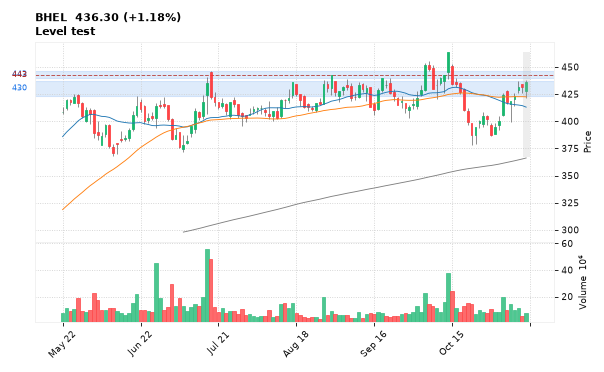

[🔔 Set alert on BHEL](https://claude.ai/artifact/Ewc5hHTPX6WkU1nVcDNQzq?s=BHEL&c=close%20below%20421.00) &nbsp;|&nbsp; [📈 Live chart (TradingView)](https://www.tradingview.com/chart/?symbol=NSE:BHEL) &nbsp;|&nbsp; [alert by email](mailto:?subject=ALERT%20BHEL&body=Alert%20me%20when%3A%20close%20above%20438.30%0A%0AEdit%20the%20line%20above%20if%20you%20want%2C%20then%20press%20Send.%20Checked%20on%20every%20day%27s%20closing%20data%3B%20a%20triggered%20alert%20appears%20at%20the%20top%20of%20the%208%20AM%20Technical%20Analysis%20email.%0A%0AExamples%20you%20can%20write%3A%0A%20%20close%20above%201150%20%20%7C%20%20close%20below%201080%20%20%7C%20%20high%20above%201200%20%20%7C%20%20low%20below%201050%0A%20%20close%20crosses%20above%20200%20DMA%20%20%7C%20%20close%20below%2050%20DMA%20%20%7C%20%20RSI%20below%2030%20%20%7C%20%20RSI%20above%2070%0A%20%20volume%20above%202x%20%20%7C%20%20change%20above%205%25%20%20%7C%20%20change%20below%20-4%25%20%20%7C%20%2052-week%20high%20%20%7C%20%20golden%20cross%0A%20%20combine%20with%20%27and%27%2C%20e.g.%20%20close%20above%201150%20and%20volume%20above%201.5x%0A%0AReference%3A%20BHEL%20closed%20436.30%20%28high%20438.30%2C%20low%20421.00%29.%0ATo%20cancel%20later%2C%20send%20an%20email%20with%20subject%3A%20CANCEL%20ALERT%20BHEL)

---

## 50. BPCL - LEVEL TEST
**302.00** (-3.05%) | vol 0.7x | RSI 50 | H 308.50 / L 302.00  
Level test

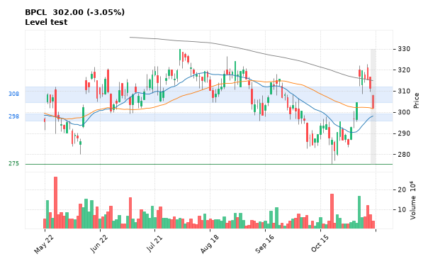

[🔔 Set alert on BPCL](https://claude.ai/artifact/Ewc5hHTPX6WkU1nVcDNQzq?s=BPCL&c=close%20below%20302.00) &nbsp;|&nbsp; [📈 Live chart (TradingView)](https://www.tradingview.com/chart/?symbol=NSE:BPCL) &nbsp;|&nbsp; [alert by email](mailto:?subject=ALERT%20BPCL&body=Alert%20me%20when%3A%20close%20above%20308.50%0A%0AEdit%20the%20line%20above%20if%20you%20want%2C%20then%20press%20Send.%20Checked%20on%20every%20day%27s%20closing%20data%3B%20a%20triggered%20alert%20appears%20at%20the%20top%20of%20the%208%20AM%20Technical%20Analysis%20email.%0A%0AExamples%20you%20can%20write%3A%0A%20%20close%20above%201150%20%20%7C%20%20close%20below%201080%20%20%7C%20%20high%20above%201200%20%20%7C%20%20low%20below%201050%0A%20%20close%20crosses%20above%20200%20DMA%20%20%7C%20%20close%20below%2050%20DMA%20%20%7C%20%20RSI%20below%2030%20%20%7C%20%20RSI%20above%2070%0A%20%20volume%20above%202x%20%20%7C%20%20change%20above%205%25%20%20%7C%20%20change%20below%20-4%25%20%20%7C%20%2052-week%20high%20%20%7C%20%20golden%20cross%0A%20%20combine%20with%20%27and%27%2C%20e.g.%20%20close%20above%201150%20and%20volume%20above%201.5x%0A%0AReference%3A%20BPCL%20closed%20302.00%20%28high%20308.50%2C%20low%20302.00%29.%0ATo%20cancel%20later%2C%20send%20an%20email%20with%20subject%3A%20CANCEL%20ALERT%20BPCL)

---

## 51. BHARTIHEXA - LEVEL TEST
**1,665.50** (+4.54%) | vol 1.0x | RSI 57 | H 1,675.90 / L 1,583.20  
Level test

[🔔 Set alert on BHARTIHEXA](https://claude.ai/artifact/Ewc5hHTPX6WkU1nVcDNQzq?s=BHARTIHEXA&c=close%20below%201583.20) &nbsp;|&nbsp; [📈 Live chart (TradingView)](https://www.tradingview.com/chart/?symbol=NSE:BHARTIHEXA) &nbsp;|&nbsp; [alert by email](mailto:?subject=ALERT%20BHARTIHEXA&body=Alert%20me%20when%3A%20close%20above%201675.90%0A%0AEdit%20the%20line%20above%20if%20you%20want%2C%20then%20press%20Send.%20Checked%20on%20every%20day%27s%20closing%20data%3B%20a%20triggered%20alert%20appears%20at%20the%20top%20of%20the%208%20AM%20Technical%20Analysis%20email.%0A%0AExamples%20you%20can%20write%3A%0A%20%20close%20above%201150%20%20%7C%20%20close%20below%201080%20%20%7C%20%20high%20above%201200%20%20%7C%20%20low%20below%201050%0A%20%20close%20crosses%20above%20200%20DMA%20%20%7C%20%20close%20below%2050%20DMA%20%20%7C%20%20RSI%20below%2030%20%20%7C%20%20RSI%20above%2070%0A%20%20volume%20above%202x%20%20%7C%20%20change%20above%205%25%20%20%7C%20%20change%20below%20-4%25%20%20%7C%20%2052-week%20high%20%20%7C%20%20golden%20cross%0A%20%20combine%20with%20%27and%27%2C%20e.g.%20%20close%20above%201150%20and%20volume%20above%201.5x%0A%0AReference%3A%20BHARTIHEXA%20closed%201665.50%20%28high%201675.90%2C%20low%201583.20%29.%0ATo%20cancel%20later%2C%20send%20an%20email%20with%20subject%3A%20CANCEL%20ALERT%20BHARTIHEXA)

---

## 52. GROWW - LEVEL TEST
**224.95** (+1.48%) | vol 1.0x | RSI 70 | H 229.16 / L 218.68  
Level test

[🔔 Set alert on GROWW](https://claude.ai/artifact/Ewc5hHTPX6WkU1nVcDNQzq?s=GROWW&c=close%20below%20218.68) &nbsp;|&nbsp; [📈 Live chart (TradingView)](https://www.tradingview.com/chart/?symbol=NSE:GROWW) &nbsp;|&nbsp; [alert by email](mailto:?subject=ALERT%20GROWW&body=Alert%20me%20when%3A%20close%20above%20229.16%0A%0AEdit%20the%20line%20above%20if%20you%20want%2C%20then%20press%20Send.%20Checked%20on%20every%20day%27s%20closing%20data%3B%20a%20triggered%20alert%20appears%20at%20the%20top%20of%20the%208%20AM%20Technical%20Analysis%20email.%0A%0AExamples%20you%20can%20write%3A%0A%20%20close%20above%201150%20%20%7C%20%20close%20below%201080%20%20%7C%20%20high%20above%201200%20%20%7C%20%20low%20below%201050%0A%20%20close%20crosses%20above%20200%20DMA%20%20%7C%20%20close%20below%2050%20DMA%20%20%7C%20%20RSI%20below%2030%20%20%7C%20%20RSI%20above%2070%0A%20%20volume%20above%202x%20%20%7C%20%20change%20above%205%25%20%20%7C%20%20change%20below%20-4%25%20%20%7C%20%2052-week%20high%20%20%7C%20%20golden%20cross%0A%20%20combine%20with%20%27and%27%2C%20e.g.%20%20close%20above%201150%20and%20volume%20above%201.5x%0A%0AReference%3A%20GROWW%20closed%20224.95%20%28high%20229.16%2C%20low%20218.68%29.%0ATo%20cancel%20later%2C%20send%20an%20email%20with%20subject%3A%20CANCEL%20ALERT%20GROWW)

---

## 53. BOSCHLTD - LEVEL TEST
**49,390.00** (-2.20%) | vol 1.1x | RSI 56 | H 50,500.00 / L 49,350.00  
Level test

[🔔 Set alert on BOSCHLTD](https://claude.ai/artifact/Ewc5hHTPX6WkU1nVcDNQzq?s=BOSCHLTD&c=close%20below%2049350.00) &nbsp;|&nbsp; [📈 Live chart (TradingView)](https://www.tradingview.com/chart/?symbol=NSE:BOSCHLTD) &nbsp;|&nbsp; [alert by email](mailto:?subject=ALERT%20BOSCHLTD&body=Alert%20me%20when%3A%20close%20above%2050500.00%0A%0AEdit%20the%20line%20above%20if%20you%20want%2C%20then%20press%20Send.%20Checked%20on%20every%20day%27s%20closing%20data%3B%20a%20triggered%20alert%20appears%20at%20the%20top%20of%20the%208%20AM%20Technical%20Analysis%20email.%0A%0AExamples%20you%20can%20write%3A%0A%20%20close%20above%201150%20%20%7C%20%20close%20below%201080%20%20%7C%20%20high%20above%201200%20%20%7C%20%20low%20below%201050%0A%20%20close%20crosses%20above%20200%20DMA%20%20%7C%20%20close%20below%2050%20DMA%20%20%7C%20%20RSI%20below%2030%20%20%7C%20%20RSI%20above%2070%0A%20%20volume%20above%202x%20%20%7C%20%20change%20above%205%25%20%20%7C%20%20change%20below%20-4%25%20%20%7C%20%2052-week%20high%20%20%7C%20%20golden%20cross%0A%20%20combine%20with%20%27and%27%2C%20e.g.%20%20close%20above%201150%20and%20volume%20above%201.5x%0A%0AReference%3A%20BOSCHLTD%20closed%2049390.00%20%28high%2050500.00%2C%20low%2049350.00%29.%0ATo%20cancel%20later%2C%20send%20an%20email%20with%20subject%3A%20CANCEL%20ALERT%20BOSCHLTD)

---

## 54. FIRSTCRY - LEVEL TEST
**160.40** (-1.81%) | vol 0.9x | RSI 40 | H 163.36 / L 159.81  
Level test

[🔔 Set alert on FIRSTCRY](https://claude.ai/artifact/Ewc5hHTPX6WkU1nVcDNQzq?s=FIRSTCRY&c=close%20below%20159.81) &nbsp;|&nbsp; [📈 Live chart (TradingView)](https://www.tradingview.com/chart/?symbol=NSE:FIRSTCRY) &nbsp;|&nbsp; [alert by email](mailto:?subject=ALERT%20FIRSTCRY&body=Alert%20me%20when%3A%20close%20above%20163.36%0A%0AEdit%20the%20line%20above%20if%20you%20want%2C%20then%20press%20Send.%20Checked%20on%20every%20day%27s%20closing%20data%3B%20a%20triggered%20alert%20appears%20at%20the%20top%20of%20the%208%20AM%20Technical%20Analysis%20email.%0A%0AExamples%20you%20can%20write%3A%0A%20%20close%20above%201150%20%20%7C%20%20close%20below%201080%20%20%7C%20%20high%20above%201200%20%20%7C%20%20low%20below%201050%0A%20%20close%20crosses%20above%20200%20DMA%20%20%7C%20%20close%20below%2050%20DMA%20%20%7C%20%20RSI%20below%2030%20%20%7C%20%20RSI%20above%2070%0A%20%20volume%20above%202x%20%20%7C%20%20change%20above%205%25%20%20%7C%20%20change%20below%20-4%25%20%20%7C%20%2052-week%20high%20%20%7C%20%20golden%20cross%0A%20%20combine%20with%20%27and%27%2C%20e.g.%20%20close%20above%201150%20and%20volume%20above%201.5x%0A%0AReference%3A%20FIRSTCRY%20closed%20160.40%20%28high%20163.36%2C%20low%20159.81%29.%0ATo%20cancel%20later%2C%20send%20an%20email%20with%20subject%3A%20CANCEL%20ALERT%20FIRSTCRY)

---

## 55. CGPOWER - LEVEL TEST
**828.00** (+0.76%) | vol 0.9x | RSI 49 | H 841.90 / L 821.05  
Level test

[🔔 Set alert on CGPOWER](https://claude.ai/artifact/Ewc5hHTPX6WkU1nVcDNQzq?s=CGPOWER&c=close%20below%20821.05) &nbsp;|&nbsp; [📈 Live chart (TradingView)](https://www.tradingview.com/chart/?symbol=NSE:CGPOWER) &nbsp;|&nbsp; [alert by email](mailto:?subject=ALERT%20CGPOWER&body=Alert%20me%20when%3A%20close%20above%20841.90%0A%0AEdit%20the%20line%20above%20if%20you%20want%2C%20then%20press%20Send.%20Checked%20on%20every%20day%27s%20closing%20data%3B%20a%20triggered%20alert%20appears%20at%20the%20top%20of%20the%208%20AM%20Technical%20Analysis%20email.%0A%0AExamples%20you%20can%20write%3A%0A%20%20close%20above%201150%20%20%7C%20%20close%20below%201080%20%20%7C%20%20high%20above%201200%20%20%7C%20%20low%20below%201050%0A%20%20close%20crosses%20above%20200%20DMA%20%20%7C%20%20close%20below%2050%20DMA%20%20%7C%20%20RSI%20below%2030%20%20%7C%20%20RSI%20above%2070%0A%20%20volume%20above%202x%20%20%7C%20%20change%20above%205%25%20%20%7C%20%20change%20below%20-4%25%20%20%7C%20%2052-week%20high%20%20%7C%20%20golden%20cross%0A%20%20combine%20with%20%27and%27%2C%20e.g.%20%20close%20above%201150%20and%20volume%20above%201.5x%0A%0AReference%3A%20CGPOWER%20closed%20828.00%20%28high%20841.90%2C%20low%20821.05%29.%0ATo%20cancel%20later%2C%20send%20an%20email%20with%20subject%3A%20CANCEL%20ALERT%20CGPOWER)

---

## 56. CIEINDIA - LEVEL TEST
**368.40** (-2.60%) | vol 0.7x | RSI 51 | H 379.70 / L 366.10  
Level test

[🔔 Set alert on CIEINDIA](https://claude.ai/artifact/Ewc5hHTPX6WkU1nVcDNQzq?s=CIEINDIA&c=close%20below%20366.10) &nbsp;|&nbsp; [📈 Live chart (TradingView)](https://www.tradingview.com/chart/?symbol=NSE:CIEINDIA) &nbsp;|&nbsp; [alert by email](mailto:?subject=ALERT%20CIEINDIA&body=Alert%20me%20when%3A%20close%20above%20379.70%0A%0AEdit%20the%20line%20above%20if%20you%20want%2C%20then%20press%20Send.%20Checked%20on%20every%20day%27s%20closing%20data%3B%20a%20triggered%20alert%20appears%20at%20the%20top%20of%20the%208%20AM%20Technical%20Analysis%20email.%0A%0AExamples%20you%20can%20write%3A%0A%20%20close%20above%201150%20%20%7C%20%20close%20below%201080%20%20%7C%20%20high%20above%201200%20%20%7C%20%20low%20below%201050%0A%20%20close%20crosses%20above%20200%20DMA%20%20%7C%20%20close%20below%2050%20DMA%20%20%7C%20%20RSI%20below%2030%20%20%7C%20%20RSI%20above%2070%0A%20%20volume%20above%202x%20%20%7C%20%20change%20above%205%25%20%20%7C%20%20change%20below%20-4%25%20%20%7C%20%2052-week%20high%20%20%7C%20%20golden%20cross%0A%20%20combine%20with%20%27and%27%2C%20e.g.%20%20close%20above%201150%20and%20volume%20above%201.5x%0A%0AReference%3A%20CIEINDIA%20closed%20368.40%20%28high%20379.70%2C%20low%20366.10%29.%0ATo%20cancel%20later%2C%20send%20an%20email%20with%20subject%3A%20CANCEL%20ALERT%20CIEINDIA)

---

## 57. CRISIL - LEVEL TEST
**4,352.40** (-0.02%) | vol 0.4x | RSI 38 | H 4,378.90 / L 4,320.10  
Level test

[🔔 Set alert on CRISIL](https://claude.ai/artifact/Ewc5hHTPX6WkU1nVcDNQzq?s=CRISIL&c=close%20below%204320.10) &nbsp;|&nbsp; [📈 Live chart (TradingView)](https://www.tradingview.com/chart/?symbol=NSE:CRISIL) &nbsp;|&nbsp; [alert by email](mailto:?subject=ALERT%20CRISIL&body=Alert%20me%20when%3A%20close%20above%204378.90%0A%0AEdit%20the%20line%20above%20if%20you%20want%2C%20then%20press%20Send.%20Checked%20on%20every%20day%27s%20closing%20data%3B%20a%20triggered%20alert%20appears%20at%20the%20top%20of%20the%208%20AM%20Technical%20Analysis%20email.%0A%0AExamples%20you%20can%20write%3A%0A%20%20close%20above%201150%20%20%7C%20%20close%20below%201080%20%20%7C%20%20high%20above%201200%20%20%7C%20%20low%20below%201050%0A%20%20close%20crosses%20above%20200%20DMA%20%20%7C%20%20close%20below%2050%20DMA%20%20%7C%20%20RSI%20below%2030%20%20%7C%20%20RSI%20above%2070%0A%20%20volume%20above%202x%20%20%7C%20%20change%20above%205%25%20%20%7C%20%20change%20below%20-4%25%20%20%7C%20%2052-week%20high%20%20%7C%20%20golden%20cross%0A%20%20combine%20with%20%27and%27%2C%20e.g.%20%20close%20above%201150%20and%20volume%20above%201.5x%0A%0AReference%3A%20CRISIL%20closed%204352.40%20%28high%204378.90%2C%20low%204320.10%29.%0ATo%20cancel%20later%2C%20send%20an%20email%20with%20subject%3A%20CANCEL%20ALERT%20CRISIL)

---

## 58. CANFINHOME - LEVEL TEST
**781.45** (-1.79%) | vol 0.6x | RSI 62 | H 799.00 / L 778.00  
Level test

[🔔 Set alert on CANFINHOME](https://claude.ai/artifact/Ewc5hHTPX6WkU1nVcDNQzq?s=CANFINHOME&c=close%20below%20778.00) &nbsp;|&nbsp; [📈 Live chart (TradingView)](https://www.tradingview.com/chart/?symbol=NSE:CANFINHOME) &nbsp;|&nbsp; [alert by email](mailto:?subject=ALERT%20CANFINHOME&body=Alert%20me%20when%3A%20close%20above%20799.00%0A%0AEdit%20the%20line%20above%20if%20you%20want%2C%20then%20press%20Send.%20Checked%20on%20every%20day%27s%20closing%20data%3B%20a%20triggered%20alert%20appears%20at%20the%20top%20of%20the%208%20AM%20Technical%20Analysis%20email.%0A%0AExamples%20you%20can%20write%3A%0A%20%20close%20above%201150%20%20%7C%20%20close%20below%201080%20%20%7C%20%20high%20above%201200%20%20%7C%20%20low%20below%201050%0A%20%20close%20crosses%20above%20200%20DMA%20%20%7C%20%20close%20below%2050%20DMA%20%20%7C%20%20RSI%20below%2030%20%20%7C%20%20RSI%20above%2070%0A%20%20volume%20above%202x%20%20%7C%20%20change%20above%205%25%20%20%7C%20%20change%20below%20-4%25%20%20%7C%20%2052-week%20high%20%20%7C%20%20golden%20cross%0A%20%20combine%20with%20%27and%27%2C%20e.g.%20%20close%20above%201150%20and%20volume%20above%201.5x%0A%0AReference%3A%20CANFINHOME%20closed%20781.45%20%28high%20799.00%2C%20low%20778.00%29.%0ATo%20cancel%20later%2C%20send%20an%20email%20with%20subject%3A%20CANCEL%20ALERT%20CANFINHOME)

---

## 59. CANHLIFE - LEVEL TEST
**134.80** (+2.04%) | vol 3.8x | RSI 58 | H 139.89 / L 130.12  
Level test

[🔔 Set alert on CANHLIFE](https://claude.ai/artifact/Ewc5hHTPX6WkU1nVcDNQzq?s=CANHLIFE&c=close%20below%20130.12) &nbsp;|&nbsp; [📈 Live chart (TradingView)](https://www.tradingview.com/chart/?symbol=NSE:CANHLIFE) &nbsp;|&nbsp; [alert by email](mailto:?subject=ALERT%20CANHLIFE&body=Alert%20me%20when%3A%20close%20above%20139.89%0A%0AEdit%20the%20line%20above%20if%20you%20want%2C%20then%20press%20Send.%20Checked%20on%20every%20day%27s%20closing%20data%3B%20a%20triggered%20alert%20appears%20at%20the%20top%20of%20the%208%20AM%20Technical%20Analysis%20email.%0A%0AExamples%20you%20can%20write%3A%0A%20%20close%20above%201150%20%20%7C%20%20close%20below%201080%20%20%7C%20%20high%20above%201200%20%20%7C%20%20low%20below%201050%0A%20%20close%20crosses%20above%20200%20DMA%20%20%7C%20%20close%20below%2050%20DMA%20%20%7C%20%20RSI%20below%2030%20%20%7C%20%20RSI%20above%2070%0A%20%20volume%20above%202x%20%20%7C%20%20change%20above%205%25%20%20%7C%20%20change%20below%20-4%25%20%20%7C%20%2052-week%20high%20%20%7C%20%20golden%20cross%0A%20%20combine%20with%20%27and%27%2C%20e.g.%20%20close%20above%201150%20and%20volume%20above%201.5x%0A%0AReference%3A%20CANHLIFE%20closed%20134.80%20%28high%20139.89%2C%20low%20130.12%29.%0ATo%20cancel%20later%2C%20send%20an%20email%20with%20subject%3A%20CANCEL%20ALERT%20CANHLIFE)

---

## 60. CAPLIPOINT - LEVEL TEST
**2,388.70** (+0.10%) | vol 1.3x | RSI 47 | H 2,420.00 / L 2,360.00  
Level test

[🔔 Set alert on CAPLIPOINT](https://claude.ai/artifact/Ewc5hHTPX6WkU1nVcDNQzq?s=CAPLIPOINT&c=close%20below%202360.00) &nbsp;|&nbsp; [📈 Live chart (TradingView)](https://www.tradingview.com/chart/?symbol=NSE:CAPLIPOINT) &nbsp;|&nbsp; [alert by email](mailto:?subject=ALERT%20CAPLIPOINT&body=Alert%20me%20when%3A%20close%20above%202420.00%0A%0AEdit%20the%20line%20above%20if%20you%20want%2C%20then%20press%20Send.%20Checked%20on%20every%20day%27s%20closing%20data%3B%20a%20triggered%20alert%20appears%20at%20the%20top%20of%20the%208%20AM%20Technical%20Analysis%20email.%0A%0AExamples%20you%20can%20write%3A%0A%20%20close%20above%201150%20%20%7C%20%20close%20below%201080%20%20%7C%20%20high%20above%201200%20%20%7C%20%20low%20below%201050%0A%20%20close%20crosses%20above%20200%20DMA%20%20%7C%20%20close%20below%2050%20DMA%20%20%7C%20%20RSI%20below%2030%20%20%7C%20%20RSI%20above%2070%0A%20%20volume%20above%202x%20%20%7C%20%20change%20above%205%25%20%20%7C%20%20change%20below%20-4%25%20%20%7C%20%2052-week%20high%20%20%7C%20%20golden%20cross%0A%20%20combine%20with%20%27and%27%2C%20e.g.%20%20close%20above%201150%20and%20volume%20above%201.5x%0A%0AReference%3A%20CAPLIPOINT%20closed%202388.70%20%28high%202420.00%2C%20low%202360.00%29.%0ATo%20cancel%20later%2C%20send%20an%20email%20with%20subject%3A%20CANCEL%20ALERT%20CAPLIPOINT)

---

## 61. CARTRADE - LEVEL TEST
**2,696.10** (+1.96%) | vol 0.3x | RSI 49 | H 2,745.00 / L 2,603.50  
Level test

[🔔 Set alert on CARTRADE](https://claude.ai/artifact/Ewc5hHTPX6WkU1nVcDNQzq?s=CARTRADE&c=close%20below%202603.50) &nbsp;|&nbsp; [📈 Live chart (TradingView)](https://www.tradingview.com/chart/?symbol=NSE:CARTRADE) &nbsp;|&nbsp; [alert by email](mailto:?subject=ALERT%20CARTRADE&body=Alert%20me%20when%3A%20close%20above%202745.00%0A%0AEdit%20the%20line%20above%20if%20you%20want%2C%20then%20press%20Send.%20Checked%20on%20every%20day%27s%20closing%20data%3B%20a%20triggered%20alert%20appears%20at%20the%20top%20of%20the%208%20AM%20Technical%20Analysis%20email.%0A%0AExamples%20you%20can%20write%3A%0A%20%20close%20above%201150%20%20%7C%20%20close%20below%201080%20%20%7C%20%20high%20above%201200%20%20%7C%20%20low%20below%201050%0A%20%20close%20crosses%20above%20200%20DMA%20%20%7C%20%20close%20below%2050%20DMA%20%20%7C%20%20RSI%20below%2030%20%20%7C%20%20RSI%20above%2070%0A%20%20volume%20above%202x%20%20%7C%20%20change%20above%205%25%20%20%7C%20%20change%20below%20-4%25%20%20%7C%20%2052-week%20high%20%20%7C%20%20golden%20cross%0A%20%20combine%20with%20%27and%27%2C%20e.g.%20%20close%20above%201150%20and%20volume%20above%201.5x%0A%0AReference%3A%20CARTRADE%20closed%202696.10%20%28high%202745.00%2C%20low%202603.50%29.%0ATo%20cancel%20later%2C%20send%20an%20email%20with%20subject%3A%20CANCEL%20ALERT%20CARTRADE)

---

## 62. CEATLTD - LEVEL TEST
**3,540.30** (-0.32%) | vol 0.5x | RSI 63 | H 3,590.00 / L 3,500.00  
Level test

[🔔 Set alert on CEATLTD](https://claude.ai/artifact/Ewc5hHTPX6WkU1nVcDNQzq?s=CEATLTD&c=close%20below%203500.00) &nbsp;|&nbsp; [📈 Live chart (TradingView)](https://www.tradingview.com/chart/?symbol=NSE:CEATLTD) &nbsp;|&nbsp; [alert by email](mailto:?subject=ALERT%20CEATLTD&body=Alert%20me%20when%3A%20close%20above%203590.00%0A%0AEdit%20the%20line%20above%20if%20you%20want%2C%20then%20press%20Send.%20Checked%20on%20every%20day%27s%20closing%20data%3B%20a%20triggered%20alert%20appears%20at%20the%20top%20of%20the%208%20AM%20Technical%20Analysis%20email.%0A%0AExamples%20you%20can%20write%3A%0A%20%20close%20above%201150%20%20%7C%20%20close%20below%201080%20%20%7C%20%20high%20above%201200%20%20%7C%20%20low%20below%201050%0A%20%20close%20crosses%20above%20200%20DMA%20%20%7C%20%20close%20below%2050%20DMA%20%20%7C%20%20RSI%20below%2030%20%20%7C%20%20RSI%20above%2070%0A%20%20volume%20above%202x%20%20%7C%20%20change%20above%205%25%20%20%7C%20%20change%20below%20-4%25%20%20%7C%20%2052-week%20high%20%20%7C%20%20golden%20cross%0A%20%20combine%20with%20%27and%27%2C%20e.g.%20%20close%20above%201150%20and%20volume%20above%201.5x%0A%0AReference%3A%20CEATLTD%20closed%203540.30%20%28high%203590.00%2C%20low%203500.00%29.%0ATo%20cancel%20later%2C%20send%20an%20email%20with%20subject%3A%20CANCEL%20ALERT%20CEATLTD)

---

## 63. CENTRALBK - LEVEL TEST
**32.22** (-0.28%) | vol 1.0x | RSI 67 | H 32.47 / L 31.92  
Level test

[🔔 Set alert on CENTRALBK](https://claude.ai/artifact/Ewc5hHTPX6WkU1nVcDNQzq?s=CENTRALBK&c=close%20below%2031.92) &nbsp;|&nbsp; [📈 Live chart (TradingView)](https://www.tradingview.com/chart/?symbol=NSE:CENTRALBK) &nbsp;|&nbsp; [alert by email](mailto:?subject=ALERT%20CENTRALBK&body=Alert%20me%20when%3A%20close%20above%2032.47%0A%0AEdit%20the%20line%20above%20if%20you%20want%2C%20then%20press%20Send.%20Checked%20on%20every%20day%27s%20closing%20data%3B%20a%20triggered%20alert%20appears%20at%20the%20top%20of%20the%208%20AM%20Technical%20Analysis%20email.%0A%0AExamples%20you%20can%20write%3A%0A%20%20close%20above%201150%20%20%7C%20%20close%20below%201080%20%20%7C%20%20high%20above%201200%20%20%7C%20%20low%20below%201050%0A%20%20close%20crosses%20above%20200%20DMA%20%20%7C%20%20close%20below%2050%20DMA%20%20%7C%20%20RSI%20below%2030%20%20%7C%20%20RSI%20above%2070%0A%20%20volume%20above%202x%20%20%7C%20%20change%20above%205%25%20%20%7C%20%20change%20below%20-4%25%20%20%7C%20%2052-week%20high%20%20%7C%20%20golden%20cross%0A%20%20combine%20with%20%27and%27%2C%20e.g.%20%20close%20above%201150%20and%20volume%20above%201.5x%0A%0AReference%3A%20CENTRALBK%20closed%2032.22%20%28high%2032.47%2C%20low%2031.92%29.%0ATo%20cancel%20later%2C%20send%20an%20email%20with%20subject%3A%20CANCEL%20ALERT%20CENTRALBK)

---

## 64. CDSL - LEVEL TEST
**1,447.00** (-0.55%) | vol 2.0x | RSI 72 | H 1,484.80 / L 1,440.60  
Level test

[🔔 Set alert on CDSL](https://claude.ai/artifact/Ewc5hHTPX6WkU1nVcDNQzq?s=CDSL&c=close%20below%201440.60) &nbsp;|&nbsp; [📈 Live chart (TradingView)](https://www.tradingview.com/chart/?symbol=NSE:CDSL) &nbsp;|&nbsp; [alert by email](mailto:?subject=ALERT%20CDSL&body=Alert%20me%20when%3A%20close%20above%201484.80%0A%0AEdit%20the%20line%20above%20if%20you%20want%2C%20then%20press%20Send.%20Checked%20on%20every%20day%27s%20closing%20data%3B%20a%20triggered%20alert%20appears%20at%20the%20top%20of%20the%208%20AM%20Technical%20Analysis%20email.%0A%0AExamples%20you%20can%20write%3A%0A%20%20close%20above%201150%20%20%7C%20%20close%20below%201080%20%20%7C%20%20high%20above%201200%20%20%7C%20%20low%20below%201050%0A%20%20close%20crosses%20above%20200%20DMA%20%20%7C%20%20close%20below%2050%20DMA%20%20%7C%20%20RSI%20below%2030%20%20%7C%20%20RSI%20above%2070%0A%20%20volume%20above%202x%20%20%7C%20%20change%20above%205%25%20%20%7C%20%20change%20below%20-4%25%20%20%7C%20%2052-week%20high%20%20%7C%20%20golden%20cross%0A%20%20combine%20with%20%27and%27%2C%20e.g.%20%20close%20above%201150%20and%20volume%20above%201.5x%0A%0AReference%3A%20CDSL%20closed%201447.00%20%28high%201484.80%2C%20low%201440.60%29.%0ATo%20cancel%20later%2C%20send%20an%20email%20with%20subject%3A%20CANCEL%20ALERT%20CDSL)

---

## 65. CLEAN - LEVEL TEST
**724.00** (+2.94%) | vol 1.3x | RSI 48 | H 729.45 / L 688.45  
Level test

[🔔 Set alert on CLEAN](https://claude.ai/artifact/Ewc5hHTPX6WkU1nVcDNQzq?s=CLEAN&c=close%20below%20688.45) &nbsp;|&nbsp; [📈 Live chart (TradingView)](https://www.tradingview.com/chart/?symbol=NSE:CLEAN) &nbsp;|&nbsp; [alert by email](mailto:?subject=ALERT%20CLEAN&body=Alert%20me%20when%3A%20close%20above%20729.45%0A%0AEdit%20the%20line%20above%20if%20you%20want%2C%20then%20press%20Send.%20Checked%20on%20every%20day%27s%20closing%20data%3B%20a%20triggered%20alert%20appears%20at%20the%20top%20of%20the%208%20AM%20Technical%20Analysis%20email.%0A%0AExamples%20you%20can%20write%3A%0A%20%20close%20above%201150%20%20%7C%20%20close%20below%201080%20%20%7C%20%20high%20above%201200%20%20%7C%20%20low%20below%201050%0A%20%20close%20crosses%20above%20200%20DMA%20%20%7C%20%20close%20below%2050%20DMA%20%20%7C%20%20RSI%20below%2030%20%20%7C%20%20RSI%20above%2070%0A%20%20volume%20above%202x%20%20%7C%20%20change%20above%205%25%20%20%7C%20%20change%20below%20-4%25%20%20%7C%20%2052-week%20high%20%20%7C%20%20golden%20cross%0A%20%20combine%20with%20%27and%27%2C%20e.g.%20%20close%20above%201150%20and%20volume%20above%201.5x%0A%0AReference%3A%20CLEAN%20closed%20724.00%20%28high%20729.45%2C%20low%20688.45%29.%0ATo%20cancel%20later%2C%20send%20an%20email%20with%20subject%3A%20CANCEL%20ALERT%20CLEAN)

---

## 66. COHANCE - LEVEL TEST
**458.60** (-2.77%) | vol 0.5x | RSI 52 | H 475.90 / L 455.15  
Level test

[🔔 Set alert on COHANCE](https://claude.ai/artifact/Ewc5hHTPX6WkU1nVcDNQzq?s=COHANCE&c=close%20below%20455.15) &nbsp;|&nbsp; [📈 Live chart (TradingView)](https://www.tradingview.com/chart/?symbol=NSE:COHANCE) &nbsp;|&nbsp; [alert by email](mailto:?subject=ALERT%20COHANCE&body=Alert%20me%20when%3A%20close%20above%20475.90%0A%0AEdit%20the%20line%20above%20if%20you%20want%2C%20then%20press%20Send.%20Checked%20on%20every%20day%27s%20closing%20data%3B%20a%20triggered%20alert%20appears%20at%20the%20top%20of%20the%208%20AM%20Technical%20Analysis%20email.%0A%0AExamples%20you%20can%20write%3A%0A%20%20close%20above%201150%20%20%7C%20%20close%20below%201080%20%20%7C%20%20high%20above%201200%20%20%7C%20%20low%20below%201050%0A%20%20close%20crosses%20above%20200%20DMA%20%20%7C%20%20close%20below%2050%20DMA%20%20%7C%20%20RSI%20below%2030%20%20%7C%20%20RSI%20above%2070%0A%20%20volume%20above%202x%20%20%7C%20%20change%20above%205%25%20%20%7C%20%20change%20below%20-4%25%20%20%7C%20%2052-week%20high%20%20%7C%20%20golden%20cross%0A%20%20combine%20with%20%27and%27%2C%20e.g.%20%20close%20above%201150%20and%20volume%20above%201.5x%0A%0AReference%3A%20COHANCE%20closed%20458.60%20%28high%20475.90%2C%20low%20455.15%29.%0ATo%20cancel%20later%2C%20send%20an%20email%20with%20subject%3A%20CANCEL%20ALERT%20COHANCE)

---

## 67. CONCOR - LEVEL TEST
**442.15** (-1.57%) | vol 0.5x | RSI 51 | H 449.90 / L 439.50  
Level test

[🔔 Set alert on CONCOR](https://claude.ai/artifact/Ewc5hHTPX6WkU1nVcDNQzq?s=CONCOR&c=close%20below%20439.50) &nbsp;|&nbsp; [📈 Live chart (TradingView)](https://www.tradingview.com/chart/?symbol=NSE:CONCOR) &nbsp;|&nbsp; [alert by email](mailto:?subject=ALERT%20CONCOR&body=Alert%20me%20when%3A%20close%20above%20449.90%0A%0AEdit%20the%20line%20above%20if%20you%20want%2C%20then%20press%20Send.%20Checked%20on%20every%20day%27s%20closing%20data%3B%20a%20triggered%20alert%20appears%20at%20the%20top%20of%20the%208%20AM%20Technical%20Analysis%20email.%0A%0AExamples%20you%20can%20write%3A%0A%20%20close%20above%201150%20%20%7C%20%20close%20below%201080%20%20%7C%20%20high%20above%201200%20%20%7C%20%20low%20below%201050%0A%20%20close%20crosses%20above%20200%20DMA%20%20%7C%20%20close%20below%2050%20DMA%20%20%7C%20%20RSI%20below%2030%20%20%7C%20%20RSI%20above%2070%0A%20%20volume%20above%202x%20%20%7C%20%20change%20above%205%25%20%20%7C%20%20change%20below%20-4%25%20%20%7C%20%2052-week%20high%20%20%7C%20%20golden%20cross%0A%20%20combine%20with%20%27and%27%2C%20e.g.%20%20close%20above%201150%20and%20volume%20above%201.5x%0A%0AReference%3A%20CONCOR%20closed%20442.15%20%28high%20449.90%2C%20low%20439.50%29.%0ATo%20cancel%20later%2C%20send%20an%20email%20with%20subject%3A%20CANCEL%20ALERT%20CONCOR)

---

## 68. DOMS - LEVEL TEST
**2,014.10** (-0.49%) | vol 0.3x | RSI 52 | H 2,035.00 / L 2,000.00  
Level test

[🔔 Set alert on DOMS](https://claude.ai/artifact/Ewc5hHTPX6WkU1nVcDNQzq?s=DOMS&c=close%20below%202000.00) &nbsp;|&nbsp; [📈 Live chart (TradingView)](https://www.tradingview.com/chart/?symbol=NSE:DOMS) &nbsp;|&nbsp; [alert by email](mailto:?subject=ALERT%20DOMS&body=Alert%20me%20when%3A%20close%20above%202035.00%0A%0AEdit%20the%20line%20above%20if%20you%20want%2C%20then%20press%20Send.%20Checked%20on%20every%20day%27s%20closing%20data%3B%20a%20triggered%20alert%20appears%20at%20the%20top%20of%20the%208%20AM%20Technical%20Analysis%20email.%0A%0AExamples%20you%20can%20write%3A%0A%20%20close%20above%201150%20%20%7C%20%20close%20below%201080%20%20%7C%20%20high%20above%201200%20%20%7C%20%20low%20below%201050%0A%20%20close%20crosses%20above%20200%20DMA%20%20%7C%20%20close%20below%2050%20DMA%20%20%7C%20%20RSI%20below%2030%20%20%7C%20%20RSI%20above%2070%0A%20%20volume%20above%202x%20%20%7C%20%20change%20above%205%25%20%20%7C%20%20change%20below%20-4%25%20%20%7C%20%2052-week%20high%20%20%7C%20%20golden%20cross%0A%20%20combine%20with%20%27and%27%2C%20e.g.%20%20close%20above%201150%20and%20volume%20above%201.5x%0A%0AReference%3A%20DOMS%20closed%202014.10%20%28high%202035.00%2C%20low%202000.00%29.%0ATo%20cancel%20later%2C%20send%20an%20email%20with%20subject%3A%20CANCEL%20ALERT%20DOMS)

---

## 69. DATAPATTNS - LEVEL TEST
**4,268.00** (+0.87%) | vol 1.1x | RSI 57 | H 4,324.40 / L 4,151.50  
Level test

[🔔 Set alert on DATAPATTNS](https://claude.ai/artifact/Ewc5hHTPX6WkU1nVcDNQzq?s=DATAPATTNS&c=close%20below%204151.50) &nbsp;|&nbsp; [📈 Live chart (TradingView)](https://www.tradingview.com/chart/?symbol=NSE:DATAPATTNS) &nbsp;|&nbsp; [alert by email](mailto:?subject=ALERT%20DATAPATTNS&body=Alert%20me%20when%3A%20close%20above%204324.40%0A%0AEdit%20the%20line%20above%20if%20you%20want%2C%20then%20press%20Send.%20Checked%20on%20every%20day%27s%20closing%20data%3B%20a%20triggered%20alert%20appears%20at%20the%20top%20of%20the%208%20AM%20Technical%20Analysis%20email.%0A%0AExamples%20you%20can%20write%3A%0A%20%20close%20above%201150%20%20%7C%20%20close%20below%201080%20%20%7C%20%20high%20above%201200%20%20%7C%20%20low%20below%201050%0A%20%20close%20crosses%20above%20200%20DMA%20%20%7C%20%20close%20below%2050%20DMA%20%20%7C%20%20RSI%20below%2030%20%20%7C%20%20RSI%20above%2070%0A%20%20volume%20above%202x%20%20%7C%20%20change%20above%205%25%20%20%7C%20%20change%20below%20-4%25%20%20%7C%20%2052-week%20high%20%20%7C%20%20golden%20cross%0A%20%20combine%20with%20%27and%27%2C%20e.g.%20%20close%20above%201150%20and%20volume%20above%201.5x%0A%0AReference%3A%20DATAPATTNS%20closed%204268.00%20%28high%204324.40%2C%20low%204151.50%29.%0ATo%20cancel%20later%2C%20send%20an%20email%20with%20subject%3A%20CANCEL%20ALERT%20DATAPATTNS)

---

## 70. DEEPAKFERT - LEVEL TEST
**1,261.80** (+0.30%) | vol 0.8x | RSI 54 | H 1,276.00 / L 1,237.60  
Level test

[🔔 Set alert on DEEPAKFERT](https://claude.ai/artifact/Ewc5hHTPX6WkU1nVcDNQzq?s=DEEPAKFERT&c=close%20below%201237.60) &nbsp;|&nbsp; [📈 Live chart (TradingView)](https://www.tradingview.com/chart/?symbol=NSE:DEEPAKFERT) &nbsp;|&nbsp; [alert by email](mailto:?subject=ALERT%20DEEPAKFERT&body=Alert%20me%20when%3A%20close%20above%201276.00%0A%0AEdit%20the%20line%20above%20if%20you%20want%2C%20then%20press%20Send.%20Checked%20on%20every%20day%27s%20closing%20data%3B%20a%20triggered%20alert%20appears%20at%20the%20top%20of%20the%208%20AM%20Technical%20Analysis%20email.%0A%0AExamples%20you%20can%20write%3A%0A%20%20close%20above%201150%20%20%7C%20%20close%20below%201080%20%20%7C%20%20high%20above%201200%20%20%7C%20%20low%20below%201050%0A%20%20close%20crosses%20above%20200%20DMA%20%20%7C%20%20close%20below%2050%20DMA%20%20%7C%20%20RSI%20below%2030%20%20%7C%20%20RSI%20above%2070%0A%20%20volume%20above%202x%20%20%7C%20%20change%20above%205%25%20%20%7C%20%20change%20below%20-4%25%20%20%7C%20%2052-week%20high%20%20%7C%20%20golden%20cross%0A%20%20combine%20with%20%27and%27%2C%20e.g.%20%20close%20above%201150%20and%20volume%20above%201.5x%0A%0AReference%3A%20DEEPAKFERT%20closed%201261.80%20%28high%201276.00%2C%20low%201237.60%29.%0ATo%20cancel%20later%2C%20send%20an%20email%20with%20subject%3A%20CANCEL%20ALERT%20DEEPAKFERT)

---

## 71. DELHIVERY - LEVEL TEST
**436.30** (-0.95%) | vol 0.4x | RSI 62 | H 442.60 / L 431.00  
Level test

[🔔 Set alert on DELHIVERY](https://claude.ai/artifact/Ewc5hHTPX6WkU1nVcDNQzq?s=DELHIVERY&c=close%20below%20431.00) &nbsp;|&nbsp; [📈 Live chart (TradingView)](https://www.tradingview.com/chart/?symbol=NSE:DELHIVERY) &nbsp;|&nbsp; [alert by email](mailto:?subject=ALERT%20DELHIVERY&body=Alert%20me%20when%3A%20close%20above%20442.60%0A%0AEdit%20the%20line%20above%20if%20you%20want%2C%20then%20press%20Send.%20Checked%20on%20every%20day%27s%20closing%20data%3B%20a%20triggered%20alert%20appears%20at%20the%20top%20of%20the%208%20AM%20Technical%20Analysis%20email.%0A%0AExamples%20you%20can%20write%3A%0A%20%20close%20above%201150%20%20%7C%20%20close%20below%201080%20%20%7C%20%20high%20above%201200%20%20%7C%20%20low%20below%201050%0A%20%20close%20crosses%20above%20200%20DMA%20%20%7C%20%20close%20below%2050%20DMA%20%20%7C%20%20RSI%20below%2030%20%20%7C%20%20RSI%20above%2070%0A%20%20volume%20above%202x%20%20%7C%20%20change%20above%205%25%20%20%7C%20%20change%20below%20-4%25%20%20%7C%20%2052-week%20high%20%20%7C%20%20golden%20cross%0A%20%20combine%20with%20%27and%27%2C%20e.g.%20%20close%20above%201150%20and%20volume%20above%201.5x%0A%0AReference%3A%20DELHIVERY%20closed%20436.30%20%28high%20442.60%2C%20low%20431.00%29.%0ATo%20cancel%20later%2C%20send%20an%20email%20with%20subject%3A%20CANCEL%20ALERT%20DELHIVERY)

---

## 72. DEVYANI - LEVEL TEST
**129.87** (-0.16%) | vol 0.2x | RSI 57 | H 130.83 / L 129.00  
Level test

[🔔 Set alert on DEVYANI](https://claude.ai/artifact/Ewc5hHTPX6WkU1nVcDNQzq?s=DEVYANI&c=close%20below%20129.00) &nbsp;|&nbsp; [📈 Live chart (TradingView)](https://www.tradingview.com/chart/?symbol=NSE:DEVYANI) &nbsp;|&nbsp; [alert by email](mailto:?subject=ALERT%20DEVYANI&body=Alert%20me%20when%3A%20close%20above%20130.83%0A%0AEdit%20the%20line%20above%20if%20you%20want%2C%20then%20press%20Send.%20Checked%20on%20every%20day%27s%20closing%20data%3B%20a%20triggered%20alert%20appears%20at%20the%20top%20of%20the%208%20AM%20Technical%20Analysis%20email.%0A%0AExamples%20you%20can%20write%3A%0A%20%20close%20above%201150%20%20%7C%20%20close%20below%201080%20%20%7C%20%20high%20above%201200%20%20%7C%20%20low%20below%201050%0A%20%20close%20crosses%20above%20200%20DMA%20%20%7C%20%20close%20below%2050%20DMA%20%20%7C%20%20RSI%20below%2030%20%20%7C%20%20RSI%20above%2070%0A%20%20volume%20above%202x%20%20%7C%20%20change%20above%205%25%20%20%7C%20%20change%20below%20-4%25%20%20%7C%20%2052-week%20high%20%20%7C%20%20golden%20cross%0A%20%20combine%20with%20%27and%27%2C%20e.g.%20%20close%20above%201150%20and%20volume%20above%201.5x%0A%0AReference%3A%20DEVYANI%20closed%20129.87%20%28high%20130.83%2C%20low%20129.00%29.%0ATo%20cancel%20later%2C%20send%20an%20email%20with%20subject%3A%20CANCEL%20ALERT%20DEVYANI)

---

## 73. DIXON - LEVEL TEST
**12,798.00** (-1.49%) | vol 0.5x | RSI 56 | H 12,952.00 / L 12,711.00  
Level test

[🔔 Set alert on DIXON](https://claude.ai/artifact/Ewc5hHTPX6WkU1nVcDNQzq?s=DIXON&c=close%20below%2012711.00) &nbsp;|&nbsp; [📈 Live chart (TradingView)](https://www.tradingview.com/chart/?symbol=NSE:DIXON) &nbsp;|&nbsp; [alert by email](mailto:?subject=ALERT%20DIXON&body=Alert%20me%20when%3A%20close%20above%2012952.00%0A%0AEdit%20the%20line%20above%20if%20you%20want%2C%20then%20press%20Send.%20Checked%20on%20every%20day%27s%20closing%20data%3B%20a%20triggered%20alert%20appears%20at%20the%20top%20of%20the%208%20AM%20Technical%20Analysis%20email.%0A%0AExamples%20you%20can%20write%3A%0A%20%20close%20above%201150%20%20%7C%20%20close%20below%201080%20%20%7C%20%20high%20above%201200%20%20%7C%20%20low%20below%201050%0A%20%20close%20crosses%20above%20200%20DMA%20%20%7C%20%20close%20below%2050%20DMA%20%20%7C%20%20RSI%20below%2030%20%20%7C%20%20RSI%20above%2070%0A%20%20volume%20above%202x%20%20%7C%20%20change%20above%205%25%20%20%7C%20%20change%20below%20-4%25%20%20%7C%20%2052-week%20high%20%20%7C%20%20golden%20cross%0A%20%20combine%20with%20%27and%27%2C%20e.g.%20%20close%20above%201150%20and%20volume%20above%201.5x%0A%0AReference%3A%20DIXON%20closed%2012798.00%20%28high%2012952.00%2C%20low%2012711.00%29.%0ATo%20cancel%20later%2C%20send%20an%20email%20with%20subject%3A%20CANCEL%20ALERT%20DIXON)

---

## 74. LALPATHLAB - LEVEL TEST
**1,993.00** (-0.79%) | vol 0.5x | RSI 57 | H 2,025.00 / L 1,977.00  
Level test

[🔔 Set alert on LALPATHLAB](https://claude.ai/artifact/Ewc5hHTPX6WkU1nVcDNQzq?s=LALPATHLAB&c=close%20below%201977.00) &nbsp;|&nbsp; [📈 Live chart (TradingView)](https://www.tradingview.com/chart/?symbol=NSE:LALPATHLAB) &nbsp;|&nbsp; [alert by email](mailto:?subject=ALERT%20LALPATHLAB&body=Alert%20me%20when%3A%20close%20above%202025.00%0A%0AEdit%20the%20line%20above%20if%20you%20want%2C%20then%20press%20Send.%20Checked%20on%20every%20day%27s%20closing%20data%3B%20a%20triggered%20alert%20appears%20at%20the%20top%20of%20the%208%20AM%20Technical%20Analysis%20email.%0A%0AExamples%20you%20can%20write%3A%0A%20%20close%20above%201150%20%20%7C%20%20close%20below%201080%20%20%7C%20%20high%20above%201200%20%20%7C%20%20low%20below%201050%0A%20%20close%20crosses%20above%20200%20DMA%20%20%7C%20%20close%20below%2050%20DMA%20%20%7C%20%20RSI%20below%2030%20%20%7C%20%20RSI%20above%2070%0A%20%20volume%20above%202x%20%20%7C%20%20change%20above%205%25%20%20%7C%20%20change%20below%20-4%25%20%20%7C%20%2052-week%20high%20%20%7C%20%20golden%20cross%0A%20%20combine%20with%20%27and%27%2C%20e.g.%20%20close%20above%201150%20and%20volume%20above%201.5x%0A%0AReference%3A%20LALPATHLAB%20closed%201993.00%20%28high%202025.00%2C%20low%201977.00%29.%0ATo%20cancel%20later%2C%20send%20an%20email%20with%20subject%3A%20CANCEL%20ALERT%20LALPATHLAB)

---

## 75. DRREDDY - LEVEL TEST
**1,380.00** (-0.48%) | vol 0.6x | RSI 71 | H 1,404.00 / L 1,375.80  
Level test

[🔔 Set alert on DRREDDY](https://claude.ai/artifact/Ewc5hHTPX6WkU1nVcDNQzq?s=DRREDDY&c=close%20below%201375.80) &nbsp;|&nbsp; [📈 Live chart (TradingView)](https://www.tradingview.com/chart/?symbol=NSE:DRREDDY) &nbsp;|&nbsp; [alert by email](mailto:?subject=ALERT%20DRREDDY&body=Alert%20me%20when%3A%20close%20above%201404.00%0A%0AEdit%20the%20line%20above%20if%20you%20want%2C%20then%20press%20Send.%20Checked%20on%20every%20day%27s%20closing%20data%3B%20a%20triggered%20alert%20appears%20at%20the%20top%20of%20the%208%20AM%20Technical%20Analysis%20email.%0A%0AExamples%20you%20can%20write%3A%0A%20%20close%20above%201150%20%20%7C%20%20close%20below%201080%20%20%7C%20%20high%20above%201200%20%20%7C%20%20low%20below%201050%0A%20%20close%20crosses%20above%20200%20DMA%20%20%7C%20%20close%20below%2050%20DMA%20%20%7C%20%20RSI%20below%2030%20%20%7C%20%20RSI%20above%2070%0A%20%20volume%20above%202x%20%20%7C%20%20change%20above%205%25%20%20%7C%20%20change%20below%20-4%25%20%20%7C%20%2052-week%20high%20%20%7C%20%20golden%20cross%0A%20%20combine%20with%20%27and%27%2C%20e.g.%20%20close%20above%201150%20and%20volume%20above%201.5x%0A%0AReference%3A%20DRREDDY%20closed%201380.00%20%28high%201404.00%2C%20low%201375.80%29.%0ATo%20cancel%20later%2C%20send%20an%20email%20with%20subject%3A%20CANCEL%20ALERT%20DRREDDY)

---

## 76. EIHOTEL - LEVEL TEST
**316.55** (+0.11%) | vol 1.9x | RSI 64 | H 326.00 / L 312.25  
Level test

[🔔 Set alert on EIHOTEL](https://claude.ai/artifact/Ewc5hHTPX6WkU1nVcDNQzq?s=EIHOTEL&c=close%20below%20312.25) &nbsp;|&nbsp; [📈 Live chart (TradingView)](https://www.tradingview.com/chart/?symbol=NSE:EIHOTEL) &nbsp;|&nbsp; [alert by email](mailto:?subject=ALERT%20EIHOTEL&body=Alert%20me%20when%3A%20close%20above%20326.00%0A%0AEdit%20the%20line%20above%20if%20you%20want%2C%20then%20press%20Send.%20Checked%20on%20every%20day%27s%20closing%20data%3B%20a%20triggered%20alert%20appears%20at%20the%20top%20of%20the%208%20AM%20Technical%20Analysis%20email.%0A%0AExamples%20you%20can%20write%3A%0A%20%20close%20above%201150%20%20%7C%20%20close%20below%201080%20%20%7C%20%20high%20above%201200%20%20%7C%20%20low%20below%201050%0A%20%20close%20crosses%20above%20200%20DMA%20%20%7C%20%20close%20below%2050%20DMA%20%20%7C%20%20RSI%20below%2030%20%20%7C%20%20RSI%20above%2070%0A%20%20volume%20above%202x%20%20%7C%20%20change%20above%205%25%20%20%7C%20%20change%20below%20-4%25%20%20%7C%20%2052-week%20high%20%20%7C%20%20golden%20cross%0A%20%20combine%20with%20%27and%27%2C%20e.g.%20%20close%20above%201150%20and%20volume%20above%201.5x%0A%0AReference%3A%20EIHOTEL%20closed%20316.55%20%28high%20326.00%2C%20low%20312.25%29.%0ATo%20cancel%20later%2C%20send%20an%20email%20with%20subject%3A%20CANCEL%20ALERT%20EIHOTEL)

---

## 77. EMBASSY - LEVEL TEST
**423.61** (+1.20%) | vol 1.4x | RSI 52 | H 424.90 / L 418.94  
Level test

[🔔 Set alert on EMBASSY](https://claude.ai/artifact/Ewc5hHTPX6WkU1nVcDNQzq?s=EMBASSY&c=close%20below%20418.94) &nbsp;|&nbsp; [📈 Live chart (TradingView)](https://www.tradingview.com/chart/?symbol=NSE:EMBASSY) &nbsp;|&nbsp; [alert by email](mailto:?subject=ALERT%20EMBASSY&body=Alert%20me%20when%3A%20close%20above%20424.90%0A%0AEdit%20the%20line%20above%20if%20you%20want%2C%20then%20press%20Send.%20Checked%20on%20every%20day%27s%20closing%20data%3B%20a%20triggered%20alert%20appears%20at%20the%20top%20of%20the%208%20AM%20Technical%20Analysis%20email.%0A%0AExamples%20you%20can%20write%3A%0A%20%20close%20above%201150%20%20%7C%20%20close%20below%201080%20%20%7C%20%20high%20above%201200%20%20%7C%20%20low%20below%201050%0A%20%20close%20crosses%20above%20200%20DMA%20%20%7C%20%20close%20below%2050%20DMA%20%20%7C%20%20RSI%20below%2030%20%20%7C%20%20RSI%20above%2070%0A%20%20volume%20above%202x%20%20%7C%20%20change%20above%205%25%20%20%7C%20%20change%20below%20-4%25%20%20%7C%20%2052-week%20high%20%20%7C%20%20golden%20cross%0A%20%20combine%20with%20%27and%27%2C%20e.g.%20%20close%20above%201150%20and%20volume%20above%201.5x%0A%0AReference%3A%20EMBASSY%20closed%20423.61%20%28high%20424.90%2C%20low%20418.94%29.%0ATo%20cancel%20later%2C%20send%20an%20email%20with%20subject%3A%20CANCEL%20ALERT%20EMBASSY)

---

## 78. EICHERMOT - LEVEL TEST
**7,650.00** (+1.34%) | vol 1.1x | RSI 62 | H 7,654.00 / L 7,451.50  
Level test

[🔔 Set alert on EICHERMOT](https://claude.ai/artifact/Ewc5hHTPX6WkU1nVcDNQzq?s=EICHERMOT&c=close%20below%207451.50) &nbsp;|&nbsp; [📈 Live chart (TradingView)](https://www.tradingview.com/chart/?symbol=NSE:EICHERMOT) &nbsp;|&nbsp; [alert by email](mailto:?subject=ALERT%20EICHERMOT&body=Alert%20me%20when%3A%20close%20above%207654.00%0A%0AEdit%20the%20line%20above%20if%20you%20want%2C%20then%20press%20Send.%20Checked%20on%20every%20day%27s%20closing%20data%3B%20a%20triggered%20alert%20appears%20at%20the%20top%20of%20the%208%20AM%20Technical%20Analysis%20email.%0A%0AExamples%20you%20can%20write%3A%0A%20%20close%20above%201150%20%20%7C%20%20close%20below%201080%20%20%7C%20%20high%20above%201200%20%20%7C%20%20low%20below%201050%0A%20%20close%20crosses%20above%20200%20DMA%20%20%7C%20%20close%20below%2050%20DMA%20%20%7C%20%20RSI%20below%2030%20%20%7C%20%20RSI%20above%2070%0A%20%20volume%20above%202x%20%20%7C%20%20change%20above%205%25%20%20%7C%20%20change%20below%20-4%25%20%20%7C%20%2052-week%20high%20%20%7C%20%20golden%20cross%0A%20%20combine%20with%20%27and%27%2C%20e.g.%20%20close%20above%201150%20and%20volume%20above%201.5x%0A%0AReference%3A%20EICHERMOT%20closed%207650.00%20%28high%207654.00%2C%20low%207451.50%29.%0ATo%20cancel%20later%2C%20send%20an%20email%20with%20subject%3A%20CANCEL%20ALERT%20EICHERMOT)

---

## 79. ELGIEQUIP - LEVEL TEST
**585.10** (+1.15%) | vol 0.6x | RSI 60 | H 590.00 / L 573.20  
Level test

[🔔 Set alert on ELGIEQUIP](https://claude.ai/artifact/Ewc5hHTPX6WkU1nVcDNQzq?s=ELGIEQUIP&c=close%20below%20573.20) &nbsp;|&nbsp; [📈 Live chart (TradingView)](https://www.tradingview.com/chart/?symbol=NSE:ELGIEQUIP) &nbsp;|&nbsp; [alert by email](mailto:?subject=ALERT%20ELGIEQUIP&body=Alert%20me%20when%3A%20close%20above%20590.00%0A%0AEdit%20the%20line%20above%20if%20you%20want%2C%20then%20press%20Send.%20Checked%20on%20every%20day%27s%20closing%20data%3B%20a%20triggered%20alert%20appears%20at%20the%20top%20of%20the%208%20AM%20Technical%20Analysis%20email.%0A%0AExamples%20you%20can%20write%3A%0A%20%20close%20above%201150%20%20%7C%20%20close%20below%201080%20%20%7C%20%20high%20above%201200%20%20%7C%20%20low%20below%201050%0A%20%20close%20crosses%20above%20200%20DMA%20%20%7C%20%20close%20below%2050%20DMA%20%20%7C%20%20RSI%20below%2030%20%20%7C%20%20RSI%20above%2070%0A%20%20volume%20above%202x%20%20%7C%20%20change%20above%205%25%20%20%7C%20%20change%20below%20-4%25%20%20%7C%20%2052-week%20high%20%20%7C%20%20golden%20cross%0A%20%20combine%20with%20%27and%27%2C%20e.g.%20%20close%20above%201150%20and%20volume%20above%201.5x%0A%0AReference%3A%20ELGIEQUIP%20closed%20585.10%20%28high%20590.00%2C%20low%20573.20%29.%0ATo%20cancel%20later%2C%20send%20an%20email%20with%20subject%3A%20CANCEL%20ALERT%20ELGIEQUIP)

---

## 80. EMAMILTD - LEVEL TEST
**408.10** (-1.10%) | vol 0.7x | RSI 66 | H 411.85 / L 400.05  
Level test

[🔔 Set alert on EMAMILTD](https://claude.ai/artifact/Ewc5hHTPX6WkU1nVcDNQzq?s=EMAMILTD&c=close%20below%20400.05) &nbsp;|&nbsp; [📈 Live chart (TradingView)](https://www.tradingview.com/chart/?symbol=NSE:EMAMILTD) &nbsp;|&nbsp; [alert by email](mailto:?subject=ALERT%20EMAMILTD&body=Alert%20me%20when%3A%20close%20above%20411.85%0A%0AEdit%20the%20line%20above%20if%20you%20want%2C%20then%20press%20Send.%20Checked%20on%20every%20day%27s%20closing%20data%3B%20a%20triggered%20alert%20appears%20at%20the%20top%20of%20the%208%20AM%20Technical%20Analysis%20email.%0A%0AExamples%20you%20can%20write%3A%0A%20%20close%20above%201150%20%20%7C%20%20close%20below%201080%20%20%7C%20%20high%20above%201200%20%20%7C%20%20low%20below%201050%0A%20%20close%20crosses%20above%20200%20DMA%20%20%7C%20%20close%20below%2050%20DMA%20%20%7C%20%20RSI%20below%2030%20%20%7C%20%20RSI%20above%2070%0A%20%20volume%20above%202x%20%20%7C%20%20change%20above%205%25%20%20%7C%20%20change%20below%20-4%25%20%20%7C%20%2052-week%20high%20%20%7C%20%20golden%20cross%0A%20%20combine%20with%20%27and%27%2C%20e.g.%20%20close%20above%201150%20and%20volume%20above%201.5x%0A%0AReference%3A%20EMAMILTD%20closed%20408.10%20%28high%20411.85%2C%20low%20400.05%29.%0ATo%20cancel%20later%2C%20send%20an%20email%20with%20subject%3A%20CANCEL%20ALERT%20EMAMILTD)

---

## 81. ENDURANCE - LEVEL TEST
**2,540.20** (+0.81%) | vol 1.0x | RSI 59 | H 2,559.60 / L 2,505.00  
Level test

[🔔 Set alert on ENDURANCE](https://claude.ai/artifact/Ewc5hHTPX6WkU1nVcDNQzq?s=ENDURANCE&c=close%20below%202505.00) &nbsp;|&nbsp; [📈 Live chart (TradingView)](https://www.tradingview.com/chart/?symbol=NSE:ENDURANCE) &nbsp;|&nbsp; [alert by email](mailto:?subject=ALERT%20ENDURANCE&body=Alert%20me%20when%3A%20close%20above%202559.60%0A%0AEdit%20the%20line%20above%20if%20you%20want%2C%20then%20press%20Send.%20Checked%20on%20every%20day%27s%20closing%20data%3B%20a%20triggered%20alert%20appears%20at%20the%20top%20of%20the%208%20AM%20Technical%20Analysis%20email.%0A%0AExamples%20you%20can%20write%3A%0A%20%20close%20above%201150%20%20%7C%20%20close%20below%201080%20%20%7C%20%20high%20above%201200%20%20%7C%20%20low%20below%201050%0A%20%20close%20crosses%20above%20200%20DMA%20%20%7C%20%20close%20below%2050%20DMA%20%20%7C%20%20RSI%20below%2030%20%20%7C%20%20RSI%20above%2070%0A%20%20volume%20above%202x%20%20%7C%20%20change%20above%205%25%20%20%7C%20%20change%20below%20-4%25%20%20%7C%20%2052-week%20high%20%20%7C%20%20golden%20cross%0A%20%20combine%20with%20%27and%27%2C%20e.g.%20%20close%20above%201150%20and%20volume%20above%201.5x%0A%0AReference%3A%20ENDURANCE%20closed%202540.20%20%28high%202559.60%2C%20low%202505.00%29.%0ATo%20cancel%20later%2C%20send%20an%20email%20with%20subject%3A%20CANCEL%20ALERT%20ENDURANCE)

---

## 82. EXIDEIND - LEVEL TEST
**373.00** (-1.84%) | vol 0.3x | RSI 50 | H 379.00 / L 371.05  
Level test

[🔔 Set alert on EXIDEIND](https://claude.ai/artifact/Ewc5hHTPX6WkU1nVcDNQzq?s=EXIDEIND&c=close%20below%20371.05) &nbsp;|&nbsp; [📈 Live chart (TradingView)](https://www.tradingview.com/chart/?symbol=NSE:EXIDEIND) &nbsp;|&nbsp; [alert by email](mailto:?subject=ALERT%20EXIDEIND&body=Alert%20me%20when%3A%20close%20above%20379.00%0A%0AEdit%20the%20line%20above%20if%20you%20want%2C%20then%20press%20Send.%20Checked%20on%20every%20day%27s%20closing%20data%3B%20a%20triggered%20alert%20appears%20at%20the%20top%20of%20the%208%20AM%20Technical%20Analysis%20email.%0A%0AExamples%20you%20can%20write%3A%0A%20%20close%20above%201150%20%20%7C%20%20close%20below%201080%20%20%7C%20%20high%20above%201200%20%20%7C%20%20low%20below%201050%0A%20%20close%20crosses%20above%20200%20DMA%20%20%7C%20%20close%20below%2050%20DMA%20%20%7C%20%20RSI%20below%2030%20%20%7C%20%20RSI%20above%2070%0A%20%20volume%20above%202x%20%20%7C%20%20change%20above%205%25%20%20%7C%20%20change%20below%20-4%25%20%20%7C%20%2052-week%20high%20%20%7C%20%20golden%20cross%0A%20%20combine%20with%20%27and%27%2C%20e.g.%20%20close%20above%201150%20and%20volume%20above%201.5x%0A%0AReference%3A%20EXIDEIND%20closed%20373.00%20%28high%20379.00%2C%20low%20371.05%29.%0ATo%20cancel%20later%2C%20send%20an%20email%20with%20subject%3A%20CANCEL%20ALERT%20EXIDEIND)

---

## 83. FACT - LEVEL TEST
**808.20** (+0.79%) | vol 4.8x | RSI 66 | H 844.60 / L 786.00  
Level test

[🔔 Set alert on FACT](https://claude.ai/artifact/Ewc5hHTPX6WkU1nVcDNQzq?s=FACT&c=close%20below%20786.00) &nbsp;|&nbsp; [📈 Live chart (TradingView)](https://www.tradingview.com/chart/?symbol=NSE:FACT) &nbsp;|&nbsp; [alert by email](mailto:?subject=ALERT%20FACT&body=Alert%20me%20when%3A%20close%20above%20844.60%0A%0AEdit%20the%20line%20above%20if%20you%20want%2C%20then%20press%20Send.%20Checked%20on%20every%20day%27s%20closing%20data%3B%20a%20triggered%20alert%20appears%20at%20the%20top%20of%20the%208%20AM%20Technical%20Analysis%20email.%0A%0AExamples%20you%20can%20write%3A%0A%20%20close%20above%201150%20%20%7C%20%20close%20below%201080%20%20%7C%20%20high%20above%201200%20%20%7C%20%20low%20below%201050%0A%20%20close%20crosses%20above%20200%20DMA%20%20%7C%20%20close%20below%2050%20DMA%20%20%7C%20%20RSI%20below%2030%20%20%7C%20%20RSI%20above%2070%0A%20%20volume%20above%202x%20%20%7C%20%20change%20above%205%25%20%20%7C%20%20change%20below%20-4%25%20%20%7C%20%2052-week%20high%20%20%7C%20%20golden%20cross%0A%20%20combine%20with%20%27and%27%2C%20e.g.%20%20close%20above%201150%20and%20volume%20above%201.5x%0A%0AReference%3A%20FACT%20closed%20808.20%20%28high%20844.60%2C%20low%20786.00%29.%0ATo%20cancel%20later%2C%20send%20an%20email%20with%20subject%3A%20CANCEL%20ALERT%20FACT)

---

## 84. FORCEMOT - LEVEL TEST
**19,600.00** (-1.19%) | vol 0.6x | RSI 69 | H 19,799.00 / L 19,480.00  
Level test

[🔔 Set alert on FORCEMOT](https://claude.ai/artifact/Ewc5hHTPX6WkU1nVcDNQzq?s=FORCEMOT&c=close%20below%2019480.00) &nbsp;|&nbsp; [📈 Live chart (TradingView)](https://www.tradingview.com/chart/?symbol=NSE:FORCEMOT) &nbsp;|&nbsp; [alert by email](mailto:?subject=ALERT%20FORCEMOT&body=Alert%20me%20when%3A%20close%20above%2019799.00%0A%0AEdit%20the%20line%20above%20if%20you%20want%2C%20then%20press%20Send.%20Checked%20on%20every%20day%27s%20closing%20data%3B%20a%20triggered%20alert%20appears%20at%20the%20top%20of%20the%208%20AM%20Technical%20Analysis%20email.%0A%0AExamples%20you%20can%20write%3A%0A%20%20close%20above%201150%20%20%7C%20%20close%20below%201080%20%20%7C%20%20high%20above%201200%20%20%7C%20%20low%20below%201050%0A%20%20close%20crosses%20above%20200%20DMA%20%20%7C%20%20close%20below%2050%20DMA%20%20%7C%20%20RSI%20below%2030%20%20%7C%20%20RSI%20above%2070%0A%20%20volume%20above%202x%20%20%7C%20%20change%20above%205%25%20%20%7C%20%20change%20below%20-4%25%20%20%7C%20%2052-week%20high%20%20%7C%20%20golden%20cross%0A%20%20combine%20with%20%27and%27%2C%20e.g.%20%20close%20above%201150%20and%20volume%20above%201.5x%0A%0AReference%3A%20FORCEMOT%20closed%2019600.00%20%28high%2019799.00%2C%20low%2019480.00%29.%0ATo%20cancel%20later%2C%20send%20an%20email%20with%20subject%3A%20CANCEL%20ALERT%20FORCEMOT)

---

## 85. GVT&D - LEVEL TEST
**4,420.00** (+5.24%) | vol 2.0x | RSI 61 | H 4,464.80 / L 4,180.00  
Level test

[🔔 Set alert on GVT&D](https://claude.ai/artifact/Ewc5hHTPX6WkU1nVcDNQzq?s=GVT%26D&c=close%20below%204180.00) &nbsp;|&nbsp; [📈 Live chart (TradingView)](https://www.tradingview.com/chart/?symbol=NSE:GVT%26D) &nbsp;|&nbsp; [alert by email](mailto:?subject=ALERT%20GVT%26D&body=Alert%20me%20when%3A%20close%20above%204464.80%0A%0AEdit%20the%20line%20above%20if%20you%20want%2C%20then%20press%20Send.%20Checked%20on%20every%20day%27s%20closing%20data%3B%20a%20triggered%20alert%20appears%20at%20the%20top%20of%20the%208%20AM%20Technical%20Analysis%20email.%0A%0AExamples%20you%20can%20write%3A%0A%20%20close%20above%201150%20%20%7C%20%20close%20below%201080%20%20%7C%20%20high%20above%201200%20%20%7C%20%20low%20below%201050%0A%20%20close%20crosses%20above%20200%20DMA%20%20%7C%20%20close%20below%2050%20DMA%20%20%7C%20%20RSI%20below%2030%20%20%7C%20%20RSI%20above%2070%0A%20%20volume%20above%202x%20%20%7C%20%20change%20above%205%25%20%20%7C%20%20change%20below%20-4%25%20%20%7C%20%2052-week%20high%20%20%7C%20%20golden%20cross%0A%20%20combine%20with%20%27and%27%2C%20e.g.%20%20close%20above%201150%20and%20volume%20above%201.5x%0A%0AReference%3A%20GVT%26D%20closed%204420.00%20%28high%204464.80%2C%20low%204180.00%29.%0ATo%20cancel%20later%2C%20send%20an%20email%20with%20subject%3A%20CANCEL%20ALERT%20GVT%26D)

---

## 86. GABRIEL - LEVEL TEST
**1,552.70** (-5.39%) | vol 1.8x | RSI 61 | H 1,610.00 / L 1,538.60  
Level test

[🔔 Set alert on GABRIEL](https://claude.ai/artifact/Ewc5hHTPX6WkU1nVcDNQzq?s=GABRIEL&c=close%20below%201538.60) &nbsp;|&nbsp; [📈 Live chart (TradingView)](https://www.tradingview.com/chart/?symbol=NSE:GABRIEL) &nbsp;|&nbsp; [alert by email](mailto:?subject=ALERT%20GABRIEL&body=Alert%20me%20when%3A%20close%20above%201610.00%0A%0AEdit%20the%20line%20above%20if%20you%20want%2C%20then%20press%20Send.%20Checked%20on%20every%20day%27s%20closing%20data%3B%20a%20triggered%20alert%20appears%20at%20the%20top%20of%20the%208%20AM%20Technical%20Analysis%20email.%0A%0AExamples%20you%20can%20write%3A%0A%20%20close%20above%201150%20%20%7C%20%20close%20below%201080%20%20%7C%20%20high%20above%201200%20%20%7C%20%20low%20below%201050%0A%20%20close%20crosses%20above%20200%20DMA%20%20%7C%20%20close%20below%2050%20DMA%20%20%7C%20%20RSI%20below%2030%20%20%7C%20%20RSI%20above%2070%0A%20%20volume%20above%202x%20%20%7C%20%20change%20above%205%25%20%20%7C%20%20change%20below%20-4%25%20%20%7C%20%2052-week%20high%20%20%7C%20%20golden%20cross%0A%20%20combine%20with%20%27and%27%2C%20e.g.%20%20close%20above%201150%20and%20volume%20above%201.5x%0A%0AReference%3A%20GABRIEL%20closed%201552.70%20%28high%201610.00%2C%20low%201538.60%29.%0ATo%20cancel%20later%2C%20send%20an%20email%20with%20subject%3A%20CANCEL%20ALERT%20GABRIEL)

---

## 87. GILLETTE - LEVEL TEST
**7,247.00** (-2.99%) | vol 5.2x | RSI 49 | H 7,540.00 / L 7,212.00  
Level test

[🔔 Set alert on GILLETTE](https://claude.ai/artifact/Ewc5hHTPX6WkU1nVcDNQzq?s=GILLETTE&c=close%20below%207212.00) &nbsp;|&nbsp; [📈 Live chart (TradingView)](https://www.tradingview.com/chart/?symbol=NSE:GILLETTE) &nbsp;|&nbsp; [alert by email](mailto:?subject=ALERT%20GILLETTE&body=Alert%20me%20when%3A%20close%20above%207540.00%0A%0AEdit%20the%20line%20above%20if%20you%20want%2C%20then%20press%20Send.%20Checked%20on%20every%20day%27s%20closing%20data%3B%20a%20triggered%20alert%20appears%20at%20the%20top%20of%20the%208%20AM%20Technical%20Analysis%20email.%0A%0AExamples%20you%20can%20write%3A%0A%20%20close%20above%201150%20%20%7C%20%20close%20below%201080%20%20%7C%20%20high%20above%201200%20%20%7C%20%20low%20below%201050%0A%20%20close%20crosses%20above%20200%20DMA%20%20%7C%20%20close%20below%2050%20DMA%20%20%7C%20%20RSI%20below%2030%20%20%7C%20%20RSI%20above%2070%0A%20%20volume%20above%202x%20%20%7C%20%20change%20above%205%25%20%20%7C%20%20change%20below%20-4%25%20%20%7C%20%2052-week%20high%20%20%7C%20%20golden%20cross%0A%20%20combine%20with%20%27and%27%2C%20e.g.%20%20close%20above%201150%20and%20volume%20above%201.5x%0A%0AReference%3A%20GILLETTE%20closed%207247.00%20%28high%207540.00%2C%20low%207212.00%29.%0ATo%20cancel%20later%2C%20send%20an%20email%20with%20subject%3A%20CANCEL%20ALERT%20GILLETTE)

---

## 88. GODREJCP - LEVEL TEST
**870.75** (-0.66%) | vol 0.6x | RSI 55 | H 878.00 / L 863.50  
Level test

[🔔 Set alert on GODREJCP](https://claude.ai/artifact/Ewc5hHTPX6WkU1nVcDNQzq?s=GODREJCP&c=close%20below%20863.50) &nbsp;|&nbsp; [📈 Live chart (TradingView)](https://www.tradingview.com/chart/?symbol=NSE:GODREJCP) &nbsp;|&nbsp; [alert by email](mailto:?subject=ALERT%20GODREJCP&body=Alert%20me%20when%3A%20close%20above%20878.00%0A%0AEdit%20the%20line%20above%20if%20you%20want%2C%20then%20press%20Send.%20Checked%20on%20every%20day%27s%20closing%20data%3B%20a%20triggered%20alert%20appears%20at%20the%20top%20of%20the%208%20AM%20Technical%20Analysis%20email.%0A%0AExamples%20you%20can%20write%3A%0A%20%20close%20above%201150%20%20%7C%20%20close%20below%201080%20%20%7C%20%20high%20above%201200%20%20%7C%20%20low%20below%201050%0A%20%20close%20crosses%20above%20200%20DMA%20%20%7C%20%20close%20below%2050%20DMA%20%20%7C%20%20RSI%20below%2030%20%20%7C%20%20RSI%20above%2070%0A%20%20volume%20above%202x%20%20%7C%20%20change%20above%205%25%20%20%7C%20%20change%20below%20-4%25%20%20%7C%20%2052-week%20high%20%20%7C%20%20golden%20cross%0A%20%20combine%20with%20%27and%27%2C%20e.g.%20%20close%20above%201150%20and%20volume%20above%201.5x%0A%0AReference%3A%20GODREJCP%20closed%20870.75%20%28high%20878.00%2C%20low%20863.50%29.%0ATo%20cancel%20later%2C%20send%20an%20email%20with%20subject%3A%20CANCEL%20ALERT%20GODREJCP)

---

## 89. GRANULES - LEVEL TEST
**813.20** (-3.25%) | vol 0.8x | RSI 48 | H 847.00 / L 811.00  
Level test

[🔔 Set alert on GRANULES](https://claude.ai/artifact/Ewc5hHTPX6WkU1nVcDNQzq?s=GRANULES&c=close%20below%20811.00) &nbsp;|&nbsp; [📈 Live chart (TradingView)](https://www.tradingview.com/chart/?symbol=NSE:GRANULES) &nbsp;|&nbsp; [alert by email](mailto:?subject=ALERT%20GRANULES&body=Alert%20me%20when%3A%20close%20above%20847.00%0A%0AEdit%20the%20line%20above%20if%20you%20want%2C%20then%20press%20Send.%20Checked%20on%20every%20day%27s%20closing%20data%3B%20a%20triggered%20alert%20appears%20at%20the%20top%20of%20the%208%20AM%20Technical%20Analysis%20email.%0A%0AExamples%20you%20can%20write%3A%0A%20%20close%20above%201150%20%20%7C%20%20close%20below%201080%20%20%7C%20%20high%20above%201200%20%20%7C%20%20low%20below%201050%0A%20%20close%20crosses%20above%20200%20DMA%20%20%7C%20%20close%20below%2050%20DMA%20%20%7C%20%20RSI%20below%2030%20%20%7C%20%20RSI%20above%2070%0A%20%20volume%20above%202x%20%20%7C%20%20change%20above%205%25%20%20%7C%20%20change%20below%20-4%25%20%20%7C%20%2052-week%20high%20%20%7C%20%20golden%20cross%0A%20%20combine%20with%20%27and%27%2C%20e.g.%20%20close%20above%201150%20and%20volume%20above%201.5x%0A%0AReference%3A%20GRANULES%20closed%20813.20%20%28high%20847.00%2C%20low%20811.00%29.%0ATo%20cancel%20later%2C%20send%20an%20email%20with%20subject%3A%20CANCEL%20ALERT%20GRANULES)

---

## 90. GRASIM - LEVEL TEST
**3,034.00** (-2.60%) | vol 2.6x | RSI 48 | H 3,125.00 / L 3,009.00  
Level test

[🔔 Set alert on GRASIM](https://claude.ai/artifact/Ewc5hHTPX6WkU1nVcDNQzq?s=GRASIM&c=close%20below%203009.00) &nbsp;|&nbsp; [📈 Live chart (TradingView)](https://www.tradingview.com/chart/?symbol=NSE:GRASIM) &nbsp;|&nbsp; [alert by email](mailto:?subject=ALERT%20GRASIM&body=Alert%20me%20when%3A%20close%20above%203125.00%0A%0AEdit%20the%20line%20above%20if%20you%20want%2C%20then%20press%20Send.%20Checked%20on%20every%20day%27s%20closing%20data%3B%20a%20triggered%20alert%20appears%20at%20the%20top%20of%20the%208%20AM%20Technical%20Analysis%20email.%0A%0AExamples%20you%20can%20write%3A%0A%20%20close%20above%201150%20%20%7C%20%20close%20below%201080%20%20%7C%20%20high%20above%201200%20%20%7C%20%20low%20below%201050%0A%20%20close%20crosses%20above%20200%20DMA%20%20%7C%20%20close%20below%2050%20DMA%20%20%7C%20%20RSI%20below%2030%20%20%7C%20%20RSI%20above%2070%0A%20%20volume%20above%202x%20%20%7C%20%20change%20above%205%25%20%20%7C%20%20change%20below%20-4%25%20%20%7C%20%2052-week%20high%20%20%7C%20%20golden%20cross%0A%20%20combine%20with%20%27and%27%2C%20e.g.%20%20close%20above%201150%20and%20volume%20above%201.5x%0A%0AReference%3A%20GRASIM%20closed%203034.00%20%28high%203125.00%2C%20low%203009.00%29.%0ATo%20cancel%20later%2C%20send%20an%20email%20with%20subject%3A%20CANCEL%20ALERT%20GRASIM)

---

## 91. GESHIP - LEVEL TEST
**1,518.00** (+4.73%) | vol 1.9x | RSI 52 | H 1,527.90 / L 1,430.00  
Level test

[🔔 Set alert on GESHIP](https://claude.ai/artifact/Ewc5hHTPX6WkU1nVcDNQzq?s=GESHIP&c=close%20below%201430.00) &nbsp;|&nbsp; [📈 Live chart (TradingView)](https://www.tradingview.com/chart/?symbol=NSE:GESHIP) &nbsp;|&nbsp; [alert by email](mailto:?subject=ALERT%20GESHIP&body=Alert%20me%20when%3A%20close%20above%201527.90%0A%0AEdit%20the%20line%20above%20if%20you%20want%2C%20then%20press%20Send.%20Checked%20on%20every%20day%27s%20closing%20data%3B%20a%20triggered%20alert%20appears%20at%20the%20top%20of%20the%208%20AM%20Technical%20Analysis%20email.%0A%0AExamples%20you%20can%20write%3A%0A%20%20close%20above%201150%20%20%7C%20%20close%20below%201080%20%20%7C%20%20high%20above%201200%20%20%7C%20%20low%20below%201050%0A%20%20close%20crosses%20above%20200%20DMA%20%20%7C%20%20close%20below%2050%20DMA%20%20%7C%20%20RSI%20below%2030%20%20%7C%20%20RSI%20above%2070%0A%20%20volume%20above%202x%20%20%7C%20%20change%20above%205%25%20%20%7C%20%20change%20below%20-4%25%20%20%7C%20%2052-week%20high%20%20%7C%20%20golden%20cross%0A%20%20combine%20with%20%27and%27%2C%20e.g.%20%20close%20above%201150%20and%20volume%20above%201.5x%0A%0AReference%3A%20GESHIP%20closed%201518.00%20%28high%201527.90%2C%20low%201430.00%29.%0ATo%20cancel%20later%2C%20send%20an%20email%20with%20subject%3A%20CANCEL%20ALERT%20GESHIP)

---

## 92. HDFCLIFE - LEVEL TEST
**592.25** (-0.93%) | vol 1.2x | RSI 71 | H 602.30 / L 587.00  
Level test

[🔔 Set alert on HDFCLIFE](https://claude.ai/artifact/Ewc5hHTPX6WkU1nVcDNQzq?s=HDFCLIFE&c=close%20below%20587.00) &nbsp;|&nbsp; [📈 Live chart (TradingView)](https://www.tradingview.com/chart/?symbol=NSE:HDFCLIFE) &nbsp;|&nbsp; [alert by email](mailto:?subject=ALERT%20HDFCLIFE&body=Alert%20me%20when%3A%20close%20above%20602.30%0A%0AEdit%20the%20line%20above%20if%20you%20want%2C%20then%20press%20Send.%20Checked%20on%20every%20day%27s%20closing%20data%3B%20a%20triggered%20alert%20appears%20at%20the%20top%20of%20the%208%20AM%20Technical%20Analysis%20email.%0A%0AExamples%20you%20can%20write%3A%0A%20%20close%20above%201150%20%20%7C%20%20close%20below%201080%20%20%7C%20%20high%20above%201200%20%20%7C%20%20low%20below%201050%0A%20%20close%20crosses%20above%20200%20DMA%20%20%7C%20%20close%20below%2050%20DMA%20%20%7C%20%20RSI%20below%2030%20%20%7C%20%20RSI%20above%2070%0A%20%20volume%20above%202x%20%20%7C%20%20change%20above%205%25%20%20%7C%20%20change%20below%20-4%25%20%20%7C%20%2052-week%20high%20%20%7C%20%20golden%20cross%0A%20%20combine%20with%20%27and%27%2C%20e.g.%20%20close%20above%201150%20and%20volume%20above%201.5x%0A%0AReference%3A%20HDFCLIFE%20closed%20592.25%20%28high%20602.30%2C%20low%20587.00%29.%0ATo%20cancel%20later%2C%20send%20an%20email%20with%20subject%3A%20CANCEL%20ALERT%20HDFCLIFE)

---

## 93. HFCL - LEVEL TEST
**205.47** (-2.17%) | vol 1.0x | RSI 37 | H 211.75 / L 204.10  
Level test

[🔔 Set alert on HFCL](https://claude.ai/artifact/Ewc5hHTPX6WkU1nVcDNQzq?s=HFCL&c=close%20below%20204.10) &nbsp;|&nbsp; [📈 Live chart (TradingView)](https://www.tradingview.com/chart/?symbol=NSE:HFCL) &nbsp;|&nbsp; [alert by email](mailto:?subject=ALERT%20HFCL&body=Alert%20me%20when%3A%20close%20above%20211.75%0A%0AEdit%20the%20line%20above%20if%20you%20want%2C%20then%20press%20Send.%20Checked%20on%20every%20day%27s%20closing%20data%3B%20a%20triggered%20alert%20appears%20at%20the%20top%20of%20the%208%20AM%20Technical%20Analysis%20email.%0A%0AExamples%20you%20can%20write%3A%0A%20%20close%20above%201150%20%20%7C%20%20close%20below%201080%20%20%7C%20%20high%20above%201200%20%20%7C%20%20low%20below%201050%0A%20%20close%20crosses%20above%20200%20DMA%20%20%7C%20%20close%20below%2050%20DMA%20%20%7C%20%20RSI%20below%2030%20%20%7C%20%20RSI%20above%2070%0A%20%20volume%20above%202x%20%20%7C%20%20change%20above%205%25%20%20%7C%20%20change%20below%20-4%25%20%20%7C%20%2052-week%20high%20%20%7C%20%20golden%20cross%0A%20%20combine%20with%20%27and%27%2C%20e.g.%20%20close%20above%201150%20and%20volume%20above%201.5x%0A%0AReference%3A%20HFCL%20closed%20205.47%20%28high%20211.75%2C%20low%20204.10%29.%0ATo%20cancel%20later%2C%20send%20an%20email%20with%20subject%3A%20CANCEL%20ALERT%20HFCL)

---

## 94. HINDZINC - LEVEL TEST
**554.85** (-2.20%) | vol 0.4x | RSI 53 | H 563.35 / L 551.45  
Level test

[🔔 Set alert on HINDZINC](https://claude.ai/artifact/Ewc5hHTPX6WkU1nVcDNQzq?s=HINDZINC&c=close%20below%20551.45) &nbsp;|&nbsp; [📈 Live chart (TradingView)](https://www.tradingview.com/chart/?symbol=NSE:HINDZINC) &nbsp;|&nbsp; [alert by email](mailto:?subject=ALERT%20HINDZINC&body=Alert%20me%20when%3A%20close%20above%20563.35%0A%0AEdit%20the%20line%20above%20if%20you%20want%2C%20then%20press%20Send.%20Checked%20on%20every%20day%27s%20closing%20data%3B%20a%20triggered%20alert%20appears%20at%20the%20top%20of%20the%208%20AM%20Technical%20Analysis%20email.%0A%0AExamples%20you%20can%20write%3A%0A%20%20close%20above%201150%20%20%7C%20%20close%20below%201080%20%20%7C%20%20high%20above%201200%20%20%7C%20%20low%20below%201050%0A%20%20close%20crosses%20above%20200%20DMA%20%20%7C%20%20close%20below%2050%20DMA%20%20%7C%20%20RSI%20below%2030%20%20%7C%20%20RSI%20above%2070%0A%20%20volume%20above%202x%20%20%7C%20%20change%20above%205%25%20%20%7C%20%20change%20below%20-4%25%20%20%7C%20%2052-week%20high%20%20%7C%20%20golden%20cross%0A%20%20combine%20with%20%27and%27%2C%20e.g.%20%20close%20above%201150%20and%20volume%20above%201.5x%0A%0AReference%3A%20HINDZINC%20closed%20554.85%20%28high%20563.35%2C%20low%20551.45%29.%0ATo%20cancel%20later%2C%20send%20an%20email%20with%20subject%3A%20CANCEL%20ALERT%20HINDZINC)

---

## 95. HYUNDAI - LEVEL TEST
**2,076.00** (-1.28%) | vol 0.5x | RSI 56 | H 2,102.00 / L 2,072.90  
Level test

[🔔 Set alert on HYUNDAI](https://claude.ai/artifact/Ewc5hHTPX6WkU1nVcDNQzq?s=HYUNDAI&c=close%20below%202072.90) &nbsp;|&nbsp; [📈 Live chart (TradingView)](https://www.tradingview.com/chart/?symbol=NSE:HYUNDAI) &nbsp;|&nbsp; [alert by email](mailto:?subject=ALERT%20HYUNDAI&body=Alert%20me%20when%3A%20close%20above%202102.00%0A%0AEdit%20the%20line%20above%20if%20you%20want%2C%20then%20press%20Send.%20Checked%20on%20every%20day%27s%20closing%20data%3B%20a%20triggered%20alert%20appears%20at%20the%20top%20of%20the%208%20AM%20Technical%20Analysis%20email.%0A%0AExamples%20you%20can%20write%3A%0A%20%20close%20above%201150%20%20%7C%20%20close%20below%201080%20%20%7C%20%20high%20above%201200%20%20%7C%20%20low%20below%201050%0A%20%20close%20crosses%20above%20200%20DMA%20%20%7C%20%20close%20below%2050%20DMA%20%20%7C%20%20RSI%20below%2030%20%20%7C%20%20RSI%20above%2070%0A%20%20volume%20above%202x%20%20%7C%20%20change%20above%205%25%20%20%7C%20%20change%20below%20-4%25%20%20%7C%20%2052-week%20high%20%20%7C%20%20golden%20cross%0A%20%20combine%20with%20%27and%27%2C%20e.g.%20%20close%20above%201150%20and%20volume%20above%201.5x%0A%0AReference%3A%20HYUNDAI%20closed%202076.00%20%28high%202102.00%2C%20low%202072.90%29.%0ATo%20cancel%20later%2C%20send%20an%20email%20with%20subject%3A%20CANCEL%20ALERT%20HYUNDAI)

---

## 96. IDBI - LEVEL TEST
**80.00** (-0.81%) | vol 0.1x | RSI 48 | H 80.48 / L 79.30  
Level test

[🔔 Set alert on IDBI](https://claude.ai/artifact/Ewc5hHTPX6WkU1nVcDNQzq?s=IDBI&c=close%20below%2079.30) &nbsp;|&nbsp; [📈 Live chart (TradingView)](https://www.tradingview.com/chart/?symbol=NSE:IDBI) &nbsp;|&nbsp; [alert by email](mailto:?subject=ALERT%20IDBI&body=Alert%20me%20when%3A%20close%20above%2080.48%0A%0AEdit%20the%20line%20above%20if%20you%20want%2C%20then%20press%20Send.%20Checked%20on%20every%20day%27s%20closing%20data%3B%20a%20triggered%20alert%20appears%20at%20the%20top%20of%20the%208%20AM%20Technical%20Analysis%20email.%0A%0AExamples%20you%20can%20write%3A%0A%20%20close%20above%201150%20%20%7C%20%20close%20below%201080%20%20%7C%20%20high%20above%201200%20%20%7C%20%20low%20below%201050%0A%20%20close%20crosses%20above%20200%20DMA%20%20%7C%20%20close%20below%2050%20DMA%20%20%7C%20%20RSI%20below%2030%20%20%7C%20%20RSI%20above%2070%0A%20%20volume%20above%202x%20%20%7C%20%20change%20above%205%25%20%20%7C%20%20change%20below%20-4%25%20%20%7C%20%2052-week%20high%20%20%7C%20%20golden%20cross%0A%20%20combine%20with%20%27and%27%2C%20e.g.%20%20close%20above%201150%20and%20volume%20above%201.5x%0A%0AReference%3A%20IDBI%20closed%2080.00%20%28high%2080.48%2C%20low%2079.30%29.%0ATo%20cancel%20later%2C%20send%20an%20email%20with%20subject%3A%20CANCEL%20ALERT%20IDBI)

---

## 97. IFCI - LEVEL TEST
**62.21** (-1.71%) | vol 0.6x | RSI 46 | H 63.59 / L 61.80  
Level test

[🔔 Set alert on IFCI](https://claude.ai/artifact/Ewc5hHTPX6WkU1nVcDNQzq?s=IFCI&c=close%20below%2061.80) &nbsp;|&nbsp; [📈 Live chart (TradingView)](https://www.tradingview.com/chart/?symbol=NSE:IFCI) &nbsp;|&nbsp; [alert by email](mailto:?subject=ALERT%20IFCI&body=Alert%20me%20when%3A%20close%20above%2063.59%0A%0AEdit%20the%20line%20above%20if%20you%20want%2C%20then%20press%20Send.%20Checked%20on%20every%20day%27s%20closing%20data%3B%20a%20triggered%20alert%20appears%20at%20the%20top%20of%20the%208%20AM%20Technical%20Analysis%20email.%0A%0AExamples%20you%20can%20write%3A%0A%20%20close%20above%201150%20%20%7C%20%20close%20below%201080%20%20%7C%20%20high%20above%201200%20%20%7C%20%20low%20below%201050%0A%20%20close%20crosses%20above%20200%20DMA%20%20%7C%20%20close%20below%2050%20DMA%20%20%7C%20%20RSI%20below%2030%20%20%7C%20%20RSI%20above%2070%0A%20%20volume%20above%202x%20%20%7C%20%20change%20above%205%25%20%20%7C%20%20change%20below%20-4%25%20%20%7C%20%2052-week%20high%20%20%7C%20%20golden%20cross%0A%20%20combine%20with%20%27and%27%2C%20e.g.%20%20close%20above%201150%20and%20volume%20above%201.5x%0A%0AReference%3A%20IFCI%20closed%2062.21%20%28high%2063.59%2C%20low%2061.80%29.%0ATo%20cancel%20later%2C%20send%20an%20email%20with%20subject%3A%20CANCEL%20ALERT%20IFCI)

---

## 98. ITI - LEVEL TEST
**268.07** (+6.80%) | vol 9.6x | RSI 65 | H 272.85 / L 250.20  
Level test

[🔔 Set alert on ITI](https://claude.ai/artifact/Ewc5hHTPX6WkU1nVcDNQzq?s=ITI&c=close%20below%20250.20) &nbsp;|&nbsp; [📈 Live chart (TradingView)](https://www.tradingview.com/chart/?symbol=NSE:ITI) &nbsp;|&nbsp; [alert by email](mailto:?subject=ALERT%20ITI&body=Alert%20me%20when%3A%20close%20above%20272.85%0A%0AEdit%20the%20line%20above%20if%20you%20want%2C%20then%20press%20Send.%20Checked%20on%20every%20day%27s%20closing%20data%3B%20a%20triggered%20alert%20appears%20at%20the%20top%20of%20the%208%20AM%20Technical%20Analysis%20email.%0A%0AExamples%20you%20can%20write%3A%0A%20%20close%20above%201150%20%20%7C%20%20close%20below%201080%20%20%7C%20%20high%20above%201200%20%20%7C%20%20low%20below%201050%0A%20%20close%20crosses%20above%20200%20DMA%20%20%7C%20%20close%20below%2050%20DMA%20%20%7C%20%20RSI%20below%2030%20%20%7C%20%20RSI%20above%2070%0A%20%20volume%20above%202x%20%20%7C%20%20change%20above%205%25%20%20%7C%20%20change%20below%20-4%25%20%20%7C%20%2052-week%20high%20%20%7C%20%20golden%20cross%0A%20%20combine%20with%20%27and%27%2C%20e.g.%20%20close%20above%201150%20and%20volume%20above%201.5x%0A%0AReference%3A%20ITI%20closed%20268.07%20%28high%20272.85%2C%20low%20250.20%29.%0ATo%20cancel%20later%2C%20send%20an%20email%20with%20subject%3A%20CANCEL%20ALERT%20ITI)

---

## 99. IEX - LEVEL TEST
**116.38** (+0.88%) | vol 1.4x | RSI 64 | H 117.06 / L 114.15  
Level test

[🔔 Set alert on IEX](https://claude.ai/artifact/Ewc5hHTPX6WkU1nVcDNQzq?s=IEX&c=close%20below%20114.15) &nbsp;|&nbsp; [📈 Live chart (TradingView)](https://www.tradingview.com/chart/?symbol=NSE:IEX) &nbsp;|&nbsp; [alert by email](mailto:?subject=ALERT%20IEX&body=Alert%20me%20when%3A%20close%20above%20117.06%0A%0AEdit%20the%20line%20above%20if%20you%20want%2C%20then%20press%20Send.%20Checked%20on%20every%20day%27s%20closing%20data%3B%20a%20triggered%20alert%20appears%20at%20the%20top%20of%20the%208%20AM%20Technical%20Analysis%20email.%0A%0AExamples%20you%20can%20write%3A%0A%20%20close%20above%201150%20%20%7C%20%20close%20below%201080%20%20%7C%20%20high%20above%201200%20%20%7C%20%20low%20below%201050%0A%20%20close%20crosses%20above%20200%20DMA%20%20%7C%20%20close%20below%2050%20DMA%20%20%7C%20%20RSI%20below%2030%20%20%7C%20%20RSI%20above%2070%0A%20%20volume%20above%202x%20%20%7C%20%20change%20above%205%25%20%20%7C%20%20change%20below%20-4%25%20%20%7C%20%2052-week%20high%20%20%7C%20%20golden%20cross%0A%20%20combine%20with%20%27and%27%2C%20e.g.%20%20close%20above%201150%20and%20volume%20above%201.5x%0A%0AReference%3A%20IEX%20closed%20116.38%20%28high%20117.06%2C%20low%20114.15%29.%0ATo%20cancel%20later%2C%20send%20an%20email%20with%20subject%3A%20CANCEL%20ALERT%20IEX)

---

## 100. IOB - LEVEL TEST
**31.63** (+0.06%) | vol 1.8x | RSI 59 | H 32.36 / L 31.41  
Level test

[🔔 Set alert on IOB](https://claude.ai/artifact/Ewc5hHTPX6WkU1nVcDNQzq?s=IOB&c=close%20below%2031.41) &nbsp;|&nbsp; [📈 Live chart (TradingView)](https://www.tradingview.com/chart/?symbol=NSE:IOB) &nbsp;|&nbsp; [alert by email](mailto:?subject=ALERT%20IOB&body=Alert%20me%20when%3A%20close%20above%2032.36%0A%0AEdit%20the%20line%20above%20if%20you%20want%2C%20then%20press%20Send.%20Checked%20on%20every%20day%27s%20closing%20data%3B%20a%20triggered%20alert%20appears%20at%20the%20top%20of%20the%208%20AM%20Technical%20Analysis%20email.%0A%0AExamples%20you%20can%20write%3A%0A%20%20close%20above%201150%20%20%7C%20%20close%20below%201080%20%20%7C%20%20high%20above%201200%20%20%7C%20%20low%20below%201050%0A%20%20close%20crosses%20above%20200%20DMA%20%20%7C%20%20close%20below%2050%20DMA%20%20%7C%20%20RSI%20below%2030%20%20%7C%20%20RSI%20above%2070%0A%20%20volume%20above%202x%20%20%7C%20%20change%20above%205%25%20%20%7C%20%20change%20below%20-4%25%20%20%7C%20%2052-week%20high%20%20%7C%20%20golden%20cross%0A%20%20combine%20with%20%27and%27%2C%20e.g.%20%20close%20above%201150%20and%20volume%20above%201.5x%0A%0AReference%3A%20IOB%20closed%2031.63%20%28high%2032.36%2C%20low%2031.41%29.%0ATo%20cancel%20later%2C%20send%20an%20email%20with%20subject%3A%20CANCEL%20ALERT%20IOB)

---

## 101. IREDA - LEVEL TEST
**118.30** (-1.29%) | vol 0.6x | RSI 67 | H 119.82 / L 117.31  
Level test

[🔔 Set alert on IREDA](https://claude.ai/artifact/Ewc5hHTPX6WkU1nVcDNQzq?s=IREDA&c=close%20below%20117.31) &nbsp;|&nbsp; [📈 Live chart (TradingView)](https://www.tradingview.com/chart/?symbol=NSE:IREDA) &nbsp;|&nbsp; [alert by email](mailto:?subject=ALERT%20IREDA&body=Alert%20me%20when%3A%20close%20above%20119.82%0A%0AEdit%20the%20line%20above%20if%20you%20want%2C%20then%20press%20Send.%20Checked%20on%20every%20day%27s%20closing%20data%3B%20a%20triggered%20alert%20appears%20at%20the%20top%20of%20the%208%20AM%20Technical%20Analysis%20email.%0A%0AExamples%20you%20can%20write%3A%0A%20%20close%20above%201150%20%20%7C%20%20close%20below%201080%20%20%7C%20%20high%20above%201200%20%20%7C%20%20low%20below%201050%0A%20%20close%20crosses%20above%20200%20DMA%20%20%7C%20%20close%20below%2050%20DMA%20%20%7C%20%20RSI%20below%2030%20%20%7C%20%20RSI%20above%2070%0A%20%20volume%20above%202x%20%20%7C%20%20change%20above%205%25%20%20%7C%20%20change%20below%20-4%25%20%20%7C%20%2052-week%20high%20%20%7C%20%20golden%20cross%0A%20%20combine%20with%20%27and%27%2C%20e.g.%20%20close%20above%201150%20and%20volume%20above%201.5x%0A%0AReference%3A%20IREDA%20closed%20118.30%20%28high%20119.82%2C%20low%20117.31%29.%0ATo%20cancel%20later%2C%20send%20an%20email%20with%20subject%3A%20CANCEL%20ALERT%20IREDA)

---

## 102. INDUSTOWER - LEVEL TEST
**396.00** (+2.34%) | vol 0.8x | RSI 58 | H 400.50 / L 384.55  
Level test

[🔔 Set alert on INDUSTOWER](https://claude.ai/artifact/Ewc5hHTPX6WkU1nVcDNQzq?s=INDUSTOWER&c=close%20below%20384.55) &nbsp;|&nbsp; [📈 Live chart (TradingView)](https://www.tradingview.com/chart/?symbol=NSE:INDUSTOWER) &nbsp;|&nbsp; [alert by email](mailto:?subject=ALERT%20INDUSTOWER&body=Alert%20me%20when%3A%20close%20above%20400.50%0A%0AEdit%20the%20line%20above%20if%20you%20want%2C%20then%20press%20Send.%20Checked%20on%20every%20day%27s%20closing%20data%3B%20a%20triggered%20alert%20appears%20at%20the%20top%20of%20the%208%20AM%20Technical%20Analysis%20email.%0A%0AExamples%20you%20can%20write%3A%0A%20%20close%20above%201150%20%20%7C%20%20close%20below%201080%20%20%7C%20%20high%20above%201200%20%20%7C%20%20low%20below%201050%0A%20%20close%20crosses%20above%20200%20DMA%20%20%7C%20%20close%20below%2050%20DMA%20%20%7C%20%20RSI%20below%2030%20%20%7C%20%20RSI%20above%2070%0A%20%20volume%20above%202x%20%20%7C%20%20change%20above%205%25%20%20%7C%20%20change%20below%20-4%25%20%20%7C%20%2052-week%20high%20%20%7C%20%20golden%20cross%0A%20%20combine%20with%20%27and%27%2C%20e.g.%20%20close%20above%201150%20and%20volume%20above%201.5x%0A%0AReference%3A%20INDUSTOWER%20closed%20396.00%20%28high%20400.50%2C%20low%20384.55%29.%0ATo%20cancel%20later%2C%20send%20an%20email%20with%20subject%3A%20CANCEL%20ALERT%20INDUSTOWER)

---

## 103. JKCEMENT - LEVEL TEST
**5,155.10** (-1.96%) | vol 0.4x | RSI 55 | H 5,260.00 / L 5,125.00  
Level test

[🔔 Set alert on JKCEMENT](https://claude.ai/artifact/Ewc5hHTPX6WkU1nVcDNQzq?s=JKCEMENT&c=close%20below%205125.00) &nbsp;|&nbsp; [📈 Live chart (TradingView)](https://www.tradingview.com/chart/?symbol=NSE:JKCEMENT) &nbsp;|&nbsp; [alert by email](mailto:?subject=ALERT%20JKCEMENT&body=Alert%20me%20when%3A%20close%20above%205260.00%0A%0AEdit%20the%20line%20above%20if%20you%20want%2C%20then%20press%20Send.%20Checked%20on%20every%20day%27s%20closing%20data%3B%20a%20triggered%20alert%20appears%20at%20the%20top%20of%20the%208%20AM%20Technical%20Analysis%20email.%0A%0AExamples%20you%20can%20write%3A%0A%20%20close%20above%201150%20%20%7C%20%20close%20below%201080%20%20%7C%20%20high%20above%201200%20%20%7C%20%20low%20below%201050%0A%20%20close%20crosses%20above%20200%20DMA%20%20%7C%20%20close%20below%2050%20DMA%20%20%7C%20%20RSI%20below%2030%20%20%7C%20%20RSI%20above%2070%0A%20%20volume%20above%202x%20%20%7C%20%20change%20above%205%25%20%20%7C%20%20change%20below%20-4%25%20%20%7C%20%2052-week%20high%20%20%7C%20%20golden%20cross%0A%20%20combine%20with%20%27and%27%2C%20e.g.%20%20close%20above%201150%20and%20volume%20above%201.5x%0A%0AReference%3A%20JKCEMENT%20closed%205155.10%20%28high%205260.00%2C%20low%205125.00%29.%0ATo%20cancel%20later%2C%20send%20an%20email%20with%20subject%3A%20CANCEL%20ALERT%20JKCEMENT)

---

## 104. JKTYRE - LEVEL TEST
**363.50** (-0.67%) | vol 1.1x | RSI 64 | H 364.65 / L 356.10  
Level test

[🔔 Set alert on JKTYRE](https://claude.ai/artifact/Ewc5hHTPX6WkU1nVcDNQzq?s=JKTYRE&c=close%20below%20356.10) &nbsp;|&nbsp; [📈 Live chart (TradingView)](https://www.tradingview.com/chart/?symbol=NSE:JKTYRE) &nbsp;|&nbsp; [alert by email](mailto:?subject=ALERT%20JKTYRE&body=Alert%20me%20when%3A%20close%20above%20364.65%0A%0AEdit%20the%20line%20above%20if%20you%20want%2C%20then%20press%20Send.%20Checked%20on%20every%20day%27s%20closing%20data%3B%20a%20triggered%20alert%20appears%20at%20the%20top%20of%20the%208%20AM%20Technical%20Analysis%20email.%0A%0AExamples%20you%20can%20write%3A%0A%20%20close%20above%201150%20%20%7C%20%20close%20below%201080%20%20%7C%20%20high%20above%201200%20%20%7C%20%20low%20below%201050%0A%20%20close%20crosses%20above%20200%20DMA%20%20%7C%20%20close%20below%2050%20DMA%20%20%7C%20%20RSI%20below%2030%20%20%7C%20%20RSI%20above%2070%0A%20%20volume%20above%202x%20%20%7C%20%20change%20above%205%25%20%20%7C%20%20change%20below%20-4%25%20%20%7C%20%2052-week%20high%20%20%7C%20%20golden%20cross%0A%20%20combine%20with%20%27and%27%2C%20e.g.%20%20close%20above%201150%20and%20volume%20above%201.5x%0A%0AReference%3A%20JKTYRE%20closed%20363.50%20%28high%20364.65%2C%20low%20356.10%29.%0ATo%20cancel%20later%2C%20send%20an%20email%20with%20subject%3A%20CANCEL%20ALERT%20JKTYRE)

---

## 105. JMFINANCIL - LEVEL TEST
**114.56** (-0.45%) | vol 0.5x | RSI 49 | H 115.25 / L 113.05  
Level test

[🔔 Set alert on JMFINANCIL](https://claude.ai/artifact/Ewc5hHTPX6WkU1nVcDNQzq?s=JMFINANCIL&c=close%20below%20113.05) &nbsp;|&nbsp; [📈 Live chart (TradingView)](https://www.tradingview.com/chart/?symbol=NSE:JMFINANCIL) &nbsp;|&nbsp; [alert by email](mailto:?subject=ALERT%20JMFINANCIL&body=Alert%20me%20when%3A%20close%20above%20115.25%0A%0AEdit%20the%20line%20above%20if%20you%20want%2C%20then%20press%20Send.%20Checked%20on%20every%20day%27s%20closing%20data%3B%20a%20triggered%20alert%20appears%20at%20the%20top%20of%20the%208%20AM%20Technical%20Analysis%20email.%0A%0AExamples%20you%20can%20write%3A%0A%20%20close%20above%201150%20%20%7C%20%20close%20below%201080%20%20%7C%20%20high%20above%201200%20%20%7C%20%20low%20below%201050%0A%20%20close%20crosses%20above%20200%20DMA%20%20%7C%20%20close%20below%2050%20DMA%20%20%7C%20%20RSI%20below%2030%20%20%7C%20%20RSI%20above%2070%0A%20%20volume%20above%202x%20%20%7C%20%20change%20above%205%25%20%20%7C%20%20change%20below%20-4%25%20%20%7C%20%2052-week%20high%20%20%7C%20%20golden%20cross%0A%20%20combine%20with%20%27and%27%2C%20e.g.%20%20close%20above%201150%20and%20volume%20above%201.5x%0A%0AReference%3A%20JMFINANCIL%20closed%20114.56%20%28high%20115.25%2C%20low%20113.05%29.%0ATo%20cancel%20later%2C%20send%20an%20email%20with%20subject%3A%20CANCEL%20ALERT%20JMFINANCIL)

---

## 106. JSWINFRA - LEVEL TEST
**339.50** (-0.75%) | vol 0.6x | RSI 53 | H 347.45 / L 337.80  
Level test

[🔔 Set alert on JSWINFRA](https://claude.ai/artifact/Ewc5hHTPX6WkU1nVcDNQzq?s=JSWINFRA&c=close%20below%20337.80) &nbsp;|&nbsp; [📈 Live chart (TradingView)](https://www.tradingview.com/chart/?symbol=NSE:JSWINFRA) &nbsp;|&nbsp; [alert by email](mailto:?subject=ALERT%20JSWINFRA&body=Alert%20me%20when%3A%20close%20above%20347.45%0A%0AEdit%20the%20line%20above%20if%20you%20want%2C%20then%20press%20Send.%20Checked%20on%20every%20day%27s%20closing%20data%3B%20a%20triggered%20alert%20appears%20at%20the%20top%20of%20the%208%20AM%20Technical%20Analysis%20email.%0A%0AExamples%20you%20can%20write%3A%0A%20%20close%20above%201150%20%20%7C%20%20close%20below%201080%20%20%7C%20%20high%20above%201200%20%20%7C%20%20low%20below%201050%0A%20%20close%20crosses%20above%20200%20DMA%20%20%7C%20%20close%20below%2050%20DMA%20%20%7C%20%20RSI%20below%2030%20%20%7C%20%20RSI%20above%2070%0A%20%20volume%20above%202x%20%20%7C%20%20change%20above%205%25%20%20%7C%20%20change%20below%20-4%25%20%20%7C%20%2052-week%20high%20%20%7C%20%20golden%20cross%0A%20%20combine%20with%20%27and%27%2C%20e.g.%20%20close%20above%201150%20and%20volume%20above%201.5x%0A%0AReference%3A%20JSWINFRA%20closed%20339.50%20%28high%20347.45%2C%20low%20337.80%29.%0ATo%20cancel%20later%2C%20send%20an%20email%20with%20subject%3A%20CANCEL%20ALERT%20JSWINFRA)

---

## 107. JSWSTEEL - LEVEL TEST
**1,348.00** (-0.30%) | vol 0.7x | RSI 65 | H 1,355.40 / L 1,336.40  
Level test

[🔔 Set alert on JSWSTEEL](https://claude.ai/artifact/Ewc5hHTPX6WkU1nVcDNQzq?s=JSWSTEEL&c=close%20below%201336.40) &nbsp;|&nbsp; [📈 Live chart (TradingView)](https://www.tradingview.com/chart/?symbol=NSE:JSWSTEEL) &nbsp;|&nbsp; [alert by email](mailto:?subject=ALERT%20JSWSTEEL&body=Alert%20me%20when%3A%20close%20above%201355.40%0A%0AEdit%20the%20line%20above%20if%20you%20want%2C%20then%20press%20Send.%20Checked%20on%20every%20day%27s%20closing%20data%3B%20a%20triggered%20alert%20appears%20at%20the%20top%20of%20the%208%20AM%20Technical%20Analysis%20email.%0A%0AExamples%20you%20can%20write%3A%0A%20%20close%20above%201150%20%20%7C%20%20close%20below%201080%20%20%7C%20%20high%20above%201200%20%20%7C%20%20low%20below%201050%0A%20%20close%20crosses%20above%20200%20DMA%20%20%7C%20%20close%20below%2050%20DMA%20%20%7C%20%20RSI%20below%2030%20%20%7C%20%20RSI%20above%2070%0A%20%20volume%20above%202x%20%20%7C%20%20change%20above%205%25%20%20%7C%20%20change%20below%20-4%25%20%20%7C%20%2052-week%20high%20%20%7C%20%20golden%20cross%0A%20%20combine%20with%20%27and%27%2C%20e.g.%20%20close%20above%201150%20and%20volume%20above%201.5x%0A%0AReference%3A%20JSWSTEEL%20closed%201348.00%20%28high%201355.40%2C%20low%201336.40%29.%0ATo%20cancel%20later%2C%20send%20an%20email%20with%20subject%3A%20CANCEL%20ALERT%20JSWSTEEL)

---

## 108. JINDALSAW - LEVEL TEST
**261.45** (+3.74%) | vol 1.1x | RSI 51 | H 262.88 / L 246.65  
Level test

[🔔 Set alert on JINDALSAW](https://claude.ai/artifact/Ewc5hHTPX6WkU1nVcDNQzq?s=JINDALSAW&c=close%20below%20246.65) &nbsp;|&nbsp; [📈 Live chart (TradingView)](https://www.tradingview.com/chart/?symbol=NSE:JINDALSAW) &nbsp;|&nbsp; [alert by email](mailto:?subject=ALERT%20JINDALSAW&body=Alert%20me%20when%3A%20close%20above%20262.88%0A%0AEdit%20the%20line%20above%20if%20you%20want%2C%20then%20press%20Send.%20Checked%20on%20every%20day%27s%20closing%20data%3B%20a%20triggered%20alert%20appears%20at%20the%20top%20of%20the%208%20AM%20Technical%20Analysis%20email.%0A%0AExamples%20you%20can%20write%3A%0A%20%20close%20above%201150%20%20%7C%20%20close%20below%201080%20%20%7C%20%20high%20above%201200%20%20%7C%20%20low%20below%201050%0A%20%20close%20crosses%20above%20200%20DMA%20%20%7C%20%20close%20below%2050%20DMA%20%20%7C%20%20RSI%20below%2030%20%20%7C%20%20RSI%20above%2070%0A%20%20volume%20above%202x%20%20%7C%20%20change%20above%205%25%20%20%7C%20%20change%20below%20-4%25%20%20%7C%20%2052-week%20high%20%20%7C%20%20golden%20cross%0A%20%20combine%20with%20%27and%27%2C%20e.g.%20%20close%20above%201150%20and%20volume%20above%201.5x%0A%0AReference%3A%20JINDALSAW%20closed%20261.45%20%28high%20262.88%2C%20low%20246.65%29.%0ATo%20cancel%20later%2C%20send%20an%20email%20with%20subject%3A%20CANCEL%20ALERT%20JINDALSAW)

---

## 109. JIOFIN - LEVEL TEST
**227.50** (-1.60%) | vol 0.5x | RSI 59 | H 229.40 / L 226.91  
Level test

[🔔 Set alert on JIOFIN](https://claude.ai/artifact/Ewc5hHTPX6WkU1nVcDNQzq?s=JIOFIN&c=close%20below%20226.91) &nbsp;|&nbsp; [📈 Live chart (TradingView)](https://www.tradingview.com/chart/?symbol=NSE:JIOFIN) &nbsp;|&nbsp; [alert by email](mailto:?subject=ALERT%20JIOFIN&body=Alert%20me%20when%3A%20close%20above%20229.40%0A%0AEdit%20the%20line%20above%20if%20you%20want%2C%20then%20press%20Send.%20Checked%20on%20every%20day%27s%20closing%20data%3B%20a%20triggered%20alert%20appears%20at%20the%20top%20of%20the%208%20AM%20Technical%20Analysis%20email.%0A%0AExamples%20you%20can%20write%3A%0A%20%20close%20above%201150%20%20%7C%20%20close%20below%201080%20%20%7C%20%20high%20above%201200%20%20%7C%20%20low%20below%201050%0A%20%20close%20crosses%20above%20200%20DMA%20%20%7C%20%20close%20below%2050%20DMA%20%20%7C%20%20RSI%20below%2030%20%20%7C%20%20RSI%20above%2070%0A%20%20volume%20above%202x%20%20%7C%20%20change%20above%205%25%20%20%7C%20%20change%20below%20-4%25%20%20%7C%20%2052-week%20high%20%20%7C%20%20golden%20cross%0A%20%20combine%20with%20%27and%27%2C%20e.g.%20%20close%20above%201150%20and%20volume%20above%201.5x%0A%0AReference%3A%20JIOFIN%20closed%20227.50%20%28high%20229.40%2C%20low%20226.91%29.%0ATo%20cancel%20later%2C%20send%20an%20email%20with%20subject%3A%20CANCEL%20ALERT%20JIOFIN)

---

## 110. JUBLINGREA - LEVEL TEST
**591.65** (-1.37%) | vol 0.3x | RSI 46 | H 603.05 / L 589.00  
Level test

[🔔 Set alert on JUBLINGREA](https://claude.ai/artifact/Ewc5hHTPX6WkU1nVcDNQzq?s=JUBLINGREA&c=close%20below%20589.00) &nbsp;|&nbsp; [📈 Live chart (TradingView)](https://www.tradingview.com/chart/?symbol=NSE:JUBLINGREA) &nbsp;|&nbsp; [alert by email](mailto:?subject=ALERT%20JUBLINGREA&body=Alert%20me%20when%3A%20close%20above%20603.05%0A%0AEdit%20the%20line%20above%20if%20you%20want%2C%20then%20press%20Send.%20Checked%20on%20every%20day%27s%20closing%20data%3B%20a%20triggered%20alert%20appears%20at%20the%20top%20of%20the%208%20AM%20Technical%20Analysis%20email.%0A%0AExamples%20you%20can%20write%3A%0A%20%20close%20above%201150%20%20%7C%20%20close%20below%201080%20%20%7C%20%20high%20above%201200%20%20%7C%20%20low%20below%201050%0A%20%20close%20crosses%20above%20200%20DMA%20%20%7C%20%20close%20below%2050%20DMA%20%20%7C%20%20RSI%20below%2030%20%20%7C%20%20RSI%20above%2070%0A%20%20volume%20above%202x%20%20%7C%20%20change%20above%205%25%20%20%7C%20%20change%20below%20-4%25%20%20%7C%20%2052-week%20high%20%20%7C%20%20golden%20cross%0A%20%20combine%20with%20%27and%27%2C%20e.g.%20%20close%20above%201150%20and%20volume%20above%201.5x%0A%0AReference%3A%20JUBLINGREA%20closed%20591.65%20%28high%20603.05%2C%20low%20589.00%29.%0ATo%20cancel%20later%2C%20send%20an%20email%20with%20subject%3A%20CANCEL%20ALERT%20JUBLINGREA)

---

## 111. KPIL - LEVEL TEST
**1,349.50** (-0.05%) | vol 0.5x | RSI 48 | H 1,360.90 / L 1,331.00  
Level test

[🔔 Set alert on KPIL](https://claude.ai/artifact/Ewc5hHTPX6WkU1nVcDNQzq?s=KPIL&c=close%20below%201331.00) &nbsp;|&nbsp; [📈 Live chart (TradingView)](https://www.tradingview.com/chart/?symbol=NSE:KPIL) &nbsp;|&nbsp; [alert by email](mailto:?subject=ALERT%20KPIL&body=Alert%20me%20when%3A%20close%20above%201360.90%0A%0AEdit%20the%20line%20above%20if%20you%20want%2C%20then%20press%20Send.%20Checked%20on%20every%20day%27s%20closing%20data%3B%20a%20triggered%20alert%20appears%20at%20the%20top%20of%20the%208%20AM%20Technical%20Analysis%20email.%0A%0AExamples%20you%20can%20write%3A%0A%20%20close%20above%201150%20%20%7C%20%20close%20below%201080%20%20%7C%20%20high%20above%201200%20%20%7C%20%20low%20below%201050%0A%20%20close%20crosses%20above%20200%20DMA%20%20%7C%20%20close%20below%2050%20DMA%20%20%7C%20%20RSI%20below%2030%20%20%7C%20%20RSI%20above%2070%0A%20%20volume%20above%202x%20%20%7C%20%20change%20above%205%25%20%20%7C%20%20change%20below%20-4%25%20%20%7C%20%2052-week%20high%20%20%7C%20%20golden%20cross%0A%20%20combine%20with%20%27and%27%2C%20e.g.%20%20close%20above%201150%20and%20volume%20above%201.5x%0A%0AReference%3A%20KPIL%20closed%201349.50%20%28high%201360.90%2C%20low%201331.00%29.%0ATo%20cancel%20later%2C%20send%20an%20email%20with%20subject%3A%20CANCEL%20ALERT%20KPIL)

---

## 112. KAYNES - LEVEL TEST
**3,430.00** (-1.55%) | vol 0.9x | RSI 55 | H 3,484.10 / L 3,398.10  
Level test

[🔔 Set alert on KAYNES](https://claude.ai/artifact/Ewc5hHTPX6WkU1nVcDNQzq?s=KAYNES&c=close%20below%203398.10) &nbsp;|&nbsp; [📈 Live chart (TradingView)](https://www.tradingview.com/chart/?symbol=NSE:KAYNES) &nbsp;|&nbsp; [alert by email](mailto:?subject=ALERT%20KAYNES&body=Alert%20me%20when%3A%20close%20above%203484.10%0A%0AEdit%20the%20line%20above%20if%20you%20want%2C%20then%20press%20Send.%20Checked%20on%20every%20day%27s%20closing%20data%3B%20a%20triggered%20alert%20appears%20at%20the%20top%20of%20the%208%20AM%20Technical%20Analysis%20email.%0A%0AExamples%20you%20can%20write%3A%0A%20%20close%20above%201150%20%20%7C%20%20close%20below%201080%20%20%7C%20%20high%20above%201200%20%20%7C%20%20low%20below%201050%0A%20%20close%20crosses%20above%20200%20DMA%20%20%7C%20%20close%20below%2050%20DMA%20%20%7C%20%20RSI%20below%2030%20%20%7C%20%20RSI%20above%2070%0A%20%20volume%20above%202x%20%20%7C%20%20change%20above%205%25%20%20%7C%20%20change%20below%20-4%25%20%20%7C%20%2052-week%20high%20%20%7C%20%20golden%20cross%0A%20%20combine%20with%20%27and%27%2C%20e.g.%20%20close%20above%201150%20and%20volume%20above%201.5x%0A%0AReference%3A%20KAYNES%20closed%203430.00%20%28high%203484.10%2C%20low%203398.10%29.%0ATo%20cancel%20later%2C%20send%20an%20email%20with%20subject%3A%20CANCEL%20ALERT%20KAYNES)

---

## 113. LICHSGFIN - LEVEL TEST
**585.10** (+1.05%) | vol 1.5x | RSI 70 | H 592.50 / L 571.50  
Level test

[🔔 Set alert on LICHSGFIN](https://claude.ai/artifact/Ewc5hHTPX6WkU1nVcDNQzq?s=LICHSGFIN&c=close%20below%20571.50) &nbsp;|&nbsp; [📈 Live chart (TradingView)](https://www.tradingview.com/chart/?symbol=NSE:LICHSGFIN) &nbsp;|&nbsp; [alert by email](mailto:?subject=ALERT%20LICHSGFIN&body=Alert%20me%20when%3A%20close%20above%20592.50%0A%0AEdit%20the%20line%20above%20if%20you%20want%2C%20then%20press%20Send.%20Checked%20on%20every%20day%27s%20closing%20data%3B%20a%20triggered%20alert%20appears%20at%20the%20top%20of%20the%208%20AM%20Technical%20Analysis%20email.%0A%0AExamples%20you%20can%20write%3A%0A%20%20close%20above%201150%20%20%7C%20%20close%20below%201080%20%20%7C%20%20high%20above%201200%20%20%7C%20%20low%20below%201050%0A%20%20close%20crosses%20above%20200%20DMA%20%20%7C%20%20close%20below%2050%20DMA%20%20%7C%20%20RSI%20below%2030%20%20%7C%20%20RSI%20above%2070%0A%20%20volume%20above%202x%20%20%7C%20%20change%20above%205%25%20%20%7C%20%20change%20below%20-4%25%20%20%7C%20%2052-week%20high%20%20%7C%20%20golden%20cross%0A%20%20combine%20with%20%27and%27%2C%20e.g.%20%20close%20above%201150%20and%20volume%20above%201.5x%0A%0AReference%3A%20LICHSGFIN%20closed%20585.10%20%28high%20592.50%2C%20low%20571.50%29.%0ATo%20cancel%20later%2C%20send%20an%20email%20with%20subject%3A%20CANCEL%20ALERT%20LICHSGFIN)

---

## 114. LTM - LEVEL TEST
**4,256.40** (-1.11%) | vol 0.3x | RSI 52 | H 4,327.00 / L 4,241.00  
Level test

[🔔 Set alert on LTM](https://claude.ai/artifact/Ewc5hHTPX6WkU1nVcDNQzq?s=LTM&c=close%20below%204241.00) &nbsp;|&nbsp; [📈 Live chart (TradingView)](https://www.tradingview.com/chart/?symbol=NSE:LTM) &nbsp;|&nbsp; [alert by email](mailto:?subject=ALERT%20LTM&body=Alert%20me%20when%3A%20close%20above%204327.00%0A%0AEdit%20the%20line%20above%20if%20you%20want%2C%20then%20press%20Send.%20Checked%20on%20every%20day%27s%20closing%20data%3B%20a%20triggered%20alert%20appears%20at%20the%20top%20of%20the%208%20AM%20Technical%20Analysis%20email.%0A%0AExamples%20you%20can%20write%3A%0A%20%20close%20above%201150%20%20%7C%20%20close%20below%201080%20%20%7C%20%20high%20above%201200%20%20%7C%20%20low%20below%201050%0A%20%20close%20crosses%20above%20200%20DMA%20%20%7C%20%20close%20below%2050%20DMA%20%20%7C%20%20RSI%20below%2030%20%20%7C%20%20RSI%20above%2070%0A%20%20volume%20above%202x%20%20%7C%20%20change%20above%205%25%20%20%7C%20%20change%20below%20-4%25%20%20%7C%20%2052-week%20high%20%20%7C%20%20golden%20cross%0A%20%20combine%20with%20%27and%27%2C%20e.g.%20%20close%20above%201150%20and%20volume%20above%201.5x%0A%0AReference%3A%20LTM%20closed%204256.40%20%28high%204327.00%2C%20low%204241.00%29.%0ATo%20cancel%20later%2C%20send%20an%20email%20with%20subject%3A%20CANCEL%20ALERT%20LTM)

---

## 115. LT - LEVEL TEST
**4,143.80** (-0.37%) | vol 0.6x | RSI 70 | H 4,193.60 / L 4,127.60  
Level test

[🔔 Set alert on LT](https://claude.ai/artifact/Ewc5hHTPX6WkU1nVcDNQzq?s=LT&c=close%20below%204127.60) &nbsp;|&nbsp; [📈 Live chart (TradingView)](https://www.tradingview.com/chart/?symbol=NSE:LT) &nbsp;|&nbsp; [alert by email](mailto:?subject=ALERT%20LT&body=Alert%20me%20when%3A%20close%20above%204193.60%0A%0AEdit%20the%20line%20above%20if%20you%20want%2C%20then%20press%20Send.%20Checked%20on%20every%20day%27s%20closing%20data%3B%20a%20triggered%20alert%20appears%20at%20the%20top%20of%20the%208%20AM%20Technical%20Analysis%20email.%0A%0AExamples%20you%20can%20write%3A%0A%20%20close%20above%201150%20%20%7C%20%20close%20below%201080%20%20%7C%20%20high%20above%201200%20%20%7C%20%20low%20below%201050%0A%20%20close%20crosses%20above%20200%20DMA%20%20%7C%20%20close%20below%2050%20DMA%20%20%7C%20%20RSI%20below%2030%20%20%7C%20%20RSI%20above%2070%0A%20%20volume%20above%202x%20%20%7C%20%20change%20above%205%25%20%20%7C%20%20change%20below%20-4%25%20%20%7C%20%2052-week%20high%20%20%7C%20%20golden%20cross%0A%20%20combine%20with%20%27and%27%2C%20e.g.%20%20close%20above%201150%20and%20volume%20above%201.5x%0A%0AReference%3A%20LT%20closed%204143.80%20%28high%204193.60%2C%20low%204127.60%29.%0ATo%20cancel%20later%2C%20send%20an%20email%20with%20subject%3A%20CANCEL%20ALERT%20LT)

---

## 116. LEMONTREE - LEVEL TEST
**121.96** (+1.29%) | vol 2.0x | RSI 69 | H 124.20 / L 120.27  
Level test

[🔔 Set alert on LEMONTREE](https://claude.ai/artifact/Ewc5hHTPX6WkU1nVcDNQzq?s=LEMONTREE&c=close%20below%20120.27) &nbsp;|&nbsp; [📈 Live chart (TradingView)](https://www.tradingview.com/chart/?symbol=NSE:LEMONTREE) &nbsp;|&nbsp; [alert by email](mailto:?subject=ALERT%20LEMONTREE&body=Alert%20me%20when%3A%20close%20above%20124.20%0A%0AEdit%20the%20line%20above%20if%20you%20want%2C%20then%20press%20Send.%20Checked%20on%20every%20day%27s%20closing%20data%3B%20a%20triggered%20alert%20appears%20at%20the%20top%20of%20the%208%20AM%20Technical%20Analysis%20email.%0A%0AExamples%20you%20can%20write%3A%0A%20%20close%20above%201150%20%20%7C%20%20close%20below%201080%20%20%7C%20%20high%20above%201200%20%20%7C%20%20low%20below%201050%0A%20%20close%20crosses%20above%20200%20DMA%20%20%7C%20%20close%20below%2050%20DMA%20%20%7C%20%20RSI%20below%2030%20%20%7C%20%20RSI%20above%2070%0A%20%20volume%20above%202x%20%20%7C%20%20change%20above%205%25%20%20%7C%20%20change%20below%20-4%25%20%20%7C%20%2052-week%20high%20%20%7C%20%20golden%20cross%0A%20%20combine%20with%20%27and%27%2C%20e.g.%20%20close%20above%201150%20and%20volume%20above%201.5x%0A%0AReference%3A%20LEMONTREE%20closed%20121.96%20%28high%20124.20%2C%20low%20120.27%29.%0ATo%20cancel%20later%2C%20send%20an%20email%20with%20subject%3A%20CANCEL%20ALERT%20LEMONTREE)

---

## 117. LENSKART - LEVEL TEST
**727.00** (-0.06%) | vol 0.5x | RSI 66 | H 734.95 / L 716.30  
Level test

[🔔 Set alert on LENSKART](https://claude.ai/artifact/Ewc5hHTPX6WkU1nVcDNQzq?s=LENSKART&c=close%20below%20716.30) &nbsp;|&nbsp; [📈 Live chart (TradingView)](https://www.tradingview.com/chart/?symbol=NSE:LENSKART) &nbsp;|&nbsp; [alert by email](mailto:?subject=ALERT%20LENSKART&body=Alert%20me%20when%3A%20close%20above%20734.95%0A%0AEdit%20the%20line%20above%20if%20you%20want%2C%20then%20press%20Send.%20Checked%20on%20every%20day%27s%20closing%20data%3B%20a%20triggered%20alert%20appears%20at%20the%20top%20of%20the%208%20AM%20Technical%20Analysis%20email.%0A%0AExamples%20you%20can%20write%3A%0A%20%20close%20above%201150%20%20%7C%20%20close%20below%201080%20%20%7C%20%20high%20above%201200%20%20%7C%20%20low%20below%201050%0A%20%20close%20crosses%20above%20200%20DMA%20%20%7C%20%20close%20below%2050%20DMA%20%20%7C%20%20RSI%20below%2030%20%20%7C%20%20RSI%20above%2070%0A%20%20volume%20above%202x%20%20%7C%20%20change%20above%205%25%20%20%7C%20%20change%20below%20-4%25%20%20%7C%20%2052-week%20high%20%20%7C%20%20golden%20cross%0A%20%20combine%20with%20%27and%27%2C%20e.g.%20%20close%20above%201150%20and%20volume%20above%201.5x%0A%0AReference%3A%20LENSKART%20closed%20727.00%20%28high%20734.95%2C%20low%20716.30%29.%0ATo%20cancel%20later%2C%20send%20an%20email%20with%20subject%3A%20CANCEL%20ALERT%20LENSKART)

---

## 118. MGL - LEVEL TEST
**1,158.60** (+0.42%) | vol 0.9x | RSI 72 | H 1,178.80 / L 1,150.60  
Level test

[🔔 Set alert on MGL](https://claude.ai/artifact/Ewc5hHTPX6WkU1nVcDNQzq?s=MGL&c=close%20below%201150.60) &nbsp;|&nbsp; [📈 Live chart (TradingView)](https://www.tradingview.com/chart/?symbol=NSE:MGL) &nbsp;|&nbsp; [alert by email](mailto:?subject=ALERT%20MGL&body=Alert%20me%20when%3A%20close%20above%201178.80%0A%0AEdit%20the%20line%20above%20if%20you%20want%2C%20then%20press%20Send.%20Checked%20on%20every%20day%27s%20closing%20data%3B%20a%20triggered%20alert%20appears%20at%20the%20top%20of%20the%208%20AM%20Technical%20Analysis%20email.%0A%0AExamples%20you%20can%20write%3A%0A%20%20close%20above%201150%20%20%7C%20%20close%20below%201080%20%20%7C%20%20high%20above%201200%20%20%7C%20%20low%20below%201050%0A%20%20close%20crosses%20above%20200%20DMA%20%20%7C%20%20close%20below%2050%20DMA%20%20%7C%20%20RSI%20below%2030%20%20%7C%20%20RSI%20above%2070%0A%20%20volume%20above%202x%20%20%7C%20%20change%20above%205%25%20%20%7C%20%20change%20below%20-4%25%20%20%7C%20%2052-week%20high%20%20%7C%20%20golden%20cross%0A%20%20combine%20with%20%27and%27%2C%20e.g.%20%20close%20above%201150%20and%20volume%20above%201.5x%0A%0AReference%3A%20MGL%20closed%201158.60%20%28high%201178.80%2C%20low%201150.60%29.%0ATo%20cancel%20later%2C%20send%20an%20email%20with%20subject%3A%20CANCEL%20ALERT%20MGL)

---

## 119. MANKIND - LEVEL TEST
**2,640.00** (+0.05%) | vol 0.6x | RSI 65 | H 2,676.00 / L 2,627.80  
Level test

[🔔 Set alert on MANKIND](https://claude.ai/artifact/Ewc5hHTPX6WkU1nVcDNQzq?s=MANKIND&c=close%20below%202627.80) &nbsp;|&nbsp; [📈 Live chart (TradingView)](https://www.tradingview.com/chart/?symbol=NSE:MANKIND) &nbsp;|&nbsp; [alert by email](mailto:?subject=ALERT%20MANKIND&body=Alert%20me%20when%3A%20close%20above%202676.00%0A%0AEdit%20the%20line%20above%20if%20you%20want%2C%20then%20press%20Send.%20Checked%20on%20every%20day%27s%20closing%20data%3B%20a%20triggered%20alert%20appears%20at%20the%20top%20of%20the%208%20AM%20Technical%20Analysis%20email.%0A%0AExamples%20you%20can%20write%3A%0A%20%20close%20above%201150%20%20%7C%20%20close%20below%201080%20%20%7C%20%20high%20above%201200%20%20%7C%20%20low%20below%201050%0A%20%20close%20crosses%20above%20200%20DMA%20%20%7C%20%20close%20below%2050%20DMA%20%20%7C%20%20RSI%20below%2030%20%20%7C%20%20RSI%20above%2070%0A%20%20volume%20above%202x%20%20%7C%20%20change%20above%205%25%20%20%7C%20%20change%20below%20-4%25%20%20%7C%20%2052-week%20high%20%20%7C%20%20golden%20cross%0A%20%20combine%20with%20%27and%27%2C%20e.g.%20%20close%20above%201150%20and%20volume%20above%201.5x%0A%0AReference%3A%20MANKIND%20closed%202640.00%20%28high%202676.00%2C%20low%202627.80%29.%0ATo%20cancel%20later%2C%20send%20an%20email%20with%20subject%3A%20CANCEL%20ALERT%20MANKIND)

---

## 120. MARUTI - LEVEL TEST
**12,854.00** (-1.31%) | vol 0.9x | RSI 66 | H 12,978.00 / L 12,786.00  
Level test

[🔔 Set alert on MARUTI](https://claude.ai/artifact/Ewc5hHTPX6WkU1nVcDNQzq?s=MARUTI&c=close%20below%2012786.00) &nbsp;|&nbsp; [📈 Live chart (TradingView)](https://www.tradingview.com/chart/?symbol=NSE:MARUTI) &nbsp;|&nbsp; [alert by email](mailto:?subject=ALERT%20MARUTI&body=Alert%20me%20when%3A%20close%20above%2012978.00%0A%0AEdit%20the%20line%20above%20if%20you%20want%2C%20then%20press%20Send.%20Checked%20on%20every%20day%27s%20closing%20data%3B%20a%20triggered%20alert%20appears%20at%20the%20top%20of%20the%208%20AM%20Technical%20Analysis%20email.%0A%0AExamples%20you%20can%20write%3A%0A%20%20close%20above%201150%20%20%7C%20%20close%20below%201080%20%20%7C%20%20high%20above%201200%20%20%7C%20%20low%20below%201050%0A%20%20close%20crosses%20above%20200%20DMA%20%20%7C%20%20close%20below%2050%20DMA%20%20%7C%20%20RSI%20below%2030%20%20%7C%20%20RSI%20above%2070%0A%20%20volume%20above%202x%20%20%7C%20%20change%20above%205%25%20%20%7C%20%20change%20below%20-4%25%20%20%7C%20%2052-week%20high%20%20%7C%20%20golden%20cross%0A%20%20combine%20with%20%27and%27%2C%20e.g.%20%20close%20above%201150%20and%20volume%20above%201.5x%0A%0AReference%3A%20MARUTI%20closed%2012854.00%20%28high%2012978.00%2C%20low%2012786.00%29.%0ATo%20cancel%20later%2C%20send%20an%20email%20with%20subject%3A%20CANCEL%20ALERT%20MARUTI)

---

## 121. MSUMI - LEVEL TEST
**39.02** (+0.33%) | vol 0.2x | RSI 68 | H 39.10 / L 38.37  
Level test

[🔔 Set alert on MSUMI](https://claude.ai/artifact/Ewc5hHTPX6WkU1nVcDNQzq?s=MSUMI&c=close%20below%2038.37) &nbsp;|&nbsp; [📈 Live chart (TradingView)](https://www.tradingview.com/chart/?symbol=NSE:MSUMI) &nbsp;|&nbsp; [alert by email](mailto:?subject=ALERT%20MSUMI&body=Alert%20me%20when%3A%20close%20above%2039.10%0A%0AEdit%20the%20line%20above%20if%20you%20want%2C%20then%20press%20Send.%20Checked%20on%20every%20day%27s%20closing%20data%3B%20a%20triggered%20alert%20appears%20at%20the%20top%20of%20the%208%20AM%20Technical%20Analysis%20email.%0A%0AExamples%20you%20can%20write%3A%0A%20%20close%20above%201150%20%20%7C%20%20close%20below%201080%20%20%7C%20%20high%20above%201200%20%20%7C%20%20low%20below%201050%0A%20%20close%20crosses%20above%20200%20DMA%20%20%7C%20%20close%20below%2050%20DMA%20%20%7C%20%20RSI%20below%2030%20%20%7C%20%20RSI%20above%2070%0A%20%20volume%20above%202x%20%20%7C%20%20change%20above%205%25%20%20%7C%20%20change%20below%20-4%25%20%20%7C%20%2052-week%20high%20%20%7C%20%20golden%20cross%0A%20%20combine%20with%20%27and%27%2C%20e.g.%20%20close%20above%201150%20and%20volume%20above%201.5x%0A%0AReference%3A%20MSUMI%20closed%2039.02%20%28high%2039.10%2C%20low%2038.37%29.%0ATo%20cancel%20later%2C%20send%20an%20email%20with%20subject%3A%20CANCEL%20ALERT%20MSUMI)

---

## 122. MPHASIS - LEVEL TEST
**2,455.00** (+1.87%) | vol 0.8x | RSI 50 | H 2,464.80 / L 2,385.90  
Level test

[🔔 Set alert on MPHASIS](https://claude.ai/artifact/Ewc5hHTPX6WkU1nVcDNQzq?s=MPHASIS&c=close%20below%202385.90) &nbsp;|&nbsp; [📈 Live chart (TradingView)](https://www.tradingview.com/chart/?symbol=NSE:MPHASIS) &nbsp;|&nbsp; [alert by email](mailto:?subject=ALERT%20MPHASIS&body=Alert%20me%20when%3A%20close%20above%202464.80%0A%0AEdit%20the%20line%20above%20if%20you%20want%2C%20then%20press%20Send.%20Checked%20on%20every%20day%27s%20closing%20data%3B%20a%20triggered%20alert%20appears%20at%20the%20top%20of%20the%208%20AM%20Technical%20Analysis%20email.%0A%0AExamples%20you%20can%20write%3A%0A%20%20close%20above%201150%20%20%7C%20%20close%20below%201080%20%20%7C%20%20high%20above%201200%20%20%7C%20%20low%20below%201050%0A%20%20close%20crosses%20above%20200%20DMA%20%20%7C%20%20close%20below%2050%20DMA%20%20%7C%20%20RSI%20below%2030%20%20%7C%20%20RSI%20above%2070%0A%20%20volume%20above%202x%20%20%7C%20%20change%20above%205%25%20%20%7C%20%20change%20below%20-4%25%20%20%7C%20%2052-week%20high%20%20%7C%20%20golden%20cross%0A%20%20combine%20with%20%27and%27%2C%20e.g.%20%20close%20above%201150%20and%20volume%20above%201.5x%0A%0AReference%3A%20MPHASIS%20closed%202455.00%20%28high%202464.80%2C%20low%202385.90%29.%0ATo%20cancel%20later%2C%20send%20an%20email%20with%20subject%3A%20CANCEL%20ALERT%20MPHASIS)

---

## 123. MUTHOOTFIN - LEVEL TEST
**2,840.00** (-3.17%) | vol 0.9x | RSI 60 | H 2,900.00 / L 2,833.60  
Level test

[🔔 Set alert on MUTHOOTFIN](https://claude.ai/artifact/Ewc5hHTPX6WkU1nVcDNQzq?s=MUTHOOTFIN&c=close%20below%202833.60) &nbsp;|&nbsp; [📈 Live chart (TradingView)](https://www.tradingview.com/chart/?symbol=NSE:MUTHOOTFIN) &nbsp;|&nbsp; [alert by email](mailto:?subject=ALERT%20MUTHOOTFIN&body=Alert%20me%20when%3A%20close%20above%202900.00%0A%0AEdit%20the%20line%20above%20if%20you%20want%2C%20then%20press%20Send.%20Checked%20on%20every%20day%27s%20closing%20data%3B%20a%20triggered%20alert%20appears%20at%20the%20top%20of%20the%208%20AM%20Technical%20Analysis%20email.%0A%0AExamples%20you%20can%20write%3A%0A%20%20close%20above%201150%20%20%7C%20%20close%20below%201080%20%20%7C%20%20high%20above%201200%20%20%7C%20%20low%20below%201050%0A%20%20close%20crosses%20above%20200%20DMA%20%20%7C%20%20close%20below%2050%20DMA%20%20%7C%20%20RSI%20below%2030%20%20%7C%20%20RSI%20above%2070%0A%20%20volume%20above%202x%20%20%7C%20%20change%20above%205%25%20%20%7C%20%20change%20below%20-4%25%20%20%7C%20%2052-week%20high%20%20%7C%20%20golden%20cross%0A%20%20combine%20with%20%27and%27%2C%20e.g.%20%20close%20above%201150%20and%20volume%20above%201.5x%0A%0AReference%3A%20MUTHOOTFIN%20closed%202840.00%20%28high%202900.00%2C%20low%202833.60%29.%0ATo%20cancel%20later%2C%20send%20an%20email%20with%20subject%3A%20CANCEL%20ALERT%20MUTHOOTFIN)

---

## 124. NATCOPHARM - LEVEL TEST
**810.45** (+0.20%) | vol 6.2x | RSI 56 | H 819.25 / L 780.00  
Level test

[🔔 Set alert on NATCOPHARM](https://claude.ai/artifact/Ewc5hHTPX6WkU1nVcDNQzq?s=NATCOPHARM&c=close%20below%20780.00) &nbsp;|&nbsp; [📈 Live chart (TradingView)](https://www.tradingview.com/chart/?symbol=NSE:NATCOPHARM) &nbsp;|&nbsp; [alert by email](mailto:?subject=ALERT%20NATCOPHARM&body=Alert%20me%20when%3A%20close%20above%20819.25%0A%0AEdit%20the%20line%20above%20if%20you%20want%2C%20then%20press%20Send.%20Checked%20on%20every%20day%27s%20closing%20data%3B%20a%20triggered%20alert%20appears%20at%20the%20top%20of%20the%208%20AM%20Technical%20Analysis%20email.%0A%0AExamples%20you%20can%20write%3A%0A%20%20close%20above%201150%20%20%7C%20%20close%20below%201080%20%20%7C%20%20high%20above%201200%20%20%7C%20%20low%20below%201050%0A%20%20close%20crosses%20above%20200%20DMA%20%20%7C%20%20close%20below%2050%20DMA%20%20%7C%20%20RSI%20below%2030%20%20%7C%20%20RSI%20above%2070%0A%20%20volume%20above%202x%20%20%7C%20%20change%20above%205%25%20%20%7C%20%20change%20below%20-4%25%20%20%7C%20%2052-week%20high%20%20%7C%20%20golden%20cross%0A%20%20combine%20with%20%27and%27%2C%20e.g.%20%20close%20above%201150%20and%20volume%20above%201.5x%0A%0AReference%3A%20NATCOPHARM%20closed%20810.45%20%28high%20819.25%2C%20low%20780.00%29.%0ATo%20cancel%20later%2C%20send%20an%20email%20with%20subject%3A%20CANCEL%20ALERT%20NATCOPHARM)

---

## 125. NCC - LEVEL TEST
**134.58** (-0.96%) | vol 0.5x | RSI 62 | H 135.98 / L 134.00  
Level test

[🔔 Set alert on NCC](https://claude.ai/artifact/Ewc5hHTPX6WkU1nVcDNQzq?s=NCC&c=close%20below%20134.00) &nbsp;|&nbsp; [📈 Live chart (TradingView)](https://www.tradingview.com/chart/?symbol=NSE:NCC) &nbsp;|&nbsp; [alert by email](mailto:?subject=ALERT%20NCC&body=Alert%20me%20when%3A%20close%20above%20135.98%0A%0AEdit%20the%20line%20above%20if%20you%20want%2C%20then%20press%20Send.%20Checked%20on%20every%20day%27s%20closing%20data%3B%20a%20triggered%20alert%20appears%20at%20the%20top%20of%20the%208%20AM%20Technical%20Analysis%20email.%0A%0AExamples%20you%20can%20write%3A%0A%20%20close%20above%201150%20%20%7C%20%20close%20below%201080%20%20%7C%20%20high%20above%201200%20%20%7C%20%20low%20below%201050%0A%20%20close%20crosses%20above%20200%20DMA%20%20%7C%20%20close%20below%2050%20DMA%20%20%7C%20%20RSI%20below%2030%20%20%7C%20%20RSI%20above%2070%0A%20%20volume%20above%202x%20%20%7C%20%20change%20above%205%25%20%20%7C%20%20change%20below%20-4%25%20%20%7C%20%2052-week%20high%20%20%7C%20%20golden%20cross%0A%20%20combine%20with%20%27and%27%2C%20e.g.%20%20close%20above%201150%20and%20volume%20above%201.5x%0A%0AReference%3A%20NCC%20closed%20134.58%20%28high%20135.98%2C%20low%20134.00%29.%0ATo%20cancel%20later%2C%20send%20an%20email%20with%20subject%3A%20CANCEL%20ALERT%20NCC)

---

## 126. NSLNISP - LEVEL TEST
**40.54** (-0.42%) | vol 6.0x | RSI 53 | H 42.48 / L 40.20  
Level test

[🔔 Set alert on NSLNISP](https://claude.ai/artifact/Ewc5hHTPX6WkU1nVcDNQzq?s=NSLNISP&c=close%20below%2040.20) &nbsp;|&nbsp; [📈 Live chart (TradingView)](https://www.tradingview.com/chart/?symbol=NSE:NSLNISP) &nbsp;|&nbsp; [alert by email](mailto:?subject=ALERT%20NSLNISP&body=Alert%20me%20when%3A%20close%20above%2042.48%0A%0AEdit%20the%20line%20above%20if%20you%20want%2C%20then%20press%20Send.%20Checked%20on%20every%20day%27s%20closing%20data%3B%20a%20triggered%20alert%20appears%20at%20the%20top%20of%20the%208%20AM%20Technical%20Analysis%20email.%0A%0AExamples%20you%20can%20write%3A%0A%20%20close%20above%201150%20%20%7C%20%20close%20below%201080%20%20%7C%20%20high%20above%201200%20%20%7C%20%20low%20below%201050%0A%20%20close%20crosses%20above%20200%20DMA%20%20%7C%20%20close%20below%2050%20DMA%20%20%7C%20%20RSI%20below%2030%20%20%7C%20%20RSI%20above%2070%0A%20%20volume%20above%202x%20%20%7C%20%20change%20above%205%25%20%20%7C%20%20change%20below%20-4%25%20%20%7C%20%2052-week%20high%20%20%7C%20%20golden%20cross%0A%20%20combine%20with%20%27and%27%2C%20e.g.%20%20close%20above%201150%20and%20volume%20above%201.5x%0A%0AReference%3A%20NSLNISP%20closed%2040.54%20%28high%2042.48%2C%20low%2040.20%29.%0ATo%20cancel%20later%2C%20send%20an%20email%20with%20subject%3A%20CANCEL%20ALERT%20NSLNISP)

---

## 127. NH - LEVEL TEST
**1,860.40** (+1.10%) | vol 0.7x | RSI 57 | H 1,876.00 / L 1,833.00  
Level test

[🔔 Set alert on NH](https://claude.ai/artifact/Ewc5hHTPX6WkU1nVcDNQzq?s=NH&c=close%20below%201833.00) &nbsp;|&nbsp; [📈 Live chart (TradingView)](https://www.tradingview.com/chart/?symbol=NSE:NH) &nbsp;|&nbsp; [alert by email](mailto:?subject=ALERT%20NH&body=Alert%20me%20when%3A%20close%20above%201876.00%0A%0AEdit%20the%20line%20above%20if%20you%20want%2C%20then%20press%20Send.%20Checked%20on%20every%20day%27s%20closing%20data%3B%20a%20triggered%20alert%20appears%20at%20the%20top%20of%20the%208%20AM%20Technical%20Analysis%20email.%0A%0AExamples%20you%20can%20write%3A%0A%20%20close%20above%201150%20%20%7C%20%20close%20below%201080%20%20%7C%20%20high%20above%201200%20%20%7C%20%20low%20below%201050%0A%20%20close%20crosses%20above%20200%20DMA%20%20%7C%20%20close%20below%2050%20DMA%20%20%7C%20%20RSI%20below%2030%20%20%7C%20%20RSI%20above%2070%0A%20%20volume%20above%202x%20%20%7C%20%20change%20above%205%25%20%20%7C%20%20change%20below%20-4%25%20%20%7C%20%2052-week%20high%20%20%7C%20%20golden%20cross%0A%20%20combine%20with%20%27and%27%2C%20e.g.%20%20close%20above%201150%20and%20volume%20above%201.5x%0A%0AReference%3A%20NH%20closed%201860.40%20%28high%201876.00%2C%20low%201833.00%29.%0ATo%20cancel%20later%2C%20send%20an%20email%20with%20subject%3A%20CANCEL%20ALERT%20NH)

---

## 128. NAM-INDIA - LEVEL TEST
**1,094.10** (-2.14%) | vol 0.8x | RSI 59 | H 1,131.40 / L 1,094.10  
Level test

[🔔 Set alert on NAM-INDIA](https://claude.ai/artifact/Ewc5hHTPX6WkU1nVcDNQzq?s=NAM-INDIA&c=close%20below%201094.10) &nbsp;|&nbsp; [📈 Live chart (TradingView)](https://www.tradingview.com/chart/?symbol=NSE:NAM-INDIA) &nbsp;|&nbsp; [alert by email](mailto:?subject=ALERT%20NAM-INDIA&body=Alert%20me%20when%3A%20close%20above%201131.40%0A%0AEdit%20the%20line%20above%20if%20you%20want%2C%20then%20press%20Send.%20Checked%20on%20every%20day%27s%20closing%20data%3B%20a%20triggered%20alert%20appears%20at%20the%20top%20of%20the%208%20AM%20Technical%20Analysis%20email.%0A%0AExamples%20you%20can%20write%3A%0A%20%20close%20above%201150%20%20%7C%20%20close%20below%201080%20%20%7C%20%20high%20above%201200%20%20%7C%20%20low%20below%201050%0A%20%20close%20crosses%20above%20200%20DMA%20%20%7C%20%20close%20below%2050%20DMA%20%20%7C%20%20RSI%20below%2030%20%20%7C%20%20RSI%20above%2070%0A%20%20volume%20above%202x%20%20%7C%20%20change%20above%205%25%20%20%7C%20%20change%20below%20-4%25%20%20%7C%20%2052-week%20high%20%20%7C%20%20golden%20cross%0A%20%20combine%20with%20%27and%27%2C%20e.g.%20%20close%20above%201150%20and%20volume%20above%201.5x%0A%0AReference%3A%20NAM-INDIA%20closed%201094.10%20%28high%201131.40%2C%20low%201094.10%29.%0ATo%20cancel%20later%2C%20send%20an%20email%20with%20subject%3A%20CANCEL%20ALERT%20NAM-INDIA)

---

## 129. NUVAMA - LEVEL TEST
**1,847.80** (-2.04%) | vol 0.7x | RSI 56 | H 1,915.10 / L 1,836.30  
Level test

[🔔 Set alert on NUVAMA](https://claude.ai/artifact/Ewc5hHTPX6WkU1nVcDNQzq?s=NUVAMA&c=close%20below%201836.30) &nbsp;|&nbsp; [📈 Live chart (TradingView)](https://www.tradingview.com/chart/?symbol=NSE:NUVAMA) &nbsp;|&nbsp; [alert by email](mailto:?subject=ALERT%20NUVAMA&body=Alert%20me%20when%3A%20close%20above%201915.10%0A%0AEdit%20the%20line%20above%20if%20you%20want%2C%20then%20press%20Send.%20Checked%20on%20every%20day%27s%20closing%20data%3B%20a%20triggered%20alert%20appears%20at%20the%20top%20of%20the%208%20AM%20Technical%20Analysis%20email.%0A%0AExamples%20you%20can%20write%3A%0A%20%20close%20above%201150%20%20%7C%20%20close%20below%201080%20%20%7C%20%20high%20above%201200%20%20%7C%20%20low%20below%201050%0A%20%20close%20crosses%20above%20200%20DMA%20%20%7C%20%20close%20below%2050%20DMA%20%20%7C%20%20RSI%20below%2030%20%20%7C%20%20RSI%20above%2070%0A%20%20volume%20above%202x%20%20%7C%20%20change%20above%205%25%20%20%7C%20%20change%20below%20-4%25%20%20%7C%20%2052-week%20high%20%20%7C%20%20golden%20cross%0A%20%20combine%20with%20%27and%27%2C%20e.g.%20%20close%20above%201150%20and%20volume%20above%201.5x%0A%0AReference%3A%20NUVAMA%20closed%201847.80%20%28high%201915.10%2C%20low%201836.30%29.%0ATo%20cancel%20later%2C%20send%20an%20email%20with%20subject%3A%20CANCEL%20ALERT%20NUVAMA)

---

## 130. NUVOCO - LEVEL TEST
**341.40** (-1.40%) | vol 0.3x | RSI 54 | H 345.25 / L 339.40  
Level test

[🔔 Set alert on NUVOCO](https://claude.ai/artifact/Ewc5hHTPX6WkU1nVcDNQzq?s=NUVOCO&c=close%20below%20339.40) &nbsp;|&nbsp; [📈 Live chart (TradingView)](https://www.tradingview.com/chart/?symbol=NSE:NUVOCO) &nbsp;|&nbsp; [alert by email](mailto:?subject=ALERT%20NUVOCO&body=Alert%20me%20when%3A%20close%20above%20345.25%0A%0AEdit%20the%20line%20above%20if%20you%20want%2C%20then%20press%20Send.%20Checked%20on%20every%20day%27s%20closing%20data%3B%20a%20triggered%20alert%20appears%20at%20the%20top%20of%20the%208%20AM%20Technical%20Analysis%20email.%0A%0AExamples%20you%20can%20write%3A%0A%20%20close%20above%201150%20%20%7C%20%20close%20below%201080%20%20%7C%20%20high%20above%201200%20%20%7C%20%20low%20below%201050%0A%20%20close%20crosses%20above%20200%20DMA%20%20%7C%20%20close%20below%2050%20DMA%20%20%7C%20%20RSI%20below%2030%20%20%7C%20%20RSI%20above%2070%0A%20%20volume%20above%202x%20%20%7C%20%20change%20above%205%25%20%20%7C%20%20change%20below%20-4%25%20%20%7C%20%2052-week%20high%20%20%7C%20%20golden%20cross%0A%20%20combine%20with%20%27and%27%2C%20e.g.%20%20close%20above%201150%20and%20volume%20above%201.5x%0A%0AReference%3A%20NUVOCO%20closed%20341.40%20%28high%20345.25%2C%20low%20339.40%29.%0ATo%20cancel%20later%2C%20send%20an%20email%20with%20subject%3A%20CANCEL%20ALERT%20NUVOCO)

---

## 131. OIL - LEVEL TEST
**441.50** (+0.34%) | vol 2.4x | RSI 43 | H 448.60 / L 434.90  
Level test

[🔔 Set alert on OIL](https://claude.ai/artifact/Ewc5hHTPX6WkU1nVcDNQzq?s=OIL&c=close%20below%20434.90) &nbsp;|&nbsp; [📈 Live chart (TradingView)](https://www.tradingview.com/chart/?symbol=NSE:OIL) &nbsp;|&nbsp; [alert by email](mailto:?subject=ALERT%20OIL&body=Alert%20me%20when%3A%20close%20above%20448.60%0A%0AEdit%20the%20line%20above%20if%20you%20want%2C%20then%20press%20Send.%20Checked%20on%20every%20day%27s%20closing%20data%3B%20a%20triggered%20alert%20appears%20at%20the%20top%20of%20the%208%20AM%20Technical%20Analysis%20email.%0A%0AExamples%20you%20can%20write%3A%0A%20%20close%20above%201150%20%20%7C%20%20close%20below%201080%20%20%7C%20%20high%20above%201200%20%20%7C%20%20low%20below%201050%0A%20%20close%20crosses%20above%20200%20DMA%20%20%7C%20%20close%20below%2050%20DMA%20%20%7C%20%20RSI%20below%2030%20%20%7C%20%20RSI%20above%2070%0A%20%20volume%20above%202x%20%20%7C%20%20change%20above%205%25%20%20%7C%20%20change%20below%20-4%25%20%20%7C%20%2052-week%20high%20%20%7C%20%20golden%20cross%0A%20%20combine%20with%20%27and%27%2C%20e.g.%20%20close%20above%201150%20and%20volume%20above%201.5x%0A%0AReference%3A%20OIL%20closed%20441.50%20%28high%20448.60%2C%20low%20434.90%29.%0ATo%20cancel%20later%2C%20send%20an%20email%20with%20subject%3A%20CANCEL%20ALERT%20OIL)

---

## 132. ONESOURCE - LEVEL TEST
**1,610.10** (-0.61%) | vol 0.7x | RSI 60 | H 1,688.00 / L 1,600.50  
Level test

[🔔 Set alert on ONESOURCE](https://claude.ai/artifact/Ewc5hHTPX6WkU1nVcDNQzq?s=ONESOURCE&c=close%20below%201600.50) &nbsp;|&nbsp; [📈 Live chart (TradingView)](https://www.tradingview.com/chart/?symbol=NSE:ONESOURCE) &nbsp;|&nbsp; [alert by email](mailto:?subject=ALERT%20ONESOURCE&body=Alert%20me%20when%3A%20close%20above%201688.00%0A%0AEdit%20the%20line%20above%20if%20you%20want%2C%20then%20press%20Send.%20Checked%20on%20every%20day%27s%20closing%20data%3B%20a%20triggered%20alert%20appears%20at%20the%20top%20of%20the%208%20AM%20Technical%20Analysis%20email.%0A%0AExamples%20you%20can%20write%3A%0A%20%20close%20above%201150%20%20%7C%20%20close%20below%201080%20%20%7C%20%20high%20above%201200%20%20%7C%20%20low%20below%201050%0A%20%20close%20crosses%20above%20200%20DMA%20%20%7C%20%20close%20below%2050%20DMA%20%20%7C%20%20RSI%20below%2030%20%20%7C%20%20RSI%20above%2070%0A%20%20volume%20above%202x%20%20%7C%20%20change%20above%205%25%20%20%7C%20%20change%20below%20-4%25%20%20%7C%20%2052-week%20high%20%20%7C%20%20golden%20cross%0A%20%20combine%20with%20%27and%27%2C%20e.g.%20%20close%20above%201150%20and%20volume%20above%201.5x%0A%0AReference%3A%20ONESOURCE%20closed%201610.10%20%28high%201688.00%2C%20low%201600.50%29.%0ATo%20cancel%20later%2C%20send%20an%20email%20with%20subject%3A%20CANCEL%20ALERT%20ONESOURCE)

---

## 133. OFSS - LEVEL TEST
**9,912.00** (-0.88%) | vol 0.9x | RSI 41 | H 10,140.00 / L 9,900.50  
Level test

[🔔 Set alert on OFSS](https://claude.ai/artifact/Ewc5hHTPX6WkU1nVcDNQzq?s=OFSS&c=close%20below%209900.50) &nbsp;|&nbsp; [📈 Live chart (TradingView)](https://www.tradingview.com/chart/?symbol=NSE:OFSS) &nbsp;|&nbsp; [alert by email](mailto:?subject=ALERT%20OFSS&body=Alert%20me%20when%3A%20close%20above%2010140.00%0A%0AEdit%20the%20line%20above%20if%20you%20want%2C%20then%20press%20Send.%20Checked%20on%20every%20day%27s%20closing%20data%3B%20a%20triggered%20alert%20appears%20at%20the%20top%20of%20the%208%20AM%20Technical%20Analysis%20email.%0A%0AExamples%20you%20can%20write%3A%0A%20%20close%20above%201150%20%20%7C%20%20close%20below%201080%20%20%7C%20%20high%20above%201200%20%20%7C%20%20low%20below%201050%0A%20%20close%20crosses%20above%20200%20DMA%20%20%7C%20%20close%20below%2050%20DMA%20%20%7C%20%20RSI%20below%2030%20%20%7C%20%20RSI%20above%2070%0A%20%20volume%20above%202x%20%20%7C%20%20change%20above%205%25%20%20%7C%20%20change%20below%20-4%25%20%20%7C%20%2052-week%20high%20%20%7C%20%20golden%20cross%0A%20%20combine%20with%20%27and%27%2C%20e.g.%20%20close%20above%201150%20and%20volume%20above%201.5x%0A%0AReference%3A%20OFSS%20closed%209912.00%20%28high%2010140.00%2C%20low%209900.50%29.%0ATo%20cancel%20later%2C%20send%20an%20email%20with%20subject%3A%20CANCEL%20ALERT%20OFSS)

---

## 134. PGEL - LEVEL TEST
**566.80** (-1.13%) | vol 0.3x | RSI 63 | H 578.40 / L 563.00  
Level test

[🔔 Set alert on PGEL](https://claude.ai/artifact/Ewc5hHTPX6WkU1nVcDNQzq?s=PGEL&c=close%20below%20563.00) &nbsp;|&nbsp; [📈 Live chart (TradingView)](https://www.tradingview.com/chart/?symbol=NSE:PGEL) &nbsp;|&nbsp; [alert by email](mailto:?subject=ALERT%20PGEL&body=Alert%20me%20when%3A%20close%20above%20578.40%0A%0AEdit%20the%20line%20above%20if%20you%20want%2C%20then%20press%20Send.%20Checked%20on%20every%20day%27s%20closing%20data%3B%20a%20triggered%20alert%20appears%20at%20the%20top%20of%20the%208%20AM%20Technical%20Analysis%20email.%0A%0AExamples%20you%20can%20write%3A%0A%20%20close%20above%201150%20%20%7C%20%20close%20below%201080%20%20%7C%20%20high%20above%201200%20%20%7C%20%20low%20below%201050%0A%20%20close%20crosses%20above%20200%20DMA%20%20%7C%20%20close%20below%2050%20DMA%20%20%7C%20%20RSI%20below%2030%20%20%7C%20%20RSI%20above%2070%0A%20%20volume%20above%202x%20%20%7C%20%20change%20above%205%25%20%20%7C%20%20change%20below%20-4%25%20%20%7C%20%2052-week%20high%20%20%7C%20%20golden%20cross%0A%20%20combine%20with%20%27and%27%2C%20e.g.%20%20close%20above%201150%20and%20volume%20above%201.5x%0A%0AReference%3A%20PGEL%20closed%20566.80%20%28high%20578.40%2C%20low%20563.00%29.%0ATo%20cancel%20later%2C%20send%20an%20email%20with%20subject%3A%20CANCEL%20ALERT%20PGEL)

---

## 135. PNBHOUSING - LEVEL TEST
**1,117.30** (-1.59%) | vol 0.3x | RSI 50 | H 1,135.50 / L 1,113.30  
Level test

[🔔 Set alert on PNBHOUSING](https://claude.ai/artifact/Ewc5hHTPX6WkU1nVcDNQzq?s=PNBHOUSING&c=close%20below%201113.30) &nbsp;|&nbsp; [📈 Live chart (TradingView)](https://www.tradingview.com/chart/?symbol=NSE:PNBHOUSING) &nbsp;|&nbsp; [alert by email](mailto:?subject=ALERT%20PNBHOUSING&body=Alert%20me%20when%3A%20close%20above%201135.50%0A%0AEdit%20the%20line%20above%20if%20you%20want%2C%20then%20press%20Send.%20Checked%20on%20every%20day%27s%20closing%20data%3B%20a%20triggered%20alert%20appears%20at%20the%20top%20of%20the%208%20AM%20Technical%20Analysis%20email.%0A%0AExamples%20you%20can%20write%3A%0A%20%20close%20above%201150%20%20%7C%20%20close%20below%201080%20%20%7C%20%20high%20above%201200%20%20%7C%20%20low%20below%201050%0A%20%20close%20crosses%20above%20200%20DMA%20%20%7C%20%20close%20below%2050%20DMA%20%20%7C%20%20RSI%20below%2030%20%20%7C%20%20RSI%20above%2070%0A%20%20volume%20above%202x%20%20%7C%20%20change%20above%205%25%20%20%7C%20%20change%20below%20-4%25%20%20%7C%20%2052-week%20high%20%20%7C%20%20golden%20cross%0A%20%20combine%20with%20%27and%27%2C%20e.g.%20%20close%20above%201150%20and%20volume%20above%201.5x%0A%0AReference%3A%20PNBHOUSING%20closed%201117.30%20%28high%201135.50%2C%20low%201113.30%29.%0ATo%20cancel%20later%2C%20send%20an%20email%20with%20subject%3A%20CANCEL%20ALERT%20PNBHOUSING)

---

## 136. PTCIL - LEVEL TEST
**24,365.00** (+1.10%) | vol 1.0x | RSI 53 | H 24,590.00 / L 23,910.00  
Level test

[🔔 Set alert on PTCIL](https://claude.ai/artifact/Ewc5hHTPX6WkU1nVcDNQzq?s=PTCIL&c=close%20below%2023910.00) &nbsp;|&nbsp; [📈 Live chart (TradingView)](https://www.tradingview.com/chart/?symbol=NSE:PTCIL) &nbsp;|&nbsp; [alert by email](mailto:?subject=ALERT%20PTCIL&body=Alert%20me%20when%3A%20close%20above%2024590.00%0A%0AEdit%20the%20line%20above%20if%20you%20want%2C%20then%20press%20Send.%20Checked%20on%20every%20day%27s%20closing%20data%3B%20a%20triggered%20alert%20appears%20at%20the%20top%20of%20the%208%20AM%20Technical%20Analysis%20email.%0A%0AExamples%20you%20can%20write%3A%0A%20%20close%20above%201150%20%20%7C%20%20close%20below%201080%20%20%7C%20%20high%20above%201200%20%20%7C%20%20low%20below%201050%0A%20%20close%20crosses%20above%20200%20DMA%20%20%7C%20%20close%20below%2050%20DMA%20%20%7C%20%20RSI%20below%2030%20%20%7C%20%20RSI%20above%2070%0A%20%20volume%20above%202x%20%20%7C%20%20change%20above%205%25%20%20%7C%20%20change%20below%20-4%25%20%20%7C%20%2052-week%20high%20%20%7C%20%20golden%20cross%0A%20%20combine%20with%20%27and%27%2C%20e.g.%20%20close%20above%201150%20and%20volume%20above%201.5x%0A%0AReference%3A%20PTCIL%20closed%2024365.00%20%28high%2024590.00%2C%20low%2023910.00%29.%0ATo%20cancel%20later%2C%20send%20an%20email%20with%20subject%3A%20CANCEL%20ALERT%20PTCIL)

---

## 137. PERSISTENT - LEVEL TEST
**6,003.00** (-0.45%) | vol 0.4x | RSI 58 | H 6,103.00 / L 5,982.00  
Level test

[🔔 Set alert on PERSISTENT](https://claude.ai/artifact/Ewc5hHTPX6WkU1nVcDNQzq?s=PERSISTENT&c=close%20below%205982.00) &nbsp;|&nbsp; [📈 Live chart (TradingView)](https://www.tradingview.com/chart/?symbol=NSE:PERSISTENT) &nbsp;|&nbsp; [alert by email](mailto:?subject=ALERT%20PERSISTENT&body=Alert%20me%20when%3A%20close%20above%206103.00%0A%0AEdit%20the%20line%20above%20if%20you%20want%2C%20then%20press%20Send.%20Checked%20on%20every%20day%27s%20closing%20data%3B%20a%20triggered%20alert%20appears%20at%20the%20top%20of%20the%208%20AM%20Technical%20Analysis%20email.%0A%0AExamples%20you%20can%20write%3A%0A%20%20close%20above%201150%20%20%7C%20%20close%20below%201080%20%20%7C%20%20high%20above%201200%20%20%7C%20%20low%20below%201050%0A%20%20close%20crosses%20above%20200%20DMA%20%20%7C%20%20close%20below%2050%20DMA%20%20%7C%20%20RSI%20below%2030%20%20%7C%20%20RSI%20above%2070%0A%20%20volume%20above%202x%20%20%7C%20%20change%20above%205%25%20%20%7C%20%20change%20below%20-4%25%20%20%7C%20%2052-week%20high%20%20%7C%20%20golden%20cross%0A%20%20combine%20with%20%27and%27%2C%20e.g.%20%20close%20above%201150%20and%20volume%20above%201.5x%0A%0AReference%3A%20PERSISTENT%20closed%206003.00%20%28high%206103.00%2C%20low%205982.00%29.%0ATo%20cancel%20later%2C%20send%20an%20email%20with%20subject%3A%20CANCEL%20ALERT%20PERSISTENT)

---

## 138. PIDILITIND - LEVEL TEST
**1,525.70** (-3.42%) | vol 0.9x | RSI 51 | H 1,571.00 / L 1,525.70  
Level test

[🔔 Set alert on PIDILITIND](https://claude.ai/artifact/Ewc5hHTPX6WkU1nVcDNQzq?s=PIDILITIND&c=close%20below%201525.70) &nbsp;|&nbsp; [📈 Live chart (TradingView)](https://www.tradingview.com/chart/?symbol=NSE:PIDILITIND) &nbsp;|&nbsp; [alert by email](mailto:?subject=ALERT%20PIDILITIND&body=Alert%20me%20when%3A%20close%20above%201571.00%0A%0AEdit%20the%20line%20above%20if%20you%20want%2C%20then%20press%20Send.%20Checked%20on%20every%20day%27s%20closing%20data%3B%20a%20triggered%20alert%20appears%20at%20the%20top%20of%20the%208%20AM%20Technical%20Analysis%20email.%0A%0AExamples%20you%20can%20write%3A%0A%20%20close%20above%201150%20%20%7C%20%20close%20below%201080%20%20%7C%20%20high%20above%201200%20%20%7C%20%20low%20below%201050%0A%20%20close%20crosses%20above%20200%20DMA%20%20%7C%20%20close%20below%2050%20DMA%20%20%7C%20%20RSI%20below%2030%20%20%7C%20%20RSI%20above%2070%0A%20%20volume%20above%202x%20%20%7C%20%20change%20above%205%25%20%20%7C%20%20change%20below%20-4%25%20%20%7C%20%2052-week%20high%20%20%7C%20%20golden%20cross%0A%20%20combine%20with%20%27and%27%2C%20e.g.%20%20close%20above%201150%20and%20volume%20above%201.5x%0A%0AReference%3A%20PIDILITIND%20closed%201525.70%20%28high%201571.00%2C%20low%201525.70%29.%0ATo%20cancel%20later%2C%20send%20an%20email%20with%20subject%3A%20CANCEL%20ALERT%20PIDILITIND)

---

## 139. POLYMED - LEVEL TEST
**1,681.20** (-0.70%) | vol 0.3x | RSI 65 | H 1,690.00 / L 1,658.20  
Level test

[🔔 Set alert on POLYMED](https://claude.ai/artifact/Ewc5hHTPX6WkU1nVcDNQzq?s=POLYMED&c=close%20below%201658.20) &nbsp;|&nbsp; [📈 Live chart (TradingView)](https://www.tradingview.com/chart/?symbol=NSE:POLYMED) &nbsp;|&nbsp; [alert by email](mailto:?subject=ALERT%20POLYMED&body=Alert%20me%20when%3A%20close%20above%201690.00%0A%0AEdit%20the%20line%20above%20if%20you%20want%2C%20then%20press%20Send.%20Checked%20on%20every%20day%27s%20closing%20data%3B%20a%20triggered%20alert%20appears%20at%20the%20top%20of%20the%208%20AM%20Technical%20Analysis%20email.%0A%0AExamples%20you%20can%20write%3A%0A%20%20close%20above%201150%20%20%7C%20%20close%20below%201080%20%20%7C%20%20high%20above%201200%20%20%7C%20%20low%20below%201050%0A%20%20close%20crosses%20above%20200%20DMA%20%20%7C%20%20close%20below%2050%20DMA%20%20%7C%20%20RSI%20below%2030%20%20%7C%20%20RSI%20above%2070%0A%20%20volume%20above%202x%20%20%7C%20%20change%20above%205%25%20%20%7C%20%20change%20below%20-4%25%20%20%7C%20%2052-week%20high%20%20%7C%20%20golden%20cross%0A%20%20combine%20with%20%27and%27%2C%20e.g.%20%20close%20above%201150%20and%20volume%20above%201.5x%0A%0AReference%3A%20POLYMED%20closed%201681.20%20%28high%201690.00%2C%20low%201658.20%29.%0ATo%20cancel%20later%2C%20send%20an%20email%20with%20subject%3A%20CANCEL%20ALERT%20POLYMED)

---

## 140. POONAWALLA - LEVEL TEST
**484.80** (-1.66%) | vol 0.2x | RSI 61 | H 493.00 / L 481.50  
Level test

[🔔 Set alert on POONAWALLA](https://claude.ai/artifact/Ewc5hHTPX6WkU1nVcDNQzq?s=POONAWALLA&c=close%20below%20481.50) &nbsp;|&nbsp; [📈 Live chart (TradingView)](https://www.tradingview.com/chart/?symbol=NSE:POONAWALLA) &nbsp;|&nbsp; [alert by email](mailto:?subject=ALERT%20POONAWALLA&body=Alert%20me%20when%3A%20close%20above%20493.00%0A%0AEdit%20the%20line%20above%20if%20you%20want%2C%20then%20press%20Send.%20Checked%20on%20every%20day%27s%20closing%20data%3B%20a%20triggered%20alert%20appears%20at%20the%20top%20of%20the%208%20AM%20Technical%20Analysis%20email.%0A%0AExamples%20you%20can%20write%3A%0A%20%20close%20above%201150%20%20%7C%20%20close%20below%201080%20%20%7C%20%20high%20above%201200%20%20%7C%20%20low%20below%201050%0A%20%20close%20crosses%20above%20200%20DMA%20%20%7C%20%20close%20below%2050%20DMA%20%20%7C%20%20RSI%20below%2030%20%20%7C%20%20RSI%20above%2070%0A%20%20volume%20above%202x%20%20%7C%20%20change%20above%205%25%20%20%7C%20%20change%20below%20-4%25%20%20%7C%20%2052-week%20high%20%20%7C%20%20golden%20cross%0A%20%20combine%20with%20%27and%27%2C%20e.g.%20%20close%20above%201150%20and%20volume%20above%201.5x%0A%0AReference%3A%20POONAWALLA%20closed%20484.80%20%28high%20493.00%2C%20low%20481.50%29.%0ATo%20cancel%20later%2C%20send%20an%20email%20with%20subject%3A%20CANCEL%20ALERT%20POONAWALLA)

---

## 141. RBLBANK - LEVEL TEST
**385.75** (-0.84%) | vol 0.6x | RSI 55 | H 388.40 / L 380.65  
Level test

[🔔 Set alert on RBLBANK](https://claude.ai/artifact/Ewc5hHTPX6WkU1nVcDNQzq?s=RBLBANK&c=close%20below%20380.65) &nbsp;|&nbsp; [📈 Live chart (TradingView)](https://www.tradingview.com/chart/?symbol=NSE:RBLBANK) &nbsp;|&nbsp; [alert by email](mailto:?subject=ALERT%20RBLBANK&body=Alert%20me%20when%3A%20close%20above%20388.40%0A%0AEdit%20the%20line%20above%20if%20you%20want%2C%20then%20press%20Send.%20Checked%20on%20every%20day%27s%20closing%20data%3B%20a%20triggered%20alert%20appears%20at%20the%20top%20of%20the%208%20AM%20Technical%20Analysis%20email.%0A%0AExamples%20you%20can%20write%3A%0A%20%20close%20above%201150%20%20%7C%20%20close%20below%201080%20%20%7C%20%20high%20above%201200%20%20%7C%20%20low%20below%201050%0A%20%20close%20crosses%20above%20200%20DMA%20%20%7C%20%20close%20below%2050%20DMA%20%20%7C%20%20RSI%20below%2030%20%20%7C%20%20RSI%20above%2070%0A%20%20volume%20above%202x%20%20%7C%20%20change%20above%205%25%20%20%7C%20%20change%20below%20-4%25%20%20%7C%20%2052-week%20high%20%20%7C%20%20golden%20cross%0A%20%20combine%20with%20%27and%27%2C%20e.g.%20%20close%20above%201150%20and%20volume%20above%201.5x%0A%0AReference%3A%20RBLBANK%20closed%20385.75%20%28high%20388.40%2C%20low%20380.65%29.%0ATo%20cancel%20later%2C%20send%20an%20email%20with%20subject%3A%20CANCEL%20ALERT%20RBLBANK)

---

## 142. RADICO - LEVEL TEST
**4,605.00** (-0.72%) | vol 0.7x | RSI 59 | H 4,664.00 / L 4,575.10  
Level test

[🔔 Set alert on RADICO](https://claude.ai/artifact/Ewc5hHTPX6WkU1nVcDNQzq?s=RADICO&c=close%20below%204575.10) &nbsp;|&nbsp; [📈 Live chart (TradingView)](https://www.tradingview.com/chart/?symbol=NSE:RADICO) &nbsp;|&nbsp; [alert by email](mailto:?subject=ALERT%20RADICO&body=Alert%20me%20when%3A%20close%20above%204664.00%0A%0AEdit%20the%20line%20above%20if%20you%20want%2C%20then%20press%20Send.%20Checked%20on%20every%20day%27s%20closing%20data%3B%20a%20triggered%20alert%20appears%20at%20the%20top%20of%20the%208%20AM%20Technical%20Analysis%20email.%0A%0AExamples%20you%20can%20write%3A%0A%20%20close%20above%201150%20%20%7C%20%20close%20below%201080%20%20%7C%20%20high%20above%201200%20%20%7C%20%20low%20below%201050%0A%20%20close%20crosses%20above%20200%20DMA%20%20%7C%20%20close%20below%2050%20DMA%20%20%7C%20%20RSI%20below%2030%20%20%7C%20%20RSI%20above%2070%0A%20%20volume%20above%202x%20%20%7C%20%20change%20above%205%25%20%20%7C%20%20change%20below%20-4%25%20%20%7C%20%2052-week%20high%20%20%7C%20%20golden%20cross%0A%20%20combine%20with%20%27and%27%2C%20e.g.%20%20close%20above%201150%20and%20volume%20above%201.5x%0A%0AReference%3A%20RADICO%20closed%204605.00%20%28high%204664.00%2C%20low%204575.10%29.%0ATo%20cancel%20later%2C%20send%20an%20email%20with%20subject%3A%20CANCEL%20ALERT%20RADICO)

---

## 143. RELIANCE - LEVEL TEST
**1,339.70** (+0.00%) | vol 0.6x | RSI 71 | H 1,350.70 / L 1,324.00  
Level test

[🔔 Set alert on RELIANCE](https://claude.ai/artifact/Ewc5hHTPX6WkU1nVcDNQzq?s=RELIANCE&c=close%20below%201324.00) &nbsp;|&nbsp; [📈 Live chart (TradingView)](https://www.tradingview.com/chart/?symbol=NSE:RELIANCE) &nbsp;|&nbsp; [alert by email](mailto:?subject=ALERT%20RELIANCE&body=Alert%20me%20when%3A%20close%20above%201350.70%0A%0AEdit%20the%20line%20above%20if%20you%20want%2C%20then%20press%20Send.%20Checked%20on%20every%20day%27s%20closing%20data%3B%20a%20triggered%20alert%20appears%20at%20the%20top%20of%20the%208%20AM%20Technical%20Analysis%20email.%0A%0AExamples%20you%20can%20write%3A%0A%20%20close%20above%201150%20%20%7C%20%20close%20below%201080%20%20%7C%20%20high%20above%201200%20%20%7C%20%20low%20below%201050%0A%20%20close%20crosses%20above%20200%20DMA%20%20%7C%20%20close%20below%2050%20DMA%20%20%7C%20%20RSI%20below%2030%20%20%7C%20%20RSI%20above%2070%0A%20%20volume%20above%202x%20%20%7C%20%20change%20above%205%25%20%20%7C%20%20change%20below%20-4%25%20%20%7C%20%2052-week%20high%20%20%7C%20%20golden%20cross%0A%20%20combine%20with%20%27and%27%2C%20e.g.%20%20close%20above%201150%20and%20volume%20above%201.5x%0A%0AReference%3A%20RELIANCE%20closed%201339.70%20%28high%201350.70%2C%20low%201324.00%29.%0ATo%20cancel%20later%2C%20send%20an%20email%20with%20subject%3A%20CANCEL%20ALERT%20RELIANCE)

---

## 144. SBICARD - LEVEL TEST
**578.30** (-1.98%) | vol 0.9x | RSI 53 | H 590.00 / L 574.05  
Level test

[🔔 Set alert on SBICARD](https://claude.ai/artifact/Ewc5hHTPX6WkU1nVcDNQzq?s=SBICARD&c=close%20below%20574.05) &nbsp;|&nbsp; [📈 Live chart (TradingView)](https://www.tradingview.com/chart/?symbol=NSE:SBICARD) &nbsp;|&nbsp; [alert by email](mailto:?subject=ALERT%20SBICARD&body=Alert%20me%20when%3A%20close%20above%20590.00%0A%0AEdit%20the%20line%20above%20if%20you%20want%2C%20then%20press%20Send.%20Checked%20on%20every%20day%27s%20closing%20data%3B%20a%20triggered%20alert%20appears%20at%20the%20top%20of%20the%208%20AM%20Technical%20Analysis%20email.%0A%0AExamples%20you%20can%20write%3A%0A%20%20close%20above%201150%20%20%7C%20%20close%20below%201080%20%20%7C%20%20high%20above%201200%20%20%7C%20%20low%20below%201050%0A%20%20close%20crosses%20above%20200%20DMA%20%20%7C%20%20close%20below%2050%20DMA%20%20%7C%20%20RSI%20below%2030%20%20%7C%20%20RSI%20above%2070%0A%20%20volume%20above%202x%20%20%7C%20%20change%20above%205%25%20%20%7C%20%20change%20below%20-4%25%20%20%7C%20%2052-week%20high%20%20%7C%20%20golden%20cross%0A%20%20combine%20with%20%27and%27%2C%20e.g.%20%20close%20above%201150%20and%20volume%20above%201.5x%0A%0AReference%3A%20SBICARD%20closed%20578.30%20%28high%20590.00%2C%20low%20574.05%29.%0ATo%20cancel%20later%2C%20send%20an%20email%20with%20subject%3A%20CANCEL%20ALERT%20SBICARD)

---

## 145. SBILIFE - LEVEL TEST
**1,789.90** (-1.63%) | vol 0.4x | RSI 62 | H 1,820.00 / L 1,781.00  
Level test

[🔔 Set alert on SBILIFE](https://claude.ai/artifact/Ewc5hHTPX6WkU1nVcDNQzq?s=SBILIFE&c=close%20below%201781.00) &nbsp;|&nbsp; [📈 Live chart (TradingView)](https://www.tradingview.com/chart/?symbol=NSE:SBILIFE) &nbsp;|&nbsp; [alert by email](mailto:?subject=ALERT%20SBILIFE&body=Alert%20me%20when%3A%20close%20above%201820.00%0A%0AEdit%20the%20line%20above%20if%20you%20want%2C%20then%20press%20Send.%20Checked%20on%20every%20day%27s%20closing%20data%3B%20a%20triggered%20alert%20appears%20at%20the%20top%20of%20the%208%20AM%20Technical%20Analysis%20email.%0A%0AExamples%20you%20can%20write%3A%0A%20%20close%20above%201150%20%20%7C%20%20close%20below%201080%20%20%7C%20%20high%20above%201200%20%20%7C%20%20low%20below%201050%0A%20%20close%20crosses%20above%20200%20DMA%20%20%7C%20%20close%20below%2050%20DMA%20%20%7C%20%20RSI%20below%2030%20%20%7C%20%20RSI%20above%2070%0A%20%20volume%20above%202x%20%20%7C%20%20change%20above%205%25%20%20%7C%20%20change%20below%20-4%25%20%20%7C%20%2052-week%20high%20%20%7C%20%20golden%20cross%0A%20%20combine%20with%20%27and%27%2C%20e.g.%20%20close%20above%201150%20and%20volume%20above%201.5x%0A%0AReference%3A%20SBILIFE%20closed%201789.90%20%28high%201820.00%2C%20low%201781.00%29.%0ATo%20cancel%20later%2C%20send%20an%20email%20with%20subject%3A%20CANCEL%20ALERT%20SBILIFE)

---

## 146. SAMMAANCAP - LEVEL TEST
**137.52** (+0.01%) | vol 0.4x | RSI 60 | H 138.00 / L 134.69  
Level test

[🔔 Set alert on SAMMAANCAP](https://claude.ai/artifact/Ewc5hHTPX6WkU1nVcDNQzq?s=SAMMAANCAP&c=close%20below%20134.69) &nbsp;|&nbsp; [📈 Live chart (TradingView)](https://www.tradingview.com/chart/?symbol=NSE:SAMMAANCAP) &nbsp;|&nbsp; [alert by email](mailto:?subject=ALERT%20SAMMAANCAP&body=Alert%20me%20when%3A%20close%20above%20138.00%0A%0AEdit%20the%20line%20above%20if%20you%20want%2C%20then%20press%20Send.%20Checked%20on%20every%20day%27s%20closing%20data%3B%20a%20triggered%20alert%20appears%20at%20the%20top%20of%20the%208%20AM%20Technical%20Analysis%20email.%0A%0AExamples%20you%20can%20write%3A%0A%20%20close%20above%201150%20%20%7C%20%20close%20below%201080%20%20%7C%20%20high%20above%201200%20%20%7C%20%20low%20below%201050%0A%20%20close%20crosses%20above%20200%20DMA%20%20%7C%20%20close%20below%2050%20DMA%20%20%7C%20%20RSI%20below%2030%20%20%7C%20%20RSI%20above%2070%0A%20%20volume%20above%202x%20%20%7C%20%20change%20above%205%25%20%20%7C%20%20change%20below%20-4%25%20%20%7C%20%2052-week%20high%20%20%7C%20%20golden%20cross%0A%20%20combine%20with%20%27and%27%2C%20e.g.%20%20close%20above%201150%20and%20volume%20above%201.5x%0A%0AReference%3A%20SAMMAANCAP%20closed%20137.52%20%28high%20138.00%2C%20low%20134.69%29.%0ATo%20cancel%20later%2C%20send%20an%20email%20with%20subject%3A%20CANCEL%20ALERT%20SAMMAANCAP)

---

## 147. MOTHERSON - LEVEL TEST
**164.80** (-0.62%) | vol 0.5x | RSI 55 | H 166.98 / L 163.85  
Level test

[🔔 Set alert on MOTHERSON](https://claude.ai/artifact/Ewc5hHTPX6WkU1nVcDNQzq?s=MOTHERSON&c=close%20below%20163.85) &nbsp;|&nbsp; [📈 Live chart (TradingView)](https://www.tradingview.com/chart/?symbol=NSE:MOTHERSON) &nbsp;|&nbsp; [alert by email](mailto:?subject=ALERT%20MOTHERSON&body=Alert%20me%20when%3A%20close%20above%20166.98%0A%0AEdit%20the%20line%20above%20if%20you%20want%2C%20then%20press%20Send.%20Checked%20on%20every%20day%27s%20closing%20data%3B%20a%20triggered%20alert%20appears%20at%20the%20top%20of%20the%208%20AM%20Technical%20Analysis%20email.%0A%0AExamples%20you%20can%20write%3A%0A%20%20close%20above%201150%20%20%7C%20%20close%20below%201080%20%20%7C%20%20high%20above%201200%20%20%7C%20%20low%20below%201050%0A%20%20close%20crosses%20above%20200%20DMA%20%20%7C%20%20close%20below%2050%20DMA%20%20%7C%20%20RSI%20below%2030%20%20%7C%20%20RSI%20above%2070%0A%20%20volume%20above%202x%20%20%7C%20%20change%20above%205%25%20%20%7C%20%20change%20below%20-4%25%20%20%7C%20%2052-week%20high%20%20%7C%20%20golden%20cross%0A%20%20combine%20with%20%27and%27%2C%20e.g.%20%20close%20above%201150%20and%20volume%20above%201.5x%0A%0AReference%3A%20MOTHERSON%20closed%20164.80%20%28high%20166.98%2C%20low%20163.85%29.%0ATo%20cancel%20later%2C%20send%20an%20email%20with%20subject%3A%20CANCEL%20ALERT%20MOTHERSON)

---

## 148. SHRIRAMFIN - LEVEL TEST
**970.00** (-3.37%) | vol 1.0x | RSI 57 | H 999.00 / L 965.00  
Level test

[🔔 Set alert on SHRIRAMFIN](https://claude.ai/artifact/Ewc5hHTPX6WkU1nVcDNQzq?s=SHRIRAMFIN&c=close%20below%20965.00) &nbsp;|&nbsp; [📈 Live chart (TradingView)](https://www.tradingview.com/chart/?symbol=NSE:SHRIRAMFIN) &nbsp;|&nbsp; [alert by email](mailto:?subject=ALERT%20SHRIRAMFIN&body=Alert%20me%20when%3A%20close%20above%20999.00%0A%0AEdit%20the%20line%20above%20if%20you%20want%2C%20then%20press%20Send.%20Checked%20on%20every%20day%27s%20closing%20data%3B%20a%20triggered%20alert%20appears%20at%20the%20top%20of%20the%208%20AM%20Technical%20Analysis%20email.%0A%0AExamples%20you%20can%20write%3A%0A%20%20close%20above%201150%20%20%7C%20%20close%20below%201080%20%20%7C%20%20high%20above%201200%20%20%7C%20%20low%20below%201050%0A%20%20close%20crosses%20above%20200%20DMA%20%20%7C%20%20close%20below%2050%20DMA%20%20%7C%20%20RSI%20below%2030%20%20%7C%20%20RSI%20above%2070%0A%20%20volume%20above%202x%20%20%7C%20%20change%20above%205%25%20%20%7C%20%20change%20below%20-4%25%20%20%7C%20%2052-week%20high%20%20%7C%20%20golden%20cross%0A%20%20combine%20with%20%27and%27%2C%20e.g.%20%20close%20above%201150%20and%20volume%20above%201.5x%0A%0AReference%3A%20SHRIRAMFIN%20closed%20970.00%20%28high%20999.00%2C%20low%20965.00%29.%0ATo%20cancel%20later%2C%20send%20an%20email%20with%20subject%3A%20CANCEL%20ALERT%20SHRIRAMFIN)

---

## 149. ENRIN - LEVEL TEST
**3,125.90** (+2.90%) | vol 3.5x | RSI 59 | H 3,222.30 / L 3,030.20  
Level test

[🔔 Set alert on ENRIN](https://claude.ai/artifact/Ewc5hHTPX6WkU1nVcDNQzq?s=ENRIN&c=close%20below%203030.20) &nbsp;|&nbsp; [📈 Live chart (TradingView)](https://www.tradingview.com/chart/?symbol=NSE:ENRIN) &nbsp;|&nbsp; [alert by email](mailto:?subject=ALERT%20ENRIN&body=Alert%20me%20when%3A%20close%20above%203222.30%0A%0AEdit%20the%20line%20above%20if%20you%20want%2C%20then%20press%20Send.%20Checked%20on%20every%20day%27s%20closing%20data%3B%20a%20triggered%20alert%20appears%20at%20the%20top%20of%20the%208%20AM%20Technical%20Analysis%20email.%0A%0AExamples%20you%20can%20write%3A%0A%20%20close%20above%201150%20%20%7C%20%20close%20below%201080%20%20%7C%20%20high%20above%201200%20%20%7C%20%20low%20below%201050%0A%20%20close%20crosses%20above%20200%20DMA%20%20%7C%20%20close%20below%2050%20DMA%20%20%7C%20%20RSI%20below%2030%20%20%7C%20%20RSI%20above%2070%0A%20%20volume%20above%202x%20%20%7C%20%20change%20above%205%25%20%20%7C%20%20change%20below%20-4%25%20%20%7C%20%2052-week%20high%20%20%7C%20%20golden%20cross%0A%20%20combine%20with%20%27and%27%2C%20e.g.%20%20close%20above%201150%20and%20volume%20above%201.5x%0A%0AReference%3A%20ENRIN%20closed%203125.90%20%28high%203222.30%2C%20low%203030.20%29.%0ATo%20cancel%20later%2C%20send%20an%20email%20with%20subject%3A%20CANCEL%20ALERT%20ENRIN)

---

## 150. SIEMENS - LEVEL TEST
**3,660.00** (-0.30%) | vol 1.2x | RSI 55 | H 3,752.90 / L 3,630.00  
Level test

[🔔 Set alert on SIEMENS](https://claude.ai/artifact/Ewc5hHTPX6WkU1nVcDNQzq?s=SIEMENS&c=close%20below%203630.00) &nbsp;|&nbsp; [📈 Live chart (TradingView)](https://www.tradingview.com/chart/?symbol=NSE:SIEMENS) &nbsp;|&nbsp; [alert by email](mailto:?subject=ALERT%20SIEMENS&body=Alert%20me%20when%3A%20close%20above%203752.90%0A%0AEdit%20the%20line%20above%20if%20you%20want%2C%20then%20press%20Send.%20Checked%20on%20every%20day%27s%20closing%20data%3B%20a%20triggered%20alert%20appears%20at%20the%20top%20of%20the%208%20AM%20Technical%20Analysis%20email.%0A%0AExamples%20you%20can%20write%3A%0A%20%20close%20above%201150%20%20%7C%20%20close%20below%201080%20%20%7C%20%20high%20above%201200%20%20%7C%20%20low%20below%201050%0A%20%20close%20crosses%20above%20200%20DMA%20%20%7C%20%20close%20below%2050%20DMA%20%20%7C%20%20RSI%20below%2030%20%20%7C%20%20RSI%20above%2070%0A%20%20volume%20above%202x%20%20%7C%20%20change%20above%205%25%20%20%7C%20%20change%20below%20-4%25%20%20%7C%20%2052-week%20high%20%20%7C%20%20golden%20cross%0A%20%20combine%20with%20%27and%27%2C%20e.g.%20%20close%20above%201150%20and%20volume%20above%201.5x%0A%0AReference%3A%20SIEMENS%20closed%203660.00%20%28high%203752.90%2C%20low%203630.00%29.%0ATo%20cancel%20later%2C%20send%20an%20email%20with%20subject%3A%20CANCEL%20ALERT%20SIEMENS)

---

## 151. STARHEALTH - LEVEL TEST
**572.90** (+0.34%) | vol 0.6x | RSI 60 | H 581.10 / L 567.55  
Level test

[🔔 Set alert on STARHEALTH](https://claude.ai/artifact/Ewc5hHTPX6WkU1nVcDNQzq?s=STARHEALTH&c=close%20below%20567.55) &nbsp;|&nbsp; [📈 Live chart (TradingView)](https://www.tradingview.com/chart/?symbol=NSE:STARHEALTH) &nbsp;|&nbsp; [alert by email](mailto:?subject=ALERT%20STARHEALTH&body=Alert%20me%20when%3A%20close%20above%20581.10%0A%0AEdit%20the%20line%20above%20if%20you%20want%2C%20then%20press%20Send.%20Checked%20on%20every%20day%27s%20closing%20data%3B%20a%20triggered%20alert%20appears%20at%20the%20top%20of%20the%208%20AM%20Technical%20Analysis%20email.%0A%0AExamples%20you%20can%20write%3A%0A%20%20close%20above%201150%20%20%7C%20%20close%20below%201080%20%20%7C%20%20high%20above%201200%20%20%7C%20%20low%20below%201050%0A%20%20close%20crosses%20above%20200%20DMA%20%20%7C%20%20close%20below%2050%20DMA%20%20%7C%20%20RSI%20below%2030%20%20%7C%20%20RSI%20above%2070%0A%20%20volume%20above%202x%20%20%7C%20%20change%20above%205%25%20%20%7C%20%20change%20below%20-4%25%20%20%7C%20%2052-week%20high%20%20%7C%20%20golden%20cross%0A%20%20combine%20with%20%27and%27%2C%20e.g.%20%20close%20above%201150%20and%20volume%20above%201.5x%0A%0AReference%3A%20STARHEALTH%20closed%20572.90%20%28high%20581.10%2C%20low%20567.55%29.%0ATo%20cancel%20later%2C%20send%20an%20email%20with%20subject%3A%20CANCEL%20ALERT%20STARHEALTH)

---

## 152. SAIL - LEVEL TEST
**176.20** (-0.84%) | vol 0.8x | RSI 56 | H 178.68 / L 174.72  
Level test

[🔔 Set alert on SAIL](https://claude.ai/artifact/Ewc5hHTPX6WkU1nVcDNQzq?s=SAIL&c=close%20below%20174.72) &nbsp;|&nbsp; [📈 Live chart (TradingView)](https://www.tradingview.com/chart/?symbol=NSE:SAIL) &nbsp;|&nbsp; [alert by email](mailto:?subject=ALERT%20SAIL&body=Alert%20me%20when%3A%20close%20above%20178.68%0A%0AEdit%20the%20line%20above%20if%20you%20want%2C%20then%20press%20Send.%20Checked%20on%20every%20day%27s%20closing%20data%3B%20a%20triggered%20alert%20appears%20at%20the%20top%20of%20the%208%20AM%20Technical%20Analysis%20email.%0A%0AExamples%20you%20can%20write%3A%0A%20%20close%20above%201150%20%20%7C%20%20close%20below%201080%20%20%7C%20%20high%20above%201200%20%20%7C%20%20low%20below%201050%0A%20%20close%20crosses%20above%20200%20DMA%20%20%7C%20%20close%20below%2050%20DMA%20%20%7C%20%20RSI%20below%2030%20%20%7C%20%20RSI%20above%2070%0A%20%20volume%20above%202x%20%20%7C%20%20change%20above%205%25%20%20%7C%20%20change%20below%20-4%25%20%20%7C%20%2052-week%20high%20%20%7C%20%20golden%20cross%0A%20%20combine%20with%20%27and%27%2C%20e.g.%20%20close%20above%201150%20and%20volume%20above%201.5x%0A%0AReference%3A%20SAIL%20closed%20176.20%20%28high%20178.68%2C%20low%20174.72%29.%0ATo%20cancel%20later%2C%20send%20an%20email%20with%20subject%3A%20CANCEL%20ALERT%20SAIL)

---

## 153. SUNTV - LEVEL TEST
**646.70** (-3.25%) | vol 0.4x | RSI 60 | H 670.90 / L 642.20  
Level test

[🔔 Set alert on SUNTV](https://claude.ai/artifact/Ewc5hHTPX6WkU1nVcDNQzq?s=SUNTV&c=close%20below%20642.20) &nbsp;|&nbsp; [📈 Live chart (TradingView)](https://www.tradingview.com/chart/?symbol=NSE:SUNTV) &nbsp;|&nbsp; [alert by email](mailto:?subject=ALERT%20SUNTV&body=Alert%20me%20when%3A%20close%20above%20670.90%0A%0AEdit%20the%20line%20above%20if%20you%20want%2C%20then%20press%20Send.%20Checked%20on%20every%20day%27s%20closing%20data%3B%20a%20triggered%20alert%20appears%20at%20the%20top%20of%20the%208%20AM%20Technical%20Analysis%20email.%0A%0AExamples%20you%20can%20write%3A%0A%20%20close%20above%201150%20%20%7C%20%20close%20below%201080%20%20%7C%20%20high%20above%201200%20%20%7C%20%20low%20below%201050%0A%20%20close%20crosses%20above%20200%20DMA%20%20%7C%20%20close%20below%2050%20DMA%20%20%7C%20%20RSI%20below%2030%20%20%7C%20%20RSI%20above%2070%0A%20%20volume%20above%202x%20%20%7C%20%20change%20above%205%25%20%20%7C%20%20change%20below%20-4%25%20%20%7C%20%2052-week%20high%20%20%7C%20%20golden%20cross%0A%20%20combine%20with%20%27and%27%2C%20e.g.%20%20close%20above%201150%20and%20volume%20above%201.5x%0A%0AReference%3A%20SUNTV%20closed%20646.70%20%28high%20670.90%2C%20low%20642.20%29.%0ATo%20cancel%20later%2C%20send%20an%20email%20with%20subject%3A%20CANCEL%20ALERT%20SUNTV)

---

## 154. SUNDARMFIN - LEVEL TEST
**4,339.10** (-1.83%) | vol 0.6x | RSI 58 | H 4,428.70 / L 4,318.00  
Level test

[🔔 Set alert on SUNDARMFIN](https://claude.ai/artifact/Ewc5hHTPX6WkU1nVcDNQzq?s=SUNDARMFIN&c=close%20below%204318.00) &nbsp;|&nbsp; [📈 Live chart (TradingView)](https://www.tradingview.com/chart/?symbol=NSE:SUNDARMFIN) &nbsp;|&nbsp; [alert by email](mailto:?subject=ALERT%20SUNDARMFIN&body=Alert%20me%20when%3A%20close%20above%204428.70%0A%0AEdit%20the%20line%20above%20if%20you%20want%2C%20then%20press%20Send.%20Checked%20on%20every%20day%27s%20closing%20data%3B%20a%20triggered%20alert%20appears%20at%20the%20top%20of%20the%208%20AM%20Technical%20Analysis%20email.%0A%0AExamples%20you%20can%20write%3A%0A%20%20close%20above%201150%20%20%7C%20%20close%20below%201080%20%20%7C%20%20high%20above%201200%20%20%7C%20%20low%20below%201050%0A%20%20close%20crosses%20above%20200%20DMA%20%20%7C%20%20close%20below%2050%20DMA%20%20%7C%20%20RSI%20below%2030%20%20%7C%20%20RSI%20above%2070%0A%20%20volume%20above%202x%20%20%7C%20%20change%20above%205%25%20%20%7C%20%20change%20below%20-4%25%20%20%7C%20%2052-week%20high%20%20%7C%20%20golden%20cross%0A%20%20combine%20with%20%27and%27%2C%20e.g.%20%20close%20above%201150%20and%20volume%20above%201.5x%0A%0AReference%3A%20SUNDARMFIN%20closed%204339.10%20%28high%204428.70%2C%20low%204318.00%29.%0ATo%20cancel%20later%2C%20send%20an%20email%20with%20subject%3A%20CANCEL%20ALERT%20SUNDARMFIN)

---

## 155. SUPREMEIND - LEVEL TEST
**3,307.50** (-0.97%) | vol 0.4x | RSI 47 | H 3,352.80 / L 3,276.00  
Level test

[🔔 Set alert on SUPREMEIND](https://claude.ai/artifact/Ewc5hHTPX6WkU1nVcDNQzq?s=SUPREMEIND&c=close%20below%203276.00) &nbsp;|&nbsp; [📈 Live chart (TradingView)](https://www.tradingview.com/chart/?symbol=NSE:SUPREMEIND) &nbsp;|&nbsp; [alert by email](mailto:?subject=ALERT%20SUPREMEIND&body=Alert%20me%20when%3A%20close%20above%203352.80%0A%0AEdit%20the%20line%20above%20if%20you%20want%2C%20then%20press%20Send.%20Checked%20on%20every%20day%27s%20closing%20data%3B%20a%20triggered%20alert%20appears%20at%20the%20top%20of%20the%208%20AM%20Technical%20Analysis%20email.%0A%0AExamples%20you%20can%20write%3A%0A%20%20close%20above%201150%20%20%7C%20%20close%20below%201080%20%20%7C%20%20high%20above%201200%20%20%7C%20%20low%20below%201050%0A%20%20close%20crosses%20above%20200%20DMA%20%20%7C%20%20close%20below%2050%20DMA%20%20%7C%20%20RSI%20below%2030%20%20%7C%20%20RSI%20above%2070%0A%20%20volume%20above%202x%20%20%7C%20%20change%20above%205%25%20%20%7C%20%20change%20below%20-4%25%20%20%7C%20%2052-week%20high%20%20%7C%20%20golden%20cross%0A%20%20combine%20with%20%27and%27%2C%20e.g.%20%20close%20above%201150%20and%20volume%20above%201.5x%0A%0AReference%3A%20SUPREMEIND%20closed%203307.50%20%28high%203352.80%2C%20low%203276.00%29.%0ATo%20cancel%20later%2C%20send%20an%20email%20with%20subject%3A%20CANCEL%20ALERT%20SUPREMEIND)

---

## 156. SYRMA - LEVEL TEST
**1,504.10** (-0.19%) | vol 0.4x | RSI 45 | H 1,519.00 / L 1,493.40  
Level test

[🔔 Set alert on SYRMA](https://claude.ai/artifact/Ewc5hHTPX6WkU1nVcDNQzq?s=SYRMA&c=close%20below%201493.40) &nbsp;|&nbsp; [📈 Live chart (TradingView)](https://www.tradingview.com/chart/?symbol=NSE:SYRMA) &nbsp;|&nbsp; [alert by email](mailto:?subject=ALERT%20SYRMA&body=Alert%20me%20when%3A%20close%20above%201519.00%0A%0AEdit%20the%20line%20above%20if%20you%20want%2C%20then%20press%20Send.%20Checked%20on%20every%20day%27s%20closing%20data%3B%20a%20triggered%20alert%20appears%20at%20the%20top%20of%20the%208%20AM%20Technical%20Analysis%20email.%0A%0AExamples%20you%20can%20write%3A%0A%20%20close%20above%201150%20%20%7C%20%20close%20below%201080%20%20%7C%20%20high%20above%201200%20%20%7C%20%20low%20below%201050%0A%20%20close%20crosses%20above%20200%20DMA%20%20%7C%20%20close%20below%2050%20DMA%20%20%7C%20%20RSI%20below%2030%20%20%7C%20%20RSI%20above%2070%0A%20%20volume%20above%202x%20%20%7C%20%20change%20above%205%25%20%20%7C%20%20change%20below%20-4%25%20%20%7C%20%2052-week%20high%20%20%7C%20%20golden%20cross%0A%20%20combine%20with%20%27and%27%2C%20e.g.%20%20close%20above%201150%20and%20volume%20above%201.5x%0A%0AReference%3A%20SYRMA%20closed%201504.10%20%28high%201519.00%2C%20low%201493.40%29.%0ATo%20cancel%20later%2C%20send%20an%20email%20with%20subject%3A%20CANCEL%20ALERT%20SYRMA)

---

## 157. TBOTEK - LEVEL TEST
**1,614.30** (-0.43%) | vol 0.4x | RSI 53 | H 1,634.90 / L 1,593.10  
Level test

[🔔 Set alert on TBOTEK](https://claude.ai/artifact/Ewc5hHTPX6WkU1nVcDNQzq?s=TBOTEK&c=close%20below%201593.10) &nbsp;|&nbsp; [📈 Live chart (TradingView)](https://www.tradingview.com/chart/?symbol=NSE:TBOTEK) &nbsp;|&nbsp; [alert by email](mailto:?subject=ALERT%20TBOTEK&body=Alert%20me%20when%3A%20close%20above%201634.90%0A%0AEdit%20the%20line%20above%20if%20you%20want%2C%20then%20press%20Send.%20Checked%20on%20every%20day%27s%20closing%20data%3B%20a%20triggered%20alert%20appears%20at%20the%20top%20of%20the%208%20AM%20Technical%20Analysis%20email.%0A%0AExamples%20you%20can%20write%3A%0A%20%20close%20above%201150%20%20%7C%20%20close%20below%201080%20%20%7C%20%20high%20above%201200%20%20%7C%20%20low%20below%201050%0A%20%20close%20crosses%20above%20200%20DMA%20%20%7C%20%20close%20below%2050%20DMA%20%20%7C%20%20RSI%20below%2030%20%20%7C%20%20RSI%20above%2070%0A%20%20volume%20above%202x%20%20%7C%20%20change%20above%205%25%20%20%7C%20%20change%20below%20-4%25%20%20%7C%20%2052-week%20high%20%20%7C%20%20golden%20cross%0A%20%20combine%20with%20%27and%27%2C%20e.g.%20%20close%20above%201150%20and%20volume%20above%201.5x%0A%0AReference%3A%20TBOTEK%20closed%201614.30%20%28high%201634.90%2C%20low%201593.10%29.%0ATo%20cancel%20later%2C%20send%20an%20email%20with%20subject%3A%20CANCEL%20ALERT%20TBOTEK)

---

## 158. TDPOWERSYS - LEVEL TEST
**637.55** (+1.86%) | vol 9.6x | RSI 42 | H 685.90 / L 630.10  
Level test

[🔔 Set alert on TDPOWERSYS](https://claude.ai/artifact/Ewc5hHTPX6WkU1nVcDNQzq?s=TDPOWERSYS&c=close%20below%20630.10) &nbsp;|&nbsp; [📈 Live chart (TradingView)](https://www.tradingview.com/chart/?symbol=NSE:TDPOWERSYS) &nbsp;|&nbsp; [alert by email](mailto:?subject=ALERT%20TDPOWERSYS&body=Alert%20me%20when%3A%20close%20above%20685.90%0A%0AEdit%20the%20line%20above%20if%20you%20want%2C%20then%20press%20Send.%20Checked%20on%20every%20day%27s%20closing%20data%3B%20a%20triggered%20alert%20appears%20at%20the%20top%20of%20the%208%20AM%20Technical%20Analysis%20email.%0A%0AExamples%20you%20can%20write%3A%0A%20%20close%20above%201150%20%20%7C%20%20close%20below%201080%20%20%7C%20%20high%20above%201200%20%20%7C%20%20low%20below%201050%0A%20%20close%20crosses%20above%20200%20DMA%20%20%7C%20%20close%20below%2050%20DMA%20%20%7C%20%20RSI%20below%2030%20%20%7C%20%20RSI%20above%2070%0A%20%20volume%20above%202x%20%20%7C%20%20change%20above%205%25%20%20%7C%20%20change%20below%20-4%25%20%20%7C%20%2052-week%20high%20%20%7C%20%20golden%20cross%0A%20%20combine%20with%20%27and%27%2C%20e.g.%20%20close%20above%201150%20and%20volume%20above%201.5x%0A%0AReference%3A%20TDPOWERSYS%20closed%20637.55%20%28high%20685.90%2C%20low%20630.10%29.%0ATo%20cancel%20later%2C%20send%20an%20email%20with%20subject%3A%20CANCEL%20ALERT%20TDPOWERSYS)

---

## 159. TVSMOTOR - LEVEL TEST
**4,495.00** (-0.11%) | vol 1.0x | RSI 68 | H 4,502.00 / L 4,431.00  
Level test

[🔔 Set alert on TVSMOTOR](https://claude.ai/artifact/Ewc5hHTPX6WkU1nVcDNQzq?s=TVSMOTOR&c=close%20below%204431.00) &nbsp;|&nbsp; [📈 Live chart (TradingView)](https://www.tradingview.com/chart/?symbol=NSE:TVSMOTOR) &nbsp;|&nbsp; [alert by email](mailto:?subject=ALERT%20TVSMOTOR&body=Alert%20me%20when%3A%20close%20above%204502.00%0A%0AEdit%20the%20line%20above%20if%20you%20want%2C%20then%20press%20Send.%20Checked%20on%20every%20day%27s%20closing%20data%3B%20a%20triggered%20alert%20appears%20at%20the%20top%20of%20the%208%20AM%20Technical%20Analysis%20email.%0A%0AExamples%20you%20can%20write%3A%0A%20%20close%20above%201150%20%20%7C%20%20close%20below%201080%20%20%7C%20%20high%20above%201200%20%20%7C%20%20low%20below%201050%0A%20%20close%20crosses%20above%20200%20DMA%20%20%7C%20%20close%20below%2050%20DMA%20%20%7C%20%20RSI%20below%2030%20%20%7C%20%20RSI%20above%2070%0A%20%20volume%20above%202x%20%20%7C%20%20change%20above%205%25%20%20%7C%20%20change%20below%20-4%25%20%20%7C%20%2052-week%20high%20%20%7C%20%20golden%20cross%0A%20%20combine%20with%20%27and%27%2C%20e.g.%20%20close%20above%201150%20and%20volume%20above%201.5x%0A%0AReference%3A%20TVSMOTOR%20closed%204495.00%20%28high%204502.00%2C%20low%204431.00%29.%0ATo%20cancel%20later%2C%20send%20an%20email%20with%20subject%3A%20CANCEL%20ALERT%20TVSMOTOR)

---

## 160. TATACAP - LEVEL TEST
**355.25** (-0.39%) | vol 0.5x | RSI 64 | H 357.00 / L 352.00  
Level test

[🔔 Set alert on TATACAP](https://claude.ai/artifact/Ewc5hHTPX6WkU1nVcDNQzq?s=TATACAP&c=close%20below%20352.00) &nbsp;|&nbsp; [📈 Live chart (TradingView)](https://www.tradingview.com/chart/?symbol=NSE:TATACAP) &nbsp;|&nbsp; [alert by email](mailto:?subject=ALERT%20TATACAP&body=Alert%20me%20when%3A%20close%20above%20357.00%0A%0AEdit%20the%20line%20above%20if%20you%20want%2C%20then%20press%20Send.%20Checked%20on%20every%20day%27s%20closing%20data%3B%20a%20triggered%20alert%20appears%20at%20the%20top%20of%20the%208%20AM%20Technical%20Analysis%20email.%0A%0AExamples%20you%20can%20write%3A%0A%20%20close%20above%201150%20%20%7C%20%20close%20below%201080%20%20%7C%20%20high%20above%201200%20%20%7C%20%20low%20below%201050%0A%20%20close%20crosses%20above%20200%20DMA%20%20%7C%20%20close%20below%2050%20DMA%20%20%7C%20%20RSI%20below%2030%20%20%7C%20%20RSI%20above%2070%0A%20%20volume%20above%202x%20%20%7C%20%20change%20above%205%25%20%20%7C%20%20change%20below%20-4%25%20%20%7C%20%2052-week%20high%20%20%7C%20%20golden%20cross%0A%20%20combine%20with%20%27and%27%2C%20e.g.%20%20close%20above%201150%20and%20volume%20above%201.5x%0A%0AReference%3A%20TATACAP%20closed%20355.25%20%28high%20357.00%2C%20low%20352.00%29.%0ATo%20cancel%20later%2C%20send%20an%20email%20with%20subject%3A%20CANCEL%20ALERT%20TATACAP)

---

## 161. TATACOMM - LEVEL TEST
**1,772.90** (+1.69%) | vol 0.8x | RSI 59 | H 1,779.00 / L 1,735.00  
Level test

[🔔 Set alert on TATACOMM](https://claude.ai/artifact/Ewc5hHTPX6WkU1nVcDNQzq?s=TATACOMM&c=close%20below%201735.00) &nbsp;|&nbsp; [📈 Live chart (TradingView)](https://www.tradingview.com/chart/?symbol=NSE:TATACOMM) &nbsp;|&nbsp; [alert by email](mailto:?subject=ALERT%20TATACOMM&body=Alert%20me%20when%3A%20close%20above%201779.00%0A%0AEdit%20the%20line%20above%20if%20you%20want%2C%20then%20press%20Send.%20Checked%20on%20every%20day%27s%20closing%20data%3B%20a%20triggered%20alert%20appears%20at%20the%20top%20of%20the%208%20AM%20Technical%20Analysis%20email.%0A%0AExamples%20you%20can%20write%3A%0A%20%20close%20above%201150%20%20%7C%20%20close%20below%201080%20%20%7C%20%20high%20above%201200%20%20%7C%20%20low%20below%201050%0A%20%20close%20crosses%20above%20200%20DMA%20%20%7C%20%20close%20below%2050%20DMA%20%20%7C%20%20RSI%20below%2030%20%20%7C%20%20RSI%20above%2070%0A%20%20volume%20above%202x%20%20%7C%20%20change%20above%205%25%20%20%7C%20%20change%20below%20-4%25%20%20%7C%20%2052-week%20high%20%20%7C%20%20golden%20cross%0A%20%20combine%20with%20%27and%27%2C%20e.g.%20%20close%20above%201150%20and%20volume%20above%201.5x%0A%0AReference%3A%20TATACOMM%20closed%201772.90%20%28high%201779.00%2C%20low%201735.00%29.%0ATo%20cancel%20later%2C%20send%20an%20email%20with%20subject%3A%20CANCEL%20ALERT%20TATACOMM)

---

## 162. TCS - LEVEL TEST
**2,407.50** (-1.43%) | vol 0.6x | RSI 50 | H 2,450.30 / L 2,400.20  
Level test

[🔔 Set alert on TCS](https://claude.ai/artifact/Ewc5hHTPX6WkU1nVcDNQzq?s=TCS&c=close%20below%202400.20) &nbsp;|&nbsp; [📈 Live chart (TradingView)](https://www.tradingview.com/chart/?symbol=NSE:TCS) &nbsp;|&nbsp; [alert by email](mailto:?subject=ALERT%20TCS&body=Alert%20me%20when%3A%20close%20above%202450.30%0A%0AEdit%20the%20line%20above%20if%20you%20want%2C%20then%20press%20Send.%20Checked%20on%20every%20day%27s%20closing%20data%3B%20a%20triggered%20alert%20appears%20at%20the%20top%20of%20the%208%20AM%20Technical%20Analysis%20email.%0A%0AExamples%20you%20can%20write%3A%0A%20%20close%20above%201150%20%20%7C%20%20close%20below%201080%20%20%7C%20%20high%20above%201200%20%20%7C%20%20low%20below%201050%0A%20%20close%20crosses%20above%20200%20DMA%20%20%7C%20%20close%20below%2050%20DMA%20%20%7C%20%20RSI%20below%2030%20%20%7C%20%20RSI%20above%2070%0A%20%20volume%20above%202x%20%20%7C%20%20change%20above%205%25%20%20%7C%20%20change%20below%20-4%25%20%20%7C%20%2052-week%20high%20%20%7C%20%20golden%20cross%0A%20%20combine%20with%20%27and%27%2C%20e.g.%20%20close%20above%201150%20and%20volume%20above%201.5x%0A%0AReference%3A%20TCS%20closed%202407.50%20%28high%202450.30%2C%20low%202400.20%29.%0ATo%20cancel%20later%2C%20send%20an%20email%20with%20subject%3A%20CANCEL%20ALERT%20TCS)

---

## 163. TATAELXSI - LEVEL TEST
**3,835.00** (-0.70%) | vol 0.2x | RSI 60 | H 3,895.00 / L 3,819.30  
Level test

[🔔 Set alert on TATAELXSI](https://claude.ai/artifact/Ewc5hHTPX6WkU1nVcDNQzq?s=TATAELXSI&c=close%20below%203819.30) &nbsp;|&nbsp; [📈 Live chart (TradingView)](https://www.tradingview.com/chart/?symbol=NSE:TATAELXSI) &nbsp;|&nbsp; [alert by email](mailto:?subject=ALERT%20TATAELXSI&body=Alert%20me%20when%3A%20close%20above%203895.00%0A%0AEdit%20the%20line%20above%20if%20you%20want%2C%20then%20press%20Send.%20Checked%20on%20every%20day%27s%20closing%20data%3B%20a%20triggered%20alert%20appears%20at%20the%20top%20of%20the%208%20AM%20Technical%20Analysis%20email.%0A%0AExamples%20you%20can%20write%3A%0A%20%20close%20above%201150%20%20%7C%20%20close%20below%201080%20%20%7C%20%20high%20above%201200%20%20%7C%20%20low%20below%201050%0A%20%20close%20crosses%20above%20200%20DMA%20%20%7C%20%20close%20below%2050%20DMA%20%20%7C%20%20RSI%20below%2030%20%20%7C%20%20RSI%20above%2070%0A%20%20volume%20above%202x%20%20%7C%20%20change%20above%205%25%20%20%7C%20%20change%20below%20-4%25%20%20%7C%20%2052-week%20high%20%20%7C%20%20golden%20cross%0A%20%20combine%20with%20%27and%27%2C%20e.g.%20%20close%20above%201150%20and%20volume%20above%201.5x%0A%0AReference%3A%20TATAELXSI%20closed%203835.00%20%28high%203895.00%2C%20low%203819.30%29.%0ATo%20cancel%20later%2C%20send%20an%20email%20with%20subject%3A%20CANCEL%20ALERT%20TATAELXSI)

---

## 164. TMCV - LEVEL TEST
**433.55** (-4.38%) | vol 0.9x | RSI 55 | H 455.00 / L 431.15  
Level test

[🔔 Set alert on TMCV](https://claude.ai/artifact/Ewc5hHTPX6WkU1nVcDNQzq?s=TMCV&c=close%20below%20431.15) &nbsp;|&nbsp; [📈 Live chart (TradingView)](https://www.tradingview.com/chart/?symbol=NSE:TMCV) &nbsp;|&nbsp; [alert by email](mailto:?subject=ALERT%20TMCV&body=Alert%20me%20when%3A%20close%20above%20455.00%0A%0AEdit%20the%20line%20above%20if%20you%20want%2C%20then%20press%20Send.%20Checked%20on%20every%20day%27s%20closing%20data%3B%20a%20triggered%20alert%20appears%20at%20the%20top%20of%20the%208%20AM%20Technical%20Analysis%20email.%0A%0AExamples%20you%20can%20write%3A%0A%20%20close%20above%201150%20%20%7C%20%20close%20below%201080%20%20%7C%20%20high%20above%201200%20%20%7C%20%20low%20below%201050%0A%20%20close%20crosses%20above%20200%20DMA%20%20%7C%20%20close%20below%2050%20DMA%20%20%7C%20%20RSI%20below%2030%20%20%7C%20%20RSI%20above%2070%0A%20%20volume%20above%202x%20%20%7C%20%20change%20above%205%25%20%20%7C%20%20change%20below%20-4%25%20%20%7C%20%2052-week%20high%20%20%7C%20%20golden%20cross%0A%20%20combine%20with%20%27and%27%2C%20e.g.%20%20close%20above%201150%20and%20volume%20above%201.5x%0A%0AReference%3A%20TMCV%20closed%20433.55%20%28high%20455.00%2C%20low%20431.15%29.%0ATo%20cancel%20later%2C%20send%20an%20email%20with%20subject%3A%20CANCEL%20ALERT%20TMCV)

---

## 165. TECHNOE - LEVEL TEST
**958.75** (-5.64%) | vol 2.9x | RSI 55 | H 1,000.00 / L 952.00  
Level test

[🔔 Set alert on TECHNOE](https://claude.ai/artifact/Ewc5hHTPX6WkU1nVcDNQzq?s=TECHNOE&c=close%20below%20952.00) &nbsp;|&nbsp; [📈 Live chart (TradingView)](https://www.tradingview.com/chart/?symbol=NSE:TECHNOE) &nbsp;|&nbsp; [alert by email](mailto:?subject=ALERT%20TECHNOE&body=Alert%20me%20when%3A%20close%20above%201000.00%0A%0AEdit%20the%20line%20above%20if%20you%20want%2C%20then%20press%20Send.%20Checked%20on%20every%20day%27s%20closing%20data%3B%20a%20triggered%20alert%20appears%20at%20the%20top%20of%20the%208%20AM%20Technical%20Analysis%20email.%0A%0AExamples%20you%20can%20write%3A%0A%20%20close%20above%201150%20%20%7C%20%20close%20below%201080%20%20%7C%20%20high%20above%201200%20%20%7C%20%20low%20below%201050%0A%20%20close%20crosses%20above%20200%20DMA%20%20%7C%20%20close%20below%2050%20DMA%20%20%7C%20%20RSI%20below%2030%20%20%7C%20%20RSI%20above%2070%0A%20%20volume%20above%202x%20%20%7C%20%20change%20above%205%25%20%20%7C%20%20change%20below%20-4%25%20%20%7C%20%2052-week%20high%20%20%7C%20%20golden%20cross%0A%20%20combine%20with%20%27and%27%2C%20e.g.%20%20close%20above%201150%20and%20volume%20above%201.5x%0A%0AReference%3A%20TECHNOE%20closed%20958.75%20%28high%201000.00%2C%20low%20952.00%29.%0ATo%20cancel%20later%2C%20send%20an%20email%20with%20subject%3A%20CANCEL%20ALERT%20TECHNOE)

---

## 166. THANGAMAYL - LEVEL TEST
**4,195.00** (-1.92%) | vol 0.9x | RSI 34 | H 4,279.00 / L 4,168.00  
Level test

[🔔 Set alert on THANGAMAYL](https://claude.ai/artifact/Ewc5hHTPX6WkU1nVcDNQzq?s=THANGAMAYL&c=close%20below%204168.00) &nbsp;|&nbsp; [📈 Live chart (TradingView)](https://www.tradingview.com/chart/?symbol=NSE:THANGAMAYL) &nbsp;|&nbsp; [alert by email](mailto:?subject=ALERT%20THANGAMAYL&body=Alert%20me%20when%3A%20close%20above%204279.00%0A%0AEdit%20the%20line%20above%20if%20you%20want%2C%20then%20press%20Send.%20Checked%20on%20every%20day%27s%20closing%20data%3B%20a%20triggered%20alert%20appears%20at%20the%20top%20of%20the%208%20AM%20Technical%20Analysis%20email.%0A%0AExamples%20you%20can%20write%3A%0A%20%20close%20above%201150%20%20%7C%20%20close%20below%201080%20%20%7C%20%20high%20above%201200%20%20%7C%20%20low%20below%201050%0A%20%20close%20crosses%20above%20200%20DMA%20%20%7C%20%20close%20below%2050%20DMA%20%20%7C%20%20RSI%20below%2030%20%20%7C%20%20RSI%20above%2070%0A%20%20volume%20above%202x%20%20%7C%20%20change%20above%205%25%20%20%7C%20%20change%20below%20-4%25%20%20%7C%20%2052-week%20high%20%20%7C%20%20golden%20cross%0A%20%20combine%20with%20%27and%27%2C%20e.g.%20%20close%20above%201150%20and%20volume%20above%201.5x%0A%0AReference%3A%20THANGAMAYL%20closed%204195.00%20%28high%204279.00%2C%20low%204168.00%29.%0ATo%20cancel%20later%2C%20send%20an%20email%20with%20subject%3A%20CANCEL%20ALERT%20THANGAMAYL)

---

## 167. NIACL - LEVEL TEST
**158.03** (-1.97%) | vol 0.4x | RSI 42 | H 161.75 / L 157.30  
Level test

[🔔 Set alert on NIACL](https://claude.ai/artifact/Ewc5hHTPX6WkU1nVcDNQzq?s=NIACL&c=close%20below%20157.30) &nbsp;|&nbsp; [📈 Live chart (TradingView)](https://www.tradingview.com/chart/?symbol=NSE:NIACL) &nbsp;|&nbsp; [alert by email](mailto:?subject=ALERT%20NIACL&body=Alert%20me%20when%3A%20close%20above%20161.75%0A%0AEdit%20the%20line%20above%20if%20you%20want%2C%20then%20press%20Send.%20Checked%20on%20every%20day%27s%20closing%20data%3B%20a%20triggered%20alert%20appears%20at%20the%20top%20of%20the%208%20AM%20Technical%20Analysis%20email.%0A%0AExamples%20you%20can%20write%3A%0A%20%20close%20above%201150%20%20%7C%20%20close%20below%201080%20%20%7C%20%20high%20above%201200%20%20%7C%20%20low%20below%201050%0A%20%20close%20crosses%20above%20200%20DMA%20%20%7C%20%20close%20below%2050%20DMA%20%20%7C%20%20RSI%20below%2030%20%20%7C%20%20RSI%20above%2070%0A%20%20volume%20above%202x%20%20%7C%20%20change%20above%205%25%20%20%7C%20%20change%20below%20-4%25%20%20%7C%20%2052-week%20high%20%20%7C%20%20golden%20cross%0A%20%20combine%20with%20%27and%27%2C%20e.g.%20%20close%20above%201150%20and%20volume%20above%201.5x%0A%0AReference%3A%20NIACL%20closed%20158.03%20%28high%20161.75%2C%20low%20157.30%29.%0ATo%20cancel%20later%2C%20send%20an%20email%20with%20subject%3A%20CANCEL%20ALERT%20NIACL)

---

## 168. TORNTPHARM - LEVEL TEST
**4,670.00** (-1.21%) | vol 0.7x | RSI 48 | H 4,741.70 / L 4,655.10  
Level test

[🔔 Set alert on TORNTPHARM](https://claude.ai/artifact/Ewc5hHTPX6WkU1nVcDNQzq?s=TORNTPHARM&c=close%20below%204655.10) &nbsp;|&nbsp; [📈 Live chart (TradingView)](https://www.tradingview.com/chart/?symbol=NSE:TORNTPHARM) &nbsp;|&nbsp; [alert by email](mailto:?subject=ALERT%20TORNTPHARM&body=Alert%20me%20when%3A%20close%20above%204741.70%0A%0AEdit%20the%20line%20above%20if%20you%20want%2C%20then%20press%20Send.%20Checked%20on%20every%20day%27s%20closing%20data%3B%20a%20triggered%20alert%20appears%20at%20the%20top%20of%20the%208%20AM%20Technical%20Analysis%20email.%0A%0AExamples%20you%20can%20write%3A%0A%20%20close%20above%201150%20%20%7C%20%20close%20below%201080%20%20%7C%20%20high%20above%201200%20%20%7C%20%20low%20below%201050%0A%20%20close%20crosses%20above%20200%20DMA%20%20%7C%20%20close%20below%2050%20DMA%20%20%7C%20%20RSI%20below%2030%20%20%7C%20%20RSI%20above%2070%0A%20%20volume%20above%202x%20%20%7C%20%20change%20above%205%25%20%20%7C%20%20change%20below%20-4%25%20%20%7C%20%2052-week%20high%20%20%7C%20%20golden%20cross%0A%20%20combine%20with%20%27and%27%2C%20e.g.%20%20close%20above%201150%20and%20volume%20above%201.5x%0A%0AReference%3A%20TORNTPHARM%20closed%204670.00%20%28high%204741.70%2C%20low%204655.10%29.%0ATo%20cancel%20later%2C%20send%20an%20email%20with%20subject%3A%20CANCEL%20ALERT%20TORNTPHARM)

---

## 169. TRIDENT - LEVEL TEST
**23.54** (-0.97%) | vol 0.1x | RSI 59 | H 23.74 / L 23.44  
Level test

[🔔 Set alert on TRIDENT](https://claude.ai/artifact/Ewc5hHTPX6WkU1nVcDNQzq?s=TRIDENT&c=close%20below%2023.44) &nbsp;|&nbsp; [📈 Live chart (TradingView)](https://www.tradingview.com/chart/?symbol=NSE:TRIDENT) &nbsp;|&nbsp; [alert by email](mailto:?subject=ALERT%20TRIDENT&body=Alert%20me%20when%3A%20close%20above%2023.74%0A%0AEdit%20the%20line%20above%20if%20you%20want%2C%20then%20press%20Send.%20Checked%20on%20every%20day%27s%20closing%20data%3B%20a%20triggered%20alert%20appears%20at%20the%20top%20of%20the%208%20AM%20Technical%20Analysis%20email.%0A%0AExamples%20you%20can%20write%3A%0A%20%20close%20above%201150%20%20%7C%20%20close%20below%201080%20%20%7C%20%20high%20above%201200%20%20%7C%20%20low%20below%201050%0A%20%20close%20crosses%20above%20200%20DMA%20%20%7C%20%20close%20below%2050%20DMA%20%20%7C%20%20RSI%20below%2030%20%20%7C%20%20RSI%20above%2070%0A%20%20volume%20above%202x%20%20%7C%20%20change%20above%205%25%20%20%7C%20%20change%20below%20-4%25%20%20%7C%20%2052-week%20high%20%20%7C%20%20golden%20cross%0A%20%20combine%20with%20%27and%27%2C%20e.g.%20%20close%20above%201150%20and%20volume%20above%201.5x%0A%0AReference%3A%20TRIDENT%20closed%2023.54%20%28high%2023.74%2C%20low%2023.44%29.%0ATo%20cancel%20later%2C%20send%20an%20email%20with%20subject%3A%20CANCEL%20ALERT%20TRIDENT)

---

## 170. UCOBANK - LEVEL TEST
**24.84** (-1.08%) | vol 0.8x | RSI 65 | H 25.10 / L 24.75  
Level test

[🔔 Set alert on UCOBANK](https://claude.ai/artifact/Ewc5hHTPX6WkU1nVcDNQzq?s=UCOBANK&c=close%20below%2024.75) &nbsp;|&nbsp; [📈 Live chart (TradingView)](https://www.tradingview.com/chart/?symbol=NSE:UCOBANK) &nbsp;|&nbsp; [alert by email](mailto:?subject=ALERT%20UCOBANK&body=Alert%20me%20when%3A%20close%20above%2025.10%0A%0AEdit%20the%20line%20above%20if%20you%20want%2C%20then%20press%20Send.%20Checked%20on%20every%20day%27s%20closing%20data%3B%20a%20triggered%20alert%20appears%20at%20the%20top%20of%20the%208%20AM%20Technical%20Analysis%20email.%0A%0AExamples%20you%20can%20write%3A%0A%20%20close%20above%201150%20%20%7C%20%20close%20below%201080%20%20%7C%20%20high%20above%201200%20%20%7C%20%20low%20below%201050%0A%20%20close%20crosses%20above%20200%20DMA%20%20%7C%20%20close%20below%2050%20DMA%20%20%7C%20%20RSI%20below%2030%20%20%7C%20%20RSI%20above%2070%0A%20%20volume%20above%202x%20%20%7C%20%20change%20above%205%25%20%20%7C%20%20change%20below%20-4%25%20%20%7C%20%2052-week%20high%20%20%7C%20%20golden%20cross%0A%20%20combine%20with%20%27and%27%2C%20e.g.%20%20close%20above%201150%20and%20volume%20above%201.5x%0A%0AReference%3A%20UCOBANK%20closed%2024.84%20%28high%2025.10%2C%20low%2024.75%29.%0ATo%20cancel%20later%2C%20send%20an%20email%20with%20subject%3A%20CANCEL%20ALERT%20UCOBANK)

---

## 171. UPL - LEVEL TEST
**559.40** (+0.62%) | vol 1.0x | RSI 61 | H 559.40 / L 545.45  
Level test

[🔔 Set alert on UPL](https://claude.ai/artifact/Ewc5hHTPX6WkU1nVcDNQzq?s=UPL&c=close%20below%20545.45) &nbsp;|&nbsp; [📈 Live chart (TradingView)](https://www.tradingview.com/chart/?symbol=NSE:UPL) &nbsp;|&nbsp; [alert by email](mailto:?subject=ALERT%20UPL&body=Alert%20me%20when%3A%20close%20above%20559.40%0A%0AEdit%20the%20line%20above%20if%20you%20want%2C%20then%20press%20Send.%20Checked%20on%20every%20day%27s%20closing%20data%3B%20a%20triggered%20alert%20appears%20at%20the%20top%20of%20the%208%20AM%20Technical%20Analysis%20email.%0A%0AExamples%20you%20can%20write%3A%0A%20%20close%20above%201150%20%20%7C%20%20close%20below%201080%20%20%7C%20%20high%20above%201200%20%20%7C%20%20low%20below%201050%0A%20%20close%20crosses%20above%20200%20DMA%20%20%7C%20%20close%20below%2050%20DMA%20%20%7C%20%20RSI%20below%2030%20%20%7C%20%20RSI%20above%2070%0A%20%20volume%20above%202x%20%20%7C%20%20change%20above%205%25%20%20%7C%20%20change%20below%20-4%25%20%20%7C%20%2052-week%20high%20%20%7C%20%20golden%20cross%0A%20%20combine%20with%20%27and%27%2C%20e.g.%20%20close%20above%201150%20and%20volume%20above%201.5x%0A%0AReference%3A%20UPL%20closed%20559.40%20%28high%20559.40%2C%20low%20545.45%29.%0ATo%20cancel%20later%2C%20send%20an%20email%20with%20subject%3A%20CANCEL%20ALERT%20UPL)

---

## 172. ULTRACEMCO - LEVEL TEST
**12,100.00** (-1.92%) | vol 0.6x | RSI 64 | H 12,285.00 / L 12,062.00  
Level test

[🔔 Set alert on ULTRACEMCO](https://claude.ai/artifact/Ewc5hHTPX6WkU1nVcDNQzq?s=ULTRACEMCO&c=close%20below%2012062.00) &nbsp;|&nbsp; [📈 Live chart (TradingView)](https://www.tradingview.com/chart/?symbol=NSE:ULTRACEMCO) &nbsp;|&nbsp; [alert by email](mailto:?subject=ALERT%20ULTRACEMCO&body=Alert%20me%20when%3A%20close%20above%2012285.00%0A%0AEdit%20the%20line%20above%20if%20you%20want%2C%20then%20press%20Send.%20Checked%20on%20every%20day%27s%20closing%20data%3B%20a%20triggered%20alert%20appears%20at%20the%20top%20of%20the%208%20AM%20Technical%20Analysis%20email.%0A%0AExamples%20you%20can%20write%3A%0A%20%20close%20above%201150%20%20%7C%20%20close%20below%201080%20%20%7C%20%20high%20above%201200%20%20%7C%20%20low%20below%201050%0A%20%20close%20crosses%20above%20200%20DMA%20%20%7C%20%20close%20below%2050%20DMA%20%20%7C%20%20RSI%20below%2030%20%20%7C%20%20RSI%20above%2070%0A%20%20volume%20above%202x%20%20%7C%20%20change%20above%205%25%20%20%7C%20%20change%20below%20-4%25%20%20%7C%20%2052-week%20high%20%20%7C%20%20golden%20cross%0A%20%20combine%20with%20%27and%27%2C%20e.g.%20%20close%20above%201150%20and%20volume%20above%201.5x%0A%0AReference%3A%20ULTRACEMCO%20closed%2012100.00%20%28high%2012285.00%2C%20low%2012062.00%29.%0ATo%20cancel%20later%2C%20send%20an%20email%20with%20subject%3A%20CANCEL%20ALERT%20ULTRACEMCO)

---

## 173. UNITDSPR - LEVEL TEST
**1,416.80** (-0.57%) | vol 0.3x | RSI 57 | H 1,424.90 / L 1,407.60  
Level test

[🔔 Set alert on UNITDSPR](https://claude.ai/artifact/Ewc5hHTPX6WkU1nVcDNQzq?s=UNITDSPR&c=close%20below%201407.60) &nbsp;|&nbsp; [📈 Live chart (TradingView)](https://www.tradingview.com/chart/?symbol=NSE:UNITDSPR) &nbsp;|&nbsp; [alert by email](mailto:?subject=ALERT%20UNITDSPR&body=Alert%20me%20when%3A%20close%20above%201424.90%0A%0AEdit%20the%20line%20above%20if%20you%20want%2C%20then%20press%20Send.%20Checked%20on%20every%20day%27s%20closing%20data%3B%20a%20triggered%20alert%20appears%20at%20the%20top%20of%20the%208%20AM%20Technical%20Analysis%20email.%0A%0AExamples%20you%20can%20write%3A%0A%20%20close%20above%201150%20%20%7C%20%20close%20below%201080%20%20%7C%20%20high%20above%201200%20%20%7C%20%20low%20below%201050%0A%20%20close%20crosses%20above%20200%20DMA%20%20%7C%20%20close%20below%2050%20DMA%20%20%7C%20%20RSI%20below%2030%20%20%7C%20%20RSI%20above%2070%0A%20%20volume%20above%202x%20%20%7C%20%20change%20above%205%25%20%20%7C%20%20change%20below%20-4%25%20%20%7C%20%2052-week%20high%20%20%7C%20%20golden%20cross%0A%20%20combine%20with%20%27and%27%2C%20e.g.%20%20close%20above%201150%20and%20volume%20above%201.5x%0A%0AReference%3A%20UNITDSPR%20closed%201416.80%20%28high%201424.90%2C%20low%201407.60%29.%0ATo%20cancel%20later%2C%20send%20an%20email%20with%20subject%3A%20CANCEL%20ALERT%20UNITDSPR)

---

## 174. USHAMART - LEVEL TEST
**481.75** (-1.44%) | vol 0.9x | RSI 50 | H 491.85 / L 478.40  
Level test

[🔔 Set alert on USHAMART](https://claude.ai/artifact/Ewc5hHTPX6WkU1nVcDNQzq?s=USHAMART&c=close%20below%20478.40) &nbsp;|&nbsp; [📈 Live chart (TradingView)](https://www.tradingview.com/chart/?symbol=NSE:USHAMART) &nbsp;|&nbsp; [alert by email](mailto:?subject=ALERT%20USHAMART&body=Alert%20me%20when%3A%20close%20above%20491.85%0A%0AEdit%20the%20line%20above%20if%20you%20want%2C%20then%20press%20Send.%20Checked%20on%20every%20day%27s%20closing%20data%3B%20a%20triggered%20alert%20appears%20at%20the%20top%20of%20the%208%20AM%20Technical%20Analysis%20email.%0A%0AExamples%20you%20can%20write%3A%0A%20%20close%20above%201150%20%20%7C%20%20close%20below%201080%20%20%7C%20%20high%20above%201200%20%20%7C%20%20low%20below%201050%0A%20%20close%20crosses%20above%20200%20DMA%20%20%7C%20%20close%20below%2050%20DMA%20%20%7C%20%20RSI%20below%2030%20%20%7C%20%20RSI%20above%2070%0A%20%20volume%20above%202x%20%20%7C%20%20change%20above%205%25%20%20%7C%20%20change%20below%20-4%25%20%20%7C%20%2052-week%20high%20%20%7C%20%20golden%20cross%0A%20%20combine%20with%20%27and%27%2C%20e.g.%20%20close%20above%201150%20and%20volume%20above%201.5x%0A%0AReference%3A%20USHAMART%20closed%20481.75%20%28high%20491.85%2C%20low%20478.40%29.%0ATo%20cancel%20later%2C%20send%20an%20email%20with%20subject%3A%20CANCEL%20ALERT%20USHAMART)

---

## 175. VEDL - LEVEL TEST
**259.68** (-0.28%) | vol 0.6x | RSI 57 | H 261.12 / L 256.10  
Level test

[🔔 Set alert on VEDL](https://claude.ai/artifact/Ewc5hHTPX6WkU1nVcDNQzq?s=VEDL&c=close%20below%20256.10) &nbsp;|&nbsp; [📈 Live chart (TradingView)](https://www.tradingview.com/chart/?symbol=NSE:VEDL) &nbsp;|&nbsp; [alert by email](mailto:?subject=ALERT%20VEDL&body=Alert%20me%20when%3A%20close%20above%20261.12%0A%0AEdit%20the%20line%20above%20if%20you%20want%2C%20then%20press%20Send.%20Checked%20on%20every%20day%27s%20closing%20data%3B%20a%20triggered%20alert%20appears%20at%20the%20top%20of%20the%208%20AM%20Technical%20Analysis%20email.%0A%0AExamples%20you%20can%20write%3A%0A%20%20close%20above%201150%20%20%7C%20%20close%20below%201080%20%20%7C%20%20high%20above%201200%20%20%7C%20%20low%20below%201050%0A%20%20close%20crosses%20above%20200%20DMA%20%20%7C%20%20close%20below%2050%20DMA%20%20%7C%20%20RSI%20below%2030%20%20%7C%20%20RSI%20above%2070%0A%20%20volume%20above%202x%20%20%7C%20%20change%20above%205%25%20%20%7C%20%20change%20below%20-4%25%20%20%7C%20%2052-week%20high%20%20%7C%20%20golden%20cross%0A%20%20combine%20with%20%27and%27%2C%20e.g.%20%20close%20above%201150%20and%20volume%20above%201.5x%0A%0AReference%3A%20VEDL%20closed%20259.68%20%28high%20261.12%2C%20low%20256.10%29.%0ATo%20cancel%20later%2C%20send%20an%20email%20with%20subject%3A%20CANCEL%20ALERT%20VEDL)

---

## 176. VIJAYA - LEVEL TEST
**1,410.10** (-0.39%) | vol 0.4x | RSI 45 | H 1,436.00 / L 1,402.00  
Level test

[🔔 Set alert on VIJAYA](https://claude.ai/artifact/Ewc5hHTPX6WkU1nVcDNQzq?s=VIJAYA&c=close%20below%201402.00) &nbsp;|&nbsp; [📈 Live chart (TradingView)](https://www.tradingview.com/chart/?symbol=NSE:VIJAYA) &nbsp;|&nbsp; [alert by email](mailto:?subject=ALERT%20VIJAYA&body=Alert%20me%20when%3A%20close%20above%201436.00%0A%0AEdit%20the%20line%20above%20if%20you%20want%2C%20then%20press%20Send.%20Checked%20on%20every%20day%27s%20closing%20data%3B%20a%20triggered%20alert%20appears%20at%20the%20top%20of%20the%208%20AM%20Technical%20Analysis%20email.%0A%0AExamples%20you%20can%20write%3A%0A%20%20close%20above%201150%20%20%7C%20%20close%20below%201080%20%20%7C%20%20high%20above%201200%20%20%7C%20%20low%20below%201050%0A%20%20close%20crosses%20above%20200%20DMA%20%20%7C%20%20close%20below%2050%20DMA%20%20%7C%20%20RSI%20below%2030%20%20%7C%20%20RSI%20above%2070%0A%20%20volume%20above%202x%20%20%7C%20%20change%20above%205%25%20%20%7C%20%20change%20below%20-4%25%20%20%7C%20%2052-week%20high%20%20%7C%20%20golden%20cross%0A%20%20combine%20with%20%27and%27%2C%20e.g.%20%20close%20above%201150%20and%20volume%20above%201.5x%0A%0AReference%3A%20VIJAYA%20closed%201410.10%20%28high%201436.00%2C%20low%201402.00%29.%0ATo%20cancel%20later%2C%20send%20an%20email%20with%20subject%3A%20CANCEL%20ALERT%20VIJAYA)

---

## 177. WAAREEENER - LEVEL TEST
**2,546.00** (-1.01%) | vol 1.2x | RSI 61 | H 2,629.90 / L 2,540.00  
Level test

[🔔 Set alert on WAAREEENER](https://claude.ai/artifact/Ewc5hHTPX6WkU1nVcDNQzq?s=WAAREEENER&c=close%20below%202540.00) &nbsp;|&nbsp; [📈 Live chart (TradingView)](https://www.tradingview.com/chart/?symbol=NSE:WAAREEENER) &nbsp;|&nbsp; [alert by email](mailto:?subject=ALERT%20WAAREEENER&body=Alert%20me%20when%3A%20close%20above%202629.90%0A%0AEdit%20the%20line%20above%20if%20you%20want%2C%20then%20press%20Send.%20Checked%20on%20every%20day%27s%20closing%20data%3B%20a%20triggered%20alert%20appears%20at%20the%20top%20of%20the%208%20AM%20Technical%20Analysis%20email.%0A%0AExamples%20you%20can%20write%3A%0A%20%20close%20above%201150%20%20%7C%20%20close%20below%201080%20%20%7C%20%20high%20above%201200%20%20%7C%20%20low%20below%201050%0A%20%20close%20crosses%20above%20200%20DMA%20%20%7C%20%20close%20below%2050%20DMA%20%20%7C%20%20RSI%20below%2030%20%20%7C%20%20RSI%20above%2070%0A%20%20volume%20above%202x%20%20%7C%20%20change%20above%205%25%20%20%7C%20%20change%20below%20-4%25%20%20%7C%20%2052-week%20high%20%20%7C%20%20golden%20cross%0A%20%20combine%20with%20%27and%27%2C%20e.g.%20%20close%20above%201150%20and%20volume%20above%201.5x%0A%0AReference%3A%20WAAREEENER%20closed%202546.00%20%28high%202629.90%2C%20low%202540.00%29.%0ATo%20cancel%20later%2C%20send%20an%20email%20with%20subject%3A%20CANCEL%20ALERT%20WAAREEENER)

---

## 178. WHIRLPOOL - LEVEL TEST
**829.00** (-0.49%) | vol 0.2x | RSI 51 | H 840.90 / L 825.00  
Level test

[🔔 Set alert on WHIRLPOOL](https://claude.ai/artifact/Ewc5hHTPX6WkU1nVcDNQzq?s=WHIRLPOOL&c=close%20below%20825.00) &nbsp;|&nbsp; [📈 Live chart (TradingView)](https://www.tradingview.com/chart/?symbol=NSE:WHIRLPOOL) &nbsp;|&nbsp; [alert by email](mailto:?subject=ALERT%20WHIRLPOOL&body=Alert%20me%20when%3A%20close%20above%20840.90%0A%0AEdit%20the%20line%20above%20if%20you%20want%2C%20then%20press%20Send.%20Checked%20on%20every%20day%27s%20closing%20data%3B%20a%20triggered%20alert%20appears%20at%20the%20top%20of%20the%208%20AM%20Technical%20Analysis%20email.%0A%0AExamples%20you%20can%20write%3A%0A%20%20close%20above%201150%20%20%7C%20%20close%20below%201080%20%20%7C%20%20high%20above%201200%20%20%7C%20%20low%20below%201050%0A%20%20close%20crosses%20above%20200%20DMA%20%20%7C%20%20close%20below%2050%20DMA%20%20%7C%20%20RSI%20below%2030%20%20%7C%20%20RSI%20above%2070%0A%20%20volume%20above%202x%20%20%7C%20%20change%20above%205%25%20%20%7C%20%20change%20below%20-4%25%20%20%7C%20%2052-week%20high%20%20%7C%20%20golden%20cross%0A%20%20combine%20with%20%27and%27%2C%20e.g.%20%20close%20above%201150%20and%20volume%20above%201.5x%0A%0AReference%3A%20WHIRLPOOL%20closed%20829.00%20%28high%20840.90%2C%20low%20825.00%29.%0ATo%20cancel%20later%2C%20send%20an%20email%20with%20subject%3A%20CANCEL%20ALERT%20WHIRLPOOL)

---

## 179. WOCKPHARMA - LEVEL TEST
**2,027.20** (-1.30%) | vol 0.6x | RSI 55 | H 2,075.50 / L 2,012.00  
Level test

[🔔 Set alert on WOCKPHARMA](https://claude.ai/artifact/Ewc5hHTPX6WkU1nVcDNQzq?s=WOCKPHARMA&c=close%20below%202012.00) &nbsp;|&nbsp; [📈 Live chart (TradingView)](https://www.tradingview.com/chart/?symbol=NSE:WOCKPHARMA) &nbsp;|&nbsp; [alert by email](mailto:?subject=ALERT%20WOCKPHARMA&body=Alert%20me%20when%3A%20close%20above%202075.50%0A%0AEdit%20the%20line%20above%20if%20you%20want%2C%20then%20press%20Send.%20Checked%20on%20every%20day%27s%20closing%20data%3B%20a%20triggered%20alert%20appears%20at%20the%20top%20of%20the%208%20AM%20Technical%20Analysis%20email.%0A%0AExamples%20you%20can%20write%3A%0A%20%20close%20above%201150%20%20%7C%20%20close%20below%201080%20%20%7C%20%20high%20above%201200%20%20%7C%20%20low%20below%201050%0A%20%20close%20crosses%20above%20200%20DMA%20%20%7C%20%20close%20below%2050%20DMA%20%20%7C%20%20RSI%20below%2030%20%20%7C%20%20RSI%20above%2070%0A%20%20volume%20above%202x%20%20%7C%20%20change%20above%205%25%20%20%7C%20%20change%20below%20-4%25%20%20%7C%20%2052-week%20high%20%20%7C%20%20golden%20cross%0A%20%20combine%20with%20%27and%27%2C%20e.g.%20%20close%20above%201150%20and%20volume%20above%201.5x%0A%0AReference%3A%20WOCKPHARMA%20closed%202027.20%20%28high%202075.50%2C%20low%202012.00%29.%0ATo%20cancel%20later%2C%20send%20an%20email%20with%20subject%3A%20CANCEL%20ALERT%20WOCKPHARMA)

---

## 180. ZFCVINDIA - LEVEL TEST
**2,332.40** (+0.80%) | vol 2.5x | RSI 62 | H 2,422.00 / L 2,302.00  
Level test

[🔔 Set alert on ZFCVINDIA](https://claude.ai/artifact/Ewc5hHTPX6WkU1nVcDNQzq?s=ZFCVINDIA&c=close%20below%202302.00) &nbsp;|&nbsp; [📈 Live chart (TradingView)](https://www.tradingview.com/chart/?symbol=NSE:ZFCVINDIA) &nbsp;|&nbsp; [alert by email](mailto:?subject=ALERT%20ZFCVINDIA&body=Alert%20me%20when%3A%20close%20above%202422.00%0A%0AEdit%20the%20line%20above%20if%20you%20want%2C%20then%20press%20Send.%20Checked%20on%20every%20day%27s%20closing%20data%3B%20a%20triggered%20alert%20appears%20at%20the%20top%20of%20the%208%20AM%20Technical%20Analysis%20email.%0A%0AExamples%20you%20can%20write%3A%0A%20%20close%20above%201150%20%20%7C%20%20close%20below%201080%20%20%7C%20%20high%20above%201200%20%20%7C%20%20low%20below%201050%0A%20%20close%20crosses%20above%20200%20DMA%20%20%7C%20%20close%20below%2050%20DMA%20%20%7C%20%20RSI%20below%2030%20%20%7C%20%20RSI%20above%2070%0A%20%20volume%20above%202x%20%20%7C%20%20change%20above%205%25%20%20%7C%20%20change%20below%20-4%25%20%20%7C%20%2052-week%20high%20%20%7C%20%20golden%20cross%0A%20%20combine%20with%20%27and%27%2C%20e.g.%20%20close%20above%201150%20and%20volume%20above%201.5x%0A%0AReference%3A%20ZFCVINDIA%20closed%202332.40%20%28high%202422.00%2C%20low%202302.00%29.%0ATo%20cancel%20later%2C%20send%20an%20email%20with%20subject%3A%20CANCEL%20ALERT%20ZFCVINDIA)

---

## 181. ZENSARTECH - LEVEL TEST
**549.55** (-1.82%) | vol 0.2x | RSI 62 | H 560.85 / L 545.00  
Level test

[🔔 Set alert on ZENSARTECH](https://claude.ai/artifact/Ewc5hHTPX6WkU1nVcDNQzq?s=ZENSARTECH&c=close%20below%20545.00) &nbsp;|&nbsp; [📈 Live chart (TradingView)](https://www.tradingview.com/chart/?symbol=NSE:ZENSARTECH) &nbsp;|&nbsp; [alert by email](mailto:?subject=ALERT%20ZENSARTECH&body=Alert%20me%20when%3A%20close%20above%20560.85%0A%0AEdit%20the%20line%20above%20if%20you%20want%2C%20then%20press%20Send.%20Checked%20on%20every%20day%27s%20closing%20data%3B%20a%20triggered%20alert%20appears%20at%20the%20top%20of%20the%208%20AM%20Technical%20Analysis%20email.%0A%0AExamples%20you%20can%20write%3A%0A%20%20close%20above%201150%20%20%7C%20%20close%20below%201080%20%20%7C%20%20high%20above%201200%20%20%7C%20%20low%20below%201050%0A%20%20close%20crosses%20above%20200%20DMA%20%20%7C%20%20close%20below%2050%20DMA%20%20%7C%20%20RSI%20below%2030%20%20%7C%20%20RSI%20above%2070%0A%20%20volume%20above%202x%20%20%7C%20%20change%20above%205%25%20%20%7C%20%20change%20below%20-4%25%20%20%7C%20%2052-week%20high%20%20%7C%20%20golden%20cross%0A%20%20combine%20with%20%27and%27%2C%20e.g.%20%20close%20above%201150%20and%20volume%20above%201.5x%0A%0AReference%3A%20ZENSARTECH%20closed%20549.55%20%28high%20560.85%2C%20low%20545.00%29.%0ATo%20cancel%20later%2C%20send%20an%20email%20with%20subject%3A%20CANCEL%20ALERT%20ZENSARTECH)

---

## 182. ZYDUSLIFE - LEVEL TEST
**1,189.90** (-1.33%) | vol 0.5x | RSI 53 | H 1,213.00 / L 1,183.20  
Level test

[🔔 Set alert on ZYDUSLIFE](https://claude.ai/artifact/Ewc5hHTPX6WkU1nVcDNQzq?s=ZYDUSLIFE&c=close%20below%201183.20) &nbsp;|&nbsp; [📈 Live chart (TradingView)](https://www.tradingview.com/chart/?symbol=NSE:ZYDUSLIFE) &nbsp;|&nbsp; [alert by email](mailto:?subject=ALERT%20ZYDUSLIFE&body=Alert%20me%20when%3A%20close%20above%201213.00%0A%0AEdit%20the%20line%20above%20if%20you%20want%2C%20then%20press%20Send.%20Checked%20on%20every%20day%27s%20closing%20data%3B%20a%20triggered%20alert%20appears%20at%20the%20top%20of%20the%208%20AM%20Technical%20Analysis%20email.%0A%0AExamples%20you%20can%20write%3A%0A%20%20close%20above%201150%20%20%7C%20%20close%20below%201080%20%20%7C%20%20high%20above%201200%20%20%7C%20%20low%20below%201050%0A%20%20close%20crosses%20above%20200%20DMA%20%20%7C%20%20close%20below%2050%20DMA%20%20%7C%20%20RSI%20below%2030%20%20%7C%20%20RSI%20above%2070%0A%20%20volume%20above%202x%20%20%7C%20%20change%20above%205%25%20%20%7C%20%20change%20below%20-4%25%20%20%7C%20%2052-week%20high%20%20%7C%20%20golden%20cross%0A%20%20combine%20with%20%27and%27%2C%20e.g.%20%20close%20above%201150%20and%20volume%20above%201.5x%0A%0AReference%3A%20ZYDUSLIFE%20closed%201189.90%20%28high%201213.00%2C%20low%201183.20%29.%0ATo%20cancel%20later%2C%20send%20an%20email%20with%20subject%3A%20CANCEL%20ALERT%20ZYDUSLIFE)

---

## 183. ZYDUSWELL - LEVEL TEST
**469.95** (-0.22%) | vol 0.4x | RSI 43 | H 474.10 / L 461.10  
Level test

[🔔 Set alert on ZYDUSWELL](https://claude.ai/artifact/Ewc5hHTPX6WkU1nVcDNQzq?s=ZYDUSWELL&c=close%20below%20461.10) &nbsp;|&nbsp; [📈 Live chart (TradingView)](https://www.tradingview.com/chart/?symbol=NSE:ZYDUSWELL) &nbsp;|&nbsp; [alert by email](mailto:?subject=ALERT%20ZYDUSWELL&body=Alert%20me%20when%3A%20close%20above%20474.10%0A%0AEdit%20the%20line%20above%20if%20you%20want%2C%20then%20press%20Send.%20Checked%20on%20every%20day%27s%20closing%20data%3B%20a%20triggered%20alert%20appears%20at%20the%20top%20of%20the%208%20AM%20Technical%20Analysis%20email.%0A%0AExamples%20you%20can%20write%3A%0A%20%20close%20above%201150%20%20%7C%20%20close%20below%201080%20%20%7C%20%20high%20above%201200%20%20%7C%20%20low%20below%201050%0A%20%20close%20crosses%20above%20200%20DMA%20%20%7C%20%20close%20below%2050%20DMA%20%20%7C%20%20RSI%20below%2030%20%20%7C%20%20RSI%20above%2070%0A%20%20volume%20above%202x%20%20%7C%20%20change%20above%205%25%20%20%7C%20%20change%20below%20-4%25%20%20%7C%20%2052-week%20high%20%20%7C%20%20golden%20cross%0A%20%20combine%20with%20%27and%27%2C%20e.g.%20%20close%20above%201150%20and%20volume%20above%201.5x%0A%0AReference%3A%20ZYDUSWELL%20closed%20469.95%20%28high%20474.10%2C%20low%20461.10%29.%0ATo%20cancel%20later%2C%20send%20an%20email%20with%20subject%3A%20CANCEL%20ALERT%20ZYDUSWELL)

---
