# Technical Analysis Alert on Nifty 500 - charts for Mon 16 Nov 2026

Scroll through all charts. Tap **Set alert** under any chart to get an email alert in the 8 AM report when your price/condition triggers on the daily close.

## 1. MAXHEALTH - BULLISH
**1,009.90** (+6.63%) | vol 2.2x | RSI 73 | H 1,009.90 / L 947.15  
Bullish Marubozu, Close above 200 DMA, Volume spike 2.2x

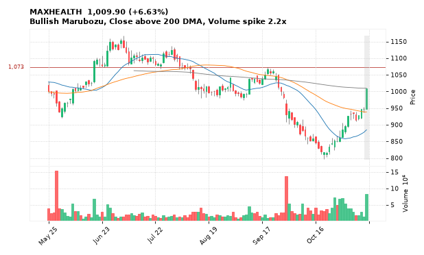

[🔔 Set alert on MAXHEALTH](https://claude.ai/artifact/Ewc5hHTPX6WkU1nVcDNQzq?s=MAXHEALTH&c=close%20above%201009.90) &nbsp;|&nbsp; [📈 Live chart (TradingView)](https://www.tradingview.com/chart/?symbol=NSE:MAXHEALTH) &nbsp;|&nbsp; [alert by email](mailto:testthetpassword@123?subject=ALERT%20MAXHEALTH&body=Alert%20me%20when%3A%20close%20above%201009.90%0A%0AEdit%20the%20line%20above%20if%20you%20want%2C%20then%20press%20Send.%20Checked%20on%20every%20day%27s%20closing%20data%3B%20a%20triggered%20alert%20appears%20at%20the%20top%20of%20the%208%20AM%20Technical%20Analysis%20email.%0A%0AExamples%20you%20can%20write%3A%0A%20%20close%20above%201150%20%20%7C%20%20close%20below%201080%20%20%7C%20%20high%20above%201200%20%20%7C%20%20low%20below%201050%0A%20%20close%20crosses%20above%20200%20DMA%20%20%7C%20%20close%20below%2050%20DMA%20%20%7C%20%20RSI%20below%2030%20%20%7C%20%20RSI%20above%2070%0A%20%20volume%20above%202x%20%20%7C%20%20change%20above%205%25%20%20%7C%20%20change%20below%20-4%25%20%20%7C%20%2052-week%20high%20%20%7C%20%20golden%20cross%0A%20%20combine%20with%20%27and%27%2C%20e.g.%20%20close%20above%201150%20and%20volume%20above%201.5x%0A%0AReference%3A%20MAXHEALTH%20closed%201009.90%20%28high%201009.90%2C%20low%20947.15%29.%0ATo%20cancel%20later%2C%20send%20an%20email%20with%20subject%3A%20CANCEL%20ALERT%20MAXHEALTH)

---

## 2. ASAHIINDIA - BULLISH
**1,165.05** (+4.94%) | vol 2.6x | RSI 83 | H 1,175.00 / L 1,107.10  
52-week high breakout, Volume spike 2.6x

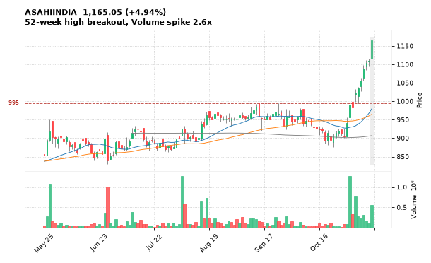

[🔔 Set alert on ASAHIINDIA](https://claude.ai/artifact/Ewc5hHTPX6WkU1nVcDNQzq?s=ASAHIINDIA&c=close%20above%201175.00) &nbsp;|&nbsp; [📈 Live chart (TradingView)](https://www.tradingview.com/chart/?symbol=NSE:ASAHIINDIA) &nbsp;|&nbsp; [alert by email](mailto:testthetpassword@123?subject=ALERT%20ASAHIINDIA&body=Alert%20me%20when%3A%20close%20above%201175.00%0A%0AEdit%20the%20line%20above%20if%20you%20want%2C%20then%20press%20Send.%20Checked%20on%20every%20day%27s%20closing%20data%3B%20a%20triggered%20alert%20appears%20at%20the%20top%20of%20the%208%20AM%20Technical%20Analysis%20email.%0A%0AExamples%20you%20can%20write%3A%0A%20%20close%20above%201150%20%20%7C%20%20close%20below%201080%20%20%7C%20%20high%20above%201200%20%20%7C%20%20low%20below%201050%0A%20%20close%20crosses%20above%20200%20DMA%20%20%7C%20%20close%20below%2050%20DMA%20%20%7C%20%20RSI%20below%2030%20%20%7C%20%20RSI%20above%2070%0A%20%20volume%20above%202x%20%20%7C%20%20change%20above%205%25%20%20%7C%20%20change%20below%20-4%25%20%20%7C%20%2052-week%20high%20%20%7C%20%20golden%20cross%0A%20%20combine%20with%20%27and%27%2C%20e.g.%20%20close%20above%201150%20and%20volume%20above%201.5x%0A%0AReference%3A%20ASAHIINDIA%20closed%201165.05%20%28high%201175.00%2C%20low%201107.10%29.%0ATo%20cancel%20later%2C%20send%20an%20email%20with%20subject%3A%20CANCEL%20ALERT%20ASAHIINDIA)

---

## 3. LICHSGFIN - BULLISH
**605.50** (+3.49%) | vol 2.6x | RSI 74 | H 608.55 / L 582.65  
52-week high breakout, Volume spike 2.6x

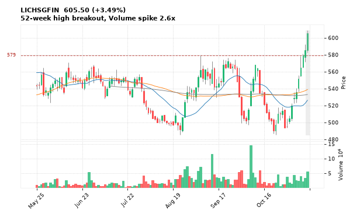

[🔔 Set alert on LICHSGFIN](https://claude.ai/artifact/Ewc5hHTPX6WkU1nVcDNQzq?s=LICHSGFIN&c=close%20above%20608.55) &nbsp;|&nbsp; [📈 Live chart (TradingView)](https://www.tradingview.com/chart/?symbol=NSE:LICHSGFIN) &nbsp;|&nbsp; [alert by email](mailto:testthetpassword@123?subject=ALERT%20LICHSGFIN&body=Alert%20me%20when%3A%20close%20above%20608.55%0A%0AEdit%20the%20line%20above%20if%20you%20want%2C%20then%20press%20Send.%20Checked%20on%20every%20day%27s%20closing%20data%3B%20a%20triggered%20alert%20appears%20at%20the%20top%20of%20the%208%20AM%20Technical%20Analysis%20email.%0A%0AExamples%20you%20can%20write%3A%0A%20%20close%20above%201150%20%20%7C%20%20close%20below%201080%20%20%7C%20%20high%20above%201200%20%20%7C%20%20low%20below%201050%0A%20%20close%20crosses%20above%20200%20DMA%20%20%7C%20%20close%20below%2050%20DMA%20%20%7C%20%20RSI%20below%2030%20%20%7C%20%20RSI%20above%2070%0A%20%20volume%20above%202x%20%20%7C%20%20change%20above%205%25%20%20%7C%20%20change%20below%20-4%25%20%20%7C%20%2052-week%20high%20%20%7C%20%20golden%20cross%0A%20%20combine%20with%20%27and%27%2C%20e.g.%20%20close%20above%201150%20and%20volume%20above%201.5x%0A%0AReference%3A%20LICHSGFIN%20closed%20605.50%20%28high%20608.55%2C%20low%20582.65%29.%0ATo%20cancel%20later%2C%20send%20an%20email%20with%20subject%3A%20CANCEL%20ALERT%20LICHSGFIN)

---

## 4. BELRISE - BULLISH
**235.09** (+9.24%) | vol 32.6x | RSI 61 | H 241.95 / L 221.10  
Close above 200 DMA, Volume spike 32.6x

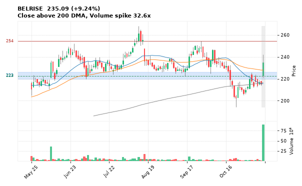

[🔔 Set alert on BELRISE](https://claude.ai/artifact/Ewc5hHTPX6WkU1nVcDNQzq?s=BELRISE&c=close%20above%20241.95) &nbsp;|&nbsp; [📈 Live chart (TradingView)](https://www.tradingview.com/chart/?symbol=NSE:BELRISE) &nbsp;|&nbsp; [alert by email](mailto:testthetpassword@123?subject=ALERT%20BELRISE&body=Alert%20me%20when%3A%20close%20above%20241.95%0A%0AEdit%20the%20line%20above%20if%20you%20want%2C%20then%20press%20Send.%20Checked%20on%20every%20day%27s%20closing%20data%3B%20a%20triggered%20alert%20appears%20at%20the%20top%20of%20the%208%20AM%20Technical%20Analysis%20email.%0A%0AExamples%20you%20can%20write%3A%0A%20%20close%20above%201150%20%20%7C%20%20close%20below%201080%20%20%7C%20%20high%20above%201200%20%20%7C%20%20low%20below%201050%0A%20%20close%20crosses%20above%20200%20DMA%20%20%7C%20%20close%20below%2050%20DMA%20%20%7C%20%20RSI%20below%2030%20%20%7C%20%20RSI%20above%2070%0A%20%20volume%20above%202x%20%20%7C%20%20change%20above%205%25%20%20%7C%20%20change%20below%20-4%25%20%20%7C%20%2052-week%20high%20%20%7C%20%20golden%20cross%0A%20%20combine%20with%20%27and%27%2C%20e.g.%20%20close%20above%201150%20and%20volume%20above%201.5x%0A%0AReference%3A%20BELRISE%20closed%20235.09%20%28high%20241.95%2C%20low%20221.10%29.%0ATo%20cancel%20later%2C%20send%20an%20email%20with%20subject%3A%20CANCEL%20ALERT%20BELRISE)

---

## 5. DEEPAKFERT - BULLISH
**1,352.80** (+7.21%) | vol 12.9x | RSI 63 | H 1,369.90 / L 1,282.00  
Close above 200 DMA, Volume spike 12.9x

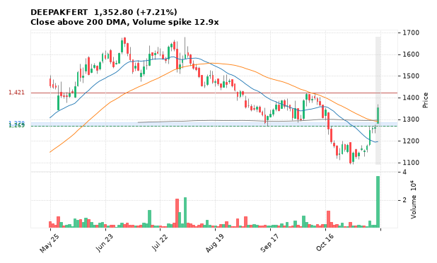

[🔔 Set alert on DEEPAKFERT](https://claude.ai/artifact/Ewc5hHTPX6WkU1nVcDNQzq?s=DEEPAKFERT&c=close%20above%201369.90) &nbsp;|&nbsp; [📈 Live chart (TradingView)](https://www.tradingview.com/chart/?symbol=NSE:DEEPAKFERT) &nbsp;|&nbsp; [alert by email](mailto:testthetpassword@123?subject=ALERT%20DEEPAKFERT&body=Alert%20me%20when%3A%20close%20above%201369.90%0A%0AEdit%20the%20line%20above%20if%20you%20want%2C%20then%20press%20Send.%20Checked%20on%20every%20day%27s%20closing%20data%3B%20a%20triggered%20alert%20appears%20at%20the%20top%20of%20the%208%20AM%20Technical%20Analysis%20email.%0A%0AExamples%20you%20can%20write%3A%0A%20%20close%20above%201150%20%20%7C%20%20close%20below%201080%20%20%7C%20%20high%20above%201200%20%20%7C%20%20low%20below%201050%0A%20%20close%20crosses%20above%20200%20DMA%20%20%7C%20%20close%20below%2050%20DMA%20%20%7C%20%20RSI%20below%2030%20%20%7C%20%20RSI%20above%2070%0A%20%20volume%20above%202x%20%20%7C%20%20change%20above%205%25%20%20%7C%20%20change%20below%20-4%25%20%20%7C%20%2052-week%20high%20%20%7C%20%20golden%20cross%0A%20%20combine%20with%20%27and%27%2C%20e.g.%20%20close%20above%201150%20and%20volume%20above%201.5x%0A%0AReference%3A%20DEEPAKFERT%20closed%201352.80%20%28high%201369.90%2C%20low%201282.00%29.%0ATo%20cancel%20later%2C%20send%20an%20email%20with%20subject%3A%20CANCEL%20ALERT%20DEEPAKFERT)

---

## 6. KIMS - BULLISH
**763.35** (+4.62%) | vol 2.8x | RSI 67 | H 767.90 / L 722.65  
Close above 200 DMA, Volume spike 2.8x

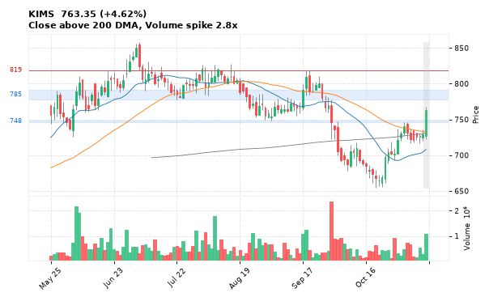

[🔔 Set alert on KIMS](https://claude.ai/artifact/Ewc5hHTPX6WkU1nVcDNQzq?s=KIMS&c=close%20above%20767.90) &nbsp;|&nbsp; [📈 Live chart (TradingView)](https://www.tradingview.com/chart/?symbol=NSE:KIMS) &nbsp;|&nbsp; [alert by email](mailto:testthetpassword@123?subject=ALERT%20KIMS&body=Alert%20me%20when%3A%20close%20above%20767.90%0A%0AEdit%20the%20line%20above%20if%20you%20want%2C%20then%20press%20Send.%20Checked%20on%20every%20day%27s%20closing%20data%3B%20a%20triggered%20alert%20appears%20at%20the%20top%20of%20the%208%20AM%20Technical%20Analysis%20email.%0A%0AExamples%20you%20can%20write%3A%0A%20%20close%20above%201150%20%20%7C%20%20close%20below%201080%20%20%7C%20%20high%20above%201200%20%20%7C%20%20low%20below%201050%0A%20%20close%20crosses%20above%20200%20DMA%20%20%7C%20%20close%20below%2050%20DMA%20%20%7C%20%20RSI%20below%2030%20%20%7C%20%20RSI%20above%2070%0A%20%20volume%20above%202x%20%20%7C%20%20change%20above%205%25%20%20%7C%20%20change%20below%20-4%25%20%20%7C%20%2052-week%20high%20%20%7C%20%20golden%20cross%0A%20%20combine%20with%20%27and%27%2C%20e.g.%20%20close%20above%201150%20and%20volume%20above%201.5x%0A%0AReference%3A%20KIMS%20closed%20763.35%20%28high%20767.90%2C%20low%20722.65%29.%0ATo%20cancel%20later%2C%20send%20an%20email%20with%20subject%3A%20CANCEL%20ALERT%20KIMS)

---

## 7. ITC - BULLISH
**295.10** (+3.54%) | vol 2.5x | RSI 73 | H 296.15 / L 283.85  
Close above 200 DMA, Volume spike 2.5x

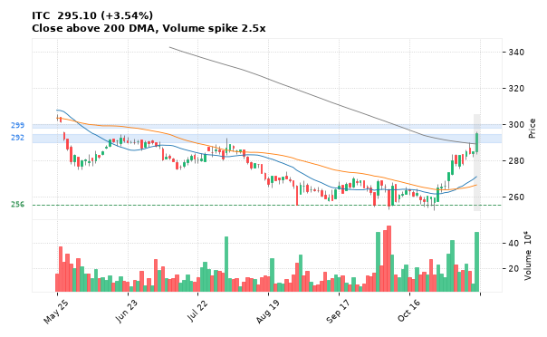

[🔔 Set alert on ITC](https://claude.ai/artifact/Ewc5hHTPX6WkU1nVcDNQzq?s=ITC&c=close%20above%20296.15) &nbsp;|&nbsp; [📈 Live chart (TradingView)](https://www.tradingview.com/chart/?symbol=NSE:ITC) &nbsp;|&nbsp; [alert by email](mailto:testthetpassword@123?subject=ALERT%20ITC&body=Alert%20me%20when%3A%20close%20above%20296.15%0A%0AEdit%20the%20line%20above%20if%20you%20want%2C%20then%20press%20Send.%20Checked%20on%20every%20day%27s%20closing%20data%3B%20a%20triggered%20alert%20appears%20at%20the%20top%20of%20the%208%20AM%20Technical%20Analysis%20email.%0A%0AExamples%20you%20can%20write%3A%0A%20%20close%20above%201150%20%20%7C%20%20close%20below%201080%20%20%7C%20%20high%20above%201200%20%20%7C%20%20low%20below%201050%0A%20%20close%20crosses%20above%20200%20DMA%20%20%7C%20%20close%20below%2050%20DMA%20%20%7C%20%20RSI%20below%2030%20%20%7C%20%20RSI%20above%2070%0A%20%20volume%20above%202x%20%20%7C%20%20change%20above%205%25%20%20%7C%20%20change%20below%20-4%25%20%20%7C%20%2052-week%20high%20%20%7C%20%20golden%20cross%0A%20%20combine%20with%20%27and%27%2C%20e.g.%20%20close%20above%201150%20and%20volume%20above%201.5x%0A%0AReference%3A%20ITC%20closed%20295.10%20%28high%20296.15%2C%20low%20283.85%29.%0ATo%20cancel%20later%2C%20send%20an%20email%20with%20subject%3A%20CANCEL%20ALERT%20ITC)

---

## 8. FORTIS - BULLISH
**803.20** (+5.13%) | vol 2.3x | RSI 56 | H 804.20 / L 764.00  
Bullish Marubozu, Volume spike 2.3x

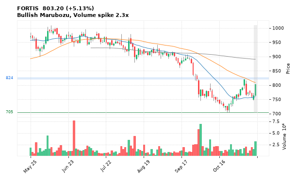

[🔔 Set alert on FORTIS](https://claude.ai/artifact/Ewc5hHTPX6WkU1nVcDNQzq?s=FORTIS&c=close%20above%20804.20) &nbsp;|&nbsp; [📈 Live chart (TradingView)](https://www.tradingview.com/chart/?symbol=NSE:FORTIS) &nbsp;|&nbsp; [alert by email](mailto:testthetpassword@123?subject=ALERT%20FORTIS&body=Alert%20me%20when%3A%20close%20above%20804.20%0A%0AEdit%20the%20line%20above%20if%20you%20want%2C%20then%20press%20Send.%20Checked%20on%20every%20day%27s%20closing%20data%3B%20a%20triggered%20alert%20appears%20at%20the%20top%20of%20the%208%20AM%20Technical%20Analysis%20email.%0A%0AExamples%20you%20can%20write%3A%0A%20%20close%20above%201150%20%20%7C%20%20close%20below%201080%20%20%7C%20%20high%20above%201200%20%20%7C%20%20low%20below%201050%0A%20%20close%20crosses%20above%20200%20DMA%20%20%7C%20%20close%20below%2050%20DMA%20%20%7C%20%20RSI%20below%2030%20%20%7C%20%20RSI%20above%2070%0A%20%20volume%20above%202x%20%20%7C%20%20change%20above%205%25%20%20%7C%20%20change%20below%20-4%25%20%20%7C%20%2052-week%20high%20%20%7C%20%20golden%20cross%0A%20%20combine%20with%20%27and%27%2C%20e.g.%20%20close%20above%201150%20and%20volume%20above%201.5x%0A%0AReference%3A%20FORTIS%20closed%20803.20%20%28high%20804.20%2C%20low%20764.00%29.%0ATo%20cancel%20later%2C%20send%20an%20email%20with%20subject%3A%20CANCEL%20ALERT%20FORTIS)

---

## 9. CARBORUNIV - BULLISH
**1,059.60** (-0.25%) | vol 1.8x | RSI 44 | H 1,064.20 / L 1,042.10  
Hammer, MACD bullish cross

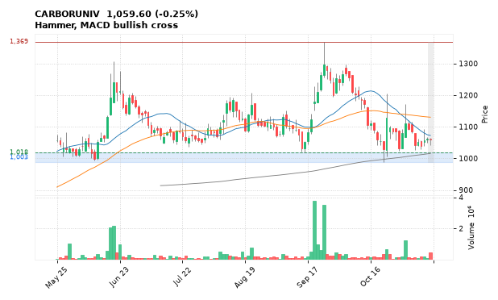

[🔔 Set alert on CARBORUNIV](https://claude.ai/artifact/Ewc5hHTPX6WkU1nVcDNQzq?s=CARBORUNIV&c=close%20above%201064.20) &nbsp;|&nbsp; [📈 Live chart (TradingView)](https://www.tradingview.com/chart/?symbol=NSE:CARBORUNIV) &nbsp;|&nbsp; [alert by email](mailto:testthetpassword@123?subject=ALERT%20CARBORUNIV&body=Alert%20me%20when%3A%20close%20above%201064.20%0A%0AEdit%20the%20line%20above%20if%20you%20want%2C%20then%20press%20Send.%20Checked%20on%20every%20day%27s%20closing%20data%3B%20a%20triggered%20alert%20appears%20at%20the%20top%20of%20the%208%20AM%20Technical%20Analysis%20email.%0A%0AExamples%20you%20can%20write%3A%0A%20%20close%20above%201150%20%20%7C%20%20close%20below%201080%20%20%7C%20%20high%20above%201200%20%20%7C%20%20low%20below%201050%0A%20%20close%20crosses%20above%20200%20DMA%20%20%7C%20%20close%20below%2050%20DMA%20%20%7C%20%20RSI%20below%2030%20%20%7C%20%20RSI%20above%2070%0A%20%20volume%20above%202x%20%20%7C%20%20change%20above%205%25%20%20%7C%20%20change%20below%20-4%25%20%20%7C%20%2052-week%20high%20%20%7C%20%20golden%20cross%0A%20%20combine%20with%20%27and%27%2C%20e.g.%20%20close%20above%201150%20and%20volume%20above%201.5x%0A%0AReference%3A%20CARBORUNIV%20closed%201059.60%20%28high%201064.20%2C%20low%201042.10%29.%0ATo%20cancel%20later%2C%20send%20an%20email%20with%20subject%3A%20CANCEL%20ALERT%20CARBORUNIV)

---

## 10. ABDL - BULLISH
**784.25** (+3.50%) | vol 1.7x | RSI 71 | H 792.00 / L 750.55  
52-week high breakout

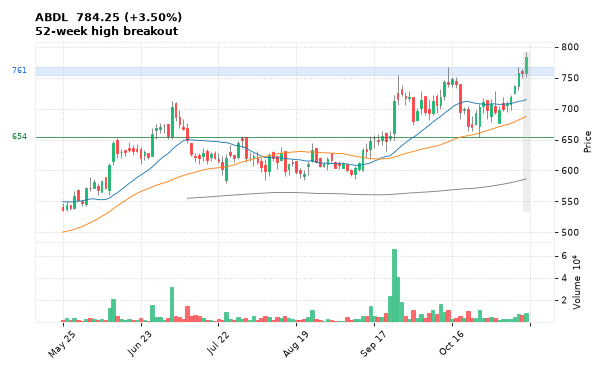

[🔔 Set alert on ABDL](https://claude.ai/artifact/Ewc5hHTPX6WkU1nVcDNQzq?s=ABDL&c=close%20above%20792.00) &nbsp;|&nbsp; [📈 Live chart (TradingView)](https://www.tradingview.com/chart/?symbol=NSE:ABDL) &nbsp;|&nbsp; [alert by email](mailto:testthetpassword@123?subject=ALERT%20ABDL&body=Alert%20me%20when%3A%20close%20above%20792.00%0A%0AEdit%20the%20line%20above%20if%20you%20want%2C%20then%20press%20Send.%20Checked%20on%20every%20day%27s%20closing%20data%3B%20a%20triggered%20alert%20appears%20at%20the%20top%20of%20the%208%20AM%20Technical%20Analysis%20email.%0A%0AExamples%20you%20can%20write%3A%0A%20%20close%20above%201150%20%20%7C%20%20close%20below%201080%20%20%7C%20%20high%20above%201200%20%20%7C%20%20low%20below%201050%0A%20%20close%20crosses%20above%20200%20DMA%20%20%7C%20%20close%20below%2050%20DMA%20%20%7C%20%20RSI%20below%2030%20%20%7C%20%20RSI%20above%2070%0A%20%20volume%20above%202x%20%20%7C%20%20change%20above%205%25%20%20%7C%20%20change%20below%20-4%25%20%20%7C%20%2052-week%20high%20%20%7C%20%20golden%20cross%0A%20%20combine%20with%20%27and%27%2C%20e.g.%20%20close%20above%201150%20and%20volume%20above%201.5x%0A%0AReference%3A%20ABDL%20closed%20784.25%20%28high%20792.00%2C%20low%20750.55%29.%0ATo%20cancel%20later%2C%20send%20an%20email%20with%20subject%3A%20CANCEL%20ALERT%20ABDL)

---

## 11. GLAND - BULLISH
**3,385.90** (+1.55%) | vol 0.9x | RSI 72 | H 3,429.00 / L 3,341.00  
52-week high breakout

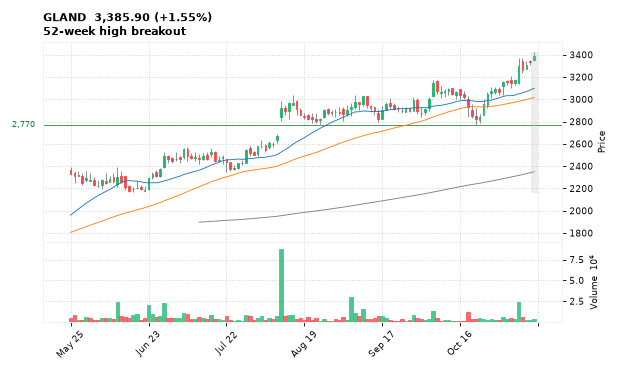

[🔔 Set alert on GLAND](https://claude.ai/artifact/Ewc5hHTPX6WkU1nVcDNQzq?s=GLAND&c=close%20above%203429.00) &nbsp;|&nbsp; [📈 Live chart (TradingView)](https://www.tradingview.com/chart/?symbol=NSE:GLAND) &nbsp;|&nbsp; [alert by email](mailto:testthetpassword@123?subject=ALERT%20GLAND&body=Alert%20me%20when%3A%20close%20above%203429.00%0A%0AEdit%20the%20line%20above%20if%20you%20want%2C%20then%20press%20Send.%20Checked%20on%20every%20day%27s%20closing%20data%3B%20a%20triggered%20alert%20appears%20at%20the%20top%20of%20the%208%20AM%20Technical%20Analysis%20email.%0A%0AExamples%20you%20can%20write%3A%0A%20%20close%20above%201150%20%20%7C%20%20close%20below%201080%20%20%7C%20%20high%20above%201200%20%20%7C%20%20low%20below%201050%0A%20%20close%20crosses%20above%20200%20DMA%20%20%7C%20%20close%20below%2050%20DMA%20%20%7C%20%20RSI%20below%2030%20%20%7C%20%20RSI%20above%2070%0A%20%20volume%20above%202x%20%20%7C%20%20change%20above%205%25%20%20%7C%20%20change%20below%20-4%25%20%20%7C%20%2052-week%20high%20%20%7C%20%20golden%20cross%0A%20%20combine%20with%20%27and%27%2C%20e.g.%20%20close%20above%201150%20and%20volume%20above%201.5x%0A%0AReference%3A%20GLAND%20closed%203385.90%20%28high%203429.00%2C%20low%203341.00%29.%0ATo%20cancel%20later%2C%20send%20an%20email%20with%20subject%3A%20CANCEL%20ALERT%20GLAND)

---

## 12. UNIONBANK - BULLISH
**205.60** (+1.28%) | vol 0.7x | RSI 75 | H 206.49 / L 203.10  
52-week high breakout

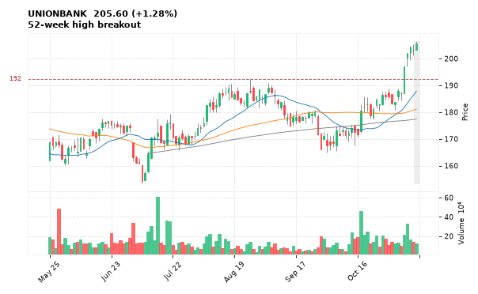

[🔔 Set alert on UNIONBANK](https://claude.ai/artifact/Ewc5hHTPX6WkU1nVcDNQzq?s=UNIONBANK&c=close%20above%20206.49) &nbsp;|&nbsp; [📈 Live chart (TradingView)](https://www.tradingview.com/chart/?symbol=NSE:UNIONBANK) &nbsp;|&nbsp; [alert by email](mailto:testthetpassword@123?subject=ALERT%20UNIONBANK&body=Alert%20me%20when%3A%20close%20above%20206.49%0A%0AEdit%20the%20line%20above%20if%20you%20want%2C%20then%20press%20Send.%20Checked%20on%20every%20day%27s%20closing%20data%3B%20a%20triggered%20alert%20appears%20at%20the%20top%20of%20the%208%20AM%20Technical%20Analysis%20email.%0A%0AExamples%20you%20can%20write%3A%0A%20%20close%20above%201150%20%20%7C%20%20close%20below%201080%20%20%7C%20%20high%20above%201200%20%20%7C%20%20low%20below%201050%0A%20%20close%20crosses%20above%20200%20DMA%20%20%7C%20%20close%20below%2050%20DMA%20%20%7C%20%20RSI%20below%2030%20%20%7C%20%20RSI%20above%2070%0A%20%20volume%20above%202x%20%20%7C%20%20change%20above%205%25%20%20%7C%20%20change%20below%20-4%25%20%20%7C%20%2052-week%20high%20%20%7C%20%20golden%20cross%0A%20%20combine%20with%20%27and%27%2C%20e.g.%20%20close%20above%201150%20and%20volume%20above%201.5x%0A%0AReference%3A%20UNIONBANK%20closed%20205.60%20%28high%20206.49%2C%20low%20203.10%29.%0ATo%20cancel%20later%2C%20send%20an%20email%20with%20subject%3A%20CANCEL%20ALERT%20UNIONBANK)

---

## 13. KOTAKBANK - BULLISH
**494.20** (+1.16%) | vol 0.6x | RSI 76 | H 497.90 / L 489.55  
52-week high breakout

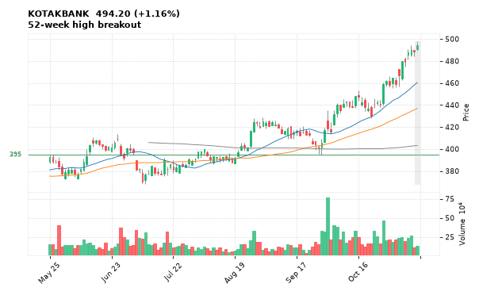

[🔔 Set alert on KOTAKBANK](https://claude.ai/artifact/Ewc5hHTPX6WkU1nVcDNQzq?s=KOTAKBANK&c=close%20above%20497.90) &nbsp;|&nbsp; [📈 Live chart (TradingView)](https://www.tradingview.com/chart/?symbol=NSE:KOTAKBANK) &nbsp;|&nbsp; [alert by email](mailto:testthetpassword@123?subject=ALERT%20KOTAKBANK&body=Alert%20me%20when%3A%20close%20above%20497.90%0A%0AEdit%20the%20line%20above%20if%20you%20want%2C%20then%20press%20Send.%20Checked%20on%20every%20day%27s%20closing%20data%3B%20a%20triggered%20alert%20appears%20at%20the%20top%20of%20the%208%20AM%20Technical%20Analysis%20email.%0A%0AExamples%20you%20can%20write%3A%0A%20%20close%20above%201150%20%20%7C%20%20close%20below%201080%20%20%7C%20%20high%20above%201200%20%20%7C%20%20low%20below%201050%0A%20%20close%20crosses%20above%20200%20DMA%20%20%7C%20%20close%20below%2050%20DMA%20%20%7C%20%20RSI%20below%2030%20%20%7C%20%20RSI%20above%2070%0A%20%20volume%20above%202x%20%20%7C%20%20change%20above%205%25%20%20%7C%20%20change%20below%20-4%25%20%20%7C%20%2052-week%20high%20%20%7C%20%20golden%20cross%0A%20%20combine%20with%20%27and%27%2C%20e.g.%20%20close%20above%201150%20and%20volume%20above%201.5x%0A%0AReference%3A%20KOTAKBANK%20closed%20494.20%20%28high%20497.90%2C%20low%20489.55%29.%0ATo%20cancel%20later%2C%20send%20an%20email%20with%20subject%3A%20CANCEL%20ALERT%20KOTAKBANK)

---

## 14. TECHM - BULLISH
**1,776.40** (+0.70%) | vol 0.4x | RSI 57 | H 1,792.80 / L 1,755.50  
Bullish Engulfing

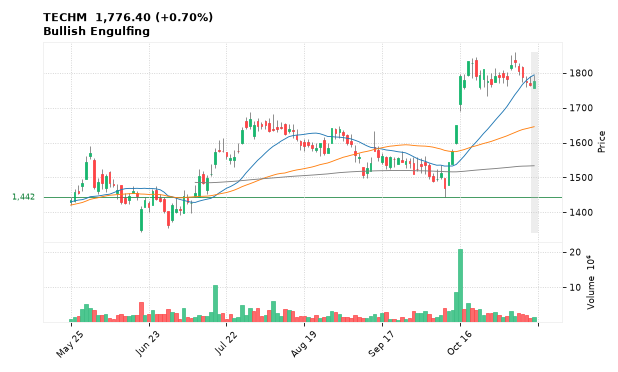

[🔔 Set alert on TECHM](https://claude.ai/artifact/Ewc5hHTPX6WkU1nVcDNQzq?s=TECHM&c=close%20above%201792.80) &nbsp;|&nbsp; [📈 Live chart (TradingView)](https://www.tradingview.com/chart/?symbol=NSE:TECHM) &nbsp;|&nbsp; [alert by email](mailto:testthetpassword@123?subject=ALERT%20TECHM&body=Alert%20me%20when%3A%20close%20above%201792.80%0A%0AEdit%20the%20line%20above%20if%20you%20want%2C%20then%20press%20Send.%20Checked%20on%20every%20day%27s%20closing%20data%3B%20a%20triggered%20alert%20appears%20at%20the%20top%20of%20the%208%20AM%20Technical%20Analysis%20email.%0A%0AExamples%20you%20can%20write%3A%0A%20%20close%20above%201150%20%20%7C%20%20close%20below%201080%20%20%7C%20%20high%20above%201200%20%20%7C%20%20low%20below%201050%0A%20%20close%20crosses%20above%20200%20DMA%20%20%7C%20%20close%20below%2050%20DMA%20%20%7C%20%20RSI%20below%2030%20%20%7C%20%20RSI%20above%2070%0A%20%20volume%20above%202x%20%20%7C%20%20change%20above%205%25%20%20%7C%20%20change%20below%20-4%25%20%20%7C%20%2052-week%20high%20%20%7C%20%20golden%20cross%0A%20%20combine%20with%20%27and%27%2C%20e.g.%20%20close%20above%201150%20and%20volume%20above%201.5x%0A%0AReference%3A%20TECHM%20closed%201776.40%20%28high%201792.80%2C%20low%201755.50%29.%0ATo%20cancel%20later%2C%20send%20an%20email%20with%20subject%3A%20CANCEL%20ALERT%20TECHM)

---

## 15. NATCOPHARM - BULLISH
**828.65** (+2.25%) | vol 7.1x | RSI 65 | H 881.80 / L 809.15  
Gravestone Doji, Volume spike 7.1x

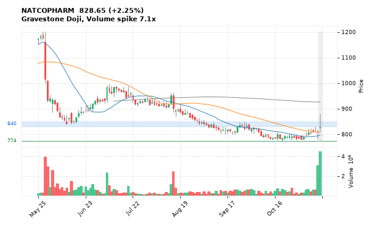

[🔔 Set alert on NATCOPHARM](https://claude.ai/artifact/Ewc5hHTPX6WkU1nVcDNQzq?s=NATCOPHARM&c=close%20above%20881.80) &nbsp;|&nbsp; [📈 Live chart (TradingView)](https://www.tradingview.com/chart/?symbol=NSE:NATCOPHARM) &nbsp;|&nbsp; [alert by email](mailto:testthetpassword@123?subject=ALERT%20NATCOPHARM&body=Alert%20me%20when%3A%20close%20above%20881.80%0A%0AEdit%20the%20line%20above%20if%20you%20want%2C%20then%20press%20Send.%20Checked%20on%20every%20day%27s%20closing%20data%3B%20a%20triggered%20alert%20appears%20at%20the%20top%20of%20the%208%20AM%20Technical%20Analysis%20email.%0A%0AExamples%20you%20can%20write%3A%0A%20%20close%20above%201150%20%20%7C%20%20close%20below%201080%20%20%7C%20%20high%20above%201200%20%20%7C%20%20low%20below%201050%0A%20%20close%20crosses%20above%20200%20DMA%20%20%7C%20%20close%20below%2050%20DMA%20%20%7C%20%20RSI%20below%2030%20%20%7C%20%20RSI%20above%2070%0A%20%20volume%20above%202x%20%20%7C%20%20change%20above%205%25%20%20%7C%20%20change%20below%20-4%25%20%20%7C%20%2052-week%20high%20%20%7C%20%20golden%20cross%0A%20%20combine%20with%20%27and%27%2C%20e.g.%20%20close%20above%201150%20and%20volume%20above%201.5x%0A%0AReference%3A%20NATCOPHARM%20closed%20828.65%20%28high%20881.80%2C%20low%20809.15%29.%0ATo%20cancel%20later%2C%20send%20an%20email%20with%20subject%3A%20CANCEL%20ALERT%20NATCOPHARM)

---

## 16. KAYNES - BEARISH
**2,980.00** (-13.12%) | vol 15.3x | RSI 37 | H 3,087.00 / L 2,744.00  
Hanging Man, 52-week low breakdown, Volume spike 15.3x

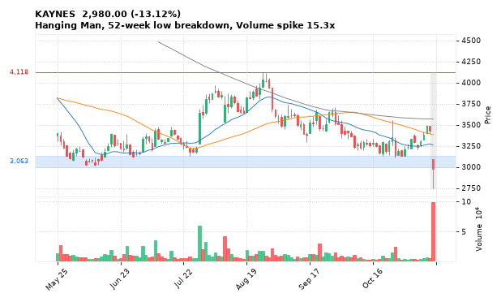

[🔔 Set alert on KAYNES](https://claude.ai/artifact/Ewc5hHTPX6WkU1nVcDNQzq?s=KAYNES&c=close%20below%202744.00) &nbsp;|&nbsp; [📈 Live chart (TradingView)](https://www.tradingview.com/chart/?symbol=NSE:KAYNES) &nbsp;|&nbsp; [alert by email](mailto:testthetpassword@123?subject=ALERT%20KAYNES&body=Alert%20me%20when%3A%20close%20below%202744.00%0A%0AEdit%20the%20line%20above%20if%20you%20want%2C%20then%20press%20Send.%20Checked%20on%20every%20day%27s%20closing%20data%3B%20a%20triggered%20alert%20appears%20at%20the%20top%20of%20the%208%20AM%20Technical%20Analysis%20email.%0A%0AExamples%20you%20can%20write%3A%0A%20%20close%20above%201150%20%20%7C%20%20close%20below%201080%20%20%7C%20%20high%20above%201200%20%20%7C%20%20low%20below%201050%0A%20%20close%20crosses%20above%20200%20DMA%20%20%7C%20%20close%20below%2050%20DMA%20%20%7C%20%20RSI%20below%2030%20%20%7C%20%20RSI%20above%2070%0A%20%20volume%20above%202x%20%20%7C%20%20change%20above%205%25%20%20%7C%20%20change%20below%20-4%25%20%20%7C%20%2052-week%20high%20%20%7C%20%20golden%20cross%0A%20%20combine%20with%20%27and%27%2C%20e.g.%20%20close%20above%201150%20and%20volume%20above%201.5x%0A%0AReference%3A%20KAYNES%20closed%202980.00%20%28high%203087.00%2C%20low%202744.00%29.%0ATo%20cancel%20later%2C%20send%20an%20email%20with%20subject%3A%20CANCEL%20ALERT%20KAYNES)

---

## 17. LAURUSLABS - BEARISH
**2,220.00** (-8.42%) | vol 2.6x | RSI 50 | H 2,439.00 / L 2,190.00  
Bearish Engulfing, MACD bearish cross, Volume spike 2.6x

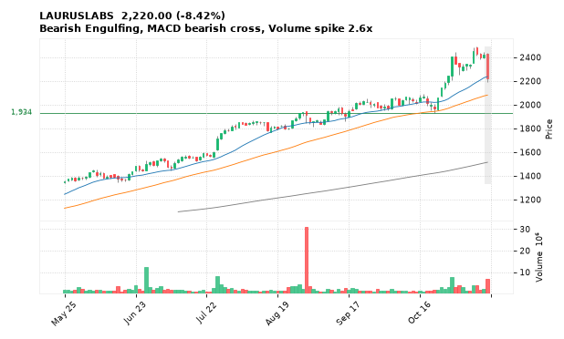

[🔔 Set alert on LAURUSLABS](https://claude.ai/artifact/Ewc5hHTPX6WkU1nVcDNQzq?s=LAURUSLABS&c=close%20below%202190.00) &nbsp;|&nbsp; [📈 Live chart (TradingView)](https://www.tradingview.com/chart/?symbol=NSE:LAURUSLABS) &nbsp;|&nbsp; [alert by email](mailto:testthetpassword@123?subject=ALERT%20LAURUSLABS&body=Alert%20me%20when%3A%20close%20below%202190.00%0A%0AEdit%20the%20line%20above%20if%20you%20want%2C%20then%20press%20Send.%20Checked%20on%20every%20day%27s%20closing%20data%3B%20a%20triggered%20alert%20appears%20at%20the%20top%20of%20the%208%20AM%20Technical%20Analysis%20email.%0A%0AExamples%20you%20can%20write%3A%0A%20%20close%20above%201150%20%20%7C%20%20close%20below%201080%20%20%7C%20%20high%20above%201200%20%20%7C%20%20low%20below%201050%0A%20%20close%20crosses%20above%20200%20DMA%20%20%7C%20%20close%20below%2050%20DMA%20%20%7C%20%20RSI%20below%2030%20%20%7C%20%20RSI%20above%2070%0A%20%20volume%20above%202x%20%20%7C%20%20change%20above%205%25%20%20%7C%20%20change%20below%20-4%25%20%20%7C%20%2052-week%20high%20%20%7C%20%20golden%20cross%0A%20%20combine%20with%20%27and%27%2C%20e.g.%20%20close%20above%201150%20and%20volume%20above%201.5x%0A%0AReference%3A%20LAURUSLABS%20closed%202220.00%20%28high%202439.00%2C%20low%202190.00%29.%0ATo%20cancel%20later%2C%20send%20an%20email%20with%20subject%3A%20CANCEL%20ALERT%20LAURUSLABS)

---

## 18. PREMIERENE - BEARISH
**822.50** (-8.19%) | vol 3.0x | RSI 34 | H 895.90 / L 813.70  
Bearish Engulfing, Volume spike 3.0x

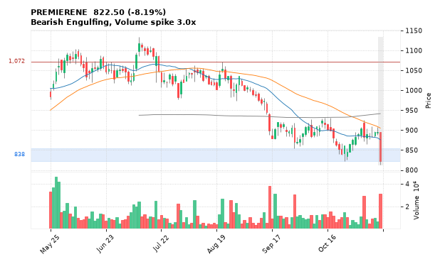

[🔔 Set alert on PREMIERENE](https://claude.ai/artifact/Ewc5hHTPX6WkU1nVcDNQzq?s=PREMIERENE&c=close%20below%20813.70) &nbsp;|&nbsp; [📈 Live chart (TradingView)](https://www.tradingview.com/chart/?symbol=NSE:PREMIERENE) &nbsp;|&nbsp; [alert by email](mailto:testthetpassword@123?subject=ALERT%20PREMIERENE&body=Alert%20me%20when%3A%20close%20below%20813.70%0A%0AEdit%20the%20line%20above%20if%20you%20want%2C%20then%20press%20Send.%20Checked%20on%20every%20day%27s%20closing%20data%3B%20a%20triggered%20alert%20appears%20at%20the%20top%20of%20the%208%20AM%20Technical%20Analysis%20email.%0A%0AExamples%20you%20can%20write%3A%0A%20%20close%20above%201150%20%20%7C%20%20close%20below%201080%20%20%7C%20%20high%20above%201200%20%20%7C%20%20low%20below%201050%0A%20%20close%20crosses%20above%20200%20DMA%20%20%7C%20%20close%20below%2050%20DMA%20%20%7C%20%20RSI%20below%2030%20%20%7C%20%20RSI%20above%2070%0A%20%20volume%20above%202x%20%20%7C%20%20change%20above%205%25%20%20%7C%20%20change%20below%20-4%25%20%20%7C%20%2052-week%20high%20%20%7C%20%20golden%20cross%0A%20%20combine%20with%20%27and%27%2C%20e.g.%20%20close%20above%201150%20and%20volume%20above%201.5x%0A%0AReference%3A%20PREMIERENE%20closed%20822.50%20%28high%20895.90%2C%20low%20813.70%29.%0ATo%20cancel%20later%2C%20send%20an%20email%20with%20subject%3A%20CANCEL%20ALERT%20PREMIERENE)

---

## 19. ABB - BEARISH
**6,895.00** (-2.26%) | vol 2.3x | RSI 53 | H 7,107.00 / L 6,803.00  
Bearish Engulfing, Volume spike 2.3x

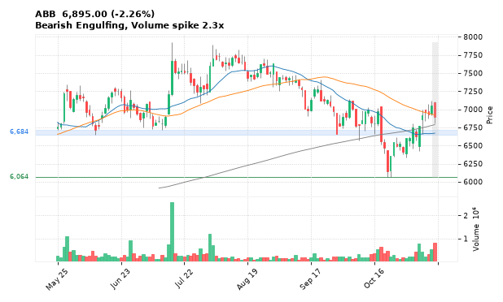

[🔔 Set alert on ABB](https://claude.ai/artifact/Ewc5hHTPX6WkU1nVcDNQzq?s=ABB&c=close%20below%206803.00) &nbsp;|&nbsp; [📈 Live chart (TradingView)](https://www.tradingview.com/chart/?symbol=NSE:ABB) &nbsp;|&nbsp; [alert by email](mailto:testthetpassword@123?subject=ALERT%20ABB&body=Alert%20me%20when%3A%20close%20below%206803.00%0A%0AEdit%20the%20line%20above%20if%20you%20want%2C%20then%20press%20Send.%20Checked%20on%20every%20day%27s%20closing%20data%3B%20a%20triggered%20alert%20appears%20at%20the%20top%20of%20the%208%20AM%20Technical%20Analysis%20email.%0A%0AExamples%20you%20can%20write%3A%0A%20%20close%20above%201150%20%20%7C%20%20close%20below%201080%20%20%7C%20%20high%20above%201200%20%20%7C%20%20low%20below%201050%0A%20%20close%20crosses%20above%20200%20DMA%20%20%7C%20%20close%20below%2050%20DMA%20%20%7C%20%20RSI%20below%2030%20%20%7C%20%20RSI%20above%2070%0A%20%20volume%20above%202x%20%20%7C%20%20change%20above%205%25%20%20%7C%20%20change%20below%20-4%25%20%20%7C%20%2052-week%20high%20%20%7C%20%20golden%20cross%0A%20%20combine%20with%20%27and%27%2C%20e.g.%20%20close%20above%201150%20and%20volume%20above%201.5x%0A%0AReference%3A%20ABB%20closed%206895.00%20%28high%207107.00%2C%20low%206803.00%29.%0ATo%20cancel%20later%2C%20send%20an%20email%20with%20subject%3A%20CANCEL%20ALERT%20ABB)

---

## 20. PAYTM - BEARISH
**1,890.80** (-2.53%) | vol 1.6x | RSI 65 | H 1,956.10 / L 1,872.20  
Bearish Engulfing, RSI down through 70

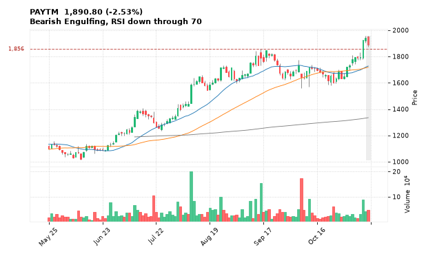

[🔔 Set alert on PAYTM](https://claude.ai/artifact/Ewc5hHTPX6WkU1nVcDNQzq?s=PAYTM&c=close%20below%201872.20) &nbsp;|&nbsp; [📈 Live chart (TradingView)](https://www.tradingview.com/chart/?symbol=NSE:PAYTM) &nbsp;|&nbsp; [alert by email](mailto:testthetpassword@123?subject=ALERT%20PAYTM&body=Alert%20me%20when%3A%20close%20below%201872.20%0A%0AEdit%20the%20line%20above%20if%20you%20want%2C%20then%20press%20Send.%20Checked%20on%20every%20day%27s%20closing%20data%3B%20a%20triggered%20alert%20appears%20at%20the%20top%20of%20the%208%20AM%20Technical%20Analysis%20email.%0A%0AExamples%20you%20can%20write%3A%0A%20%20close%20above%201150%20%20%7C%20%20close%20below%201080%20%20%7C%20%20high%20above%201200%20%20%7C%20%20low%20below%201050%0A%20%20close%20crosses%20above%20200%20DMA%20%20%7C%20%20close%20below%2050%20DMA%20%20%7C%20%20RSI%20below%2030%20%20%7C%20%20RSI%20above%2070%0A%20%20volume%20above%202x%20%20%7C%20%20change%20above%205%25%20%20%7C%20%20change%20below%20-4%25%20%20%7C%20%2052-week%20high%20%20%7C%20%20golden%20cross%0A%20%20combine%20with%20%27and%27%2C%20e.g.%20%20close%20above%201150%20and%20volume%20above%201.5x%0A%0AReference%3A%20PAYTM%20closed%201890.80%20%28high%201956.10%2C%20low%201872.20%29.%0ATo%20cancel%20later%2C%20send%20an%20email%20with%20subject%3A%20CANCEL%20ALERT%20PAYTM)

---

## 21. MEESHO - BEARISH
**251.19** (-2.29%) | vol 1.2x | RSI 66 | H 261.10 / L 250.10  
Bearish Engulfing, RSI down through 70

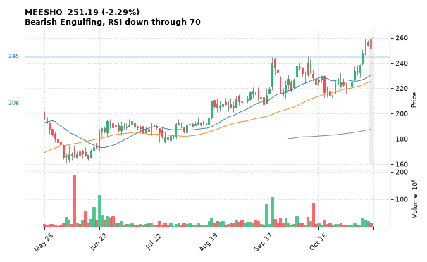

[🔔 Set alert on MEESHO](https://claude.ai/artifact/Ewc5hHTPX6WkU1nVcDNQzq?s=MEESHO&c=close%20below%20250.10) &nbsp;|&nbsp; [📈 Live chart (TradingView)](https://www.tradingview.com/chart/?symbol=NSE:MEESHO) &nbsp;|&nbsp; [alert by email](mailto:testthetpassword@123?subject=ALERT%20MEESHO&body=Alert%20me%20when%3A%20close%20below%20250.10%0A%0AEdit%20the%20line%20above%20if%20you%20want%2C%20then%20press%20Send.%20Checked%20on%20every%20day%27s%20closing%20data%3B%20a%20triggered%20alert%20appears%20at%20the%20top%20of%20the%208%20AM%20Technical%20Analysis%20email.%0A%0AExamples%20you%20can%20write%3A%0A%20%20close%20above%201150%20%20%7C%20%20close%20below%201080%20%20%7C%20%20high%20above%201200%20%20%7C%20%20low%20below%201050%0A%20%20close%20crosses%20above%20200%20DMA%20%20%7C%20%20close%20below%2050%20DMA%20%20%7C%20%20RSI%20below%2030%20%20%7C%20%20RSI%20above%2070%0A%20%20volume%20above%202x%20%20%7C%20%20change%20above%205%25%20%20%7C%20%20change%20below%20-4%25%20%20%7C%20%2052-week%20high%20%20%7C%20%20golden%20cross%0A%20%20combine%20with%20%27and%27%2C%20e.g.%20%20close%20above%201150%20and%20volume%20above%201.5x%0A%0AReference%3A%20MEESHO%20closed%20251.19%20%28high%20261.10%2C%20low%20250.10%29.%0ATo%20cancel%20later%2C%20send%20an%20email%20with%20subject%3A%20CANCEL%20ALERT%20MEESHO)

---

## 22. DIVISLAB - BEARISH
**11,080.00** (-3.16%) | vol 1.1x | RSI 69 | H 11,544.50 / L 10,954.00  
Bearish Engulfing, RSI down through 70

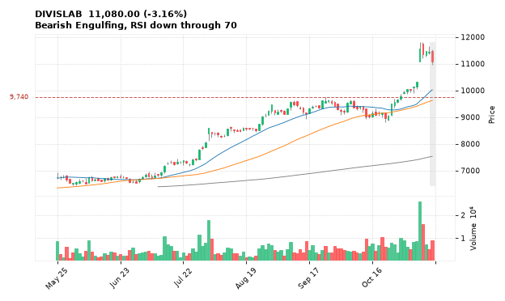

[🔔 Set alert on DIVISLAB](https://claude.ai/artifact/Ewc5hHTPX6WkU1nVcDNQzq?s=DIVISLAB&c=close%20below%2010954.00) &nbsp;|&nbsp; [📈 Live chart (TradingView)](https://www.tradingview.com/chart/?symbol=NSE:DIVISLAB) &nbsp;|&nbsp; [alert by email](mailto:testthetpassword@123?subject=ALERT%20DIVISLAB&body=Alert%20me%20when%3A%20close%20below%2010954.00%0A%0AEdit%20the%20line%20above%20if%20you%20want%2C%20then%20press%20Send.%20Checked%20on%20every%20day%27s%20closing%20data%3B%20a%20triggered%20alert%20appears%20at%20the%20top%20of%20the%208%20AM%20Technical%20Analysis%20email.%0A%0AExamples%20you%20can%20write%3A%0A%20%20close%20above%201150%20%20%7C%20%20close%20below%201080%20%20%7C%20%20high%20above%201200%20%20%7C%20%20low%20below%201050%0A%20%20close%20crosses%20above%20200%20DMA%20%20%7C%20%20close%20below%2050%20DMA%20%20%7C%20%20RSI%20below%2030%20%20%7C%20%20RSI%20above%2070%0A%20%20volume%20above%202x%20%20%7C%20%20change%20above%205%25%20%20%7C%20%20change%20below%20-4%25%20%20%7C%20%2052-week%20high%20%20%7C%20%20golden%20cross%0A%20%20combine%20with%20%27and%27%2C%20e.g.%20%20close%20above%201150%20and%20volume%20above%201.5x%0A%0AReference%3A%20DIVISLAB%20closed%2011080.00%20%28high%2011544.50%2C%20low%2010954.00%29.%0ATo%20cancel%20later%2C%20send%20an%20email%20with%20subject%3A%20CANCEL%20ALERT%20DIVISLAB)

---

## 23. CDSL - BEARISH
**1,433.90** (-0.91%) | vol 1.0x | RSI 69 | H 1,456.70 / L 1,419.00  
Evening Star, RSI down through 70

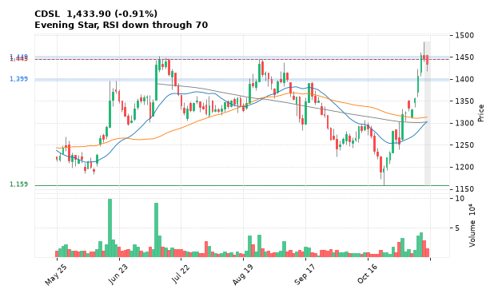

[🔔 Set alert on CDSL](https://claude.ai/artifact/Ewc5hHTPX6WkU1nVcDNQzq?s=CDSL&c=close%20below%201419.00) &nbsp;|&nbsp; [📈 Live chart (TradingView)](https://www.tradingview.com/chart/?symbol=NSE:CDSL) &nbsp;|&nbsp; [alert by email](mailto:testthetpassword@123?subject=ALERT%20CDSL&body=Alert%20me%20when%3A%20close%20below%201419.00%0A%0AEdit%20the%20line%20above%20if%20you%20want%2C%20then%20press%20Send.%20Checked%20on%20every%20day%27s%20closing%20data%3B%20a%20triggered%20alert%20appears%20at%20the%20top%20of%20the%208%20AM%20Technical%20Analysis%20email.%0A%0AExamples%20you%20can%20write%3A%0A%20%20close%20above%201150%20%20%7C%20%20close%20below%201080%20%20%7C%20%20high%20above%201200%20%20%7C%20%20low%20below%201050%0A%20%20close%20crosses%20above%20200%20DMA%20%20%7C%20%20close%20below%2050%20DMA%20%20%7C%20%20RSI%20below%2030%20%20%7C%20%20RSI%20above%2070%0A%20%20volume%20above%202x%20%20%7C%20%20change%20above%205%25%20%20%7C%20%20change%20below%20-4%25%20%20%7C%20%2052-week%20high%20%20%7C%20%20golden%20cross%0A%20%20combine%20with%20%27and%27%2C%20e.g.%20%20close%20above%201150%20and%20volume%20above%201.5x%0A%0AReference%3A%20CDSL%20closed%201433.90%20%28high%201456.70%2C%20low%201419.00%29.%0ATo%20cancel%20later%2C%20send%20an%20email%20with%20subject%3A%20CANCEL%20ALERT%20CDSL)

---

## 24. AFCONS - BEARISH
**215.63** (-2.93%) | vol 0.6x | RSI 40 | H 222.14 / L 215.00  
Bearish Marubozu, Bearish Engulfing

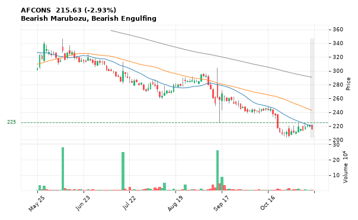

[🔔 Set alert on AFCONS](https://claude.ai/artifact/Ewc5hHTPX6WkU1nVcDNQzq?s=AFCONS&c=close%20below%20215.00) &nbsp;|&nbsp; [📈 Live chart (TradingView)](https://www.tradingview.com/chart/?symbol=NSE:AFCONS) &nbsp;|&nbsp; [alert by email](mailto:testthetpassword@123?subject=ALERT%20AFCONS&body=Alert%20me%20when%3A%20close%20below%20215.00%0A%0AEdit%20the%20line%20above%20if%20you%20want%2C%20then%20press%20Send.%20Checked%20on%20every%20day%27s%20closing%20data%3B%20a%20triggered%20alert%20appears%20at%20the%20top%20of%20the%208%20AM%20Technical%20Analysis%20email.%0A%0AExamples%20you%20can%20write%3A%0A%20%20close%20above%201150%20%20%7C%20%20close%20below%201080%20%20%7C%20%20high%20above%201200%20%20%7C%20%20low%20below%201050%0A%20%20close%20crosses%20above%20200%20DMA%20%20%7C%20%20close%20below%2050%20DMA%20%20%7C%20%20RSI%20below%2030%20%20%7C%20%20RSI%20above%2070%0A%20%20volume%20above%202x%20%20%7C%20%20change%20above%205%25%20%20%7C%20%20change%20below%20-4%25%20%20%7C%20%2052-week%20high%20%20%7C%20%20golden%20cross%0A%20%20combine%20with%20%27and%27%2C%20e.g.%20%20close%20above%201150%20and%20volume%20above%201.5x%0A%0AReference%3A%20AFCONS%20closed%20215.63%20%28high%20222.14%2C%20low%20215.00%29.%0ATo%20cancel%20later%2C%20send%20an%20email%20with%20subject%3A%20CANCEL%20ALERT%20AFCONS)

---

## 25. BSE - BEARISH
**3,887.40** (-1.28%) | vol 0.6x | RSI 70 | H 3,969.40 / L 3,862.40  
Bearish Engulfing, RSI down through 70

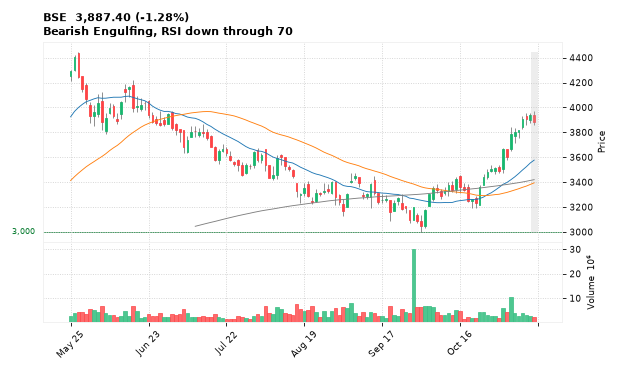

[🔔 Set alert on BSE](https://claude.ai/artifact/Ewc5hHTPX6WkU1nVcDNQzq?s=BSE&c=close%20below%203862.40) &nbsp;|&nbsp; [📈 Live chart (TradingView)](https://www.tradingview.com/chart/?symbol=NSE:BSE) &nbsp;|&nbsp; [alert by email](mailto:testthetpassword@123?subject=ALERT%20BSE&body=Alert%20me%20when%3A%20close%20below%203862.40%0A%0AEdit%20the%20line%20above%20if%20you%20want%2C%20then%20press%20Send.%20Checked%20on%20every%20day%27s%20closing%20data%3B%20a%20triggered%20alert%20appears%20at%20the%20top%20of%20the%208%20AM%20Technical%20Analysis%20email.%0A%0AExamples%20you%20can%20write%3A%0A%20%20close%20above%201150%20%20%7C%20%20close%20below%201080%20%20%7C%20%20high%20above%201200%20%20%7C%20%20low%20below%201050%0A%20%20close%20crosses%20above%20200%20DMA%20%20%7C%20%20close%20below%2050%20DMA%20%20%7C%20%20RSI%20below%2030%20%20%7C%20%20RSI%20above%2070%0A%20%20volume%20above%202x%20%20%7C%20%20change%20above%205%25%20%20%7C%20%20change%20below%20-4%25%20%20%7C%20%2052-week%20high%20%20%7C%20%20golden%20cross%0A%20%20combine%20with%20%27and%27%2C%20e.g.%20%20close%20above%201150%20and%20volume%20above%201.5x%0A%0AReference%3A%20BSE%20closed%203887.40%20%28high%203969.40%2C%20low%203862.40%29.%0ATo%20cancel%20later%2C%20send%20an%20email%20with%20subject%3A%20CANCEL%20ALERT%20BSE)

---

## 26. PINELABS - BEARISH
**169.69** (-3.83%) | vol 0.6x | RSI 54 | H 176.40 / L 168.90  
Evening Star, Close below 200 DMA

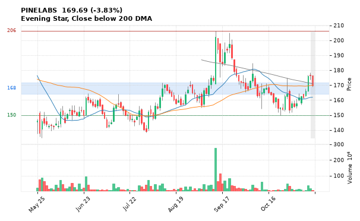

[🔔 Set alert on PINELABS](https://claude.ai/artifact/Ewc5hHTPX6WkU1nVcDNQzq?s=PINELABS&c=close%20below%20168.90) &nbsp;|&nbsp; [📈 Live chart (TradingView)](https://www.tradingview.com/chart/?symbol=NSE:PINELABS) &nbsp;|&nbsp; [alert by email](mailto:testthetpassword@123?subject=ALERT%20PINELABS&body=Alert%20me%20when%3A%20close%20below%20168.90%0A%0AEdit%20the%20line%20above%20if%20you%20want%2C%20then%20press%20Send.%20Checked%20on%20every%20day%27s%20closing%20data%3B%20a%20triggered%20alert%20appears%20at%20the%20top%20of%20the%208%20AM%20Technical%20Analysis%20email.%0A%0AExamples%20you%20can%20write%3A%0A%20%20close%20above%201150%20%20%7C%20%20close%20below%201080%20%20%7C%20%20high%20above%201200%20%20%7C%20%20low%20below%201050%0A%20%20close%20crosses%20above%20200%20DMA%20%20%7C%20%20close%20below%2050%20DMA%20%20%7C%20%20RSI%20below%2030%20%20%7C%20%20RSI%20above%2070%0A%20%20volume%20above%202x%20%20%7C%20%20change%20above%205%25%20%20%7C%20%20change%20below%20-4%25%20%20%7C%20%2052-week%20high%20%20%7C%20%20golden%20cross%0A%20%20combine%20with%20%27and%27%2C%20e.g.%20%20close%20above%201150%20and%20volume%20above%201.5x%0A%0AReference%3A%20PINELABS%20closed%20169.69%20%28high%20176.40%2C%20low%20168.90%29.%0ATo%20cancel%20later%2C%20send%20an%20email%20with%20subject%3A%20CANCEL%20ALERT%20PINELABS)

---

## 27. MINDACORP - BEARISH
**706.65** (-4.01%) | vol 0.5x | RSI 59 | H 740.00 / L 705.00  
Bearish Marubozu, Bearish Engulfing

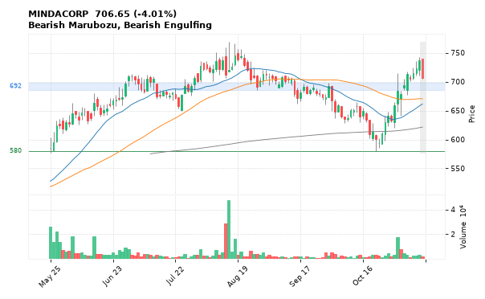

[🔔 Set alert on MINDACORP](https://claude.ai/artifact/Ewc5hHTPX6WkU1nVcDNQzq?s=MINDACORP&c=close%20below%20705.00) &nbsp;|&nbsp; [📈 Live chart (TradingView)](https://www.tradingview.com/chart/?symbol=NSE:MINDACORP) &nbsp;|&nbsp; [alert by email](mailto:testthetpassword@123?subject=ALERT%20MINDACORP&body=Alert%20me%20when%3A%20close%20below%20705.00%0A%0AEdit%20the%20line%20above%20if%20you%20want%2C%20then%20press%20Send.%20Checked%20on%20every%20day%27s%20closing%20data%3B%20a%20triggered%20alert%20appears%20at%20the%20top%20of%20the%208%20AM%20Technical%20Analysis%20email.%0A%0AExamples%20you%20can%20write%3A%0A%20%20close%20above%201150%20%20%7C%20%20close%20below%201080%20%20%7C%20%20high%20above%201200%20%20%7C%20%20low%20below%201050%0A%20%20close%20crosses%20above%20200%20DMA%20%20%7C%20%20close%20below%2050%20DMA%20%20%7C%20%20RSI%20below%2030%20%20%7C%20%20RSI%20above%2070%0A%20%20volume%20above%202x%20%20%7C%20%20change%20above%205%25%20%20%7C%20%20change%20below%20-4%25%20%20%7C%20%2052-week%20high%20%20%7C%20%20golden%20cross%0A%20%20combine%20with%20%27and%27%2C%20e.g.%20%20close%20above%201150%20and%20volume%20above%201.5x%0A%0AReference%3A%20MINDACORP%20closed%20706.65%20%28high%20740.00%2C%20low%20705.00%29.%0ATo%20cancel%20later%2C%20send%20an%20email%20with%20subject%3A%20CANCEL%20ALERT%20MINDACORP)

---

## 28. PGEL - BEARISH
**532.40** (-6.07%) | vol 0.8x | RSI 49 | H 566.50 / L 532.40  
Bearish Marubozu, Close below 200 DMA

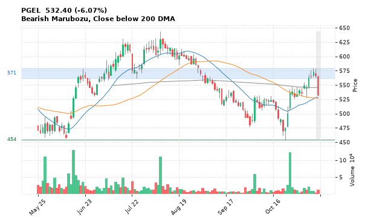

[🔔 Set alert on PGEL](https://claude.ai/artifact/Ewc5hHTPX6WkU1nVcDNQzq?s=PGEL&c=close%20below%20532.40) &nbsp;|&nbsp; [📈 Live chart (TradingView)](https://www.tradingview.com/chart/?symbol=NSE:PGEL) &nbsp;|&nbsp; [alert by email](mailto:testthetpassword@123?subject=ALERT%20PGEL&body=Alert%20me%20when%3A%20close%20below%20532.40%0A%0AEdit%20the%20line%20above%20if%20you%20want%2C%20then%20press%20Send.%20Checked%20on%20every%20day%27s%20closing%20data%3B%20a%20triggered%20alert%20appears%20at%20the%20top%20of%20the%208%20AM%20Technical%20Analysis%20email.%0A%0AExamples%20you%20can%20write%3A%0A%20%20close%20above%201150%20%20%7C%20%20close%20below%201080%20%20%7C%20%20high%20above%201200%20%20%7C%20%20low%20below%201050%0A%20%20close%20crosses%20above%20200%20DMA%20%20%7C%20%20close%20below%2050%20DMA%20%20%7C%20%20RSI%20below%2030%20%20%7C%20%20RSI%20above%2070%0A%20%20volume%20above%202x%20%20%7C%20%20change%20above%205%25%20%20%7C%20%20change%20below%20-4%25%20%20%7C%20%2052-week%20high%20%20%7C%20%20golden%20cross%0A%20%20combine%20with%20%27and%27%2C%20e.g.%20%20close%20above%201150%20and%20volume%20above%201.5x%0A%0AReference%3A%20PGEL%20closed%20532.40%20%28high%20566.50%2C%20low%20532.40%29.%0ATo%20cancel%20later%2C%20send%20an%20email%20with%20subject%3A%20CANCEL%20ALERT%20PGEL)

---

## 29. SAIL - BEARISH
**168.75** (-4.23%) | vol 0.8x | RSI 46 | H 175.60 / L 168.40  
Bearish Marubozu, Close below 200 DMA

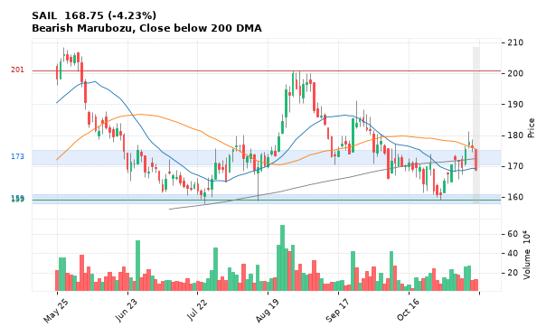

[🔔 Set alert on SAIL](https://claude.ai/artifact/Ewc5hHTPX6WkU1nVcDNQzq?s=SAIL&c=close%20below%20168.40) &nbsp;|&nbsp; [📈 Live chart (TradingView)](https://www.tradingview.com/chart/?symbol=NSE:SAIL) &nbsp;|&nbsp; [alert by email](mailto:testthetpassword@123?subject=ALERT%20SAIL&body=Alert%20me%20when%3A%20close%20below%20168.40%0A%0AEdit%20the%20line%20above%20if%20you%20want%2C%20then%20press%20Send.%20Checked%20on%20every%20day%27s%20closing%20data%3B%20a%20triggered%20alert%20appears%20at%20the%20top%20of%20the%208%20AM%20Technical%20Analysis%20email.%0A%0AExamples%20you%20can%20write%3A%0A%20%20close%20above%201150%20%20%7C%20%20close%20below%201080%20%20%7C%20%20high%20above%201200%20%20%7C%20%20low%20below%201050%0A%20%20close%20crosses%20above%20200%20DMA%20%20%7C%20%20close%20below%2050%20DMA%20%20%7C%20%20RSI%20below%2030%20%20%7C%20%20RSI%20above%2070%0A%20%20volume%20above%202x%20%20%7C%20%20change%20above%205%25%20%20%7C%20%20change%20below%20-4%25%20%20%7C%20%2052-week%20high%20%20%7C%20%20golden%20cross%0A%20%20combine%20with%20%27and%27%2C%20e.g.%20%20close%20above%201150%20and%20volume%20above%201.5x%0A%0AReference%3A%20SAIL%20closed%20168.75%20%28high%20175.60%2C%20low%20168.40%29.%0ATo%20cancel%20later%2C%20send%20an%20email%20with%20subject%3A%20CANCEL%20ALERT%20SAIL)

---

## 30. RHIM - BEARISH
**330.15** (-9.57%) | vol 6.4x | RSI 30 | H 369.25 / L 329.00  
MACD bearish cross, Volume spike 6.4x

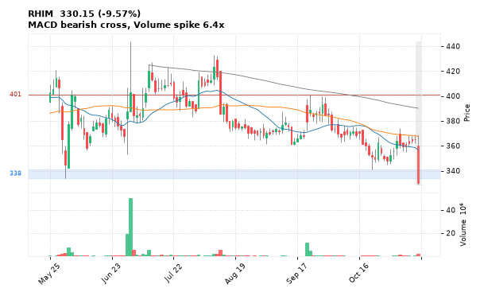

[🔔 Set alert on RHIM](https://claude.ai/artifact/Ewc5hHTPX6WkU1nVcDNQzq?s=RHIM&c=close%20below%20329.00) &nbsp;|&nbsp; [📈 Live chart (TradingView)](https://www.tradingview.com/chart/?symbol=NSE:RHIM) &nbsp;|&nbsp; [alert by email](mailto:testthetpassword@123?subject=ALERT%20RHIM&body=Alert%20me%20when%3A%20close%20below%20329.00%0A%0AEdit%20the%20line%20above%20if%20you%20want%2C%20then%20press%20Send.%20Checked%20on%20every%20day%27s%20closing%20data%3B%20a%20triggered%20alert%20appears%20at%20the%20top%20of%20the%208%20AM%20Technical%20Analysis%20email.%0A%0AExamples%20you%20can%20write%3A%0A%20%20close%20above%201150%20%20%7C%20%20close%20below%201080%20%20%7C%20%20high%20above%201200%20%20%7C%20%20low%20below%201050%0A%20%20close%20crosses%20above%20200%20DMA%20%20%7C%20%20close%20below%2050%20DMA%20%20%7C%20%20RSI%20below%2030%20%20%7C%20%20RSI%20above%2070%0A%20%20volume%20above%202x%20%20%7C%20%20change%20above%205%25%20%20%7C%20%20change%20below%20-4%25%20%20%7C%20%2052-week%20high%20%20%7C%20%20golden%20cross%0A%20%20combine%20with%20%27and%27%2C%20e.g.%20%20close%20above%201150%20and%20volume%20above%201.5x%0A%0AReference%3A%20RHIM%20closed%20330.15%20%28high%20369.25%2C%20low%20329.00%29.%0ATo%20cancel%20later%2C%20send%20an%20email%20with%20subject%3A%20CANCEL%20ALERT%20RHIM)

---

## 31. APLAPOLLO - LEVEL TEST
**2,250.20** (-0.06%) | vol 2.6x | RSI 61 | H 2,312.30 / L 2,233.30  
Level test

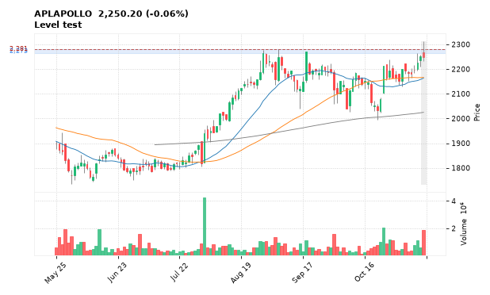

[🔔 Set alert on APLAPOLLO](https://claude.ai/artifact/Ewc5hHTPX6WkU1nVcDNQzq?s=APLAPOLLO&c=close%20below%202233.30) &nbsp;|&nbsp; [📈 Live chart (TradingView)](https://www.tradingview.com/chart/?symbol=NSE:APLAPOLLO) &nbsp;|&nbsp; [alert by email](mailto:testthetpassword@123?subject=ALERT%20APLAPOLLO&body=Alert%20me%20when%3A%20close%20above%202312.30%0A%0AEdit%20the%20line%20above%20if%20you%20want%2C%20then%20press%20Send.%20Checked%20on%20every%20day%27s%20closing%20data%3B%20a%20triggered%20alert%20appears%20at%20the%20top%20of%20the%208%20AM%20Technical%20Analysis%20email.%0A%0AExamples%20you%20can%20write%3A%0A%20%20close%20above%201150%20%20%7C%20%20close%20below%201080%20%20%7C%20%20high%20above%201200%20%20%7C%20%20low%20below%201050%0A%20%20close%20crosses%20above%20200%20DMA%20%20%7C%20%20close%20below%2050%20DMA%20%20%7C%20%20RSI%20below%2030%20%20%7C%20%20RSI%20above%2070%0A%20%20volume%20above%202x%20%20%7C%20%20change%20above%205%25%20%20%7C%20%20change%20below%20-4%25%20%20%7C%20%2052-week%20high%20%20%7C%20%20golden%20cross%0A%20%20combine%20with%20%27and%27%2C%20e.g.%20%20close%20above%201150%20and%20volume%20above%201.5x%0A%0AReference%3A%20APLAPOLLO%20closed%202250.20%20%28high%202312.30%2C%20low%202233.30%29.%0ATo%20cancel%20later%2C%20send%20an%20email%20with%20subject%3A%20CANCEL%20ALERT%20APLAPOLLO)

---

## 32. AUBANK - LEVEL TEST
**971.35** (+0.45%) | vol 0.5x | RSI 55 | H 974.40 / L 956.10  
Level test

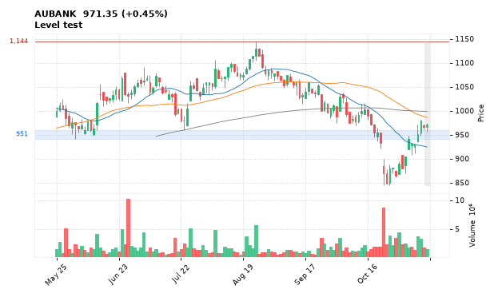

[🔔 Set alert on AUBANK](https://claude.ai/artifact/Ewc5hHTPX6WkU1nVcDNQzq?s=AUBANK&c=close%20below%20956.10) &nbsp;|&nbsp; [📈 Live chart (TradingView)](https://www.tradingview.com/chart/?symbol=NSE:AUBANK) &nbsp;|&nbsp; [alert by email](mailto:testthetpassword@123?subject=ALERT%20AUBANK&body=Alert%20me%20when%3A%20close%20above%20974.40%0A%0AEdit%20the%20line%20above%20if%20you%20want%2C%20then%20press%20Send.%20Checked%20on%20every%20day%27s%20closing%20data%3B%20a%20triggered%20alert%20appears%20at%20the%20top%20of%20the%208%20AM%20Technical%20Analysis%20email.%0A%0AExamples%20you%20can%20write%3A%0A%20%20close%20above%201150%20%20%7C%20%20close%20below%201080%20%20%7C%20%20high%20above%201200%20%20%7C%20%20low%20below%201050%0A%20%20close%20crosses%20above%20200%20DMA%20%20%7C%20%20close%20below%2050%20DMA%20%20%7C%20%20RSI%20below%2030%20%20%7C%20%20RSI%20above%2070%0A%20%20volume%20above%202x%20%20%7C%20%20change%20above%205%25%20%20%7C%20%20change%20below%20-4%25%20%20%7C%20%2052-week%20high%20%20%7C%20%20golden%20cross%0A%20%20combine%20with%20%27and%27%2C%20e.g.%20%20close%20above%201150%20and%20volume%20above%201.5x%0A%0AReference%3A%20AUBANK%20closed%20971.35%20%28high%20974.40%2C%20low%20956.10%29.%0ATo%20cancel%20later%2C%20send%20an%20email%20with%20subject%3A%20CANCEL%20ALERT%20AUBANK)

---

## 33. ABCAPITAL - LEVEL TEST
**408.50** (+0.12%) | vol 0.4x | RSI 63 | H 410.35 / L 402.50  
Level test

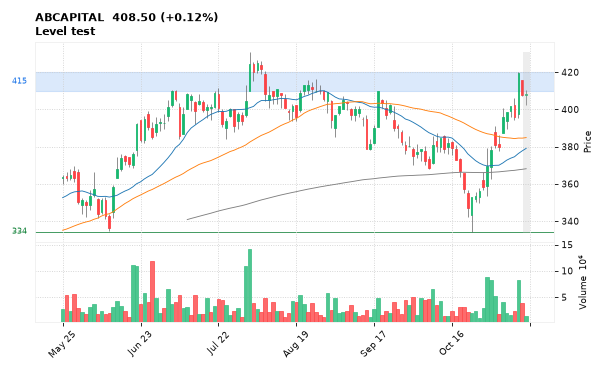

[🔔 Set alert on ABCAPITAL](https://claude.ai/artifact/Ewc5hHTPX6WkU1nVcDNQzq?s=ABCAPITAL&c=close%20below%20402.50) &nbsp;|&nbsp; [📈 Live chart (TradingView)](https://www.tradingview.com/chart/?symbol=NSE:ABCAPITAL) &nbsp;|&nbsp; [alert by email](mailto:testthetpassword@123?subject=ALERT%20ABCAPITAL&body=Alert%20me%20when%3A%20close%20above%20410.35%0A%0AEdit%20the%20line%20above%20if%20you%20want%2C%20then%20press%20Send.%20Checked%20on%20every%20day%27s%20closing%20data%3B%20a%20triggered%20alert%20appears%20at%20the%20top%20of%20the%208%20AM%20Technical%20Analysis%20email.%0A%0AExamples%20you%20can%20write%3A%0A%20%20close%20above%201150%20%20%7C%20%20close%20below%201080%20%20%7C%20%20high%20above%201200%20%20%7C%20%20low%20below%201050%0A%20%20close%20crosses%20above%20200%20DMA%20%20%7C%20%20close%20below%2050%20DMA%20%20%7C%20%20RSI%20below%2030%20%20%7C%20%20RSI%20above%2070%0A%20%20volume%20above%202x%20%20%7C%20%20change%20above%205%25%20%20%7C%20%20change%20below%20-4%25%20%20%7C%20%2052-week%20high%20%20%7C%20%20golden%20cross%0A%20%20combine%20with%20%27and%27%2C%20e.g.%20%20close%20above%201150%20and%20volume%20above%201.5x%0A%0AReference%3A%20ABCAPITAL%20closed%20408.50%20%28high%20410.35%2C%20low%20402.50%29.%0ATo%20cancel%20later%2C%20send%20an%20email%20with%20subject%3A%20CANCEL%20ALERT%20ABCAPITAL)

---

## 34. AEGISLOG - LEVEL TEST
**1,228.10** (+0.30%) | vol 0.2x | RSI 48 | H 1,236.90 / L 1,217.80  
Level test

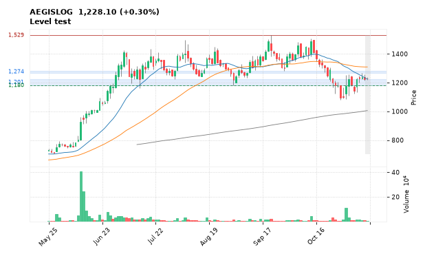

[🔔 Set alert on AEGISLOG](https://claude.ai/artifact/Ewc5hHTPX6WkU1nVcDNQzq?s=AEGISLOG&c=close%20below%201217.80) &nbsp;|&nbsp; [📈 Live chart (TradingView)](https://www.tradingview.com/chart/?symbol=NSE:AEGISLOG) &nbsp;|&nbsp; [alert by email](mailto:testthetpassword@123?subject=ALERT%20AEGISLOG&body=Alert%20me%20when%3A%20close%20above%201236.90%0A%0AEdit%20the%20line%20above%20if%20you%20want%2C%20then%20press%20Send.%20Checked%20on%20every%20day%27s%20closing%20data%3B%20a%20triggered%20alert%20appears%20at%20the%20top%20of%20the%208%20AM%20Technical%20Analysis%20email.%0A%0AExamples%20you%20can%20write%3A%0A%20%20close%20above%201150%20%20%7C%20%20close%20below%201080%20%20%7C%20%20high%20above%201200%20%20%7C%20%20low%20below%201050%0A%20%20close%20crosses%20above%20200%20DMA%20%20%7C%20%20close%20below%2050%20DMA%20%20%7C%20%20RSI%20below%2030%20%20%7C%20%20RSI%20above%2070%0A%20%20volume%20above%202x%20%20%7C%20%20change%20above%205%25%20%20%7C%20%20change%20below%20-4%25%20%20%7C%20%2052-week%20high%20%20%7C%20%20golden%20cross%0A%20%20combine%20with%20%27and%27%2C%20e.g.%20%20close%20above%201150%20and%20volume%20above%201.5x%0A%0AReference%3A%20AEGISLOG%20closed%201228.10%20%28high%201236.90%2C%20low%201217.80%29.%0ATo%20cancel%20later%2C%20send%20an%20email%20with%20subject%3A%20CANCEL%20ALERT%20AEGISLOG)

---

## 35. AETHER - LEVEL TEST
**1,632.20** (-2.68%) | vol 0.5x | RSI 53 | H 1,722.10 / L 1,622.20  
Level test

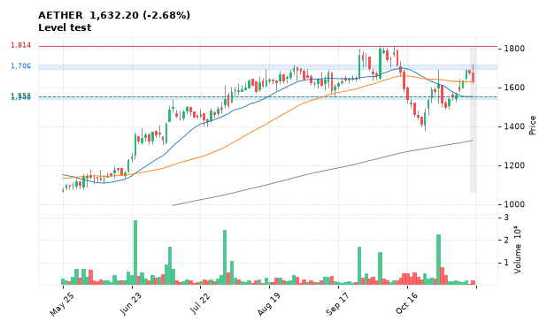

[🔔 Set alert on AETHER](https://claude.ai/artifact/Ewc5hHTPX6WkU1nVcDNQzq?s=AETHER&c=close%20below%201622.20) &nbsp;|&nbsp; [📈 Live chart (TradingView)](https://www.tradingview.com/chart/?symbol=NSE:AETHER) &nbsp;|&nbsp; [alert by email](mailto:testthetpassword@123?subject=ALERT%20AETHER&body=Alert%20me%20when%3A%20close%20above%201722.10%0A%0AEdit%20the%20line%20above%20if%20you%20want%2C%20then%20press%20Send.%20Checked%20on%20every%20day%27s%20closing%20data%3B%20a%20triggered%20alert%20appears%20at%20the%20top%20of%20the%208%20AM%20Technical%20Analysis%20email.%0A%0AExamples%20you%20can%20write%3A%0A%20%20close%20above%201150%20%20%7C%20%20close%20below%201080%20%20%7C%20%20high%20above%201200%20%20%7C%20%20low%20below%201050%0A%20%20close%20crosses%20above%20200%20DMA%20%20%7C%20%20close%20below%2050%20DMA%20%20%7C%20%20RSI%20below%2030%20%20%7C%20%20RSI%20above%2070%0A%20%20volume%20above%202x%20%20%7C%20%20change%20above%205%25%20%20%7C%20%20change%20below%20-4%25%20%20%7C%20%2052-week%20high%20%20%7C%20%20golden%20cross%0A%20%20combine%20with%20%27and%27%2C%20e.g.%20%20close%20above%201150%20and%20volume%20above%201.5x%0A%0AReference%3A%20AETHER%20closed%201632.20%20%28high%201722.10%2C%20low%201622.20%29.%0ATo%20cancel%20later%2C%20send%20an%20email%20with%20subject%3A%20CANCEL%20ALERT%20AETHER)

---

## 36. AJANTPHARM - LEVEL TEST
**3,360.60** (+2.33%) | vol 0.9x | RSI 49 | H 3,405.30 / L 3,270.10  
Level test

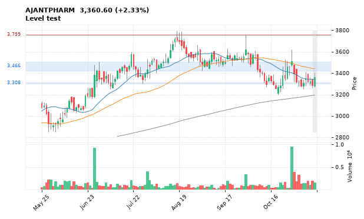

[🔔 Set alert on AJANTPHARM](https://claude.ai/artifact/Ewc5hHTPX6WkU1nVcDNQzq?s=AJANTPHARM&c=close%20below%203270.10) &nbsp;|&nbsp; [📈 Live chart (TradingView)](https://www.tradingview.com/chart/?symbol=NSE:AJANTPHARM) &nbsp;|&nbsp; [alert by email](mailto:testthetpassword@123?subject=ALERT%20AJANTPHARM&body=Alert%20me%20when%3A%20close%20above%203405.30%0A%0AEdit%20the%20line%20above%20if%20you%20want%2C%20then%20press%20Send.%20Checked%20on%20every%20day%27s%20closing%20data%3B%20a%20triggered%20alert%20appears%20at%20the%20top%20of%20the%208%20AM%20Technical%20Analysis%20email.%0A%0AExamples%20you%20can%20write%3A%0A%20%20close%20above%201150%20%20%7C%20%20close%20below%201080%20%20%7C%20%20high%20above%201200%20%20%7C%20%20low%20below%201050%0A%20%20close%20crosses%20above%20200%20DMA%20%20%7C%20%20close%20below%2050%20DMA%20%20%7C%20%20RSI%20below%2030%20%20%7C%20%20RSI%20above%2070%0A%20%20volume%20above%202x%20%20%7C%20%20change%20above%205%25%20%20%7C%20%20change%20below%20-4%25%20%20%7C%20%2052-week%20high%20%20%7C%20%20golden%20cross%0A%20%20combine%20with%20%27and%27%2C%20e.g.%20%20close%20above%201150%20and%20volume%20above%201.5x%0A%0AReference%3A%20AJANTPHARM%20closed%203360.60%20%28high%203405.30%2C%20low%203270.10%29.%0ATo%20cancel%20later%2C%20send%20an%20email%20with%20subject%3A%20CANCEL%20ALERT%20AJANTPHARM)

---

## 37. ALKEM - LEVEL TEST
**5,136.00** (+0.43%) | vol 0.4x | RSI 46 | H 5,186.50 / L 5,096.00  
Level test

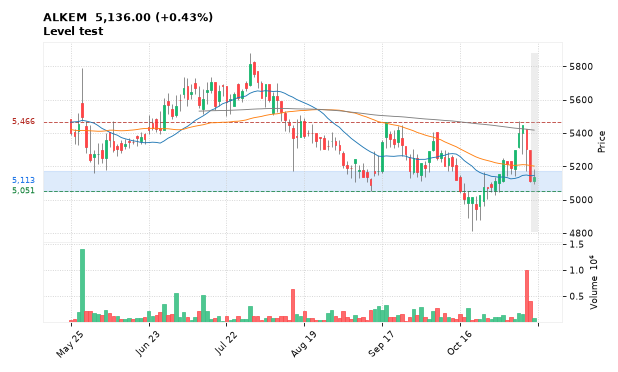

[🔔 Set alert on ALKEM](https://claude.ai/artifact/Ewc5hHTPX6WkU1nVcDNQzq?s=ALKEM&c=close%20below%205096.00) &nbsp;|&nbsp; [📈 Live chart (TradingView)](https://www.tradingview.com/chart/?symbol=NSE:ALKEM) &nbsp;|&nbsp; [alert by email](mailto:testthetpassword@123?subject=ALERT%20ALKEM&body=Alert%20me%20when%3A%20close%20above%205186.50%0A%0AEdit%20the%20line%20above%20if%20you%20want%2C%20then%20press%20Send.%20Checked%20on%20every%20day%27s%20closing%20data%3B%20a%20triggered%20alert%20appears%20at%20the%20top%20of%20the%208%20AM%20Technical%20Analysis%20email.%0A%0AExamples%20you%20can%20write%3A%0A%20%20close%20above%201150%20%20%7C%20%20close%20below%201080%20%20%7C%20%20high%20above%201200%20%20%7C%20%20low%20below%201050%0A%20%20close%20crosses%20above%20200%20DMA%20%20%7C%20%20close%20below%2050%20DMA%20%20%7C%20%20RSI%20below%2030%20%20%7C%20%20RSI%20above%2070%0A%20%20volume%20above%202x%20%20%7C%20%20change%20above%205%25%20%20%7C%20%20change%20below%20-4%25%20%20%7C%20%2052-week%20high%20%20%7C%20%20golden%20cross%0A%20%20combine%20with%20%27and%27%2C%20e.g.%20%20close%20above%201150%20and%20volume%20above%201.5x%0A%0AReference%3A%20ALKEM%20closed%205136.00%20%28high%205186.50%2C%20low%205096.00%29.%0ATo%20cancel%20later%2C%20send%20an%20email%20with%20subject%3A%20CANCEL%20ALERT%20ALKEM)

---

## 38. ANGELONE - LEVEL TEST
**348.15** (-0.24%) | vol 1.0x | RSI 72 | H 354.75 / L 345.20  
Level test

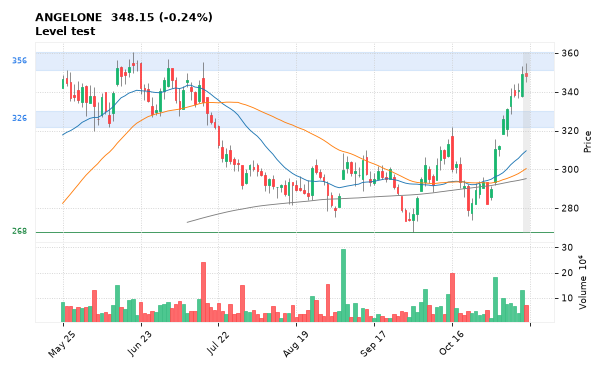

[🔔 Set alert on ANGELONE](https://claude.ai/artifact/Ewc5hHTPX6WkU1nVcDNQzq?s=ANGELONE&c=close%20below%20345.20) &nbsp;|&nbsp; [📈 Live chart (TradingView)](https://www.tradingview.com/chart/?symbol=NSE:ANGELONE) &nbsp;|&nbsp; [alert by email](mailto:testthetpassword@123?subject=ALERT%20ANGELONE&body=Alert%20me%20when%3A%20close%20above%20354.75%0A%0AEdit%20the%20line%20above%20if%20you%20want%2C%20then%20press%20Send.%20Checked%20on%20every%20day%27s%20closing%20data%3B%20a%20triggered%20alert%20appears%20at%20the%20top%20of%20the%208%20AM%20Technical%20Analysis%20email.%0A%0AExamples%20you%20can%20write%3A%0A%20%20close%20above%201150%20%20%7C%20%20close%20below%201080%20%20%7C%20%20high%20above%201200%20%20%7C%20%20low%20below%201050%0A%20%20close%20crosses%20above%20200%20DMA%20%20%7C%20%20close%20below%2050%20DMA%20%20%7C%20%20RSI%20below%2030%20%20%7C%20%20RSI%20above%2070%0A%20%20volume%20above%202x%20%20%7C%20%20change%20above%205%25%20%20%7C%20%20change%20below%20-4%25%20%20%7C%20%2052-week%20high%20%20%7C%20%20golden%20cross%0A%20%20combine%20with%20%27and%27%2C%20e.g.%20%20close%20above%201150%20and%20volume%20above%201.5x%0A%0AReference%3A%20ANGELONE%20closed%20348.15%20%28high%20354.75%2C%20low%20345.20%29.%0ATo%20cancel%20later%2C%20send%20an%20email%20with%20subject%3A%20CANCEL%20ALERT%20ANGELONE)

---

## 39. APOLLOHOSP - LEVEL TEST
**8,771.00** (+2.87%) | vol 1.2x | RSI 64 | H 8,786.50 / L 8,534.50  
Level test

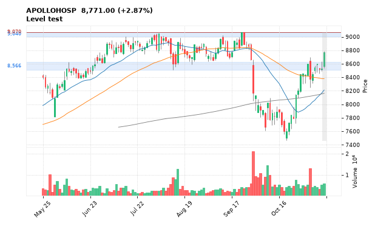

[🔔 Set alert on APOLLOHOSP](https://claude.ai/artifact/Ewc5hHTPX6WkU1nVcDNQzq?s=APOLLOHOSP&c=close%20below%208534.50) &nbsp;|&nbsp; [📈 Live chart (TradingView)](https://www.tradingview.com/chart/?symbol=NSE:APOLLOHOSP) &nbsp;|&nbsp; [alert by email](mailto:testthetpassword@123?subject=ALERT%20APOLLOHOSP&body=Alert%20me%20when%3A%20close%20above%208786.50%0A%0AEdit%20the%20line%20above%20if%20you%20want%2C%20then%20press%20Send.%20Checked%20on%20every%20day%27s%20closing%20data%3B%20a%20triggered%20alert%20appears%20at%20the%20top%20of%20the%208%20AM%20Technical%20Analysis%20email.%0A%0AExamples%20you%20can%20write%3A%0A%20%20close%20above%201150%20%20%7C%20%20close%20below%201080%20%20%7C%20%20high%20above%201200%20%20%7C%20%20low%20below%201050%0A%20%20close%20crosses%20above%20200%20DMA%20%20%7C%20%20close%20below%2050%20DMA%20%20%7C%20%20RSI%20below%2030%20%20%7C%20%20RSI%20above%2070%0A%20%20volume%20above%202x%20%20%7C%20%20change%20above%205%25%20%20%7C%20%20change%20below%20-4%25%20%20%7C%20%2052-week%20high%20%20%7C%20%20golden%20cross%0A%20%20combine%20with%20%27and%27%2C%20e.g.%20%20close%20above%201150%20and%20volume%20above%201.5x%0A%0AReference%3A%20APOLLOHOSP%20closed%208771.00%20%28high%208786.50%2C%20low%208534.50%29.%0ATo%20cancel%20later%2C%20send%20an%20email%20with%20subject%3A%20CANCEL%20ALERT%20APOLLOHOSP)

---

## 40. APOLLOTYRE - LEVEL TEST
**425.20** (+1.05%) | vol 1.1x | RSI 62 | H 429.40 / L 418.85  
Level test

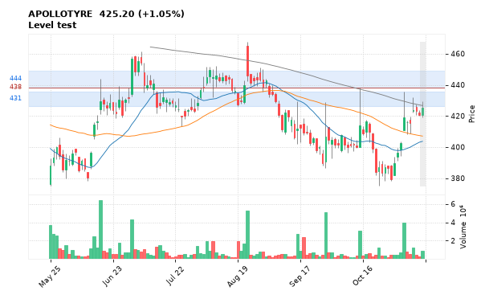

[🔔 Set alert on APOLLOTYRE](https://claude.ai/artifact/Ewc5hHTPX6WkU1nVcDNQzq?s=APOLLOTYRE&c=close%20below%20418.85) &nbsp;|&nbsp; [📈 Live chart (TradingView)](https://www.tradingview.com/chart/?symbol=NSE:APOLLOTYRE) &nbsp;|&nbsp; [alert by email](mailto:testthetpassword@123?subject=ALERT%20APOLLOTYRE&body=Alert%20me%20when%3A%20close%20above%20429.40%0A%0AEdit%20the%20line%20above%20if%20you%20want%2C%20then%20press%20Send.%20Checked%20on%20every%20day%27s%20closing%20data%3B%20a%20triggered%20alert%20appears%20at%20the%20top%20of%20the%208%20AM%20Technical%20Analysis%20email.%0A%0AExamples%20you%20can%20write%3A%0A%20%20close%20above%201150%20%20%7C%20%20close%20below%201080%20%20%7C%20%20high%20above%201200%20%20%7C%20%20low%20below%201050%0A%20%20close%20crosses%20above%20200%20DMA%20%20%7C%20%20close%20below%2050%20DMA%20%20%7C%20%20RSI%20below%2030%20%20%7C%20%20RSI%20above%2070%0A%20%20volume%20above%202x%20%20%7C%20%20change%20above%205%25%20%20%7C%20%20change%20below%20-4%25%20%20%7C%20%2052-week%20high%20%20%7C%20%20golden%20cross%0A%20%20combine%20with%20%27and%27%2C%20e.g.%20%20close%20above%201150%20and%20volume%20above%201.5x%0A%0AReference%3A%20APOLLOTYRE%20closed%20425.20%20%28high%20429.40%2C%20low%20418.85%29.%0ATo%20cancel%20later%2C%20send%20an%20email%20with%20subject%3A%20CANCEL%20ALERT%20APOLLOTYRE)

---

## 41. ASIANPAINT - LEVEL TEST
**2,572.90** (+0.90%) | vol 1.1x | RSI 67 | H 2,619.40 / L 2,562.90  
Level test

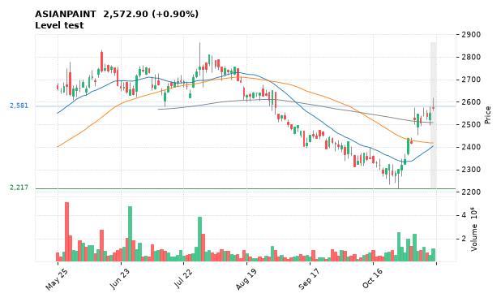

[🔔 Set alert on ASIANPAINT](https://claude.ai/artifact/Ewc5hHTPX6WkU1nVcDNQzq?s=ASIANPAINT&c=close%20below%202562.90) &nbsp;|&nbsp; [📈 Live chart (TradingView)](https://www.tradingview.com/chart/?symbol=NSE:ASIANPAINT) &nbsp;|&nbsp; [alert by email](mailto:testthetpassword@123?subject=ALERT%20ASIANPAINT&body=Alert%20me%20when%3A%20close%20above%202619.40%0A%0AEdit%20the%20line%20above%20if%20you%20want%2C%20then%20press%20Send.%20Checked%20on%20every%20day%27s%20closing%20data%3B%20a%20triggered%20alert%20appears%20at%20the%20top%20of%20the%208%20AM%20Technical%20Analysis%20email.%0A%0AExamples%20you%20can%20write%3A%0A%20%20close%20above%201150%20%20%7C%20%20close%20below%201080%20%20%7C%20%20high%20above%201200%20%20%7C%20%20low%20below%201050%0A%20%20close%20crosses%20above%20200%20DMA%20%20%7C%20%20close%20below%2050%20DMA%20%20%7C%20%20RSI%20below%2030%20%20%7C%20%20RSI%20above%2070%0A%20%20volume%20above%202x%20%20%7C%20%20change%20above%205%25%20%20%7C%20%20change%20below%20-4%25%20%20%7C%20%2052-week%20high%20%20%7C%20%20golden%20cross%0A%20%20combine%20with%20%27and%27%2C%20e.g.%20%20close%20above%201150%20and%20volume%20above%201.5x%0A%0AReference%3A%20ASIANPAINT%20closed%202572.90%20%28high%202619.40%2C%20low%202562.90%29.%0ATo%20cancel%20later%2C%20send%20an%20email%20with%20subject%3A%20CANCEL%20ALERT%20ASIANPAINT)

---

## 42. ASTERDM - LEVEL TEST
**750.00** (+3.81%) | vol 1.5x | RSI 63 | H 757.45 / L 722.70  
Level test

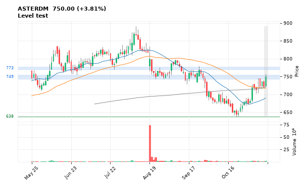

[🔔 Set alert on ASTERDM](https://claude.ai/artifact/Ewc5hHTPX6WkU1nVcDNQzq?s=ASTERDM&c=close%20below%20722.70) &nbsp;|&nbsp; [📈 Live chart (TradingView)](https://www.tradingview.com/chart/?symbol=NSE:ASTERDM) &nbsp;|&nbsp; [alert by email](mailto:testthetpassword@123?subject=ALERT%20ASTERDM&body=Alert%20me%20when%3A%20close%20above%20757.45%0A%0AEdit%20the%20line%20above%20if%20you%20want%2C%20then%20press%20Send.%20Checked%20on%20every%20day%27s%20closing%20data%3B%20a%20triggered%20alert%20appears%20at%20the%20top%20of%20the%208%20AM%20Technical%20Analysis%20email.%0A%0AExamples%20you%20can%20write%3A%0A%20%20close%20above%201150%20%20%7C%20%20close%20below%201080%20%20%7C%20%20high%20above%201200%20%20%7C%20%20low%20below%201050%0A%20%20close%20crosses%20above%20200%20DMA%20%20%7C%20%20close%20below%2050%20DMA%20%20%7C%20%20RSI%20below%2030%20%20%7C%20%20RSI%20above%2070%0A%20%20volume%20above%202x%20%20%7C%20%20change%20above%205%25%20%20%7C%20%20change%20below%20-4%25%20%20%7C%20%2052-week%20high%20%20%7C%20%20golden%20cross%0A%20%20combine%20with%20%27and%27%2C%20e.g.%20%20close%20above%201150%20and%20volume%20above%201.5x%0A%0AReference%3A%20ASTERDM%20closed%20750.00%20%28high%20757.45%2C%20low%20722.70%29.%0ATo%20cancel%20later%2C%20send%20an%20email%20with%20subject%3A%20CANCEL%20ALERT%20ASTERDM)

---

## 43. BLS - LEVEL TEST
**225.07** (-1.93%) | vol 0.2x | RSI 52 | H 229.35 / L 224.27  
Level test

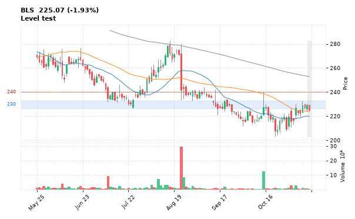

[🔔 Set alert on BLS](https://claude.ai/artifact/Ewc5hHTPX6WkU1nVcDNQzq?s=BLS&c=close%20below%20224.27) &nbsp;|&nbsp; [📈 Live chart (TradingView)](https://www.tradingview.com/chart/?symbol=NSE:BLS) &nbsp;|&nbsp; [alert by email](mailto:testthetpassword@123?subject=ALERT%20BLS&body=Alert%20me%20when%3A%20close%20above%20229.35%0A%0AEdit%20the%20line%20above%20if%20you%20want%2C%20then%20press%20Send.%20Checked%20on%20every%20day%27s%20closing%20data%3B%20a%20triggered%20alert%20appears%20at%20the%20top%20of%20the%208%20AM%20Technical%20Analysis%20email.%0A%0AExamples%20you%20can%20write%3A%0A%20%20close%20above%201150%20%20%7C%20%20close%20below%201080%20%20%7C%20%20high%20above%201200%20%20%7C%20%20low%20below%201050%0A%20%20close%20crosses%20above%20200%20DMA%20%20%7C%20%20close%20below%2050%20DMA%20%20%7C%20%20RSI%20below%2030%20%20%7C%20%20RSI%20above%2070%0A%20%20volume%20above%202x%20%20%7C%20%20change%20above%205%25%20%20%7C%20%20change%20below%20-4%25%20%20%7C%20%2052-week%20high%20%20%7C%20%20golden%20cross%0A%20%20combine%20with%20%27and%27%2C%20e.g.%20%20close%20above%201150%20and%20volume%20above%201.5x%0A%0AReference%3A%20BLS%20closed%20225.07%20%28high%20229.35%2C%20low%20224.27%29.%0ATo%20cancel%20later%2C%20send%20an%20email%20with%20subject%3A%20CANCEL%20ALERT%20BLS)

---

## 44. BAJAJ-AUTO - LEVEL TEST
**10,734.00** (-1.07%) | vol 0.5x | RSI 53 | H 10,866.00 / L 10,681.00  
Level test

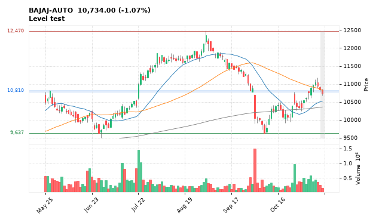

[🔔 Set alert on BAJAJ-AUTO](https://claude.ai/artifact/Ewc5hHTPX6WkU1nVcDNQzq?s=BAJAJ-AUTO&c=close%20below%2010681.00) &nbsp;|&nbsp; [📈 Live chart (TradingView)](https://www.tradingview.com/chart/?symbol=NSE:BAJAJ-AUTO) &nbsp;|&nbsp; [alert by email](mailto:testthetpassword@123?subject=ALERT%20BAJAJ-AUTO&body=Alert%20me%20when%3A%20close%20above%2010866.00%0A%0AEdit%20the%20line%20above%20if%20you%20want%2C%20then%20press%20Send.%20Checked%20on%20every%20day%27s%20closing%20data%3B%20a%20triggered%20alert%20appears%20at%20the%20top%20of%20the%208%20AM%20Technical%20Analysis%20email.%0A%0AExamples%20you%20can%20write%3A%0A%20%20close%20above%201150%20%20%7C%20%20close%20below%201080%20%20%7C%20%20high%20above%201200%20%20%7C%20%20low%20below%201050%0A%20%20close%20crosses%20above%20200%20DMA%20%20%7C%20%20close%20below%2050%20DMA%20%20%7C%20%20RSI%20below%2030%20%20%7C%20%20RSI%20above%2070%0A%20%20volume%20above%202x%20%20%7C%20%20change%20above%205%25%20%20%7C%20%20change%20below%20-4%25%20%20%7C%20%2052-week%20high%20%20%7C%20%20golden%20cross%0A%20%20combine%20with%20%27and%27%2C%20e.g.%20%20close%20above%201150%20and%20volume%20above%201.5x%0A%0AReference%3A%20BAJAJ-AUTO%20closed%2010734.00%20%28high%2010866.00%2C%20low%2010681.00%29.%0ATo%20cancel%20later%2C%20send%20an%20email%20with%20subject%3A%20CANCEL%20ALERT%20BAJAJ-AUTO)

---

## 45. BAJFINANCE - LEVEL TEST
**1,110.00** (-0.63%) | vol 0.8x | RSI 70 | H 1,122.00 / L 1,098.70  
Level test

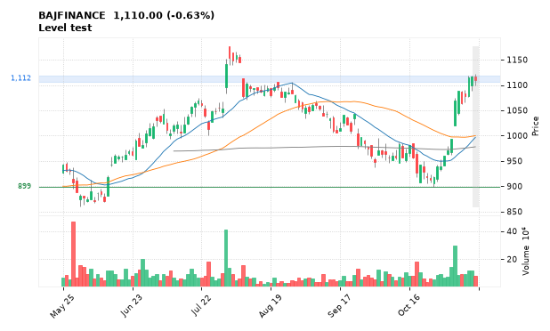

[🔔 Set alert on BAJFINANCE](https://claude.ai/artifact/Ewc5hHTPX6WkU1nVcDNQzq?s=BAJFINANCE&c=close%20below%201098.70) &nbsp;|&nbsp; [📈 Live chart (TradingView)](https://www.tradingview.com/chart/?symbol=NSE:BAJFINANCE) &nbsp;|&nbsp; [alert by email](mailto:testthetpassword@123?subject=ALERT%20BAJFINANCE&body=Alert%20me%20when%3A%20close%20above%201122.00%0A%0AEdit%20the%20line%20above%20if%20you%20want%2C%20then%20press%20Send.%20Checked%20on%20every%20day%27s%20closing%20data%3B%20a%20triggered%20alert%20appears%20at%20the%20top%20of%20the%208%20AM%20Technical%20Analysis%20email.%0A%0AExamples%20you%20can%20write%3A%0A%20%20close%20above%201150%20%20%7C%20%20close%20below%201080%20%20%7C%20%20high%20above%201200%20%20%7C%20%20low%20below%201050%0A%20%20close%20crosses%20above%20200%20DMA%20%20%7C%20%20close%20below%2050%20DMA%20%20%7C%20%20RSI%20below%2030%20%20%7C%20%20RSI%20above%2070%0A%20%20volume%20above%202x%20%20%7C%20%20change%20above%205%25%20%20%7C%20%20change%20below%20-4%25%20%20%7C%20%2052-week%20high%20%20%7C%20%20golden%20cross%0A%20%20combine%20with%20%27and%27%2C%20e.g.%20%20close%20above%201150%20and%20volume%20above%201.5x%0A%0AReference%3A%20BAJFINANCE%20closed%201110.00%20%28high%201122.00%2C%20low%201098.70%29.%0ATo%20cancel%20later%2C%20send%20an%20email%20with%20subject%3A%20CANCEL%20ALERT%20BAJFINANCE)

---

## 46. BAJAJHLDNG - LEVEL TEST
**11,319.00** (+2.01%) | vol 0.4x | RSI 59 | H 11,338.00 / L 11,169.00  
Level test

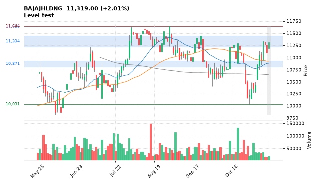

[🔔 Set alert on BAJAJHLDNG](https://claude.ai/artifact/Ewc5hHTPX6WkU1nVcDNQzq?s=BAJAJHLDNG&c=close%20below%2011169.00) &nbsp;|&nbsp; [📈 Live chart (TradingView)](https://www.tradingview.com/chart/?symbol=NSE:BAJAJHLDNG) &nbsp;|&nbsp; [alert by email](mailto:testthetpassword@123?subject=ALERT%20BAJAJHLDNG&body=Alert%20me%20when%3A%20close%20above%2011338.00%0A%0AEdit%20the%20line%20above%20if%20you%20want%2C%20then%20press%20Send.%20Checked%20on%20every%20day%27s%20closing%20data%3B%20a%20triggered%20alert%20appears%20at%20the%20top%20of%20the%208%20AM%20Technical%20Analysis%20email.%0A%0AExamples%20you%20can%20write%3A%0A%20%20close%20above%201150%20%20%7C%20%20close%20below%201080%20%20%7C%20%20high%20above%201200%20%20%7C%20%20low%20below%201050%0A%20%20close%20crosses%20above%20200%20DMA%20%20%7C%20%20close%20below%2050%20DMA%20%20%7C%20%20RSI%20below%2030%20%20%7C%20%20RSI%20above%2070%0A%20%20volume%20above%202x%20%20%7C%20%20change%20above%205%25%20%20%7C%20%20change%20below%20-4%25%20%20%7C%20%2052-week%20high%20%20%7C%20%20golden%20cross%0A%20%20combine%20with%20%27and%27%2C%20e.g.%20%20close%20above%201150%20and%20volume%20above%201.5x%0A%0AReference%3A%20BAJAJHLDNG%20closed%2011319.00%20%28high%2011338.00%2C%20low%2011169.00%29.%0ATo%20cancel%20later%2C%20send%20an%20email%20with%20subject%3A%20CANCEL%20ALERT%20BAJAJHLDNG)

---

## 47. BAJAJHFL - LEVEL TEST
**81.95** (+0.60%) | vol 0.7x | RSI 53 | H 82.10 / L 80.81  
Level test

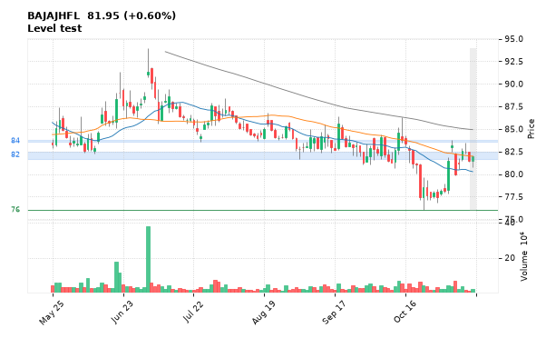

[🔔 Set alert on BAJAJHFL](https://claude.ai/artifact/Ewc5hHTPX6WkU1nVcDNQzq?s=BAJAJHFL&c=close%20below%2080.81) &nbsp;|&nbsp; [📈 Live chart (TradingView)](https://www.tradingview.com/chart/?symbol=NSE:BAJAJHFL) &nbsp;|&nbsp; [alert by email](mailto:testthetpassword@123?subject=ALERT%20BAJAJHFL&body=Alert%20me%20when%3A%20close%20above%2082.10%0A%0AEdit%20the%20line%20above%20if%20you%20want%2C%20then%20press%20Send.%20Checked%20on%20every%20day%27s%20closing%20data%3B%20a%20triggered%20alert%20appears%20at%20the%20top%20of%20the%208%20AM%20Technical%20Analysis%20email.%0A%0AExamples%20you%20can%20write%3A%0A%20%20close%20above%201150%20%20%7C%20%20close%20below%201080%20%20%7C%20%20high%20above%201200%20%20%7C%20%20low%20below%201050%0A%20%20close%20crosses%20above%20200%20DMA%20%20%7C%20%20close%20below%2050%20DMA%20%20%7C%20%20RSI%20below%2030%20%20%7C%20%20RSI%20above%2070%0A%20%20volume%20above%202x%20%20%7C%20%20change%20above%205%25%20%20%7C%20%20change%20below%20-4%25%20%20%7C%20%2052-week%20high%20%20%7C%20%20golden%20cross%0A%20%20combine%20with%20%27and%27%2C%20e.g.%20%20close%20above%201150%20and%20volume%20above%201.5x%0A%0AReference%3A%20BAJAJHFL%20closed%2081.95%20%28high%2082.10%2C%20low%2080.81%29.%0ATo%20cancel%20later%2C%20send%20an%20email%20with%20subject%3A%20CANCEL%20ALERT%20BAJAJHFL)

---

## 48. BALKRISIND - LEVEL TEST
**2,288.20** (+0.74%) | vol 0.5x | RSI 59 | H 2,346.90 / L 2,260.70  
Level test

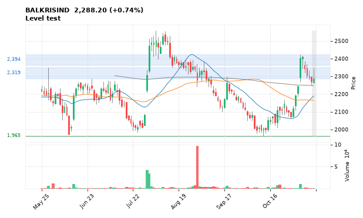

[🔔 Set alert on BALKRISIND](https://claude.ai/artifact/Ewc5hHTPX6WkU1nVcDNQzq?s=BALKRISIND&c=close%20below%202260.70) &nbsp;|&nbsp; [📈 Live chart (TradingView)](https://www.tradingview.com/chart/?symbol=NSE:BALKRISIND) &nbsp;|&nbsp; [alert by email](mailto:testthetpassword@123?subject=ALERT%20BALKRISIND&body=Alert%20me%20when%3A%20close%20above%202346.90%0A%0AEdit%20the%20line%20above%20if%20you%20want%2C%20then%20press%20Send.%20Checked%20on%20every%20day%27s%20closing%20data%3B%20a%20triggered%20alert%20appears%20at%20the%20top%20of%20the%208%20AM%20Technical%20Analysis%20email.%0A%0AExamples%20you%20can%20write%3A%0A%20%20close%20above%201150%20%20%7C%20%20close%20below%201080%20%20%7C%20%20high%20above%201200%20%20%7C%20%20low%20below%201050%0A%20%20close%20crosses%20above%20200%20DMA%20%20%7C%20%20close%20below%2050%20DMA%20%20%7C%20%20RSI%20below%2030%20%20%7C%20%20RSI%20above%2070%0A%20%20volume%20above%202x%20%20%7C%20%20change%20above%205%25%20%20%7C%20%20change%20below%20-4%25%20%20%7C%20%2052-week%20high%20%20%7C%20%20golden%20cross%0A%20%20combine%20with%20%27and%27%2C%20e.g.%20%20close%20above%201150%20and%20volume%20above%201.5x%0A%0AReference%3A%20BALKRISIND%20closed%202288.20%20%28high%202346.90%2C%20low%202260.70%29.%0ATo%20cancel%20later%2C%20send%20an%20email%20with%20subject%3A%20CANCEL%20ALERT%20BALKRISIND)

---

## 49. BEL - LEVEL TEST
**401.40** (+0.14%) | vol 0.6x | RSI 63 | H 403.75 / L 399.40  
Level test

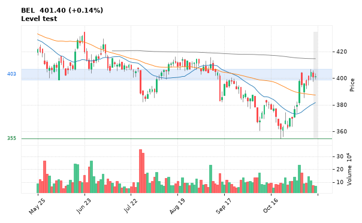

[🔔 Set alert on BEL](https://claude.ai/artifact/Ewc5hHTPX6WkU1nVcDNQzq?s=BEL&c=close%20below%20399.40) &nbsp;|&nbsp; [📈 Live chart (TradingView)](https://www.tradingview.com/chart/?symbol=NSE:BEL) &nbsp;|&nbsp; [alert by email](mailto:testthetpassword@123?subject=ALERT%20BEL&body=Alert%20me%20when%3A%20close%20above%20403.75%0A%0AEdit%20the%20line%20above%20if%20you%20want%2C%20then%20press%20Send.%20Checked%20on%20every%20day%27s%20closing%20data%3B%20a%20triggered%20alert%20appears%20at%20the%20top%20of%20the%208%20AM%20Technical%20Analysis%20email.%0A%0AExamples%20you%20can%20write%3A%0A%20%20close%20above%201150%20%20%7C%20%20close%20below%201080%20%20%7C%20%20high%20above%201200%20%20%7C%20%20low%20below%201050%0A%20%20close%20crosses%20above%20200%20DMA%20%20%7C%20%20close%20below%2050%20DMA%20%20%7C%20%20RSI%20below%2030%20%20%7C%20%20RSI%20above%2070%0A%20%20volume%20above%202x%20%20%7C%20%20change%20above%205%25%20%20%7C%20%20change%20below%20-4%25%20%20%7C%20%2052-week%20high%20%20%7C%20%20golden%20cross%0A%20%20combine%20with%20%27and%27%2C%20e.g.%20%20close%20above%201150%20and%20volume%20above%201.5x%0A%0AReference%3A%20BEL%20closed%20401.40%20%28high%20403.75%2C%20low%20399.40%29.%0ATo%20cancel%20later%2C%20send%20an%20email%20with%20subject%3A%20CANCEL%20ALERT%20BEL)

---

## 50. BPCL - LEVEL TEST
**305.30** (+1.09%) | vol 0.5x | RSI 53 | H 305.95 / L 301.15  
Level test

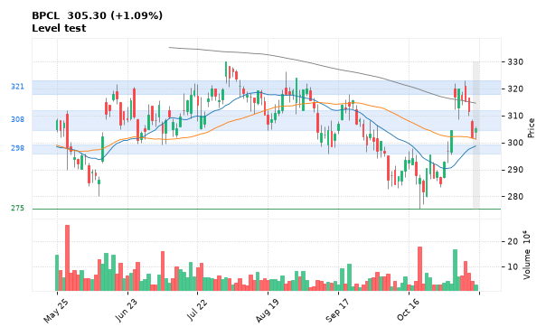

[🔔 Set alert on BPCL](https://claude.ai/artifact/Ewc5hHTPX6WkU1nVcDNQzq?s=BPCL&c=close%20below%20301.15) &nbsp;|&nbsp; [📈 Live chart (TradingView)](https://www.tradingview.com/chart/?symbol=NSE:BPCL) &nbsp;|&nbsp; [alert by email](mailto:testthetpassword@123?subject=ALERT%20BPCL&body=Alert%20me%20when%3A%20close%20above%20305.95%0A%0AEdit%20the%20line%20above%20if%20you%20want%2C%20then%20press%20Send.%20Checked%20on%20every%20day%27s%20closing%20data%3B%20a%20triggered%20alert%20appears%20at%20the%20top%20of%20the%208%20AM%20Technical%20Analysis%20email.%0A%0AExamples%20you%20can%20write%3A%0A%20%20close%20above%201150%20%20%7C%20%20close%20below%201080%20%20%7C%20%20high%20above%201200%20%20%7C%20%20low%20below%201050%0A%20%20close%20crosses%20above%20200%20DMA%20%20%7C%20%20close%20below%2050%20DMA%20%20%7C%20%20RSI%20below%2030%20%20%7C%20%20RSI%20above%2070%0A%20%20volume%20above%202x%20%20%7C%20%20change%20above%205%25%20%20%7C%20%20change%20below%20-4%25%20%20%7C%20%2052-week%20high%20%20%7C%20%20golden%20cross%0A%20%20combine%20with%20%27and%27%2C%20e.g.%20%20close%20above%201150%20and%20volume%20above%201.5x%0A%0AReference%3A%20BPCL%20closed%20305.30%20%28high%20305.95%2C%20low%20301.15%29.%0ATo%20cancel%20later%2C%20send%20an%20email%20with%20subject%3A%20CANCEL%20ALERT%20BPCL)

---

## 51. GROWW - LEVEL TEST
**224.92** (-0.01%) | vol 0.4x | RSI 70 | H 227.30 / L 222.34  
Level test

[🔔 Set alert on GROWW](https://claude.ai/artifact/Ewc5hHTPX6WkU1nVcDNQzq?s=GROWW&c=close%20below%20222.34) &nbsp;|&nbsp; [📈 Live chart (TradingView)](https://www.tradingview.com/chart/?symbol=NSE:GROWW) &nbsp;|&nbsp; [alert by email](mailto:testthetpassword@123?subject=ALERT%20GROWW&body=Alert%20me%20when%3A%20close%20above%20227.30%0A%0AEdit%20the%20line%20above%20if%20you%20want%2C%20then%20press%20Send.%20Checked%20on%20every%20day%27s%20closing%20data%3B%20a%20triggered%20alert%20appears%20at%20the%20top%20of%20the%208%20AM%20Technical%20Analysis%20email.%0A%0AExamples%20you%20can%20write%3A%0A%20%20close%20above%201150%20%20%7C%20%20close%20below%201080%20%20%7C%20%20high%20above%201200%20%20%7C%20%20low%20below%201050%0A%20%20close%20crosses%20above%20200%20DMA%20%20%7C%20%20close%20below%2050%20DMA%20%20%7C%20%20RSI%20below%2030%20%20%7C%20%20RSI%20above%2070%0A%20%20volume%20above%202x%20%20%7C%20%20change%20above%205%25%20%20%7C%20%20change%20below%20-4%25%20%20%7C%20%2052-week%20high%20%20%7C%20%20golden%20cross%0A%20%20combine%20with%20%27and%27%2C%20e.g.%20%20close%20above%201150%20and%20volume%20above%201.5x%0A%0AReference%3A%20GROWW%20closed%20224.92%20%28high%20227.30%2C%20low%20222.34%29.%0ATo%20cancel%20later%2C%20send%20an%20email%20with%20subject%3A%20CANCEL%20ALERT%20GROWW)

---

## 52. BIRET - LEVEL TEST
**317.46** (-0.19%) | vol 0.4x | RSI 46 | H 319.79 / L 315.22  
Level test

[🔔 Set alert on BIRET](https://claude.ai/artifact/Ewc5hHTPX6WkU1nVcDNQzq?s=BIRET&c=close%20below%20315.22) &nbsp;|&nbsp; [📈 Live chart (TradingView)](https://www.tradingview.com/chart/?symbol=NSE:BIRET) &nbsp;|&nbsp; [alert by email](mailto:testthetpassword@123?subject=ALERT%20BIRET&body=Alert%20me%20when%3A%20close%20above%20319.79%0A%0AEdit%20the%20line%20above%20if%20you%20want%2C%20then%20press%20Send.%20Checked%20on%20every%20day%27s%20closing%20data%3B%20a%20triggered%20alert%20appears%20at%20the%20top%20of%20the%208%20AM%20Technical%20Analysis%20email.%0A%0AExamples%20you%20can%20write%3A%0A%20%20close%20above%201150%20%20%7C%20%20close%20below%201080%20%20%7C%20%20high%20above%201200%20%20%7C%20%20low%20below%201050%0A%20%20close%20crosses%20above%20200%20DMA%20%20%7C%20%20close%20below%2050%20DMA%20%20%7C%20%20RSI%20below%2030%20%20%7C%20%20RSI%20above%2070%0A%20%20volume%20above%202x%20%20%7C%20%20change%20above%205%25%20%20%7C%20%20change%20below%20-4%25%20%20%7C%20%2052-week%20high%20%20%7C%20%20golden%20cross%0A%20%20combine%20with%20%27and%27%2C%20e.g.%20%20close%20above%201150%20and%20volume%20above%201.5x%0A%0AReference%3A%20BIRET%20closed%20317.46%20%28high%20319.79%2C%20low%20315.22%29.%0ATo%20cancel%20later%2C%20send%20an%20email%20with%20subject%3A%20CANCEL%20ALERT%20BIRET)

---

## 53. CCL - LEVEL TEST
**989.00** (+1.11%) | vol 0.7x | RSI 51 | H 995.95 / L 958.55  
Level test

[🔔 Set alert on CCL](https://claude.ai/artifact/Ewc5hHTPX6WkU1nVcDNQzq?s=CCL&c=close%20below%20958.55) &nbsp;|&nbsp; [📈 Live chart (TradingView)](https://www.tradingview.com/chart/?symbol=NSE:CCL) &nbsp;|&nbsp; [alert by email](mailto:testthetpassword@123?subject=ALERT%20CCL&body=Alert%20me%20when%3A%20close%20above%20995.95%0A%0AEdit%20the%20line%20above%20if%20you%20want%2C%20then%20press%20Send.%20Checked%20on%20every%20day%27s%20closing%20data%3B%20a%20triggered%20alert%20appears%20at%20the%20top%20of%20the%208%20AM%20Technical%20Analysis%20email.%0A%0AExamples%20you%20can%20write%3A%0A%20%20close%20above%201150%20%20%7C%20%20close%20below%201080%20%20%7C%20%20high%20above%201200%20%20%7C%20%20low%20below%201050%0A%20%20close%20crosses%20above%20200%20DMA%20%20%7C%20%20close%20below%2050%20DMA%20%20%7C%20%20RSI%20below%2030%20%20%7C%20%20RSI%20above%2070%0A%20%20volume%20above%202x%20%20%7C%20%20change%20above%205%25%20%20%7C%20%20change%20below%20-4%25%20%20%7C%20%2052-week%20high%20%20%7C%20%20golden%20cross%0A%20%20combine%20with%20%27and%27%2C%20e.g.%20%20close%20above%201150%20and%20volume%20above%201.5x%0A%0AReference%3A%20CCL%20closed%20989.00%20%28high%20995.95%2C%20low%20958.55%29.%0ATo%20cancel%20later%2C%20send%20an%20email%20with%20subject%3A%20CANCEL%20ALERT%20CCL)

---

## 54. CGPOWER - LEVEL TEST
**818.70** (-1.12%) | vol 0.5x | RSI 47 | H 827.75 / L 808.40  
Level test

[🔔 Set alert on CGPOWER](https://claude.ai/artifact/Ewc5hHTPX6WkU1nVcDNQzq?s=CGPOWER&c=close%20below%20808.40) &nbsp;|&nbsp; [📈 Live chart (TradingView)](https://www.tradingview.com/chart/?symbol=NSE:CGPOWER) &nbsp;|&nbsp; [alert by email](mailto:testthetpassword@123?subject=ALERT%20CGPOWER&body=Alert%20me%20when%3A%20close%20above%20827.75%0A%0AEdit%20the%20line%20above%20if%20you%20want%2C%20then%20press%20Send.%20Checked%20on%20every%20day%27s%20closing%20data%3B%20a%20triggered%20alert%20appears%20at%20the%20top%20of%20the%208%20AM%20Technical%20Analysis%20email.%0A%0AExamples%20you%20can%20write%3A%0A%20%20close%20above%201150%20%20%7C%20%20close%20below%201080%20%20%7C%20%20high%20above%201200%20%20%7C%20%20low%20below%201050%0A%20%20close%20crosses%20above%20200%20DMA%20%20%7C%20%20close%20below%2050%20DMA%20%20%7C%20%20RSI%20below%2030%20%20%7C%20%20RSI%20above%2070%0A%20%20volume%20above%202x%20%20%7C%20%20change%20above%205%25%20%20%7C%20%20change%20below%20-4%25%20%20%7C%20%2052-week%20high%20%20%7C%20%20golden%20cross%0A%20%20combine%20with%20%27and%27%2C%20e.g.%20%20close%20above%201150%20and%20volume%20above%201.5x%0A%0AReference%3A%20CGPOWER%20closed%20818.70%20%28high%20827.75%2C%20low%20808.40%29.%0ATo%20cancel%20later%2C%20send%20an%20email%20with%20subject%3A%20CANCEL%20ALERT%20CGPOWER)

---

## 55. CIEINDIA - LEVEL TEST
**363.45** (-1.34%) | vol 0.6x | RSI 47 | H 369.50 / L 360.80  
Level test

[🔔 Set alert on CIEINDIA](https://claude.ai/artifact/Ewc5hHTPX6WkU1nVcDNQzq?s=CIEINDIA&c=close%20below%20360.80) &nbsp;|&nbsp; [📈 Live chart (TradingView)](https://www.tradingview.com/chart/?symbol=NSE:CIEINDIA) &nbsp;|&nbsp; [alert by email](mailto:testthetpassword@123?subject=ALERT%20CIEINDIA&body=Alert%20me%20when%3A%20close%20above%20369.50%0A%0AEdit%20the%20line%20above%20if%20you%20want%2C%20then%20press%20Send.%20Checked%20on%20every%20day%27s%20closing%20data%3B%20a%20triggered%20alert%20appears%20at%20the%20top%20of%20the%208%20AM%20Technical%20Analysis%20email.%0A%0AExamples%20you%20can%20write%3A%0A%20%20close%20above%201150%20%20%7C%20%20close%20below%201080%20%20%7C%20%20high%20above%201200%20%20%7C%20%20low%20below%201050%0A%20%20close%20crosses%20above%20200%20DMA%20%20%7C%20%20close%20below%2050%20DMA%20%20%7C%20%20RSI%20below%2030%20%20%7C%20%20RSI%20above%2070%0A%20%20volume%20above%202x%20%20%7C%20%20change%20above%205%25%20%20%7C%20%20change%20below%20-4%25%20%20%7C%20%2052-week%20high%20%20%7C%20%20golden%20cross%0A%20%20combine%20with%20%27and%27%2C%20e.g.%20%20close%20above%201150%20and%20volume%20above%201.5x%0A%0AReference%3A%20CIEINDIA%20closed%20363.45%20%28high%20369.50%2C%20low%20360.80%29.%0ATo%20cancel%20later%2C%20send%20an%20email%20with%20subject%3A%20CANCEL%20ALERT%20CIEINDIA)

---

## 56. CRISIL - LEVEL TEST
**4,244.70** (-2.47%) | vol 0.9x | RSI 32 | H 4,368.50 / L 4,221.00  
Level test

[🔔 Set alert on CRISIL](https://claude.ai/artifact/Ewc5hHTPX6WkU1nVcDNQzq?s=CRISIL&c=close%20below%204221.00) &nbsp;|&nbsp; [📈 Live chart (TradingView)](https://www.tradingview.com/chart/?symbol=NSE:CRISIL) &nbsp;|&nbsp; [alert by email](mailto:testthetpassword@123?subject=ALERT%20CRISIL&body=Alert%20me%20when%3A%20close%20above%204368.50%0A%0AEdit%20the%20line%20above%20if%20you%20want%2C%20then%20press%20Send.%20Checked%20on%20every%20day%27s%20closing%20data%3B%20a%20triggered%20alert%20appears%20at%20the%20top%20of%20the%208%20AM%20Technical%20Analysis%20email.%0A%0AExamples%20you%20can%20write%3A%0A%20%20close%20above%201150%20%20%7C%20%20close%20below%201080%20%20%7C%20%20high%20above%201200%20%20%7C%20%20low%20below%201050%0A%20%20close%20crosses%20above%20200%20DMA%20%20%7C%20%20close%20below%2050%20DMA%20%20%7C%20%20RSI%20below%2030%20%20%7C%20%20RSI%20above%2070%0A%20%20volume%20above%202x%20%20%7C%20%20change%20above%205%25%20%20%7C%20%20change%20below%20-4%25%20%20%7C%20%2052-week%20high%20%20%7C%20%20golden%20cross%0A%20%20combine%20with%20%27and%27%2C%20e.g.%20%20close%20above%201150%20and%20volume%20above%201.5x%0A%0AReference%3A%20CRISIL%20closed%204244.70%20%28high%204368.50%2C%20low%204221.00%29.%0ATo%20cancel%20later%2C%20send%20an%20email%20with%20subject%3A%20CANCEL%20ALERT%20CRISIL)

---

## 57. CANBK - LEVEL TEST
**132.40** (+1.14%) | vol 0.7x | RSI 66 | H 133.89 / L 131.11  
Level test

[🔔 Set alert on CANBK](https://claude.ai/artifact/Ewc5hHTPX6WkU1nVcDNQzq?s=CANBK&c=close%20below%20131.11) &nbsp;|&nbsp; [📈 Live chart (TradingView)](https://www.tradingview.com/chart/?symbol=NSE:CANBK) &nbsp;|&nbsp; [alert by email](mailto:testthetpassword@123?subject=ALERT%20CANBK&body=Alert%20me%20when%3A%20close%20above%20133.89%0A%0AEdit%20the%20line%20above%20if%20you%20want%2C%20then%20press%20Send.%20Checked%20on%20every%20day%27s%20closing%20data%3B%20a%20triggered%20alert%20appears%20at%20the%20top%20of%20the%208%20AM%20Technical%20Analysis%20email.%0A%0AExamples%20you%20can%20write%3A%0A%20%20close%20above%201150%20%20%7C%20%20close%20below%201080%20%20%7C%20%20high%20above%201200%20%20%7C%20%20low%20below%201050%0A%20%20close%20crosses%20above%20200%20DMA%20%20%7C%20%20close%20below%2050%20DMA%20%20%7C%20%20RSI%20below%2030%20%20%7C%20%20RSI%20above%2070%0A%20%20volume%20above%202x%20%20%7C%20%20change%20above%205%25%20%20%7C%20%20change%20below%20-4%25%20%20%7C%20%2052-week%20high%20%20%7C%20%20golden%20cross%0A%20%20combine%20with%20%27and%27%2C%20e.g.%20%20close%20above%201150%20and%20volume%20above%201.5x%0A%0AReference%3A%20CANBK%20closed%20132.40%20%28high%20133.89%2C%20low%20131.11%29.%0ATo%20cancel%20later%2C%20send%20an%20email%20with%20subject%3A%20CANCEL%20ALERT%20CANBK)

---

## 58. CAPLIPOINT - LEVEL TEST
**2,346.80** (-1.75%) | vol 0.8x | RSI 44 | H 2,390.00 / L 2,325.00  
Level test

[🔔 Set alert on CAPLIPOINT](https://claude.ai/artifact/Ewc5hHTPX6WkU1nVcDNQzq?s=CAPLIPOINT&c=close%20below%202325.00) &nbsp;|&nbsp; [📈 Live chart (TradingView)](https://www.tradingview.com/chart/?symbol=NSE:CAPLIPOINT) &nbsp;|&nbsp; [alert by email](mailto:testthetpassword@123?subject=ALERT%20CAPLIPOINT&body=Alert%20me%20when%3A%20close%20above%202390.00%0A%0AEdit%20the%20line%20above%20if%20you%20want%2C%20then%20press%20Send.%20Checked%20on%20every%20day%27s%20closing%20data%3B%20a%20triggered%20alert%20appears%20at%20the%20top%20of%20the%208%20AM%20Technical%20Analysis%20email.%0A%0AExamples%20you%20can%20write%3A%0A%20%20close%20above%201150%20%20%7C%20%20close%20below%201080%20%20%7C%20%20high%20above%201200%20%20%7C%20%20low%20below%201050%0A%20%20close%20crosses%20above%20200%20DMA%20%20%7C%20%20close%20below%2050%20DMA%20%20%7C%20%20RSI%20below%2030%20%20%7C%20%20RSI%20above%2070%0A%20%20volume%20above%202x%20%20%7C%20%20change%20above%205%25%20%20%7C%20%20change%20below%20-4%25%20%20%7C%20%2052-week%20high%20%20%7C%20%20golden%20cross%0A%20%20combine%20with%20%27and%27%2C%20e.g.%20%20close%20above%201150%20and%20volume%20above%201.5x%0A%0AReference%3A%20CAPLIPOINT%20closed%202346.80%20%28high%202390.00%2C%20low%202325.00%29.%0ATo%20cancel%20later%2C%20send%20an%20email%20with%20subject%3A%20CANCEL%20ALERT%20CAPLIPOINT)

---

## 59. CARTRADE - LEVEL TEST
**2,643.90** (-1.94%) | vol 0.1x | RSI 47 | H 2,701.90 / L 2,621.80  
Level test

[🔔 Set alert on CARTRADE](https://claude.ai/artifact/Ewc5hHTPX6WkU1nVcDNQzq?s=CARTRADE&c=close%20below%202621.80) &nbsp;|&nbsp; [📈 Live chart (TradingView)](https://www.tradingview.com/chart/?symbol=NSE:CARTRADE) &nbsp;|&nbsp; [alert by email](mailto:testthetpassword@123?subject=ALERT%20CARTRADE&body=Alert%20me%20when%3A%20close%20above%202701.90%0A%0AEdit%20the%20line%20above%20if%20you%20want%2C%20then%20press%20Send.%20Checked%20on%20every%20day%27s%20closing%20data%3B%20a%20triggered%20alert%20appears%20at%20the%20top%20of%20the%208%20AM%20Technical%20Analysis%20email.%0A%0AExamples%20you%20can%20write%3A%0A%20%20close%20above%201150%20%20%7C%20%20close%20below%201080%20%20%7C%20%20high%20above%201200%20%20%7C%20%20low%20below%201050%0A%20%20close%20crosses%20above%20200%20DMA%20%20%7C%20%20close%20below%2050%20DMA%20%20%7C%20%20RSI%20below%2030%20%20%7C%20%20RSI%20above%2070%0A%20%20volume%20above%202x%20%20%7C%20%20change%20above%205%25%20%20%7C%20%20change%20below%20-4%25%20%20%7C%20%2052-week%20high%20%20%7C%20%20golden%20cross%0A%20%20combine%20with%20%27and%27%2C%20e.g.%20%20close%20above%201150%20and%20volume%20above%201.5x%0A%0AReference%3A%20CARTRADE%20closed%202643.90%20%28high%202701.90%2C%20low%202621.80%29.%0ATo%20cancel%20later%2C%20send%20an%20email%20with%20subject%3A%20CANCEL%20ALERT%20CARTRADE)

---

## 60. CEATLTD - LEVEL TEST
**3,508.30** (-0.90%) | vol 0.4x | RSI 60 | H 3,547.40 / L 3,470.40  
Level test

[🔔 Set alert on CEATLTD](https://claude.ai/artifact/Ewc5hHTPX6WkU1nVcDNQzq?s=CEATLTD&c=close%20below%203470.40) &nbsp;|&nbsp; [📈 Live chart (TradingView)](https://www.tradingview.com/chart/?symbol=NSE:CEATLTD) &nbsp;|&nbsp; [alert by email](mailto:testthetpassword@123?subject=ALERT%20CEATLTD&body=Alert%20me%20when%3A%20close%20above%203547.40%0A%0AEdit%20the%20line%20above%20if%20you%20want%2C%20then%20press%20Send.%20Checked%20on%20every%20day%27s%20closing%20data%3B%20a%20triggered%20alert%20appears%20at%20the%20top%20of%20the%208%20AM%20Technical%20Analysis%20email.%0A%0AExamples%20you%20can%20write%3A%0A%20%20close%20above%201150%20%20%7C%20%20close%20below%201080%20%20%7C%20%20high%20above%201200%20%20%7C%20%20low%20below%201050%0A%20%20close%20crosses%20above%20200%20DMA%20%20%7C%20%20close%20below%2050%20DMA%20%20%7C%20%20RSI%20below%2030%20%20%7C%20%20RSI%20above%2070%0A%20%20volume%20above%202x%20%20%7C%20%20change%20above%205%25%20%20%7C%20%20change%20below%20-4%25%20%20%7C%20%2052-week%20high%20%20%7C%20%20golden%20cross%0A%20%20combine%20with%20%27and%27%2C%20e.g.%20%20close%20above%201150%20and%20volume%20above%201.5x%0A%0AReference%3A%20CEATLTD%20closed%203508.30%20%28high%203547.40%2C%20low%203470.40%29.%0ATo%20cancel%20later%2C%20send%20an%20email%20with%20subject%3A%20CANCEL%20ALERT%20CEATLTD)

---

## 61. CENTRALBK - LEVEL TEST
**32.11** (-0.34%) | vol 1.0x | RSI 66 | H 32.54 / L 32.01  
Level test

[🔔 Set alert on CENTRALBK](https://claude.ai/artifact/Ewc5hHTPX6WkU1nVcDNQzq?s=CENTRALBK&c=close%20below%2032.01) &nbsp;|&nbsp; [📈 Live chart (TradingView)](https://www.tradingview.com/chart/?symbol=NSE:CENTRALBK) &nbsp;|&nbsp; [alert by email](mailto:testthetpassword@123?subject=ALERT%20CENTRALBK&body=Alert%20me%20when%3A%20close%20above%2032.54%0A%0AEdit%20the%20line%20above%20if%20you%20want%2C%20then%20press%20Send.%20Checked%20on%20every%20day%27s%20closing%20data%3B%20a%20triggered%20alert%20appears%20at%20the%20top%20of%20the%208%20AM%20Technical%20Analysis%20email.%0A%0AExamples%20you%20can%20write%3A%0A%20%20close%20above%201150%20%20%7C%20%20close%20below%201080%20%20%7C%20%20high%20above%201200%20%20%7C%20%20low%20below%201050%0A%20%20close%20crosses%20above%20200%20DMA%20%20%7C%20%20close%20below%2050%20DMA%20%20%7C%20%20RSI%20below%2030%20%20%7C%20%20RSI%20above%2070%0A%20%20volume%20above%202x%20%20%7C%20%20change%20above%205%25%20%20%7C%20%20change%20below%20-4%25%20%20%7C%20%2052-week%20high%20%20%7C%20%20golden%20cross%0A%20%20combine%20with%20%27and%27%2C%20e.g.%20%20close%20above%201150%20and%20volume%20above%201.5x%0A%0AReference%3A%20CENTRALBK%20closed%2032.11%20%28high%2032.54%2C%20low%2032.01%29.%0ATo%20cancel%20later%2C%20send%20an%20email%20with%20subject%3A%20CANCEL%20ALERT%20CENTRALBK)

---

## 62. CHOLAHLDNG - LEVEL TEST
**1,426.40** (-2.30%) | vol 0.3x | RSI 54 | H 1,467.50 / L 1,409.10  
Level test

[🔔 Set alert on CHOLAHLDNG](https://claude.ai/artifact/Ewc5hHTPX6WkU1nVcDNQzq?s=CHOLAHLDNG&c=close%20below%201409.10) &nbsp;|&nbsp; [📈 Live chart (TradingView)](https://www.tradingview.com/chart/?symbol=NSE:CHOLAHLDNG) &nbsp;|&nbsp; [alert by email](mailto:testthetpassword@123?subject=ALERT%20CHOLAHLDNG&body=Alert%20me%20when%3A%20close%20above%201467.50%0A%0AEdit%20the%20line%20above%20if%20you%20want%2C%20then%20press%20Send.%20Checked%20on%20every%20day%27s%20closing%20data%3B%20a%20triggered%20alert%20appears%20at%20the%20top%20of%20the%208%20AM%20Technical%20Analysis%20email.%0A%0AExamples%20you%20can%20write%3A%0A%20%20close%20above%201150%20%20%7C%20%20close%20below%201080%20%20%7C%20%20high%20above%201200%20%20%7C%20%20low%20below%201050%0A%20%20close%20crosses%20above%20200%20DMA%20%20%7C%20%20close%20below%2050%20DMA%20%20%7C%20%20RSI%20below%2030%20%20%7C%20%20RSI%20above%2070%0A%20%20volume%20above%202x%20%20%7C%20%20change%20above%205%25%20%20%7C%20%20change%20below%20-4%25%20%20%7C%20%2052-week%20high%20%20%7C%20%20golden%20cross%0A%20%20combine%20with%20%27and%27%2C%20e.g.%20%20close%20above%201150%20and%20volume%20above%201.5x%0A%0AReference%3A%20CHOLAHLDNG%20closed%201426.40%20%28high%201467.50%2C%20low%201409.10%29.%0ATo%20cancel%20later%2C%20send%20an%20email%20with%20subject%3A%20CANCEL%20ALERT%20CHOLAHLDNG)

---

## 63. CUB - LEVEL TEST
**233.20** (+0.34%) | vol 1.1x | RSI 58 | H 237.95 / L 230.84  
Level test

[🔔 Set alert on CUB](https://claude.ai/artifact/Ewc5hHTPX6WkU1nVcDNQzq?s=CUB&c=close%20below%20230.84) &nbsp;|&nbsp; [📈 Live chart (TradingView)](https://www.tradingview.com/chart/?symbol=NSE:CUB) &nbsp;|&nbsp; [alert by email](mailto:testthetpassword@123?subject=ALERT%20CUB&body=Alert%20me%20when%3A%20close%20above%20237.95%0A%0AEdit%20the%20line%20above%20if%20you%20want%2C%20then%20press%20Send.%20Checked%20on%20every%20day%27s%20closing%20data%3B%20a%20triggered%20alert%20appears%20at%20the%20top%20of%20the%208%20AM%20Technical%20Analysis%20email.%0A%0AExamples%20you%20can%20write%3A%0A%20%20close%20above%201150%20%20%7C%20%20close%20below%201080%20%20%7C%20%20high%20above%201200%20%20%7C%20%20low%20below%201050%0A%20%20close%20crosses%20above%20200%20DMA%20%20%7C%20%20close%20below%2050%20DMA%20%20%7C%20%20RSI%20below%2030%20%20%7C%20%20RSI%20above%2070%0A%20%20volume%20above%202x%20%20%7C%20%20change%20above%205%25%20%20%7C%20%20change%20below%20-4%25%20%20%7C%20%2052-week%20high%20%20%7C%20%20golden%20cross%0A%20%20combine%20with%20%27and%27%2C%20e.g.%20%20close%20above%201150%20and%20volume%20above%201.5x%0A%0AReference%3A%20CUB%20closed%20233.20%20%28high%20237.95%2C%20low%20230.84%29.%0ATo%20cancel%20later%2C%20send%20an%20email%20with%20subject%3A%20CANCEL%20ALERT%20CUB)

---

## 64. CLEAN - LEVEL TEST
**707.25** (-2.31%) | vol 0.4x | RSI 44 | H 722.45 / L 702.70  
Level test

[🔔 Set alert on CLEAN](https://claude.ai/artifact/Ewc5hHTPX6WkU1nVcDNQzq?s=CLEAN&c=close%20below%20702.70) &nbsp;|&nbsp; [📈 Live chart (TradingView)](https://www.tradingview.com/chart/?symbol=NSE:CLEAN) &nbsp;|&nbsp; [alert by email](mailto:testthetpassword@123?subject=ALERT%20CLEAN&body=Alert%20me%20when%3A%20close%20above%20722.45%0A%0AEdit%20the%20line%20above%20if%20you%20want%2C%20then%20press%20Send.%20Checked%20on%20every%20day%27s%20closing%20data%3B%20a%20triggered%20alert%20appears%20at%20the%20top%20of%20the%208%20AM%20Technical%20Analysis%20email.%0A%0AExamples%20you%20can%20write%3A%0A%20%20close%20above%201150%20%20%7C%20%20close%20below%201080%20%20%7C%20%20high%20above%201200%20%20%7C%20%20low%20below%201050%0A%20%20close%20crosses%20above%20200%20DMA%20%20%7C%20%20close%20below%2050%20DMA%20%20%7C%20%20RSI%20below%2030%20%20%7C%20%20RSI%20above%2070%0A%20%20volume%20above%202x%20%20%7C%20%20change%20above%205%25%20%20%7C%20%20change%20below%20-4%25%20%20%7C%20%2052-week%20high%20%20%7C%20%20golden%20cross%0A%20%20combine%20with%20%27and%27%2C%20e.g.%20%20close%20above%201150%20and%20volume%20above%201.5x%0A%0AReference%3A%20CLEAN%20closed%20707.25%20%28high%20722.45%2C%20low%20702.70%29.%0ATo%20cancel%20later%2C%20send%20an%20email%20with%20subject%3A%20CANCEL%20ALERT%20CLEAN)

---

## 65. COALINDIA - LEVEL TEST
**397.50** (-1.49%) | vol 2.3x | RSI 44 | H 404.80 / L 395.00  
Level test

[🔔 Set alert on COALINDIA](https://claude.ai/artifact/Ewc5hHTPX6WkU1nVcDNQzq?s=COALINDIA&c=close%20below%20395.00) &nbsp;|&nbsp; [📈 Live chart (TradingView)](https://www.tradingview.com/chart/?symbol=NSE:COALINDIA) &nbsp;|&nbsp; [alert by email](mailto:testthetpassword@123?subject=ALERT%20COALINDIA&body=Alert%20me%20when%3A%20close%20above%20404.80%0A%0AEdit%20the%20line%20above%20if%20you%20want%2C%20then%20press%20Send.%20Checked%20on%20every%20day%27s%20closing%20data%3B%20a%20triggered%20alert%20appears%20at%20the%20top%20of%20the%208%20AM%20Technical%20Analysis%20email.%0A%0AExamples%20you%20can%20write%3A%0A%20%20close%20above%201150%20%20%7C%20%20close%20below%201080%20%20%7C%20%20high%20above%201200%20%20%7C%20%20low%20below%201050%0A%20%20close%20crosses%20above%20200%20DMA%20%20%7C%20%20close%20below%2050%20DMA%20%20%7C%20%20RSI%20below%2030%20%20%7C%20%20RSI%20above%2070%0A%20%20volume%20above%202x%20%20%7C%20%20change%20above%205%25%20%20%7C%20%20change%20below%20-4%25%20%20%7C%20%2052-week%20high%20%20%7C%20%20golden%20cross%0A%20%20combine%20with%20%27and%27%2C%20e.g.%20%20close%20above%201150%20and%20volume%20above%201.5x%0A%0AReference%3A%20COALINDIA%20closed%20397.50%20%28high%20404.80%2C%20low%20395.00%29.%0ATo%20cancel%20later%2C%20send%20an%20email%20with%20subject%3A%20CANCEL%20ALERT%20COALINDIA)

---

## 66. COFORGE - LEVEL TEST
**2,010.00** (-0.89%) | vol 0.6x | RSI 55 | H 2,054.10 / L 1,977.10  
Level test

[🔔 Set alert on COFORGE](https://claude.ai/artifact/Ewc5hHTPX6WkU1nVcDNQzq?s=COFORGE&c=close%20below%201977.10) &nbsp;|&nbsp; [📈 Live chart (TradingView)](https://www.tradingview.com/chart/?symbol=NSE:COFORGE) &nbsp;|&nbsp; [alert by email](mailto:testthetpassword@123?subject=ALERT%20COFORGE&body=Alert%20me%20when%3A%20close%20above%202054.10%0A%0AEdit%20the%20line%20above%20if%20you%20want%2C%20then%20press%20Send.%20Checked%20on%20every%20day%27s%20closing%20data%3B%20a%20triggered%20alert%20appears%20at%20the%20top%20of%20the%208%20AM%20Technical%20Analysis%20email.%0A%0AExamples%20you%20can%20write%3A%0A%20%20close%20above%201150%20%20%7C%20%20close%20below%201080%20%20%7C%20%20high%20above%201200%20%20%7C%20%20low%20below%201050%0A%20%20close%20crosses%20above%20200%20DMA%20%20%7C%20%20close%20below%2050%20DMA%20%20%7C%20%20RSI%20below%2030%20%20%7C%20%20RSI%20above%2070%0A%20%20volume%20above%202x%20%20%7C%20%20change%20above%205%25%20%20%7C%20%20change%20below%20-4%25%20%20%7C%20%2052-week%20high%20%20%7C%20%20golden%20cross%0A%20%20combine%20with%20%27and%27%2C%20e.g.%20%20close%20above%201150%20and%20volume%20above%201.5x%0A%0AReference%3A%20COFORGE%20closed%202010.00%20%28high%202054.10%2C%20low%201977.10%29.%0ATo%20cancel%20later%2C%20send%20an%20email%20with%20subject%3A%20CANCEL%20ALERT%20COFORGE)

---

## 67. COLPAL - LEVEL TEST
**1,703.80** (-0.60%) | vol 0.4x | RSI 49 | H 1,722.40 / L 1,693.70  
Level test

[🔔 Set alert on COLPAL](https://claude.ai/artifact/Ewc5hHTPX6WkU1nVcDNQzq?s=COLPAL&c=close%20below%201693.70) &nbsp;|&nbsp; [📈 Live chart (TradingView)](https://www.tradingview.com/chart/?symbol=NSE:COLPAL) &nbsp;|&nbsp; [alert by email](mailto:testthetpassword@123?subject=ALERT%20COLPAL&body=Alert%20me%20when%3A%20close%20above%201722.40%0A%0AEdit%20the%20line%20above%20if%20you%20want%2C%20then%20press%20Send.%20Checked%20on%20every%20day%27s%20closing%20data%3B%20a%20triggered%20alert%20appears%20at%20the%20top%20of%20the%208%20AM%20Technical%20Analysis%20email.%0A%0AExamples%20you%20can%20write%3A%0A%20%20close%20above%201150%20%20%7C%20%20close%20below%201080%20%20%7C%20%20high%20above%201200%20%20%7C%20%20low%20below%201050%0A%20%20close%20crosses%20above%20200%20DMA%20%20%7C%20%20close%20below%2050%20DMA%20%20%7C%20%20RSI%20below%2030%20%20%7C%20%20RSI%20above%2070%0A%20%20volume%20above%202x%20%20%7C%20%20change%20above%205%25%20%20%7C%20%20change%20below%20-4%25%20%20%7C%20%2052-week%20high%20%20%7C%20%20golden%20cross%0A%20%20combine%20with%20%27and%27%2C%20e.g.%20%20close%20above%201150%20and%20volume%20above%201.5x%0A%0AReference%3A%20COLPAL%20closed%201703.80%20%28high%201722.40%2C%20low%201693.70%29.%0ATo%20cancel%20later%2C%20send%20an%20email%20with%20subject%3A%20CANCEL%20ALERT%20COLPAL)

---

## 68. CAMS - LEVEL TEST
**723.30** (-0.38%) | vol 0.5x | RSI 57 | H 730.00 / L 718.55  
Level test

[🔔 Set alert on CAMS](https://claude.ai/artifact/Ewc5hHTPX6WkU1nVcDNQzq?s=CAMS&c=close%20below%20718.55) &nbsp;|&nbsp; [📈 Live chart (TradingView)](https://www.tradingview.com/chart/?symbol=NSE:CAMS) &nbsp;|&nbsp; [alert by email](mailto:testthetpassword@123?subject=ALERT%20CAMS&body=Alert%20me%20when%3A%20close%20above%20730.00%0A%0AEdit%20the%20line%20above%20if%20you%20want%2C%20then%20press%20Send.%20Checked%20on%20every%20day%27s%20closing%20data%3B%20a%20triggered%20alert%20appears%20at%20the%20top%20of%20the%208%20AM%20Technical%20Analysis%20email.%0A%0AExamples%20you%20can%20write%3A%0A%20%20close%20above%201150%20%20%7C%20%20close%20below%201080%20%20%7C%20%20high%20above%201200%20%20%7C%20%20low%20below%201050%0A%20%20close%20crosses%20above%20200%20DMA%20%20%7C%20%20close%20below%2050%20DMA%20%20%7C%20%20RSI%20below%2030%20%20%7C%20%20RSI%20above%2070%0A%20%20volume%20above%202x%20%20%7C%20%20change%20above%205%25%20%20%7C%20%20change%20below%20-4%25%20%20%7C%20%2052-week%20high%20%20%7C%20%20golden%20cross%0A%20%20combine%20with%20%27and%27%2C%20e.g.%20%20close%20above%201150%20and%20volume%20above%201.5x%0A%0AReference%3A%20CAMS%20closed%20723.30%20%28high%20730.00%2C%20low%20718.55%29.%0ATo%20cancel%20later%2C%20send%20an%20email%20with%20subject%3A%20CANCEL%20ALERT%20CAMS)

---

## 69. CONCOR - LEVEL TEST
**442.00** (-0.03%) | vol 0.5x | RSI 51 | H 443.05 / L 437.55  
Level test

[🔔 Set alert on CONCOR](https://claude.ai/artifact/Ewc5hHTPX6WkU1nVcDNQzq?s=CONCOR&c=close%20below%20437.55) &nbsp;|&nbsp; [📈 Live chart (TradingView)](https://www.tradingview.com/chart/?symbol=NSE:CONCOR) &nbsp;|&nbsp; [alert by email](mailto:testthetpassword@123?subject=ALERT%20CONCOR&body=Alert%20me%20when%3A%20close%20above%20443.05%0A%0AEdit%20the%20line%20above%20if%20you%20want%2C%20then%20press%20Send.%20Checked%20on%20every%20day%27s%20closing%20data%3B%20a%20triggered%20alert%20appears%20at%20the%20top%20of%20the%208%20AM%20Technical%20Analysis%20email.%0A%0AExamples%20you%20can%20write%3A%0A%20%20close%20above%201150%20%20%7C%20%20close%20below%201080%20%20%7C%20%20high%20above%201200%20%20%7C%20%20low%20below%201050%0A%20%20close%20crosses%20above%20200%20DMA%20%20%7C%20%20close%20below%2050%20DMA%20%20%7C%20%20RSI%20below%2030%20%20%7C%20%20RSI%20above%2070%0A%20%20volume%20above%202x%20%20%7C%20%20change%20above%205%25%20%20%7C%20%20change%20below%20-4%25%20%20%7C%20%2052-week%20high%20%20%7C%20%20golden%20cross%0A%20%20combine%20with%20%27and%27%2C%20e.g.%20%20close%20above%201150%20and%20volume%20above%201.5x%0A%0AReference%3A%20CONCOR%20closed%20442.00%20%28high%20443.05%2C%20low%20437.55%29.%0ATo%20cancel%20later%2C%20send%20an%20email%20with%20subject%3A%20CANCEL%20ALERT%20CONCOR)

---

## 70. CUPID - LEVEL TEST
**361.90** (-4.21%) | vol 1.1x | RSI 61 | H 381.30 / L 360.25  
Level test

[🔔 Set alert on CUPID](https://claude.ai/artifact/Ewc5hHTPX6WkU1nVcDNQzq?s=CUPID&c=close%20below%20360.25) &nbsp;|&nbsp; [📈 Live chart (TradingView)](https://www.tradingview.com/chart/?symbol=NSE:CUPID) &nbsp;|&nbsp; [alert by email](mailto:testthetpassword@123?subject=ALERT%20CUPID&body=Alert%20me%20when%3A%20close%20above%20381.30%0A%0AEdit%20the%20line%20above%20if%20you%20want%2C%20then%20press%20Send.%20Checked%20on%20every%20day%27s%20closing%20data%3B%20a%20triggered%20alert%20appears%20at%20the%20top%20of%20the%208%20AM%20Technical%20Analysis%20email.%0A%0AExamples%20you%20can%20write%3A%0A%20%20close%20above%201150%20%20%7C%20%20close%20below%201080%20%20%7C%20%20high%20above%201200%20%20%7C%20%20low%20below%201050%0A%20%20close%20crosses%20above%20200%20DMA%20%20%7C%20%20close%20below%2050%20DMA%20%20%7C%20%20RSI%20below%2030%20%20%7C%20%20RSI%20above%2070%0A%20%20volume%20above%202x%20%20%7C%20%20change%20above%205%25%20%20%7C%20%20change%20below%20-4%25%20%20%7C%20%2052-week%20high%20%20%7C%20%20golden%20cross%0A%20%20combine%20with%20%27and%27%2C%20e.g.%20%20close%20above%201150%20and%20volume%20above%201.5x%0A%0AReference%3A%20CUPID%20closed%20361.90%20%28high%20381.30%2C%20low%20360.25%29.%0ATo%20cancel%20later%2C%20send%20an%20email%20with%20subject%3A%20CANCEL%20ALERT%20CUPID)

---

## 71. DATAPATTNS - LEVEL TEST
**4,190.00** (-1.83%) | vol 0.5x | RSI 54 | H 4,294.90 / L 4,167.00  
Level test

[🔔 Set alert on DATAPATTNS](https://claude.ai/artifact/Ewc5hHTPX6WkU1nVcDNQzq?s=DATAPATTNS&c=close%20below%204167.00) &nbsp;|&nbsp; [📈 Live chart (TradingView)](https://www.tradingview.com/chart/?symbol=NSE:DATAPATTNS) &nbsp;|&nbsp; [alert by email](mailto:testthetpassword@123?subject=ALERT%20DATAPATTNS&body=Alert%20me%20when%3A%20close%20above%204294.90%0A%0AEdit%20the%20line%20above%20if%20you%20want%2C%20then%20press%20Send.%20Checked%20on%20every%20day%27s%20closing%20data%3B%20a%20triggered%20alert%20appears%20at%20the%20top%20of%20the%208%20AM%20Technical%20Analysis%20email.%0A%0AExamples%20you%20can%20write%3A%0A%20%20close%20above%201150%20%20%7C%20%20close%20below%201080%20%20%7C%20%20high%20above%201200%20%20%7C%20%20low%20below%201050%0A%20%20close%20crosses%20above%20200%20DMA%20%20%7C%20%20close%20below%2050%20DMA%20%20%7C%20%20RSI%20below%2030%20%20%7C%20%20RSI%20above%2070%0A%20%20volume%20above%202x%20%20%7C%20%20change%20above%205%25%20%20%7C%20%20change%20below%20-4%25%20%20%7C%20%2052-week%20high%20%20%7C%20%20golden%20cross%0A%20%20combine%20with%20%27and%27%2C%20e.g.%20%20close%20above%201150%20and%20volume%20above%201.5x%0A%0AReference%3A%20DATAPATTNS%20closed%204190.00%20%28high%204294.90%2C%20low%204167.00%29.%0ATo%20cancel%20later%2C%20send%20an%20email%20with%20subject%3A%20CANCEL%20ALERT%20DATAPATTNS)

---

## 72. DELHIVERY - LEVEL TEST
**440.45** (+0.95%) | vol 0.3x | RSI 63 | H 441.65 / L 434.90  
Level test

[🔔 Set alert on DELHIVERY](https://claude.ai/artifact/Ewc5hHTPX6WkU1nVcDNQzq?s=DELHIVERY&c=close%20below%20434.90) &nbsp;|&nbsp; [📈 Live chart (TradingView)](https://www.tradingview.com/chart/?symbol=NSE:DELHIVERY) &nbsp;|&nbsp; [alert by email](mailto:testthetpassword@123?subject=ALERT%20DELHIVERY&body=Alert%20me%20when%3A%20close%20above%20441.65%0A%0AEdit%20the%20line%20above%20if%20you%20want%2C%20then%20press%20Send.%20Checked%20on%20every%20day%27s%20closing%20data%3B%20a%20triggered%20alert%20appears%20at%20the%20top%20of%20the%208%20AM%20Technical%20Analysis%20email.%0A%0AExamples%20you%20can%20write%3A%0A%20%20close%20above%201150%20%20%7C%20%20close%20below%201080%20%20%7C%20%20high%20above%201200%20%20%7C%20%20low%20below%201050%0A%20%20close%20crosses%20above%20200%20DMA%20%20%7C%20%20close%20below%2050%20DMA%20%20%7C%20%20RSI%20below%2030%20%20%7C%20%20RSI%20above%2070%0A%20%20volume%20above%202x%20%20%7C%20%20change%20above%205%25%20%20%7C%20%20change%20below%20-4%25%20%20%7C%20%2052-week%20high%20%20%7C%20%20golden%20cross%0A%20%20combine%20with%20%27and%27%2C%20e.g.%20%20close%20above%201150%20and%20volume%20above%201.5x%0A%0AReference%3A%20DELHIVERY%20closed%20440.45%20%28high%20441.65%2C%20low%20434.90%29.%0ATo%20cancel%20later%2C%20send%20an%20email%20with%20subject%3A%20CANCEL%20ALERT%20DELHIVERY)

---

## 73. DIXON - LEVEL TEST
**12,890.00** (+0.72%) | vol 0.6x | RSI 58 | H 12,909.00 / L 12,638.00  
Level test

[🔔 Set alert on DIXON](https://claude.ai/artifact/Ewc5hHTPX6WkU1nVcDNQzq?s=DIXON&c=close%20below%2012638.00) &nbsp;|&nbsp; [📈 Live chart (TradingView)](https://www.tradingview.com/chart/?symbol=NSE:DIXON) &nbsp;|&nbsp; [alert by email](mailto:testthetpassword@123?subject=ALERT%20DIXON&body=Alert%20me%20when%3A%20close%20above%2012909.00%0A%0AEdit%20the%20line%20above%20if%20you%20want%2C%20then%20press%20Send.%20Checked%20on%20every%20day%27s%20closing%20data%3B%20a%20triggered%20alert%20appears%20at%20the%20top%20of%20the%208%20AM%20Technical%20Analysis%20email.%0A%0AExamples%20you%20can%20write%3A%0A%20%20close%20above%201150%20%20%7C%20%20close%20below%201080%20%20%7C%20%20high%20above%201200%20%20%7C%20%20low%20below%201050%0A%20%20close%20crosses%20above%20200%20DMA%20%20%7C%20%20close%20below%2050%20DMA%20%20%7C%20%20RSI%20below%2030%20%20%7C%20%20RSI%20above%2070%0A%20%20volume%20above%202x%20%20%7C%20%20change%20above%205%25%20%20%7C%20%20change%20below%20-4%25%20%20%7C%20%2052-week%20high%20%20%7C%20%20golden%20cross%0A%20%20combine%20with%20%27and%27%2C%20e.g.%20%20close%20above%201150%20and%20volume%20above%201.5x%0A%0AReference%3A%20DIXON%20closed%2012890.00%20%28high%2012909.00%2C%20low%2012638.00%29.%0ATo%20cancel%20later%2C%20send%20an%20email%20with%20subject%3A%20CANCEL%20ALERT%20DIXON)

---

## 74. LALPATHLAB - LEVEL TEST
**2,000.70** (+0.39%) | vol 0.7x | RSI 58 | H 2,025.30 / L 1,966.20  
Level test

[🔔 Set alert on LALPATHLAB](https://claude.ai/artifact/Ewc5hHTPX6WkU1nVcDNQzq?s=LALPATHLAB&c=close%20below%201966.20) &nbsp;|&nbsp; [📈 Live chart (TradingView)](https://www.tradingview.com/chart/?symbol=NSE:LALPATHLAB) &nbsp;|&nbsp; [alert by email](mailto:testthetpassword@123?subject=ALERT%20LALPATHLAB&body=Alert%20me%20when%3A%20close%20above%202025.30%0A%0AEdit%20the%20line%20above%20if%20you%20want%2C%20then%20press%20Send.%20Checked%20on%20every%20day%27s%20closing%20data%3B%20a%20triggered%20alert%20appears%20at%20the%20top%20of%20the%208%20AM%20Technical%20Analysis%20email.%0A%0AExamples%20you%20can%20write%3A%0A%20%20close%20above%201150%20%20%7C%20%20close%20below%201080%20%20%7C%20%20high%20above%201200%20%20%7C%20%20low%20below%201050%0A%20%20close%20crosses%20above%20200%20DMA%20%20%7C%20%20close%20below%2050%20DMA%20%20%7C%20%20RSI%20below%2030%20%20%7C%20%20RSI%20above%2070%0A%20%20volume%20above%202x%20%20%7C%20%20change%20above%205%25%20%20%7C%20%20change%20below%20-4%25%20%20%7C%20%2052-week%20high%20%20%7C%20%20golden%20cross%0A%20%20combine%20with%20%27and%27%2C%20e.g.%20%20close%20above%201150%20and%20volume%20above%201.5x%0A%0AReference%3A%20LALPATHLAB%20closed%202000.70%20%28high%202025.30%2C%20low%201966.20%29.%0ATo%20cancel%20later%2C%20send%20an%20email%20with%20subject%3A%20CANCEL%20ALERT%20LALPATHLAB)

---

## 75. EMBASSY - LEVEL TEST
**420.00** (-0.85%) | vol 0.7x | RSI 47 | H 424.00 / L 417.06  
Level test

[🔔 Set alert on EMBASSY](https://claude.ai/artifact/Ewc5hHTPX6WkU1nVcDNQzq?s=EMBASSY&c=close%20below%20417.06) &nbsp;|&nbsp; [📈 Live chart (TradingView)](https://www.tradingview.com/chart/?symbol=NSE:EMBASSY) &nbsp;|&nbsp; [alert by email](mailto:testthetpassword@123?subject=ALERT%20EMBASSY&body=Alert%20me%20when%3A%20close%20above%20424.00%0A%0AEdit%20the%20line%20above%20if%20you%20want%2C%20then%20press%20Send.%20Checked%20on%20every%20day%27s%20closing%20data%3B%20a%20triggered%20alert%20appears%20at%20the%20top%20of%20the%208%20AM%20Technical%20Analysis%20email.%0A%0AExamples%20you%20can%20write%3A%0A%20%20close%20above%201150%20%20%7C%20%20close%20below%201080%20%20%7C%20%20high%20above%201200%20%20%7C%20%20low%20below%201050%0A%20%20close%20crosses%20above%20200%20DMA%20%20%7C%20%20close%20below%2050%20DMA%20%20%7C%20%20RSI%20below%2030%20%20%7C%20%20RSI%20above%2070%0A%20%20volume%20above%202x%20%20%7C%20%20change%20above%205%25%20%20%7C%20%20change%20below%20-4%25%20%20%7C%20%2052-week%20high%20%20%7C%20%20golden%20cross%0A%20%20combine%20with%20%27and%27%2C%20e.g.%20%20close%20above%201150%20and%20volume%20above%201.5x%0A%0AReference%3A%20EMBASSY%20closed%20420.00%20%28high%20424.00%2C%20low%20417.06%29.%0ATo%20cancel%20later%2C%20send%20an%20email%20with%20subject%3A%20CANCEL%20ALERT%20EMBASSY)

---

## 76. EICHERMOT - LEVEL TEST
**7,599.00** (-0.67%) | vol 3.7x | RSI 59 | H 7,947.00 / L 7,534.00  
Level test

[🔔 Set alert on EICHERMOT](https://claude.ai/artifact/Ewc5hHTPX6WkU1nVcDNQzq?s=EICHERMOT&c=close%20below%207534.00) &nbsp;|&nbsp; [📈 Live chart (TradingView)](https://www.tradingview.com/chart/?symbol=NSE:EICHERMOT) &nbsp;|&nbsp; [alert by email](mailto:testthetpassword@123?subject=ALERT%20EICHERMOT&body=Alert%20me%20when%3A%20close%20above%207947.00%0A%0AEdit%20the%20line%20above%20if%20you%20want%2C%20then%20press%20Send.%20Checked%20on%20every%20day%27s%20closing%20data%3B%20a%20triggered%20alert%20appears%20at%20the%20top%20of%20the%208%20AM%20Technical%20Analysis%20email.%0A%0AExamples%20you%20can%20write%3A%0A%20%20close%20above%201150%20%20%7C%20%20close%20below%201080%20%20%7C%20%20high%20above%201200%20%20%7C%20%20low%20below%201050%0A%20%20close%20crosses%20above%20200%20DMA%20%20%7C%20%20close%20below%2050%20DMA%20%20%7C%20%20RSI%20below%2030%20%20%7C%20%20RSI%20above%2070%0A%20%20volume%20above%202x%20%20%7C%20%20change%20above%205%25%20%20%7C%20%20change%20below%20-4%25%20%20%7C%20%2052-week%20high%20%20%7C%20%20golden%20cross%0A%20%20combine%20with%20%27and%27%2C%20e.g.%20%20close%20above%201150%20and%20volume%20above%201.5x%0A%0AReference%3A%20EICHERMOT%20closed%207599.00%20%28high%207947.00%2C%20low%207534.00%29.%0ATo%20cancel%20later%2C%20send%20an%20email%20with%20subject%3A%20CANCEL%20ALERT%20EICHERMOT)

---

## 77. EMAMILTD - LEVEL TEST
**413.60** (+1.35%) | vol 0.7x | RSI 68 | H 414.75 / L 403.55  
Level test

[🔔 Set alert on EMAMILTD](https://claude.ai/artifact/Ewc5hHTPX6WkU1nVcDNQzq?s=EMAMILTD&c=close%20below%20403.55) &nbsp;|&nbsp; [📈 Live chart (TradingView)](https://www.tradingview.com/chart/?symbol=NSE:EMAMILTD) &nbsp;|&nbsp; [alert by email](mailto:testthetpassword@123?subject=ALERT%20EMAMILTD&body=Alert%20me%20when%3A%20close%20above%20414.75%0A%0AEdit%20the%20line%20above%20if%20you%20want%2C%20then%20press%20Send.%20Checked%20on%20every%20day%27s%20closing%20data%3B%20a%20triggered%20alert%20appears%20at%20the%20top%20of%20the%208%20AM%20Technical%20Analysis%20email.%0A%0AExamples%20you%20can%20write%3A%0A%20%20close%20above%201150%20%20%7C%20%20close%20below%201080%20%20%7C%20%20high%20above%201200%20%20%7C%20%20low%20below%201050%0A%20%20close%20crosses%20above%20200%20DMA%20%20%7C%20%20close%20below%2050%20DMA%20%20%7C%20%20RSI%20below%2030%20%20%7C%20%20RSI%20above%2070%0A%20%20volume%20above%202x%20%20%7C%20%20change%20above%205%25%20%20%7C%20%20change%20below%20-4%25%20%20%7C%20%2052-week%20high%20%20%7C%20%20golden%20cross%0A%20%20combine%20with%20%27and%27%2C%20e.g.%20%20close%20above%201150%20and%20volume%20above%201.5x%0A%0AReference%3A%20EMAMILTD%20closed%20413.60%20%28high%20414.75%2C%20low%20403.55%29.%0ATo%20cancel%20later%2C%20send%20an%20email%20with%20subject%3A%20CANCEL%20ALERT%20EMAMILTD)

---

## 78. ENDURANCE - LEVEL TEST
**2,534.60** (-0.22%) | vol 0.4x | RSI 58 | H 2,555.20 / L 2,510.00  
Level test

[🔔 Set alert on ENDURANCE](https://claude.ai/artifact/Ewc5hHTPX6WkU1nVcDNQzq?s=ENDURANCE&c=close%20below%202510.00) &nbsp;|&nbsp; [📈 Live chart (TradingView)](https://www.tradingview.com/chart/?symbol=NSE:ENDURANCE) &nbsp;|&nbsp; [alert by email](mailto:testthetpassword@123?subject=ALERT%20ENDURANCE&body=Alert%20me%20when%3A%20close%20above%202555.20%0A%0AEdit%20the%20line%20above%20if%20you%20want%2C%20then%20press%20Send.%20Checked%20on%20every%20day%27s%20closing%20data%3B%20a%20triggered%20alert%20appears%20at%20the%20top%20of%20the%208%20AM%20Technical%20Analysis%20email.%0A%0AExamples%20you%20can%20write%3A%0A%20%20close%20above%201150%20%20%7C%20%20close%20below%201080%20%20%7C%20%20high%20above%201200%20%20%7C%20%20low%20below%201050%0A%20%20close%20crosses%20above%20200%20DMA%20%20%7C%20%20close%20below%2050%20DMA%20%20%7C%20%20RSI%20below%2030%20%20%7C%20%20RSI%20above%2070%0A%20%20volume%20above%202x%20%20%7C%20%20change%20above%205%25%20%20%7C%20%20change%20below%20-4%25%20%20%7C%20%2052-week%20high%20%20%7C%20%20golden%20cross%0A%20%20combine%20with%20%27and%27%2C%20e.g.%20%20close%20above%201150%20and%20volume%20above%201.5x%0A%0AReference%3A%20ENDURANCE%20closed%202534.60%20%28high%202555.20%2C%20low%202510.00%29.%0ATo%20cancel%20later%2C%20send%20an%20email%20with%20subject%3A%20CANCEL%20ALERT%20ENDURANCE)

---

## 79. FEDERALBNK - LEVEL TEST
**362.00** (+0.29%) | vol 0.7x | RSI 67 | H 368.90 / L 359.00  
Level test

[🔔 Set alert on FEDERALBNK](https://claude.ai/artifact/Ewc5hHTPX6WkU1nVcDNQzq?s=FEDERALBNK&c=close%20below%20359.00) &nbsp;|&nbsp; [📈 Live chart (TradingView)](https://www.tradingview.com/chart/?symbol=NSE:FEDERALBNK) &nbsp;|&nbsp; [alert by email](mailto:testthetpassword@123?subject=ALERT%20FEDERALBNK&body=Alert%20me%20when%3A%20close%20above%20368.90%0A%0AEdit%20the%20line%20above%20if%20you%20want%2C%20then%20press%20Send.%20Checked%20on%20every%20day%27s%20closing%20data%3B%20a%20triggered%20alert%20appears%20at%20the%20top%20of%20the%208%20AM%20Technical%20Analysis%20email.%0A%0AExamples%20you%20can%20write%3A%0A%20%20close%20above%201150%20%20%7C%20%20close%20below%201080%20%20%7C%20%20high%20above%201200%20%20%7C%20%20low%20below%201050%0A%20%20close%20crosses%20above%20200%20DMA%20%20%7C%20%20close%20below%2050%20DMA%20%20%7C%20%20RSI%20below%2030%20%20%7C%20%20RSI%20above%2070%0A%20%20volume%20above%202x%20%20%7C%20%20change%20above%205%25%20%20%7C%20%20change%20below%20-4%25%20%20%7C%20%2052-week%20high%20%20%7C%20%20golden%20cross%0A%20%20combine%20with%20%27and%27%2C%20e.g.%20%20close%20above%201150%20and%20volume%20above%201.5x%0A%0AReference%3A%20FEDERALBNK%20closed%20362.00%20%28high%20368.90%2C%20low%20359.00%29.%0ATo%20cancel%20later%2C%20send%20an%20email%20with%20subject%3A%20CANCEL%20ALERT%20FEDERALBNK)

---

## 80. FACT - LEVEL TEST
**793.95** (-1.76%) | vol 0.3x | RSI 62 | H 811.25 / L 786.20  
Level test

[🔔 Set alert on FACT](https://claude.ai/artifact/Ewc5hHTPX6WkU1nVcDNQzq?s=FACT&c=close%20below%20786.20) &nbsp;|&nbsp; [📈 Live chart (TradingView)](https://www.tradingview.com/chart/?symbol=NSE:FACT) &nbsp;|&nbsp; [alert by email](mailto:testthetpassword@123?subject=ALERT%20FACT&body=Alert%20me%20when%3A%20close%20above%20811.25%0A%0AEdit%20the%20line%20above%20if%20you%20want%2C%20then%20press%20Send.%20Checked%20on%20every%20day%27s%20closing%20data%3B%20a%20triggered%20alert%20appears%20at%20the%20top%20of%20the%208%20AM%20Technical%20Analysis%20email.%0A%0AExamples%20you%20can%20write%3A%0A%20%20close%20above%201150%20%20%7C%20%20close%20below%201080%20%20%7C%20%20high%20above%201200%20%20%7C%20%20low%20below%201050%0A%20%20close%20crosses%20above%20200%20DMA%20%20%7C%20%20close%20below%2050%20DMA%20%20%7C%20%20RSI%20below%2030%20%20%7C%20%20RSI%20above%2070%0A%20%20volume%20above%202x%20%20%7C%20%20change%20above%205%25%20%20%7C%20%20change%20below%20-4%25%20%20%7C%20%2052-week%20high%20%20%7C%20%20golden%20cross%0A%20%20combine%20with%20%27and%27%2C%20e.g.%20%20close%20above%201150%20and%20volume%20above%201.5x%0A%0AReference%3A%20FACT%20closed%20793.95%20%28high%20811.25%2C%20low%20786.20%29.%0ATo%20cancel%20later%2C%20send%20an%20email%20with%20subject%3A%20CANCEL%20ALERT%20FACT)

---

## 81. FORCEMOT - LEVEL TEST
**19,389.00** (-1.08%) | vol 0.6x | RSI 66 | H 19,789.00 / L 19,234.00  
Level test

[🔔 Set alert on FORCEMOT](https://claude.ai/artifact/Ewc5hHTPX6WkU1nVcDNQzq?s=FORCEMOT&c=close%20below%2019234.00) &nbsp;|&nbsp; [📈 Live chart (TradingView)](https://www.tradingview.com/chart/?symbol=NSE:FORCEMOT) &nbsp;|&nbsp; [alert by email](mailto:testthetpassword@123?subject=ALERT%20FORCEMOT&body=Alert%20me%20when%3A%20close%20above%2019789.00%0A%0AEdit%20the%20line%20above%20if%20you%20want%2C%20then%20press%20Send.%20Checked%20on%20every%20day%27s%20closing%20data%3B%20a%20triggered%20alert%20appears%20at%20the%20top%20of%20the%208%20AM%20Technical%20Analysis%20email.%0A%0AExamples%20you%20can%20write%3A%0A%20%20close%20above%201150%20%20%7C%20%20close%20below%201080%20%20%7C%20%20high%20above%201200%20%20%7C%20%20low%20below%201050%0A%20%20close%20crosses%20above%20200%20DMA%20%20%7C%20%20close%20below%2050%20DMA%20%20%7C%20%20RSI%20below%2030%20%20%7C%20%20RSI%20above%2070%0A%20%20volume%20above%202x%20%20%7C%20%20change%20above%205%25%20%20%7C%20%20change%20below%20-4%25%20%20%7C%20%2052-week%20high%20%20%7C%20%20golden%20cross%0A%20%20combine%20with%20%27and%27%2C%20e.g.%20%20close%20above%201150%20and%20volume%20above%201.5x%0A%0AReference%3A%20FORCEMOT%20closed%2019389.00%20%28high%2019789.00%2C%20low%2019234.00%29.%0ATo%20cancel%20later%2C%20send%20an%20email%20with%20subject%3A%20CANCEL%20ALERT%20FORCEMOT)

---

## 82. GVT&D - LEVEL TEST
**4,337.00** (-1.88%) | vol 0.7x | RSI 57 | H 4,440.00 / L 4,300.00  
Level test

[🔔 Set alert on GVT&D](https://claude.ai/artifact/Ewc5hHTPX6WkU1nVcDNQzq?s=GVT%26D&c=close%20below%204300.00) &nbsp;|&nbsp; [📈 Live chart (TradingView)](https://www.tradingview.com/chart/?symbol=NSE:GVT%26D) &nbsp;|&nbsp; [alert by email](mailto:testthetpassword@123?subject=ALERT%20GVT%26D&body=Alert%20me%20when%3A%20close%20above%204440.00%0A%0AEdit%20the%20line%20above%20if%20you%20want%2C%20then%20press%20Send.%20Checked%20on%20every%20day%27s%20closing%20data%3B%20a%20triggered%20alert%20appears%20at%20the%20top%20of%20the%208%20AM%20Technical%20Analysis%20email.%0A%0AExamples%20you%20can%20write%3A%0A%20%20close%20above%201150%20%20%7C%20%20close%20below%201080%20%20%7C%20%20high%20above%201200%20%20%7C%20%20low%20below%201050%0A%20%20close%20crosses%20above%20200%20DMA%20%20%7C%20%20close%20below%2050%20DMA%20%20%7C%20%20RSI%20below%2030%20%20%7C%20%20RSI%20above%2070%0A%20%20volume%20above%202x%20%20%7C%20%20change%20above%205%25%20%20%7C%20%20change%20below%20-4%25%20%20%7C%20%2052-week%20high%20%20%7C%20%20golden%20cross%0A%20%20combine%20with%20%27and%27%2C%20e.g.%20%20close%20above%201150%20and%20volume%20above%201.5x%0A%0AReference%3A%20GVT%26D%20closed%204337.00%20%28high%204440.00%2C%20low%204300.00%29.%0ATo%20cancel%20later%2C%20send%20an%20email%20with%20subject%3A%20CANCEL%20ALERT%20GVT%26D)

---

## 83. GMRAIRPORT - LEVEL TEST
**101.80** (+2.83%) | vol 1.1x | RSI 66 | H 101.80 / L 98.74  
Level test

[🔔 Set alert on GMRAIRPORT](https://claude.ai/artifact/Ewc5hHTPX6WkU1nVcDNQzq?s=GMRAIRPORT&c=close%20below%2098.74) &nbsp;|&nbsp; [📈 Live chart (TradingView)](https://www.tradingview.com/chart/?symbol=NSE:GMRAIRPORT) &nbsp;|&nbsp; [alert by email](mailto:testthetpassword@123?subject=ALERT%20GMRAIRPORT&body=Alert%20me%20when%3A%20close%20above%20101.80%0A%0AEdit%20the%20line%20above%20if%20you%20want%2C%20then%20press%20Send.%20Checked%20on%20every%20day%27s%20closing%20data%3B%20a%20triggered%20alert%20appears%20at%20the%20top%20of%20the%208%20AM%20Technical%20Analysis%20email.%0A%0AExamples%20you%20can%20write%3A%0A%20%20close%20above%201150%20%20%7C%20%20close%20below%201080%20%20%7C%20%20high%20above%201200%20%20%7C%20%20low%20below%201050%0A%20%20close%20crosses%20above%20200%20DMA%20%20%7C%20%20close%20below%2050%20DMA%20%20%7C%20%20RSI%20below%2030%20%20%7C%20%20RSI%20above%2070%0A%20%20volume%20above%202x%20%20%7C%20%20change%20above%205%25%20%20%7C%20%20change%20below%20-4%25%20%20%7C%20%2052-week%20high%20%20%7C%20%20golden%20cross%0A%20%20combine%20with%20%27and%27%2C%20e.g.%20%20close%20above%201150%20and%20volume%20above%201.5x%0A%0AReference%3A%20GMRAIRPORT%20closed%20101.80%20%28high%20101.80%2C%20low%2098.74%29.%0ATo%20cancel%20later%2C%20send%20an%20email%20with%20subject%3A%20CANCEL%20ALERT%20GMRAIRPORT)

---

## 84. GALLANTT - LEVEL TEST
**543.10** (+3.46%) | vol 2.1x | RSI 50 | H 573.00 / L 522.10  
Level test

[🔔 Set alert on GALLANTT](https://claude.ai/artifact/Ewc5hHTPX6WkU1nVcDNQzq?s=GALLANTT&c=close%20below%20522.10) &nbsp;|&nbsp; [📈 Live chart (TradingView)](https://www.tradingview.com/chart/?symbol=NSE:GALLANTT) &nbsp;|&nbsp; [alert by email](mailto:testthetpassword@123?subject=ALERT%20GALLANTT&body=Alert%20me%20when%3A%20close%20above%20573.00%0A%0AEdit%20the%20line%20above%20if%20you%20want%2C%20then%20press%20Send.%20Checked%20on%20every%20day%27s%20closing%20data%3B%20a%20triggered%20alert%20appears%20at%20the%20top%20of%20the%208%20AM%20Technical%20Analysis%20email.%0A%0AExamples%20you%20can%20write%3A%0A%20%20close%20above%201150%20%20%7C%20%20close%20below%201080%20%20%7C%20%20high%20above%201200%20%20%7C%20%20low%20below%201050%0A%20%20close%20crosses%20above%20200%20DMA%20%20%7C%20%20close%20below%2050%20DMA%20%20%7C%20%20RSI%20below%2030%20%20%7C%20%20RSI%20above%2070%0A%20%20volume%20above%202x%20%20%7C%20%20change%20above%205%25%20%20%7C%20%20change%20below%20-4%25%20%20%7C%20%2052-week%20high%20%20%7C%20%20golden%20cross%0A%20%20combine%20with%20%27and%27%2C%20e.g.%20%20close%20above%201150%20and%20volume%20above%201.5x%0A%0AReference%3A%20GALLANTT%20closed%20543.10%20%28high%20573.00%2C%20low%20522.10%29.%0ATo%20cancel%20later%2C%20send%20an%20email%20with%20subject%3A%20CANCEL%20ALERT%20GALLANTT)

---

## 85. GICRE - LEVEL TEST
**344.50** (+1.85%) | vol 1.7x | RSI 62 | H 345.00 / L 331.80  
Level test

[🔔 Set alert on GICRE](https://claude.ai/artifact/Ewc5hHTPX6WkU1nVcDNQzq?s=GICRE&c=close%20below%20331.80) &nbsp;|&nbsp; [📈 Live chart (TradingView)](https://www.tradingview.com/chart/?symbol=NSE:GICRE) &nbsp;|&nbsp; [alert by email](mailto:testthetpassword@123?subject=ALERT%20GICRE&body=Alert%20me%20when%3A%20close%20above%20345.00%0A%0AEdit%20the%20line%20above%20if%20you%20want%2C%20then%20press%20Send.%20Checked%20on%20every%20day%27s%20closing%20data%3B%20a%20triggered%20alert%20appears%20at%20the%20top%20of%20the%208%20AM%20Technical%20Analysis%20email.%0A%0AExamples%20you%20can%20write%3A%0A%20%20close%20above%201150%20%20%7C%20%20close%20below%201080%20%20%7C%20%20high%20above%201200%20%20%7C%20%20low%20below%201050%0A%20%20close%20crosses%20above%20200%20DMA%20%20%7C%20%20close%20below%2050%20DMA%20%20%7C%20%20RSI%20below%2030%20%20%7C%20%20RSI%20above%2070%0A%20%20volume%20above%202x%20%20%7C%20%20change%20above%205%25%20%20%7C%20%20change%20below%20-4%25%20%20%7C%20%2052-week%20high%20%20%7C%20%20golden%20cross%0A%20%20combine%20with%20%27and%27%2C%20e.g.%20%20close%20above%201150%20and%20volume%20above%201.5x%0A%0AReference%3A%20GICRE%20closed%20344.50%20%28high%20345.00%2C%20low%20331.80%29.%0ATo%20cancel%20later%2C%20send%20an%20email%20with%20subject%3A%20CANCEL%20ALERT%20GICRE)

---

## 86. GODREJCP - LEVEL TEST
**892.70** (+2.52%) | vol 0.7x | RSI 62 | H 892.70 / L 865.30  
Level test

[🔔 Set alert on GODREJCP](https://claude.ai/artifact/Ewc5hHTPX6WkU1nVcDNQzq?s=GODREJCP&c=close%20below%20865.30) &nbsp;|&nbsp; [📈 Live chart (TradingView)](https://www.tradingview.com/chart/?symbol=NSE:GODREJCP) &nbsp;|&nbsp; [alert by email](mailto:testthetpassword@123?subject=ALERT%20GODREJCP&body=Alert%20me%20when%3A%20close%20above%20892.70%0A%0AEdit%20the%20line%20above%20if%20you%20want%2C%20then%20press%20Send.%20Checked%20on%20every%20day%27s%20closing%20data%3B%20a%20triggered%20alert%20appears%20at%20the%20top%20of%20the%208%20AM%20Technical%20Analysis%20email.%0A%0AExamples%20you%20can%20write%3A%0A%20%20close%20above%201150%20%20%7C%20%20close%20below%201080%20%20%7C%20%20high%20above%201200%20%20%7C%20%20low%20below%201050%0A%20%20close%20crosses%20above%20200%20DMA%20%20%7C%20%20close%20below%2050%20DMA%20%20%7C%20%20RSI%20below%2030%20%20%7C%20%20RSI%20above%2070%0A%20%20volume%20above%202x%20%20%7C%20%20change%20above%205%25%20%20%7C%20%20change%20below%20-4%25%20%20%7C%20%2052-week%20high%20%20%7C%20%20golden%20cross%0A%20%20combine%20with%20%27and%27%2C%20e.g.%20%20close%20above%201150%20and%20volume%20above%201.5x%0A%0AReference%3A%20GODREJCP%20closed%20892.70%20%28high%20892.70%2C%20low%20865.30%29.%0ATo%20cancel%20later%2C%20send%20an%20email%20with%20subject%3A%20CANCEL%20ALERT%20GODREJCP)

---

## 87. GRANULES - LEVEL TEST
**798.95** (-1.75%) | vol 0.8x | RSI 44 | H 821.90 / L 792.15  
Level test

[🔔 Set alert on GRANULES](https://claude.ai/artifact/Ewc5hHTPX6WkU1nVcDNQzq?s=GRANULES&c=close%20below%20792.15) &nbsp;|&nbsp; [📈 Live chart (TradingView)](https://www.tradingview.com/chart/?symbol=NSE:GRANULES) &nbsp;|&nbsp; [alert by email](mailto:testthetpassword@123?subject=ALERT%20GRANULES&body=Alert%20me%20when%3A%20close%20above%20821.90%0A%0AEdit%20the%20line%20above%20if%20you%20want%2C%20then%20press%20Send.%20Checked%20on%20every%20day%27s%20closing%20data%3B%20a%20triggered%20alert%20appears%20at%20the%20top%20of%20the%208%20AM%20Technical%20Analysis%20email.%0A%0AExamples%20you%20can%20write%3A%0A%20%20close%20above%201150%20%20%7C%20%20close%20below%201080%20%20%7C%20%20high%20above%201200%20%20%7C%20%20low%20below%201050%0A%20%20close%20crosses%20above%20200%20DMA%20%20%7C%20%20close%20below%2050%20DMA%20%20%7C%20%20RSI%20below%2030%20%20%7C%20%20RSI%20above%2070%0A%20%20volume%20above%202x%20%20%7C%20%20change%20above%205%25%20%20%7C%20%20change%20below%20-4%25%20%20%7C%20%2052-week%20high%20%20%7C%20%20golden%20cross%0A%20%20combine%20with%20%27and%27%2C%20e.g.%20%20close%20above%201150%20and%20volume%20above%201.5x%0A%0AReference%3A%20GRANULES%20closed%20798.95%20%28high%20821.90%2C%20low%20792.15%29.%0ATo%20cancel%20later%2C%20send%20an%20email%20with%20subject%3A%20CANCEL%20ALERT%20GRANULES)

---

## 88. GRASIM - LEVEL TEST
**3,084.40** (+1.66%) | vol 1.3x | RSI 53 | H 3,087.00 / L 3,012.10  
Level test

[🔔 Set alert on GRASIM](https://claude.ai/artifact/Ewc5hHTPX6WkU1nVcDNQzq?s=GRASIM&c=close%20below%203012.10) &nbsp;|&nbsp; [📈 Live chart (TradingView)](https://www.tradingview.com/chart/?symbol=NSE:GRASIM) &nbsp;|&nbsp; [alert by email](mailto:testthetpassword@123?subject=ALERT%20GRASIM&body=Alert%20me%20when%3A%20close%20above%203087.00%0A%0AEdit%20the%20line%20above%20if%20you%20want%2C%20then%20press%20Send.%20Checked%20on%20every%20day%27s%20closing%20data%3B%20a%20triggered%20alert%20appears%20at%20the%20top%20of%20the%208%20AM%20Technical%20Analysis%20email.%0A%0AExamples%20you%20can%20write%3A%0A%20%20close%20above%201150%20%20%7C%20%20close%20below%201080%20%20%7C%20%20high%20above%201200%20%20%7C%20%20low%20below%201050%0A%20%20close%20crosses%20above%20200%20DMA%20%20%7C%20%20close%20below%2050%20DMA%20%20%7C%20%20RSI%20below%2030%20%20%7C%20%20RSI%20above%2070%0A%20%20volume%20above%202x%20%20%7C%20%20change%20above%205%25%20%20%7C%20%20change%20below%20-4%25%20%20%7C%20%2052-week%20high%20%20%7C%20%20golden%20cross%0A%20%20combine%20with%20%27and%27%2C%20e.g.%20%20close%20above%201150%20and%20volume%20above%201.5x%0A%0AReference%3A%20GRASIM%20closed%203084.40%20%28high%203087.00%2C%20low%203012.10%29.%0ATo%20cancel%20later%2C%20send%20an%20email%20with%20subject%3A%20CANCEL%20ALERT%20GRASIM)

---

## 89. GESHIP - LEVEL TEST
**1,532.90** (+0.98%) | vol 0.9x | RSI 54 | H 1,536.00 / L 1,476.70  
Level test

[🔔 Set alert on GESHIP](https://claude.ai/artifact/Ewc5hHTPX6WkU1nVcDNQzq?s=GESHIP&c=close%20below%201476.70) &nbsp;|&nbsp; [📈 Live chart (TradingView)](https://www.tradingview.com/chart/?symbol=NSE:GESHIP) &nbsp;|&nbsp; [alert by email](mailto:testthetpassword@123?subject=ALERT%20GESHIP&body=Alert%20me%20when%3A%20close%20above%201536.00%0A%0AEdit%20the%20line%20above%20if%20you%20want%2C%20then%20press%20Send.%20Checked%20on%20every%20day%27s%20closing%20data%3B%20a%20triggered%20alert%20appears%20at%20the%20top%20of%20the%208%20AM%20Technical%20Analysis%20email.%0A%0AExamples%20you%20can%20write%3A%0A%20%20close%20above%201150%20%20%7C%20%20close%20below%201080%20%20%7C%20%20high%20above%201200%20%20%7C%20%20low%20below%201050%0A%20%20close%20crosses%20above%20200%20DMA%20%20%7C%20%20close%20below%2050%20DMA%20%20%7C%20%20RSI%20below%2030%20%20%7C%20%20RSI%20above%2070%0A%20%20volume%20above%202x%20%20%7C%20%20change%20above%205%25%20%20%7C%20%20change%20below%20-4%25%20%20%7C%20%2052-week%20high%20%20%7C%20%20golden%20cross%0A%20%20combine%20with%20%27and%27%2C%20e.g.%20%20close%20above%201150%20and%20volume%20above%201.5x%0A%0AReference%3A%20GESHIP%20closed%201532.90%20%28high%201536.00%2C%20low%201476.70%29.%0ATo%20cancel%20later%2C%20send%20an%20email%20with%20subject%3A%20CANCEL%20ALERT%20GESHIP)

---

## 90. FLUOROCHEM - LEVEL TEST
**4,824.10** (+2.38%) | vol 1.3x | RSI 63 | H 4,860.00 / L 4,587.40  
Level test

[🔔 Set alert on FLUOROCHEM](https://claude.ai/artifact/Ewc5hHTPX6WkU1nVcDNQzq?s=FLUOROCHEM&c=close%20below%204587.40) &nbsp;|&nbsp; [📈 Live chart (TradingView)](https://www.tradingview.com/chart/?symbol=NSE:FLUOROCHEM) &nbsp;|&nbsp; [alert by email](mailto:testthetpassword@123?subject=ALERT%20FLUOROCHEM&body=Alert%20me%20when%3A%20close%20above%204860.00%0A%0AEdit%20the%20line%20above%20if%20you%20want%2C%20then%20press%20Send.%20Checked%20on%20every%20day%27s%20closing%20data%3B%20a%20triggered%20alert%20appears%20at%20the%20top%20of%20the%208%20AM%20Technical%20Analysis%20email.%0A%0AExamples%20you%20can%20write%3A%0A%20%20close%20above%201150%20%20%7C%20%20close%20below%201080%20%20%7C%20%20high%20above%201200%20%20%7C%20%20low%20below%201050%0A%20%20close%20crosses%20above%20200%20DMA%20%20%7C%20%20close%20below%2050%20DMA%20%20%7C%20%20RSI%20below%2030%20%20%7C%20%20RSI%20above%2070%0A%20%20volume%20above%202x%20%20%7C%20%20change%20above%205%25%20%20%7C%20%20change%20below%20-4%25%20%20%7C%20%2052-week%20high%20%20%7C%20%20golden%20cross%0A%20%20combine%20with%20%27and%27%2C%20e.g.%20%20close%20above%201150%20and%20volume%20above%201.5x%0A%0AReference%3A%20FLUOROCHEM%20closed%204824.10%20%28high%204860.00%2C%20low%204587.40%29.%0ATo%20cancel%20later%2C%20send%20an%20email%20with%20subject%3A%20CANCEL%20ALERT%20FLUOROCHEM)

---

## 91. HCLTECH - LEVEL TEST
**1,384.60** (+0.48%) | vol 0.6x | RSI 53 | H 1,398.60 / L 1,371.10  
Level test

[🔔 Set alert on HCLTECH](https://claude.ai/artifact/Ewc5hHTPX6WkU1nVcDNQzq?s=HCLTECH&c=close%20below%201371.10) &nbsp;|&nbsp; [📈 Live chart (TradingView)](https://www.tradingview.com/chart/?symbol=NSE:HCLTECH) &nbsp;|&nbsp; [alert by email](mailto:testthetpassword@123?subject=ALERT%20HCLTECH&body=Alert%20me%20when%3A%20close%20above%201398.60%0A%0AEdit%20the%20line%20above%20if%20you%20want%2C%20then%20press%20Send.%20Checked%20on%20every%20day%27s%20closing%20data%3B%20a%20triggered%20alert%20appears%20at%20the%20top%20of%20the%208%20AM%20Technical%20Analysis%20email.%0A%0AExamples%20you%20can%20write%3A%0A%20%20close%20above%201150%20%20%7C%20%20close%20below%201080%20%20%7C%20%20high%20above%201200%20%20%7C%20%20low%20below%201050%0A%20%20close%20crosses%20above%20200%20DMA%20%20%7C%20%20close%20below%2050%20DMA%20%20%7C%20%20RSI%20below%2030%20%20%7C%20%20RSI%20above%2070%0A%20%20volume%20above%202x%20%20%7C%20%20change%20above%205%25%20%20%7C%20%20change%20below%20-4%25%20%20%7C%20%2052-week%20high%20%20%7C%20%20golden%20cross%0A%20%20combine%20with%20%27and%27%2C%20e.g.%20%20close%20above%201150%20and%20volume%20above%201.5x%0A%0AReference%3A%20HCLTECH%20closed%201384.60%20%28high%201398.60%2C%20low%201371.10%29.%0ATo%20cancel%20later%2C%20send%20an%20email%20with%20subject%3A%20CANCEL%20ALERT%20HCLTECH)

---

## 92. HFCL - LEVEL TEST
**195.20** (-5.00%) | vol 0.9x | RSI 33 | H 204.90 / L 195.20  
Level test

[🔔 Set alert on HFCL](https://claude.ai/artifact/Ewc5hHTPX6WkU1nVcDNQzq?s=HFCL&c=close%20below%20195.20) &nbsp;|&nbsp; [📈 Live chart (TradingView)](https://www.tradingview.com/chart/?symbol=NSE:HFCL) &nbsp;|&nbsp; [alert by email](mailto:testthetpassword@123?subject=ALERT%20HFCL&body=Alert%20me%20when%3A%20close%20above%20204.90%0A%0AEdit%20the%20line%20above%20if%20you%20want%2C%20then%20press%20Send.%20Checked%20on%20every%20day%27s%20closing%20data%3B%20a%20triggered%20alert%20appears%20at%20the%20top%20of%20the%208%20AM%20Technical%20Analysis%20email.%0A%0AExamples%20you%20can%20write%3A%0A%20%20close%20above%201150%20%20%7C%20%20close%20below%201080%20%20%7C%20%20high%20above%201200%20%20%7C%20%20low%20below%201050%0A%20%20close%20crosses%20above%20200%20DMA%20%20%7C%20%20close%20below%2050%20DMA%20%20%7C%20%20RSI%20below%2030%20%20%7C%20%20RSI%20above%2070%0A%20%20volume%20above%202x%20%20%7C%20%20change%20above%205%25%20%20%7C%20%20change%20below%20-4%25%20%20%7C%20%2052-week%20high%20%20%7C%20%20golden%20cross%0A%20%20combine%20with%20%27and%27%2C%20e.g.%20%20close%20above%201150%20and%20volume%20above%201.5x%0A%0AReference%3A%20HFCL%20closed%20195.20%20%28high%20204.90%2C%20low%20195.20%29.%0ATo%20cancel%20later%2C%20send%20an%20email%20with%20subject%3A%20CANCEL%20ALERT%20HFCL)

---

## 93. HEROMOTOCO - LEVEL TEST
**5,359.50** (-0.47%) | vol 0.6x | RSI 54 | H 5,449.00 / L 5,324.00  
Level test

[🔔 Set alert on HEROMOTOCO](https://claude.ai/artifact/Ewc5hHTPX6WkU1nVcDNQzq?s=HEROMOTOCO&c=close%20below%205324.00) &nbsp;|&nbsp; [📈 Live chart (TradingView)](https://www.tradingview.com/chart/?symbol=NSE:HEROMOTOCO) &nbsp;|&nbsp; [alert by email](mailto:testthetpassword@123?subject=ALERT%20HEROMOTOCO&body=Alert%20me%20when%3A%20close%20above%205449.00%0A%0AEdit%20the%20line%20above%20if%20you%20want%2C%20then%20press%20Send.%20Checked%20on%20every%20day%27s%20closing%20data%3B%20a%20triggered%20alert%20appears%20at%20the%20top%20of%20the%208%20AM%20Technical%20Analysis%20email.%0A%0AExamples%20you%20can%20write%3A%0A%20%20close%20above%201150%20%20%7C%20%20close%20below%201080%20%20%7C%20%20high%20above%201200%20%20%7C%20%20low%20below%201050%0A%20%20close%20crosses%20above%20200%20DMA%20%20%7C%20%20close%20below%2050%20DMA%20%20%7C%20%20RSI%20below%2030%20%20%7C%20%20RSI%20above%2070%0A%20%20volume%20above%202x%20%20%7C%20%20change%20above%205%25%20%20%7C%20%20change%20below%20-4%25%20%20%7C%20%2052-week%20high%20%20%7C%20%20golden%20cross%0A%20%20combine%20with%20%27and%27%2C%20e.g.%20%20close%20above%201150%20and%20volume%20above%201.5x%0A%0AReference%3A%20HEROMOTOCO%20closed%205359.50%20%28high%205449.00%2C%20low%205324.00%29.%0ATo%20cancel%20later%2C%20send%20an%20email%20with%20subject%3A%20CANCEL%20ALERT%20HEROMOTOCO)

---

## 94. HEXT - LEVEL TEST
**480.30** (-2.69%) | vol 1.2x | RSI 31 | H 496.35 / L 479.25  
Level test

[🔔 Set alert on HEXT](https://claude.ai/artifact/Ewc5hHTPX6WkU1nVcDNQzq?s=HEXT&c=close%20below%20479.25) &nbsp;|&nbsp; [📈 Live chart (TradingView)](https://www.tradingview.com/chart/?symbol=NSE:HEXT) &nbsp;|&nbsp; [alert by email](mailto:testthetpassword@123?subject=ALERT%20HEXT&body=Alert%20me%20when%3A%20close%20above%20496.35%0A%0AEdit%20the%20line%20above%20if%20you%20want%2C%20then%20press%20Send.%20Checked%20on%20every%20day%27s%20closing%20data%3B%20a%20triggered%20alert%20appears%20at%20the%20top%20of%20the%208%20AM%20Technical%20Analysis%20email.%0A%0AExamples%20you%20can%20write%3A%0A%20%20close%20above%201150%20%20%7C%20%20close%20below%201080%20%20%7C%20%20high%20above%201200%20%20%7C%20%20low%20below%201050%0A%20%20close%20crosses%20above%20200%20DMA%20%20%7C%20%20close%20below%2050%20DMA%20%20%7C%20%20RSI%20below%2030%20%20%7C%20%20RSI%20above%2070%0A%20%20volume%20above%202x%20%20%7C%20%20change%20above%205%25%20%20%7C%20%20change%20below%20-4%25%20%20%7C%20%2052-week%20high%20%20%7C%20%20golden%20cross%0A%20%20combine%20with%20%27and%27%2C%20e.g.%20%20close%20above%201150%20and%20volume%20above%201.5x%0A%0AReference%3A%20HEXT%20closed%20480.30%20%28high%20496.35%2C%20low%20479.25%29.%0ATo%20cancel%20later%2C%20send%20an%20email%20with%20subject%3A%20CANCEL%20ALERT%20HEXT)

---

## 95. HINDALCO - LEVEL TEST
**923.30** (-2.15%) | vol 1.5x | RSI 48 | H 949.60 / L 922.80  
Level test

[🔔 Set alert on HINDALCO](https://claude.ai/artifact/Ewc5hHTPX6WkU1nVcDNQzq?s=HINDALCO&c=close%20below%20922.80) &nbsp;|&nbsp; [📈 Live chart (TradingView)](https://www.tradingview.com/chart/?symbol=NSE:HINDALCO) &nbsp;|&nbsp; [alert by email](mailto:testthetpassword@123?subject=ALERT%20HINDALCO&body=Alert%20me%20when%3A%20close%20above%20949.60%0A%0AEdit%20the%20line%20above%20if%20you%20want%2C%20then%20press%20Send.%20Checked%20on%20every%20day%27s%20closing%20data%3B%20a%20triggered%20alert%20appears%20at%20the%20top%20of%20the%208%20AM%20Technical%20Analysis%20email.%0A%0AExamples%20you%20can%20write%3A%0A%20%20close%20above%201150%20%20%7C%20%20close%20below%201080%20%20%7C%20%20high%20above%201200%20%20%7C%20%20low%20below%201050%0A%20%20close%20crosses%20above%20200%20DMA%20%20%7C%20%20close%20below%2050%20DMA%20%20%7C%20%20RSI%20below%2030%20%20%7C%20%20RSI%20above%2070%0A%20%20volume%20above%202x%20%20%7C%20%20change%20above%205%25%20%20%7C%20%20change%20below%20-4%25%20%20%7C%20%2052-week%20high%20%20%7C%20%20golden%20cross%0A%20%20combine%20with%20%27and%27%2C%20e.g.%20%20close%20above%201150%20and%20volume%20above%201.5x%0A%0AReference%3A%20HINDALCO%20closed%20923.30%20%28high%20949.60%2C%20low%20922.80%29.%0ATo%20cancel%20later%2C%20send%20an%20email%20with%20subject%3A%20CANCEL%20ALERT%20HINDALCO)

---

## 96. HAL - LEVEL TEST
**4,789.00** (-0.43%) | vol 0.5x | RSI 44 | H 4,830.50 / L 4,756.60  
Level test

[🔔 Set alert on HAL](https://claude.ai/artifact/Ewc5hHTPX6WkU1nVcDNQzq?s=HAL&c=close%20below%204756.60) &nbsp;|&nbsp; [📈 Live chart (TradingView)](https://www.tradingview.com/chart/?symbol=NSE:HAL) &nbsp;|&nbsp; [alert by email](mailto:testthetpassword@123?subject=ALERT%20HAL&body=Alert%20me%20when%3A%20close%20above%204830.50%0A%0AEdit%20the%20line%20above%20if%20you%20want%2C%20then%20press%20Send.%20Checked%20on%20every%20day%27s%20closing%20data%3B%20a%20triggered%20alert%20appears%20at%20the%20top%20of%20the%208%20AM%20Technical%20Analysis%20email.%0A%0AExamples%20you%20can%20write%3A%0A%20%20close%20above%201150%20%20%7C%20%20close%20below%201080%20%20%7C%20%20high%20above%201200%20%20%7C%20%20low%20below%201050%0A%20%20close%20crosses%20above%20200%20DMA%20%20%7C%20%20close%20below%2050%20DMA%20%20%7C%20%20RSI%20below%2030%20%20%7C%20%20RSI%20above%2070%0A%20%20volume%20above%202x%20%20%7C%20%20change%20above%205%25%20%20%7C%20%20change%20below%20-4%25%20%20%7C%20%2052-week%20high%20%20%7C%20%20golden%20cross%0A%20%20combine%20with%20%27and%27%2C%20e.g.%20%20close%20above%201150%20and%20volume%20above%201.5x%0A%0AReference%3A%20HAL%20closed%204789.00%20%28high%204830.50%2C%20low%204756.60%29.%0ATo%20cancel%20later%2C%20send%20an%20email%20with%20subject%3A%20CANCEL%20ALERT%20HAL)

---

## 97. HINDZINC - LEVEL TEST
**550.20** (-0.84%) | vol 0.8x | RSI 51 | H 550.35 / L 540.15  
Level test

[🔔 Set alert on HINDZINC](https://claude.ai/artifact/Ewc5hHTPX6WkU1nVcDNQzq?s=HINDZINC&c=close%20below%20540.15) &nbsp;|&nbsp; [📈 Live chart (TradingView)](https://www.tradingview.com/chart/?symbol=NSE:HINDZINC) &nbsp;|&nbsp; [alert by email](mailto:testthetpassword@123?subject=ALERT%20HINDZINC&body=Alert%20me%20when%3A%20close%20above%20550.35%0A%0AEdit%20the%20line%20above%20if%20you%20want%2C%20then%20press%20Send.%20Checked%20on%20every%20day%27s%20closing%20data%3B%20a%20triggered%20alert%20appears%20at%20the%20top%20of%20the%208%20AM%20Technical%20Analysis%20email.%0A%0AExamples%20you%20can%20write%3A%0A%20%20close%20above%201150%20%20%7C%20%20close%20below%201080%20%20%7C%20%20high%20above%201200%20%20%7C%20%20low%20below%201050%0A%20%20close%20crosses%20above%20200%20DMA%20%20%7C%20%20close%20below%2050%20DMA%20%20%7C%20%20RSI%20below%2030%20%20%7C%20%20RSI%20above%2070%0A%20%20volume%20above%202x%20%20%7C%20%20change%20above%205%25%20%20%7C%20%20change%20below%20-4%25%20%20%7C%20%2052-week%20high%20%20%7C%20%20golden%20cross%0A%20%20combine%20with%20%27and%27%2C%20e.g.%20%20close%20above%201150%20and%20volume%20above%201.5x%0A%0AReference%3A%20HINDZINC%20closed%20550.20%20%28high%20550.35%2C%20low%20540.15%29.%0ATo%20cancel%20later%2C%20send%20an%20email%20with%20subject%3A%20CANCEL%20ALERT%20HINDZINC)

---

## 98. IDBI - LEVEL TEST
**79.68** (-0.40%) | vol 0.3x | RSI 47 | H 80.30 / L 79.20  
Level test

[🔔 Set alert on IDBI](https://claude.ai/artifact/Ewc5hHTPX6WkU1nVcDNQzq?s=IDBI&c=close%20below%2079.20) &nbsp;|&nbsp; [📈 Live chart (TradingView)](https://www.tradingview.com/chart/?symbol=NSE:IDBI) &nbsp;|&nbsp; [alert by email](mailto:testthetpassword@123?subject=ALERT%20IDBI&body=Alert%20me%20when%3A%20close%20above%2080.30%0A%0AEdit%20the%20line%20above%20if%20you%20want%2C%20then%20press%20Send.%20Checked%20on%20every%20day%27s%20closing%20data%3B%20a%20triggered%20alert%20appears%20at%20the%20top%20of%20the%208%20AM%20Technical%20Analysis%20email.%0A%0AExamples%20you%20can%20write%3A%0A%20%20close%20above%201150%20%20%7C%20%20close%20below%201080%20%20%7C%20%20high%20above%201200%20%20%7C%20%20low%20below%201050%0A%20%20close%20crosses%20above%20200%20DMA%20%20%7C%20%20close%20below%2050%20DMA%20%20%7C%20%20RSI%20below%2030%20%20%7C%20%20RSI%20above%2070%0A%20%20volume%20above%202x%20%20%7C%20%20change%20above%205%25%20%20%7C%20%20change%20below%20-4%25%20%20%7C%20%2052-week%20high%20%20%7C%20%20golden%20cross%0A%20%20combine%20with%20%27and%27%2C%20e.g.%20%20close%20above%201150%20and%20volume%20above%201.5x%0A%0AReference%3A%20IDBI%20closed%2079.68%20%28high%2080.30%2C%20low%2079.20%29.%0ATo%20cancel%20later%2C%20send%20an%20email%20with%20subject%3A%20CANCEL%20ALERT%20IDBI)

---

## 99. IFCI - LEVEL TEST
**62.07** (-0.23%) | vol 1.0x | RSI 45 | H 63.58 / L 60.35  
Level test

[🔔 Set alert on IFCI](https://claude.ai/artifact/Ewc5hHTPX6WkU1nVcDNQzq?s=IFCI&c=close%20below%2060.35) &nbsp;|&nbsp; [📈 Live chart (TradingView)](https://www.tradingview.com/chart/?symbol=NSE:IFCI) &nbsp;|&nbsp; [alert by email](mailto:testthetpassword@123?subject=ALERT%20IFCI&body=Alert%20me%20when%3A%20close%20above%2063.58%0A%0AEdit%20the%20line%20above%20if%20you%20want%2C%20then%20press%20Send.%20Checked%20on%20every%20day%27s%20closing%20data%3B%20a%20triggered%20alert%20appears%20at%20the%20top%20of%20the%208%20AM%20Technical%20Analysis%20email.%0A%0AExamples%20you%20can%20write%3A%0A%20%20close%20above%201150%20%20%7C%20%20close%20below%201080%20%20%7C%20%20high%20above%201200%20%20%7C%20%20low%20below%201050%0A%20%20close%20crosses%20above%20200%20DMA%20%20%7C%20%20close%20below%2050%20DMA%20%20%7C%20%20RSI%20below%2030%20%20%7C%20%20RSI%20above%2070%0A%20%20volume%20above%202x%20%20%7C%20%20change%20above%205%25%20%20%7C%20%20change%20below%20-4%25%20%20%7C%20%2052-week%20high%20%20%7C%20%20golden%20cross%0A%20%20combine%20with%20%27and%27%2C%20e.g.%20%20close%20above%201150%20and%20volume%20above%201.5x%0A%0AReference%3A%20IFCI%20closed%2062.07%20%28high%2063.58%2C%20low%2060.35%29.%0ATo%20cancel%20later%2C%20send%20an%20email%20with%20subject%3A%20CANCEL%20ALERT%20IFCI)

---

## 100. IRB - LEVEL TEST
**18.12** (-3.51%) | vol 0.7x | RSI 56 | H 18.85 / L 18.05  
Level test

[🔔 Set alert on IRB](https://claude.ai/artifact/Ewc5hHTPX6WkU1nVcDNQzq?s=IRB&c=close%20below%2018.05) &nbsp;|&nbsp; [📈 Live chart (TradingView)](https://www.tradingview.com/chart/?symbol=NSE:IRB) &nbsp;|&nbsp; [alert by email](mailto:testthetpassword@123?subject=ALERT%20IRB&body=Alert%20me%20when%3A%20close%20above%2018.85%0A%0AEdit%20the%20line%20above%20if%20you%20want%2C%20then%20press%20Send.%20Checked%20on%20every%20day%27s%20closing%20data%3B%20a%20triggered%20alert%20appears%20at%20the%20top%20of%20the%208%20AM%20Technical%20Analysis%20email.%0A%0AExamples%20you%20can%20write%3A%0A%20%20close%20above%201150%20%20%7C%20%20close%20below%201080%20%20%7C%20%20high%20above%201200%20%20%7C%20%20low%20below%201050%0A%20%20close%20crosses%20above%20200%20DMA%20%20%7C%20%20close%20below%2050%20DMA%20%20%7C%20%20RSI%20below%2030%20%20%7C%20%20RSI%20above%2070%0A%20%20volume%20above%202x%20%20%7C%20%20change%20above%205%25%20%20%7C%20%20change%20below%20-4%25%20%20%7C%20%2052-week%20high%20%20%7C%20%20golden%20cross%0A%20%20combine%20with%20%27and%27%2C%20e.g.%20%20close%20above%201150%20and%20volume%20above%201.5x%0A%0AReference%3A%20IRB%20closed%2018.12%20%28high%2018.85%2C%20low%2018.05%29.%0ATo%20cancel%20later%2C%20send%20an%20email%20with%20subject%3A%20CANCEL%20ALERT%20IRB)

---

## 101. ITCHOTELS - LEVEL TEST
**174.16** (+0.32%) | vol 0.6x | RSI 60 | H 177.04 / L 172.51  
Level test

[🔔 Set alert on ITCHOTELS](https://claude.ai/artifact/Ewc5hHTPX6WkU1nVcDNQzq?s=ITCHOTELS&c=close%20below%20172.51) &nbsp;|&nbsp; [📈 Live chart (TradingView)](https://www.tradingview.com/chart/?symbol=NSE:ITCHOTELS) &nbsp;|&nbsp; [alert by email](mailto:testthetpassword@123?subject=ALERT%20ITCHOTELS&body=Alert%20me%20when%3A%20close%20above%20177.04%0A%0AEdit%20the%20line%20above%20if%20you%20want%2C%20then%20press%20Send.%20Checked%20on%20every%20day%27s%20closing%20data%3B%20a%20triggered%20alert%20appears%20at%20the%20top%20of%20the%208%20AM%20Technical%20Analysis%20email.%0A%0AExamples%20you%20can%20write%3A%0A%20%20close%20above%201150%20%20%7C%20%20close%20below%201080%20%20%7C%20%20high%20above%201200%20%20%7C%20%20low%20below%201050%0A%20%20close%20crosses%20above%20200%20DMA%20%20%7C%20%20close%20below%2050%20DMA%20%20%7C%20%20RSI%20below%2030%20%20%7C%20%20RSI%20above%2070%0A%20%20volume%20above%202x%20%20%7C%20%20change%20above%205%25%20%20%7C%20%20change%20below%20-4%25%20%20%7C%20%2052-week%20high%20%20%7C%20%20golden%20cross%0A%20%20combine%20with%20%27and%27%2C%20e.g.%20%20close%20above%201150%20and%20volume%20above%201.5x%0A%0AReference%3A%20ITCHOTELS%20closed%20174.16%20%28high%20177.04%2C%20low%20172.51%29.%0ATo%20cancel%20later%2C%20send%20an%20email%20with%20subject%3A%20CANCEL%20ALERT%20ITCHOTELS)

---

## 102. IEX - LEVEL TEST
**115.54** (-0.72%) | vol 1.2x | RSI 62 | H 117.95 / L 114.72  
Level test

[🔔 Set alert on IEX](https://claude.ai/artifact/Ewc5hHTPX6WkU1nVcDNQzq?s=IEX&c=close%20below%20114.72) &nbsp;|&nbsp; [📈 Live chart (TradingView)](https://www.tradingview.com/chart/?symbol=NSE:IEX) &nbsp;|&nbsp; [alert by email](mailto:testthetpassword@123?subject=ALERT%20IEX&body=Alert%20me%20when%3A%20close%20above%20117.95%0A%0AEdit%20the%20line%20above%20if%20you%20want%2C%20then%20press%20Send.%20Checked%20on%20every%20day%27s%20closing%20data%3B%20a%20triggered%20alert%20appears%20at%20the%20top%20of%20the%208%20AM%20Technical%20Analysis%20email.%0A%0AExamples%20you%20can%20write%3A%0A%20%20close%20above%201150%20%20%7C%20%20close%20below%201080%20%20%7C%20%20high%20above%201200%20%20%7C%20%20low%20below%201050%0A%20%20close%20crosses%20above%20200%20DMA%20%20%7C%20%20close%20below%2050%20DMA%20%20%7C%20%20RSI%20below%2030%20%20%7C%20%20RSI%20above%2070%0A%20%20volume%20above%202x%20%20%7C%20%20change%20above%205%25%20%20%7C%20%20change%20below%20-4%25%20%20%7C%20%2052-week%20high%20%20%7C%20%20golden%20cross%0A%20%20combine%20with%20%27and%27%2C%20e.g.%20%20close%20above%201150%20and%20volume%20above%201.5x%0A%0AReference%3A%20IEX%20closed%20115.54%20%28high%20117.95%2C%20low%20114.72%29.%0ATo%20cancel%20later%2C%20send%20an%20email%20with%20subject%3A%20CANCEL%20ALERT%20IEX)

---

## 103. IOB - LEVEL TEST
**31.18** (-1.42%) | vol 1.5x | RSI 54 | H 31.89 / L 31.07  
Level test

[🔔 Set alert on IOB](https://claude.ai/artifact/Ewc5hHTPX6WkU1nVcDNQzq?s=IOB&c=close%20below%2031.07) &nbsp;|&nbsp; [📈 Live chart (TradingView)](https://www.tradingview.com/chart/?symbol=NSE:IOB) &nbsp;|&nbsp; [alert by email](mailto:testthetpassword@123?subject=ALERT%20IOB&body=Alert%20me%20when%3A%20close%20above%2031.89%0A%0AEdit%20the%20line%20above%20if%20you%20want%2C%20then%20press%20Send.%20Checked%20on%20every%20day%27s%20closing%20data%3B%20a%20triggered%20alert%20appears%20at%20the%20top%20of%20the%208%20AM%20Technical%20Analysis%20email.%0A%0AExamples%20you%20can%20write%3A%0A%20%20close%20above%201150%20%20%7C%20%20close%20below%201080%20%20%7C%20%20high%20above%201200%20%20%7C%20%20low%20below%201050%0A%20%20close%20crosses%20above%20200%20DMA%20%20%7C%20%20close%20below%2050%20DMA%20%20%7C%20%20RSI%20below%2030%20%20%7C%20%20RSI%20above%2070%0A%20%20volume%20above%202x%20%20%7C%20%20change%20above%205%25%20%20%7C%20%20change%20below%20-4%25%20%20%7C%20%2052-week%20high%20%20%7C%20%20golden%20cross%0A%20%20combine%20with%20%27and%27%2C%20e.g.%20%20close%20above%201150%20and%20volume%20above%201.5x%0A%0AReference%3A%20IOB%20closed%2031.18%20%28high%2031.89%2C%20low%2031.07%29.%0ATo%20cancel%20later%2C%20send%20an%20email%20with%20subject%3A%20CANCEL%20ALERT%20IOB)

---

## 104. IREDA - LEVEL TEST
**115.95** (-1.99%) | vol 0.7x | RSI 61 | H 118.35 / L 114.63  
Level test

[🔔 Set alert on IREDA](https://claude.ai/artifact/Ewc5hHTPX6WkU1nVcDNQzq?s=IREDA&c=close%20below%20114.63) &nbsp;|&nbsp; [📈 Live chart (TradingView)](https://www.tradingview.com/chart/?symbol=NSE:IREDA) &nbsp;|&nbsp; [alert by email](mailto:testthetpassword@123?subject=ALERT%20IREDA&body=Alert%20me%20when%3A%20close%20above%20118.35%0A%0AEdit%20the%20line%20above%20if%20you%20want%2C%20then%20press%20Send.%20Checked%20on%20every%20day%27s%20closing%20data%3B%20a%20triggered%20alert%20appears%20at%20the%20top%20of%20the%208%20AM%20Technical%20Analysis%20email.%0A%0AExamples%20you%20can%20write%3A%0A%20%20close%20above%201150%20%20%7C%20%20close%20below%201080%20%20%7C%20%20high%20above%201200%20%20%7C%20%20low%20below%201050%0A%20%20close%20crosses%20above%20200%20DMA%20%20%7C%20%20close%20below%2050%20DMA%20%20%7C%20%20RSI%20below%2030%20%20%7C%20%20RSI%20above%2070%0A%20%20volume%20above%202x%20%20%7C%20%20change%20above%205%25%20%20%7C%20%20change%20below%20-4%25%20%20%7C%20%2052-week%20high%20%20%7C%20%20golden%20cross%0A%20%20combine%20with%20%27and%27%2C%20e.g.%20%20close%20above%201150%20and%20volume%20above%201.5x%0A%0AReference%3A%20IREDA%20closed%20115.95%20%28high%20118.35%2C%20low%20114.63%29.%0ATo%20cancel%20later%2C%20send%20an%20email%20with%20subject%3A%20CANCEL%20ALERT%20IREDA)

---

## 105. IGL - LEVEL TEST
**147.40** (+3.56%) | vol 1.6x | RSI 59 | H 148.50 / L 140.35  
Level test

[🔔 Set alert on IGL](https://claude.ai/artifact/Ewc5hHTPX6WkU1nVcDNQzq?s=IGL&c=close%20below%20140.35) &nbsp;|&nbsp; [📈 Live chart (TradingView)](https://www.tradingview.com/chart/?symbol=NSE:IGL) &nbsp;|&nbsp; [alert by email](mailto:testthetpassword@123?subject=ALERT%20IGL&body=Alert%20me%20when%3A%20close%20above%20148.50%0A%0AEdit%20the%20line%20above%20if%20you%20want%2C%20then%20press%20Send.%20Checked%20on%20every%20day%27s%20closing%20data%3B%20a%20triggered%20alert%20appears%20at%20the%20top%20of%20the%208%20AM%20Technical%20Analysis%20email.%0A%0AExamples%20you%20can%20write%3A%0A%20%20close%20above%201150%20%20%7C%20%20close%20below%201080%20%20%7C%20%20high%20above%201200%20%20%7C%20%20low%20below%201050%0A%20%20close%20crosses%20above%20200%20DMA%20%20%7C%20%20close%20below%2050%20DMA%20%20%7C%20%20RSI%20below%2030%20%20%7C%20%20RSI%20above%2070%0A%20%20volume%20above%202x%20%20%7C%20%20change%20above%205%25%20%20%7C%20%20change%20below%20-4%25%20%20%7C%20%2052-week%20high%20%20%7C%20%20golden%20cross%0A%20%20combine%20with%20%27and%27%2C%20e.g.%20%20close%20above%201150%20and%20volume%20above%201.5x%0A%0AReference%3A%20IGL%20closed%20147.40%20%28high%20148.50%2C%20low%20140.35%29.%0ATo%20cancel%20later%2C%20send%20an%20email%20with%20subject%3A%20CANCEL%20ALERT%20IGL)

---

## 106. INDUSTOWER - LEVEL TEST
**396.20** (+0.05%) | vol 0.6x | RSI 58 | H 402.50 / L 392.10  
Level test

[🔔 Set alert on INDUSTOWER](https://claude.ai/artifact/Ewc5hHTPX6WkU1nVcDNQzq?s=INDUSTOWER&c=close%20below%20392.10) &nbsp;|&nbsp; [📈 Live chart (TradingView)](https://www.tradingview.com/chart/?symbol=NSE:INDUSTOWER) &nbsp;|&nbsp; [alert by email](mailto:testthetpassword@123?subject=ALERT%20INDUSTOWER&body=Alert%20me%20when%3A%20close%20above%20402.50%0A%0AEdit%20the%20line%20above%20if%20you%20want%2C%20then%20press%20Send.%20Checked%20on%20every%20day%27s%20closing%20data%3B%20a%20triggered%20alert%20appears%20at%20the%20top%20of%20the%208%20AM%20Technical%20Analysis%20email.%0A%0AExamples%20you%20can%20write%3A%0A%20%20close%20above%201150%20%20%7C%20%20close%20below%201080%20%20%7C%20%20high%20above%201200%20%20%7C%20%20low%20below%201050%0A%20%20close%20crosses%20above%20200%20DMA%20%20%7C%20%20close%20below%2050%20DMA%20%20%7C%20%20RSI%20below%2030%20%20%7C%20%20RSI%20above%2070%0A%20%20volume%20above%202x%20%20%7C%20%20change%20above%205%25%20%20%7C%20%20change%20below%20-4%25%20%20%7C%20%2052-week%20high%20%20%7C%20%20golden%20cross%0A%20%20combine%20with%20%27and%27%2C%20e.g.%20%20close%20above%201150%20and%20volume%20above%201.5x%0A%0AReference%3A%20INDUSTOWER%20closed%20396.20%20%28high%20402.50%2C%20low%20392.10%29.%0ATo%20cancel%20later%2C%20send%20an%20email%20with%20subject%3A%20CANCEL%20ALERT%20INDUSTOWER)

---

## 107. INDIGO - LEVEL TEST
**5,544.00** (-0.77%) | vol 0.7x | RSI 70 | H 5,613.80 / L 5,491.10  
Level test

[🔔 Set alert on INDIGO](https://claude.ai/artifact/Ewc5hHTPX6WkU1nVcDNQzq?s=INDIGO&c=close%20below%205491.10) &nbsp;|&nbsp; [📈 Live chart (TradingView)](https://www.tradingview.com/chart/?symbol=NSE:INDIGO) &nbsp;|&nbsp; [alert by email](mailto:testthetpassword@123?subject=ALERT%20INDIGO&body=Alert%20me%20when%3A%20close%20above%205613.80%0A%0AEdit%20the%20line%20above%20if%20you%20want%2C%20then%20press%20Send.%20Checked%20on%20every%20day%27s%20closing%20data%3B%20a%20triggered%20alert%20appears%20at%20the%20top%20of%20the%208%20AM%20Technical%20Analysis%20email.%0A%0AExamples%20you%20can%20write%3A%0A%20%20close%20above%201150%20%20%7C%20%20close%20below%201080%20%20%7C%20%20high%20above%201200%20%20%7C%20%20low%20below%201050%0A%20%20close%20crosses%20above%20200%20DMA%20%20%7C%20%20close%20below%2050%20DMA%20%20%7C%20%20RSI%20below%2030%20%20%7C%20%20RSI%20above%2070%0A%20%20volume%20above%202x%20%20%7C%20%20change%20above%205%25%20%20%7C%20%20change%20below%20-4%25%20%20%7C%20%2052-week%20high%20%20%7C%20%20golden%20cross%0A%20%20combine%20with%20%27and%27%2C%20e.g.%20%20close%20above%201150%20and%20volume%20above%201.5x%0A%0AReference%3A%20INDIGO%20closed%205544.00%20%28high%205613.80%2C%20low%205491.10%29.%0ATo%20cancel%20later%2C%20send%20an%20email%20with%20subject%3A%20CANCEL%20ALERT%20INDIGO)

---

## 108. IKS - LEVEL TEST
**1,618.90** (-0.93%) | vol 0.5x | RSI 37 | H 1,639.90 / L 1,608.40  
Level test

[🔔 Set alert on IKS](https://claude.ai/artifact/Ewc5hHTPX6WkU1nVcDNQzq?s=IKS&c=close%20below%201608.40) &nbsp;|&nbsp; [📈 Live chart (TradingView)](https://www.tradingview.com/chart/?symbol=NSE:IKS) &nbsp;|&nbsp; [alert by email](mailto:testthetpassword@123?subject=ALERT%20IKS&body=Alert%20me%20when%3A%20close%20above%201639.90%0A%0AEdit%20the%20line%20above%20if%20you%20want%2C%20then%20press%20Send.%20Checked%20on%20every%20day%27s%20closing%20data%3B%20a%20triggered%20alert%20appears%20at%20the%20top%20of%20the%208%20AM%20Technical%20Analysis%20email.%0A%0AExamples%20you%20can%20write%3A%0A%20%20close%20above%201150%20%20%7C%20%20close%20below%201080%20%20%7C%20%20high%20above%201200%20%20%7C%20%20low%20below%201050%0A%20%20close%20crosses%20above%20200%20DMA%20%20%7C%20%20close%20below%2050%20DMA%20%20%7C%20%20RSI%20below%2030%20%20%7C%20%20RSI%20above%2070%0A%20%20volume%20above%202x%20%20%7C%20%20change%20above%205%25%20%20%7C%20%20change%20below%20-4%25%20%20%7C%20%2052-week%20high%20%20%7C%20%20golden%20cross%0A%20%20combine%20with%20%27and%27%2C%20e.g.%20%20close%20above%201150%20and%20volume%20above%201.5x%0A%0AReference%3A%20IKS%20closed%201618.90%20%28high%201639.90%2C%20low%201608.40%29.%0ATo%20cancel%20later%2C%20send%20an%20email%20with%20subject%3A%20CANCEL%20ALERT%20IKS)

---

## 109. JKCEMENT - LEVEL TEST
**5,252.60** (+1.89%) | vol 1.1x | RSI 58 | H 5,299.60 / L 5,130.20  
Level test

[🔔 Set alert on JKCEMENT](https://claude.ai/artifact/Ewc5hHTPX6WkU1nVcDNQzq?s=JKCEMENT&c=close%20below%205130.20) &nbsp;|&nbsp; [📈 Live chart (TradingView)](https://www.tradingview.com/chart/?symbol=NSE:JKCEMENT) &nbsp;|&nbsp; [alert by email](mailto:testthetpassword@123?subject=ALERT%20JKCEMENT&body=Alert%20me%20when%3A%20close%20above%205299.60%0A%0AEdit%20the%20line%20above%20if%20you%20want%2C%20then%20press%20Send.%20Checked%20on%20every%20day%27s%20closing%20data%3B%20a%20triggered%20alert%20appears%20at%20the%20top%20of%20the%208%20AM%20Technical%20Analysis%20email.%0A%0AExamples%20you%20can%20write%3A%0A%20%20close%20above%201150%20%20%7C%20%20close%20below%201080%20%20%7C%20%20high%20above%201200%20%20%7C%20%20low%20below%201050%0A%20%20close%20crosses%20above%20200%20DMA%20%20%7C%20%20close%20below%2050%20DMA%20%20%7C%20%20RSI%20below%2030%20%20%7C%20%20RSI%20above%2070%0A%20%20volume%20above%202x%20%20%7C%20%20change%20above%205%25%20%20%7C%20%20change%20below%20-4%25%20%20%7C%20%2052-week%20high%20%20%7C%20%20golden%20cross%0A%20%20combine%20with%20%27and%27%2C%20e.g.%20%20close%20above%201150%20and%20volume%20above%201.5x%0A%0AReference%3A%20JKCEMENT%20closed%205252.60%20%28high%205299.60%2C%20low%205130.20%29.%0ATo%20cancel%20later%2C%20send%20an%20email%20with%20subject%3A%20CANCEL%20ALERT%20JKCEMENT)

---

## 110. JKTYRE - LEVEL TEST
**357.80** (-1.57%) | vol 0.6x | RSI 60 | H 366.00 / L 357.00  
Level test

[🔔 Set alert on JKTYRE](https://claude.ai/artifact/Ewc5hHTPX6WkU1nVcDNQzq?s=JKTYRE&c=close%20below%20357.00) &nbsp;|&nbsp; [📈 Live chart (TradingView)](https://www.tradingview.com/chart/?symbol=NSE:JKTYRE) &nbsp;|&nbsp; [alert by email](mailto:testthetpassword@123?subject=ALERT%20JKTYRE&body=Alert%20me%20when%3A%20close%20above%20366.00%0A%0AEdit%20the%20line%20above%20if%20you%20want%2C%20then%20press%20Send.%20Checked%20on%20every%20day%27s%20closing%20data%3B%20a%20triggered%20alert%20appears%20at%20the%20top%20of%20the%208%20AM%20Technical%20Analysis%20email.%0A%0AExamples%20you%20can%20write%3A%0A%20%20close%20above%201150%20%20%7C%20%20close%20below%201080%20%20%7C%20%20high%20above%201200%20%20%7C%20%20low%20below%201050%0A%20%20close%20crosses%20above%20200%20DMA%20%20%7C%20%20close%20below%2050%20DMA%20%20%7C%20%20RSI%20below%2030%20%20%7C%20%20RSI%20above%2070%0A%20%20volume%20above%202x%20%20%7C%20%20change%20above%205%25%20%20%7C%20%20change%20below%20-4%25%20%20%7C%20%2052-week%20high%20%20%7C%20%20golden%20cross%0A%20%20combine%20with%20%27and%27%2C%20e.g.%20%20close%20above%201150%20and%20volume%20above%201.5x%0A%0AReference%3A%20JKTYRE%20closed%20357.80%20%28high%20366.00%2C%20low%20357.00%29.%0ATo%20cancel%20later%2C%20send%20an%20email%20with%20subject%3A%20CANCEL%20ALERT%20JKTYRE)

---

## 111. JMFINANCIL - LEVEL TEST
**114.46** (-0.09%) | vol 0.9x | RSI 49 | H 115.99 / L 113.00  
Level test

[🔔 Set alert on JMFINANCIL](https://claude.ai/artifact/Ewc5hHTPX6WkU1nVcDNQzq?s=JMFINANCIL&c=close%20below%20113.00) &nbsp;|&nbsp; [📈 Live chart (TradingView)](https://www.tradingview.com/chart/?symbol=NSE:JMFINANCIL) &nbsp;|&nbsp; [alert by email](mailto:testthetpassword@123?subject=ALERT%20JMFINANCIL&body=Alert%20me%20when%3A%20close%20above%20115.99%0A%0AEdit%20the%20line%20above%20if%20you%20want%2C%20then%20press%20Send.%20Checked%20on%20every%20day%27s%20closing%20data%3B%20a%20triggered%20alert%20appears%20at%20the%20top%20of%20the%208%20AM%20Technical%20Analysis%20email.%0A%0AExamples%20you%20can%20write%3A%0A%20%20close%20above%201150%20%20%7C%20%20close%20below%201080%20%20%7C%20%20high%20above%201200%20%20%7C%20%20low%20below%201050%0A%20%20close%20crosses%20above%20200%20DMA%20%20%7C%20%20close%20below%2050%20DMA%20%20%7C%20%20RSI%20below%2030%20%20%7C%20%20RSI%20above%2070%0A%20%20volume%20above%202x%20%20%7C%20%20change%20above%205%25%20%20%7C%20%20change%20below%20-4%25%20%20%7C%20%2052-week%20high%20%20%7C%20%20golden%20cross%0A%20%20combine%20with%20%27and%27%2C%20e.g.%20%20close%20above%201150%20and%20volume%20above%201.5x%0A%0AReference%3A%20JMFINANCIL%20closed%20114.46%20%28high%20115.99%2C%20low%20113.00%29.%0ATo%20cancel%20later%2C%20send%20an%20email%20with%20subject%3A%20CANCEL%20ALERT%20JMFINANCIL)

---

## 112. JSWSTEEL - LEVEL TEST
**1,334.60** (-0.99%) | vol 0.8x | RSI 61 | H 1,348.80 / L 1,321.00  
Level test

[🔔 Set alert on JSWSTEEL](https://claude.ai/artifact/Ewc5hHTPX6WkU1nVcDNQzq?s=JSWSTEEL&c=close%20below%201321.00) &nbsp;|&nbsp; [📈 Live chart (TradingView)](https://www.tradingview.com/chart/?symbol=NSE:JSWSTEEL) &nbsp;|&nbsp; [alert by email](mailto:testthetpassword@123?subject=ALERT%20JSWSTEEL&body=Alert%20me%20when%3A%20close%20above%201348.80%0A%0AEdit%20the%20line%20above%20if%20you%20want%2C%20then%20press%20Send.%20Checked%20on%20every%20day%27s%20closing%20data%3B%20a%20triggered%20alert%20appears%20at%20the%20top%20of%20the%208%20AM%20Technical%20Analysis%20email.%0A%0AExamples%20you%20can%20write%3A%0A%20%20close%20above%201150%20%20%7C%20%20close%20below%201080%20%20%7C%20%20high%20above%201200%20%20%7C%20%20low%20below%201050%0A%20%20close%20crosses%20above%20200%20DMA%20%20%7C%20%20close%20below%2050%20DMA%20%20%7C%20%20RSI%20below%2030%20%20%7C%20%20RSI%20above%2070%0A%20%20volume%20above%202x%20%20%7C%20%20change%20above%205%25%20%20%7C%20%20change%20below%20-4%25%20%20%7C%20%2052-week%20high%20%20%7C%20%20golden%20cross%0A%20%20combine%20with%20%27and%27%2C%20e.g.%20%20close%20above%201150%20and%20volume%20above%201.5x%0A%0AReference%3A%20JSWSTEEL%20closed%201334.60%20%28high%201348.80%2C%20low%201321.00%29.%0ATo%20cancel%20later%2C%20send%20an%20email%20with%20subject%3A%20CANCEL%20ALERT%20JSWSTEEL)

---

## 113. JAINREC - LEVEL TEST
**289.50** (+2.51%) | vol 1.6x | RSI 55 | H 291.95 / L 273.80  
Level test

[🔔 Set alert on JAINREC](https://claude.ai/artifact/Ewc5hHTPX6WkU1nVcDNQzq?s=JAINREC&c=close%20below%20273.80) &nbsp;|&nbsp; [📈 Live chart (TradingView)](https://www.tradingview.com/chart/?symbol=NSE:JAINREC) &nbsp;|&nbsp; [alert by email](mailto:testthetpassword@123?subject=ALERT%20JAINREC&body=Alert%20me%20when%3A%20close%20above%20291.95%0A%0AEdit%20the%20line%20above%20if%20you%20want%2C%20then%20press%20Send.%20Checked%20on%20every%20day%27s%20closing%20data%3B%20a%20triggered%20alert%20appears%20at%20the%20top%20of%20the%208%20AM%20Technical%20Analysis%20email.%0A%0AExamples%20you%20can%20write%3A%0A%20%20close%20above%201150%20%20%7C%20%20close%20below%201080%20%20%7C%20%20high%20above%201200%20%20%7C%20%20low%20below%201050%0A%20%20close%20crosses%20above%20200%20DMA%20%20%7C%20%20close%20below%2050%20DMA%20%20%7C%20%20RSI%20below%2030%20%20%7C%20%20RSI%20above%2070%0A%20%20volume%20above%202x%20%20%7C%20%20change%20above%205%25%20%20%7C%20%20change%20below%20-4%25%20%20%7C%20%2052-week%20high%20%20%7C%20%20golden%20cross%0A%20%20combine%20with%20%27and%27%2C%20e.g.%20%20close%20above%201150%20and%20volume%20above%201.5x%0A%0AReference%3A%20JAINREC%20closed%20289.50%20%28high%20291.95%2C%20low%20273.80%29.%0ATo%20cancel%20later%2C%20send%20an%20email%20with%20subject%3A%20CANCEL%20ALERT%20JAINREC)

---

## 114. J&KBANK - LEVEL TEST
**137.32** (+0.04%) | vol 0.6x | RSI 58 | H 139.65 / L 136.42  
Level test

[🔔 Set alert on J&KBANK](https://claude.ai/artifact/Ewc5hHTPX6WkU1nVcDNQzq?s=J%26KBANK&c=close%20below%20136.42) &nbsp;|&nbsp; [📈 Live chart (TradingView)](https://www.tradingview.com/chart/?symbol=NSE:J%26KBANK) &nbsp;|&nbsp; [alert by email](mailto:testthetpassword@123?subject=ALERT%20J%26KBANK&body=Alert%20me%20when%3A%20close%20above%20139.65%0A%0AEdit%20the%20line%20above%20if%20you%20want%2C%20then%20press%20Send.%20Checked%20on%20every%20day%27s%20closing%20data%3B%20a%20triggered%20alert%20appears%20at%20the%20top%20of%20the%208%20AM%20Technical%20Analysis%20email.%0A%0AExamples%20you%20can%20write%3A%0A%20%20close%20above%201150%20%20%7C%20%20close%20below%201080%20%20%7C%20%20high%20above%201200%20%20%7C%20%20low%20below%201050%0A%20%20close%20crosses%20above%20200%20DMA%20%20%7C%20%20close%20below%2050%20DMA%20%20%7C%20%20RSI%20below%2030%20%20%7C%20%20RSI%20above%2070%0A%20%20volume%20above%202x%20%20%7C%20%20change%20above%205%25%20%20%7C%20%20change%20below%20-4%25%20%20%7C%20%2052-week%20high%20%20%7C%20%20golden%20cross%0A%20%20combine%20with%20%27and%27%2C%20e.g.%20%20close%20above%201150%20and%20volume%20above%201.5x%0A%0AReference%3A%20J%26KBANK%20closed%20137.32%20%28high%20139.65%2C%20low%20136.42%29.%0ATo%20cancel%20later%2C%20send%20an%20email%20with%20subject%3A%20CANCEL%20ALERT%20J%26KBANK)

---

## 115. JINDALSAW - LEVEL TEST
**260.66** (-0.30%) | vol 1.0x | RSI 51 | H 263.01 / L 253.30  
Level test

[🔔 Set alert on JINDALSAW](https://claude.ai/artifact/Ewc5hHTPX6WkU1nVcDNQzq?s=JINDALSAW&c=close%20below%20253.30) &nbsp;|&nbsp; [📈 Live chart (TradingView)](https://www.tradingview.com/chart/?symbol=NSE:JINDALSAW) &nbsp;|&nbsp; [alert by email](mailto:testthetpassword@123?subject=ALERT%20JINDALSAW&body=Alert%20me%20when%3A%20close%20above%20263.01%0A%0AEdit%20the%20line%20above%20if%20you%20want%2C%20then%20press%20Send.%20Checked%20on%20every%20day%27s%20closing%20data%3B%20a%20triggered%20alert%20appears%20at%20the%20top%20of%20the%208%20AM%20Technical%20Analysis%20email.%0A%0AExamples%20you%20can%20write%3A%0A%20%20close%20above%201150%20%20%7C%20%20close%20below%201080%20%20%7C%20%20high%20above%201200%20%20%7C%20%20low%20below%201050%0A%20%20close%20crosses%20above%20200%20DMA%20%20%7C%20%20close%20below%2050%20DMA%20%20%7C%20%20RSI%20below%2030%20%20%7C%20%20RSI%20above%2070%0A%20%20volume%20above%202x%20%20%7C%20%20change%20above%205%25%20%20%7C%20%20change%20below%20-4%25%20%20%7C%20%2052-week%20high%20%20%7C%20%20golden%20cross%0A%20%20combine%20with%20%27and%27%2C%20e.g.%20%20close%20above%201150%20and%20volume%20above%201.5x%0A%0AReference%3A%20JINDALSAW%20closed%20260.66%20%28high%20263.01%2C%20low%20253.30%29.%0ATo%20cancel%20later%2C%20send%20an%20email%20with%20subject%3A%20CANCEL%20ALERT%20JINDALSAW)

---

## 116. JSL - LEVEL TEST
**718.70** (+0.86%) | vol 1.0x | RSI 54 | H 727.50 / L 708.35  
Level test

[🔔 Set alert on JSL](https://claude.ai/artifact/Ewc5hHTPX6WkU1nVcDNQzq?s=JSL&c=close%20below%20708.35) &nbsp;|&nbsp; [📈 Live chart (TradingView)](https://www.tradingview.com/chart/?symbol=NSE:JSL) &nbsp;|&nbsp; [alert by email](mailto:testthetpassword@123?subject=ALERT%20JSL&body=Alert%20me%20when%3A%20close%20above%20727.50%0A%0AEdit%20the%20line%20above%20if%20you%20want%2C%20then%20press%20Send.%20Checked%20on%20every%20day%27s%20closing%20data%3B%20a%20triggered%20alert%20appears%20at%20the%20top%20of%20the%208%20AM%20Technical%20Analysis%20email.%0A%0AExamples%20you%20can%20write%3A%0A%20%20close%20above%201150%20%20%7C%20%20close%20below%201080%20%20%7C%20%20high%20above%201200%20%20%7C%20%20low%20below%201050%0A%20%20close%20crosses%20above%20200%20DMA%20%20%7C%20%20close%20below%2050%20DMA%20%20%7C%20%20RSI%20below%2030%20%20%7C%20%20RSI%20above%2070%0A%20%20volume%20above%202x%20%20%7C%20%20change%20above%205%25%20%20%7C%20%20change%20below%20-4%25%20%20%7C%20%2052-week%20high%20%20%7C%20%20golden%20cross%0A%20%20combine%20with%20%27and%27%2C%20e.g.%20%20close%20above%201150%20and%20volume%20above%201.5x%0A%0AReference%3A%20JSL%20closed%20718.70%20%28high%20727.50%2C%20low%20708.35%29.%0ATo%20cancel%20later%2C%20send%20an%20email%20with%20subject%3A%20CANCEL%20ALERT%20JSL)

---

## 117. JIOFIN - LEVEL TEST
**226.00** (-0.66%) | vol 0.5x | RSI 57 | H 228.82 / L 225.60  
Level test

[🔔 Set alert on JIOFIN](https://claude.ai/artifact/Ewc5hHTPX6WkU1nVcDNQzq?s=JIOFIN&c=close%20below%20225.60) &nbsp;|&nbsp; [📈 Live chart (TradingView)](https://www.tradingview.com/chart/?symbol=NSE:JIOFIN) &nbsp;|&nbsp; [alert by email](mailto:testthetpassword@123?subject=ALERT%20JIOFIN&body=Alert%20me%20when%3A%20close%20above%20228.82%0A%0AEdit%20the%20line%20above%20if%20you%20want%2C%20then%20press%20Send.%20Checked%20on%20every%20day%27s%20closing%20data%3B%20a%20triggered%20alert%20appears%20at%20the%20top%20of%20the%208%20AM%20Technical%20Analysis%20email.%0A%0AExamples%20you%20can%20write%3A%0A%20%20close%20above%201150%20%20%7C%20%20close%20below%201080%20%20%7C%20%20high%20above%201200%20%20%7C%20%20low%20below%201050%0A%20%20close%20crosses%20above%20200%20DMA%20%20%7C%20%20close%20below%2050%20DMA%20%20%7C%20%20RSI%20below%2030%20%20%7C%20%20RSI%20above%2070%0A%20%20volume%20above%202x%20%20%7C%20%20change%20above%205%25%20%20%7C%20%20change%20below%20-4%25%20%20%7C%20%2052-week%20high%20%20%7C%20%20golden%20cross%0A%20%20combine%20with%20%27and%27%2C%20e.g.%20%20close%20above%201150%20and%20volume%20above%201.5x%0A%0AReference%3A%20JIOFIN%20closed%20226.00%20%28high%20228.82%2C%20low%20225.60%29.%0ATo%20cancel%20later%2C%20send%20an%20email%20with%20subject%3A%20CANCEL%20ALERT%20JIOFIN)

---

## 118. KPRMILL - LEVEL TEST
**1,211.00** (+4.54%) | vol 1.8x | RSI 69 | H 1,217.90 / L 1,158.40  
Level test

[🔔 Set alert on KPRMILL](https://claude.ai/artifact/Ewc5hHTPX6WkU1nVcDNQzq?s=KPRMILL&c=close%20below%201158.40) &nbsp;|&nbsp; [📈 Live chart (TradingView)](https://www.tradingview.com/chart/?symbol=NSE:KPRMILL) &nbsp;|&nbsp; [alert by email](mailto:testthetpassword@123?subject=ALERT%20KPRMILL&body=Alert%20me%20when%3A%20close%20above%201217.90%0A%0AEdit%20the%20line%20above%20if%20you%20want%2C%20then%20press%20Send.%20Checked%20on%20every%20day%27s%20closing%20data%3B%20a%20triggered%20alert%20appears%20at%20the%20top%20of%20the%208%20AM%20Technical%20Analysis%20email.%0A%0AExamples%20you%20can%20write%3A%0A%20%20close%20above%201150%20%20%7C%20%20close%20below%201080%20%20%7C%20%20high%20above%201200%20%20%7C%20%20low%20below%201050%0A%20%20close%20crosses%20above%20200%20DMA%20%20%7C%20%20close%20below%2050%20DMA%20%20%7C%20%20RSI%20below%2030%20%20%7C%20%20RSI%20above%2070%0A%20%20volume%20above%202x%20%20%7C%20%20change%20above%205%25%20%20%7C%20%20change%20below%20-4%25%20%20%7C%20%2052-week%20high%20%20%7C%20%20golden%20cross%0A%20%20combine%20with%20%27and%27%2C%20e.g.%20%20close%20above%201150%20and%20volume%20above%201.5x%0A%0AReference%3A%20KPRMILL%20closed%201211.00%20%28high%201217.90%2C%20low%201158.40%29.%0ATo%20cancel%20later%2C%20send%20an%20email%20with%20subject%3A%20CANCEL%20ALERT%20KPRMILL)

---

## 119. KAJARIACER - LEVEL TEST
**1,177.50** (-2.03%) | vol 0.2x | RSI 49 | H 1,205.00 / L 1,174.80  
Level test

[🔔 Set alert on KAJARIACER](https://claude.ai/artifact/Ewc5hHTPX6WkU1nVcDNQzq?s=KAJARIACER&c=close%20below%201174.80) &nbsp;|&nbsp; [📈 Live chart (TradingView)](https://www.tradingview.com/chart/?symbol=NSE:KAJARIACER) &nbsp;|&nbsp; [alert by email](mailto:testthetpassword@123?subject=ALERT%20KAJARIACER&body=Alert%20me%20when%3A%20close%20above%201205.00%0A%0AEdit%20the%20line%20above%20if%20you%20want%2C%20then%20press%20Send.%20Checked%20on%20every%20day%27s%20closing%20data%3B%20a%20triggered%20alert%20appears%20at%20the%20top%20of%20the%208%20AM%20Technical%20Analysis%20email.%0A%0AExamples%20you%20can%20write%3A%0A%20%20close%20above%201150%20%20%7C%20%20close%20below%201080%20%20%7C%20%20high%20above%201200%20%20%7C%20%20low%20below%201050%0A%20%20close%20crosses%20above%20200%20DMA%20%20%7C%20%20close%20below%2050%20DMA%20%20%7C%20%20RSI%20below%2030%20%20%7C%20%20RSI%20above%2070%0A%20%20volume%20above%202x%20%20%7C%20%20change%20above%205%25%20%20%7C%20%20change%20below%20-4%25%20%20%7C%20%2052-week%20high%20%20%7C%20%20golden%20cross%0A%20%20combine%20with%20%27and%27%2C%20e.g.%20%20close%20above%201150%20and%20volume%20above%201.5x%0A%0AReference%3A%20KAJARIACER%20closed%201177.50%20%28high%201205.00%2C%20low%201174.80%29.%0ATo%20cancel%20later%2C%20send%20an%20email%20with%20subject%3A%20CANCEL%20ALERT%20KAJARIACER)

---

## 120. KPIL - LEVEL TEST
**1,345.80** (-0.27%) | vol 1.8x | RSI 47 | H 1,399.90 / L 1,315.40  
Level test

[🔔 Set alert on KPIL](https://claude.ai/artifact/Ewc5hHTPX6WkU1nVcDNQzq?s=KPIL&c=close%20below%201315.40) &nbsp;|&nbsp; [📈 Live chart (TradingView)](https://www.tradingview.com/chart/?symbol=NSE:KPIL) &nbsp;|&nbsp; [alert by email](mailto:testthetpassword@123?subject=ALERT%20KPIL&body=Alert%20me%20when%3A%20close%20above%201399.90%0A%0AEdit%20the%20line%20above%20if%20you%20want%2C%20then%20press%20Send.%20Checked%20on%20every%20day%27s%20closing%20data%3B%20a%20triggered%20alert%20appears%20at%20the%20top%20of%20the%208%20AM%20Technical%20Analysis%20email.%0A%0AExamples%20you%20can%20write%3A%0A%20%20close%20above%201150%20%20%7C%20%20close%20below%201080%20%20%7C%20%20high%20above%201200%20%20%7C%20%20low%20below%201050%0A%20%20close%20crosses%20above%20200%20DMA%20%20%7C%20%20close%20below%2050%20DMA%20%20%7C%20%20RSI%20below%2030%20%20%7C%20%20RSI%20above%2070%0A%20%20volume%20above%202x%20%20%7C%20%20change%20above%205%25%20%20%7C%20%20change%20below%20-4%25%20%20%7C%20%2052-week%20high%20%20%7C%20%20golden%20cross%0A%20%20combine%20with%20%27and%27%2C%20e.g.%20%20close%20above%201150%20and%20volume%20above%201.5x%0A%0AReference%3A%20KPIL%20closed%201345.80%20%28high%201399.90%2C%20low%201315.40%29.%0ATo%20cancel%20later%2C%20send%20an%20email%20with%20subject%3A%20CANCEL%20ALERT%20KPIL)

---

## 121. KARURVYSYA - LEVEL TEST
**390.25** (+2.28%) | vol 0.9x | RSI 69 | H 395.70 / L 378.20  
Level test

[🔔 Set alert on KARURVYSYA](https://claude.ai/artifact/Ewc5hHTPX6WkU1nVcDNQzq?s=KARURVYSYA&c=close%20below%20378.20) &nbsp;|&nbsp; [📈 Live chart (TradingView)](https://www.tradingview.com/chart/?symbol=NSE:KARURVYSYA) &nbsp;|&nbsp; [alert by email](mailto:testthetpassword@123?subject=ALERT%20KARURVYSYA&body=Alert%20me%20when%3A%20close%20above%20395.70%0A%0AEdit%20the%20line%20above%20if%20you%20want%2C%20then%20press%20Send.%20Checked%20on%20every%20day%27s%20closing%20data%3B%20a%20triggered%20alert%20appears%20at%20the%20top%20of%20the%208%20AM%20Technical%20Analysis%20email.%0A%0AExamples%20you%20can%20write%3A%0A%20%20close%20above%201150%20%20%7C%20%20close%20below%201080%20%20%7C%20%20high%20above%201200%20%20%7C%20%20low%20below%201050%0A%20%20close%20crosses%20above%20200%20DMA%20%20%7C%20%20close%20below%2050%20DMA%20%20%7C%20%20RSI%20below%2030%20%20%7C%20%20RSI%20above%2070%0A%20%20volume%20above%202x%20%20%7C%20%20change%20above%205%25%20%20%7C%20%20change%20below%20-4%25%20%20%7C%20%2052-week%20high%20%20%7C%20%20golden%20cross%0A%20%20combine%20with%20%27and%27%2C%20e.g.%20%20close%20above%201150%20and%20volume%20above%201.5x%0A%0AReference%3A%20KARURVYSYA%20closed%20390.25%20%28high%20395.70%2C%20low%20378.20%29.%0ATo%20cancel%20later%2C%20send%20an%20email%20with%20subject%3A%20CANCEL%20ALERT%20KARURVYSYA)

---

## 122. LTF - LEVEL TEST
**279.00** (+0.56%) | vol 0.5x | RSI 59 | H 283.60 / L 274.75  
Level test

[🔔 Set alert on LTF](https://claude.ai/artifact/Ewc5hHTPX6WkU1nVcDNQzq?s=LTF&c=close%20below%20274.75) &nbsp;|&nbsp; [📈 Live chart (TradingView)](https://www.tradingview.com/chart/?symbol=NSE:LTF) &nbsp;|&nbsp; [alert by email](mailto:testthetpassword@123?subject=ALERT%20LTF&body=Alert%20me%20when%3A%20close%20above%20283.60%0A%0AEdit%20the%20line%20above%20if%20you%20want%2C%20then%20press%20Send.%20Checked%20on%20every%20day%27s%20closing%20data%3B%20a%20triggered%20alert%20appears%20at%20the%20top%20of%20the%208%20AM%20Technical%20Analysis%20email.%0A%0AExamples%20you%20can%20write%3A%0A%20%20close%20above%201150%20%20%7C%20%20close%20below%201080%20%20%7C%20%20high%20above%201200%20%20%7C%20%20low%20below%201050%0A%20%20close%20crosses%20above%20200%20DMA%20%20%7C%20%20close%20below%2050%20DMA%20%20%7C%20%20RSI%20below%2030%20%20%7C%20%20RSI%20above%2070%0A%20%20volume%20above%202x%20%20%7C%20%20change%20above%205%25%20%20%7C%20%20change%20below%20-4%25%20%20%7C%20%2052-week%20high%20%20%7C%20%20golden%20cross%0A%20%20combine%20with%20%27and%27%2C%20e.g.%20%20close%20above%201150%20and%20volume%20above%201.5x%0A%0AReference%3A%20LTF%20closed%20279.00%20%28high%20283.60%2C%20low%20274.75%29.%0ATo%20cancel%20later%2C%20send%20an%20email%20with%20subject%3A%20CANCEL%20ALERT%20LTF)

---

## 123. LTFOODS - LEVEL TEST
**424.45** (-0.06%) | vol 0.4x | RSI 59 | H 428.05 / L 420.00  
Level test

[🔔 Set alert on LTFOODS](https://claude.ai/artifact/Ewc5hHTPX6WkU1nVcDNQzq?s=LTFOODS&c=close%20below%20420.00) &nbsp;|&nbsp; [📈 Live chart (TradingView)](https://www.tradingview.com/chart/?symbol=NSE:LTFOODS) &nbsp;|&nbsp; [alert by email](mailto:testthetpassword@123?subject=ALERT%20LTFOODS&body=Alert%20me%20when%3A%20close%20above%20428.05%0A%0AEdit%20the%20line%20above%20if%20you%20want%2C%20then%20press%20Send.%20Checked%20on%20every%20day%27s%20closing%20data%3B%20a%20triggered%20alert%20appears%20at%20the%20top%20of%20the%208%20AM%20Technical%20Analysis%20email.%0A%0AExamples%20you%20can%20write%3A%0A%20%20close%20above%201150%20%20%7C%20%20close%20below%201080%20%20%7C%20%20high%20above%201200%20%20%7C%20%20low%20below%201050%0A%20%20close%20crosses%20above%20200%20DMA%20%20%7C%20%20close%20below%2050%20DMA%20%20%7C%20%20RSI%20below%2030%20%20%7C%20%20RSI%20above%2070%0A%20%20volume%20above%202x%20%20%7C%20%20change%20above%205%25%20%20%7C%20%20change%20below%20-4%25%20%20%7C%20%2052-week%20high%20%20%7C%20%20golden%20cross%0A%20%20combine%20with%20%27and%27%2C%20e.g.%20%20close%20above%201150%20and%20volume%20above%201.5x%0A%0AReference%3A%20LTFOODS%20closed%20424.45%20%28high%20428.05%2C%20low%20420.00%29.%0ATo%20cancel%20later%2C%20send%20an%20email%20with%20subject%3A%20CANCEL%20ALERT%20LTFOODS)

---

## 124. LTM - LEVEL TEST
**4,199.70** (-1.33%) | vol 0.4x | RSI 49 | H 4,326.00 / L 4,152.00  
Level test

[🔔 Set alert on LTM](https://claude.ai/artifact/Ewc5hHTPX6WkU1nVcDNQzq?s=LTM&c=close%20below%204152.00) &nbsp;|&nbsp; [📈 Live chart (TradingView)](https://www.tradingview.com/chart/?symbol=NSE:LTM) &nbsp;|&nbsp; [alert by email](mailto:testthetpassword@123?subject=ALERT%20LTM&body=Alert%20me%20when%3A%20close%20above%204326.00%0A%0AEdit%20the%20line%20above%20if%20you%20want%2C%20then%20press%20Send.%20Checked%20on%20every%20day%27s%20closing%20data%3B%20a%20triggered%20alert%20appears%20at%20the%20top%20of%20the%208%20AM%20Technical%20Analysis%20email.%0A%0AExamples%20you%20can%20write%3A%0A%20%20close%20above%201150%20%20%7C%20%20close%20below%201080%20%20%7C%20%20high%20above%201200%20%20%7C%20%20low%20below%201050%0A%20%20close%20crosses%20above%20200%20DMA%20%20%7C%20%20close%20below%2050%20DMA%20%20%7C%20%20RSI%20below%2030%20%20%7C%20%20RSI%20above%2070%0A%20%20volume%20above%202x%20%20%7C%20%20change%20above%205%25%20%20%7C%20%20change%20below%20-4%25%20%20%7C%20%2052-week%20high%20%20%7C%20%20golden%20cross%0A%20%20combine%20with%20%27and%27%2C%20e.g.%20%20close%20above%201150%20and%20volume%20above%201.5x%0A%0AReference%3A%20LTM%20closed%204199.70%20%28high%204326.00%2C%20low%204152.00%29.%0ATo%20cancel%20later%2C%20send%20an%20email%20with%20subject%3A%20CANCEL%20ALERT%20LTM)

---

## 125. LT - LEVEL TEST
**4,140.00** (-0.09%) | vol 0.5x | RSI 70 | H 4,165.90 / L 4,115.00  
Level test

[🔔 Set alert on LT](https://claude.ai/artifact/Ewc5hHTPX6WkU1nVcDNQzq?s=LT&c=close%20below%204115.00) &nbsp;|&nbsp; [📈 Live chart (TradingView)](https://www.tradingview.com/chart/?symbol=NSE:LT) &nbsp;|&nbsp; [alert by email](mailto:testthetpassword@123?subject=ALERT%20LT&body=Alert%20me%20when%3A%20close%20above%204165.90%0A%0AEdit%20the%20line%20above%20if%20you%20want%2C%20then%20press%20Send.%20Checked%20on%20every%20day%27s%20closing%20data%3B%20a%20triggered%20alert%20appears%20at%20the%20top%20of%20the%208%20AM%20Technical%20Analysis%20email.%0A%0AExamples%20you%20can%20write%3A%0A%20%20close%20above%201150%20%20%7C%20%20close%20below%201080%20%20%7C%20%20high%20above%201200%20%20%7C%20%20low%20below%201050%0A%20%20close%20crosses%20above%20200%20DMA%20%20%7C%20%20close%20below%2050%20DMA%20%20%7C%20%20RSI%20below%2030%20%20%7C%20%20RSI%20above%2070%0A%20%20volume%20above%202x%20%20%7C%20%20change%20above%205%25%20%20%7C%20%20change%20below%20-4%25%20%20%7C%20%2052-week%20high%20%20%7C%20%20golden%20cross%0A%20%20combine%20with%20%27and%27%2C%20e.g.%20%20close%20above%201150%20and%20volume%20above%201.5x%0A%0AReference%3A%20LT%20closed%204140.00%20%28high%204165.90%2C%20low%204115.00%29.%0ATo%20cancel%20later%2C%20send%20an%20email%20with%20subject%3A%20CANCEL%20ALERT%20LT)

---

## 126. LEMONTREE - LEVEL TEST
**124.18** (+1.82%) | vol 1.4x | RSI 72 | H 125.00 / L 122.00  
Level test

[🔔 Set alert on LEMONTREE](https://claude.ai/artifact/Ewc5hHTPX6WkU1nVcDNQzq?s=LEMONTREE&c=close%20below%20122.00) &nbsp;|&nbsp; [📈 Live chart (TradingView)](https://www.tradingview.com/chart/?symbol=NSE:LEMONTREE) &nbsp;|&nbsp; [alert by email](mailto:testthetpassword@123?subject=ALERT%20LEMONTREE&body=Alert%20me%20when%3A%20close%20above%20125.00%0A%0AEdit%20the%20line%20above%20if%20you%20want%2C%20then%20press%20Send.%20Checked%20on%20every%20day%27s%20closing%20data%3B%20a%20triggered%20alert%20appears%20at%20the%20top%20of%20the%208%20AM%20Technical%20Analysis%20email.%0A%0AExamples%20you%20can%20write%3A%0A%20%20close%20above%201150%20%20%7C%20%20close%20below%201080%20%20%7C%20%20high%20above%201200%20%20%7C%20%20low%20below%201050%0A%20%20close%20crosses%20above%20200%20DMA%20%20%7C%20%20close%20below%2050%20DMA%20%20%7C%20%20RSI%20below%2030%20%20%7C%20%20RSI%20above%2070%0A%20%20volume%20above%202x%20%20%7C%20%20change%20above%205%25%20%20%7C%20%20change%20below%20-4%25%20%20%7C%20%2052-week%20high%20%20%7C%20%20golden%20cross%0A%20%20combine%20with%20%27and%27%2C%20e.g.%20%20close%20above%201150%20and%20volume%20above%201.5x%0A%0AReference%3A%20LEMONTREE%20closed%20124.18%20%28high%20125.00%2C%20low%20122.00%29.%0ATo%20cancel%20later%2C%20send%20an%20email%20with%20subject%3A%20CANCEL%20ALERT%20LEMONTREE)

---

## 127. LINDEINDIA - LEVEL TEST
**6,911.50** (+0.89%) | vol 0.9x | RSI 72 | H 6,994.50 / L 6,830.00  
Level test

[🔔 Set alert on LINDEINDIA](https://claude.ai/artifact/Ewc5hHTPX6WkU1nVcDNQzq?s=LINDEINDIA&c=close%20below%206830.00) &nbsp;|&nbsp; [📈 Live chart (TradingView)](https://www.tradingview.com/chart/?symbol=NSE:LINDEINDIA) &nbsp;|&nbsp; [alert by email](mailto:testthetpassword@123?subject=ALERT%20LINDEINDIA&body=Alert%20me%20when%3A%20close%20above%206994.50%0A%0AEdit%20the%20line%20above%20if%20you%20want%2C%20then%20press%20Send.%20Checked%20on%20every%20day%27s%20closing%20data%3B%20a%20triggered%20alert%20appears%20at%20the%20top%20of%20the%208%20AM%20Technical%20Analysis%20email.%0A%0AExamples%20you%20can%20write%3A%0A%20%20close%20above%201150%20%20%7C%20%20close%20below%201080%20%20%7C%20%20high%20above%201200%20%20%7C%20%20low%20below%201050%0A%20%20close%20crosses%20above%20200%20DMA%20%20%7C%20%20close%20below%2050%20DMA%20%20%7C%20%20RSI%20below%2030%20%20%7C%20%20RSI%20above%2070%0A%20%20volume%20above%202x%20%20%7C%20%20change%20above%205%25%20%20%7C%20%20change%20below%20-4%25%20%20%7C%20%2052-week%20high%20%20%7C%20%20golden%20cross%0A%20%20combine%20with%20%27and%27%2C%20e.g.%20%20close%20above%201150%20and%20volume%20above%201.5x%0A%0AReference%3A%20LINDEINDIA%20closed%206911.50%20%28high%206994.50%2C%20low%206830.00%29.%0ATo%20cancel%20later%2C%20send%20an%20email%20with%20subject%3A%20CANCEL%20ALERT%20LINDEINDIA)

---

## 128. MRF - LEVEL TEST
**128,085.00** (+0.10%) | vol 1.0x | RSI 67 | H 129,600.00 / L 127,550.00  
Level test

[🔔 Set alert on MRF](https://claude.ai/artifact/Ewc5hHTPX6WkU1nVcDNQzq?s=MRF&c=close%20below%20127550.00) &nbsp;|&nbsp; [📈 Live chart (TradingView)](https://www.tradingview.com/chart/?symbol=NSE:MRF) &nbsp;|&nbsp; [alert by email](mailto:testthetpassword@123?subject=ALERT%20MRF&body=Alert%20me%20when%3A%20close%20above%20129600.00%0A%0AEdit%20the%20line%20above%20if%20you%20want%2C%20then%20press%20Send.%20Checked%20on%20every%20day%27s%20closing%20data%3B%20a%20triggered%20alert%20appears%20at%20the%20top%20of%20the%208%20AM%20Technical%20Analysis%20email.%0A%0AExamples%20you%20can%20write%3A%0A%20%20close%20above%201150%20%20%7C%20%20close%20below%201080%20%20%7C%20%20high%20above%201200%20%20%7C%20%20low%20below%201050%0A%20%20close%20crosses%20above%20200%20DMA%20%20%7C%20%20close%20below%2050%20DMA%20%20%7C%20%20RSI%20below%2030%20%20%7C%20%20RSI%20above%2070%0A%20%20volume%20above%202x%20%20%7C%20%20change%20above%205%25%20%20%7C%20%20change%20below%20-4%25%20%20%7C%20%2052-week%20high%20%20%7C%20%20golden%20cross%0A%20%20combine%20with%20%27and%27%2C%20e.g.%20%20close%20above%201150%20and%20volume%20above%201.5x%0A%0AReference%3A%20MRF%20closed%20128085.00%20%28high%20129600.00%2C%20low%20127550.00%29.%0ATo%20cancel%20later%2C%20send%20an%20email%20with%20subject%3A%20CANCEL%20ALERT%20MRF)

---

## 129. MGL - LEVEL TEST
**1,123.10** (-3.06%) | vol 0.9x | RSI 60 | H 1,160.00 / L 1,120.00  
Level test

[🔔 Set alert on MGL](https://claude.ai/artifact/Ewc5hHTPX6WkU1nVcDNQzq?s=MGL&c=close%20below%201120.00) &nbsp;|&nbsp; [📈 Live chart (TradingView)](https://www.tradingview.com/chart/?symbol=NSE:MGL) &nbsp;|&nbsp; [alert by email](mailto:testthetpassword@123?subject=ALERT%20MGL&body=Alert%20me%20when%3A%20close%20above%201160.00%0A%0AEdit%20the%20line%20above%20if%20you%20want%2C%20then%20press%20Send.%20Checked%20on%20every%20day%27s%20closing%20data%3B%20a%20triggered%20alert%20appears%20at%20the%20top%20of%20the%208%20AM%20Technical%20Analysis%20email.%0A%0AExamples%20you%20can%20write%3A%0A%20%20close%20above%201150%20%20%7C%20%20close%20below%201080%20%20%7C%20%20high%20above%201200%20%20%7C%20%20low%20below%201050%0A%20%20close%20crosses%20above%20200%20DMA%20%20%7C%20%20close%20below%2050%20DMA%20%20%7C%20%20RSI%20below%2030%20%20%7C%20%20RSI%20above%2070%0A%20%20volume%20above%202x%20%20%7C%20%20change%20above%205%25%20%20%7C%20%20change%20below%20-4%25%20%20%7C%20%2052-week%20high%20%20%7C%20%20golden%20cross%0A%20%20combine%20with%20%27and%27%2C%20e.g.%20%20close%20above%201150%20and%20volume%20above%201.5x%0A%0AReference%3A%20MGL%20closed%201123.10%20%28high%201160.00%2C%20low%201120.00%29.%0ATo%20cancel%20later%2C%20send%20an%20email%20with%20subject%3A%20CANCEL%20ALERT%20MGL)

---

## 130. MARUTI - LEVEL TEST
**12,571.00** (-2.20%) | vol 1.2x | RSI 59 | H 12,990.00 / L 12,535.00  
Level test

[🔔 Set alert on MARUTI](https://claude.ai/artifact/Ewc5hHTPX6WkU1nVcDNQzq?s=MARUTI&c=close%20below%2012535.00) &nbsp;|&nbsp; [📈 Live chart (TradingView)](https://www.tradingview.com/chart/?symbol=NSE:MARUTI) &nbsp;|&nbsp; [alert by email](mailto:testthetpassword@123?subject=ALERT%20MARUTI&body=Alert%20me%20when%3A%20close%20above%2012990.00%0A%0AEdit%20the%20line%20above%20if%20you%20want%2C%20then%20press%20Send.%20Checked%20on%20every%20day%27s%20closing%20data%3B%20a%20triggered%20alert%20appears%20at%20the%20top%20of%20the%208%20AM%20Technical%20Analysis%20email.%0A%0AExamples%20you%20can%20write%3A%0A%20%20close%20above%201150%20%20%7C%20%20close%20below%201080%20%20%7C%20%20high%20above%201200%20%20%7C%20%20low%20below%201050%0A%20%20close%20crosses%20above%20200%20DMA%20%20%7C%20%20close%20below%2050%20DMA%20%20%7C%20%20RSI%20below%2030%20%20%7C%20%20RSI%20above%2070%0A%20%20volume%20above%202x%20%20%7C%20%20change%20above%205%25%20%20%7C%20%20change%20below%20-4%25%20%20%7C%20%2052-week%20high%20%20%7C%20%20golden%20cross%0A%20%20combine%20with%20%27and%27%2C%20e.g.%20%20close%20above%201150%20and%20volume%20above%201.5x%0A%0AReference%3A%20MARUTI%20closed%2012571.00%20%28high%2012990.00%2C%20low%2012535.00%29.%0ATo%20cancel%20later%2C%20send%20an%20email%20with%20subject%3A%20CANCEL%20ALERT%20MARUTI)

---

## 131. MSUMI - LEVEL TEST
**39.11** (+0.23%) | vol 0.3x | RSI 68 | H 39.25 / L 38.40  
Level test

[🔔 Set alert on MSUMI](https://claude.ai/artifact/Ewc5hHTPX6WkU1nVcDNQzq?s=MSUMI&c=close%20below%2038.40) &nbsp;|&nbsp; [📈 Live chart (TradingView)](https://www.tradingview.com/chart/?symbol=NSE:MSUMI) &nbsp;|&nbsp; [alert by email](mailto:testthetpassword@123?subject=ALERT%20MSUMI&body=Alert%20me%20when%3A%20close%20above%2039.25%0A%0AEdit%20the%20line%20above%20if%20you%20want%2C%20then%20press%20Send.%20Checked%20on%20every%20day%27s%20closing%20data%3B%20a%20triggered%20alert%20appears%20at%20the%20top%20of%20the%208%20AM%20Technical%20Analysis%20email.%0A%0AExamples%20you%20can%20write%3A%0A%20%20close%20above%201150%20%20%7C%20%20close%20below%201080%20%20%7C%20%20high%20above%201200%20%20%7C%20%20low%20below%201050%0A%20%20close%20crosses%20above%20200%20DMA%20%20%7C%20%20close%20below%2050%20DMA%20%20%7C%20%20RSI%20below%2030%20%20%7C%20%20RSI%20above%2070%0A%20%20volume%20above%202x%20%20%7C%20%20change%20above%205%25%20%20%7C%20%20change%20below%20-4%25%20%20%7C%20%2052-week%20high%20%20%7C%20%20golden%20cross%0A%20%20combine%20with%20%27and%27%2C%20e.g.%20%20close%20above%201150%20and%20volume%20above%201.5x%0A%0AReference%3A%20MSUMI%20closed%2039.11%20%28high%2039.25%2C%20low%2038.40%29.%0ATo%20cancel%20later%2C%20send%20an%20email%20with%20subject%3A%20CANCEL%20ALERT%20MSUMI)

---

## 132. MPHASIS - LEVEL TEST
**2,432.90** (-0.90%) | vol 0.5x | RSI 48 | H 2,470.00 / L 2,405.90  
Level test

[🔔 Set alert on MPHASIS](https://claude.ai/artifact/Ewc5hHTPX6WkU1nVcDNQzq?s=MPHASIS&c=close%20below%202405.90) &nbsp;|&nbsp; [📈 Live chart (TradingView)](https://www.tradingview.com/chart/?symbol=NSE:MPHASIS) &nbsp;|&nbsp; [alert by email](mailto:testthetpassword@123?subject=ALERT%20MPHASIS&body=Alert%20me%20when%3A%20close%20above%202470.00%0A%0AEdit%20the%20line%20above%20if%20you%20want%2C%20then%20press%20Send.%20Checked%20on%20every%20day%27s%20closing%20data%3B%20a%20triggered%20alert%20appears%20at%20the%20top%20of%20the%208%20AM%20Technical%20Analysis%20email.%0A%0AExamples%20you%20can%20write%3A%0A%20%20close%20above%201150%20%20%7C%20%20close%20below%201080%20%20%7C%20%20high%20above%201200%20%20%7C%20%20low%20below%201050%0A%20%20close%20crosses%20above%20200%20DMA%20%20%7C%20%20close%20below%2050%20DMA%20%20%7C%20%20RSI%20below%2030%20%20%7C%20%20RSI%20above%2070%0A%20%20volume%20above%202x%20%20%7C%20%20change%20above%205%25%20%20%7C%20%20change%20below%20-4%25%20%20%7C%20%2052-week%20high%20%20%7C%20%20golden%20cross%0A%20%20combine%20with%20%27and%27%2C%20e.g.%20%20close%20above%201150%20and%20volume%20above%201.5x%0A%0AReference%3A%20MPHASIS%20closed%202432.90%20%28high%202470.00%2C%20low%202405.90%29.%0ATo%20cancel%20later%2C%20send%20an%20email%20with%20subject%3A%20CANCEL%20ALERT%20MPHASIS)

---

## 133. MUTHOOTFIN - LEVEL TEST
**2,777.00** (-2.22%) | vol 0.8x | RSI 55 | H 2,839.00 / L 2,744.20  
Level test

[🔔 Set alert on MUTHOOTFIN](https://claude.ai/artifact/Ewc5hHTPX6WkU1nVcDNQzq?s=MUTHOOTFIN&c=close%20below%202744.20) &nbsp;|&nbsp; [📈 Live chart (TradingView)](https://www.tradingview.com/chart/?symbol=NSE:MUTHOOTFIN) &nbsp;|&nbsp; [alert by email](mailto:testthetpassword@123?subject=ALERT%20MUTHOOTFIN&body=Alert%20me%20when%3A%20close%20above%202839.00%0A%0AEdit%20the%20line%20above%20if%20you%20want%2C%20then%20press%20Send.%20Checked%20on%20every%20day%27s%20closing%20data%3B%20a%20triggered%20alert%20appears%20at%20the%20top%20of%20the%208%20AM%20Technical%20Analysis%20email.%0A%0AExamples%20you%20can%20write%3A%0A%20%20close%20above%201150%20%20%7C%20%20close%20below%201080%20%20%7C%20%20high%20above%201200%20%20%7C%20%20low%20below%201050%0A%20%20close%20crosses%20above%20200%20DMA%20%20%7C%20%20close%20below%2050%20DMA%20%20%7C%20%20RSI%20below%2030%20%20%7C%20%20RSI%20above%2070%0A%20%20volume%20above%202x%20%20%7C%20%20change%20above%205%25%20%20%7C%20%20change%20below%20-4%25%20%20%7C%20%2052-week%20high%20%20%7C%20%20golden%20cross%0A%20%20combine%20with%20%27and%27%2C%20e.g.%20%20close%20above%201150%20and%20volume%20above%201.5x%0A%0AReference%3A%20MUTHOOTFIN%20closed%202777.00%20%28high%202839.00%2C%20low%202744.20%29.%0ATo%20cancel%20later%2C%20send%20an%20email%20with%20subject%3A%20CANCEL%20ALERT%20MUTHOOTFIN)

---

## 134. NCC - LEVEL TEST
**132.74** (-1.37%) | vol 0.5x | RSI 59 | H 134.39 / L 131.80  
Level test

[🔔 Set alert on NCC](https://claude.ai/artifact/Ewc5hHTPX6WkU1nVcDNQzq?s=NCC&c=close%20below%20131.80) &nbsp;|&nbsp; [📈 Live chart (TradingView)](https://www.tradingview.com/chart/?symbol=NSE:NCC) &nbsp;|&nbsp; [alert by email](mailto:testthetpassword@123?subject=ALERT%20NCC&body=Alert%20me%20when%3A%20close%20above%20134.39%0A%0AEdit%20the%20line%20above%20if%20you%20want%2C%20then%20press%20Send.%20Checked%20on%20every%20day%27s%20closing%20data%3B%20a%20triggered%20alert%20appears%20at%20the%20top%20of%20the%208%20AM%20Technical%20Analysis%20email.%0A%0AExamples%20you%20can%20write%3A%0A%20%20close%20above%201150%20%20%7C%20%20close%20below%201080%20%20%7C%20%20high%20above%201200%20%20%7C%20%20low%20below%201050%0A%20%20close%20crosses%20above%20200%20DMA%20%20%7C%20%20close%20below%2050%20DMA%20%20%7C%20%20RSI%20below%2030%20%20%7C%20%20RSI%20above%2070%0A%20%20volume%20above%202x%20%20%7C%20%20change%20above%205%25%20%20%7C%20%20change%20below%20-4%25%20%20%7C%20%2052-week%20high%20%20%7C%20%20golden%20cross%0A%20%20combine%20with%20%27and%27%2C%20e.g.%20%20close%20above%201150%20and%20volume%20above%201.5x%0A%0AReference%3A%20NCC%20closed%20132.74%20%28high%20134.39%2C%20low%20131.80%29.%0ATo%20cancel%20later%2C%20send%20an%20email%20with%20subject%3A%20CANCEL%20ALERT%20NCC)

---

## 135. NHPC - LEVEL TEST
**75.05** (-1.03%) | vol 0.7x | RSI 47 | H 75.83 / L 74.42  
Level test

[🔔 Set alert on NHPC](https://claude.ai/artifact/Ewc5hHTPX6WkU1nVcDNQzq?s=NHPC&c=close%20below%2074.42) &nbsp;|&nbsp; [📈 Live chart (TradingView)](https://www.tradingview.com/chart/?symbol=NSE:NHPC) &nbsp;|&nbsp; [alert by email](mailto:testthetpassword@123?subject=ALERT%20NHPC&body=Alert%20me%20when%3A%20close%20above%2075.83%0A%0AEdit%20the%20line%20above%20if%20you%20want%2C%20then%20press%20Send.%20Checked%20on%20every%20day%27s%20closing%20data%3B%20a%20triggered%20alert%20appears%20at%20the%20top%20of%20the%208%20AM%20Technical%20Analysis%20email.%0A%0AExamples%20you%20can%20write%3A%0A%20%20close%20above%201150%20%20%7C%20%20close%20below%201080%20%20%7C%20%20high%20above%201200%20%20%7C%20%20low%20below%201050%0A%20%20close%20crosses%20above%20200%20DMA%20%20%7C%20%20close%20below%2050%20DMA%20%20%7C%20%20RSI%20below%2030%20%20%7C%20%20RSI%20above%2070%0A%20%20volume%20above%202x%20%20%7C%20%20change%20above%205%25%20%20%7C%20%20change%20below%20-4%25%20%20%7C%20%2052-week%20high%20%20%7C%20%20golden%20cross%0A%20%20combine%20with%20%27and%27%2C%20e.g.%20%20close%20above%201150%20and%20volume%20above%201.5x%0A%0AReference%3A%20NHPC%20closed%2075.05%20%28high%2075.83%2C%20low%2074.42%29.%0ATo%20cancel%20later%2C%20send%20an%20email%20with%20subject%3A%20CANCEL%20ALERT%20NHPC)

---

## 136. NSLNISP - LEVEL TEST
**39.95** (-1.46%) | vol 0.6x | RSI 49 | H 40.56 / L 39.31  
Level test

[🔔 Set alert on NSLNISP](https://claude.ai/artifact/Ewc5hHTPX6WkU1nVcDNQzq?s=NSLNISP&c=close%20below%2039.31) &nbsp;|&nbsp; [📈 Live chart (TradingView)](https://www.tradingview.com/chart/?symbol=NSE:NSLNISP) &nbsp;|&nbsp; [alert by email](mailto:testthetpassword@123?subject=ALERT%20NSLNISP&body=Alert%20me%20when%3A%20close%20above%2040.56%0A%0AEdit%20the%20line%20above%20if%20you%20want%2C%20then%20press%20Send.%20Checked%20on%20every%20day%27s%20closing%20data%3B%20a%20triggered%20alert%20appears%20at%20the%20top%20of%20the%208%20AM%20Technical%20Analysis%20email.%0A%0AExamples%20you%20can%20write%3A%0A%20%20close%20above%201150%20%20%7C%20%20close%20below%201080%20%20%7C%20%20high%20above%201200%20%20%7C%20%20low%20below%201050%0A%20%20close%20crosses%20above%20200%20DMA%20%20%7C%20%20close%20below%2050%20DMA%20%20%7C%20%20RSI%20below%2030%20%20%7C%20%20RSI%20above%2070%0A%20%20volume%20above%202x%20%20%7C%20%20change%20above%205%25%20%20%7C%20%20change%20below%20-4%25%20%20%7C%20%2052-week%20high%20%20%7C%20%20golden%20cross%0A%20%20combine%20with%20%27and%27%2C%20e.g.%20%20close%20above%201150%20and%20volume%20above%201.5x%0A%0AReference%3A%20NSLNISP%20closed%2039.95%20%28high%2040.56%2C%20low%2039.31%29.%0ATo%20cancel%20later%2C%20send%20an%20email%20with%20subject%3A%20CANCEL%20ALERT%20NSLNISP)

---

## 137. NAM-INDIA - LEVEL TEST
**1,077.85** (-1.49%) | vol 1.2x | RSI 56 | H 1,104.80 / L 1,068.10  
Level test

[🔔 Set alert on NAM-INDIA](https://claude.ai/artifact/Ewc5hHTPX6WkU1nVcDNQzq?s=NAM-INDIA&c=close%20below%201068.10) &nbsp;|&nbsp; [📈 Live chart (TradingView)](https://www.tradingview.com/chart/?symbol=NSE:NAM-INDIA) &nbsp;|&nbsp; [alert by email](mailto:testthetpassword@123?subject=ALERT%20NAM-INDIA&body=Alert%20me%20when%3A%20close%20above%201104.80%0A%0AEdit%20the%20line%20above%20if%20you%20want%2C%20then%20press%20Send.%20Checked%20on%20every%20day%27s%20closing%20data%3B%20a%20triggered%20alert%20appears%20at%20the%20top%20of%20the%208%20AM%20Technical%20Analysis%20email.%0A%0AExamples%20you%20can%20write%3A%0A%20%20close%20above%201150%20%20%7C%20%20close%20below%201080%20%20%7C%20%20high%20above%201200%20%20%7C%20%20low%20below%201050%0A%20%20close%20crosses%20above%20200%20DMA%20%20%7C%20%20close%20below%2050%20DMA%20%20%7C%20%20RSI%20below%2030%20%20%7C%20%20RSI%20above%2070%0A%20%20volume%20above%202x%20%20%7C%20%20change%20above%205%25%20%20%7C%20%20change%20below%20-4%25%20%20%7C%20%2052-week%20high%20%20%7C%20%20golden%20cross%0A%20%20combine%20with%20%27and%27%2C%20e.g.%20%20close%20above%201150%20and%20volume%20above%201.5x%0A%0AReference%3A%20NAM-INDIA%20closed%201077.85%20%28high%201104.80%2C%20low%201068.10%29.%0ATo%20cancel%20later%2C%20send%20an%20email%20with%20subject%3A%20CANCEL%20ALERT%20NAM-INDIA)

---

## 138. NUVOCO - LEVEL TEST
**345.45** (+1.19%) | vol 0.4x | RSI 57 | H 347.70 / L 336.80  
Level test

[🔔 Set alert on NUVOCO](https://claude.ai/artifact/Ewc5hHTPX6WkU1nVcDNQzq?s=NUVOCO&c=close%20below%20336.80) &nbsp;|&nbsp; [📈 Live chart (TradingView)](https://www.tradingview.com/chart/?symbol=NSE:NUVOCO) &nbsp;|&nbsp; [alert by email](mailto:testthetpassword@123?subject=ALERT%20NUVOCO&body=Alert%20me%20when%3A%20close%20above%20347.70%0A%0AEdit%20the%20line%20above%20if%20you%20want%2C%20then%20press%20Send.%20Checked%20on%20every%20day%27s%20closing%20data%3B%20a%20triggered%20alert%20appears%20at%20the%20top%20of%20the%208%20AM%20Technical%20Analysis%20email.%0A%0AExamples%20you%20can%20write%3A%0A%20%20close%20above%201150%20%20%7C%20%20close%20below%201080%20%20%7C%20%20high%20above%201200%20%20%7C%20%20low%20below%201050%0A%20%20close%20crosses%20above%20200%20DMA%20%20%7C%20%20close%20below%2050%20DMA%20%20%7C%20%20RSI%20below%2030%20%20%7C%20%20RSI%20above%2070%0A%20%20volume%20above%202x%20%20%7C%20%20change%20above%205%25%20%20%7C%20%20change%20below%20-4%25%20%20%7C%20%2052-week%20high%20%20%7C%20%20golden%20cross%0A%20%20combine%20with%20%27and%27%2C%20e.g.%20%20close%20above%201150%20and%20volume%20above%201.5x%0A%0AReference%3A%20NUVOCO%20closed%20345.45%20%28high%20347.70%2C%20low%20336.80%29.%0ATo%20cancel%20later%2C%20send%20an%20email%20with%20subject%3A%20CANCEL%20ALERT%20NUVOCO)

---

## 139. OBEROIRLTY - LEVEL TEST
**1,773.60** (-1.34%) | vol 0.6x | RSI 57 | H 1,792.10 / L 1,755.70  
Level test

[🔔 Set alert on OBEROIRLTY](https://claude.ai/artifact/Ewc5hHTPX6WkU1nVcDNQzq?s=OBEROIRLTY&c=close%20below%201755.70) &nbsp;|&nbsp; [📈 Live chart (TradingView)](https://www.tradingview.com/chart/?symbol=NSE:OBEROIRLTY) &nbsp;|&nbsp; [alert by email](mailto:testthetpassword@123?subject=ALERT%20OBEROIRLTY&body=Alert%20me%20when%3A%20close%20above%201792.10%0A%0AEdit%20the%20line%20above%20if%20you%20want%2C%20then%20press%20Send.%20Checked%20on%20every%20day%27s%20closing%20data%3B%20a%20triggered%20alert%20appears%20at%20the%20top%20of%20the%208%20AM%20Technical%20Analysis%20email.%0A%0AExamples%20you%20can%20write%3A%0A%20%20close%20above%201150%20%20%7C%20%20close%20below%201080%20%20%7C%20%20high%20above%201200%20%20%7C%20%20low%20below%201050%0A%20%20close%20crosses%20above%20200%20DMA%20%20%7C%20%20close%20below%2050%20DMA%20%20%7C%20%20RSI%20below%2030%20%20%7C%20%20RSI%20above%2070%0A%20%20volume%20above%202x%20%20%7C%20%20change%20above%205%25%20%20%7C%20%20change%20below%20-4%25%20%20%7C%20%2052-week%20high%20%20%7C%20%20golden%20cross%0A%20%20combine%20with%20%27and%27%2C%20e.g.%20%20close%20above%201150%20and%20volume%20above%201.5x%0A%0AReference%3A%20OBEROIRLTY%20closed%201773.60%20%28high%201792.10%2C%20low%201755.70%29.%0ATo%20cancel%20later%2C%20send%20an%20email%20with%20subject%3A%20CANCEL%20ALERT%20OBEROIRLTY)

---

## 140. OFSS - LEVEL TEST
**9,963.00** (+0.51%) | vol 0.6x | RSI 43 | H 10,049.50 / L 9,834.50  
Level test

[🔔 Set alert on OFSS](https://claude.ai/artifact/Ewc5hHTPX6WkU1nVcDNQzq?s=OFSS&c=close%20below%209834.50) &nbsp;|&nbsp; [📈 Live chart (TradingView)](https://www.tradingview.com/chart/?symbol=NSE:OFSS) &nbsp;|&nbsp; [alert by email](mailto:testthetpassword@123?subject=ALERT%20OFSS&body=Alert%20me%20when%3A%20close%20above%2010049.50%0A%0AEdit%20the%20line%20above%20if%20you%20want%2C%20then%20press%20Send.%20Checked%20on%20every%20day%27s%20closing%20data%3B%20a%20triggered%20alert%20appears%20at%20the%20top%20of%20the%208%20AM%20Technical%20Analysis%20email.%0A%0AExamples%20you%20can%20write%3A%0A%20%20close%20above%201150%20%20%7C%20%20close%20below%201080%20%20%7C%20%20high%20above%201200%20%20%7C%20%20low%20below%201050%0A%20%20close%20crosses%20above%20200%20DMA%20%20%7C%20%20close%20below%2050%20DMA%20%20%7C%20%20RSI%20below%2030%20%20%7C%20%20RSI%20above%2070%0A%20%20volume%20above%202x%20%20%7C%20%20change%20above%205%25%20%20%7C%20%20change%20below%20-4%25%20%20%7C%20%2052-week%20high%20%20%7C%20%20golden%20cross%0A%20%20combine%20with%20%27and%27%2C%20e.g.%20%20close%20above%201150%20and%20volume%20above%201.5x%0A%0AReference%3A%20OFSS%20closed%209963.00%20%28high%2010049.50%2C%20low%209834.50%29.%0ATo%20cancel%20later%2C%20send%20an%20email%20with%20subject%3A%20CANCEL%20ALERT%20OFSS)

---

## 141. PNBHOUSING - LEVEL TEST
**1,135.90** (+1.66%) | vol 0.5x | RSI 54 | H 1,143.00 / L 1,112.50  
Level test

[🔔 Set alert on PNBHOUSING](https://claude.ai/artifact/Ewc5hHTPX6WkU1nVcDNQzq?s=PNBHOUSING&c=close%20below%201112.50) &nbsp;|&nbsp; [📈 Live chart (TradingView)](https://www.tradingview.com/chart/?symbol=NSE:PNBHOUSING) &nbsp;|&nbsp; [alert by email](mailto:testthetpassword@123?subject=ALERT%20PNBHOUSING&body=Alert%20me%20when%3A%20close%20above%201143.00%0A%0AEdit%20the%20line%20above%20if%20you%20want%2C%20then%20press%20Send.%20Checked%20on%20every%20day%27s%20closing%20data%3B%20a%20triggered%20alert%20appears%20at%20the%20top%20of%20the%208%20AM%20Technical%20Analysis%20email.%0A%0AExamples%20you%20can%20write%3A%0A%20%20close%20above%201150%20%20%7C%20%20close%20below%201080%20%20%7C%20%20high%20above%201200%20%20%7C%20%20low%20below%201050%0A%20%20close%20crosses%20above%20200%20DMA%20%20%7C%20%20close%20below%2050%20DMA%20%20%7C%20%20RSI%20below%2030%20%20%7C%20%20RSI%20above%2070%0A%20%20volume%20above%202x%20%20%7C%20%20change%20above%205%25%20%20%7C%20%20change%20below%20-4%25%20%20%7C%20%2052-week%20high%20%20%7C%20%20golden%20cross%0A%20%20combine%20with%20%27and%27%2C%20e.g.%20%20close%20above%201150%20and%20volume%20above%201.5x%0A%0AReference%3A%20PNBHOUSING%20closed%201135.90%20%28high%201143.00%2C%20low%201112.50%29.%0ATo%20cancel%20later%2C%20send%20an%20email%20with%20subject%3A%20CANCEL%20ALERT%20PNBHOUSING)

---

## 142. PATANJALI - LEVEL TEST
**400.70** (-4.82%) | vol 1.2x | RSI 56 | H 427.05 / L 398.80  
Level test

[🔔 Set alert on PATANJALI](https://claude.ai/artifact/Ewc5hHTPX6WkU1nVcDNQzq?s=PATANJALI&c=close%20below%20398.80) &nbsp;|&nbsp; [📈 Live chart (TradingView)](https://www.tradingview.com/chart/?symbol=NSE:PATANJALI) &nbsp;|&nbsp; [alert by email](mailto:testthetpassword@123?subject=ALERT%20PATANJALI&body=Alert%20me%20when%3A%20close%20above%20427.05%0A%0AEdit%20the%20line%20above%20if%20you%20want%2C%20then%20press%20Send.%20Checked%20on%20every%20day%27s%20closing%20data%3B%20a%20triggered%20alert%20appears%20at%20the%20top%20of%20the%208%20AM%20Technical%20Analysis%20email.%0A%0AExamples%20you%20can%20write%3A%0A%20%20close%20above%201150%20%20%7C%20%20close%20below%201080%20%20%7C%20%20high%20above%201200%20%20%7C%20%20low%20below%201050%0A%20%20close%20crosses%20above%20200%20DMA%20%20%7C%20%20close%20below%2050%20DMA%20%20%7C%20%20RSI%20below%2030%20%20%7C%20%20RSI%20above%2070%0A%20%20volume%20above%202x%20%20%7C%20%20change%20above%205%25%20%20%7C%20%20change%20below%20-4%25%20%20%7C%20%2052-week%20high%20%20%7C%20%20golden%20cross%0A%20%20combine%20with%20%27and%27%2C%20e.g.%20%20close%20above%201150%20and%20volume%20above%201.5x%0A%0AReference%3A%20PATANJALI%20closed%20400.70%20%28high%20427.05%2C%20low%20398.80%29.%0ATo%20cancel%20later%2C%20send%20an%20email%20with%20subject%3A%20CANCEL%20ALERT%20PATANJALI)

---

## 143. PERSISTENT - LEVEL TEST
**5,978.50** (-0.41%) | vol 0.4x | RSI 56 | H 6,102.50 / L 5,940.00  
Level test

[🔔 Set alert on PERSISTENT](https://claude.ai/artifact/Ewc5hHTPX6WkU1nVcDNQzq?s=PERSISTENT&c=close%20below%205940.00) &nbsp;|&nbsp; [📈 Live chart (TradingView)](https://www.tradingview.com/chart/?symbol=NSE:PERSISTENT) &nbsp;|&nbsp; [alert by email](mailto:testthetpassword@123?subject=ALERT%20PERSISTENT&body=Alert%20me%20when%3A%20close%20above%206102.50%0A%0AEdit%20the%20line%20above%20if%20you%20want%2C%20then%20press%20Send.%20Checked%20on%20every%20day%27s%20closing%20data%3B%20a%20triggered%20alert%20appears%20at%20the%20top%20of%20the%208%20AM%20Technical%20Analysis%20email.%0A%0AExamples%20you%20can%20write%3A%0A%20%20close%20above%201150%20%20%7C%20%20close%20below%201080%20%20%7C%20%20high%20above%201200%20%20%7C%20%20low%20below%201050%0A%20%20close%20crosses%20above%20200%20DMA%20%20%7C%20%20close%20below%2050%20DMA%20%20%7C%20%20RSI%20below%2030%20%20%7C%20%20RSI%20above%2070%0A%20%20volume%20above%202x%20%20%7C%20%20change%20above%205%25%20%20%7C%20%20change%20below%20-4%25%20%20%7C%20%2052-week%20high%20%20%7C%20%20golden%20cross%0A%20%20combine%20with%20%27and%27%2C%20e.g.%20%20close%20above%201150%20and%20volume%20above%201.5x%0A%0AReference%3A%20PERSISTENT%20closed%205978.50%20%28high%206102.50%2C%20low%205940.00%29.%0ATo%20cancel%20later%2C%20send%20an%20email%20with%20subject%3A%20CANCEL%20ALERT%20PERSISTENT)

---

## 144. PIDILITIND - LEVEL TEST
**1,545.80** (+1.32%) | vol 1.2x | RSI 54 | H 1,567.50 / L 1,530.00  
Level test

[🔔 Set alert on PIDILITIND](https://claude.ai/artifact/Ewc5hHTPX6WkU1nVcDNQzq?s=PIDILITIND&c=close%20below%201530.00) &nbsp;|&nbsp; [📈 Live chart (TradingView)](https://www.tradingview.com/chart/?symbol=NSE:PIDILITIND) &nbsp;|&nbsp; [alert by email](mailto:testthetpassword@123?subject=ALERT%20PIDILITIND&body=Alert%20me%20when%3A%20close%20above%201567.50%0A%0AEdit%20the%20line%20above%20if%20you%20want%2C%20then%20press%20Send.%20Checked%20on%20every%20day%27s%20closing%20data%3B%20a%20triggered%20alert%20appears%20at%20the%20top%20of%20the%208%20AM%20Technical%20Analysis%20email.%0A%0AExamples%20you%20can%20write%3A%0A%20%20close%20above%201150%20%20%7C%20%20close%20below%201080%20%20%7C%20%20high%20above%201200%20%20%7C%20%20low%20below%201050%0A%20%20close%20crosses%20above%20200%20DMA%20%20%7C%20%20close%20below%2050%20DMA%20%20%7C%20%20RSI%20below%2030%20%20%7C%20%20RSI%20above%2070%0A%20%20volume%20above%202x%20%20%7C%20%20change%20above%205%25%20%20%7C%20%20change%20below%20-4%25%20%20%7C%20%2052-week%20high%20%20%7C%20%20golden%20cross%0A%20%20combine%20with%20%27and%27%2C%20e.g.%20%20close%20above%201150%20and%20volume%20above%201.5x%0A%0AReference%3A%20PIDILITIND%20closed%201545.80%20%28high%201567.50%2C%20low%201530.00%29.%0ATo%20cancel%20later%2C%20send%20an%20email%20with%20subject%3A%20CANCEL%20ALERT%20PIDILITIND)

---

## 145. POLYMED - LEVEL TEST
**1,684.30** (+0.18%) | vol 0.4x | RSI 65 | H 1,695.80 / L 1,652.10  
Level test

[🔔 Set alert on POLYMED](https://claude.ai/artifact/Ewc5hHTPX6WkU1nVcDNQzq?s=POLYMED&c=close%20below%201652.10) &nbsp;|&nbsp; [📈 Live chart (TradingView)](https://www.tradingview.com/chart/?symbol=NSE:POLYMED) &nbsp;|&nbsp; [alert by email](mailto:testthetpassword@123?subject=ALERT%20POLYMED&body=Alert%20me%20when%3A%20close%20above%201695.80%0A%0AEdit%20the%20line%20above%20if%20you%20want%2C%20then%20press%20Send.%20Checked%20on%20every%20day%27s%20closing%20data%3B%20a%20triggered%20alert%20appears%20at%20the%20top%20of%20the%208%20AM%20Technical%20Analysis%20email.%0A%0AExamples%20you%20can%20write%3A%0A%20%20close%20above%201150%20%20%7C%20%20close%20below%201080%20%20%7C%20%20high%20above%201200%20%20%7C%20%20low%20below%201050%0A%20%20close%20crosses%20above%20200%20DMA%20%20%7C%20%20close%20below%2050%20DMA%20%20%7C%20%20RSI%20below%2030%20%20%7C%20%20RSI%20above%2070%0A%20%20volume%20above%202x%20%20%7C%20%20change%20above%205%25%20%20%7C%20%20change%20below%20-4%25%20%20%7C%20%2052-week%20high%20%20%7C%20%20golden%20cross%0A%20%20combine%20with%20%27and%27%2C%20e.g.%20%20close%20above%201150%20and%20volume%20above%201.5x%0A%0AReference%3A%20POLYMED%20closed%201684.30%20%28high%201695.80%2C%20low%201652.10%29.%0ATo%20cancel%20later%2C%20send%20an%20email%20with%20subject%3A%20CANCEL%20ALERT%20POLYMED)

---

## 146. POONAWALLA - LEVEL TEST
**490.50** (+1.18%) | vol 0.3x | RSI 63 | H 493.00 / L 482.35  
Level test

[🔔 Set alert on POONAWALLA](https://claude.ai/artifact/Ewc5hHTPX6WkU1nVcDNQzq?s=POONAWALLA&c=close%20below%20482.35) &nbsp;|&nbsp; [📈 Live chart (TradingView)](https://www.tradingview.com/chart/?symbol=NSE:POONAWALLA) &nbsp;|&nbsp; [alert by email](mailto:testthetpassword@123?subject=ALERT%20POONAWALLA&body=Alert%20me%20when%3A%20close%20above%20493.00%0A%0AEdit%20the%20line%20above%20if%20you%20want%2C%20then%20press%20Send.%20Checked%20on%20every%20day%27s%20closing%20data%3B%20a%20triggered%20alert%20appears%20at%20the%20top%20of%20the%208%20AM%20Technical%20Analysis%20email.%0A%0AExamples%20you%20can%20write%3A%0A%20%20close%20above%201150%20%20%7C%20%20close%20below%201080%20%20%7C%20%20high%20above%201200%20%20%7C%20%20low%20below%201050%0A%20%20close%20crosses%20above%20200%20DMA%20%20%7C%20%20close%20below%2050%20DMA%20%20%7C%20%20RSI%20below%2030%20%20%7C%20%20RSI%20above%2070%0A%20%20volume%20above%202x%20%20%7C%20%20change%20above%205%25%20%20%7C%20%20change%20below%20-4%25%20%20%7C%20%2052-week%20high%20%20%7C%20%20golden%20cross%0A%20%20combine%20with%20%27and%27%2C%20e.g.%20%20close%20above%201150%20and%20volume%20above%201.5x%0A%0AReference%3A%20POONAWALLA%20closed%20490.50%20%28high%20493.00%2C%20low%20482.35%29.%0ATo%20cancel%20later%2C%20send%20an%20email%20with%20subject%3A%20CANCEL%20ALERT%20POONAWALLA)

---

## 147. PFOCUS - LEVEL TEST
**267.60** (-0.87%) | vol 2.5x | RSI 42 | H 292.85 / L 262.75  
Level test

[🔔 Set alert on PFOCUS](https://claude.ai/artifact/Ewc5hHTPX6WkU1nVcDNQzq?s=PFOCUS&c=close%20below%20262.75) &nbsp;|&nbsp; [📈 Live chart (TradingView)](https://www.tradingview.com/chart/?symbol=NSE:PFOCUS) &nbsp;|&nbsp; [alert by email](mailto:testthetpassword@123?subject=ALERT%20PFOCUS&body=Alert%20me%20when%3A%20close%20above%20292.85%0A%0AEdit%20the%20line%20above%20if%20you%20want%2C%20then%20press%20Send.%20Checked%20on%20every%20day%27s%20closing%20data%3B%20a%20triggered%20alert%20appears%20at%20the%20top%20of%20the%208%20AM%20Technical%20Analysis%20email.%0A%0AExamples%20you%20can%20write%3A%0A%20%20close%20above%201150%20%20%7C%20%20close%20below%201080%20%20%7C%20%20high%20above%201200%20%20%7C%20%20low%20below%201050%0A%20%20close%20crosses%20above%20200%20DMA%20%20%7C%20%20close%20below%2050%20DMA%20%20%7C%20%20RSI%20below%2030%20%20%7C%20%20RSI%20above%2070%0A%20%20volume%20above%202x%20%20%7C%20%20change%20above%205%25%20%20%7C%20%20change%20below%20-4%25%20%20%7C%20%2052-week%20high%20%20%7C%20%20golden%20cross%0A%20%20combine%20with%20%27and%27%2C%20e.g.%20%20close%20above%201150%20and%20volume%20above%201.5x%0A%0AReference%3A%20PFOCUS%20closed%20267.60%20%28high%20292.85%2C%20low%20262.75%29.%0ATo%20cancel%20later%2C%20send%20an%20email%20with%20subject%3A%20CANCEL%20ALERT%20PFOCUS)

---

## 148. RBLBANK - LEVEL TEST
**381.90** (-1.00%) | vol 0.4x | RSI 53 | H 389.45 / L 380.75  
Level test

[🔔 Set alert on RBLBANK](https://claude.ai/artifact/Ewc5hHTPX6WkU1nVcDNQzq?s=RBLBANK&c=close%20below%20380.75) &nbsp;|&nbsp; [📈 Live chart (TradingView)](https://www.tradingview.com/chart/?symbol=NSE:RBLBANK) &nbsp;|&nbsp; [alert by email](mailto:testthetpassword@123?subject=ALERT%20RBLBANK&body=Alert%20me%20when%3A%20close%20above%20389.45%0A%0AEdit%20the%20line%20above%20if%20you%20want%2C%20then%20press%20Send.%20Checked%20on%20every%20day%27s%20closing%20data%3B%20a%20triggered%20alert%20appears%20at%20the%20top%20of%20the%208%20AM%20Technical%20Analysis%20email.%0A%0AExamples%20you%20can%20write%3A%0A%20%20close%20above%201150%20%20%7C%20%20close%20below%201080%20%20%7C%20%20high%20above%201200%20%20%7C%20%20low%20below%201050%0A%20%20close%20crosses%20above%20200%20DMA%20%20%7C%20%20close%20below%2050%20DMA%20%20%7C%20%20RSI%20below%2030%20%20%7C%20%20RSI%20above%2070%0A%20%20volume%20above%202x%20%20%7C%20%20change%20above%205%25%20%20%7C%20%20change%20below%20-4%25%20%20%7C%20%2052-week%20high%20%20%7C%20%20golden%20cross%0A%20%20combine%20with%20%27and%27%2C%20e.g.%20%20close%20above%201150%20and%20volume%20above%201.5x%0A%0AReference%3A%20RBLBANK%20closed%20381.90%20%28high%20389.45%2C%20low%20380.75%29.%0ATo%20cancel%20later%2C%20send%20an%20email%20with%20subject%3A%20CANCEL%20ALERT%20RBLBANK)

---

## 149. RITES - LEVEL TEST
**191.75** (-1.93%) | vol 0.3x | RSI 43 | H 195.53 / L 191.00  
Level test

[🔔 Set alert on RITES](https://claude.ai/artifact/Ewc5hHTPX6WkU1nVcDNQzq?s=RITES&c=close%20below%20191.00) &nbsp;|&nbsp; [📈 Live chart (TradingView)](https://www.tradingview.com/chart/?symbol=NSE:RITES) &nbsp;|&nbsp; [alert by email](mailto:testthetpassword@123?subject=ALERT%20RITES&body=Alert%20me%20when%3A%20close%20above%20195.53%0A%0AEdit%20the%20line%20above%20if%20you%20want%2C%20then%20press%20Send.%20Checked%20on%20every%20day%27s%20closing%20data%3B%20a%20triggered%20alert%20appears%20at%20the%20top%20of%20the%208%20AM%20Technical%20Analysis%20email.%0A%0AExamples%20you%20can%20write%3A%0A%20%20close%20above%201150%20%20%7C%20%20close%20below%201080%20%20%7C%20%20high%20above%201200%20%20%7C%20%20low%20below%201050%0A%20%20close%20crosses%20above%20200%20DMA%20%20%7C%20%20close%20below%2050%20DMA%20%20%7C%20%20RSI%20below%2030%20%20%7C%20%20RSI%20above%2070%0A%20%20volume%20above%202x%20%20%7C%20%20change%20above%205%25%20%20%7C%20%20change%20below%20-4%25%20%20%7C%20%2052-week%20high%20%20%7C%20%20golden%20cross%0A%20%20combine%20with%20%27and%27%2C%20e.g.%20%20close%20above%201150%20and%20volume%20above%201.5x%0A%0AReference%3A%20RITES%20closed%20191.75%20%28high%20195.53%2C%20low%20191.00%29.%0ATo%20cancel%20later%2C%20send%20an%20email%20with%20subject%3A%20CANCEL%20ALERT%20RITES)

---

## 150. RADICO - LEVEL TEST
**4,665.00** (+1.30%) | vol 0.7x | RSI 61 | H 4,690.00 / L 4,584.40  
Level test

[🔔 Set alert on RADICO](https://claude.ai/artifact/Ewc5hHTPX6WkU1nVcDNQzq?s=RADICO&c=close%20below%204584.40) &nbsp;|&nbsp; [📈 Live chart (TradingView)](https://www.tradingview.com/chart/?symbol=NSE:RADICO) &nbsp;|&nbsp; [alert by email](mailto:testthetpassword@123?subject=ALERT%20RADICO&body=Alert%20me%20when%3A%20close%20above%204690.00%0A%0AEdit%20the%20line%20above%20if%20you%20want%2C%20then%20press%20Send.%20Checked%20on%20every%20day%27s%20closing%20data%3B%20a%20triggered%20alert%20appears%20at%20the%20top%20of%20the%208%20AM%20Technical%20Analysis%20email.%0A%0AExamples%20you%20can%20write%3A%0A%20%20close%20above%201150%20%20%7C%20%20close%20below%201080%20%20%7C%20%20high%20above%201200%20%20%7C%20%20low%20below%201050%0A%20%20close%20crosses%20above%20200%20DMA%20%20%7C%20%20close%20below%2050%20DMA%20%20%7C%20%20RSI%20below%2030%20%20%7C%20%20RSI%20above%2070%0A%20%20volume%20above%202x%20%20%7C%20%20change%20above%205%25%20%20%7C%20%20change%20below%20-4%25%20%20%7C%20%2052-week%20high%20%20%7C%20%20golden%20cross%0A%20%20combine%20with%20%27and%27%2C%20e.g.%20%20close%20above%201150%20and%20volume%20above%201.5x%0A%0AReference%3A%20RADICO%20closed%204665.00%20%28high%204690.00%2C%20low%204584.40%29.%0ATo%20cancel%20later%2C%20send%20an%20email%20with%20subject%3A%20CANCEL%20ALERT%20RADICO)

---

## 151. RKFORGE - LEVEL TEST
**791.85** (+0.91%) | vol 0.7x | RSI 67 | H 796.80 / L 771.05  
Level test

[🔔 Set alert on RKFORGE](https://claude.ai/artifact/Ewc5hHTPX6WkU1nVcDNQzq?s=RKFORGE&c=close%20below%20771.05) &nbsp;|&nbsp; [📈 Live chart (TradingView)](https://www.tradingview.com/chart/?symbol=NSE:RKFORGE) &nbsp;|&nbsp; [alert by email](mailto:testthetpassword@123?subject=ALERT%20RKFORGE&body=Alert%20me%20when%3A%20close%20above%20796.80%0A%0AEdit%20the%20line%20above%20if%20you%20want%2C%20then%20press%20Send.%20Checked%20on%20every%20day%27s%20closing%20data%3B%20a%20triggered%20alert%20appears%20at%20the%20top%20of%20the%208%20AM%20Technical%20Analysis%20email.%0A%0AExamples%20you%20can%20write%3A%0A%20%20close%20above%201150%20%20%7C%20%20close%20below%201080%20%20%7C%20%20high%20above%201200%20%20%7C%20%20low%20below%201050%0A%20%20close%20crosses%20above%20200%20DMA%20%20%7C%20%20close%20below%2050%20DMA%20%20%7C%20%20RSI%20below%2030%20%20%7C%20%20RSI%20above%2070%0A%20%20volume%20above%202x%20%20%7C%20%20change%20above%205%25%20%20%7C%20%20change%20below%20-4%25%20%20%7C%20%2052-week%20high%20%20%7C%20%20golden%20cross%0A%20%20combine%20with%20%27and%27%2C%20e.g.%20%20close%20above%201150%20and%20volume%20above%201.5x%0A%0AReference%3A%20RKFORGE%20closed%20791.85%20%28high%20796.80%2C%20low%20771.05%29.%0ATo%20cancel%20later%2C%20send%20an%20email%20with%20subject%3A%20CANCEL%20ALERT%20RKFORGE)

---

## 152. RELIANCE - LEVEL TEST
**1,344.80** (+0.38%) | vol 0.3x | RSI 72 | H 1,347.30 / L 1,333.80  
Level test

[🔔 Set alert on RELIANCE](https://claude.ai/artifact/Ewc5hHTPX6WkU1nVcDNQzq?s=RELIANCE&c=close%20below%201333.80) &nbsp;|&nbsp; [📈 Live chart (TradingView)](https://www.tradingview.com/chart/?symbol=NSE:RELIANCE) &nbsp;|&nbsp; [alert by email](mailto:testthetpassword@123?subject=ALERT%20RELIANCE&body=Alert%20me%20when%3A%20close%20above%201347.30%0A%0AEdit%20the%20line%20above%20if%20you%20want%2C%20then%20press%20Send.%20Checked%20on%20every%20day%27s%20closing%20data%3B%20a%20triggered%20alert%20appears%20at%20the%20top%20of%20the%208%20AM%20Technical%20Analysis%20email.%0A%0AExamples%20you%20can%20write%3A%0A%20%20close%20above%201150%20%20%7C%20%20close%20below%201080%20%20%7C%20%20high%20above%201200%20%20%7C%20%20low%20below%201050%0A%20%20close%20crosses%20above%20200%20DMA%20%20%7C%20%20close%20below%2050%20DMA%20%20%7C%20%20RSI%20below%2030%20%20%7C%20%20RSI%20above%2070%0A%20%20volume%20above%202x%20%20%7C%20%20change%20above%205%25%20%20%7C%20%20change%20below%20-4%25%20%20%7C%20%2052-week%20high%20%20%7C%20%20golden%20cross%0A%20%20combine%20with%20%27and%27%2C%20e.g.%20%20close%20above%201150%20and%20volume%20above%201.5x%0A%0AReference%3A%20RELIANCE%20closed%201344.80%20%28high%201347.30%2C%20low%201333.80%29.%0ATo%20cancel%20later%2C%20send%20an%20email%20with%20subject%3A%20CANCEL%20ALERT%20RELIANCE)

---

## 153. SBICARD - LEVEL TEST
**573.00** (-0.92%) | vol 0.5x | RSI 51 | H 578.65 / L 568.95  
Level test

[🔔 Set alert on SBICARD](https://claude.ai/artifact/Ewc5hHTPX6WkU1nVcDNQzq?s=SBICARD&c=close%20below%20568.95) &nbsp;|&nbsp; [📈 Live chart (TradingView)](https://www.tradingview.com/chart/?symbol=NSE:SBICARD) &nbsp;|&nbsp; [alert by email](mailto:testthetpassword@123?subject=ALERT%20SBICARD&body=Alert%20me%20when%3A%20close%20above%20578.65%0A%0AEdit%20the%20line%20above%20if%20you%20want%2C%20then%20press%20Send.%20Checked%20on%20every%20day%27s%20closing%20data%3B%20a%20triggered%20alert%20appears%20at%20the%20top%20of%20the%208%20AM%20Technical%20Analysis%20email.%0A%0AExamples%20you%20can%20write%3A%0A%20%20close%20above%201150%20%20%7C%20%20close%20below%201080%20%20%7C%20%20high%20above%201200%20%20%7C%20%20low%20below%201050%0A%20%20close%20crosses%20above%20200%20DMA%20%20%7C%20%20close%20below%2050%20DMA%20%20%7C%20%20RSI%20below%2030%20%20%7C%20%20RSI%20above%2070%0A%20%20volume%20above%202x%20%20%7C%20%20change%20above%205%25%20%20%7C%20%20change%20below%20-4%25%20%20%7C%20%2052-week%20high%20%20%7C%20%20golden%20cross%0A%20%20combine%20with%20%27and%27%2C%20e.g.%20%20close%20above%201150%20and%20volume%20above%201.5x%0A%0AReference%3A%20SBICARD%20closed%20573.00%20%28high%20578.65%2C%20low%20568.95%29.%0ATo%20cancel%20later%2C%20send%20an%20email%20with%20subject%3A%20CANCEL%20ALERT%20SBICARD)

---

## 154. SBILIFE - LEVEL TEST
**1,827.70** (+2.11%) | vol 0.6x | RSI 66 | H 1,827.70 / L 1,785.70  
Level test

[🔔 Set alert on SBILIFE](https://claude.ai/artifact/Ewc5hHTPX6WkU1nVcDNQzq?s=SBILIFE&c=close%20below%201785.70) &nbsp;|&nbsp; [📈 Live chart (TradingView)](https://www.tradingview.com/chart/?symbol=NSE:SBILIFE) &nbsp;|&nbsp; [alert by email](mailto:testthetpassword@123?subject=ALERT%20SBILIFE&body=Alert%20me%20when%3A%20close%20above%201827.70%0A%0AEdit%20the%20line%20above%20if%20you%20want%2C%20then%20press%20Send.%20Checked%20on%20every%20day%27s%20closing%20data%3B%20a%20triggered%20alert%20appears%20at%20the%20top%20of%20the%208%20AM%20Technical%20Analysis%20email.%0A%0AExamples%20you%20can%20write%3A%0A%20%20close%20above%201150%20%20%7C%20%20close%20below%201080%20%20%7C%20%20high%20above%201200%20%20%7C%20%20low%20below%201050%0A%20%20close%20crosses%20above%20200%20DMA%20%20%7C%20%20close%20below%2050%20DMA%20%20%7C%20%20RSI%20below%2030%20%20%7C%20%20RSI%20above%2070%0A%20%20volume%20above%202x%20%20%7C%20%20change%20above%205%25%20%20%7C%20%20change%20below%20-4%25%20%20%7C%20%2052-week%20high%20%20%7C%20%20golden%20cross%0A%20%20combine%20with%20%27and%27%2C%20e.g.%20%20close%20above%201150%20and%20volume%20above%201.5x%0A%0AReference%3A%20SBILIFE%20closed%201827.70%20%28high%201827.70%2C%20low%201785.70%29.%0ATo%20cancel%20later%2C%20send%20an%20email%20with%20subject%3A%20CANCEL%20ALERT%20SBILIFE)

---

## 155. SAMMAANCAP - LEVEL TEST
**137.36** (-0.12%) | vol 1.6x | RSI 60 | H 142.00 / L 135.74  
Level test

[🔔 Set alert on SAMMAANCAP](https://claude.ai/artifact/Ewc5hHTPX6WkU1nVcDNQzq?s=SAMMAANCAP&c=close%20below%20135.74) &nbsp;|&nbsp; [📈 Live chart (TradingView)](https://www.tradingview.com/chart/?symbol=NSE:SAMMAANCAP) &nbsp;|&nbsp; [alert by email](mailto:testthetpassword@123?subject=ALERT%20SAMMAANCAP&body=Alert%20me%20when%3A%20close%20above%20142.00%0A%0AEdit%20the%20line%20above%20if%20you%20want%2C%20then%20press%20Send.%20Checked%20on%20every%20day%27s%20closing%20data%3B%20a%20triggered%20alert%20appears%20at%20the%20top%20of%20the%208%20AM%20Technical%20Analysis%20email.%0A%0AExamples%20you%20can%20write%3A%0A%20%20close%20above%201150%20%20%7C%20%20close%20below%201080%20%20%7C%20%20high%20above%201200%20%20%7C%20%20low%20below%201050%0A%20%20close%20crosses%20above%20200%20DMA%20%20%7C%20%20close%20below%2050%20DMA%20%20%7C%20%20RSI%20below%2030%20%20%7C%20%20RSI%20above%2070%0A%20%20volume%20above%202x%20%20%7C%20%20change%20above%205%25%20%20%7C%20%20change%20below%20-4%25%20%20%7C%20%2052-week%20high%20%20%7C%20%20golden%20cross%0A%20%20combine%20with%20%27and%27%2C%20e.g.%20%20close%20above%201150%20and%20volume%20above%201.5x%0A%0AReference%3A%20SAMMAANCAP%20closed%20137.36%20%28high%20142.00%2C%20low%20135.74%29.%0ATo%20cancel%20later%2C%20send%20an%20email%20with%20subject%3A%20CANCEL%20ALERT%20SAMMAANCAP)

---

## 156. MOTHERSON - LEVEL TEST
**162.98** (-1.10%) | vol 1.0x | RSI 52 | H 167.40 / L 160.30  
Level test

[🔔 Set alert on MOTHERSON](https://claude.ai/artifact/Ewc5hHTPX6WkU1nVcDNQzq?s=MOTHERSON&c=close%20below%20160.30) &nbsp;|&nbsp; [📈 Live chart (TradingView)](https://www.tradingview.com/chart/?symbol=NSE:MOTHERSON) &nbsp;|&nbsp; [alert by email](mailto:testthetpassword@123?subject=ALERT%20MOTHERSON&body=Alert%20me%20when%3A%20close%20above%20167.40%0A%0AEdit%20the%20line%20above%20if%20you%20want%2C%20then%20press%20Send.%20Checked%20on%20every%20day%27s%20closing%20data%3B%20a%20triggered%20alert%20appears%20at%20the%20top%20of%20the%208%20AM%20Technical%20Analysis%20email.%0A%0AExamples%20you%20can%20write%3A%0A%20%20close%20above%201150%20%20%7C%20%20close%20below%201080%20%20%7C%20%20high%20above%201200%20%20%7C%20%20low%20below%201050%0A%20%20close%20crosses%20above%20200%20DMA%20%20%7C%20%20close%20below%2050%20DMA%20%20%7C%20%20RSI%20below%2030%20%20%7C%20%20RSI%20above%2070%0A%20%20volume%20above%202x%20%20%7C%20%20change%20above%205%25%20%20%7C%20%20change%20below%20-4%25%20%20%7C%20%2052-week%20high%20%20%7C%20%20golden%20cross%0A%20%20combine%20with%20%27and%27%2C%20e.g.%20%20close%20above%201150%20and%20volume%20above%201.5x%0A%0AReference%3A%20MOTHERSON%20closed%20162.98%20%28high%20167.40%2C%20low%20160.30%29.%0ATo%20cancel%20later%2C%20send%20an%20email%20with%20subject%3A%20CANCEL%20ALERT%20MOTHERSON)

---

## 157. SANSERA - LEVEL TEST
**4,763.60** (+1.17%) | vol 0.9x | RSI 68 | H 4,776.30 / L 4,552.20  
Level test

[🔔 Set alert on SANSERA](https://claude.ai/artifact/Ewc5hHTPX6WkU1nVcDNQzq?s=SANSERA&c=close%20below%204552.20) &nbsp;|&nbsp; [📈 Live chart (TradingView)](https://www.tradingview.com/chart/?symbol=NSE:SANSERA) &nbsp;|&nbsp; [alert by email](mailto:testthetpassword@123?subject=ALERT%20SANSERA&body=Alert%20me%20when%3A%20close%20above%204776.30%0A%0AEdit%20the%20line%20above%20if%20you%20want%2C%20then%20press%20Send.%20Checked%20on%20every%20day%27s%20closing%20data%3B%20a%20triggered%20alert%20appears%20at%20the%20top%20of%20the%208%20AM%20Technical%20Analysis%20email.%0A%0AExamples%20you%20can%20write%3A%0A%20%20close%20above%201150%20%20%7C%20%20close%20below%201080%20%20%7C%20%20high%20above%201200%20%20%7C%20%20low%20below%201050%0A%20%20close%20crosses%20above%20200%20DMA%20%20%7C%20%20close%20below%2050%20DMA%20%20%7C%20%20RSI%20below%2030%20%20%7C%20%20RSI%20above%2070%0A%20%20volume%20above%202x%20%20%7C%20%20change%20above%205%25%20%20%7C%20%20change%20below%20-4%25%20%20%7C%20%2052-week%20high%20%20%7C%20%20golden%20cross%0A%20%20combine%20with%20%27and%27%2C%20e.g.%20%20close%20above%201150%20and%20volume%20above%201.5x%0A%0AReference%3A%20SANSERA%20closed%204763.60%20%28high%204776.30%2C%20low%204552.20%29.%0ATo%20cancel%20later%2C%20send%20an%20email%20with%20subject%3A%20CANCEL%20ALERT%20SANSERA)

---

## 158. SCHNEIDER - LEVEL TEST
**1,024.90** (-3.40%) | vol 0.7x | RSI 31 | H 1,060.90 / L 1,020.00  
Level test

[🔔 Set alert on SCHNEIDER](https://claude.ai/artifact/Ewc5hHTPX6WkU1nVcDNQzq?s=SCHNEIDER&c=close%20below%201020.00) &nbsp;|&nbsp; [📈 Live chart (TradingView)](https://www.tradingview.com/chart/?symbol=NSE:SCHNEIDER) &nbsp;|&nbsp; [alert by email](mailto:testthetpassword@123?subject=ALERT%20SCHNEIDER&body=Alert%20me%20when%3A%20close%20above%201060.90%0A%0AEdit%20the%20line%20above%20if%20you%20want%2C%20then%20press%20Send.%20Checked%20on%20every%20day%27s%20closing%20data%3B%20a%20triggered%20alert%20appears%20at%20the%20top%20of%20the%208%20AM%20Technical%20Analysis%20email.%0A%0AExamples%20you%20can%20write%3A%0A%20%20close%20above%201150%20%20%7C%20%20close%20below%201080%20%20%7C%20%20high%20above%201200%20%20%7C%20%20low%20below%201050%0A%20%20close%20crosses%20above%20200%20DMA%20%20%7C%20%20close%20below%2050%20DMA%20%20%7C%20%20RSI%20below%2030%20%20%7C%20%20RSI%20above%2070%0A%20%20volume%20above%202x%20%20%7C%20%20change%20above%205%25%20%20%7C%20%20change%20below%20-4%25%20%20%7C%20%2052-week%20high%20%20%7C%20%20golden%20cross%0A%20%20combine%20with%20%27and%27%2C%20e.g.%20%20close%20above%201150%20and%20volume%20above%201.5x%0A%0AReference%3A%20SCHNEIDER%20closed%201024.90%20%28high%201060.90%2C%20low%201020.00%29.%0ATo%20cancel%20later%2C%20send%20an%20email%20with%20subject%3A%20CANCEL%20ALERT%20SCHNEIDER)

---

## 159. SHRIRAMFIN - LEVEL TEST
**978.40** (+0.87%) | vol 0.8x | RSI 58 | H 980.00 / L 965.65  
Level test

[🔔 Set alert on SHRIRAMFIN](https://claude.ai/artifact/Ewc5hHTPX6WkU1nVcDNQzq?s=SHRIRAMFIN&c=close%20below%20965.65) &nbsp;|&nbsp; [📈 Live chart (TradingView)](https://www.tradingview.com/chart/?symbol=NSE:SHRIRAMFIN) &nbsp;|&nbsp; [alert by email](mailto:testthetpassword@123?subject=ALERT%20SHRIRAMFIN&body=Alert%20me%20when%3A%20close%20above%20980.00%0A%0AEdit%20the%20line%20above%20if%20you%20want%2C%20then%20press%20Send.%20Checked%20on%20every%20day%27s%20closing%20data%3B%20a%20triggered%20alert%20appears%20at%20the%20top%20of%20the%208%20AM%20Technical%20Analysis%20email.%0A%0AExamples%20you%20can%20write%3A%0A%20%20close%20above%201150%20%20%7C%20%20close%20below%201080%20%20%7C%20%20high%20above%201200%20%20%7C%20%20low%20below%201050%0A%20%20close%20crosses%20above%20200%20DMA%20%20%7C%20%20close%20below%2050%20DMA%20%20%7C%20%20RSI%20below%2030%20%20%7C%20%20RSI%20above%2070%0A%20%20volume%20above%202x%20%20%7C%20%20change%20above%205%25%20%20%7C%20%20change%20below%20-4%25%20%20%7C%20%2052-week%20high%20%20%7C%20%20golden%20cross%0A%20%20combine%20with%20%27and%27%2C%20e.g.%20%20close%20above%201150%20and%20volume%20above%201.5x%0A%0AReference%3A%20SHRIRAMFIN%20closed%20978.40%20%28high%20980.00%2C%20low%20965.65%29.%0ATo%20cancel%20later%2C%20send%20an%20email%20with%20subject%3A%20CANCEL%20ALERT%20SHRIRAMFIN)

---

## 160. ENRIN - LEVEL TEST
**3,097.00** (-0.92%) | vol 0.8x | RSI 57 | H 3,168.10 / L 3,071.20  
Level test

[🔔 Set alert on ENRIN](https://claude.ai/artifact/Ewc5hHTPX6WkU1nVcDNQzq?s=ENRIN&c=close%20below%203071.20) &nbsp;|&nbsp; [📈 Live chart (TradingView)](https://www.tradingview.com/chart/?symbol=NSE:ENRIN) &nbsp;|&nbsp; [alert by email](mailto:testthetpassword@123?subject=ALERT%20ENRIN&body=Alert%20me%20when%3A%20close%20above%203168.10%0A%0AEdit%20the%20line%20above%20if%20you%20want%2C%20then%20press%20Send.%20Checked%20on%20every%20day%27s%20closing%20data%3B%20a%20triggered%20alert%20appears%20at%20the%20top%20of%20the%208%20AM%20Technical%20Analysis%20email.%0A%0AExamples%20you%20can%20write%3A%0A%20%20close%20above%201150%20%20%7C%20%20close%20below%201080%20%20%7C%20%20high%20above%201200%20%20%7C%20%20low%20below%201050%0A%20%20close%20crosses%20above%20200%20DMA%20%20%7C%20%20close%20below%2050%20DMA%20%20%7C%20%20RSI%20below%2030%20%20%7C%20%20RSI%20above%2070%0A%20%20volume%20above%202x%20%20%7C%20%20change%20above%205%25%20%20%7C%20%20change%20below%20-4%25%20%20%7C%20%2052-week%20high%20%20%7C%20%20golden%20cross%0A%20%20combine%20with%20%27and%27%2C%20e.g.%20%20close%20above%201150%20and%20volume%20above%201.5x%0A%0AReference%3A%20ENRIN%20closed%203097.00%20%28high%203168.10%2C%20low%203071.20%29.%0ATo%20cancel%20later%2C%20send%20an%20email%20with%20subject%3A%20CANCEL%20ALERT%20ENRIN)

---

## 161. SOBHA - LEVEL TEST
**1,251.40** (-1.57%) | vol 0.2x | RSI 55 | H 1,270.50 / L 1,245.00  
Level test

[🔔 Set alert on SOBHA](https://claude.ai/artifact/Ewc5hHTPX6WkU1nVcDNQzq?s=SOBHA&c=close%20below%201245.00) &nbsp;|&nbsp; [📈 Live chart (TradingView)](https://www.tradingview.com/chart/?symbol=NSE:SOBHA) &nbsp;|&nbsp; [alert by email](mailto:testthetpassword@123?subject=ALERT%20SOBHA&body=Alert%20me%20when%3A%20close%20above%201270.50%0A%0AEdit%20the%20line%20above%20if%20you%20want%2C%20then%20press%20Send.%20Checked%20on%20every%20day%27s%20closing%20data%3B%20a%20triggered%20alert%20appears%20at%20the%20top%20of%20the%208%20AM%20Technical%20Analysis%20email.%0A%0AExamples%20you%20can%20write%3A%0A%20%20close%20above%201150%20%20%7C%20%20close%20below%201080%20%20%7C%20%20high%20above%201200%20%20%7C%20%20low%20below%201050%0A%20%20close%20crosses%20above%20200%20DMA%20%20%7C%20%20close%20below%2050%20DMA%20%20%7C%20%20RSI%20below%2030%20%20%7C%20%20RSI%20above%2070%0A%20%20volume%20above%202x%20%20%7C%20%20change%20above%205%25%20%20%7C%20%20change%20below%20-4%25%20%20%7C%20%2052-week%20high%20%20%7C%20%20golden%20cross%0A%20%20combine%20with%20%27and%27%2C%20e.g.%20%20close%20above%201150%20and%20volume%20above%201.5x%0A%0AReference%3A%20SOBHA%20closed%201251.40%20%28high%201270.50%2C%20low%201245.00%29.%0ATo%20cancel%20later%2C%20send%20an%20email%20with%20subject%3A%20CANCEL%20ALERT%20SOBHA)

---

## 162. SOLARINDS - LEVEL TEST
**18,820.00** (-2.68%) | vol 0.5x | RSI 45 | H 19,341.00 / L 18,780.00  
Level test

[🔔 Set alert on SOLARINDS](https://claude.ai/artifact/Ewc5hHTPX6WkU1nVcDNQzq?s=SOLARINDS&c=close%20below%2018780.00) &nbsp;|&nbsp; [📈 Live chart (TradingView)](https://www.tradingview.com/chart/?symbol=NSE:SOLARINDS) &nbsp;|&nbsp; [alert by email](mailto:testthetpassword@123?subject=ALERT%20SOLARINDS&body=Alert%20me%20when%3A%20close%20above%2019341.00%0A%0AEdit%20the%20line%20above%20if%20you%20want%2C%20then%20press%20Send.%20Checked%20on%20every%20day%27s%20closing%20data%3B%20a%20triggered%20alert%20appears%20at%20the%20top%20of%20the%208%20AM%20Technical%20Analysis%20email.%0A%0AExamples%20you%20can%20write%3A%0A%20%20close%20above%201150%20%20%7C%20%20close%20below%201080%20%20%7C%20%20high%20above%201200%20%20%7C%20%20low%20below%201050%0A%20%20close%20crosses%20above%20200%20DMA%20%20%7C%20%20close%20below%2050%20DMA%20%20%7C%20%20RSI%20below%2030%20%20%7C%20%20RSI%20above%2070%0A%20%20volume%20above%202x%20%20%7C%20%20change%20above%205%25%20%20%7C%20%20change%20below%20-4%25%20%20%7C%20%2052-week%20high%20%20%7C%20%20golden%20cross%0A%20%20combine%20with%20%27and%27%2C%20e.g.%20%20close%20above%201150%20and%20volume%20above%201.5x%0A%0AReference%3A%20SOLARINDS%20closed%2018820.00%20%28high%2019341.00%2C%20low%2018780.00%29.%0ATo%20cancel%20later%2C%20send%20an%20email%20with%20subject%3A%20CANCEL%20ALERT%20SOLARINDS)

---

## 163. STARHEALTH - LEVEL TEST
**568.05** (-0.85%) | vol 0.5x | RSI 58 | H 579.20 / L 558.00  
Level test

[🔔 Set alert on STARHEALTH](https://claude.ai/artifact/Ewc5hHTPX6WkU1nVcDNQzq?s=STARHEALTH&c=close%20below%20558.00) &nbsp;|&nbsp; [📈 Live chart (TradingView)](https://www.tradingview.com/chart/?symbol=NSE:STARHEALTH) &nbsp;|&nbsp; [alert by email](mailto:testthetpassword@123?subject=ALERT%20STARHEALTH&body=Alert%20me%20when%3A%20close%20above%20579.20%0A%0AEdit%20the%20line%20above%20if%20you%20want%2C%20then%20press%20Send.%20Checked%20on%20every%20day%27s%20closing%20data%3B%20a%20triggered%20alert%20appears%20at%20the%20top%20of%20the%208%20AM%20Technical%20Analysis%20email.%0A%0AExamples%20you%20can%20write%3A%0A%20%20close%20above%201150%20%20%7C%20%20close%20below%201080%20%20%7C%20%20high%20above%201200%20%20%7C%20%20low%20below%201050%0A%20%20close%20crosses%20above%20200%20DMA%20%20%7C%20%20close%20below%2050%20DMA%20%20%7C%20%20RSI%20below%2030%20%20%7C%20%20RSI%20above%2070%0A%20%20volume%20above%202x%20%20%7C%20%20change%20above%205%25%20%20%7C%20%20change%20below%20-4%25%20%20%7C%20%2052-week%20high%20%20%7C%20%20golden%20cross%0A%20%20combine%20with%20%27and%27%2C%20e.g.%20%20close%20above%201150%20and%20volume%20above%201.5x%0A%0AReference%3A%20STARHEALTH%20closed%20568.05%20%28high%20579.20%2C%20low%20558.00%29.%0ATo%20cancel%20later%2C%20send%20an%20email%20with%20subject%3A%20CANCEL%20ALERT%20STARHEALTH)

---

## 164. STLTECH - LEVEL TEST
**675.25** (-4.99%) | vol 0.8x | RSI 34 | H 699.95 / L 675.25  
Level test

[🔔 Set alert on STLTECH](https://claude.ai/artifact/Ewc5hHTPX6WkU1nVcDNQzq?s=STLTECH&c=close%20below%20675.25) &nbsp;|&nbsp; [📈 Live chart (TradingView)](https://www.tradingview.com/chart/?symbol=NSE:STLTECH) &nbsp;|&nbsp; [alert by email](mailto:testthetpassword@123?subject=ALERT%20STLTECH&body=Alert%20me%20when%3A%20close%20above%20699.95%0A%0AEdit%20the%20line%20above%20if%20you%20want%2C%20then%20press%20Send.%20Checked%20on%20every%20day%27s%20closing%20data%3B%20a%20triggered%20alert%20appears%20at%20the%20top%20of%20the%208%20AM%20Technical%20Analysis%20email.%0A%0AExamples%20you%20can%20write%3A%0A%20%20close%20above%201150%20%20%7C%20%20close%20below%201080%20%20%7C%20%20high%20above%201200%20%20%7C%20%20low%20below%201050%0A%20%20close%20crosses%20above%20200%20DMA%20%20%7C%20%20close%20below%2050%20DMA%20%20%7C%20%20RSI%20below%2030%20%20%7C%20%20RSI%20above%2070%0A%20%20volume%20above%202x%20%20%7C%20%20change%20above%205%25%20%20%7C%20%20change%20below%20-4%25%20%20%7C%20%2052-week%20high%20%20%7C%20%20golden%20cross%0A%20%20combine%20with%20%27and%27%2C%20e.g.%20%20close%20above%201150%20and%20volume%20above%201.5x%0A%0AReference%3A%20STLTECH%20closed%20675.25%20%28high%20699.95%2C%20low%20675.25%29.%0ATo%20cancel%20later%2C%20send%20an%20email%20with%20subject%3A%20CANCEL%20ALERT%20STLTECH)

---

## 165. SUNTV - LEVEL TEST
**658.20** (+1.78%) | vol 0.8x | RSI 62 | H 670.00 / L 646.15  
Level test

[🔔 Set alert on SUNTV](https://claude.ai/artifact/Ewc5hHTPX6WkU1nVcDNQzq?s=SUNTV&c=close%20below%20646.15) &nbsp;|&nbsp; [📈 Live chart (TradingView)](https://www.tradingview.com/chart/?symbol=NSE:SUNTV) &nbsp;|&nbsp; [alert by email](mailto:testthetpassword@123?subject=ALERT%20SUNTV&body=Alert%20me%20when%3A%20close%20above%20670.00%0A%0AEdit%20the%20line%20above%20if%20you%20want%2C%20then%20press%20Send.%20Checked%20on%20every%20day%27s%20closing%20data%3B%20a%20triggered%20alert%20appears%20at%20the%20top%20of%20the%208%20AM%20Technical%20Analysis%20email.%0A%0AExamples%20you%20can%20write%3A%0A%20%20close%20above%201150%20%20%7C%20%20close%20below%201080%20%20%7C%20%20high%20above%201200%20%20%7C%20%20low%20below%201050%0A%20%20close%20crosses%20above%20200%20DMA%20%20%7C%20%20close%20below%2050%20DMA%20%20%7C%20%20RSI%20below%2030%20%20%7C%20%20RSI%20above%2070%0A%20%20volume%20above%202x%20%20%7C%20%20change%20above%205%25%20%20%7C%20%20change%20below%20-4%25%20%20%7C%20%2052-week%20high%20%20%7C%20%20golden%20cross%0A%20%20combine%20with%20%27and%27%2C%20e.g.%20%20close%20above%201150%20and%20volume%20above%201.5x%0A%0AReference%3A%20SUNTV%20closed%20658.20%20%28high%20670.00%2C%20low%20646.15%29.%0ATo%20cancel%20later%2C%20send%20an%20email%20with%20subject%3A%20CANCEL%20ALERT%20SUNTV)

---

## 166. SUNDARMFIN - LEVEL TEST
**4,290.30** (-1.12%) | vol 0.5x | RSI 55 | H 4,389.90 / L 4,250.00  
Level test

[🔔 Set alert on SUNDARMFIN](https://claude.ai/artifact/Ewc5hHTPX6WkU1nVcDNQzq?s=SUNDARMFIN&c=close%20below%204250.00) &nbsp;|&nbsp; [📈 Live chart (TradingView)](https://www.tradingview.com/chart/?symbol=NSE:SUNDARMFIN) &nbsp;|&nbsp; [alert by email](mailto:testthetpassword@123?subject=ALERT%20SUNDARMFIN&body=Alert%20me%20when%3A%20close%20above%204389.90%0A%0AEdit%20the%20line%20above%20if%20you%20want%2C%20then%20press%20Send.%20Checked%20on%20every%20day%27s%20closing%20data%3B%20a%20triggered%20alert%20appears%20at%20the%20top%20of%20the%208%20AM%20Technical%20Analysis%20email.%0A%0AExamples%20you%20can%20write%3A%0A%20%20close%20above%201150%20%20%7C%20%20close%20below%201080%20%20%7C%20%20high%20above%201200%20%20%7C%20%20low%20below%201050%0A%20%20close%20crosses%20above%20200%20DMA%20%20%7C%20%20close%20below%2050%20DMA%20%20%7C%20%20RSI%20below%2030%20%20%7C%20%20RSI%20above%2070%0A%20%20volume%20above%202x%20%20%7C%20%20change%20above%205%25%20%20%7C%20%20change%20below%20-4%25%20%20%7C%20%2052-week%20high%20%20%7C%20%20golden%20cross%0A%20%20combine%20with%20%27and%27%2C%20e.g.%20%20close%20above%201150%20and%20volume%20above%201.5x%0A%0AReference%3A%20SUNDARMFIN%20closed%204290.30%20%28high%204389.90%2C%20low%204250.00%29.%0ATo%20cancel%20later%2C%20send%20an%20email%20with%20subject%3A%20CANCEL%20ALERT%20SUNDARMFIN)

---

## 167. SUPREMEIND - LEVEL TEST
**3,266.30** (-1.25%) | vol 0.7x | RSI 45 | H 3,310.00 / L 3,219.90  
Level test

[🔔 Set alert on SUPREMEIND](https://claude.ai/artifact/Ewc5hHTPX6WkU1nVcDNQzq?s=SUPREMEIND&c=close%20below%203219.90) &nbsp;|&nbsp; [📈 Live chart (TradingView)](https://www.tradingview.com/chart/?symbol=NSE:SUPREMEIND) &nbsp;|&nbsp; [alert by email](mailto:testthetpassword@123?subject=ALERT%20SUPREMEIND&body=Alert%20me%20when%3A%20close%20above%203310.00%0A%0AEdit%20the%20line%20above%20if%20you%20want%2C%20then%20press%20Send.%20Checked%20on%20every%20day%27s%20closing%20data%3B%20a%20triggered%20alert%20appears%20at%20the%20top%20of%20the%208%20AM%20Technical%20Analysis%20email.%0A%0AExamples%20you%20can%20write%3A%0A%20%20close%20above%201150%20%20%7C%20%20close%20below%201080%20%20%7C%20%20high%20above%201200%20%20%7C%20%20low%20below%201050%0A%20%20close%20crosses%20above%20200%20DMA%20%20%7C%20%20close%20below%2050%20DMA%20%20%7C%20%20RSI%20below%2030%20%20%7C%20%20RSI%20above%2070%0A%20%20volume%20above%202x%20%20%7C%20%20change%20above%205%25%20%20%7C%20%20change%20below%20-4%25%20%20%7C%20%2052-week%20high%20%20%7C%20%20golden%20cross%0A%20%20combine%20with%20%27and%27%2C%20e.g.%20%20close%20above%201150%20and%20volume%20above%201.5x%0A%0AReference%3A%20SUPREMEIND%20closed%203266.30%20%28high%203310.00%2C%20low%203219.90%29.%0ATo%20cancel%20later%2C%20send%20an%20email%20with%20subject%3A%20CANCEL%20ALERT%20SUPREMEIND)

---

## 168. TVSMOTOR - LEVEL TEST
**4,453.00** (-0.93%) | vol 0.8x | RSI 64 | H 4,528.00 / L 4,366.10  
Level test

[🔔 Set alert on TVSMOTOR](https://claude.ai/artifact/Ewc5hHTPX6WkU1nVcDNQzq?s=TVSMOTOR&c=close%20below%204366.10) &nbsp;|&nbsp; [📈 Live chart (TradingView)](https://www.tradingview.com/chart/?symbol=NSE:TVSMOTOR) &nbsp;|&nbsp; [alert by email](mailto:testthetpassword@123?subject=ALERT%20TVSMOTOR&body=Alert%20me%20when%3A%20close%20above%204528.00%0A%0AEdit%20the%20line%20above%20if%20you%20want%2C%20then%20press%20Send.%20Checked%20on%20every%20day%27s%20closing%20data%3B%20a%20triggered%20alert%20appears%20at%20the%20top%20of%20the%208%20AM%20Technical%20Analysis%20email.%0A%0AExamples%20you%20can%20write%3A%0A%20%20close%20above%201150%20%20%7C%20%20close%20below%201080%20%20%7C%20%20high%20above%201200%20%20%7C%20%20low%20below%201050%0A%20%20close%20crosses%20above%20200%20DMA%20%20%7C%20%20close%20below%2050%20DMA%20%20%7C%20%20RSI%20below%2030%20%20%7C%20%20RSI%20above%2070%0A%20%20volume%20above%202x%20%20%7C%20%20change%20above%205%25%20%20%7C%20%20change%20below%20-4%25%20%20%7C%20%2052-week%20high%20%20%7C%20%20golden%20cross%0A%20%20combine%20with%20%27and%27%2C%20e.g.%20%20close%20above%201150%20and%20volume%20above%201.5x%0A%0AReference%3A%20TVSMOTOR%20closed%204453.00%20%28high%204528.00%2C%20low%204366.10%29.%0ATo%20cancel%20later%2C%20send%20an%20email%20with%20subject%3A%20CANCEL%20ALERT%20TVSMOTOR)

---

## 169. TATACAP - LEVEL TEST
**351.45** (-1.07%) | vol 0.2x | RSI 61 | H 357.95 / L 347.80  
Level test

[🔔 Set alert on TATACAP](https://claude.ai/artifact/Ewc5hHTPX6WkU1nVcDNQzq?s=TATACAP&c=close%20below%20347.80) &nbsp;|&nbsp; [📈 Live chart (TradingView)](https://www.tradingview.com/chart/?symbol=NSE:TATACAP) &nbsp;|&nbsp; [alert by email](mailto:testthetpassword@123?subject=ALERT%20TATACAP&body=Alert%20me%20when%3A%20close%20above%20357.95%0A%0AEdit%20the%20line%20above%20if%20you%20want%2C%20then%20press%20Send.%20Checked%20on%20every%20day%27s%20closing%20data%3B%20a%20triggered%20alert%20appears%20at%20the%20top%20of%20the%208%20AM%20Technical%20Analysis%20email.%0A%0AExamples%20you%20can%20write%3A%0A%20%20close%20above%201150%20%20%7C%20%20close%20below%201080%20%20%7C%20%20high%20above%201200%20%20%7C%20%20low%20below%201050%0A%20%20close%20crosses%20above%20200%20DMA%20%20%7C%20%20close%20below%2050%20DMA%20%20%7C%20%20RSI%20below%2030%20%20%7C%20%20RSI%20above%2070%0A%20%20volume%20above%202x%20%20%7C%20%20change%20above%205%25%20%20%7C%20%20change%20below%20-4%25%20%20%7C%20%2052-week%20high%20%20%7C%20%20golden%20cross%0A%20%20combine%20with%20%27and%27%2C%20e.g.%20%20close%20above%201150%20and%20volume%20above%201.5x%0A%0AReference%3A%20TATACAP%20closed%20351.45%20%28high%20357.95%2C%20low%20347.80%29.%0ATo%20cancel%20later%2C%20send%20an%20email%20with%20subject%3A%20CANCEL%20ALERT%20TATACAP)

---

## 170. TATACOMM - LEVEL TEST
**1,850.50** (+4.38%) | vol 1.1x | RSI 67 | H 1,858.60 / L 1,765.80  
Level test

[🔔 Set alert on TATACOMM](https://claude.ai/artifact/Ewc5hHTPX6WkU1nVcDNQzq?s=TATACOMM&c=close%20below%201765.80) &nbsp;|&nbsp; [📈 Live chart (TradingView)](https://www.tradingview.com/chart/?symbol=NSE:TATACOMM) &nbsp;|&nbsp; [alert by email](mailto:testthetpassword@123?subject=ALERT%20TATACOMM&body=Alert%20me%20when%3A%20close%20above%201858.60%0A%0AEdit%20the%20line%20above%20if%20you%20want%2C%20then%20press%20Send.%20Checked%20on%20every%20day%27s%20closing%20data%3B%20a%20triggered%20alert%20appears%20at%20the%20top%20of%20the%208%20AM%20Technical%20Analysis%20email.%0A%0AExamples%20you%20can%20write%3A%0A%20%20close%20above%201150%20%20%7C%20%20close%20below%201080%20%20%7C%20%20high%20above%201200%20%20%7C%20%20low%20below%201050%0A%20%20close%20crosses%20above%20200%20DMA%20%20%7C%20%20close%20below%2050%20DMA%20%20%7C%20%20RSI%20below%2030%20%20%7C%20%20RSI%20above%2070%0A%20%20volume%20above%202x%20%20%7C%20%20change%20above%205%25%20%20%7C%20%20change%20below%20-4%25%20%20%7C%20%2052-week%20high%20%20%7C%20%20golden%20cross%0A%20%20combine%20with%20%27and%27%2C%20e.g.%20%20close%20above%201150%20and%20volume%20above%201.5x%0A%0AReference%3A%20TATACOMM%20closed%201850.50%20%28high%201858.60%2C%20low%201765.80%29.%0ATo%20cancel%20later%2C%20send%20an%20email%20with%20subject%3A%20CANCEL%20ALERT%20TATACOMM)

---

## 171. TCS - LEVEL TEST
**2,405.00** (-0.10%) | vol 0.4x | RSI 50 | H 2,449.90 / L 2,387.90  
Level test

[🔔 Set alert on TCS](https://claude.ai/artifact/Ewc5hHTPX6WkU1nVcDNQzq?s=TCS&c=close%20below%202387.90) &nbsp;|&nbsp; [📈 Live chart (TradingView)](https://www.tradingview.com/chart/?symbol=NSE:TCS) &nbsp;|&nbsp; [alert by email](mailto:testthetpassword@123?subject=ALERT%20TCS&body=Alert%20me%20when%3A%20close%20above%202449.90%0A%0AEdit%20the%20line%20above%20if%20you%20want%2C%20then%20press%20Send.%20Checked%20on%20every%20day%27s%20closing%20data%3B%20a%20triggered%20alert%20appears%20at%20the%20top%20of%20the%208%20AM%20Technical%20Analysis%20email.%0A%0AExamples%20you%20can%20write%3A%0A%20%20close%20above%201150%20%20%7C%20%20close%20below%201080%20%20%7C%20%20high%20above%201200%20%20%7C%20%20low%20below%201050%0A%20%20close%20crosses%20above%20200%20DMA%20%20%7C%20%20close%20below%2050%20DMA%20%20%7C%20%20RSI%20below%2030%20%20%7C%20%20RSI%20above%2070%0A%20%20volume%20above%202x%20%20%7C%20%20change%20above%205%25%20%20%7C%20%20change%20below%20-4%25%20%20%7C%20%2052-week%20high%20%20%7C%20%20golden%20cross%0A%20%20combine%20with%20%27and%27%2C%20e.g.%20%20close%20above%201150%20and%20volume%20above%201.5x%0A%0AReference%3A%20TCS%20closed%202405.00%20%28high%202449.90%2C%20low%202387.90%29.%0ATo%20cancel%20later%2C%20send%20an%20email%20with%20subject%3A%20CANCEL%20ALERT%20TCS)

---

## 172. TATACONSUM - LEVEL TEST
**1,117.50** (+3.57%) | vol 0.8x | RSI 73 | H 1,117.50 / L 1,075.50  
Level test

[🔔 Set alert on TATACONSUM](https://claude.ai/artifact/Ewc5hHTPX6WkU1nVcDNQzq?s=TATACONSUM&c=close%20below%201075.50) &nbsp;|&nbsp; [📈 Live chart (TradingView)](https://www.tradingview.com/chart/?symbol=NSE:TATACONSUM) &nbsp;|&nbsp; [alert by email](mailto:testthetpassword@123?subject=ALERT%20TATACONSUM&body=Alert%20me%20when%3A%20close%20above%201117.50%0A%0AEdit%20the%20line%20above%20if%20you%20want%2C%20then%20press%20Send.%20Checked%20on%20every%20day%27s%20closing%20data%3B%20a%20triggered%20alert%20appears%20at%20the%20top%20of%20the%208%20AM%20Technical%20Analysis%20email.%0A%0AExamples%20you%20can%20write%3A%0A%20%20close%20above%201150%20%20%7C%20%20close%20below%201080%20%20%7C%20%20high%20above%201200%20%20%7C%20%20low%20below%201050%0A%20%20close%20crosses%20above%20200%20DMA%20%20%7C%20%20close%20below%2050%20DMA%20%20%7C%20%20RSI%20below%2030%20%20%7C%20%20RSI%20above%2070%0A%20%20volume%20above%202x%20%20%7C%20%20change%20above%205%25%20%20%7C%20%20change%20below%20-4%25%20%20%7C%20%2052-week%20high%20%20%7C%20%20golden%20cross%0A%20%20combine%20with%20%27and%27%2C%20e.g.%20%20close%20above%201150%20and%20volume%20above%201.5x%0A%0AReference%3A%20TATACONSUM%20closed%201117.50%20%28high%201117.50%2C%20low%201075.50%29.%0ATo%20cancel%20later%2C%20send%20an%20email%20with%20subject%3A%20CANCEL%20ALERT%20TATACONSUM)

---

## 173. TATAELXSI - LEVEL TEST
**3,750.00** (-2.22%) | vol 0.4x | RSI 53 | H 3,872.10 / L 3,717.10  
Level test

[🔔 Set alert on TATAELXSI](https://claude.ai/artifact/Ewc5hHTPX6WkU1nVcDNQzq?s=TATAELXSI&c=close%20below%203717.10) &nbsp;|&nbsp; [📈 Live chart (TradingView)](https://www.tradingview.com/chart/?symbol=NSE:TATAELXSI) &nbsp;|&nbsp; [alert by email](mailto:testthetpassword@123?subject=ALERT%20TATAELXSI&body=Alert%20me%20when%3A%20close%20above%203872.10%0A%0AEdit%20the%20line%20above%20if%20you%20want%2C%20then%20press%20Send.%20Checked%20on%20every%20day%27s%20closing%20data%3B%20a%20triggered%20alert%20appears%20at%20the%20top%20of%20the%208%20AM%20Technical%20Analysis%20email.%0A%0AExamples%20you%20can%20write%3A%0A%20%20close%20above%201150%20%20%7C%20%20close%20below%201080%20%20%7C%20%20high%20above%201200%20%20%7C%20%20low%20below%201050%0A%20%20close%20crosses%20above%20200%20DMA%20%20%7C%20%20close%20below%2050%20DMA%20%20%7C%20%20RSI%20below%2030%20%20%7C%20%20RSI%20above%2070%0A%20%20volume%20above%202x%20%20%7C%20%20change%20above%205%25%20%20%7C%20%20change%20below%20-4%25%20%20%7C%20%2052-week%20high%20%20%7C%20%20golden%20cross%0A%20%20combine%20with%20%27and%27%2C%20e.g.%20%20close%20above%201150%20and%20volume%20above%201.5x%0A%0AReference%3A%20TATAELXSI%20closed%203750.00%20%28high%203872.10%2C%20low%203717.10%29.%0ATo%20cancel%20later%2C%20send%20an%20email%20with%20subject%3A%20CANCEL%20ALERT%20TATAELXSI)

---

## 174. TATAPOWER - LEVEL TEST
**345.50** (-0.72%) | vol 1.1x | RSI 44 | H 349.65 / L 343.10  
Level test

[🔔 Set alert on TATAPOWER](https://claude.ai/artifact/Ewc5hHTPX6WkU1nVcDNQzq?s=TATAPOWER&c=close%20below%20343.10) &nbsp;|&nbsp; [📈 Live chart (TradingView)](https://www.tradingview.com/chart/?symbol=NSE:TATAPOWER) &nbsp;|&nbsp; [alert by email](mailto:testthetpassword@123?subject=ALERT%20TATAPOWER&body=Alert%20me%20when%3A%20close%20above%20349.65%0A%0AEdit%20the%20line%20above%20if%20you%20want%2C%20then%20press%20Send.%20Checked%20on%20every%20day%27s%20closing%20data%3B%20a%20triggered%20alert%20appears%20at%20the%20top%20of%20the%208%20AM%20Technical%20Analysis%20email.%0A%0AExamples%20you%20can%20write%3A%0A%20%20close%20above%201150%20%20%7C%20%20close%20below%201080%20%20%7C%20%20high%20above%201200%20%20%7C%20%20low%20below%201050%0A%20%20close%20crosses%20above%20200%20DMA%20%20%7C%20%20close%20below%2050%20DMA%20%20%7C%20%20RSI%20below%2030%20%20%7C%20%20RSI%20above%2070%0A%20%20volume%20above%202x%20%20%7C%20%20change%20above%205%25%20%20%7C%20%20change%20below%20-4%25%20%20%7C%20%2052-week%20high%20%20%7C%20%20golden%20cross%0A%20%20combine%20with%20%27and%27%2C%20e.g.%20%20close%20above%201150%20and%20volume%20above%201.5x%0A%0AReference%3A%20TATAPOWER%20closed%20345.50%20%28high%20349.65%2C%20low%20343.10%29.%0ATo%20cancel%20later%2C%20send%20an%20email%20with%20subject%3A%20CANCEL%20ALERT%20TATAPOWER)

---

## 175. TATATECH - LEVEL TEST
**664.60** (-0.63%) | vol 0.5x | RSI 43 | H 673.30 / L 657.25  
Level test

[🔔 Set alert on TATATECH](https://claude.ai/artifact/Ewc5hHTPX6WkU1nVcDNQzq?s=TATATECH&c=close%20below%20657.25) &nbsp;|&nbsp; [📈 Live chart (TradingView)](https://www.tradingview.com/chart/?symbol=NSE:TATATECH) &nbsp;|&nbsp; [alert by email](mailto:testthetpassword@123?subject=ALERT%20TATATECH&body=Alert%20me%20when%3A%20close%20above%20673.30%0A%0AEdit%20the%20line%20above%20if%20you%20want%2C%20then%20press%20Send.%20Checked%20on%20every%20day%27s%20closing%20data%3B%20a%20triggered%20alert%20appears%20at%20the%20top%20of%20the%208%20AM%20Technical%20Analysis%20email.%0A%0AExamples%20you%20can%20write%3A%0A%20%20close%20above%201150%20%20%7C%20%20close%20below%201080%20%20%7C%20%20high%20above%201200%20%20%7C%20%20low%20below%201050%0A%20%20close%20crosses%20above%20200%20DMA%20%20%7C%20%20close%20below%2050%20DMA%20%20%7C%20%20RSI%20below%2030%20%20%7C%20%20RSI%20above%2070%0A%20%20volume%20above%202x%20%20%7C%20%20change%20above%205%25%20%20%7C%20%20change%20below%20-4%25%20%20%7C%20%2052-week%20high%20%20%7C%20%20golden%20cross%0A%20%20combine%20with%20%27and%27%2C%20e.g.%20%20close%20above%201150%20and%20volume%20above%201.5x%0A%0AReference%3A%20TATATECH%20closed%20664.60%20%28high%20673.30%2C%20low%20657.25%29.%0ATo%20cancel%20later%2C%20send%20an%20email%20with%20subject%3A%20CANCEL%20ALERT%20TATATECH)

---

## 176. TECHNOE - LEVEL TEST
**955.15** (-0.38%) | vol 0.7x | RSI 55 | H 976.40 / L 945.00  
Level test

[🔔 Set alert on TECHNOE](https://claude.ai/artifact/Ewc5hHTPX6WkU1nVcDNQzq?s=TECHNOE&c=close%20below%20945.00) &nbsp;|&nbsp; [📈 Live chart (TradingView)](https://www.tradingview.com/chart/?symbol=NSE:TECHNOE) &nbsp;|&nbsp; [alert by email](mailto:testthetpassword@123?subject=ALERT%20TECHNOE&body=Alert%20me%20when%3A%20close%20above%20976.40%0A%0AEdit%20the%20line%20above%20if%20you%20want%2C%20then%20press%20Send.%20Checked%20on%20every%20day%27s%20closing%20data%3B%20a%20triggered%20alert%20appears%20at%20the%20top%20of%20the%208%20AM%20Technical%20Analysis%20email.%0A%0AExamples%20you%20can%20write%3A%0A%20%20close%20above%201150%20%20%7C%20%20close%20below%201080%20%20%7C%20%20high%20above%201200%20%20%7C%20%20low%20below%201050%0A%20%20close%20crosses%20above%20200%20DMA%20%20%7C%20%20close%20below%2050%20DMA%20%20%7C%20%20RSI%20below%2030%20%20%7C%20%20RSI%20above%2070%0A%20%20volume%20above%202x%20%20%7C%20%20change%20above%205%25%20%20%7C%20%20change%20below%20-4%25%20%20%7C%20%2052-week%20high%20%20%7C%20%20golden%20cross%0A%20%20combine%20with%20%27and%27%2C%20e.g.%20%20close%20above%201150%20and%20volume%20above%201.5x%0A%0AReference%3A%20TECHNOE%20closed%20955.15%20%28high%20976.40%2C%20low%20945.00%29.%0ATo%20cancel%20later%2C%20send%20an%20email%20with%20subject%3A%20CANCEL%20ALERT%20TECHNOE)

---

## 177. THANGAMAYL - LEVEL TEST
**4,057.00** (-3.29%) | vol 0.9x | RSI 31 | H 4,215.30 / L 4,019.40  
Level test

[🔔 Set alert on THANGAMAYL](https://claude.ai/artifact/Ewc5hHTPX6WkU1nVcDNQzq?s=THANGAMAYL&c=close%20below%204019.40) &nbsp;|&nbsp; [📈 Live chart (TradingView)](https://www.tradingview.com/chart/?symbol=NSE:THANGAMAYL) &nbsp;|&nbsp; [alert by email](mailto:testthetpassword@123?subject=ALERT%20THANGAMAYL&body=Alert%20me%20when%3A%20close%20above%204215.30%0A%0AEdit%20the%20line%20above%20if%20you%20want%2C%20then%20press%20Send.%20Checked%20on%20every%20day%27s%20closing%20data%3B%20a%20triggered%20alert%20appears%20at%20the%20top%20of%20the%208%20AM%20Technical%20Analysis%20email.%0A%0AExamples%20you%20can%20write%3A%0A%20%20close%20above%201150%20%20%7C%20%20close%20below%201080%20%20%7C%20%20high%20above%201200%20%20%7C%20%20low%20below%201050%0A%20%20close%20crosses%20above%20200%20DMA%20%20%7C%20%20close%20below%2050%20DMA%20%20%7C%20%20RSI%20below%2030%20%20%7C%20%20RSI%20above%2070%0A%20%20volume%20above%202x%20%20%7C%20%20change%20above%205%25%20%20%7C%20%20change%20below%20-4%25%20%20%7C%20%2052-week%20high%20%20%7C%20%20golden%20cross%0A%20%20combine%20with%20%27and%27%2C%20e.g.%20%20close%20above%201150%20and%20volume%20above%201.5x%0A%0AReference%3A%20THANGAMAYL%20closed%204057.00%20%28high%204215.30%2C%20low%204019.40%29.%0ATo%20cancel%20later%2C%20send%20an%20email%20with%20subject%3A%20CANCEL%20ALERT%20THANGAMAYL)

---

## 178. NIACL - LEVEL TEST
**156.18** (-1.17%) | vol 0.5x | RSI 40 | H 159.00 / L 154.33  
Level test

[🔔 Set alert on NIACL](https://claude.ai/artifact/Ewc5hHTPX6WkU1nVcDNQzq?s=NIACL&c=close%20below%20154.33) &nbsp;|&nbsp; [📈 Live chart (TradingView)](https://www.tradingview.com/chart/?symbol=NSE:NIACL) &nbsp;|&nbsp; [alert by email](mailto:testthetpassword@123?subject=ALERT%20NIACL&body=Alert%20me%20when%3A%20close%20above%20159.00%0A%0AEdit%20the%20line%20above%20if%20you%20want%2C%20then%20press%20Send.%20Checked%20on%20every%20day%27s%20closing%20data%3B%20a%20triggered%20alert%20appears%20at%20the%20top%20of%20the%208%20AM%20Technical%20Analysis%20email.%0A%0AExamples%20you%20can%20write%3A%0A%20%20close%20above%201150%20%20%7C%20%20close%20below%201080%20%20%7C%20%20high%20above%201200%20%20%7C%20%20low%20below%201050%0A%20%20close%20crosses%20above%20200%20DMA%20%20%7C%20%20close%20below%2050%20DMA%20%20%7C%20%20RSI%20below%2030%20%20%7C%20%20RSI%20above%2070%0A%20%20volume%20above%202x%20%20%7C%20%20change%20above%205%25%20%20%7C%20%20change%20below%20-4%25%20%20%7C%20%2052-week%20high%20%20%7C%20%20golden%20cross%0A%20%20combine%20with%20%27and%27%2C%20e.g.%20%20close%20above%201150%20and%20volume%20above%201.5x%0A%0AReference%3A%20NIACL%20closed%20156.18%20%28high%20159.00%2C%20low%20154.33%29.%0ATo%20cancel%20later%2C%20send%20an%20email%20with%20subject%3A%20CANCEL%20ALERT%20NIACL)

---

## 179. TIMKEN - LEVEL TEST
**3,118.40** (-0.06%) | vol 0.5x | RSI 60 | H 3,131.80 / L 3,067.50  
Level test

[🔔 Set alert on TIMKEN](https://claude.ai/artifact/Ewc5hHTPX6WkU1nVcDNQzq?s=TIMKEN&c=close%20below%203067.50) &nbsp;|&nbsp; [📈 Live chart (TradingView)](https://www.tradingview.com/chart/?symbol=NSE:TIMKEN) &nbsp;|&nbsp; [alert by email](mailto:testthetpassword@123?subject=ALERT%20TIMKEN&body=Alert%20me%20when%3A%20close%20above%203131.80%0A%0AEdit%20the%20line%20above%20if%20you%20want%2C%20then%20press%20Send.%20Checked%20on%20every%20day%27s%20closing%20data%3B%20a%20triggered%20alert%20appears%20at%20the%20top%20of%20the%208%20AM%20Technical%20Analysis%20email.%0A%0AExamples%20you%20can%20write%3A%0A%20%20close%20above%201150%20%20%7C%20%20close%20below%201080%20%20%7C%20%20high%20above%201200%20%20%7C%20%20low%20below%201050%0A%20%20close%20crosses%20above%20200%20DMA%20%20%7C%20%20close%20below%2050%20DMA%20%20%7C%20%20RSI%20below%2030%20%20%7C%20%20RSI%20above%2070%0A%20%20volume%20above%202x%20%20%7C%20%20change%20above%205%25%20%20%7C%20%20change%20below%20-4%25%20%20%7C%20%2052-week%20high%20%20%7C%20%20golden%20cross%0A%20%20combine%20with%20%27and%27%2C%20e.g.%20%20close%20above%201150%20and%20volume%20above%201.5x%0A%0AReference%3A%20TIMKEN%20closed%203118.40%20%28high%203131.80%2C%20low%203067.50%29.%0ATo%20cancel%20later%2C%20send%20an%20email%20with%20subject%3A%20CANCEL%20ALERT%20TIMKEN)

---

## 180. TITAGARH - LEVEL TEST
**732.15** (-0.68%) | vol 0.9x | RSI 52 | H 751.00 / L 728.20  
Level test

[🔔 Set alert on TITAGARH](https://claude.ai/artifact/Ewc5hHTPX6WkU1nVcDNQzq?s=TITAGARH&c=close%20below%20728.20) &nbsp;|&nbsp; [📈 Live chart (TradingView)](https://www.tradingview.com/chart/?symbol=NSE:TITAGARH) &nbsp;|&nbsp; [alert by email](mailto:testthetpassword@123?subject=ALERT%20TITAGARH&body=Alert%20me%20when%3A%20close%20above%20751.00%0A%0AEdit%20the%20line%20above%20if%20you%20want%2C%20then%20press%20Send.%20Checked%20on%20every%20day%27s%20closing%20data%3B%20a%20triggered%20alert%20appears%20at%20the%20top%20of%20the%208%20AM%20Technical%20Analysis%20email.%0A%0AExamples%20you%20can%20write%3A%0A%20%20close%20above%201150%20%20%7C%20%20close%20below%201080%20%20%7C%20%20high%20above%201200%20%20%7C%20%20low%20below%201050%0A%20%20close%20crosses%20above%20200%20DMA%20%20%7C%20%20close%20below%2050%20DMA%20%20%7C%20%20RSI%20below%2030%20%20%7C%20%20RSI%20above%2070%0A%20%20volume%20above%202x%20%20%7C%20%20change%20above%205%25%20%20%7C%20%20change%20below%20-4%25%20%20%7C%20%2052-week%20high%20%20%7C%20%20golden%20cross%0A%20%20combine%20with%20%27and%27%2C%20e.g.%20%20close%20above%201150%20and%20volume%20above%201.5x%0A%0AReference%3A%20TITAGARH%20closed%20732.15%20%28high%20751.00%2C%20low%20728.20%29.%0ATo%20cancel%20later%2C%20send%20an%20email%20with%20subject%3A%20CANCEL%20ALERT%20TITAGARH)

---

## 181. TORNTPHARM - LEVEL TEST
**4,691.20** (+0.45%) | vol 0.7x | RSI 50 | H 4,732.30 / L 4,660.00  
Level test

[🔔 Set alert on TORNTPHARM](https://claude.ai/artifact/Ewc5hHTPX6WkU1nVcDNQzq?s=TORNTPHARM&c=close%20below%204660.00) &nbsp;|&nbsp; [📈 Live chart (TradingView)](https://www.tradingview.com/chart/?symbol=NSE:TORNTPHARM) &nbsp;|&nbsp; [alert by email](mailto:testthetpassword@123?subject=ALERT%20TORNTPHARM&body=Alert%20me%20when%3A%20close%20above%204732.30%0A%0AEdit%20the%20line%20above%20if%20you%20want%2C%20then%20press%20Send.%20Checked%20on%20every%20day%27s%20closing%20data%3B%20a%20triggered%20alert%20appears%20at%20the%20top%20of%20the%208%20AM%20Technical%20Analysis%20email.%0A%0AExamples%20you%20can%20write%3A%0A%20%20close%20above%201150%20%20%7C%20%20close%20below%201080%20%20%7C%20%20high%20above%201200%20%20%7C%20%20low%20below%201050%0A%20%20close%20crosses%20above%20200%20DMA%20%20%7C%20%20close%20below%2050%20DMA%20%20%7C%20%20RSI%20below%2030%20%20%7C%20%20RSI%20above%2070%0A%20%20volume%20above%202x%20%20%7C%20%20change%20above%205%25%20%20%7C%20%20change%20below%20-4%25%20%20%7C%20%2052-week%20high%20%20%7C%20%20golden%20cross%0A%20%20combine%20with%20%27and%27%2C%20e.g.%20%20close%20above%201150%20and%20volume%20above%201.5x%0A%0AReference%3A%20TORNTPHARM%20closed%204691.20%20%28high%204732.30%2C%20low%204660.00%29.%0ATo%20cancel%20later%2C%20send%20an%20email%20with%20subject%3A%20CANCEL%20ALERT%20TORNTPHARM)

---

## 182. TRIDENT - LEVEL TEST
**23.35** (-0.81%) | vol 0.2x | RSI 57 | H 23.54 / L 23.16  
Level test

[🔔 Set alert on TRIDENT](https://claude.ai/artifact/Ewc5hHTPX6WkU1nVcDNQzq?s=TRIDENT&c=close%20below%2023.16) &nbsp;|&nbsp; [📈 Live chart (TradingView)](https://www.tradingview.com/chart/?symbol=NSE:TRIDENT) &nbsp;|&nbsp; [alert by email](mailto:testthetpassword@123?subject=ALERT%20TRIDENT&body=Alert%20me%20when%3A%20close%20above%2023.54%0A%0AEdit%20the%20line%20above%20if%20you%20want%2C%20then%20press%20Send.%20Checked%20on%20every%20day%27s%20closing%20data%3B%20a%20triggered%20alert%20appears%20at%20the%20top%20of%20the%208%20AM%20Technical%20Analysis%20email.%0A%0AExamples%20you%20can%20write%3A%0A%20%20close%20above%201150%20%20%7C%20%20close%20below%201080%20%20%7C%20%20high%20above%201200%20%20%7C%20%20low%20below%201050%0A%20%20close%20crosses%20above%20200%20DMA%20%20%7C%20%20close%20below%2050%20DMA%20%20%7C%20%20RSI%20below%2030%20%20%7C%20%20RSI%20above%2070%0A%20%20volume%20above%202x%20%20%7C%20%20change%20above%205%25%20%20%7C%20%20change%20below%20-4%25%20%20%7C%20%2052-week%20high%20%20%7C%20%20golden%20cross%0A%20%20combine%20with%20%27and%27%2C%20e.g.%20%20close%20above%201150%20and%20volume%20above%201.5x%0A%0AReference%3A%20TRIDENT%20closed%2023.35%20%28high%2023.54%2C%20low%2023.16%29.%0ATo%20cancel%20later%2C%20send%20an%20email%20with%20subject%3A%20CANCEL%20ALERT%20TRIDENT)

---

## 183. UCOBANK - LEVEL TEST
**24.67** (-0.68%) | vol 0.6x | RSI 63 | H 25.09 / L 24.58  
Level test

[🔔 Set alert on UCOBANK](https://claude.ai/artifact/Ewc5hHTPX6WkU1nVcDNQzq?s=UCOBANK&c=close%20below%2024.58) &nbsp;|&nbsp; [📈 Live chart (TradingView)](https://www.tradingview.com/chart/?symbol=NSE:UCOBANK) &nbsp;|&nbsp; [alert by email](mailto:testthetpassword@123?subject=ALERT%20UCOBANK&body=Alert%20me%20when%3A%20close%20above%2025.09%0A%0AEdit%20the%20line%20above%20if%20you%20want%2C%20then%20press%20Send.%20Checked%20on%20every%20day%27s%20closing%20data%3B%20a%20triggered%20alert%20appears%20at%20the%20top%20of%20the%208%20AM%20Technical%20Analysis%20email.%0A%0AExamples%20you%20can%20write%3A%0A%20%20close%20above%201150%20%20%7C%20%20close%20below%201080%20%20%7C%20%20high%20above%201200%20%20%7C%20%20low%20below%201050%0A%20%20close%20crosses%20above%20200%20DMA%20%20%7C%20%20close%20below%2050%20DMA%20%20%7C%20%20RSI%20below%2030%20%20%7C%20%20RSI%20above%2070%0A%20%20volume%20above%202x%20%20%7C%20%20change%20above%205%25%20%20%7C%20%20change%20below%20-4%25%20%20%7C%20%2052-week%20high%20%20%7C%20%20golden%20cross%0A%20%20combine%20with%20%27and%27%2C%20e.g.%20%20close%20above%201150%20and%20volume%20above%201.5x%0A%0AReference%3A%20UCOBANK%20closed%2024.67%20%28high%2025.09%2C%20low%2024.58%29.%0ATo%20cancel%20later%2C%20send%20an%20email%20with%20subject%3A%20CANCEL%20ALERT%20UCOBANK)

---

## 184. UPL - LEVEL TEST
**563.45** (+0.72%) | vol 1.0x | RSI 63 | H 566.80 / L 548.00  
Level test

[🔔 Set alert on UPL](https://claude.ai/artifact/Ewc5hHTPX6WkU1nVcDNQzq?s=UPL&c=close%20below%20548.00) &nbsp;|&nbsp; [📈 Live chart (TradingView)](https://www.tradingview.com/chart/?symbol=NSE:UPL) &nbsp;|&nbsp; [alert by email](mailto:testthetpassword@123?subject=ALERT%20UPL&body=Alert%20me%20when%3A%20close%20above%20566.80%0A%0AEdit%20the%20line%20above%20if%20you%20want%2C%20then%20press%20Send.%20Checked%20on%20every%20day%27s%20closing%20data%3B%20a%20triggered%20alert%20appears%20at%20the%20top%20of%20the%208%20AM%20Technical%20Analysis%20email.%0A%0AExamples%20you%20can%20write%3A%0A%20%20close%20above%201150%20%20%7C%20%20close%20below%201080%20%20%7C%20%20high%20above%201200%20%20%7C%20%20low%20below%201050%0A%20%20close%20crosses%20above%20200%20DMA%20%20%7C%20%20close%20below%2050%20DMA%20%20%7C%20%20RSI%20below%2030%20%20%7C%20%20RSI%20above%2070%0A%20%20volume%20above%202x%20%20%7C%20%20change%20above%205%25%20%20%7C%20%20change%20below%20-4%25%20%20%7C%20%2052-week%20high%20%20%7C%20%20golden%20cross%0A%20%20combine%20with%20%27and%27%2C%20e.g.%20%20close%20above%201150%20and%20volume%20above%201.5x%0A%0AReference%3A%20UPL%20closed%20563.45%20%28high%20566.80%2C%20low%20548.00%29.%0ATo%20cancel%20later%2C%20send%20an%20email%20with%20subject%3A%20CANCEL%20ALERT%20UPL)

---

## 185. ULTRACEMCO - LEVEL TEST
**12,270.00** (+1.40%) | vol 0.6x | RSI 66 | H 12,315.00 / L 12,105.00  
Level test

[🔔 Set alert on ULTRACEMCO](https://claude.ai/artifact/Ewc5hHTPX6WkU1nVcDNQzq?s=ULTRACEMCO&c=close%20below%2012105.00) &nbsp;|&nbsp; [📈 Live chart (TradingView)](https://www.tradingview.com/chart/?symbol=NSE:ULTRACEMCO) &nbsp;|&nbsp; [alert by email](mailto:testthetpassword@123?subject=ALERT%20ULTRACEMCO&body=Alert%20me%20when%3A%20close%20above%2012315.00%0A%0AEdit%20the%20line%20above%20if%20you%20want%2C%20then%20press%20Send.%20Checked%20on%20every%20day%27s%20closing%20data%3B%20a%20triggered%20alert%20appears%20at%20the%20top%20of%20the%208%20AM%20Technical%20Analysis%20email.%0A%0AExamples%20you%20can%20write%3A%0A%20%20close%20above%201150%20%20%7C%20%20close%20below%201080%20%20%7C%20%20high%20above%201200%20%20%7C%20%20low%20below%201050%0A%20%20close%20crosses%20above%20200%20DMA%20%20%7C%20%20close%20below%2050%20DMA%20%20%7C%20%20RSI%20below%2030%20%20%7C%20%20RSI%20above%2070%0A%20%20volume%20above%202x%20%20%7C%20%20change%20above%205%25%20%20%7C%20%20change%20below%20-4%25%20%20%7C%20%2052-week%20high%20%20%7C%20%20golden%20cross%0A%20%20combine%20with%20%27and%27%2C%20e.g.%20%20close%20above%201150%20and%20volume%20above%201.5x%0A%0AReference%3A%20ULTRACEMCO%20closed%2012270.00%20%28high%2012315.00%2C%20low%2012105.00%29.%0ATo%20cancel%20later%2C%20send%20an%20email%20with%20subject%3A%20CANCEL%20ALERT%20ULTRACEMCO)

---

## 186. UNITDSPR - LEVEL TEST
**1,446.00** (+2.06%) | vol 0.4x | RSI 61 | H 1,446.00 / L 1,412.00  
Level test

[🔔 Set alert on UNITDSPR](https://claude.ai/artifact/Ewc5hHTPX6WkU1nVcDNQzq?s=UNITDSPR&c=close%20below%201412.00) &nbsp;|&nbsp; [📈 Live chart (TradingView)](https://www.tradingview.com/chart/?symbol=NSE:UNITDSPR) &nbsp;|&nbsp; [alert by email](mailto:testthetpassword@123?subject=ALERT%20UNITDSPR&body=Alert%20me%20when%3A%20close%20above%201446.00%0A%0AEdit%20the%20line%20above%20if%20you%20want%2C%20then%20press%20Send.%20Checked%20on%20every%20day%27s%20closing%20data%3B%20a%20triggered%20alert%20appears%20at%20the%20top%20of%20the%208%20AM%20Technical%20Analysis%20email.%0A%0AExamples%20you%20can%20write%3A%0A%20%20close%20above%201150%20%20%7C%20%20close%20below%201080%20%20%7C%20%20high%20above%201200%20%20%7C%20%20low%20below%201050%0A%20%20close%20crosses%20above%20200%20DMA%20%20%7C%20%20close%20below%2050%20DMA%20%20%7C%20%20RSI%20below%2030%20%20%7C%20%20RSI%20above%2070%0A%20%20volume%20above%202x%20%20%7C%20%20change%20above%205%25%20%20%7C%20%20change%20below%20-4%25%20%20%7C%20%2052-week%20high%20%20%7C%20%20golden%20cross%0A%20%20combine%20with%20%27and%27%2C%20e.g.%20%20close%20above%201150%20and%20volume%20above%201.5x%0A%0AReference%3A%20UNITDSPR%20closed%201446.00%20%28high%201446.00%2C%20low%201412.00%29.%0ATo%20cancel%20later%2C%20send%20an%20email%20with%20subject%3A%20CANCEL%20ALERT%20UNITDSPR)

---

## 187. USHAMART - LEVEL TEST
**470.00** (-2.44%) | vol 0.7x | RSI 45 | H 478.00 / L 464.65  
Level test

[🔔 Set alert on USHAMART](https://claude.ai/artifact/Ewc5hHTPX6WkU1nVcDNQzq?s=USHAMART&c=close%20below%20464.65) &nbsp;|&nbsp; [📈 Live chart (TradingView)](https://www.tradingview.com/chart/?symbol=NSE:USHAMART) &nbsp;|&nbsp; [alert by email](mailto:testthetpassword@123?subject=ALERT%20USHAMART&body=Alert%20me%20when%3A%20close%20above%20478.00%0A%0AEdit%20the%20line%20above%20if%20you%20want%2C%20then%20press%20Send.%20Checked%20on%20every%20day%27s%20closing%20data%3B%20a%20triggered%20alert%20appears%20at%20the%20top%20of%20the%208%20AM%20Technical%20Analysis%20email.%0A%0AExamples%20you%20can%20write%3A%0A%20%20close%20above%201150%20%20%7C%20%20close%20below%201080%20%20%7C%20%20high%20above%201200%20%20%7C%20%20low%20below%201050%0A%20%20close%20crosses%20above%20200%20DMA%20%20%7C%20%20close%20below%2050%20DMA%20%20%7C%20%20RSI%20below%2030%20%20%7C%20%20RSI%20above%2070%0A%20%20volume%20above%202x%20%20%7C%20%20change%20above%205%25%20%20%7C%20%20change%20below%20-4%25%20%20%7C%20%2052-week%20high%20%20%7C%20%20golden%20cross%0A%20%20combine%20with%20%27and%27%2C%20e.g.%20%20close%20above%201150%20and%20volume%20above%201.5x%0A%0AReference%3A%20USHAMART%20closed%20470.00%20%28high%20478.00%2C%20low%20464.65%29.%0ATo%20cancel%20later%2C%20send%20an%20email%20with%20subject%3A%20CANCEL%20ALERT%20USHAMART)

---

## 188. VTL - LEVEL TEST
**526.65** (-0.37%) | vol 0.7x | RSI 51 | H 532.65 / L 521.00  
Level test

[🔔 Set alert on VTL](https://claude.ai/artifact/Ewc5hHTPX6WkU1nVcDNQzq?s=VTL&c=close%20below%20521.00) &nbsp;|&nbsp; [📈 Live chart (TradingView)](https://www.tradingview.com/chart/?symbol=NSE:VTL) &nbsp;|&nbsp; [alert by email](mailto:testthetpassword@123?subject=ALERT%20VTL&body=Alert%20me%20when%3A%20close%20above%20532.65%0A%0AEdit%20the%20line%20above%20if%20you%20want%2C%20then%20press%20Send.%20Checked%20on%20every%20day%27s%20closing%20data%3B%20a%20triggered%20alert%20appears%20at%20the%20top%20of%20the%208%20AM%20Technical%20Analysis%20email.%0A%0AExamples%20you%20can%20write%3A%0A%20%20close%20above%201150%20%20%7C%20%20close%20below%201080%20%20%7C%20%20high%20above%201200%20%20%7C%20%20low%20below%201050%0A%20%20close%20crosses%20above%20200%20DMA%20%20%7C%20%20close%20below%2050%20DMA%20%20%7C%20%20RSI%20below%2030%20%20%7C%20%20RSI%20above%2070%0A%20%20volume%20above%202x%20%20%7C%20%20change%20above%205%25%20%20%7C%20%20change%20below%20-4%25%20%20%7C%20%2052-week%20high%20%20%7C%20%20golden%20cross%0A%20%20combine%20with%20%27and%27%2C%20e.g.%20%20close%20above%201150%20and%20volume%20above%201.5x%0A%0AReference%3A%20VTL%20closed%20526.65%20%28high%20532.65%2C%20low%20521.00%29.%0ATo%20cancel%20later%2C%20send%20an%20email%20with%20subject%3A%20CANCEL%20ALERT%20VTL)

---

## 189. VEDL - LEVEL TEST
**253.00** (-2.57%) | vol 0.8x | RSI 50 | H 257.31 / L 251.50  
Level test

[🔔 Set alert on VEDL](https://claude.ai/artifact/Ewc5hHTPX6WkU1nVcDNQzq?s=VEDL&c=close%20below%20251.50) &nbsp;|&nbsp; [📈 Live chart (TradingView)](https://www.tradingview.com/chart/?symbol=NSE:VEDL) &nbsp;|&nbsp; [alert by email](mailto:testthetpassword@123?subject=ALERT%20VEDL&body=Alert%20me%20when%3A%20close%20above%20257.31%0A%0AEdit%20the%20line%20above%20if%20you%20want%2C%20then%20press%20Send.%20Checked%20on%20every%20day%27s%20closing%20data%3B%20a%20triggered%20alert%20appears%20at%20the%20top%20of%20the%208%20AM%20Technical%20Analysis%20email.%0A%0AExamples%20you%20can%20write%3A%0A%20%20close%20above%201150%20%20%7C%20%20close%20below%201080%20%20%7C%20%20high%20above%201200%20%20%7C%20%20low%20below%201050%0A%20%20close%20crosses%20above%20200%20DMA%20%20%7C%20%20close%20below%2050%20DMA%20%20%7C%20%20RSI%20below%2030%20%20%7C%20%20RSI%20above%2070%0A%20%20volume%20above%202x%20%20%7C%20%20change%20above%205%25%20%20%7C%20%20change%20below%20-4%25%20%20%7C%20%2052-week%20high%20%20%7C%20%20golden%20cross%0A%20%20combine%20with%20%27and%27%2C%20e.g.%20%20close%20above%201150%20and%20volume%20above%201.5x%0A%0AReference%3A%20VEDL%20closed%20253.00%20%28high%20257.31%2C%20low%20251.50%29.%0ATo%20cancel%20later%2C%20send%20an%20email%20with%20subject%3A%20CANCEL%20ALERT%20VEDL)

---

## 190. VIJAYA - LEVEL TEST
**1,487.50** (+5.49%) | vol 5.9x | RSI 58 | H 1,498.00 / L 1,395.00  
Level test

[🔔 Set alert on VIJAYA](https://claude.ai/artifact/Ewc5hHTPX6WkU1nVcDNQzq?s=VIJAYA&c=close%20below%201395.00) &nbsp;|&nbsp; [📈 Live chart (TradingView)](https://www.tradingview.com/chart/?symbol=NSE:VIJAYA) &nbsp;|&nbsp; [alert by email](mailto:testthetpassword@123?subject=ALERT%20VIJAYA&body=Alert%20me%20when%3A%20close%20above%201498.00%0A%0AEdit%20the%20line%20above%20if%20you%20want%2C%20then%20press%20Send.%20Checked%20on%20every%20day%27s%20closing%20data%3B%20a%20triggered%20alert%20appears%20at%20the%20top%20of%20the%208%20AM%20Technical%20Analysis%20email.%0A%0AExamples%20you%20can%20write%3A%0A%20%20close%20above%201150%20%20%7C%20%20close%20below%201080%20%20%7C%20%20high%20above%201200%20%20%7C%20%20low%20below%201050%0A%20%20close%20crosses%20above%20200%20DMA%20%20%7C%20%20close%20below%2050%20DMA%20%20%7C%20%20RSI%20below%2030%20%20%7C%20%20RSI%20above%2070%0A%20%20volume%20above%202x%20%20%7C%20%20change%20above%205%25%20%20%7C%20%20change%20below%20-4%25%20%20%7C%20%2052-week%20high%20%20%7C%20%20golden%20cross%0A%20%20combine%20with%20%27and%27%2C%20e.g.%20%20close%20above%201150%20and%20volume%20above%201.5x%0A%0AReference%3A%20VIJAYA%20closed%201487.50%20%28high%201498.00%2C%20low%201395.00%29.%0ATo%20cancel%20later%2C%20send%20an%20email%20with%20subject%3A%20CANCEL%20ALERT%20VIJAYA)

---

## 191. WAAREEENER - LEVEL TEST
**2,441.00** (-4.12%) | vol 1.1x | RSI 51 | H 2,578.90 / L 2,420.80  
Level test

[🔔 Set alert on WAAREEENER](https://claude.ai/artifact/Ewc5hHTPX6WkU1nVcDNQzq?s=WAAREEENER&c=close%20below%202420.80) &nbsp;|&nbsp; [📈 Live chart (TradingView)](https://www.tradingview.com/chart/?symbol=NSE:WAAREEENER) &nbsp;|&nbsp; [alert by email](mailto:testthetpassword@123?subject=ALERT%20WAAREEENER&body=Alert%20me%20when%3A%20close%20above%202578.90%0A%0AEdit%20the%20line%20above%20if%20you%20want%2C%20then%20press%20Send.%20Checked%20on%20every%20day%27s%20closing%20data%3B%20a%20triggered%20alert%20appears%20at%20the%20top%20of%20the%208%20AM%20Technical%20Analysis%20email.%0A%0AExamples%20you%20can%20write%3A%0A%20%20close%20above%201150%20%20%7C%20%20close%20below%201080%20%20%7C%20%20high%20above%201200%20%20%7C%20%20low%20below%201050%0A%20%20close%20crosses%20above%20200%20DMA%20%20%7C%20%20close%20below%2050%20DMA%20%20%7C%20%20RSI%20below%2030%20%20%7C%20%20RSI%20above%2070%0A%20%20volume%20above%202x%20%20%7C%20%20change%20above%205%25%20%20%7C%20%20change%20below%20-4%25%20%20%7C%20%2052-week%20high%20%20%7C%20%20golden%20cross%0A%20%20combine%20with%20%27and%27%2C%20e.g.%20%20close%20above%201150%20and%20volume%20above%201.5x%0A%0AReference%3A%20WAAREEENER%20closed%202441.00%20%28high%202578.90%2C%20low%202420.80%29.%0ATo%20cancel%20later%2C%20send%20an%20email%20with%20subject%3A%20CANCEL%20ALERT%20WAAREEENER)

---

## 192. WHIRLPOOL - LEVEL TEST
**835.50** (+0.78%) | vol 0.3x | RSI 53 | H 839.30 / L 823.35  
Level test

[🔔 Set alert on WHIRLPOOL](https://claude.ai/artifact/Ewc5hHTPX6WkU1nVcDNQzq?s=WHIRLPOOL&c=close%20below%20823.35) &nbsp;|&nbsp; [📈 Live chart (TradingView)](https://www.tradingview.com/chart/?symbol=NSE:WHIRLPOOL) &nbsp;|&nbsp; [alert by email](mailto:testthetpassword@123?subject=ALERT%20WHIRLPOOL&body=Alert%20me%20when%3A%20close%20above%20839.30%0A%0AEdit%20the%20line%20above%20if%20you%20want%2C%20then%20press%20Send.%20Checked%20on%20every%20day%27s%20closing%20data%3B%20a%20triggered%20alert%20appears%20at%20the%20top%20of%20the%208%20AM%20Technical%20Analysis%20email.%0A%0AExamples%20you%20can%20write%3A%0A%20%20close%20above%201150%20%20%7C%20%20close%20below%201080%20%20%7C%20%20high%20above%201200%20%20%7C%20%20low%20below%201050%0A%20%20close%20crosses%20above%20200%20DMA%20%20%7C%20%20close%20below%2050%20DMA%20%20%7C%20%20RSI%20below%2030%20%20%7C%20%20RSI%20above%2070%0A%20%20volume%20above%202x%20%20%7C%20%20change%20above%205%25%20%20%7C%20%20change%20below%20-4%25%20%20%7C%20%2052-week%20high%20%20%7C%20%20golden%20cross%0A%20%20combine%20with%20%27and%27%2C%20e.g.%20%20close%20above%201150%20and%20volume%20above%201.5x%0A%0AReference%3A%20WHIRLPOOL%20closed%20835.50%20%28high%20839.30%2C%20low%20823.35%29.%0ATo%20cancel%20later%2C%20send%20an%20email%20with%20subject%3A%20CANCEL%20ALERT%20WHIRLPOOL)

---

## 193. ZFCVINDIA - LEVEL TEST
**2,207.50** (-5.35%) | vol 1.4x | RSI 47 | H 2,354.90 / L 2,195.00  
Level test

[🔔 Set alert on ZFCVINDIA](https://claude.ai/artifact/Ewc5hHTPX6WkU1nVcDNQzq?s=ZFCVINDIA&c=close%20below%202195.00) &nbsp;|&nbsp; [📈 Live chart (TradingView)](https://www.tradingview.com/chart/?symbol=NSE:ZFCVINDIA) &nbsp;|&nbsp; [alert by email](mailto:testthetpassword@123?subject=ALERT%20ZFCVINDIA&body=Alert%20me%20when%3A%20close%20above%202354.90%0A%0AEdit%20the%20line%20above%20if%20you%20want%2C%20then%20press%20Send.%20Checked%20on%20every%20day%27s%20closing%20data%3B%20a%20triggered%20alert%20appears%20at%20the%20top%20of%20the%208%20AM%20Technical%20Analysis%20email.%0A%0AExamples%20you%20can%20write%3A%0A%20%20close%20above%201150%20%20%7C%20%20close%20below%201080%20%20%7C%20%20high%20above%201200%20%20%7C%20%20low%20below%201050%0A%20%20close%20crosses%20above%20200%20DMA%20%20%7C%20%20close%20below%2050%20DMA%20%20%7C%20%20RSI%20below%2030%20%20%7C%20%20RSI%20above%2070%0A%20%20volume%20above%202x%20%20%7C%20%20change%20above%205%25%20%20%7C%20%20change%20below%20-4%25%20%20%7C%20%2052-week%20high%20%20%7C%20%20golden%20cross%0A%20%20combine%20with%20%27and%27%2C%20e.g.%20%20close%20above%201150%20and%20volume%20above%201.5x%0A%0AReference%3A%20ZFCVINDIA%20closed%202207.50%20%28high%202354.90%2C%20low%202195.00%29.%0ATo%20cancel%20later%2C%20send%20an%20email%20with%20subject%3A%20CANCEL%20ALERT%20ZFCVINDIA)

---

## 194. ZENTEC - LEVEL TEST
**1,732.30** (-0.65%) | vol 0.6x | RSI 57 | H 1,749.80 / L 1,695.00  
Level test

[🔔 Set alert on ZENTEC](https://claude.ai/artifact/Ewc5hHTPX6WkU1nVcDNQzq?s=ZENTEC&c=close%20below%201695.00) &nbsp;|&nbsp; [📈 Live chart (TradingView)](https://www.tradingview.com/chart/?symbol=NSE:ZENTEC) &nbsp;|&nbsp; [alert by email](mailto:testthetpassword@123?subject=ALERT%20ZENTEC&body=Alert%20me%20when%3A%20close%20above%201749.80%0A%0AEdit%20the%20line%20above%20if%20you%20want%2C%20then%20press%20Send.%20Checked%20on%20every%20day%27s%20closing%20data%3B%20a%20triggered%20alert%20appears%20at%20the%20top%20of%20the%208%20AM%20Technical%20Analysis%20email.%0A%0AExamples%20you%20can%20write%3A%0A%20%20close%20above%201150%20%20%7C%20%20close%20below%201080%20%20%7C%20%20high%20above%201200%20%20%7C%20%20low%20below%201050%0A%20%20close%20crosses%20above%20200%20DMA%20%20%7C%20%20close%20below%2050%20DMA%20%20%7C%20%20RSI%20below%2030%20%20%7C%20%20RSI%20above%2070%0A%20%20volume%20above%202x%20%20%7C%20%20change%20above%205%25%20%20%7C%20%20change%20below%20-4%25%20%20%7C%20%2052-week%20high%20%20%7C%20%20golden%20cross%0A%20%20combine%20with%20%27and%27%2C%20e.g.%20%20close%20above%201150%20and%20volume%20above%201.5x%0A%0AReference%3A%20ZENTEC%20closed%201732.30%20%28high%201749.80%2C%20low%201695.00%29.%0ATo%20cancel%20later%2C%20send%20an%20email%20with%20subject%3A%20CANCEL%20ALERT%20ZENTEC)

---

## 195. ZENSARTECH - LEVEL TEST
**539.10** (-1.90%) | vol 0.2x | RSI 58 | H 555.60 / L 536.50  
Level test

[🔔 Set alert on ZENSARTECH](https://claude.ai/artifact/Ewc5hHTPX6WkU1nVcDNQzq?s=ZENSARTECH&c=close%20below%20536.50) &nbsp;|&nbsp; [📈 Live chart (TradingView)](https://www.tradingview.com/chart/?symbol=NSE:ZENSARTECH) &nbsp;|&nbsp; [alert by email](mailto:testthetpassword@123?subject=ALERT%20ZENSARTECH&body=Alert%20me%20when%3A%20close%20above%20555.60%0A%0AEdit%20the%20line%20above%20if%20you%20want%2C%20then%20press%20Send.%20Checked%20on%20every%20day%27s%20closing%20data%3B%20a%20triggered%20alert%20appears%20at%20the%20top%20of%20the%208%20AM%20Technical%20Analysis%20email.%0A%0AExamples%20you%20can%20write%3A%0A%20%20close%20above%201150%20%20%7C%20%20close%20below%201080%20%20%7C%20%20high%20above%201200%20%20%7C%20%20low%20below%201050%0A%20%20close%20crosses%20above%20200%20DMA%20%20%7C%20%20close%20below%2050%20DMA%20%20%7C%20%20RSI%20below%2030%20%20%7C%20%20RSI%20above%2070%0A%20%20volume%20above%202x%20%20%7C%20%20change%20above%205%25%20%20%7C%20%20change%20below%20-4%25%20%20%7C%20%2052-week%20high%20%20%7C%20%20golden%20cross%0A%20%20combine%20with%20%27and%27%2C%20e.g.%20%20close%20above%201150%20and%20volume%20above%201.5x%0A%0AReference%3A%20ZENSARTECH%20closed%20539.10%20%28high%20555.60%2C%20low%20536.50%29.%0ATo%20cancel%20later%2C%20send%20an%20email%20with%20subject%3A%20CANCEL%20ALERT%20ZENSARTECH)

---

## 196. ZYDUSLIFE - LEVEL TEST
**1,192.00** (+0.18%) | vol 0.8x | RSI 53 | H 1,207.20 / L 1,181.10  
Level test

[🔔 Set alert on ZYDUSLIFE](https://claude.ai/artifact/Ewc5hHTPX6WkU1nVcDNQzq?s=ZYDUSLIFE&c=close%20below%201181.10) &nbsp;|&nbsp; [📈 Live chart (TradingView)](https://www.tradingview.com/chart/?symbol=NSE:ZYDUSLIFE) &nbsp;|&nbsp; [alert by email](mailto:testthetpassword@123?subject=ALERT%20ZYDUSLIFE&body=Alert%20me%20when%3A%20close%20above%201207.20%0A%0AEdit%20the%20line%20above%20if%20you%20want%2C%20then%20press%20Send.%20Checked%20on%20every%20day%27s%20closing%20data%3B%20a%20triggered%20alert%20appears%20at%20the%20top%20of%20the%208%20AM%20Technical%20Analysis%20email.%0A%0AExamples%20you%20can%20write%3A%0A%20%20close%20above%201150%20%20%7C%20%20close%20below%201080%20%20%7C%20%20high%20above%201200%20%20%7C%20%20low%20below%201050%0A%20%20close%20crosses%20above%20200%20DMA%20%20%7C%20%20close%20below%2050%20DMA%20%20%7C%20%20RSI%20below%2030%20%20%7C%20%20RSI%20above%2070%0A%20%20volume%20above%202x%20%20%7C%20%20change%20above%205%25%20%20%7C%20%20change%20below%20-4%25%20%20%7C%20%2052-week%20high%20%20%7C%20%20golden%20cross%0A%20%20combine%20with%20%27and%27%2C%20e.g.%20%20close%20above%201150%20and%20volume%20above%201.5x%0A%0AReference%3A%20ZYDUSLIFE%20closed%201192.00%20%28high%201207.20%2C%20low%201181.10%29.%0ATo%20cancel%20later%2C%20send%20an%20email%20with%20subject%3A%20CANCEL%20ALERT%20ZYDUSLIFE)

---
