# Technical Analysis Alert on Nifty 500 - charts for Tue 17 Nov 2026

Scroll through all charts. Tap **Set alert** under any chart to get an email alert in the 8 AM report when your price/condition triggers on the daily close.

## 1. FIRSTCRY - BULLISH
**178.97** (+12.85%) | vol 113.4x | RSI 61 | H 182.00 / L 156.60  
Bullish Engulfing, Volume spike 113.4x

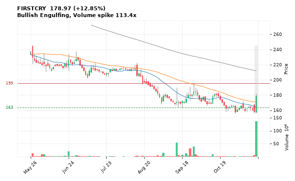

[🔔 Set alert on FIRSTCRY](https://claude.ai/artifact/Ewc5hHTPX6WkU1nVcDNQzq?s=FIRSTCRY&c=close%20above%20182.00) &nbsp;|&nbsp; [📈 Live chart (TradingView)](https://www.tradingview.com/chart/?symbol=NSE:FIRSTCRY) &nbsp;|&nbsp; [alert by email](mailto:testthetpassword@123?subject=ALERT%20FIRSTCRY&body=Alert%20me%20when%3A%20close%20above%20182.00%0A%0AEdit%20the%20line%20above%20if%20you%20want%2C%20then%20press%20Send.%20Checked%20on%20every%20day%27s%20closing%20data%3B%20a%20triggered%20alert%20appears%20at%20the%20top%20of%20the%208%20AM%20Technical%20Analysis%20email.%0A%0AExamples%20you%20can%20write%3A%0A%20%20close%20above%201150%20%20%7C%20%20close%20below%201080%20%20%7C%20%20high%20above%201200%20%20%7C%20%20low%20below%201050%0A%20%20close%20crosses%20above%20200%20DMA%20%20%7C%20%20close%20below%2050%20DMA%20%20%7C%20%20RSI%20below%2030%20%20%7C%20%20RSI%20above%2070%0A%20%20volume%20above%202x%20%20%7C%20%20change%20above%205%25%20%20%7C%20%20change%20below%20-4%25%20%20%7C%20%2052-week%20high%20%20%7C%20%20golden%20cross%0A%20%20combine%20with%20%27and%27%2C%20e.g.%20%20close%20above%201150%20and%20volume%20above%201.5x%0A%0AReference%3A%20FIRSTCRY%20closed%20178.97%20%28high%20182.00%2C%20low%20156.60%29.%0ATo%20cancel%20later%2C%20send%20an%20email%20with%20subject%3A%20CANCEL%20ALERT%20FIRSTCRY)

---

## 2. APTUS - BULLISH
**188.58** (+7.19%) | vol 6.5x | RSI 42 | H 194.38 / L 173.11  
RSI up through 30, MACD bullish cross, Volume spike 6.5x

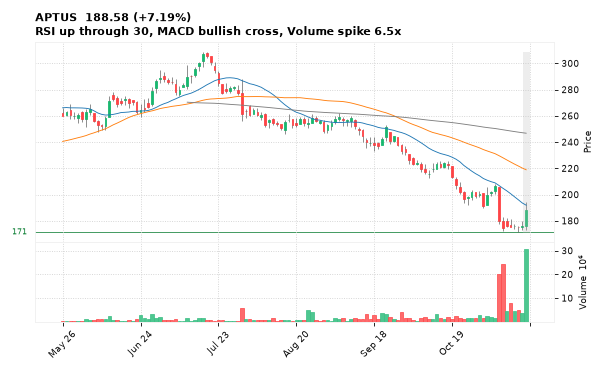

[🔔 Set alert on APTUS](https://claude.ai/artifact/Ewc5hHTPX6WkU1nVcDNQzq?s=APTUS&c=close%20above%20194.38) &nbsp;|&nbsp; [📈 Live chart (TradingView)](https://www.tradingview.com/chart/?symbol=NSE:APTUS) &nbsp;|&nbsp; [alert by email](mailto:testthetpassword@123?subject=ALERT%20APTUS&body=Alert%20me%20when%3A%20close%20above%20194.38%0A%0AEdit%20the%20line%20above%20if%20you%20want%2C%20then%20press%20Send.%20Checked%20on%20every%20day%27s%20closing%20data%3B%20a%20triggered%20alert%20appears%20at%20the%20top%20of%20the%208%20AM%20Technical%20Analysis%20email.%0A%0AExamples%20you%20can%20write%3A%0A%20%20close%20above%201150%20%20%7C%20%20close%20below%201080%20%20%7C%20%20high%20above%201200%20%20%7C%20%20low%20below%201050%0A%20%20close%20crosses%20above%20200%20DMA%20%20%7C%20%20close%20below%2050%20DMA%20%20%7C%20%20RSI%20below%2030%20%20%7C%20%20RSI%20above%2070%0A%20%20volume%20above%202x%20%20%7C%20%20change%20above%205%25%20%20%7C%20%20change%20below%20-4%25%20%20%7C%20%2052-week%20high%20%20%7C%20%20golden%20cross%0A%20%20combine%20with%20%27and%27%2C%20e.g.%20%20close%20above%201150%20and%20volume%20above%201.5x%0A%0AReference%3A%20APTUS%20closed%20188.58%20%28high%20194.38%2C%20low%20173.11%29.%0ATo%20cancel%20later%2C%20send%20an%20email%20with%20subject%3A%20CANCEL%20ALERT%20APTUS)

---

## 3. LICHSGFIN - BULLISH
**622.50** (+2.81%) | vol 2.9x | RSI 77 | H 623.30 / L 596.15  
52-week high breakout, Volume spike 2.9x

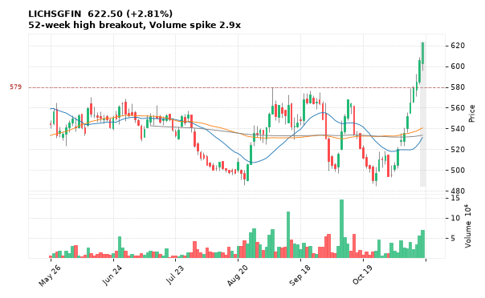

[🔔 Set alert on LICHSGFIN](https://claude.ai/artifact/Ewc5hHTPX6WkU1nVcDNQzq?s=LICHSGFIN&c=close%20above%20623.30) &nbsp;|&nbsp; [📈 Live chart (TradingView)](https://www.tradingview.com/chart/?symbol=NSE:LICHSGFIN) &nbsp;|&nbsp; [alert by email](mailto:testthetpassword@123?subject=ALERT%20LICHSGFIN&body=Alert%20me%20when%3A%20close%20above%20623.30%0A%0AEdit%20the%20line%20above%20if%20you%20want%2C%20then%20press%20Send.%20Checked%20on%20every%20day%27s%20closing%20data%3B%20a%20triggered%20alert%20appears%20at%20the%20top%20of%20the%208%20AM%20Technical%20Analysis%20email.%0A%0AExamples%20you%20can%20write%3A%0A%20%20close%20above%201150%20%20%7C%20%20close%20below%201080%20%20%7C%20%20high%20above%201200%20%20%7C%20%20low%20below%201050%0A%20%20close%20crosses%20above%20200%20DMA%20%20%7C%20%20close%20below%2050%20DMA%20%20%7C%20%20RSI%20below%2030%20%20%7C%20%20RSI%20above%2070%0A%20%20volume%20above%202x%20%20%7C%20%20change%20above%205%25%20%20%7C%20%20change%20below%20-4%25%20%20%7C%20%2052-week%20high%20%20%7C%20%20golden%20cross%0A%20%20combine%20with%20%27and%27%2C%20e.g.%20%20close%20above%201150%20and%20volume%20above%201.5x%0A%0AReference%3A%20LICHSGFIN%20closed%20622.50%20%28high%20623.30%2C%20low%20596.15%29.%0ATo%20cancel%20later%2C%20send%20an%20email%20with%20subject%3A%20CANCEL%20ALERT%20LICHSGFIN)

---

## 4. MAHABANK - BULLISH
**95.99** (+4.34%) | vol 1.9x | RSI 75 | H 96.10 / L 92.00  
Bullish Marubozu, 52-week high breakout

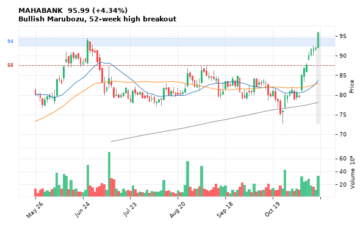

[🔔 Set alert on MAHABANK](https://claude.ai/artifact/Ewc5hHTPX6WkU1nVcDNQzq?s=MAHABANK&c=close%20above%2096.10) &nbsp;|&nbsp; [📈 Live chart (TradingView)](https://www.tradingview.com/chart/?symbol=NSE:MAHABANK) &nbsp;|&nbsp; [alert by email](mailto:testthetpassword@123?subject=ALERT%20MAHABANK&body=Alert%20me%20when%3A%20close%20above%2096.10%0A%0AEdit%20the%20line%20above%20if%20you%20want%2C%20then%20press%20Send.%20Checked%20on%20every%20day%27s%20closing%20data%3B%20a%20triggered%20alert%20appears%20at%20the%20top%20of%20the%208%20AM%20Technical%20Analysis%20email.%0A%0AExamples%20you%20can%20write%3A%0A%20%20close%20above%201150%20%20%7C%20%20close%20below%201080%20%20%7C%20%20high%20above%201200%20%20%7C%20%20low%20below%201050%0A%20%20close%20crosses%20above%20200%20DMA%20%20%7C%20%20close%20below%2050%20DMA%20%20%7C%20%20RSI%20below%2030%20%20%7C%20%20RSI%20above%2070%0A%20%20volume%20above%202x%20%20%7C%20%20change%20above%205%25%20%20%7C%20%20change%20below%20-4%25%20%20%7C%20%2052-week%20high%20%20%7C%20%20golden%20cross%0A%20%20combine%20with%20%27and%27%2C%20e.g.%20%20close%20above%201150%20and%20volume%20above%201.5x%0A%0AReference%3A%20MAHABANK%20closed%2095.99%20%28high%2096.10%2C%20low%2092.00%29.%0ATo%20cancel%20later%2C%20send%20an%20email%20with%20subject%3A%20CANCEL%20ALERT%20MAHABANK)

---

## 5. BRIGADE - BULLISH
**560.50** (+3.37%) | vol 1.7x | RSI 51 | H 572.00 / L 536.05  
Bullish Engulfing, Close above 200 DMA

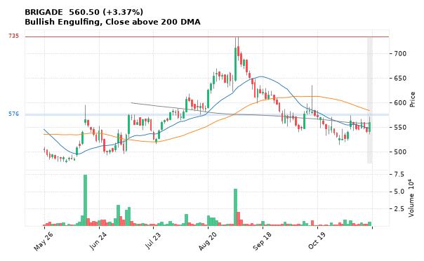

[🔔 Set alert on BRIGADE](https://claude.ai/artifact/Ewc5hHTPX6WkU1nVcDNQzq?s=BRIGADE&c=close%20above%20572.00) &nbsp;|&nbsp; [📈 Live chart (TradingView)](https://www.tradingview.com/chart/?symbol=NSE:BRIGADE) &nbsp;|&nbsp; [alert by email](mailto:testthetpassword@123?subject=ALERT%20BRIGADE&body=Alert%20me%20when%3A%20close%20above%20572.00%0A%0AEdit%20the%20line%20above%20if%20you%20want%2C%20then%20press%20Send.%20Checked%20on%20every%20day%27s%20closing%20data%3B%20a%20triggered%20alert%20appears%20at%20the%20top%20of%20the%208%20AM%20Technical%20Analysis%20email.%0A%0AExamples%20you%20can%20write%3A%0A%20%20close%20above%201150%20%20%7C%20%20close%20below%201080%20%20%7C%20%20high%20above%201200%20%20%7C%20%20low%20below%201050%0A%20%20close%20crosses%20above%20200%20DMA%20%20%7C%20%20close%20below%2050%20DMA%20%20%7C%20%20RSI%20below%2030%20%20%7C%20%20RSI%20above%2070%0A%20%20volume%20above%202x%20%20%7C%20%20change%20above%205%25%20%20%7C%20%20change%20below%20-4%25%20%20%7C%20%2052-week%20high%20%20%7C%20%20golden%20cross%0A%20%20combine%20with%20%27and%27%2C%20e.g.%20%20close%20above%201150%20and%20volume%20above%201.5x%0A%0AReference%3A%20BRIGADE%20closed%20560.50%20%28high%20572.00%2C%20low%20536.05%29.%0ATo%20cancel%20later%2C%20send%20an%20email%20with%20subject%3A%20CANCEL%20ALERT%20BRIGADE)

---

## 6. SIGNATURE - BULLISH
**835.60** (+9.14%) | vol 4.3x | RSI 73 | H 844.00 / L 765.15  
Close above 200 DMA, Volume spike 4.3x

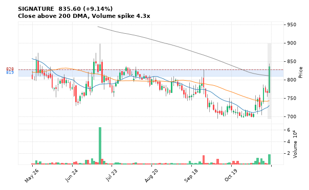

[🔔 Set alert on SIGNATURE](https://claude.ai/artifact/Ewc5hHTPX6WkU1nVcDNQzq?s=SIGNATURE&c=close%20above%20844.00) &nbsp;|&nbsp; [📈 Live chart (TradingView)](https://www.tradingview.com/chart/?symbol=NSE:SIGNATURE) &nbsp;|&nbsp; [alert by email](mailto:testthetpassword@123?subject=ALERT%20SIGNATURE&body=Alert%20me%20when%3A%20close%20above%20844.00%0A%0AEdit%20the%20line%20above%20if%20you%20want%2C%20then%20press%20Send.%20Checked%20on%20every%20day%27s%20closing%20data%3B%20a%20triggered%20alert%20appears%20at%20the%20top%20of%20the%208%20AM%20Technical%20Analysis%20email.%0A%0AExamples%20you%20can%20write%3A%0A%20%20close%20above%201150%20%20%7C%20%20close%20below%201080%20%20%7C%20%20high%20above%201200%20%20%7C%20%20low%20below%201050%0A%20%20close%20crosses%20above%20200%20DMA%20%20%7C%20%20close%20below%2050%20DMA%20%20%7C%20%20RSI%20below%2030%20%20%7C%20%20RSI%20above%2070%0A%20%20volume%20above%202x%20%20%7C%20%20change%20above%205%25%20%20%7C%20%20change%20below%20-4%25%20%20%7C%20%2052-week%20high%20%20%7C%20%20golden%20cross%0A%20%20combine%20with%20%27and%27%2C%20e.g.%20%20close%20above%201150%20and%20volume%20above%201.5x%0A%0AReference%3A%20SIGNATURE%20closed%20835.60%20%28high%20844.00%2C%20low%20765.15%29.%0ATo%20cancel%20later%2C%20send%20an%20email%20with%20subject%3A%20CANCEL%20ALERT%20SIGNATURE)

---

## 7. RHIM - BULLISH
**343.50** (+4.04%) | vol 2.7x | RSI 40 | H 344.60 / L 326.20  
RSI up through 30, Volume spike 2.7x

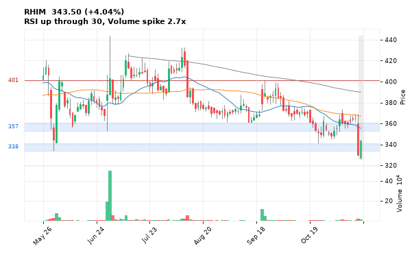

[🔔 Set alert on RHIM](https://claude.ai/artifact/Ewc5hHTPX6WkU1nVcDNQzq?s=RHIM&c=close%20above%20344.60) &nbsp;|&nbsp; [📈 Live chart (TradingView)](https://www.tradingview.com/chart/?symbol=NSE:RHIM) &nbsp;|&nbsp; [alert by email](mailto:testthetpassword@123?subject=ALERT%20RHIM&body=Alert%20me%20when%3A%20close%20above%20344.60%0A%0AEdit%20the%20line%20above%20if%20you%20want%2C%20then%20press%20Send.%20Checked%20on%20every%20day%27s%20closing%20data%3B%20a%20triggered%20alert%20appears%20at%20the%20top%20of%20the%208%20AM%20Technical%20Analysis%20email.%0A%0AExamples%20you%20can%20write%3A%0A%20%20close%20above%201150%20%20%7C%20%20close%20below%201080%20%20%7C%20%20high%20above%201200%20%20%7C%20%20low%20below%201050%0A%20%20close%20crosses%20above%20200%20DMA%20%20%7C%20%20close%20below%2050%20DMA%20%20%7C%20%20RSI%20below%2030%20%20%7C%20%20RSI%20above%2070%0A%20%20volume%20above%202x%20%20%7C%20%20change%20above%205%25%20%20%7C%20%20change%20below%20-4%25%20%20%7C%20%2052-week%20high%20%20%7C%20%20golden%20cross%0A%20%20combine%20with%20%27and%27%2C%20e.g.%20%20close%20above%201150%20and%20volume%20above%201.5x%0A%0AReference%3A%20RHIM%20closed%20343.50%20%28high%20344.60%2C%20low%20326.20%29.%0ATo%20cancel%20later%2C%20send%20an%20email%20with%20subject%3A%20CANCEL%20ALERT%20RHIM)

---

## 8. CAMS - BULLISH
**744.00** (+2.86%) | vol 2.3x | RSI 62 | H 772.00 / L 720.25  
Close above 200 DMA, Volume spike 2.3x

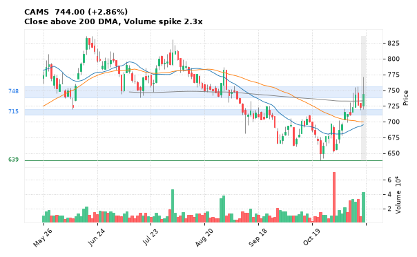

[🔔 Set alert on CAMS](https://claude.ai/artifact/Ewc5hHTPX6WkU1nVcDNQzq?s=CAMS&c=close%20above%20772.00) &nbsp;|&nbsp; [📈 Live chart (TradingView)](https://www.tradingview.com/chart/?symbol=NSE:CAMS) &nbsp;|&nbsp; [alert by email](mailto:testthetpassword@123?subject=ALERT%20CAMS&body=Alert%20me%20when%3A%20close%20above%20772.00%0A%0AEdit%20the%20line%20above%20if%20you%20want%2C%20then%20press%20Send.%20Checked%20on%20every%20day%27s%20closing%20data%3B%20a%20triggered%20alert%20appears%20at%20the%20top%20of%20the%208%20AM%20Technical%20Analysis%20email.%0A%0AExamples%20you%20can%20write%3A%0A%20%20close%20above%201150%20%20%7C%20%20close%20below%201080%20%20%7C%20%20high%20above%201200%20%20%7C%20%20low%20below%201050%0A%20%20close%20crosses%20above%20200%20DMA%20%20%7C%20%20close%20below%2050%20DMA%20%20%7C%20%20RSI%20below%2030%20%20%7C%20%20RSI%20above%2070%0A%20%20volume%20above%202x%20%20%7C%20%20change%20above%205%25%20%20%7C%20%20change%20below%20-4%25%20%20%7C%20%2052-week%20high%20%20%7C%20%20golden%20cross%0A%20%20combine%20with%20%27and%27%2C%20e.g.%20%20close%20above%201150%20and%20volume%20above%201.5x%0A%0AReference%3A%20CAMS%20closed%20744.00%20%28high%20772.00%2C%20low%20720.25%29.%0ATo%20cancel%20later%2C%20send%20an%20email%20with%20subject%3A%20CANCEL%20ALERT%20CAMS)

---

## 9. DELHIVERY - BULLISH
**457.95** (+3.97%) | vol 2.3x | RSI 70 | H 465.80 / L 439.05  
Close above 200 DMA, Volume spike 2.3x

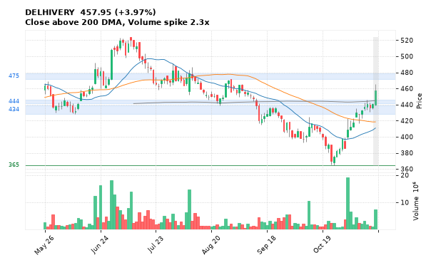

[🔔 Set alert on DELHIVERY](https://claude.ai/artifact/Ewc5hHTPX6WkU1nVcDNQzq?s=DELHIVERY&c=close%20above%20465.80) &nbsp;|&nbsp; [📈 Live chart (TradingView)](https://www.tradingview.com/chart/?symbol=NSE:DELHIVERY) &nbsp;|&nbsp; [alert by email](mailto:testthetpassword@123?subject=ALERT%20DELHIVERY&body=Alert%20me%20when%3A%20close%20above%20465.80%0A%0AEdit%20the%20line%20above%20if%20you%20want%2C%20then%20press%20Send.%20Checked%20on%20every%20day%27s%20closing%20data%3B%20a%20triggered%20alert%20appears%20at%20the%20top%20of%20the%208%20AM%20Technical%20Analysis%20email.%0A%0AExamples%20you%20can%20write%3A%0A%20%20close%20above%201150%20%20%7C%20%20close%20below%201080%20%20%7C%20%20high%20above%201200%20%20%7C%20%20low%20below%201050%0A%20%20close%20crosses%20above%20200%20DMA%20%20%7C%20%20close%20below%2050%20DMA%20%20%7C%20%20RSI%20below%2030%20%20%7C%20%20RSI%20above%2070%0A%20%20volume%20above%202x%20%20%7C%20%20change%20above%205%25%20%20%7C%20%20change%20below%20-4%25%20%20%7C%20%2052-week%20high%20%20%7C%20%20golden%20cross%0A%20%20combine%20with%20%27and%27%2C%20e.g.%20%20close%20above%201150%20and%20volume%20above%201.5x%0A%0AReference%3A%20DELHIVERY%20closed%20457.95%20%28high%20465.80%2C%20low%20439.05%29.%0ATo%20cancel%20later%2C%20send%20an%20email%20with%20subject%3A%20CANCEL%20ALERT%20DELHIVERY)

---

## 10. SAGILITY - BULLISH
**43.89** (+1.13%) | vol 0.3x | RSI 49 | H 44.10 / L 42.90  
Bullish Engulfing, MACD bullish cross

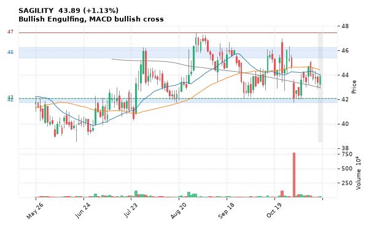

[🔔 Set alert on SAGILITY](https://claude.ai/artifact/Ewc5hHTPX6WkU1nVcDNQzq?s=SAGILITY&c=close%20above%2044.10) &nbsp;|&nbsp; [📈 Live chart (TradingView)](https://www.tradingview.com/chart/?symbol=NSE:SAGILITY) &nbsp;|&nbsp; [alert by email](mailto:testthetpassword@123?subject=ALERT%20SAGILITY&body=Alert%20me%20when%3A%20close%20above%2044.10%0A%0AEdit%20the%20line%20above%20if%20you%20want%2C%20then%20press%20Send.%20Checked%20on%20every%20day%27s%20closing%20data%3B%20a%20triggered%20alert%20appears%20at%20the%20top%20of%20the%208%20AM%20Technical%20Analysis%20email.%0A%0AExamples%20you%20can%20write%3A%0A%20%20close%20above%201150%20%20%7C%20%20close%20below%201080%20%20%7C%20%20high%20above%201200%20%20%7C%20%20low%20below%201050%0A%20%20close%20crosses%20above%20200%20DMA%20%20%7C%20%20close%20below%2050%20DMA%20%20%7C%20%20RSI%20below%2030%20%20%7C%20%20RSI%20above%2070%0A%20%20volume%20above%202x%20%20%7C%20%20change%20above%205%25%20%20%7C%20%20change%20below%20-4%25%20%20%7C%20%2052-week%20high%20%20%7C%20%20golden%20cross%0A%20%20combine%20with%20%27and%27%2C%20e.g.%20%20close%20above%201150%20and%20volume%20above%201.5x%0A%0AReference%3A%20SAGILITY%20closed%2043.89%20%28high%2044.10%2C%20low%2042.90%29.%0ATo%20cancel%20later%2C%20send%20an%20email%20with%20subject%3A%20CANCEL%20ALERT%20SAGILITY)

---

## 11. AFCONS - BULLISH
**221.91** (+2.91%) | vol 9.5x | RSI 46 | H 232.32 / L 219.37  
Inverted Hammer, Volume spike 9.5x

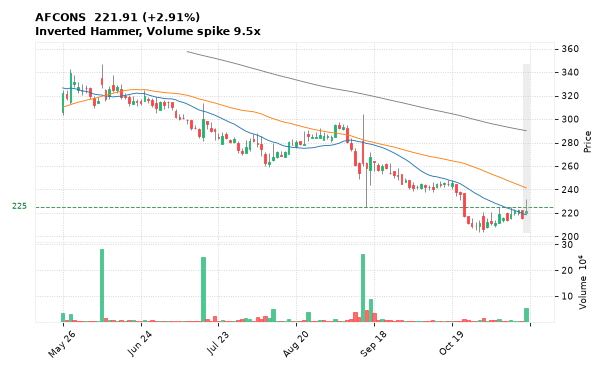

[🔔 Set alert on AFCONS](https://claude.ai/artifact/Ewc5hHTPX6WkU1nVcDNQzq?s=AFCONS&c=close%20above%20232.32) &nbsp;|&nbsp; [📈 Live chart (TradingView)](https://www.tradingview.com/chart/?symbol=NSE:AFCONS) &nbsp;|&nbsp; [alert by email](mailto:testthetpassword@123?subject=ALERT%20AFCONS&body=Alert%20me%20when%3A%20close%20above%20232.32%0A%0AEdit%20the%20line%20above%20if%20you%20want%2C%20then%20press%20Send.%20Checked%20on%20every%20day%27s%20closing%20data%3B%20a%20triggered%20alert%20appears%20at%20the%20top%20of%20the%208%20AM%20Technical%20Analysis%20email.%0A%0AExamples%20you%20can%20write%3A%0A%20%20close%20above%201150%20%20%7C%20%20close%20below%201080%20%20%7C%20%20high%20above%201200%20%20%7C%20%20low%20below%201050%0A%20%20close%20crosses%20above%20200%20DMA%20%20%7C%20%20close%20below%2050%20DMA%20%20%7C%20%20RSI%20below%2030%20%20%7C%20%20RSI%20above%2070%0A%20%20volume%20above%202x%20%20%7C%20%20change%20above%205%25%20%20%7C%20%20change%20below%20-4%25%20%20%7C%20%2052-week%20high%20%20%7C%20%20golden%20cross%0A%20%20combine%20with%20%27and%27%2C%20e.g.%20%20close%20above%201150%20and%20volume%20above%201.5x%0A%0AReference%3A%20AFCONS%20closed%20221.91%20%28high%20232.32%2C%20low%20219.37%29.%0ATo%20cancel%20later%2C%20send%20an%20email%20with%20subject%3A%20CANCEL%20ALERT%20AFCONS)

---

## 12. HONASA - BULLISH
**517.80** (+3.30%) | vol 2.0x | RSI 70 | H 524.00 / L 501.40  
52-week high breakout

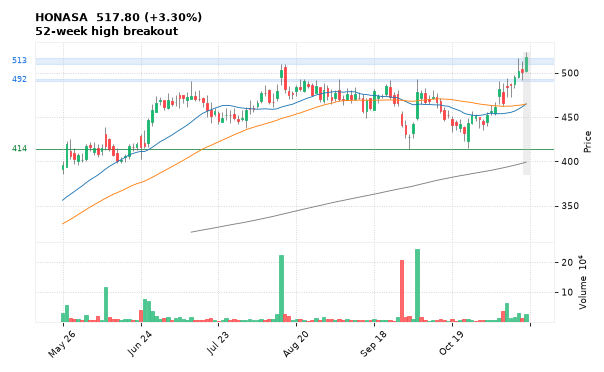

[🔔 Set alert on HONASA](https://claude.ai/artifact/Ewc5hHTPX6WkU1nVcDNQzq?s=HONASA&c=close%20above%20524.00) &nbsp;|&nbsp; [📈 Live chart (TradingView)](https://www.tradingview.com/chart/?symbol=NSE:HONASA) &nbsp;|&nbsp; [alert by email](mailto:testthetpassword@123?subject=ALERT%20HONASA&body=Alert%20me%20when%3A%20close%20above%20524.00%0A%0AEdit%20the%20line%20above%20if%20you%20want%2C%20then%20press%20Send.%20Checked%20on%20every%20day%27s%20closing%20data%3B%20a%20triggered%20alert%20appears%20at%20the%20top%20of%20the%208%20AM%20Technical%20Analysis%20email.%0A%0AExamples%20you%20can%20write%3A%0A%20%20close%20above%201150%20%20%7C%20%20close%20below%201080%20%20%7C%20%20high%20above%201200%20%20%7C%20%20low%20below%201050%0A%20%20close%20crosses%20above%20200%20DMA%20%20%7C%20%20close%20below%2050%20DMA%20%20%7C%20%20RSI%20below%2030%20%20%7C%20%20RSI%20above%2070%0A%20%20volume%20above%202x%20%20%7C%20%20change%20above%205%25%20%20%7C%20%20change%20below%20-4%25%20%20%7C%20%2052-week%20high%20%20%7C%20%20golden%20cross%0A%20%20combine%20with%20%27and%27%2C%20e.g.%20%20close%20above%201150%20and%20volume%20above%201.5x%0A%0AReference%3A%20HONASA%20closed%20517.80%20%28high%20524.00%2C%20low%20501.40%29.%0ATo%20cancel%20later%2C%20send%20an%20email%20with%20subject%3A%20CANCEL%20ALERT%20HONASA)

---

## 13. MOTILALOFS - BULLISH
**1,240.25** (+1.91%) | vol 1.8x | RSI 75 | H 1,277.80 / L 1,201.20  
52-week high breakout

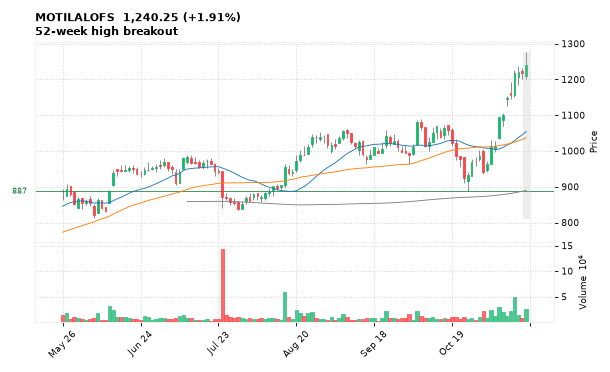

[🔔 Set alert on MOTILALOFS](https://claude.ai/artifact/Ewc5hHTPX6WkU1nVcDNQzq?s=MOTILALOFS&c=close%20above%201277.80) &nbsp;|&nbsp; [📈 Live chart (TradingView)](https://www.tradingview.com/chart/?symbol=NSE:MOTILALOFS) &nbsp;|&nbsp; [alert by email](mailto:testthetpassword@123?subject=ALERT%20MOTILALOFS&body=Alert%20me%20when%3A%20close%20above%201277.80%0A%0AEdit%20the%20line%20above%20if%20you%20want%2C%20then%20press%20Send.%20Checked%20on%20every%20day%27s%20closing%20data%3B%20a%20triggered%20alert%20appears%20at%20the%20top%20of%20the%208%20AM%20Technical%20Analysis%20email.%0A%0AExamples%20you%20can%20write%3A%0A%20%20close%20above%201150%20%20%7C%20%20close%20below%201080%20%20%7C%20%20high%20above%201200%20%20%7C%20%20low%20below%201050%0A%20%20close%20crosses%20above%20200%20DMA%20%20%7C%20%20close%20below%2050%20DMA%20%20%7C%20%20RSI%20below%2030%20%20%7C%20%20RSI%20above%2070%0A%20%20volume%20above%202x%20%20%7C%20%20change%20above%205%25%20%20%7C%20%20change%20below%20-4%25%20%20%7C%20%2052-week%20high%20%20%7C%20%20golden%20cross%0A%20%20combine%20with%20%27and%27%2C%20e.g.%20%20close%20above%201150%20and%20volume%20above%201.5x%0A%0AReference%3A%20MOTILALOFS%20closed%201240.25%20%28high%201277.80%2C%20low%201201.20%29.%0ATo%20cancel%20later%2C%20send%20an%20email%20with%20subject%3A%20CANCEL%20ALERT%20MOTILALOFS)

---

## 14. PNB - BULLISH
**150.00** (+3.74%) | vol 1.7x | RSI 85 | H 151.67 / L 143.90  
52-week high breakout

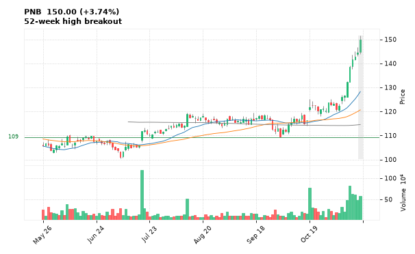

[🔔 Set alert on PNB](https://claude.ai/artifact/Ewc5hHTPX6WkU1nVcDNQzq?s=PNB&c=close%20above%20151.67) &nbsp;|&nbsp; [📈 Live chart (TradingView)](https://www.tradingview.com/chart/?symbol=NSE:PNB) &nbsp;|&nbsp; [alert by email](mailto:testthetpassword@123?subject=ALERT%20PNB&body=Alert%20me%20when%3A%20close%20above%20151.67%0A%0AEdit%20the%20line%20above%20if%20you%20want%2C%20then%20press%20Send.%20Checked%20on%20every%20day%27s%20closing%20data%3B%20a%20triggered%20alert%20appears%20at%20the%20top%20of%20the%208%20AM%20Technical%20Analysis%20email.%0A%0AExamples%20you%20can%20write%3A%0A%20%20close%20above%201150%20%20%7C%20%20close%20below%201080%20%20%7C%20%20high%20above%201200%20%20%7C%20%20low%20below%201050%0A%20%20close%20crosses%20above%20200%20DMA%20%20%7C%20%20close%20below%2050%20DMA%20%20%7C%20%20RSI%20below%2030%20%20%7C%20%20RSI%20above%2070%0A%20%20volume%20above%202x%20%20%7C%20%20change%20above%205%25%20%20%7C%20%20change%20below%20-4%25%20%20%7C%20%2052-week%20high%20%20%7C%20%20golden%20cross%0A%20%20combine%20with%20%27and%27%2C%20e.g.%20%20close%20above%201150%20and%20volume%20above%201.5x%0A%0AReference%3A%20PNB%20closed%20150.00%20%28high%20151.67%2C%20low%20143.90%29.%0ATo%20cancel%20later%2C%20send%20an%20email%20with%20subject%3A%20CANCEL%20ALERT%20PNB)

---

## 15. ETERNAL - BULLISH
**375.05** (+1.06%) | vol 1.1x | RSI 73 | H 378.00 / L 369.15  
52-week high breakout

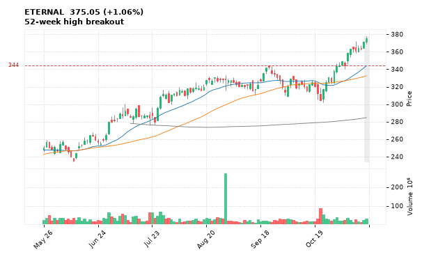

[🔔 Set alert on ETERNAL](https://claude.ai/artifact/Ewc5hHTPX6WkU1nVcDNQzq?s=ETERNAL&c=close%20above%20378.00) &nbsp;|&nbsp; [📈 Live chart (TradingView)](https://www.tradingview.com/chart/?symbol=NSE:ETERNAL) &nbsp;|&nbsp; [alert by email](mailto:testthetpassword@123?subject=ALERT%20ETERNAL&body=Alert%20me%20when%3A%20close%20above%20378.00%0A%0AEdit%20the%20line%20above%20if%20you%20want%2C%20then%20press%20Send.%20Checked%20on%20every%20day%27s%20closing%20data%3B%20a%20triggered%20alert%20appears%20at%20the%20top%20of%20the%208%20AM%20Technical%20Analysis%20email.%0A%0AExamples%20you%20can%20write%3A%0A%20%20close%20above%201150%20%20%7C%20%20close%20below%201080%20%20%7C%20%20high%20above%201200%20%20%7C%20%20low%20below%201050%0A%20%20close%20crosses%20above%20200%20DMA%20%20%7C%20%20close%20below%2050%20DMA%20%20%7C%20%20RSI%20below%2030%20%20%7C%20%20RSI%20above%2070%0A%20%20volume%20above%202x%20%20%7C%20%20change%20above%205%25%20%20%7C%20%20change%20below%20-4%25%20%20%7C%20%2052-week%20high%20%20%7C%20%20golden%20cross%0A%20%20combine%20with%20%27and%27%2C%20e.g.%20%20close%20above%201150%20and%20volume%20above%201.5x%0A%0AReference%3A%20ETERNAL%20closed%20375.05%20%28high%20378.00%2C%20low%20369.15%29.%0ATo%20cancel%20later%2C%20send%20an%20email%20with%20subject%3A%20CANCEL%20ALERT%20ETERNAL)

---

## 16. URBANCO - BEARISH
**161.63** (-5.86%) | vol 5.0x | RSI 53 | H 173.15 / L 160.50  
Bearish Engulfing, Volume spike 5.0x

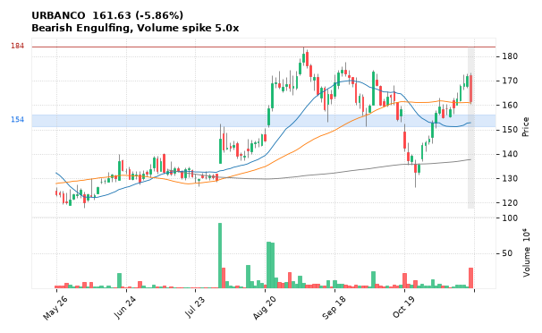

[🔔 Set alert on URBANCO](https://claude.ai/artifact/Ewc5hHTPX6WkU1nVcDNQzq?s=URBANCO&c=close%20below%20160.50) &nbsp;|&nbsp; [📈 Live chart (TradingView)](https://www.tradingview.com/chart/?symbol=NSE:URBANCO) &nbsp;|&nbsp; [alert by email](mailto:testthetpassword@123?subject=ALERT%20URBANCO&body=Alert%20me%20when%3A%20close%20below%20160.50%0A%0AEdit%20the%20line%20above%20if%20you%20want%2C%20then%20press%20Send.%20Checked%20on%20every%20day%27s%20closing%20data%3B%20a%20triggered%20alert%20appears%20at%20the%20top%20of%20the%208%20AM%20Technical%20Analysis%20email.%0A%0AExamples%20you%20can%20write%3A%0A%20%20close%20above%201150%20%20%7C%20%20close%20below%201080%20%20%7C%20%20high%20above%201200%20%20%7C%20%20low%20below%201050%0A%20%20close%20crosses%20above%20200%20DMA%20%20%7C%20%20close%20below%2050%20DMA%20%20%7C%20%20RSI%20below%2030%20%20%7C%20%20RSI%20above%2070%0A%20%20volume%20above%202x%20%20%7C%20%20change%20above%205%25%20%20%7C%20%20change%20below%20-4%25%20%20%7C%20%2052-week%20high%20%20%7C%20%20golden%20cross%0A%20%20combine%20with%20%27and%27%2C%20e.g.%20%20close%20above%201150%20and%20volume%20above%201.5x%0A%0AReference%3A%20URBANCO%20closed%20161.63%20%28high%20173.15%2C%20low%20160.50%29.%0ATo%20cancel%20later%2C%20send%20an%20email%20with%20subject%3A%20CANCEL%20ALERT%20URBANCO)

---

## 17. ASHOKLEY - BEARISH
**160.50** (-4.17%) | vol 2.7x | RSI 52 | H 172.80 / L 160.50  
Three Black Crows, Volume spike 2.7x

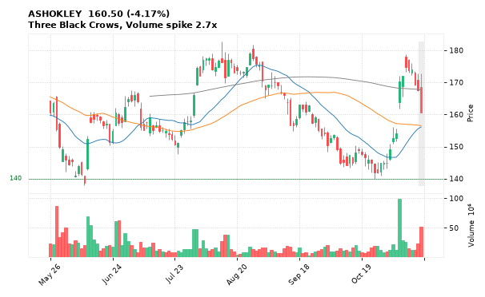

[🔔 Set alert on ASHOKLEY](https://claude.ai/artifact/Ewc5hHTPX6WkU1nVcDNQzq?s=ASHOKLEY&c=close%20below%20160.50) &nbsp;|&nbsp; [📈 Live chart (TradingView)](https://www.tradingview.com/chart/?symbol=NSE:ASHOKLEY) &nbsp;|&nbsp; [alert by email](mailto:testthetpassword@123?subject=ALERT%20ASHOKLEY&body=Alert%20me%20when%3A%20close%20below%20160.50%0A%0AEdit%20the%20line%20above%20if%20you%20want%2C%20then%20press%20Send.%20Checked%20on%20every%20day%27s%20closing%20data%3B%20a%20triggered%20alert%20appears%20at%20the%20top%20of%20the%208%20AM%20Technical%20Analysis%20email.%0A%0AExamples%20you%20can%20write%3A%0A%20%20close%20above%201150%20%20%7C%20%20close%20below%201080%20%20%7C%20%20high%20above%201200%20%20%7C%20%20low%20below%201050%0A%20%20close%20crosses%20above%20200%20DMA%20%20%7C%20%20close%20below%2050%20DMA%20%20%7C%20%20RSI%20below%2030%20%20%7C%20%20RSI%20above%2070%0A%20%20volume%20above%202x%20%20%7C%20%20change%20above%205%25%20%20%7C%20%20change%20below%20-4%25%20%20%7C%20%2052-week%20high%20%20%7C%20%20golden%20cross%0A%20%20combine%20with%20%27and%27%2C%20e.g.%20%20close%20above%201150%20and%20volume%20above%201.5x%0A%0AReference%3A%20ASHOKLEY%20closed%20160.50%20%28high%20172.80%2C%20low%20160.50%29.%0ATo%20cancel%20later%2C%20send%20an%20email%20with%20subject%3A%20CANCEL%20ALERT%20ASHOKLEY)

---

## 18. POLYCAB - BEARISH
**7,702.00** (-3.19%) | vol 1.6x | RSI 41 | H 7,985.50 / L 7,695.00  
Bearish Marubozu, Bearish Engulfing

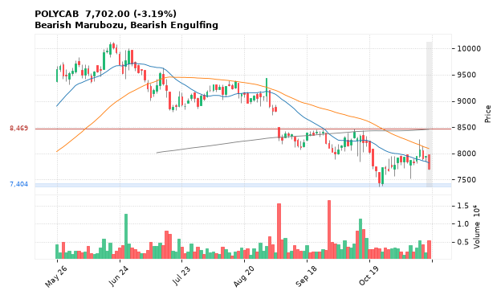

[🔔 Set alert on POLYCAB](https://claude.ai/artifact/Ewc5hHTPX6WkU1nVcDNQzq?s=POLYCAB&c=close%20below%207695.00) &nbsp;|&nbsp; [📈 Live chart (TradingView)](https://www.tradingview.com/chart/?symbol=NSE:POLYCAB) &nbsp;|&nbsp; [alert by email](mailto:testthetpassword@123?subject=ALERT%20POLYCAB&body=Alert%20me%20when%3A%20close%20below%207695.00%0A%0AEdit%20the%20line%20above%20if%20you%20want%2C%20then%20press%20Send.%20Checked%20on%20every%20day%27s%20closing%20data%3B%20a%20triggered%20alert%20appears%20at%20the%20top%20of%20the%208%20AM%20Technical%20Analysis%20email.%0A%0AExamples%20you%20can%20write%3A%0A%20%20close%20above%201150%20%20%7C%20%20close%20below%201080%20%20%7C%20%20high%20above%201200%20%20%7C%20%20low%20below%201050%0A%20%20close%20crosses%20above%20200%20DMA%20%20%7C%20%20close%20below%2050%20DMA%20%20%7C%20%20RSI%20below%2030%20%20%7C%20%20RSI%20above%2070%0A%20%20volume%20above%202x%20%20%7C%20%20change%20above%205%25%20%20%7C%20%20change%20below%20-4%25%20%20%7C%20%2052-week%20high%20%20%7C%20%20golden%20cross%0A%20%20combine%20with%20%27and%27%2C%20e.g.%20%20close%20above%201150%20and%20volume%20above%201.5x%0A%0AReference%3A%20POLYCAB%20closed%207702.00%20%28high%207985.50%2C%20low%207695.00%29.%0ATo%20cancel%20later%2C%20send%20an%20email%20with%20subject%3A%20CANCEL%20ALERT%20POLYCAB)

---

## 19. WHIRLPOOL - BEARISH
**826.45** (-1.08%) | vol 0.4x | RSI 50 | H 843.00 / L 825.00  
Bearish Engulfing, Close below 200 DMA

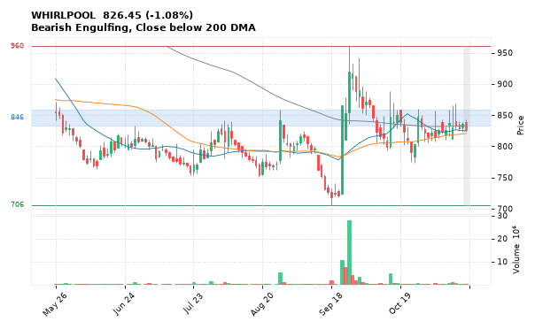

[🔔 Set alert on WHIRLPOOL](https://claude.ai/artifact/Ewc5hHTPX6WkU1nVcDNQzq?s=WHIRLPOOL&c=close%20below%20825.00) &nbsp;|&nbsp; [📈 Live chart (TradingView)](https://www.tradingview.com/chart/?symbol=NSE:WHIRLPOOL) &nbsp;|&nbsp; [alert by email](mailto:testthetpassword@123?subject=ALERT%20WHIRLPOOL&body=Alert%20me%20when%3A%20close%20below%20825.00%0A%0AEdit%20the%20line%20above%20if%20you%20want%2C%20then%20press%20Send.%20Checked%20on%20every%20day%27s%20closing%20data%3B%20a%20triggered%20alert%20appears%20at%20the%20top%20of%20the%208%20AM%20Technical%20Analysis%20email.%0A%0AExamples%20you%20can%20write%3A%0A%20%20close%20above%201150%20%20%7C%20%20close%20below%201080%20%20%7C%20%20high%20above%201200%20%20%7C%20%20low%20below%201050%0A%20%20close%20crosses%20above%20200%20DMA%20%20%7C%20%20close%20below%2050%20DMA%20%20%7C%20%20RSI%20below%2030%20%20%7C%20%20RSI%20above%2070%0A%20%20volume%20above%202x%20%20%7C%20%20change%20above%205%25%20%20%7C%20%20change%20below%20-4%25%20%20%7C%20%2052-week%20high%20%20%7C%20%20golden%20cross%0A%20%20combine%20with%20%27and%27%2C%20e.g.%20%20close%20above%201150%20and%20volume%20above%201.5x%0A%0AReference%3A%20WHIRLPOOL%20closed%20826.45%20%28high%20843.00%2C%20low%20825.00%29.%0ATo%20cancel%20later%2C%20send%20an%20email%20with%20subject%3A%20CANCEL%20ALERT%20WHIRLPOOL)

---

## 20. CONCORDBIO - BEARISH
**554.80** (-4.51%) | vol 2.1x | RSI 35 | H 584.40 / L 553.50  
Bearish Marubozu, Volume spike 2.1x

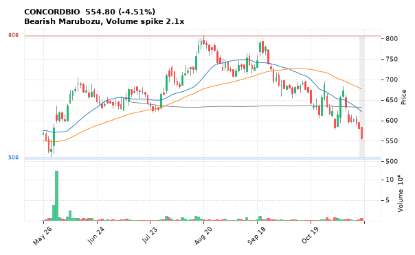

[🔔 Set alert on CONCORDBIO](https://claude.ai/artifact/Ewc5hHTPX6WkU1nVcDNQzq?s=CONCORDBIO&c=close%20below%20553.50) &nbsp;|&nbsp; [📈 Live chart (TradingView)](https://www.tradingview.com/chart/?symbol=NSE:CONCORDBIO) &nbsp;|&nbsp; [alert by email](mailto:testthetpassword@123?subject=ALERT%20CONCORDBIO&body=Alert%20me%20when%3A%20close%20below%20553.50%0A%0AEdit%20the%20line%20above%20if%20you%20want%2C%20then%20press%20Send.%20Checked%20on%20every%20day%27s%20closing%20data%3B%20a%20triggered%20alert%20appears%20at%20the%20top%20of%20the%208%20AM%20Technical%20Analysis%20email.%0A%0AExamples%20you%20can%20write%3A%0A%20%20close%20above%201150%20%20%7C%20%20close%20below%201080%20%20%7C%20%20high%20above%201200%20%20%7C%20%20low%20below%201050%0A%20%20close%20crosses%20above%20200%20DMA%20%20%7C%20%20close%20below%2050%20DMA%20%20%7C%20%20RSI%20below%2030%20%20%7C%20%20RSI%20above%2070%0A%20%20volume%20above%202x%20%20%7C%20%20change%20above%205%25%20%20%7C%20%20change%20below%20-4%25%20%20%7C%20%2052-week%20high%20%20%7C%20%20golden%20cross%0A%20%20combine%20with%20%27and%27%2C%20e.g.%20%20close%20above%201150%20and%20volume%20above%201.5x%0A%0AReference%3A%20CONCORDBIO%20closed%20554.80%20%28high%20584.40%2C%20low%20553.50%29.%0ATo%20cancel%20later%2C%20send%20an%20email%20with%20subject%3A%20CANCEL%20ALERT%20CONCORDBIO)

---

## 21. PPLPHARMA - BEARISH
**240.70** (-1.73%) | vol 0.4x | RSI 65 | H 247.99 / L 239.26  
Shooting Star, RSI down through 70, Inside Bar

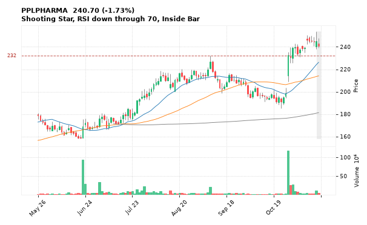

[🔔 Set alert on PPLPHARMA](https://claude.ai/artifact/Ewc5hHTPX6WkU1nVcDNQzq?s=PPLPHARMA&c=close%20below%20239.26) &nbsp;|&nbsp; [📈 Live chart (TradingView)](https://www.tradingview.com/chart/?symbol=NSE:PPLPHARMA) &nbsp;|&nbsp; [alert by email](mailto:testthetpassword@123?subject=ALERT%20PPLPHARMA&body=Alert%20me%20when%3A%20close%20below%20239.26%0A%0AEdit%20the%20line%20above%20if%20you%20want%2C%20then%20press%20Send.%20Checked%20on%20every%20day%27s%20closing%20data%3B%20a%20triggered%20alert%20appears%20at%20the%20top%20of%20the%208%20AM%20Technical%20Analysis%20email.%0A%0AExamples%20you%20can%20write%3A%0A%20%20close%20above%201150%20%20%7C%20%20close%20below%201080%20%20%7C%20%20high%20above%201200%20%20%7C%20%20low%20below%201050%0A%20%20close%20crosses%20above%20200%20DMA%20%20%7C%20%20close%20below%2050%20DMA%20%20%7C%20%20RSI%20below%2030%20%20%7C%20%20RSI%20above%2070%0A%20%20volume%20above%202x%20%20%7C%20%20change%20above%205%25%20%20%7C%20%20change%20below%20-4%25%20%20%7C%20%2052-week%20high%20%20%7C%20%20golden%20cross%0A%20%20combine%20with%20%27and%27%2C%20e.g.%20%20close%20above%201150%20and%20volume%20above%201.5x%0A%0AReference%3A%20PPLPHARMA%20closed%20240.70%20%28high%20247.99%2C%20low%20239.26%29.%0ATo%20cancel%20later%2C%20send%20an%20email%20with%20subject%3A%20CANCEL%20ALERT%20PPLPHARMA)

---

## 22. KAYNES - BEARISH
**2,858.00** (-4.09%) | vol 3.8x | RSI 34 | H 3,024.60 / L 2,850.00  
MACD bearish cross, Volume spike 3.8x, Inside Bar

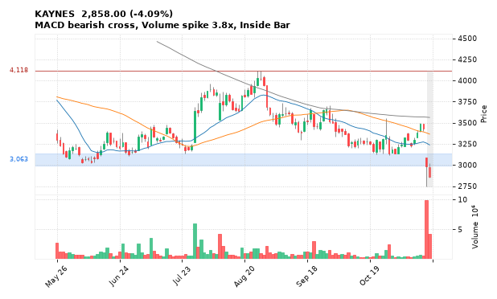

[🔔 Set alert on KAYNES](https://claude.ai/artifact/Ewc5hHTPX6WkU1nVcDNQzq?s=KAYNES&c=close%20below%202850.00) &nbsp;|&nbsp; [📈 Live chart (TradingView)](https://www.tradingview.com/chart/?symbol=NSE:KAYNES) &nbsp;|&nbsp; [alert by email](mailto:testthetpassword@123?subject=ALERT%20KAYNES&body=Alert%20me%20when%3A%20close%20below%202850.00%0A%0AEdit%20the%20line%20above%20if%20you%20want%2C%20then%20press%20Send.%20Checked%20on%20every%20day%27s%20closing%20data%3B%20a%20triggered%20alert%20appears%20at%20the%20top%20of%20the%208%20AM%20Technical%20Analysis%20email.%0A%0AExamples%20you%20can%20write%3A%0A%20%20close%20above%201150%20%20%7C%20%20close%20below%201080%20%20%7C%20%20high%20above%201200%20%20%7C%20%20low%20below%201050%0A%20%20close%20crosses%20above%20200%20DMA%20%20%7C%20%20close%20below%2050%20DMA%20%20%7C%20%20RSI%20below%2030%20%20%7C%20%20RSI%20above%2070%0A%20%20volume%20above%202x%20%20%7C%20%20change%20above%205%25%20%20%7C%20%20change%20below%20-4%25%20%20%7C%20%2052-week%20high%20%20%7C%20%20golden%20cross%0A%20%20combine%20with%20%27and%27%2C%20e.g.%20%20close%20above%201150%20and%20volume%20above%201.5x%0A%0AReference%3A%20KAYNES%20closed%202858.00%20%28high%203024.60%2C%20low%202850.00%29.%0ATo%20cancel%20later%2C%20send%20an%20email%20with%20subject%3A%20CANCEL%20ALERT%20KAYNES)

---

## 23. POWERINDIA - BEARISH
**30,435.00** (-1.46%) | vol 0.9x | RSI 55 | H 30,950.00 / L 29,785.00  
Doji (indecision), Death Cross (50/200 DMA)

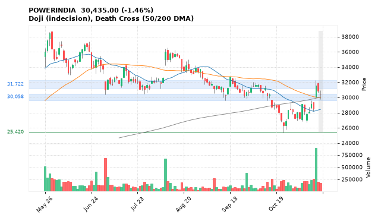

[🔔 Set alert on POWERINDIA](https://claude.ai/artifact/Ewc5hHTPX6WkU1nVcDNQzq?s=POWERINDIA&c=close%20below%2029785.00) &nbsp;|&nbsp; [📈 Live chart (TradingView)](https://www.tradingview.com/chart/?symbol=NSE:POWERINDIA) &nbsp;|&nbsp; [alert by email](mailto:testthetpassword@123?subject=ALERT%20POWERINDIA&body=Alert%20me%20when%3A%20close%20below%2029785.00%0A%0AEdit%20the%20line%20above%20if%20you%20want%2C%20then%20press%20Send.%20Checked%20on%20every%20day%27s%20closing%20data%3B%20a%20triggered%20alert%20appears%20at%20the%20top%20of%20the%208%20AM%20Technical%20Analysis%20email.%0A%0AExamples%20you%20can%20write%3A%0A%20%20close%20above%201150%20%20%7C%20%20close%20below%201080%20%20%7C%20%20high%20above%201200%20%20%7C%20%20low%20below%201050%0A%20%20close%20crosses%20above%20200%20DMA%20%20%7C%20%20close%20below%2050%20DMA%20%20%7C%20%20RSI%20below%2030%20%20%7C%20%20RSI%20above%2070%0A%20%20volume%20above%202x%20%20%7C%20%20change%20above%205%25%20%20%7C%20%20change%20below%20-4%25%20%20%7C%20%2052-week%20high%20%20%7C%20%20golden%20cross%0A%20%20combine%20with%20%27and%27%2C%20e.g.%20%20close%20above%201150%20and%20volume%20above%201.5x%0A%0AReference%3A%20POWERINDIA%20closed%2030435.00%20%28high%2030950.00%2C%20low%2029785.00%29.%0ATo%20cancel%20later%2C%20send%20an%20email%20with%20subject%3A%20CANCEL%20ALERT%20POWERINDIA)

---

## 24. RAINBOW - BEARISH
**1,270.40** (-0.50%) | vol 0.9x | RSI 51 | H 1,288.70 / L 1,267.50  
Bearish Engulfing, Inside Bar, NR7 (narrowest range in 7)

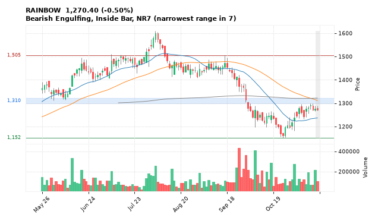

[🔔 Set alert on RAINBOW](https://claude.ai/artifact/Ewc5hHTPX6WkU1nVcDNQzq?s=RAINBOW&c=close%20below%201267.50) &nbsp;|&nbsp; [📈 Live chart (TradingView)](https://www.tradingview.com/chart/?symbol=NSE:RAINBOW) &nbsp;|&nbsp; [alert by email](mailto:testthetpassword@123?subject=ALERT%20RAINBOW&body=Alert%20me%20when%3A%20close%20below%201267.50%0A%0AEdit%20the%20line%20above%20if%20you%20want%2C%20then%20press%20Send.%20Checked%20on%20every%20day%27s%20closing%20data%3B%20a%20triggered%20alert%20appears%20at%20the%20top%20of%20the%208%20AM%20Technical%20Analysis%20email.%0A%0AExamples%20you%20can%20write%3A%0A%20%20close%20above%201150%20%20%7C%20%20close%20below%201080%20%20%7C%20%20high%20above%201200%20%20%7C%20%20low%20below%201050%0A%20%20close%20crosses%20above%20200%20DMA%20%20%7C%20%20close%20below%2050%20DMA%20%20%7C%20%20RSI%20below%2030%20%20%7C%20%20RSI%20above%2070%0A%20%20volume%20above%202x%20%20%7C%20%20change%20above%205%25%20%20%7C%20%20change%20below%20-4%25%20%20%7C%20%2052-week%20high%20%20%7C%20%20golden%20cross%0A%20%20combine%20with%20%27and%27%2C%20e.g.%20%20close%20above%201150%20and%20volume%20above%201.5x%0A%0AReference%3A%20RAINBOW%20closed%201270.40%20%28high%201288.70%2C%20low%201267.50%29.%0ATo%20cancel%20later%2C%20send%20an%20email%20with%20subject%3A%20CANCEL%20ALERT%20RAINBOW)

---

## 25. CARBORUNIV - BEARISH
**1,014.10** (-4.29%) | vol 0.7x | RSI 38 | H 1,065.00 / L 1,007.60  
Close below 200 DMA, MACD bearish cross

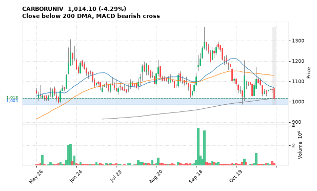

[🔔 Set alert on CARBORUNIV](https://claude.ai/artifact/Ewc5hHTPX6WkU1nVcDNQzq?s=CARBORUNIV&c=close%20below%201007.60) &nbsp;|&nbsp; [📈 Live chart (TradingView)](https://www.tradingview.com/chart/?symbol=NSE:CARBORUNIV) &nbsp;|&nbsp; [alert by email](mailto:testthetpassword@123?subject=ALERT%20CARBORUNIV&body=Alert%20me%20when%3A%20close%20below%201007.60%0A%0AEdit%20the%20line%20above%20if%20you%20want%2C%20then%20press%20Send.%20Checked%20on%20every%20day%27s%20closing%20data%3B%20a%20triggered%20alert%20appears%20at%20the%20top%20of%20the%208%20AM%20Technical%20Analysis%20email.%0A%0AExamples%20you%20can%20write%3A%0A%20%20close%20above%201150%20%20%7C%20%20close%20below%201080%20%20%7C%20%20high%20above%201200%20%20%7C%20%20low%20below%201050%0A%20%20close%20crosses%20above%20200%20DMA%20%20%7C%20%20close%20below%2050%20DMA%20%20%7C%20%20RSI%20below%2030%20%20%7C%20%20RSI%20above%2070%0A%20%20volume%20above%202x%20%20%7C%20%20change%20above%205%25%20%20%7C%20%20change%20below%20-4%25%20%20%7C%20%2052-week%20high%20%20%7C%20%20golden%20cross%0A%20%20combine%20with%20%27and%27%2C%20e.g.%20%20close%20above%201150%20and%20volume%20above%201.5x%0A%0AReference%3A%20CARBORUNIV%20closed%201014.10%20%28high%201065.00%2C%20low%201007.60%29.%0ATo%20cancel%20later%2C%20send%20an%20email%20with%20subject%3A%20CANCEL%20ALERT%20CARBORUNIV)

---

## 26. BEL - BEARISH
**399.55** (-0.46%) | vol 0.6x | RSI 61 | H 402.50 / L 396.80  
Bearish Engulfing

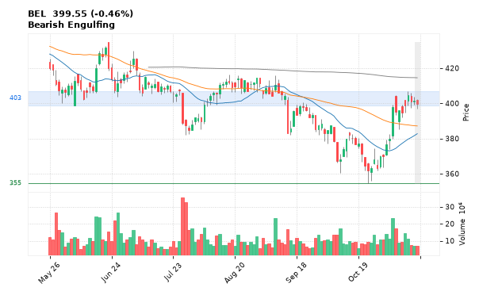

[🔔 Set alert on BEL](https://claude.ai/artifact/Ewc5hHTPX6WkU1nVcDNQzq?s=BEL&c=close%20below%20396.80) &nbsp;|&nbsp; [📈 Live chart (TradingView)](https://www.tradingview.com/chart/?symbol=NSE:BEL) &nbsp;|&nbsp; [alert by email](mailto:testthetpassword@123?subject=ALERT%20BEL&body=Alert%20me%20when%3A%20close%20below%20396.80%0A%0AEdit%20the%20line%20above%20if%20you%20want%2C%20then%20press%20Send.%20Checked%20on%20every%20day%27s%20closing%20data%3B%20a%20triggered%20alert%20appears%20at%20the%20top%20of%20the%208%20AM%20Technical%20Analysis%20email.%0A%0AExamples%20you%20can%20write%3A%0A%20%20close%20above%201150%20%20%7C%20%20close%20below%201080%20%20%7C%20%20high%20above%201200%20%20%7C%20%20low%20below%201050%0A%20%20close%20crosses%20above%20200%20DMA%20%20%7C%20%20close%20below%2050%20DMA%20%20%7C%20%20RSI%20below%2030%20%20%7C%20%20RSI%20above%2070%0A%20%20volume%20above%202x%20%20%7C%20%20change%20above%205%25%20%20%7C%20%20change%20below%20-4%25%20%20%7C%20%2052-week%20high%20%20%7C%20%20golden%20cross%0A%20%20combine%20with%20%27and%27%2C%20e.g.%20%20close%20above%201150%20and%20volume%20above%201.5x%0A%0AReference%3A%20BEL%20closed%20399.55%20%28high%20402.50%2C%20low%20396.80%29.%0ATo%20cancel%20later%2C%20send%20an%20email%20with%20subject%3A%20CANCEL%20ALERT%20BEL)

---

## 27. PIIND - BEARISH
**1,672.00** (-0.48%) | vol 0.4x | RSI 26 | H 1,696.00 / L 1,667.60  
Inverted Hammer, 52-week low breakdown, NR7 (narrowest range in 7)

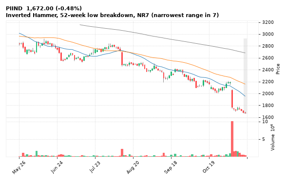

[🔔 Set alert on PIIND](https://claude.ai/artifact/Ewc5hHTPX6WkU1nVcDNQzq?s=PIIND&c=close%20below%201667.60) &nbsp;|&nbsp; [📈 Live chart (TradingView)](https://www.tradingview.com/chart/?symbol=NSE:PIIND) &nbsp;|&nbsp; [alert by email](mailto:testthetpassword@123?subject=ALERT%20PIIND&body=Alert%20me%20when%3A%20close%20below%201667.60%0A%0AEdit%20the%20line%20above%20if%20you%20want%2C%20then%20press%20Send.%20Checked%20on%20every%20day%27s%20closing%20data%3B%20a%20triggered%20alert%20appears%20at%20the%20top%20of%20the%208%20AM%20Technical%20Analysis%20email.%0A%0AExamples%20you%20can%20write%3A%0A%20%20close%20above%201150%20%20%7C%20%20close%20below%201080%20%20%7C%20%20high%20above%201200%20%20%7C%20%20low%20below%201050%0A%20%20close%20crosses%20above%20200%20DMA%20%20%7C%20%20close%20below%2050%20DMA%20%20%7C%20%20RSI%20below%2030%20%20%7C%20%20RSI%20above%2070%0A%20%20volume%20above%202x%20%20%7C%20%20change%20above%205%25%20%20%7C%20%20change%20below%20-4%25%20%20%7C%20%2052-week%20high%20%20%7C%20%20golden%20cross%0A%20%20combine%20with%20%27and%27%2C%20e.g.%20%20close%20above%201150%20and%20volume%20above%201.5x%0A%0AReference%3A%20PIIND%20closed%201672.00%20%28high%201696.00%2C%20low%201667.60%29.%0ATo%20cancel%20later%2C%20send%20an%20email%20with%20subject%3A%20CANCEL%20ALERT%20PIIND)

---

## 28. SYNGENE - BEARISH
**434.35** (-1.55%) | vol 0.2x | RSI 62 | H 442.00 / L 433.00  
Bearish Engulfing

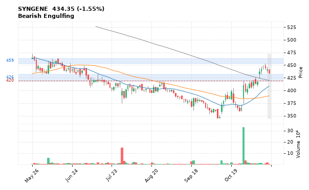

[🔔 Set alert on SYNGENE](https://claude.ai/artifact/Ewc5hHTPX6WkU1nVcDNQzq?s=SYNGENE&c=close%20below%20433.00) &nbsp;|&nbsp; [📈 Live chart (TradingView)](https://www.tradingview.com/chart/?symbol=NSE:SYNGENE) &nbsp;|&nbsp; [alert by email](mailto:testthetpassword@123?subject=ALERT%20SYNGENE&body=Alert%20me%20when%3A%20close%20below%20433.00%0A%0AEdit%20the%20line%20above%20if%20you%20want%2C%20then%20press%20Send.%20Checked%20on%20every%20day%27s%20closing%20data%3B%20a%20triggered%20alert%20appears%20at%20the%20top%20of%20the%208%20AM%20Technical%20Analysis%20email.%0A%0AExamples%20you%20can%20write%3A%0A%20%20close%20above%201150%20%20%7C%20%20close%20below%201080%20%20%7C%20%20high%20above%201200%20%20%7C%20%20low%20below%201050%0A%20%20close%20crosses%20above%20200%20DMA%20%20%7C%20%20close%20below%2050%20DMA%20%20%7C%20%20RSI%20below%2030%20%20%7C%20%20RSI%20above%2070%0A%20%20volume%20above%202x%20%20%7C%20%20change%20above%205%25%20%20%7C%20%20change%20below%20-4%25%20%20%7C%20%2052-week%20high%20%20%7C%20%20golden%20cross%0A%20%20combine%20with%20%27and%27%2C%20e.g.%20%20close%20above%201150%20and%20volume%20above%201.5x%0A%0AReference%3A%20SYNGENE%20closed%20434.35%20%28high%20442.00%2C%20low%20433.00%29.%0ATo%20cancel%20later%2C%20send%20an%20email%20with%20subject%3A%20CANCEL%20ALERT%20SYNGENE)

---

## 29. IREDA - BEARISH
**117.40** (+1.25%) | vol 2.5x | RSI 64 | H 122.45 / L 114.54  
Shooting Star

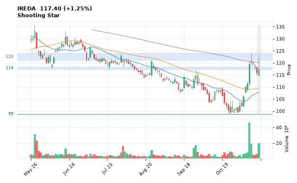

[🔔 Set alert on IREDA](https://claude.ai/artifact/Ewc5hHTPX6WkU1nVcDNQzq?s=IREDA&c=close%20below%20114.54) &nbsp;|&nbsp; [📈 Live chart (TradingView)](https://www.tradingview.com/chart/?symbol=NSE:IREDA) &nbsp;|&nbsp; [alert by email](mailto:testthetpassword@123?subject=ALERT%20IREDA&body=Alert%20me%20when%3A%20close%20below%20114.54%0A%0AEdit%20the%20line%20above%20if%20you%20want%2C%20then%20press%20Send.%20Checked%20on%20every%20day%27s%20closing%20data%3B%20a%20triggered%20alert%20appears%20at%20the%20top%20of%20the%208%20AM%20Technical%20Analysis%20email.%0A%0AExamples%20you%20can%20write%3A%0A%20%20close%20above%201150%20%20%7C%20%20close%20below%201080%20%20%7C%20%20high%20above%201200%20%20%7C%20%20low%20below%201050%0A%20%20close%20crosses%20above%20200%20DMA%20%20%7C%20%20close%20below%2050%20DMA%20%20%7C%20%20RSI%20below%2030%20%20%7C%20%20RSI%20above%2070%0A%20%20volume%20above%202x%20%20%7C%20%20change%20above%205%25%20%20%7C%20%20change%20below%20-4%25%20%20%7C%20%2052-week%20high%20%20%7C%20%20golden%20cross%0A%20%20combine%20with%20%27and%27%2C%20e.g.%20%20close%20above%201150%20and%20volume%20above%201.5x%0A%0AReference%3A%20IREDA%20closed%20117.40%20%28high%20122.45%2C%20low%20114.54%29.%0ATo%20cancel%20later%2C%20send%20an%20email%20with%20subject%3A%20CANCEL%20ALERT%20IREDA)

---

## 30. CAPLIPOINT - BEARISH
**2,247.10** (-4.25%) | vol 2.2x | RSI 37 | H 2,387.50 / L 2,202.60  
Volume spike 2.2x

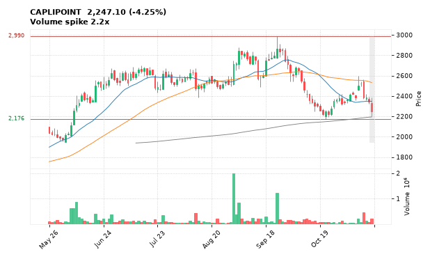

[🔔 Set alert on CAPLIPOINT](https://claude.ai/artifact/Ewc5hHTPX6WkU1nVcDNQzq?s=CAPLIPOINT&c=close%20below%202202.60) &nbsp;|&nbsp; [📈 Live chart (TradingView)](https://www.tradingview.com/chart/?symbol=NSE:CAPLIPOINT) &nbsp;|&nbsp; [alert by email](mailto:testthetpassword@123?subject=ALERT%20CAPLIPOINT&body=Alert%20me%20when%3A%20close%20below%202202.60%0A%0AEdit%20the%20line%20above%20if%20you%20want%2C%20then%20press%20Send.%20Checked%20on%20every%20day%27s%20closing%20data%3B%20a%20triggered%20alert%20appears%20at%20the%20top%20of%20the%208%20AM%20Technical%20Analysis%20email.%0A%0AExamples%20you%20can%20write%3A%0A%20%20close%20above%201150%20%20%7C%20%20close%20below%201080%20%20%7C%20%20high%20above%201200%20%20%7C%20%20low%20below%201050%0A%20%20close%20crosses%20above%20200%20DMA%20%20%7C%20%20close%20below%2050%20DMA%20%20%7C%20%20RSI%20below%2030%20%20%7C%20%20RSI%20above%2070%0A%20%20volume%20above%202x%20%20%7C%20%20change%20above%205%25%20%20%7C%20%20change%20below%20-4%25%20%20%7C%20%2052-week%20high%20%20%7C%20%20golden%20cross%0A%20%20combine%20with%20%27and%27%2C%20e.g.%20%20close%20above%201150%20and%20volume%20above%201.5x%0A%0AReference%3A%20CAPLIPOINT%20closed%202247.10%20%28high%202387.50%2C%20low%202202.60%29.%0ATo%20cancel%20later%2C%20send%20an%20email%20with%20subject%3A%20CANCEL%20ALERT%20CAPLIPOINT)

---

## 31. 360ONE - LEVEL TEST
**1,202.85** (+2.02%) | vol 1.4x | RSI 69 | H 1,220.50 / L 1,170.05  
Level test

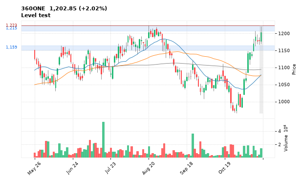

[🔔 Set alert on 360ONE](https://claude.ai/artifact/Ewc5hHTPX6WkU1nVcDNQzq?s=360ONE&c=close%20below%201170.05) &nbsp;|&nbsp; [📈 Live chart (TradingView)](https://www.tradingview.com/chart/?symbol=NSE:360ONE) &nbsp;|&nbsp; [alert by email](mailto:testthetpassword@123?subject=ALERT%20360ONE&body=Alert%20me%20when%3A%20close%20above%201220.50%0A%0AEdit%20the%20line%20above%20if%20you%20want%2C%20then%20press%20Send.%20Checked%20on%20every%20day%27s%20closing%20data%3B%20a%20triggered%20alert%20appears%20at%20the%20top%20of%20the%208%20AM%20Technical%20Analysis%20email.%0A%0AExamples%20you%20can%20write%3A%0A%20%20close%20above%201150%20%20%7C%20%20close%20below%201080%20%20%7C%20%20high%20above%201200%20%20%7C%20%20low%20below%201050%0A%20%20close%20crosses%20above%20200%20DMA%20%20%7C%20%20close%20below%2050%20DMA%20%20%7C%20%20RSI%20below%2030%20%20%7C%20%20RSI%20above%2070%0A%20%20volume%20above%202x%20%20%7C%20%20change%20above%205%25%20%20%7C%20%20change%20below%20-4%25%20%20%7C%20%2052-week%20high%20%20%7C%20%20golden%20cross%0A%20%20combine%20with%20%27and%27%2C%20e.g.%20%20close%20above%201150%20and%20volume%20above%201.5x%0A%0AReference%3A%20360ONE%20closed%201202.85%20%28high%201220.50%2C%20low%201170.05%29.%0ATo%20cancel%20later%2C%20send%20an%20email%20with%20subject%3A%20CANCEL%20ALERT%20360ONE)

---

## 32. ABBOTINDIA - LEVEL TEST
**25,815.00** (-0.64%) | vol 1.0x | RSI 46 | H 26,135.00 / L 25,620.00  
Level test

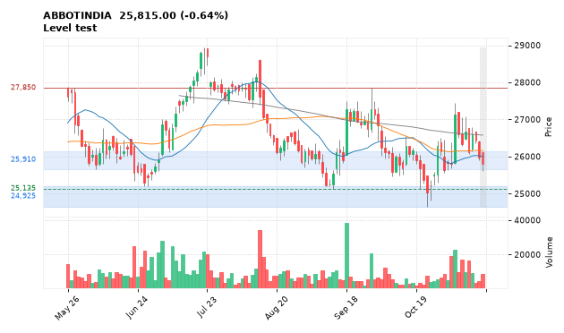

[🔔 Set alert on ABBOTINDIA](https://claude.ai/artifact/Ewc5hHTPX6WkU1nVcDNQzq?s=ABBOTINDIA&c=close%20below%2025620.00) &nbsp;|&nbsp; [📈 Live chart (TradingView)](https://www.tradingview.com/chart/?symbol=NSE:ABBOTINDIA) &nbsp;|&nbsp; [alert by email](mailto:testthetpassword@123?subject=ALERT%20ABBOTINDIA&body=Alert%20me%20when%3A%20close%20above%2026135.00%0A%0AEdit%20the%20line%20above%20if%20you%20want%2C%20then%20press%20Send.%20Checked%20on%20every%20day%27s%20closing%20data%3B%20a%20triggered%20alert%20appears%20at%20the%20top%20of%20the%208%20AM%20Technical%20Analysis%20email.%0A%0AExamples%20you%20can%20write%3A%0A%20%20close%20above%201150%20%20%7C%20%20close%20below%201080%20%20%7C%20%20high%20above%201200%20%20%7C%20%20low%20below%201050%0A%20%20close%20crosses%20above%20200%20DMA%20%20%7C%20%20close%20below%2050%20DMA%20%20%7C%20%20RSI%20below%2030%20%20%7C%20%20RSI%20above%2070%0A%20%20volume%20above%202x%20%20%7C%20%20change%20above%205%25%20%20%7C%20%20change%20below%20-4%25%20%20%7C%20%2052-week%20high%20%20%7C%20%20golden%20cross%0A%20%20combine%20with%20%27and%27%2C%20e.g.%20%20close%20above%201150%20and%20volume%20above%201.5x%0A%0AReference%3A%20ABBOTINDIA%20closed%2025815.00%20%28high%2026135.00%2C%20low%2025620.00%29.%0ATo%20cancel%20later%2C%20send%20an%20email%20with%20subject%3A%20CANCEL%20ALERT%20ABBOTINDIA)

---

## 33. ADANIENSOL - LEVEL TEST
**1,493.70** (+2.83%) | vol 1.1x | RSI 65 | H 1,493.70 / L 1,443.70  
Level test

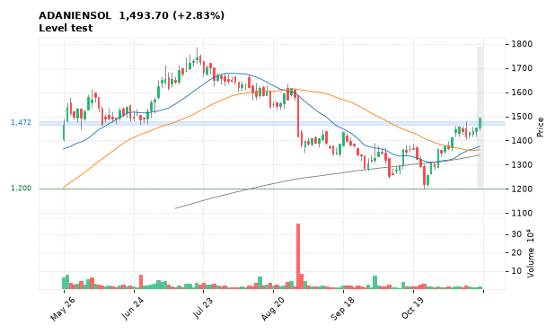

[🔔 Set alert on ADANIENSOL](https://claude.ai/artifact/Ewc5hHTPX6WkU1nVcDNQzq?s=ADANIENSOL&c=close%20below%201443.70) &nbsp;|&nbsp; [📈 Live chart (TradingView)](https://www.tradingview.com/chart/?symbol=NSE:ADANIENSOL) &nbsp;|&nbsp; [alert by email](mailto:testthetpassword@123?subject=ALERT%20ADANIENSOL&body=Alert%20me%20when%3A%20close%20above%201493.70%0A%0AEdit%20the%20line%20above%20if%20you%20want%2C%20then%20press%20Send.%20Checked%20on%20every%20day%27s%20closing%20data%3B%20a%20triggered%20alert%20appears%20at%20the%20top%20of%20the%208%20AM%20Technical%20Analysis%20email.%0A%0AExamples%20you%20can%20write%3A%0A%20%20close%20above%201150%20%20%7C%20%20close%20below%201080%20%20%7C%20%20high%20above%201200%20%20%7C%20%20low%20below%201050%0A%20%20close%20crosses%20above%20200%20DMA%20%20%7C%20%20close%20below%2050%20DMA%20%20%7C%20%20RSI%20below%2030%20%20%7C%20%20RSI%20above%2070%0A%20%20volume%20above%202x%20%20%7C%20%20change%20above%205%25%20%20%7C%20%20change%20below%20-4%25%20%20%7C%20%2052-week%20high%20%20%7C%20%20golden%20cross%0A%20%20combine%20with%20%27and%27%2C%20e.g.%20%20close%20above%201150%20and%20volume%20above%201.5x%0A%0AReference%3A%20ADANIENSOL%20closed%201493.70%20%28high%201493.70%2C%20low%201443.70%29.%0ATo%20cancel%20later%2C%20send%20an%20email%20with%20subject%3A%20CANCEL%20ALERT%20ADANIENSOL)

---

## 34. ADANIPOWER - LEVEL TEST
**208.07** (+1.35%) | vol 0.9x | RSI 62 | H 208.91 / L 204.31  
Level test

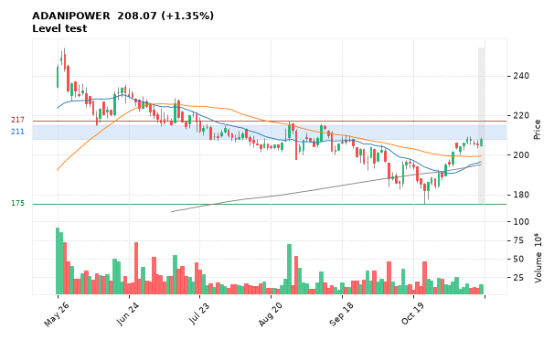

[🔔 Set alert on ADANIPOWER](https://claude.ai/artifact/Ewc5hHTPX6WkU1nVcDNQzq?s=ADANIPOWER&c=close%20below%20204.31) &nbsp;|&nbsp; [📈 Live chart (TradingView)](https://www.tradingview.com/chart/?symbol=NSE:ADANIPOWER) &nbsp;|&nbsp; [alert by email](mailto:testthetpassword@123?subject=ALERT%20ADANIPOWER&body=Alert%20me%20when%3A%20close%20above%20208.91%0A%0AEdit%20the%20line%20above%20if%20you%20want%2C%20then%20press%20Send.%20Checked%20on%20every%20day%27s%20closing%20data%3B%20a%20triggered%20alert%20appears%20at%20the%20top%20of%20the%208%20AM%20Technical%20Analysis%20email.%0A%0AExamples%20you%20can%20write%3A%0A%20%20close%20above%201150%20%20%7C%20%20close%20below%201080%20%20%7C%20%20high%20above%201200%20%20%7C%20%20low%20below%201050%0A%20%20close%20crosses%20above%20200%20DMA%20%20%7C%20%20close%20below%2050%20DMA%20%20%7C%20%20RSI%20below%2030%20%20%7C%20%20RSI%20above%2070%0A%20%20volume%20above%202x%20%20%7C%20%20change%20above%205%25%20%20%7C%20%20change%20below%20-4%25%20%20%7C%20%2052-week%20high%20%20%7C%20%20golden%20cross%0A%20%20combine%20with%20%27and%27%2C%20e.g.%20%20close%20above%201150%20and%20volume%20above%201.5x%0A%0AReference%3A%20ADANIPOWER%20closed%20208.07%20%28high%20208.91%2C%20low%20204.31%29.%0ATo%20cancel%20later%2C%20send%20an%20email%20with%20subject%3A%20CANCEL%20ALERT%20ADANIPOWER)

---

## 35. ABCAPITAL - LEVEL TEST
**411.50** (+0.73%) | vol 0.5x | RSI 64 | H 414.50 / L 406.10  
Level test

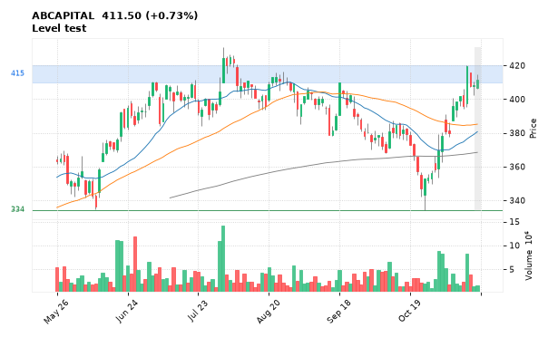

[🔔 Set alert on ABCAPITAL](https://claude.ai/artifact/Ewc5hHTPX6WkU1nVcDNQzq?s=ABCAPITAL&c=close%20below%20406.10) &nbsp;|&nbsp; [📈 Live chart (TradingView)](https://www.tradingview.com/chart/?symbol=NSE:ABCAPITAL) &nbsp;|&nbsp; [alert by email](mailto:testthetpassword@123?subject=ALERT%20ABCAPITAL&body=Alert%20me%20when%3A%20close%20above%20414.50%0A%0AEdit%20the%20line%20above%20if%20you%20want%2C%20then%20press%20Send.%20Checked%20on%20every%20day%27s%20closing%20data%3B%20a%20triggered%20alert%20appears%20at%20the%20top%20of%20the%208%20AM%20Technical%20Analysis%20email.%0A%0AExamples%20you%20can%20write%3A%0A%20%20close%20above%201150%20%20%7C%20%20close%20below%201080%20%20%7C%20%20high%20above%201200%20%20%7C%20%20low%20below%201050%0A%20%20close%20crosses%20above%20200%20DMA%20%20%7C%20%20close%20below%2050%20DMA%20%20%7C%20%20RSI%20below%2030%20%20%7C%20%20RSI%20above%2070%0A%20%20volume%20above%202x%20%20%7C%20%20change%20above%205%25%20%20%7C%20%20change%20below%20-4%25%20%20%7C%20%2052-week%20high%20%20%7C%20%20golden%20cross%0A%20%20combine%20with%20%27and%27%2C%20e.g.%20%20close%20above%201150%20and%20volume%20above%201.5x%0A%0AReference%3A%20ABCAPITAL%20closed%20411.50%20%28high%20414.50%2C%20low%20406.10%29.%0ATo%20cancel%20later%2C%20send%20an%20email%20with%20subject%3A%20CANCEL%20ALERT%20ABCAPITAL)

---

## 36. ANGELONE - LEVEL TEST
**349.80** (+0.47%) | vol 9.6x | RSI 73 | H 379.15 / L 344.45  
Level test

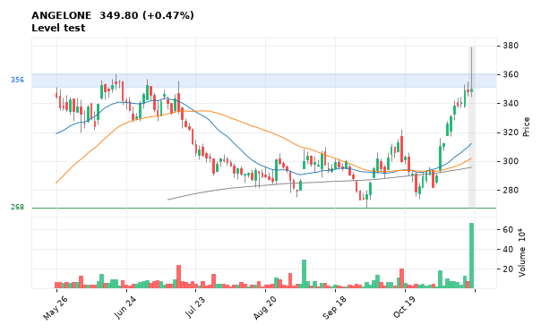

[🔔 Set alert on ANGELONE](https://claude.ai/artifact/Ewc5hHTPX6WkU1nVcDNQzq?s=ANGELONE&c=close%20below%20344.45) &nbsp;|&nbsp; [📈 Live chart (TradingView)](https://www.tradingview.com/chart/?symbol=NSE:ANGELONE) &nbsp;|&nbsp; [alert by email](mailto:testthetpassword@123?subject=ALERT%20ANGELONE&body=Alert%20me%20when%3A%20close%20above%20379.15%0A%0AEdit%20the%20line%20above%20if%20you%20want%2C%20then%20press%20Send.%20Checked%20on%20every%20day%27s%20closing%20data%3B%20a%20triggered%20alert%20appears%20at%20the%20top%20of%20the%208%20AM%20Technical%20Analysis%20email.%0A%0AExamples%20you%20can%20write%3A%0A%20%20close%20above%201150%20%20%7C%20%20close%20below%201080%20%20%7C%20%20high%20above%201200%20%20%7C%20%20low%20below%201050%0A%20%20close%20crosses%20above%20200%20DMA%20%20%7C%20%20close%20below%2050%20DMA%20%20%7C%20%20RSI%20below%2030%20%20%7C%20%20RSI%20above%2070%0A%20%20volume%20above%202x%20%20%7C%20%20change%20above%205%25%20%20%7C%20%20change%20below%20-4%25%20%20%7C%20%2052-week%20high%20%20%7C%20%20golden%20cross%0A%20%20combine%20with%20%27and%27%2C%20e.g.%20%20close%20above%201150%20and%20volume%20above%201.5x%0A%0AReference%3A%20ANGELONE%20closed%20349.80%20%28high%20379.15%2C%20low%20344.45%29.%0ATo%20cancel%20later%2C%20send%20an%20email%20with%20subject%3A%20CANCEL%20ALERT%20ANGELONE)

---

## 37. BLS - LEVEL TEST
**227.89** (+1.25%) | vol 0.4x | RSI 55 | H 228.90 / L 223.03  
Level test

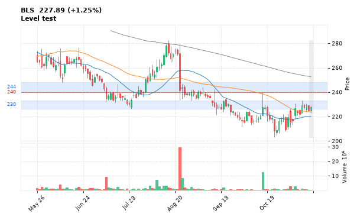

[🔔 Set alert on BLS](https://claude.ai/artifact/Ewc5hHTPX6WkU1nVcDNQzq?s=BLS&c=close%20below%20223.03) &nbsp;|&nbsp; [📈 Live chart (TradingView)](https://www.tradingview.com/chart/?symbol=NSE:BLS) &nbsp;|&nbsp; [alert by email](mailto:testthetpassword@123?subject=ALERT%20BLS&body=Alert%20me%20when%3A%20close%20above%20228.90%0A%0AEdit%20the%20line%20above%20if%20you%20want%2C%20then%20press%20Send.%20Checked%20on%20every%20day%27s%20closing%20data%3B%20a%20triggered%20alert%20appears%20at%20the%20top%20of%20the%208%20AM%20Technical%20Analysis%20email.%0A%0AExamples%20you%20can%20write%3A%0A%20%20close%20above%201150%20%20%7C%20%20close%20below%201080%20%20%7C%20%20high%20above%201200%20%20%7C%20%20low%20below%201050%0A%20%20close%20crosses%20above%20200%20DMA%20%20%7C%20%20close%20below%2050%20DMA%20%20%7C%20%20RSI%20below%2030%20%20%7C%20%20RSI%20above%2070%0A%20%20volume%20above%202x%20%20%7C%20%20change%20above%205%25%20%20%7C%20%20change%20below%20-4%25%20%20%7C%20%2052-week%20high%20%20%7C%20%20golden%20cross%0A%20%20combine%20with%20%27and%27%2C%20e.g.%20%20close%20above%201150%20and%20volume%20above%201.5x%0A%0AReference%3A%20BLS%20closed%20227.89%20%28high%20228.90%2C%20low%20223.03%29.%0ATo%20cancel%20later%2C%20send%20an%20email%20with%20subject%3A%20CANCEL%20ALERT%20BLS)

---

## 38. BAJAJ-AUTO - LEVEL TEST
**10,770.00** (+0.34%) | vol 0.9x | RSI 54 | H 10,849.00 / L 10,706.00  
Level test

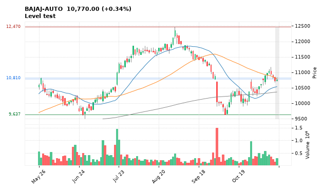

[🔔 Set alert on BAJAJ-AUTO](https://claude.ai/artifact/Ewc5hHTPX6WkU1nVcDNQzq?s=BAJAJ-AUTO&c=close%20below%2010706.00) &nbsp;|&nbsp; [📈 Live chart (TradingView)](https://www.tradingview.com/chart/?symbol=NSE:BAJAJ-AUTO) &nbsp;|&nbsp; [alert by email](mailto:testthetpassword@123?subject=ALERT%20BAJAJ-AUTO&body=Alert%20me%20when%3A%20close%20above%2010849.00%0A%0AEdit%20the%20line%20above%20if%20you%20want%2C%20then%20press%20Send.%20Checked%20on%20every%20day%27s%20closing%20data%3B%20a%20triggered%20alert%20appears%20at%20the%20top%20of%20the%208%20AM%20Technical%20Analysis%20email.%0A%0AExamples%20you%20can%20write%3A%0A%20%20close%20above%201150%20%20%7C%20%20close%20below%201080%20%20%7C%20%20high%20above%201200%20%20%7C%20%20low%20below%201050%0A%20%20close%20crosses%20above%20200%20DMA%20%20%7C%20%20close%20below%2050%20DMA%20%20%7C%20%20RSI%20below%2030%20%20%7C%20%20RSI%20above%2070%0A%20%20volume%20above%202x%20%20%7C%20%20change%20above%205%25%20%20%7C%20%20change%20below%20-4%25%20%20%7C%20%2052-week%20high%20%20%7C%20%20golden%20cross%0A%20%20combine%20with%20%27and%27%2C%20e.g.%20%20close%20above%201150%20and%20volume%20above%201.5x%0A%0AReference%3A%20BAJAJ-AUTO%20closed%2010770.00%20%28high%2010849.00%2C%20low%2010706.00%29.%0ATo%20cancel%20later%2C%20send%20an%20email%20with%20subject%3A%20CANCEL%20ALERT%20BAJAJ-AUTO)

---

## 39. BAJAJHFL - LEVEL TEST
**82.89** (+1.15%) | vol 1.0x | RSI 56 | H 83.10 / L 81.45  
Level test

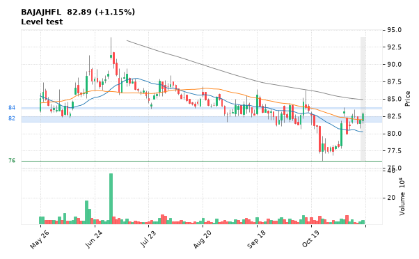

[🔔 Set alert on BAJAJHFL](https://claude.ai/artifact/Ewc5hHTPX6WkU1nVcDNQzq?s=BAJAJHFL&c=close%20below%2081.45) &nbsp;|&nbsp; [📈 Live chart (TradingView)](https://www.tradingview.com/chart/?symbol=NSE:BAJAJHFL) &nbsp;|&nbsp; [alert by email](mailto:testthetpassword@123?subject=ALERT%20BAJAJHFL&body=Alert%20me%20when%3A%20close%20above%2083.10%0A%0AEdit%20the%20line%20above%20if%20you%20want%2C%20then%20press%20Send.%20Checked%20on%20every%20day%27s%20closing%20data%3B%20a%20triggered%20alert%20appears%20at%20the%20top%20of%20the%208%20AM%20Technical%20Analysis%20email.%0A%0AExamples%20you%20can%20write%3A%0A%20%20close%20above%201150%20%20%7C%20%20close%20below%201080%20%20%7C%20%20high%20above%201200%20%20%7C%20%20low%20below%201050%0A%20%20close%20crosses%20above%20200%20DMA%20%20%7C%20%20close%20below%2050%20DMA%20%20%7C%20%20RSI%20below%2030%20%20%7C%20%20RSI%20above%2070%0A%20%20volume%20above%202x%20%20%7C%20%20change%20above%205%25%20%20%7C%20%20change%20below%20-4%25%20%20%7C%20%2052-week%20high%20%20%7C%20%20golden%20cross%0A%20%20combine%20with%20%27and%27%2C%20e.g.%20%20close%20above%201150%20and%20volume%20above%201.5x%0A%0AReference%3A%20BAJAJHFL%20closed%2082.89%20%28high%2083.10%2C%20low%2081.45%29.%0ATo%20cancel%20later%2C%20send%20an%20email%20with%20subject%3A%20CANCEL%20ALERT%20BAJAJHFL)

---

## 40. BPCL - LEVEL TEST
**305.80** (+0.16%) | vol 0.6x | RSI 53 | H 309.25 / L 304.20  
Level test

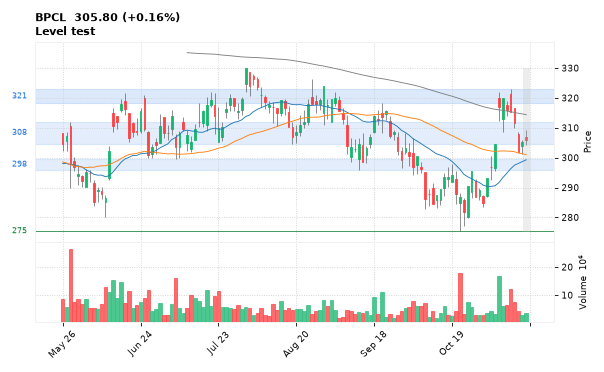

[🔔 Set alert on BPCL](https://claude.ai/artifact/Ewc5hHTPX6WkU1nVcDNQzq?s=BPCL&c=close%20below%20304.20) &nbsp;|&nbsp; [📈 Live chart (TradingView)](https://www.tradingview.com/chart/?symbol=NSE:BPCL) &nbsp;|&nbsp; [alert by email](mailto:testthetpassword@123?subject=ALERT%20BPCL&body=Alert%20me%20when%3A%20close%20above%20309.25%0A%0AEdit%20the%20line%20above%20if%20you%20want%2C%20then%20press%20Send.%20Checked%20on%20every%20day%27s%20closing%20data%3B%20a%20triggered%20alert%20appears%20at%20the%20top%20of%20the%208%20AM%20Technical%20Analysis%20email.%0A%0AExamples%20you%20can%20write%3A%0A%20%20close%20above%201150%20%20%7C%20%20close%20below%201080%20%20%7C%20%20high%20above%201200%20%20%7C%20%20low%20below%201050%0A%20%20close%20crosses%20above%20200%20DMA%20%20%7C%20%20close%20below%2050%20DMA%20%20%7C%20%20RSI%20below%2030%20%20%7C%20%20RSI%20above%2070%0A%20%20volume%20above%202x%20%20%7C%20%20change%20above%205%25%20%20%7C%20%20change%20below%20-4%25%20%20%7C%20%2052-week%20high%20%20%7C%20%20golden%20cross%0A%20%20combine%20with%20%27and%27%2C%20e.g.%20%20close%20above%201150%20and%20volume%20above%201.5x%0A%0AReference%3A%20BPCL%20closed%20305.80%20%28high%20309.25%2C%20low%20304.20%29.%0ATo%20cancel%20later%2C%20send%20an%20email%20with%20subject%3A%20CANCEL%20ALERT%20BPCL)

---

## 41. GROWW - LEVEL TEST
**227.53** (+1.16%) | vol 1.6x | RSI 72 | H 233.40 / L 226.00  
Level test

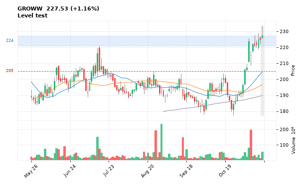

[🔔 Set alert on GROWW](https://claude.ai/artifact/Ewc5hHTPX6WkU1nVcDNQzq?s=GROWW&c=close%20below%20226.00) &nbsp;|&nbsp; [📈 Live chart (TradingView)](https://www.tradingview.com/chart/?symbol=NSE:GROWW) &nbsp;|&nbsp; [alert by email](mailto:testthetpassword@123?subject=ALERT%20GROWW&body=Alert%20me%20when%3A%20close%20above%20233.40%0A%0AEdit%20the%20line%20above%20if%20you%20want%2C%20then%20press%20Send.%20Checked%20on%20every%20day%27s%20closing%20data%3B%20a%20triggered%20alert%20appears%20at%20the%20top%20of%20the%208%20AM%20Technical%20Analysis%20email.%0A%0AExamples%20you%20can%20write%3A%0A%20%20close%20above%201150%20%20%7C%20%20close%20below%201080%20%20%7C%20%20high%20above%201200%20%20%7C%20%20low%20below%201050%0A%20%20close%20crosses%20above%20200%20DMA%20%20%7C%20%20close%20below%2050%20DMA%20%20%7C%20%20RSI%20below%2030%20%20%7C%20%20RSI%20above%2070%0A%20%20volume%20above%202x%20%20%7C%20%20change%20above%205%25%20%20%7C%20%20change%20below%20-4%25%20%20%7C%20%2052-week%20high%20%20%7C%20%20golden%20cross%0A%20%20combine%20with%20%27and%27%2C%20e.g.%20%20close%20above%201150%20and%20volume%20above%201.5x%0A%0AReference%3A%20GROWW%20closed%20227.53%20%28high%20233.40%2C%20low%20226.00%29.%0ATo%20cancel%20later%2C%20send%20an%20email%20with%20subject%3A%20CANCEL%20ALERT%20GROWW)

---

## 42. BSOFT - LEVEL TEST
**304.30** (-3.27%) | vol 0.4x | RSI 45 | H 318.85 / L 302.90  
Level test

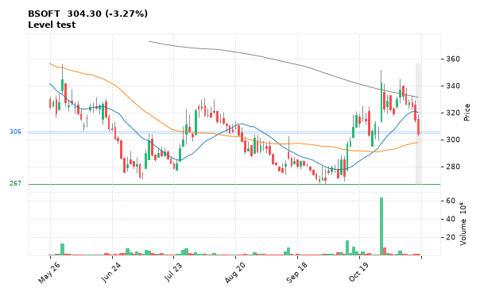

[🔔 Set alert on BSOFT](https://claude.ai/artifact/Ewc5hHTPX6WkU1nVcDNQzq?s=BSOFT&c=close%20below%20302.90) &nbsp;|&nbsp; [📈 Live chart (TradingView)](https://www.tradingview.com/chart/?symbol=NSE:BSOFT) &nbsp;|&nbsp; [alert by email](mailto:testthetpassword@123?subject=ALERT%20BSOFT&body=Alert%20me%20when%3A%20close%20above%20318.85%0A%0AEdit%20the%20line%20above%20if%20you%20want%2C%20then%20press%20Send.%20Checked%20on%20every%20day%27s%20closing%20data%3B%20a%20triggered%20alert%20appears%20at%20the%20top%20of%20the%208%20AM%20Technical%20Analysis%20email.%0A%0AExamples%20you%20can%20write%3A%0A%20%20close%20above%201150%20%20%7C%20%20close%20below%201080%20%20%7C%20%20high%20above%201200%20%20%7C%20%20low%20below%201050%0A%20%20close%20crosses%20above%20200%20DMA%20%20%7C%20%20close%20below%2050%20DMA%20%20%7C%20%20RSI%20below%2030%20%20%7C%20%20RSI%20above%2070%0A%20%20volume%20above%202x%20%20%7C%20%20change%20above%205%25%20%20%7C%20%20change%20below%20-4%25%20%20%7C%20%2052-week%20high%20%20%7C%20%20golden%20cross%0A%20%20combine%20with%20%27and%27%2C%20e.g.%20%20close%20above%201150%20and%20volume%20above%201.5x%0A%0AReference%3A%20BSOFT%20closed%20304.30%20%28high%20318.85%2C%20low%20302.90%29.%0ATo%20cancel%20later%2C%20send%20an%20email%20with%20subject%3A%20CANCEL%20ALERT%20BSOFT)

---

## 43. CGPOWER - LEVEL TEST
**801.00** (-2.16%) | vol 0.9x | RSI 43 | H 819.15 / L 799.00  
Level test

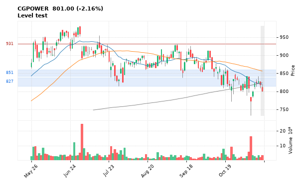

[🔔 Set alert on CGPOWER](https://claude.ai/artifact/Ewc5hHTPX6WkU1nVcDNQzq?s=CGPOWER&c=close%20below%20799.00) &nbsp;|&nbsp; [📈 Live chart (TradingView)](https://www.tradingview.com/chart/?symbol=NSE:CGPOWER) &nbsp;|&nbsp; [alert by email](mailto:testthetpassword@123?subject=ALERT%20CGPOWER&body=Alert%20me%20when%3A%20close%20above%20819.15%0A%0AEdit%20the%20line%20above%20if%20you%20want%2C%20then%20press%20Send.%20Checked%20on%20every%20day%27s%20closing%20data%3B%20a%20triggered%20alert%20appears%20at%20the%20top%20of%20the%208%20AM%20Technical%20Analysis%20email.%0A%0AExamples%20you%20can%20write%3A%0A%20%20close%20above%201150%20%20%7C%20%20close%20below%201080%20%20%7C%20%20high%20above%201200%20%20%7C%20%20low%20below%201050%0A%20%20close%20crosses%20above%20200%20DMA%20%20%7C%20%20close%20below%2050%20DMA%20%20%7C%20%20RSI%20below%2030%20%20%7C%20%20RSI%20above%2070%0A%20%20volume%20above%202x%20%20%7C%20%20change%20above%205%25%20%20%7C%20%20change%20below%20-4%25%20%20%7C%20%2052-week%20high%20%20%7C%20%20golden%20cross%0A%20%20combine%20with%20%27and%27%2C%20e.g.%20%20close%20above%201150%20and%20volume%20above%201.5x%0A%0AReference%3A%20CGPOWER%20closed%20801.00%20%28high%20819.15%2C%20low%20799.00%29.%0ATo%20cancel%20later%2C%20send%20an%20email%20with%20subject%3A%20CANCEL%20ALERT%20CGPOWER)

---

## 44. CANBK - LEVEL TEST
**134.00** (+1.21%) | vol 2.1x | RSI 68 | H 136.80 / L 132.20  
Level test

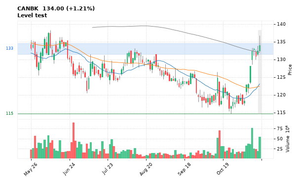

[🔔 Set alert on CANBK](https://claude.ai/artifact/Ewc5hHTPX6WkU1nVcDNQzq?s=CANBK&c=close%20below%20132.20) &nbsp;|&nbsp; [📈 Live chart (TradingView)](https://www.tradingview.com/chart/?symbol=NSE:CANBK) &nbsp;|&nbsp; [alert by email](mailto:testthetpassword@123?subject=ALERT%20CANBK&body=Alert%20me%20when%3A%20close%20above%20136.80%0A%0AEdit%20the%20line%20above%20if%20you%20want%2C%20then%20press%20Send.%20Checked%20on%20every%20day%27s%20closing%20data%3B%20a%20triggered%20alert%20appears%20at%20the%20top%20of%20the%208%20AM%20Technical%20Analysis%20email.%0A%0AExamples%20you%20can%20write%3A%0A%20%20close%20above%201150%20%20%7C%20%20close%20below%201080%20%20%7C%20%20high%20above%201200%20%20%7C%20%20low%20below%201050%0A%20%20close%20crosses%20above%20200%20DMA%20%20%7C%20%20close%20below%2050%20DMA%20%20%7C%20%20RSI%20below%2030%20%20%7C%20%20RSI%20above%2070%0A%20%20volume%20above%202x%20%20%7C%20%20change%20above%205%25%20%20%7C%20%20change%20below%20-4%25%20%20%7C%20%2052-week%20high%20%20%7C%20%20golden%20cross%0A%20%20combine%20with%20%27and%27%2C%20e.g.%20%20close%20above%201150%20and%20volume%20above%201.5x%0A%0AReference%3A%20CANBK%20closed%20134.00%20%28high%20136.80%2C%20low%20132.20%29.%0ATo%20cancel%20later%2C%20send%20an%20email%20with%20subject%3A%20CANCEL%20ALERT%20CANBK)

---

## 45. CARTRADE - LEVEL TEST
**2,612.10** (-1.20%) | vol 0.1x | RSI 45 | H 2,665.90 / L 2,605.20  
Level test

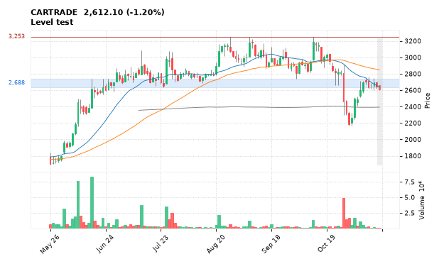

[🔔 Set alert on CARTRADE](https://claude.ai/artifact/Ewc5hHTPX6WkU1nVcDNQzq?s=CARTRADE&c=close%20below%202605.20) &nbsp;|&nbsp; [📈 Live chart (TradingView)](https://www.tradingview.com/chart/?symbol=NSE:CARTRADE) &nbsp;|&nbsp; [alert by email](mailto:testthetpassword@123?subject=ALERT%20CARTRADE&body=Alert%20me%20when%3A%20close%20above%202665.90%0A%0AEdit%20the%20line%20above%20if%20you%20want%2C%20then%20press%20Send.%20Checked%20on%20every%20day%27s%20closing%20data%3B%20a%20triggered%20alert%20appears%20at%20the%20top%20of%20the%208%20AM%20Technical%20Analysis%20email.%0A%0AExamples%20you%20can%20write%3A%0A%20%20close%20above%201150%20%20%7C%20%20close%20below%201080%20%20%7C%20%20high%20above%201200%20%20%7C%20%20low%20below%201050%0A%20%20close%20crosses%20above%20200%20DMA%20%20%7C%20%20close%20below%2050%20DMA%20%20%7C%20%20RSI%20below%2030%20%20%7C%20%20RSI%20above%2070%0A%20%20volume%20above%202x%20%20%7C%20%20change%20above%205%25%20%20%7C%20%20change%20below%20-4%25%20%20%7C%20%2052-week%20high%20%20%7C%20%20golden%20cross%0A%20%20combine%20with%20%27and%27%2C%20e.g.%20%20close%20above%201150%20and%20volume%20above%201.5x%0A%0AReference%3A%20CARTRADE%20closed%202612.10%20%28high%202665.90%2C%20low%202605.20%29.%0ATo%20cancel%20later%2C%20send%20an%20email%20with%20subject%3A%20CANCEL%20ALERT%20CARTRADE)

---

## 46. CEMPRO - LEVEL TEST
**1,352.30** (+4.14%) | vol 1.6x | RSI 63 | H 1,363.40 / L 1,286.00  
Level test

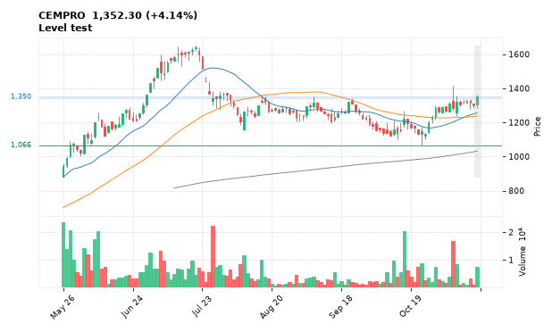

[🔔 Set alert on CEMPRO](https://claude.ai/artifact/Ewc5hHTPX6WkU1nVcDNQzq?s=CEMPRO&c=close%20below%201286.00) &nbsp;|&nbsp; [📈 Live chart (TradingView)](https://www.tradingview.com/chart/?symbol=NSE:CEMPRO) &nbsp;|&nbsp; [alert by email](mailto:testthetpassword@123?subject=ALERT%20CEMPRO&body=Alert%20me%20when%3A%20close%20above%201363.40%0A%0AEdit%20the%20line%20above%20if%20you%20want%2C%20then%20press%20Send.%20Checked%20on%20every%20day%27s%20closing%20data%3B%20a%20triggered%20alert%20appears%20at%20the%20top%20of%20the%208%20AM%20Technical%20Analysis%20email.%0A%0AExamples%20you%20can%20write%3A%0A%20%20close%20above%201150%20%20%7C%20%20close%20below%201080%20%20%7C%20%20high%20above%201200%20%20%7C%20%20low%20below%201050%0A%20%20close%20crosses%20above%20200%20DMA%20%20%7C%20%20close%20below%2050%20DMA%20%20%7C%20%20RSI%20below%2030%20%20%7C%20%20RSI%20above%2070%0A%20%20volume%20above%202x%20%20%7C%20%20change%20above%205%25%20%20%7C%20%20change%20below%20-4%25%20%20%7C%20%2052-week%20high%20%20%7C%20%20golden%20cross%0A%20%20combine%20with%20%27and%27%2C%20e.g.%20%20close%20above%201150%20and%20volume%20above%201.5x%0A%0AReference%3A%20CEMPRO%20closed%201352.30%20%28high%201363.40%2C%20low%201286.00%29.%0ATo%20cancel%20later%2C%20send%20an%20email%20with%20subject%3A%20CANCEL%20ALERT%20CEMPRO)

---

## 47. CENTRALBK - LEVEL TEST
**32.60** (+1.53%) | vol 2.6x | RSI 69 | H 33.05 / L 31.96  
Level test

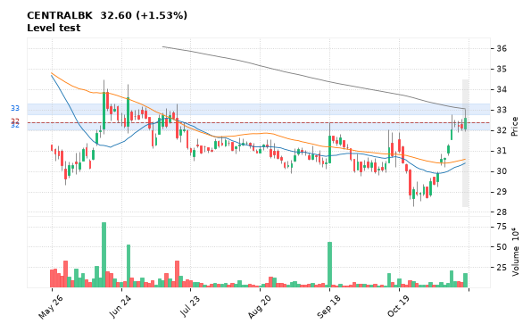

[🔔 Set alert on CENTRALBK](https://claude.ai/artifact/Ewc5hHTPX6WkU1nVcDNQzq?s=CENTRALBK&c=close%20below%2031.96) &nbsp;|&nbsp; [📈 Live chart (TradingView)](https://www.tradingview.com/chart/?symbol=NSE:CENTRALBK) &nbsp;|&nbsp; [alert by email](mailto:testthetpassword@123?subject=ALERT%20CENTRALBK&body=Alert%20me%20when%3A%20close%20above%2033.05%0A%0AEdit%20the%20line%20above%20if%20you%20want%2C%20then%20press%20Send.%20Checked%20on%20every%20day%27s%20closing%20data%3B%20a%20triggered%20alert%20appears%20at%20the%20top%20of%20the%208%20AM%20Technical%20Analysis%20email.%0A%0AExamples%20you%20can%20write%3A%0A%20%20close%20above%201150%20%20%7C%20%20close%20below%201080%20%20%7C%20%20high%20above%201200%20%20%7C%20%20low%20below%201050%0A%20%20close%20crosses%20above%20200%20DMA%20%20%7C%20%20close%20below%2050%20DMA%20%20%7C%20%20RSI%20below%2030%20%20%7C%20%20RSI%20above%2070%0A%20%20volume%20above%202x%20%20%7C%20%20change%20above%205%25%20%20%7C%20%20change%20below%20-4%25%20%20%7C%20%2052-week%20high%20%20%7C%20%20golden%20cross%0A%20%20combine%20with%20%27and%27%2C%20e.g.%20%20close%20above%201150%20and%20volume%20above%201.5x%0A%0AReference%3A%20CENTRALBK%20closed%2032.60%20%28high%2033.05%2C%20low%2031.96%29.%0ATo%20cancel%20later%2C%20send%20an%20email%20with%20subject%3A%20CANCEL%20ALERT%20CENTRALBK)

---

## 48. CDSL - LEVEL TEST
**1,439.80** (+0.41%) | vol 1.6x | RSI 70 | H 1,479.90 / L 1,424.00  
Level test

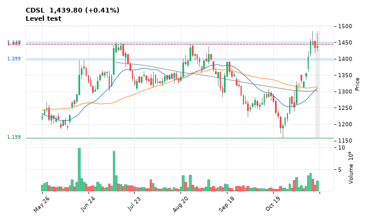

[🔔 Set alert on CDSL](https://claude.ai/artifact/Ewc5hHTPX6WkU1nVcDNQzq?s=CDSL&c=close%20below%201424.00) &nbsp;|&nbsp; [📈 Live chart (TradingView)](https://www.tradingview.com/chart/?symbol=NSE:CDSL) &nbsp;|&nbsp; [alert by email](mailto:testthetpassword@123?subject=ALERT%20CDSL&body=Alert%20me%20when%3A%20close%20above%201479.90%0A%0AEdit%20the%20line%20above%20if%20you%20want%2C%20then%20press%20Send.%20Checked%20on%20every%20day%27s%20closing%20data%3B%20a%20triggered%20alert%20appears%20at%20the%20top%20of%20the%208%20AM%20Technical%20Analysis%20email.%0A%0AExamples%20you%20can%20write%3A%0A%20%20close%20above%201150%20%20%7C%20%20close%20below%201080%20%20%7C%20%20high%20above%201200%20%20%7C%20%20low%20below%201050%0A%20%20close%20crosses%20above%20200%20DMA%20%20%7C%20%20close%20below%2050%20DMA%20%20%7C%20%20RSI%20below%2030%20%20%7C%20%20RSI%20above%2070%0A%20%20volume%20above%202x%20%20%7C%20%20change%20above%205%25%20%20%7C%20%20change%20below%20-4%25%20%20%7C%20%2052-week%20high%20%20%7C%20%20golden%20cross%0A%20%20combine%20with%20%27and%27%2C%20e.g.%20%20close%20above%201150%20and%20volume%20above%201.5x%0A%0AReference%3A%20CDSL%20closed%201439.80%20%28high%201479.90%2C%20low%201424.00%29.%0ATo%20cancel%20later%2C%20send%20an%20email%20with%20subject%3A%20CANCEL%20ALERT%20CDSL)

---

## 49. CUB - LEVEL TEST
**232.40** (-0.34%) | vol 0.8x | RSI 57 | H 237.00 / L 231.10  
Level test

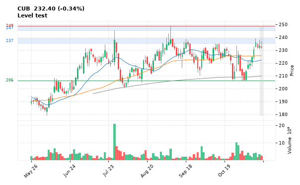

[🔔 Set alert on CUB](https://claude.ai/artifact/Ewc5hHTPX6WkU1nVcDNQzq?s=CUB&c=close%20below%20231.10) &nbsp;|&nbsp; [📈 Live chart (TradingView)](https://www.tradingview.com/chart/?symbol=NSE:CUB) &nbsp;|&nbsp; [alert by email](mailto:testthetpassword@123?subject=ALERT%20CUB&body=Alert%20me%20when%3A%20close%20above%20237.00%0A%0AEdit%20the%20line%20above%20if%20you%20want%2C%20then%20press%20Send.%20Checked%20on%20every%20day%27s%20closing%20data%3B%20a%20triggered%20alert%20appears%20at%20the%20top%20of%20the%208%20AM%20Technical%20Analysis%20email.%0A%0AExamples%20you%20can%20write%3A%0A%20%20close%20above%201150%20%20%7C%20%20close%20below%201080%20%20%7C%20%20high%20above%201200%20%20%7C%20%20low%20below%201050%0A%20%20close%20crosses%20above%20200%20DMA%20%20%7C%20%20close%20below%2050%20DMA%20%20%7C%20%20RSI%20below%2030%20%20%7C%20%20RSI%20above%2070%0A%20%20volume%20above%202x%20%20%7C%20%20change%20above%205%25%20%20%7C%20%20change%20below%20-4%25%20%20%7C%20%2052-week%20high%20%20%7C%20%20golden%20cross%0A%20%20combine%20with%20%27and%27%2C%20e.g.%20%20close%20above%201150%20and%20volume%20above%201.5x%0A%0AReference%3A%20CUB%20closed%20232.40%20%28high%20237.00%2C%20low%20231.10%29.%0ATo%20cancel%20later%2C%20send%20an%20email%20with%20subject%3A%20CANCEL%20ALERT%20CUB)

---

## 50. CLEAN - LEVEL TEST
**715.95** (+1.23%) | vol 0.6x | RSI 47 | H 719.55 / L 686.00  
Level test

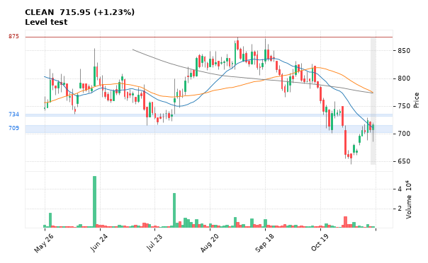

[🔔 Set alert on CLEAN](https://claude.ai/artifact/Ewc5hHTPX6WkU1nVcDNQzq?s=CLEAN&c=close%20below%20686.00) &nbsp;|&nbsp; [📈 Live chart (TradingView)](https://www.tradingview.com/chart/?symbol=NSE:CLEAN) &nbsp;|&nbsp; [alert by email](mailto:testthetpassword@123?subject=ALERT%20CLEAN&body=Alert%20me%20when%3A%20close%20above%20719.55%0A%0AEdit%20the%20line%20above%20if%20you%20want%2C%20then%20press%20Send.%20Checked%20on%20every%20day%27s%20closing%20data%3B%20a%20triggered%20alert%20appears%20at%20the%20top%20of%20the%208%20AM%20Technical%20Analysis%20email.%0A%0AExamples%20you%20can%20write%3A%0A%20%20close%20above%201150%20%20%7C%20%20close%20below%201080%20%20%7C%20%20high%20above%201200%20%20%7C%20%20low%20below%201050%0A%20%20close%20crosses%20above%20200%20DMA%20%20%7C%20%20close%20below%2050%20DMA%20%20%7C%20%20RSI%20below%2030%20%20%7C%20%20RSI%20above%2070%0A%20%20volume%20above%202x%20%20%7C%20%20change%20above%205%25%20%20%7C%20%20change%20below%20-4%25%20%20%7C%20%2052-week%20high%20%20%7C%20%20golden%20cross%0A%20%20combine%20with%20%27and%27%2C%20e.g.%20%20close%20above%201150%20and%20volume%20above%201.5x%0A%0AReference%3A%20CLEAN%20closed%20715.95%20%28high%20719.55%2C%20low%20686.00%29.%0ATo%20cancel%20later%2C%20send%20an%20email%20with%20subject%3A%20CANCEL%20ALERT%20CLEAN)

---

## 51. COALINDIA - LEVEL TEST
**391.55** (-1.50%) | vol 3.1x | RSI 40 | H 398.50 / L 387.75  
Level test

[🔔 Set alert on COALINDIA](https://claude.ai/artifact/Ewc5hHTPX6WkU1nVcDNQzq?s=COALINDIA&c=close%20below%20387.75) &nbsp;|&nbsp; [📈 Live chart (TradingView)](https://www.tradingview.com/chart/?symbol=NSE:COALINDIA) &nbsp;|&nbsp; [alert by email](mailto:testthetpassword@123?subject=ALERT%20COALINDIA&body=Alert%20me%20when%3A%20close%20above%20398.50%0A%0AEdit%20the%20line%20above%20if%20you%20want%2C%20then%20press%20Send.%20Checked%20on%20every%20day%27s%20closing%20data%3B%20a%20triggered%20alert%20appears%20at%20the%20top%20of%20the%208%20AM%20Technical%20Analysis%20email.%0A%0AExamples%20you%20can%20write%3A%0A%20%20close%20above%201150%20%20%7C%20%20close%20below%201080%20%20%7C%20%20high%20above%201200%20%20%7C%20%20low%20below%201050%0A%20%20close%20crosses%20above%20200%20DMA%20%20%7C%20%20close%20below%2050%20DMA%20%20%7C%20%20RSI%20below%2030%20%20%7C%20%20RSI%20above%2070%0A%20%20volume%20above%202x%20%20%7C%20%20change%20above%205%25%20%20%7C%20%20change%20below%20-4%25%20%20%7C%20%2052-week%20high%20%20%7C%20%20golden%20cross%0A%20%20combine%20with%20%27and%27%2C%20e.g.%20%20close%20above%201150%20and%20volume%20above%201.5x%0A%0AReference%3A%20COALINDIA%20closed%20391.55%20%28high%20398.50%2C%20low%20387.75%29.%0ATo%20cancel%20later%2C%20send%20an%20email%20with%20subject%3A%20CANCEL%20ALERT%20COALINDIA)

---

## 52. COFORGE - LEVEL TEST
**2,041.00** (+1.54%) | vol 0.8x | RSI 58 | H 2,064.00 / L 1,992.20  
Level test

[🔔 Set alert on COFORGE](https://claude.ai/artifact/Ewc5hHTPX6WkU1nVcDNQzq?s=COFORGE&c=close%20below%201992.20) &nbsp;|&nbsp; [📈 Live chart (TradingView)](https://www.tradingview.com/chart/?symbol=NSE:COFORGE) &nbsp;|&nbsp; [alert by email](mailto:testthetpassword@123?subject=ALERT%20COFORGE&body=Alert%20me%20when%3A%20close%20above%202064.00%0A%0AEdit%20the%20line%20above%20if%20you%20want%2C%20then%20press%20Send.%20Checked%20on%20every%20day%27s%20closing%20data%3B%20a%20triggered%20alert%20appears%20at%20the%20top%20of%20the%208%20AM%20Technical%20Analysis%20email.%0A%0AExamples%20you%20can%20write%3A%0A%20%20close%20above%201150%20%20%7C%20%20close%20below%201080%20%20%7C%20%20high%20above%201200%20%20%7C%20%20low%20below%201050%0A%20%20close%20crosses%20above%20200%20DMA%20%20%7C%20%20close%20below%2050%20DMA%20%20%7C%20%20RSI%20below%2030%20%20%7C%20%20RSI%20above%2070%0A%20%20volume%20above%202x%20%20%7C%20%20change%20above%205%25%20%20%7C%20%20change%20below%20-4%25%20%20%7C%20%2052-week%20high%20%20%7C%20%20golden%20cross%0A%20%20combine%20with%20%27and%27%2C%20e.g.%20%20close%20above%201150%20and%20volume%20above%201.5x%0A%0AReference%3A%20COFORGE%20closed%202041.00%20%28high%202064.00%2C%20low%201992.20%29.%0ATo%20cancel%20later%2C%20send%20an%20email%20with%20subject%3A%20CANCEL%20ALERT%20COFORGE)

---

## 53. COLPAL - LEVEL TEST
**1,719.70** (+0.93%) | vol 0.3x | RSI 52 | H 1,731.80 / L 1,701.30  
Level test

[🔔 Set alert on COLPAL](https://claude.ai/artifact/Ewc5hHTPX6WkU1nVcDNQzq?s=COLPAL&c=close%20below%201701.30) &nbsp;|&nbsp; [📈 Live chart (TradingView)](https://www.tradingview.com/chart/?symbol=NSE:COLPAL) &nbsp;|&nbsp; [alert by email](mailto:testthetpassword@123?subject=ALERT%20COLPAL&body=Alert%20me%20when%3A%20close%20above%201731.80%0A%0AEdit%20the%20line%20above%20if%20you%20want%2C%20then%20press%20Send.%20Checked%20on%20every%20day%27s%20closing%20data%3B%20a%20triggered%20alert%20appears%20at%20the%20top%20of%20the%208%20AM%20Technical%20Analysis%20email.%0A%0AExamples%20you%20can%20write%3A%0A%20%20close%20above%201150%20%20%7C%20%20close%20below%201080%20%20%7C%20%20high%20above%201200%20%20%7C%20%20low%20below%201050%0A%20%20close%20crosses%20above%20200%20DMA%20%20%7C%20%20close%20below%2050%20DMA%20%20%7C%20%20RSI%20below%2030%20%20%7C%20%20RSI%20above%2070%0A%20%20volume%20above%202x%20%20%7C%20%20change%20above%205%25%20%20%7C%20%20change%20below%20-4%25%20%20%7C%20%2052-week%20high%20%20%7C%20%20golden%20cross%0A%20%20combine%20with%20%27and%27%2C%20e.g.%20%20close%20above%201150%20and%20volume%20above%201.5x%0A%0AReference%3A%20COLPAL%20closed%201719.70%20%28high%201731.80%2C%20low%201701.30%29.%0ATo%20cancel%20later%2C%20send%20an%20email%20with%20subject%3A%20CANCEL%20ALERT%20COLPAL)

---

## 54. CONCOR - LEVEL TEST
**441.90** (-0.02%) | vol 0.4x | RSI 51 | H 446.70 / L 438.85  
Level test

[🔔 Set alert on CONCOR](https://claude.ai/artifact/Ewc5hHTPX6WkU1nVcDNQzq?s=CONCOR&c=close%20below%20438.85) &nbsp;|&nbsp; [📈 Live chart (TradingView)](https://www.tradingview.com/chart/?symbol=NSE:CONCOR) &nbsp;|&nbsp; [alert by email](mailto:testthetpassword@123?subject=ALERT%20CONCOR&body=Alert%20me%20when%3A%20close%20above%20446.70%0A%0AEdit%20the%20line%20above%20if%20you%20want%2C%20then%20press%20Send.%20Checked%20on%20every%20day%27s%20closing%20data%3B%20a%20triggered%20alert%20appears%20at%20the%20top%20of%20the%208%20AM%20Technical%20Analysis%20email.%0A%0AExamples%20you%20can%20write%3A%0A%20%20close%20above%201150%20%20%7C%20%20close%20below%201080%20%20%7C%20%20high%20above%201200%20%20%7C%20%20low%20below%201050%0A%20%20close%20crosses%20above%20200%20DMA%20%20%7C%20%20close%20below%2050%20DMA%20%20%7C%20%20RSI%20below%2030%20%20%7C%20%20RSI%20above%2070%0A%20%20volume%20above%202x%20%20%7C%20%20change%20above%205%25%20%20%7C%20%20change%20below%20-4%25%20%20%7C%20%2052-week%20high%20%20%7C%20%20golden%20cross%0A%20%20combine%20with%20%27and%27%2C%20e.g.%20%20close%20above%201150%20and%20volume%20above%201.5x%0A%0AReference%3A%20CONCOR%20closed%20441.90%20%28high%20446.70%2C%20low%20438.85%29.%0ATo%20cancel%20later%2C%20send%20an%20email%20with%20subject%3A%20CANCEL%20ALERT%20CONCOR)

---

## 55. CUPID - LEVEL TEST
**365.85** (+1.09%) | vol 0.6x | RSI 62 | H 371.80 / L 351.85  
Level test

[🔔 Set alert on CUPID](https://claude.ai/artifact/Ewc5hHTPX6WkU1nVcDNQzq?s=CUPID&c=close%20below%20351.85) &nbsp;|&nbsp; [📈 Live chart (TradingView)](https://www.tradingview.com/chart/?symbol=NSE:CUPID) &nbsp;|&nbsp; [alert by email](mailto:testthetpassword@123?subject=ALERT%20CUPID&body=Alert%20me%20when%3A%20close%20above%20371.80%0A%0AEdit%20the%20line%20above%20if%20you%20want%2C%20then%20press%20Send.%20Checked%20on%20every%20day%27s%20closing%20data%3B%20a%20triggered%20alert%20appears%20at%20the%20top%20of%20the%208%20AM%20Technical%20Analysis%20email.%0A%0AExamples%20you%20can%20write%3A%0A%20%20close%20above%201150%20%20%7C%20%20close%20below%201080%20%20%7C%20%20high%20above%201200%20%20%7C%20%20low%20below%201050%0A%20%20close%20crosses%20above%20200%20DMA%20%20%7C%20%20close%20below%2050%20DMA%20%20%7C%20%20RSI%20below%2030%20%20%7C%20%20RSI%20above%2070%0A%20%20volume%20above%202x%20%20%7C%20%20change%20above%205%25%20%20%7C%20%20change%20below%20-4%25%20%20%7C%20%2052-week%20high%20%20%7C%20%20golden%20cross%0A%20%20combine%20with%20%27and%27%2C%20e.g.%20%20close%20above%201150%20and%20volume%20above%201.5x%0A%0AReference%3A%20CUPID%20closed%20365.85%20%28high%20371.80%2C%20low%20351.85%29.%0ATo%20cancel%20later%2C%20send%20an%20email%20with%20subject%3A%20CANCEL%20ALERT%20CUPID)

---

## 56. DEEPAKFERT - LEVEL TEST
**1,443.70** (+6.72%) | vol 5.3x | RSI 69 | H 1,460.00 / L 1,345.00  
Level test

[🔔 Set alert on DEEPAKFERT](https://claude.ai/artifact/Ewc5hHTPX6WkU1nVcDNQzq?s=DEEPAKFERT&c=close%20below%201345.00) &nbsp;|&nbsp; [📈 Live chart (TradingView)](https://www.tradingview.com/chart/?symbol=NSE:DEEPAKFERT) &nbsp;|&nbsp; [alert by email](mailto:testthetpassword@123?subject=ALERT%20DEEPAKFERT&body=Alert%20me%20when%3A%20close%20above%201460.00%0A%0AEdit%20the%20line%20above%20if%20you%20want%2C%20then%20press%20Send.%20Checked%20on%20every%20day%27s%20closing%20data%3B%20a%20triggered%20alert%20appears%20at%20the%20top%20of%20the%208%20AM%20Technical%20Analysis%20email.%0A%0AExamples%20you%20can%20write%3A%0A%20%20close%20above%201150%20%20%7C%20%20close%20below%201080%20%20%7C%20%20high%20above%201200%20%20%7C%20%20low%20below%201050%0A%20%20close%20crosses%20above%20200%20DMA%20%20%7C%20%20close%20below%2050%20DMA%20%20%7C%20%20RSI%20below%2030%20%20%7C%20%20RSI%20above%2070%0A%20%20volume%20above%202x%20%20%7C%20%20change%20above%205%25%20%20%7C%20%20change%20below%20-4%25%20%20%7C%20%2052-week%20high%20%20%7C%20%20golden%20cross%0A%20%20combine%20with%20%27and%27%2C%20e.g.%20%20close%20above%201150%20and%20volume%20above%201.5x%0A%0AReference%3A%20DEEPAKFERT%20closed%201443.70%20%28high%201460.00%2C%20low%201345.00%29.%0ATo%20cancel%20later%2C%20send%20an%20email%20with%20subject%3A%20CANCEL%20ALERT%20DEEPAKFERT)

---

## 57. DEEPAKNTR - LEVEL TEST
**1,590.10** (-0.30%) | vol 0.2x | RSI 55 | H 1,608.50 / L 1,574.40  
Level test

[🔔 Set alert on DEEPAKNTR](https://claude.ai/artifact/Ewc5hHTPX6WkU1nVcDNQzq?s=DEEPAKNTR&c=close%20below%201574.40) &nbsp;|&nbsp; [📈 Live chart (TradingView)](https://www.tradingview.com/chart/?symbol=NSE:DEEPAKNTR) &nbsp;|&nbsp; [alert by email](mailto:testthetpassword@123?subject=ALERT%20DEEPAKNTR&body=Alert%20me%20when%3A%20close%20above%201608.50%0A%0AEdit%20the%20line%20above%20if%20you%20want%2C%20then%20press%20Send.%20Checked%20on%20every%20day%27s%20closing%20data%3B%20a%20triggered%20alert%20appears%20at%20the%20top%20of%20the%208%20AM%20Technical%20Analysis%20email.%0A%0AExamples%20you%20can%20write%3A%0A%20%20close%20above%201150%20%20%7C%20%20close%20below%201080%20%20%7C%20%20high%20above%201200%20%20%7C%20%20low%20below%201050%0A%20%20close%20crosses%20above%20200%20DMA%20%20%7C%20%20close%20below%2050%20DMA%20%20%7C%20%20RSI%20below%2030%20%20%7C%20%20RSI%20above%2070%0A%20%20volume%20above%202x%20%20%7C%20%20change%20above%205%25%20%20%7C%20%20change%20below%20-4%25%20%20%7C%20%2052-week%20high%20%20%7C%20%20golden%20cross%0A%20%20combine%20with%20%27and%27%2C%20e.g.%20%20close%20above%201150%20and%20volume%20above%201.5x%0A%0AReference%3A%20DEEPAKNTR%20closed%201590.10%20%28high%201608.50%2C%20low%201574.40%29.%0ATo%20cancel%20later%2C%20send%20an%20email%20with%20subject%3A%20CANCEL%20ALERT%20DEEPAKNTR)

---

## 58. DIXON - LEVEL TEST
**13,081.00** (+1.48%) | vol 1.0x | RSI 60 | H 13,220.00 / L 12,800.00  
Level test

[🔔 Set alert on DIXON](https://claude.ai/artifact/Ewc5hHTPX6WkU1nVcDNQzq?s=DIXON&c=close%20below%2012800.00) &nbsp;|&nbsp; [📈 Live chart (TradingView)](https://www.tradingview.com/chart/?symbol=NSE:DIXON) &nbsp;|&nbsp; [alert by email](mailto:testthetpassword@123?subject=ALERT%20DIXON&body=Alert%20me%20when%3A%20close%20above%2013220.00%0A%0AEdit%20the%20line%20above%20if%20you%20want%2C%20then%20press%20Send.%20Checked%20on%20every%20day%27s%20closing%20data%3B%20a%20triggered%20alert%20appears%20at%20the%20top%20of%20the%208%20AM%20Technical%20Analysis%20email.%0A%0AExamples%20you%20can%20write%3A%0A%20%20close%20above%201150%20%20%7C%20%20close%20below%201080%20%20%7C%20%20high%20above%201200%20%20%7C%20%20low%20below%201050%0A%20%20close%20crosses%20above%20200%20DMA%20%20%7C%20%20close%20below%2050%20DMA%20%20%7C%20%20RSI%20below%2030%20%20%7C%20%20RSI%20above%2070%0A%20%20volume%20above%202x%20%20%7C%20%20change%20above%205%25%20%20%7C%20%20change%20below%20-4%25%20%20%7C%20%2052-week%20high%20%20%7C%20%20golden%20cross%0A%20%20combine%20with%20%27and%27%2C%20e.g.%20%20close%20above%201150%20and%20volume%20above%201.5x%0A%0AReference%3A%20DIXON%20closed%2013081.00%20%28high%2013220.00%2C%20low%2012800.00%29.%0ATo%20cancel%20later%2C%20send%20an%20email%20with%20subject%3A%20CANCEL%20ALERT%20DIXON)

---

## 59. EXIDEIND - LEVEL TEST
**380.15** (+4.01%) | vol 2.0x | RSI 53 | H 389.60 / L 366.00  
Level test

[🔔 Set alert on EXIDEIND](https://claude.ai/artifact/Ewc5hHTPX6WkU1nVcDNQzq?s=EXIDEIND&c=close%20below%20366.00) &nbsp;|&nbsp; [📈 Live chart (TradingView)](https://www.tradingview.com/chart/?symbol=NSE:EXIDEIND) &nbsp;|&nbsp; [alert by email](mailto:testthetpassword@123?subject=ALERT%20EXIDEIND&body=Alert%20me%20when%3A%20close%20above%20389.60%0A%0AEdit%20the%20line%20above%20if%20you%20want%2C%20then%20press%20Send.%20Checked%20on%20every%20day%27s%20closing%20data%3B%20a%20triggered%20alert%20appears%20at%20the%20top%20of%20the%208%20AM%20Technical%20Analysis%20email.%0A%0AExamples%20you%20can%20write%3A%0A%20%20close%20above%201150%20%20%7C%20%20close%20below%201080%20%20%7C%20%20high%20above%201200%20%20%7C%20%20low%20below%201050%0A%20%20close%20crosses%20above%20200%20DMA%20%20%7C%20%20close%20below%2050%20DMA%20%20%7C%20%20RSI%20below%2030%20%20%7C%20%20RSI%20above%2070%0A%20%20volume%20above%202x%20%20%7C%20%20change%20above%205%25%20%20%7C%20%20change%20below%20-4%25%20%20%7C%20%2052-week%20high%20%20%7C%20%20golden%20cross%0A%20%20combine%20with%20%27and%27%2C%20e.g.%20%20close%20above%201150%20and%20volume%20above%201.5x%0A%0AReference%3A%20EXIDEIND%20closed%20380.15%20%28high%20389.60%2C%20low%20366.00%29.%0ATo%20cancel%20later%2C%20send%20an%20email%20with%20subject%3A%20CANCEL%20ALERT%20EXIDEIND)

---

## 60. FEDERALBNK - LEVEL TEST
**365.80** (+1.05%) | vol 0.6x | RSI 69 | H 366.60 / L 361.80  
Level test

[🔔 Set alert on FEDERALBNK](https://claude.ai/artifact/Ewc5hHTPX6WkU1nVcDNQzq?s=FEDERALBNK&c=close%20below%20361.80) &nbsp;|&nbsp; [📈 Live chart (TradingView)](https://www.tradingview.com/chart/?symbol=NSE:FEDERALBNK) &nbsp;|&nbsp; [alert by email](mailto:testthetpassword@123?subject=ALERT%20FEDERALBNK&body=Alert%20me%20when%3A%20close%20above%20366.60%0A%0AEdit%20the%20line%20above%20if%20you%20want%2C%20then%20press%20Send.%20Checked%20on%20every%20day%27s%20closing%20data%3B%20a%20triggered%20alert%20appears%20at%20the%20top%20of%20the%208%20AM%20Technical%20Analysis%20email.%0A%0AExamples%20you%20can%20write%3A%0A%20%20close%20above%201150%20%20%7C%20%20close%20below%201080%20%20%7C%20%20high%20above%201200%20%20%7C%20%20low%20below%201050%0A%20%20close%20crosses%20above%20200%20DMA%20%20%7C%20%20close%20below%2050%20DMA%20%20%7C%20%20RSI%20below%2030%20%20%7C%20%20RSI%20above%2070%0A%20%20volume%20above%202x%20%20%7C%20%20change%20above%205%25%20%20%7C%20%20change%20below%20-4%25%20%20%7C%20%2052-week%20high%20%20%7C%20%20golden%20cross%0A%20%20combine%20with%20%27and%27%2C%20e.g.%20%20close%20above%201150%20and%20volume%20above%201.5x%0A%0AReference%3A%20FEDERALBNK%20closed%20365.80%20%28high%20366.60%2C%20low%20361.80%29.%0ATo%20cancel%20later%2C%20send%20an%20email%20with%20subject%3A%20CANCEL%20ALERT%20FEDERALBNK)

---

## 61. FORCEMOT - LEVEL TEST
**19,945.00** (+2.87%) | vol 1.0x | RSI 70 | H 20,239.00 / L 19,280.00  
Level test

[🔔 Set alert on FORCEMOT](https://claude.ai/artifact/Ewc5hHTPX6WkU1nVcDNQzq?s=FORCEMOT&c=close%20below%2019280.00) &nbsp;|&nbsp; [📈 Live chart (TradingView)](https://www.tradingview.com/chart/?symbol=NSE:FORCEMOT) &nbsp;|&nbsp; [alert by email](mailto:testthetpassword@123?subject=ALERT%20FORCEMOT&body=Alert%20me%20when%3A%20close%20above%2020239.00%0A%0AEdit%20the%20line%20above%20if%20you%20want%2C%20then%20press%20Send.%20Checked%20on%20every%20day%27s%20closing%20data%3B%20a%20triggered%20alert%20appears%20at%20the%20top%20of%20the%208%20AM%20Technical%20Analysis%20email.%0A%0AExamples%20you%20can%20write%3A%0A%20%20close%20above%201150%20%20%7C%20%20close%20below%201080%20%20%7C%20%20high%20above%201200%20%20%7C%20%20low%20below%201050%0A%20%20close%20crosses%20above%20200%20DMA%20%20%7C%20%20close%20below%2050%20DMA%20%20%7C%20%20RSI%20below%2030%20%20%7C%20%20RSI%20above%2070%0A%20%20volume%20above%202x%20%20%7C%20%20change%20above%205%25%20%20%7C%20%20change%20below%20-4%25%20%20%7C%20%2052-week%20high%20%20%7C%20%20golden%20cross%0A%20%20combine%20with%20%27and%27%2C%20e.g.%20%20close%20above%201150%20and%20volume%20above%201.5x%0A%0AReference%3A%20FORCEMOT%20closed%2019945.00%20%28high%2020239.00%2C%20low%2019280.00%29.%0ATo%20cancel%20later%2C%20send%20an%20email%20with%20subject%3A%20CANCEL%20ALERT%20FORCEMOT)

---

## 62. GVT&D - LEVEL TEST
**4,320.00** (-0.39%) | vol 0.5x | RSI 56 | H 4,390.00 / L 4,215.10  
Level test

[🔔 Set alert on GVT&D](https://claude.ai/artifact/Ewc5hHTPX6WkU1nVcDNQzq?s=GVT%26D&c=close%20below%204215.10) &nbsp;|&nbsp; [📈 Live chart (TradingView)](https://www.tradingview.com/chart/?symbol=NSE:GVT%26D) &nbsp;|&nbsp; [alert by email](mailto:testthetpassword@123?subject=ALERT%20GVT%26D&body=Alert%20me%20when%3A%20close%20above%204390.00%0A%0AEdit%20the%20line%20above%20if%20you%20want%2C%20then%20press%20Send.%20Checked%20on%20every%20day%27s%20closing%20data%3B%20a%20triggered%20alert%20appears%20at%20the%20top%20of%20the%208%20AM%20Technical%20Analysis%20email.%0A%0AExamples%20you%20can%20write%3A%0A%20%20close%20above%201150%20%20%7C%20%20close%20below%201080%20%20%7C%20%20high%20above%201200%20%20%7C%20%20low%20below%201050%0A%20%20close%20crosses%20above%20200%20DMA%20%20%7C%20%20close%20below%2050%20DMA%20%20%7C%20%20RSI%20below%2030%20%20%7C%20%20RSI%20above%2070%0A%20%20volume%20above%202x%20%20%7C%20%20change%20above%205%25%20%20%7C%20%20change%20below%20-4%25%20%20%7C%20%2052-week%20high%20%20%7C%20%20golden%20cross%0A%20%20combine%20with%20%27and%27%2C%20e.g.%20%20close%20above%201150%20and%20volume%20above%201.5x%0A%0AReference%3A%20GVT%26D%20closed%204320.00%20%28high%204390.00%2C%20low%204215.10%29.%0ATo%20cancel%20later%2C%20send%20an%20email%20with%20subject%3A%20CANCEL%20ALERT%20GVT%26D)

---

## 63. GMRAIRPORT - LEVEL TEST
**104.50** (+2.65%) | vol 2.2x | RSI 70 | H 105.26 / L 101.50  
Level test

[🔔 Set alert on GMRAIRPORT](https://claude.ai/artifact/Ewc5hHTPX6WkU1nVcDNQzq?s=GMRAIRPORT&c=close%20below%20101.50) &nbsp;|&nbsp; [📈 Live chart (TradingView)](https://www.tradingview.com/chart/?symbol=NSE:GMRAIRPORT) &nbsp;|&nbsp; [alert by email](mailto:testthetpassword@123?subject=ALERT%20GMRAIRPORT&body=Alert%20me%20when%3A%20close%20above%20105.26%0A%0AEdit%20the%20line%20above%20if%20you%20want%2C%20then%20press%20Send.%20Checked%20on%20every%20day%27s%20closing%20data%3B%20a%20triggered%20alert%20appears%20at%20the%20top%20of%20the%208%20AM%20Technical%20Analysis%20email.%0A%0AExamples%20you%20can%20write%3A%0A%20%20close%20above%201150%20%20%7C%20%20close%20below%201080%20%20%7C%20%20high%20above%201200%20%20%7C%20%20low%20below%201050%0A%20%20close%20crosses%20above%20200%20DMA%20%20%7C%20%20close%20below%2050%20DMA%20%20%7C%20%20RSI%20below%2030%20%20%7C%20%20RSI%20above%2070%0A%20%20volume%20above%202x%20%20%7C%20%20change%20above%205%25%20%20%7C%20%20change%20below%20-4%25%20%20%7C%20%2052-week%20high%20%20%7C%20%20golden%20cross%0A%20%20combine%20with%20%27and%27%2C%20e.g.%20%20close%20above%201150%20and%20volume%20above%201.5x%0A%0AReference%3A%20GMRAIRPORT%20closed%20104.50%20%28high%20105.26%2C%20low%20101.50%29.%0ATo%20cancel%20later%2C%20send%20an%20email%20with%20subject%3A%20CANCEL%20ALERT%20GMRAIRPORT)

---

## 64. GODREJCP - LEVEL TEST
**894.50** (+0.20%) | vol 0.6x | RSI 62 | H 907.15 / L 886.40  
Level test

[🔔 Set alert on GODREJCP](https://claude.ai/artifact/Ewc5hHTPX6WkU1nVcDNQzq?s=GODREJCP&c=close%20below%20886.40) &nbsp;|&nbsp; [📈 Live chart (TradingView)](https://www.tradingview.com/chart/?symbol=NSE:GODREJCP) &nbsp;|&nbsp; [alert by email](mailto:testthetpassword@123?subject=ALERT%20GODREJCP&body=Alert%20me%20when%3A%20close%20above%20907.15%0A%0AEdit%20the%20line%20above%20if%20you%20want%2C%20then%20press%20Send.%20Checked%20on%20every%20day%27s%20closing%20data%3B%20a%20triggered%20alert%20appears%20at%20the%20top%20of%20the%208%20AM%20Technical%20Analysis%20email.%0A%0AExamples%20you%20can%20write%3A%0A%20%20close%20above%201150%20%20%7C%20%20close%20below%201080%20%20%7C%20%20high%20above%201200%20%20%7C%20%20low%20below%201050%0A%20%20close%20crosses%20above%20200%20DMA%20%20%7C%20%20close%20below%2050%20DMA%20%20%7C%20%20RSI%20below%2030%20%20%7C%20%20RSI%20above%2070%0A%20%20volume%20above%202x%20%20%7C%20%20change%20above%205%25%20%20%7C%20%20change%20below%20-4%25%20%20%7C%20%2052-week%20high%20%20%7C%20%20golden%20cross%0A%20%20combine%20with%20%27and%27%2C%20e.g.%20%20close%20above%201150%20and%20volume%20above%201.5x%0A%0AReference%3A%20GODREJCP%20closed%20894.50%20%28high%20907.15%2C%20low%20886.40%29.%0ATo%20cancel%20later%2C%20send%20an%20email%20with%20subject%3A%20CANCEL%20ALERT%20GODREJCP)

---

## 65. GODREJPROP - LEVEL TEST
**1,892.40** (+2.75%) | vol 1.0x | RSI 69 | H 1,912.40 / L 1,834.00  
Level test

[🔔 Set alert on GODREJPROP](https://claude.ai/artifact/Ewc5hHTPX6WkU1nVcDNQzq?s=GODREJPROP&c=close%20below%201834.00) &nbsp;|&nbsp; [📈 Live chart (TradingView)](https://www.tradingview.com/chart/?symbol=NSE:GODREJPROP) &nbsp;|&nbsp; [alert by email](mailto:testthetpassword@123?subject=ALERT%20GODREJPROP&body=Alert%20me%20when%3A%20close%20above%201912.40%0A%0AEdit%20the%20line%20above%20if%20you%20want%2C%20then%20press%20Send.%20Checked%20on%20every%20day%27s%20closing%20data%3B%20a%20triggered%20alert%20appears%20at%20the%20top%20of%20the%208%20AM%20Technical%20Analysis%20email.%0A%0AExamples%20you%20can%20write%3A%0A%20%20close%20above%201150%20%20%7C%20%20close%20below%201080%20%20%7C%20%20high%20above%201200%20%20%7C%20%20low%20below%201050%0A%20%20close%20crosses%20above%20200%20DMA%20%20%7C%20%20close%20below%2050%20DMA%20%20%7C%20%20RSI%20below%2030%20%20%7C%20%20RSI%20above%2070%0A%20%20volume%20above%202x%20%20%7C%20%20change%20above%205%25%20%20%7C%20%20change%20below%20-4%25%20%20%7C%20%2052-week%20high%20%20%7C%20%20golden%20cross%0A%20%20combine%20with%20%27and%27%2C%20e.g.%20%20close%20above%201150%20and%20volume%20above%201.5x%0A%0AReference%3A%20GODREJPROP%20closed%201892.40%20%28high%201912.40%2C%20low%201834.00%29.%0ATo%20cancel%20later%2C%20send%20an%20email%20with%20subject%3A%20CANCEL%20ALERT%20GODREJPROP)

---

## 66. GRANULES - LEVEL TEST
**815.50** (+2.07%) | vol 1.2x | RSI 49 | H 824.50 / L 793.30  
Level test

[🔔 Set alert on GRANULES](https://claude.ai/artifact/Ewc5hHTPX6WkU1nVcDNQzq?s=GRANULES&c=close%20below%20793.30) &nbsp;|&nbsp; [📈 Live chart (TradingView)](https://www.tradingview.com/chart/?symbol=NSE:GRANULES) &nbsp;|&nbsp; [alert by email](mailto:testthetpassword@123?subject=ALERT%20GRANULES&body=Alert%20me%20when%3A%20close%20above%20824.50%0A%0AEdit%20the%20line%20above%20if%20you%20want%2C%20then%20press%20Send.%20Checked%20on%20every%20day%27s%20closing%20data%3B%20a%20triggered%20alert%20appears%20at%20the%20top%20of%20the%208%20AM%20Technical%20Analysis%20email.%0A%0AExamples%20you%20can%20write%3A%0A%20%20close%20above%201150%20%20%7C%20%20close%20below%201080%20%20%7C%20%20high%20above%201200%20%20%7C%20%20low%20below%201050%0A%20%20close%20crosses%20above%20200%20DMA%20%20%7C%20%20close%20below%2050%20DMA%20%20%7C%20%20RSI%20below%2030%20%20%7C%20%20RSI%20above%2070%0A%20%20volume%20above%202x%20%20%7C%20%20change%20above%205%25%20%20%7C%20%20change%20below%20-4%25%20%20%7C%20%2052-week%20high%20%20%7C%20%20golden%20cross%0A%20%20combine%20with%20%27and%27%2C%20e.g.%20%20close%20above%201150%20and%20volume%20above%201.5x%0A%0AReference%3A%20GRANULES%20closed%20815.50%20%28high%20824.50%2C%20low%20793.30%29.%0ATo%20cancel%20later%2C%20send%20an%20email%20with%20subject%3A%20CANCEL%20ALERT%20GRANULES)

---

## 67. GRAPHITE - LEVEL TEST
**792.35** (-0.70%) | vol 0.8x | RSI 56 | H 807.70 / L 784.20  
Level test

[🔔 Set alert on GRAPHITE](https://claude.ai/artifact/Ewc5hHTPX6WkU1nVcDNQzq?s=GRAPHITE&c=close%20below%20784.20) &nbsp;|&nbsp; [📈 Live chart (TradingView)](https://www.tradingview.com/chart/?symbol=NSE:GRAPHITE) &nbsp;|&nbsp; [alert by email](mailto:testthetpassword@123?subject=ALERT%20GRAPHITE&body=Alert%20me%20when%3A%20close%20above%20807.70%0A%0AEdit%20the%20line%20above%20if%20you%20want%2C%20then%20press%20Send.%20Checked%20on%20every%20day%27s%20closing%20data%3B%20a%20triggered%20alert%20appears%20at%20the%20top%20of%20the%208%20AM%20Technical%20Analysis%20email.%0A%0AExamples%20you%20can%20write%3A%0A%20%20close%20above%201150%20%20%7C%20%20close%20below%201080%20%20%7C%20%20high%20above%201200%20%20%7C%20%20low%20below%201050%0A%20%20close%20crosses%20above%20200%20DMA%20%20%7C%20%20close%20below%2050%20DMA%20%20%7C%20%20RSI%20below%2030%20%20%7C%20%20RSI%20above%2070%0A%20%20volume%20above%202x%20%20%7C%20%20change%20above%205%25%20%20%7C%20%20change%20below%20-4%25%20%20%7C%20%2052-week%20high%20%20%7C%20%20golden%20cross%0A%20%20combine%20with%20%27and%27%2C%20e.g.%20%20close%20above%201150%20and%20volume%20above%201.5x%0A%0AReference%3A%20GRAPHITE%20closed%20792.35%20%28high%20807.70%2C%20low%20784.20%29.%0ATo%20cancel%20later%2C%20send%20an%20email%20with%20subject%3A%20CANCEL%20ALERT%20GRAPHITE)

---

## 68. GRASIM - LEVEL TEST
**3,054.80** (-0.96%) | vol 1.0x | RSI 50 | H 3,105.00 / L 3,054.80  
Level test

[🔔 Set alert on GRASIM](https://claude.ai/artifact/Ewc5hHTPX6WkU1nVcDNQzq?s=GRASIM&c=close%20below%203054.80) &nbsp;|&nbsp; [📈 Live chart (TradingView)](https://www.tradingview.com/chart/?symbol=NSE:GRASIM) &nbsp;|&nbsp; [alert by email](mailto:testthetpassword@123?subject=ALERT%20GRASIM&body=Alert%20me%20when%3A%20close%20above%203105.00%0A%0AEdit%20the%20line%20above%20if%20you%20want%2C%20then%20press%20Send.%20Checked%20on%20every%20day%27s%20closing%20data%3B%20a%20triggered%20alert%20appears%20at%20the%20top%20of%20the%208%20AM%20Technical%20Analysis%20email.%0A%0AExamples%20you%20can%20write%3A%0A%20%20close%20above%201150%20%20%7C%20%20close%20below%201080%20%20%7C%20%20high%20above%201200%20%20%7C%20%20low%20below%201050%0A%20%20close%20crosses%20above%20200%20DMA%20%20%7C%20%20close%20below%2050%20DMA%20%20%7C%20%20RSI%20below%2030%20%20%7C%20%20RSI%20above%2070%0A%20%20volume%20above%202x%20%20%7C%20%20change%20above%205%25%20%20%7C%20%20change%20below%20-4%25%20%20%7C%20%2052-week%20high%20%20%7C%20%20golden%20cross%0A%20%20combine%20with%20%27and%27%2C%20e.g.%20%20close%20above%201150%20and%20volume%20above%201.5x%0A%0AReference%3A%20GRASIM%20closed%203054.80%20%28high%203105.00%2C%20low%203054.80%29.%0ATo%20cancel%20later%2C%20send%20an%20email%20with%20subject%3A%20CANCEL%20ALERT%20GRASIM)

---

## 69. GESHIP - LEVEL TEST
**1,548.50** (+1.02%) | vol 0.6x | RSI 56 | H 1,551.90 / L 1,516.30  
Level test

[🔔 Set alert on GESHIP](https://claude.ai/artifact/Ewc5hHTPX6WkU1nVcDNQzq?s=GESHIP&c=close%20below%201516.30) &nbsp;|&nbsp; [📈 Live chart (TradingView)](https://www.tradingview.com/chart/?symbol=NSE:GESHIP) &nbsp;|&nbsp; [alert by email](mailto:testthetpassword@123?subject=ALERT%20GESHIP&body=Alert%20me%20when%3A%20close%20above%201551.90%0A%0AEdit%20the%20line%20above%20if%20you%20want%2C%20then%20press%20Send.%20Checked%20on%20every%20day%27s%20closing%20data%3B%20a%20triggered%20alert%20appears%20at%20the%20top%20of%20the%208%20AM%20Technical%20Analysis%20email.%0A%0AExamples%20you%20can%20write%3A%0A%20%20close%20above%201150%20%20%7C%20%20close%20below%201080%20%20%7C%20%20high%20above%201200%20%20%7C%20%20low%20below%201050%0A%20%20close%20crosses%20above%20200%20DMA%20%20%7C%20%20close%20below%2050%20DMA%20%20%7C%20%20RSI%20below%2030%20%20%7C%20%20RSI%20above%2070%0A%20%20volume%20above%202x%20%20%7C%20%20change%20above%205%25%20%20%7C%20%20change%20below%20-4%25%20%20%7C%20%2052-week%20high%20%20%7C%20%20golden%20cross%0A%20%20combine%20with%20%27and%27%2C%20e.g.%20%20close%20above%201150%20and%20volume%20above%201.5x%0A%0AReference%3A%20GESHIP%20closed%201548.50%20%28high%201551.90%2C%20low%201516.30%29.%0ATo%20cancel%20later%2C%20send%20an%20email%20with%20subject%3A%20CANCEL%20ALERT%20GESHIP)

---

## 70. HCLTECH - LEVEL TEST
**1,355.70** (-2.09%) | vol 0.9x | RSI 46 | H 1,381.30 / L 1,350.60  
Level test

[🔔 Set alert on HCLTECH](https://claude.ai/artifact/Ewc5hHTPX6WkU1nVcDNQzq?s=HCLTECH&c=close%20below%201350.60) &nbsp;|&nbsp; [📈 Live chart (TradingView)](https://www.tradingview.com/chart/?symbol=NSE:HCLTECH) &nbsp;|&nbsp; [alert by email](mailto:testthetpassword@123?subject=ALERT%20HCLTECH&body=Alert%20me%20when%3A%20close%20above%201381.30%0A%0AEdit%20the%20line%20above%20if%20you%20want%2C%20then%20press%20Send.%20Checked%20on%20every%20day%27s%20closing%20data%3B%20a%20triggered%20alert%20appears%20at%20the%20top%20of%20the%208%20AM%20Technical%20Analysis%20email.%0A%0AExamples%20you%20can%20write%3A%0A%20%20close%20above%201150%20%20%7C%20%20close%20below%201080%20%20%7C%20%20high%20above%201200%20%20%7C%20%20low%20below%201050%0A%20%20close%20crosses%20above%20200%20DMA%20%20%7C%20%20close%20below%2050%20DMA%20%20%7C%20%20RSI%20below%2030%20%20%7C%20%20RSI%20above%2070%0A%20%20volume%20above%202x%20%20%7C%20%20change%20above%205%25%20%20%7C%20%20change%20below%20-4%25%20%20%7C%20%2052-week%20high%20%20%7C%20%20golden%20cross%0A%20%20combine%20with%20%27and%27%2C%20e.g.%20%20close%20above%201150%20and%20volume%20above%201.5x%0A%0AReference%3A%20HCLTECH%20closed%201355.70%20%28high%201381.30%2C%20low%201350.60%29.%0ATo%20cancel%20later%2C%20send%20an%20email%20with%20subject%3A%20CANCEL%20ALERT%20HCLTECH)

---

## 71. HDFCAMC - LEVEL TEST
**2,699.00** (+1.85%) | vol 1.0x | RSI 68 | H 2,758.70 / L 2,651.60  
Level test

[🔔 Set alert on HDFCAMC](https://claude.ai/artifact/Ewc5hHTPX6WkU1nVcDNQzq?s=HDFCAMC&c=close%20below%202651.60) &nbsp;|&nbsp; [📈 Live chart (TradingView)](https://www.tradingview.com/chart/?symbol=NSE:HDFCAMC) &nbsp;|&nbsp; [alert by email](mailto:testthetpassword@123?subject=ALERT%20HDFCAMC&body=Alert%20me%20when%3A%20close%20above%202758.70%0A%0AEdit%20the%20line%20above%20if%20you%20want%2C%20then%20press%20Send.%20Checked%20on%20every%20day%27s%20closing%20data%3B%20a%20triggered%20alert%20appears%20at%20the%20top%20of%20the%208%20AM%20Technical%20Analysis%20email.%0A%0AExamples%20you%20can%20write%3A%0A%20%20close%20above%201150%20%20%7C%20%20close%20below%201080%20%20%7C%20%20high%20above%201200%20%20%7C%20%20low%20below%201050%0A%20%20close%20crosses%20above%20200%20DMA%20%20%7C%20%20close%20below%2050%20DMA%20%20%7C%20%20RSI%20below%2030%20%20%7C%20%20RSI%20above%2070%0A%20%20volume%20above%202x%20%20%7C%20%20change%20above%205%25%20%20%7C%20%20change%20below%20-4%25%20%20%7C%20%2052-week%20high%20%20%7C%20%20golden%20cross%0A%20%20combine%20with%20%27and%27%2C%20e.g.%20%20close%20above%201150%20and%20volume%20above%201.5x%0A%0AReference%3A%20HDFCAMC%20closed%202699.00%20%28high%202758.70%2C%20low%202651.60%29.%0ATo%20cancel%20later%2C%20send%20an%20email%20with%20subject%3A%20CANCEL%20ALERT%20HDFCAMC)

---

## 72. HDFCBANK - LEVEL TEST
**814.95** (-0.19%) | vol 0.9x | RSI 75 | H 821.00 / L 810.85  
Level test

[🔔 Set alert on HDFCBANK](https://claude.ai/artifact/Ewc5hHTPX6WkU1nVcDNQzq?s=HDFCBANK&c=close%20below%20810.85) &nbsp;|&nbsp; [📈 Live chart (TradingView)](https://www.tradingview.com/chart/?symbol=NSE:HDFCBANK) &nbsp;|&nbsp; [alert by email](mailto:testthetpassword@123?subject=ALERT%20HDFCBANK&body=Alert%20me%20when%3A%20close%20above%20821.00%0A%0AEdit%20the%20line%20above%20if%20you%20want%2C%20then%20press%20Send.%20Checked%20on%20every%20day%27s%20closing%20data%3B%20a%20triggered%20alert%20appears%20at%20the%20top%20of%20the%208%20AM%20Technical%20Analysis%20email.%0A%0AExamples%20you%20can%20write%3A%0A%20%20close%20above%201150%20%20%7C%20%20close%20below%201080%20%20%7C%20%20high%20above%201200%20%20%7C%20%20low%20below%201050%0A%20%20close%20crosses%20above%20200%20DMA%20%20%7C%20%20close%20below%2050%20DMA%20%20%7C%20%20RSI%20below%2030%20%20%7C%20%20RSI%20above%2070%0A%20%20volume%20above%202x%20%20%7C%20%20change%20above%205%25%20%20%7C%20%20change%20below%20-4%25%20%20%7C%20%2052-week%20high%20%20%7C%20%20golden%20cross%0A%20%20combine%20with%20%27and%27%2C%20e.g.%20%20close%20above%201150%20and%20volume%20above%201.5x%0A%0AReference%3A%20HDFCBANK%20closed%20814.95%20%28high%20821.00%2C%20low%20810.85%29.%0ATo%20cancel%20later%2C%20send%20an%20email%20with%20subject%3A%20CANCEL%20ALERT%20HDFCBANK)

---

## 73. HAVELLS - LEVEL TEST
**1,175.00** (+0.26%) | vol 0.6x | RSI 67 | H 1,192.00 / L 1,170.80  
Level test

[🔔 Set alert on HAVELLS](https://claude.ai/artifact/Ewc5hHTPX6WkU1nVcDNQzq?s=HAVELLS&c=close%20below%201170.80) &nbsp;|&nbsp; [📈 Live chart (TradingView)](https://www.tradingview.com/chart/?symbol=NSE:HAVELLS) &nbsp;|&nbsp; [alert by email](mailto:testthetpassword@123?subject=ALERT%20HAVELLS&body=Alert%20me%20when%3A%20close%20above%201192.00%0A%0AEdit%20the%20line%20above%20if%20you%20want%2C%20then%20press%20Send.%20Checked%20on%20every%20day%27s%20closing%20data%3B%20a%20triggered%20alert%20appears%20at%20the%20top%20of%20the%208%20AM%20Technical%20Analysis%20email.%0A%0AExamples%20you%20can%20write%3A%0A%20%20close%20above%201150%20%20%7C%20%20close%20below%201080%20%20%7C%20%20high%20above%201200%20%20%7C%20%20low%20below%201050%0A%20%20close%20crosses%20above%20200%20DMA%20%20%7C%20%20close%20below%2050%20DMA%20%20%7C%20%20RSI%20below%2030%20%20%7C%20%20RSI%20above%2070%0A%20%20volume%20above%202x%20%20%7C%20%20change%20above%205%25%20%20%7C%20%20change%20below%20-4%25%20%20%7C%20%2052-week%20high%20%20%7C%20%20golden%20cross%0A%20%20combine%20with%20%27and%27%2C%20e.g.%20%20close%20above%201150%20and%20volume%20above%201.5x%0A%0AReference%3A%20HAVELLS%20closed%201175.00%20%28high%201192.00%2C%20low%201170.80%29.%0ATo%20cancel%20later%2C%20send%20an%20email%20with%20subject%3A%20CANCEL%20ALERT%20HAVELLS)

---

## 74. HAL - LEVEL TEST
**4,727.00** (-1.29%) | vol 0.5x | RSI 41 | H 4,803.00 / L 4,727.00  
Level test

[🔔 Set alert on HAL](https://claude.ai/artifact/Ewc5hHTPX6WkU1nVcDNQzq?s=HAL&c=close%20below%204727.00) &nbsp;|&nbsp; [📈 Live chart (TradingView)](https://www.tradingview.com/chart/?symbol=NSE:HAL) &nbsp;|&nbsp; [alert by email](mailto:testthetpassword@123?subject=ALERT%20HAL&body=Alert%20me%20when%3A%20close%20above%204803.00%0A%0AEdit%20the%20line%20above%20if%20you%20want%2C%20then%20press%20Send.%20Checked%20on%20every%20day%27s%20closing%20data%3B%20a%20triggered%20alert%20appears%20at%20the%20top%20of%20the%208%20AM%20Technical%20Analysis%20email.%0A%0AExamples%20you%20can%20write%3A%0A%20%20close%20above%201150%20%20%7C%20%20close%20below%201080%20%20%7C%20%20high%20above%201200%20%20%7C%20%20low%20below%201050%0A%20%20close%20crosses%20above%20200%20DMA%20%20%7C%20%20close%20below%2050%20DMA%20%20%7C%20%20RSI%20below%2030%20%20%7C%20%20RSI%20above%2070%0A%20%20volume%20above%202x%20%20%7C%20%20change%20above%205%25%20%20%7C%20%20change%20below%20-4%25%20%20%7C%20%2052-week%20high%20%20%7C%20%20golden%20cross%0A%20%20combine%20with%20%27and%27%2C%20e.g.%20%20close%20above%201150%20and%20volume%20above%201.5x%0A%0AReference%3A%20HAL%20closed%204727.00%20%28high%204803.00%2C%20low%204727.00%29.%0ATo%20cancel%20later%2C%20send%20an%20email%20with%20subject%3A%20CANCEL%20ALERT%20HAL)

---

## 75. HINDZINC - LEVEL TEST
**550.00** (-0.04%) | vol 0.6x | RSI 51 | H 555.00 / L 540.15  
Level test

[🔔 Set alert on HINDZINC](https://claude.ai/artifact/Ewc5hHTPX6WkU1nVcDNQzq?s=HINDZINC&c=close%20below%20540.15) &nbsp;|&nbsp; [📈 Live chart (TradingView)](https://www.tradingview.com/chart/?symbol=NSE:HINDZINC) &nbsp;|&nbsp; [alert by email](mailto:testthetpassword@123?subject=ALERT%20HINDZINC&body=Alert%20me%20when%3A%20close%20above%20555.00%0A%0AEdit%20the%20line%20above%20if%20you%20want%2C%20then%20press%20Send.%20Checked%20on%20every%20day%27s%20closing%20data%3B%20a%20triggered%20alert%20appears%20at%20the%20top%20of%20the%208%20AM%20Technical%20Analysis%20email.%0A%0AExamples%20you%20can%20write%3A%0A%20%20close%20above%201150%20%20%7C%20%20close%20below%201080%20%20%7C%20%20high%20above%201200%20%20%7C%20%20low%20below%201050%0A%20%20close%20crosses%20above%20200%20DMA%20%20%7C%20%20close%20below%2050%20DMA%20%20%7C%20%20RSI%20below%2030%20%20%7C%20%20RSI%20above%2070%0A%20%20volume%20above%202x%20%20%7C%20%20change%20above%205%25%20%20%7C%20%20change%20below%20-4%25%20%20%7C%20%2052-week%20high%20%20%7C%20%20golden%20cross%0A%20%20combine%20with%20%27and%27%2C%20e.g.%20%20close%20above%201150%20and%20volume%20above%201.5x%0A%0AReference%3A%20HINDZINC%20closed%20550.00%20%28high%20555.00%2C%20low%20540.15%29.%0ATo%20cancel%20later%2C%20send%20an%20email%20with%20subject%3A%20CANCEL%20ALERT%20HINDZINC)

---

## 76. HYUNDAI - LEVEL TEST
**2,121.30** (+1.79%) | vol 1.9x | RSI 60 | H 2,151.60 / L 2,084.00  
Level test

[🔔 Set alert on HYUNDAI](https://claude.ai/artifact/Ewc5hHTPX6WkU1nVcDNQzq?s=HYUNDAI&c=close%20below%202084.00) &nbsp;|&nbsp; [📈 Live chart (TradingView)](https://www.tradingview.com/chart/?symbol=NSE:HYUNDAI) &nbsp;|&nbsp; [alert by email](mailto:testthetpassword@123?subject=ALERT%20HYUNDAI&body=Alert%20me%20when%3A%20close%20above%202151.60%0A%0AEdit%20the%20line%20above%20if%20you%20want%2C%20then%20press%20Send.%20Checked%20on%20every%20day%27s%20closing%20data%3B%20a%20triggered%20alert%20appears%20at%20the%20top%20of%20the%208%20AM%20Technical%20Analysis%20email.%0A%0AExamples%20you%20can%20write%3A%0A%20%20close%20above%201150%20%20%7C%20%20close%20below%201080%20%20%7C%20%20high%20above%201200%20%20%7C%20%20low%20below%201050%0A%20%20close%20crosses%20above%20200%20DMA%20%20%7C%20%20close%20below%2050%20DMA%20%20%7C%20%20RSI%20below%2030%20%20%7C%20%20RSI%20above%2070%0A%20%20volume%20above%202x%20%20%7C%20%20change%20above%205%25%20%20%7C%20%20change%20below%20-4%25%20%20%7C%20%2052-week%20high%20%20%7C%20%20golden%20cross%0A%20%20combine%20with%20%27and%27%2C%20e.g.%20%20close%20above%201150%20and%20volume%20above%201.5x%0A%0AReference%3A%20HYUNDAI%20closed%202121.30%20%28high%202151.60%2C%20low%202084.00%29.%0ATo%20cancel%20later%2C%20send%20an%20email%20with%20subject%3A%20CANCEL%20ALERT%20HYUNDAI)

---

## 77. ICICILIFE - LEVEL TEST
**453.20** (-1.71%) | vol 0.3x | RSI 56 | H 462.30 / L 452.80  
Level test

[🔔 Set alert on ICICILIFE](https://claude.ai/artifact/Ewc5hHTPX6WkU1nVcDNQzq?s=ICICILIFE&c=close%20below%20452.80) &nbsp;|&nbsp; [📈 Live chart (TradingView)](https://www.tradingview.com/chart/?symbol=NSE:ICICILIFE) &nbsp;|&nbsp; [alert by email](mailto:testthetpassword@123?subject=ALERT%20ICICILIFE&body=Alert%20me%20when%3A%20close%20above%20462.30%0A%0AEdit%20the%20line%20above%20if%20you%20want%2C%20then%20press%20Send.%20Checked%20on%20every%20day%27s%20closing%20data%3B%20a%20triggered%20alert%20appears%20at%20the%20top%20of%20the%208%20AM%20Technical%20Analysis%20email.%0A%0AExamples%20you%20can%20write%3A%0A%20%20close%20above%201150%20%20%7C%20%20close%20below%201080%20%20%7C%20%20high%20above%201200%20%20%7C%20%20low%20below%201050%0A%20%20close%20crosses%20above%20200%20DMA%20%20%7C%20%20close%20below%2050%20DMA%20%20%7C%20%20RSI%20below%2030%20%20%7C%20%20RSI%20above%2070%0A%20%20volume%20above%202x%20%20%7C%20%20change%20above%205%25%20%20%7C%20%20change%20below%20-4%25%20%20%7C%20%2052-week%20high%20%20%7C%20%20golden%20cross%0A%20%20combine%20with%20%27and%27%2C%20e.g.%20%20close%20above%201150%20and%20volume%20above%201.5x%0A%0AReference%3A%20ICICILIFE%20closed%20453.20%20%28high%20462.30%2C%20low%20452.80%29.%0ATo%20cancel%20later%2C%20send%20an%20email%20with%20subject%3A%20CANCEL%20ALERT%20ICICILIFE)

---

## 78. IDBI - LEVEL TEST
**79.28** (-0.50%) | vol 1.5x | RSI 45 | H 80.60 / L 78.66  
Level test

[🔔 Set alert on IDBI](https://claude.ai/artifact/Ewc5hHTPX6WkU1nVcDNQzq?s=IDBI&c=close%20below%2078.66) &nbsp;|&nbsp; [📈 Live chart (TradingView)](https://www.tradingview.com/chart/?symbol=NSE:IDBI) &nbsp;|&nbsp; [alert by email](mailto:testthetpassword@123?subject=ALERT%20IDBI&body=Alert%20me%20when%3A%20close%20above%2080.60%0A%0AEdit%20the%20line%20above%20if%20you%20want%2C%20then%20press%20Send.%20Checked%20on%20every%20day%27s%20closing%20data%3B%20a%20triggered%20alert%20appears%20at%20the%20top%20of%20the%208%20AM%20Technical%20Analysis%20email.%0A%0AExamples%20you%20can%20write%3A%0A%20%20close%20above%201150%20%20%7C%20%20close%20below%201080%20%20%7C%20%20high%20above%201200%20%20%7C%20%20low%20below%201050%0A%20%20close%20crosses%20above%20200%20DMA%20%20%7C%20%20close%20below%2050%20DMA%20%20%7C%20%20RSI%20below%2030%20%20%7C%20%20RSI%20above%2070%0A%20%20volume%20above%202x%20%20%7C%20%20change%20above%205%25%20%20%7C%20%20change%20below%20-4%25%20%20%7C%20%2052-week%20high%20%20%7C%20%20golden%20cross%0A%20%20combine%20with%20%27and%27%2C%20e.g.%20%20close%20above%201150%20and%20volume%20above%201.5x%0A%0AReference%3A%20IDBI%20closed%2079.28%20%28high%2080.60%2C%20low%2078.66%29.%0ATo%20cancel%20later%2C%20send%20an%20email%20with%20subject%3A%20CANCEL%20ALERT%20IDBI)

---

## 79. IDFCFIRSTB - LEVEL TEST
**83.59** (+2.82%) | vol 1.3x | RSI 66 | H 83.71 / L 81.24  
Level test

[🔔 Set alert on IDFCFIRSTB](https://claude.ai/artifact/Ewc5hHTPX6WkU1nVcDNQzq?s=IDFCFIRSTB&c=close%20below%2081.24) &nbsp;|&nbsp; [📈 Live chart (TradingView)](https://www.tradingview.com/chart/?symbol=NSE:IDFCFIRSTB) &nbsp;|&nbsp; [alert by email](mailto:testthetpassword@123?subject=ALERT%20IDFCFIRSTB&body=Alert%20me%20when%3A%20close%20above%2083.71%0A%0AEdit%20the%20line%20above%20if%20you%20want%2C%20then%20press%20Send.%20Checked%20on%20every%20day%27s%20closing%20data%3B%20a%20triggered%20alert%20appears%20at%20the%20top%20of%20the%208%20AM%20Technical%20Analysis%20email.%0A%0AExamples%20you%20can%20write%3A%0A%20%20close%20above%201150%20%20%7C%20%20close%20below%201080%20%20%7C%20%20high%20above%201200%20%20%7C%20%20low%20below%201050%0A%20%20close%20crosses%20above%20200%20DMA%20%20%7C%20%20close%20below%2050%20DMA%20%20%7C%20%20RSI%20below%2030%20%20%7C%20%20RSI%20above%2070%0A%20%20volume%20above%202x%20%20%7C%20%20change%20above%205%25%20%20%7C%20%20change%20below%20-4%25%20%20%7C%20%2052-week%20high%20%20%7C%20%20golden%20cross%0A%20%20combine%20with%20%27and%27%2C%20e.g.%20%20close%20above%201150%20and%20volume%20above%201.5x%0A%0AReference%3A%20IDFCFIRSTB%20closed%2083.59%20%28high%2083.71%2C%20low%2081.24%29.%0ATo%20cancel%20later%2C%20send%20an%20email%20with%20subject%3A%20CANCEL%20ALERT%20IDFCFIRSTB)

---

## 80. IFCI - LEVEL TEST
**61.73** (-0.55%) | vol 0.5x | RSI 45 | H 62.92 / L 60.90  
Level test

[🔔 Set alert on IFCI](https://claude.ai/artifact/Ewc5hHTPX6WkU1nVcDNQzq?s=IFCI&c=close%20below%2060.90) &nbsp;|&nbsp; [📈 Live chart (TradingView)](https://www.tradingview.com/chart/?symbol=NSE:IFCI) &nbsp;|&nbsp; [alert by email](mailto:testthetpassword@123?subject=ALERT%20IFCI&body=Alert%20me%20when%3A%20close%20above%2062.92%0A%0AEdit%20the%20line%20above%20if%20you%20want%2C%20then%20press%20Send.%20Checked%20on%20every%20day%27s%20closing%20data%3B%20a%20triggered%20alert%20appears%20at%20the%20top%20of%20the%208%20AM%20Technical%20Analysis%20email.%0A%0AExamples%20you%20can%20write%3A%0A%20%20close%20above%201150%20%20%7C%20%20close%20below%201080%20%20%7C%20%20high%20above%201200%20%20%7C%20%20low%20below%201050%0A%20%20close%20crosses%20above%20200%20DMA%20%20%7C%20%20close%20below%2050%20DMA%20%20%7C%20%20RSI%20below%2030%20%20%7C%20%20RSI%20above%2070%0A%20%20volume%20above%202x%20%20%7C%20%20change%20above%205%25%20%20%7C%20%20change%20below%20-4%25%20%20%7C%20%2052-week%20high%20%20%7C%20%20golden%20cross%0A%20%20combine%20with%20%27and%27%2C%20e.g.%20%20close%20above%201150%20and%20volume%20above%201.5x%0A%0AReference%3A%20IFCI%20closed%2061.73%20%28high%2062.92%2C%20low%2060.90%29.%0ATo%20cancel%20later%2C%20send%20an%20email%20with%20subject%3A%20CANCEL%20ALERT%20IFCI)

---

## 81. ITC - LEVEL TEST
**293.30** (-0.61%) | vol 0.8x | RSI 70 | H 296.95 / L 292.30  
Level test

[🔔 Set alert on ITC](https://claude.ai/artifact/Ewc5hHTPX6WkU1nVcDNQzq?s=ITC&c=close%20below%20292.30) &nbsp;|&nbsp; [📈 Live chart (TradingView)](https://www.tradingview.com/chart/?symbol=NSE:ITC) &nbsp;|&nbsp; [alert by email](mailto:testthetpassword@123?subject=ALERT%20ITC&body=Alert%20me%20when%3A%20close%20above%20296.95%0A%0AEdit%20the%20line%20above%20if%20you%20want%2C%20then%20press%20Send.%20Checked%20on%20every%20day%27s%20closing%20data%3B%20a%20triggered%20alert%20appears%20at%20the%20top%20of%20the%208%20AM%20Technical%20Analysis%20email.%0A%0AExamples%20you%20can%20write%3A%0A%20%20close%20above%201150%20%20%7C%20%20close%20below%201080%20%20%7C%20%20high%20above%201200%20%20%7C%20%20low%20below%201050%0A%20%20close%20crosses%20above%20200%20DMA%20%20%7C%20%20close%20below%2050%20DMA%20%20%7C%20%20RSI%20below%2030%20%20%7C%20%20RSI%20above%2070%0A%20%20volume%20above%202x%20%20%7C%20%20change%20above%205%25%20%20%7C%20%20change%20below%20-4%25%20%20%7C%20%2052-week%20high%20%20%7C%20%20golden%20cross%0A%20%20combine%20with%20%27and%27%2C%20e.g.%20%20close%20above%201150%20and%20volume%20above%201.5x%0A%0AReference%3A%20ITC%20closed%20293.30%20%28high%20296.95%2C%20low%20292.30%29.%0ATo%20cancel%20later%2C%20send%20an%20email%20with%20subject%3A%20CANCEL%20ALERT%20ITC)

---

## 82. IEX - LEVEL TEST
**114.40** (-0.99%) | vol 1.5x | RSI 59 | H 117.75 / L 114.25  
Level test

[🔔 Set alert on IEX](https://claude.ai/artifact/Ewc5hHTPX6WkU1nVcDNQzq?s=IEX&c=close%20below%20114.25) &nbsp;|&nbsp; [📈 Live chart (TradingView)](https://www.tradingview.com/chart/?symbol=NSE:IEX) &nbsp;|&nbsp; [alert by email](mailto:testthetpassword@123?subject=ALERT%20IEX&body=Alert%20me%20when%3A%20close%20above%20117.75%0A%0AEdit%20the%20line%20above%20if%20you%20want%2C%20then%20press%20Send.%20Checked%20on%20every%20day%27s%20closing%20data%3B%20a%20triggered%20alert%20appears%20at%20the%20top%20of%20the%208%20AM%20Technical%20Analysis%20email.%0A%0AExamples%20you%20can%20write%3A%0A%20%20close%20above%201150%20%20%7C%20%20close%20below%201080%20%20%7C%20%20high%20above%201200%20%20%7C%20%20low%20below%201050%0A%20%20close%20crosses%20above%20200%20DMA%20%20%7C%20%20close%20below%2050%20DMA%20%20%7C%20%20RSI%20below%2030%20%20%7C%20%20RSI%20above%2070%0A%20%20volume%20above%202x%20%20%7C%20%20change%20above%205%25%20%20%7C%20%20change%20below%20-4%25%20%20%7C%20%2052-week%20high%20%20%7C%20%20golden%20cross%0A%20%20combine%20with%20%27and%27%2C%20e.g.%20%20close%20above%201150%20and%20volume%20above%201.5x%0A%0AReference%3A%20IEX%20closed%20114.40%20%28high%20117.75%2C%20low%20114.25%29.%0ATo%20cancel%20later%2C%20send%20an%20email%20with%20subject%3A%20CANCEL%20ALERT%20IEX)

---

## 83. IOC - LEVEL TEST
**145.56** (+1.06%) | vol 0.8x | RSI 67 | H 146.62 / L 143.70  
Level test

[🔔 Set alert on IOC](https://claude.ai/artifact/Ewc5hHTPX6WkU1nVcDNQzq?s=IOC&c=close%20below%20143.70) &nbsp;|&nbsp; [📈 Live chart (TradingView)](https://www.tradingview.com/chart/?symbol=NSE:IOC) &nbsp;|&nbsp; [alert by email](mailto:testthetpassword@123?subject=ALERT%20IOC&body=Alert%20me%20when%3A%20close%20above%20146.62%0A%0AEdit%20the%20line%20above%20if%20you%20want%2C%20then%20press%20Send.%20Checked%20on%20every%20day%27s%20closing%20data%3B%20a%20triggered%20alert%20appears%20at%20the%20top%20of%20the%208%20AM%20Technical%20Analysis%20email.%0A%0AExamples%20you%20can%20write%3A%0A%20%20close%20above%201150%20%20%7C%20%20close%20below%201080%20%20%7C%20%20high%20above%201200%20%20%7C%20%20low%20below%201050%0A%20%20close%20crosses%20above%20200%20DMA%20%20%7C%20%20close%20below%2050%20DMA%20%20%7C%20%20RSI%20below%2030%20%20%7C%20%20RSI%20above%2070%0A%20%20volume%20above%202x%20%20%7C%20%20change%20above%205%25%20%20%7C%20%20change%20below%20-4%25%20%20%7C%20%2052-week%20high%20%20%7C%20%20golden%20cross%0A%20%20combine%20with%20%27and%27%2C%20e.g.%20%20close%20above%201150%20and%20volume%20above%201.5x%0A%0AReference%3A%20IOC%20closed%20145.56%20%28high%20146.62%2C%20low%20143.70%29.%0ATo%20cancel%20later%2C%20send%20an%20email%20with%20subject%3A%20CANCEL%20ALERT%20IOC)

---

## 84. IOB - LEVEL TEST
**31.67** (+1.57%) | vol 2.3x | RSI 58 | H 32.32 / L 31.15  
Level test

[🔔 Set alert on IOB](https://claude.ai/artifact/Ewc5hHTPX6WkU1nVcDNQzq?s=IOB&c=close%20below%2031.15) &nbsp;|&nbsp; [📈 Live chart (TradingView)](https://www.tradingview.com/chart/?symbol=NSE:IOB) &nbsp;|&nbsp; [alert by email](mailto:testthetpassword@123?subject=ALERT%20IOB&body=Alert%20me%20when%3A%20close%20above%2032.32%0A%0AEdit%20the%20line%20above%20if%20you%20want%2C%20then%20press%20Send.%20Checked%20on%20every%20day%27s%20closing%20data%3B%20a%20triggered%20alert%20appears%20at%20the%20top%20of%20the%208%20AM%20Technical%20Analysis%20email.%0A%0AExamples%20you%20can%20write%3A%0A%20%20close%20above%201150%20%20%7C%20%20close%20below%201080%20%20%7C%20%20high%20above%201200%20%20%7C%20%20low%20below%201050%0A%20%20close%20crosses%20above%20200%20DMA%20%20%7C%20%20close%20below%2050%20DMA%20%20%7C%20%20RSI%20below%2030%20%20%7C%20%20RSI%20above%2070%0A%20%20volume%20above%202x%20%20%7C%20%20change%20above%205%25%20%20%7C%20%20change%20below%20-4%25%20%20%7C%20%2052-week%20high%20%20%7C%20%20golden%20cross%0A%20%20combine%20with%20%27and%27%2C%20e.g.%20%20close%20above%201150%20and%20volume%20above%201.5x%0A%0AReference%3A%20IOB%20closed%2031.67%20%28high%2032.32%2C%20low%2031.15%29.%0ATo%20cancel%20later%2C%20send%20an%20email%20with%20subject%3A%20CANCEL%20ALERT%20IOB)

---

## 85. IGL - LEVEL TEST
**148.19** (+0.54%) | vol 0.7x | RSI 60 | H 148.40 / L 146.01  
Level test

[🔔 Set alert on IGL](https://claude.ai/artifact/Ewc5hHTPX6WkU1nVcDNQzq?s=IGL&c=close%20below%20146.01) &nbsp;|&nbsp; [📈 Live chart (TradingView)](https://www.tradingview.com/chart/?symbol=NSE:IGL) &nbsp;|&nbsp; [alert by email](mailto:testthetpassword@123?subject=ALERT%20IGL&body=Alert%20me%20when%3A%20close%20above%20148.40%0A%0AEdit%20the%20line%20above%20if%20you%20want%2C%20then%20press%20Send.%20Checked%20on%20every%20day%27s%20closing%20data%3B%20a%20triggered%20alert%20appears%20at%20the%20top%20of%20the%208%20AM%20Technical%20Analysis%20email.%0A%0AExamples%20you%20can%20write%3A%0A%20%20close%20above%201150%20%20%7C%20%20close%20below%201080%20%20%7C%20%20high%20above%201200%20%20%7C%20%20low%20below%201050%0A%20%20close%20crosses%20above%20200%20DMA%20%20%7C%20%20close%20below%2050%20DMA%20%20%7C%20%20RSI%20below%2030%20%20%7C%20%20RSI%20above%2070%0A%20%20volume%20above%202x%20%20%7C%20%20change%20above%205%25%20%20%7C%20%20change%20below%20-4%25%20%20%7C%20%2052-week%20high%20%20%7C%20%20golden%20cross%0A%20%20combine%20with%20%27and%27%2C%20e.g.%20%20close%20above%201150%20and%20volume%20above%201.5x%0A%0AReference%3A%20IGL%20closed%20148.19%20%28high%20148.40%2C%20low%20146.01%29.%0ATo%20cancel%20later%2C%20send%20an%20email%20with%20subject%3A%20CANCEL%20ALERT%20IGL)

---

## 86. INDUSTOWER - LEVEL TEST
**392.60** (-0.91%) | vol 0.4x | RSI 55 | H 397.35 / L 391.00  
Level test

[🔔 Set alert on INDUSTOWER](https://claude.ai/artifact/Ewc5hHTPX6WkU1nVcDNQzq?s=INDUSTOWER&c=close%20below%20391.00) &nbsp;|&nbsp; [📈 Live chart (TradingView)](https://www.tradingview.com/chart/?symbol=NSE:INDUSTOWER) &nbsp;|&nbsp; [alert by email](mailto:testthetpassword@123?subject=ALERT%20INDUSTOWER&body=Alert%20me%20when%3A%20close%20above%20397.35%0A%0AEdit%20the%20line%20above%20if%20you%20want%2C%20then%20press%20Send.%20Checked%20on%20every%20day%27s%20closing%20data%3B%20a%20triggered%20alert%20appears%20at%20the%20top%20of%20the%208%20AM%20Technical%20Analysis%20email.%0A%0AExamples%20you%20can%20write%3A%0A%20%20close%20above%201150%20%20%7C%20%20close%20below%201080%20%20%7C%20%20high%20above%201200%20%20%7C%20%20low%20below%201050%0A%20%20close%20crosses%20above%20200%20DMA%20%20%7C%20%20close%20below%2050%20DMA%20%20%7C%20%20RSI%20below%2030%20%20%7C%20%20RSI%20above%2070%0A%20%20volume%20above%202x%20%20%7C%20%20change%20above%205%25%20%20%7C%20%20change%20below%20-4%25%20%20%7C%20%2052-week%20high%20%20%7C%20%20golden%20cross%0A%20%20combine%20with%20%27and%27%2C%20e.g.%20%20close%20above%201150%20and%20volume%20above%201.5x%0A%0AReference%3A%20INDUSTOWER%20closed%20392.60%20%28high%20397.35%2C%20low%20391.00%29.%0ATo%20cancel%20later%2C%20send%20an%20email%20with%20subject%3A%20CANCEL%20ALERT%20INDUSTOWER)

---

## 87. INDUSINDBK - LEVEL TEST
**931.00** (+1.80%) | vol 1.1x | RSI 60 | H 932.40 / L 905.20  
Level test

[🔔 Set alert on INDUSINDBK](https://claude.ai/artifact/Ewc5hHTPX6WkU1nVcDNQzq?s=INDUSINDBK&c=close%20below%20905.20) &nbsp;|&nbsp; [📈 Live chart (TradingView)](https://www.tradingview.com/chart/?symbol=NSE:INDUSINDBK) &nbsp;|&nbsp; [alert by email](mailto:testthetpassword@123?subject=ALERT%20INDUSINDBK&body=Alert%20me%20when%3A%20close%20above%20932.40%0A%0AEdit%20the%20line%20above%20if%20you%20want%2C%20then%20press%20Send.%20Checked%20on%20every%20day%27s%20closing%20data%3B%20a%20triggered%20alert%20appears%20at%20the%20top%20of%20the%208%20AM%20Technical%20Analysis%20email.%0A%0AExamples%20you%20can%20write%3A%0A%20%20close%20above%201150%20%20%7C%20%20close%20below%201080%20%20%7C%20%20high%20above%201200%20%20%7C%20%20low%20below%201050%0A%20%20close%20crosses%20above%20200%20DMA%20%20%7C%20%20close%20below%2050%20DMA%20%20%7C%20%20RSI%20below%2030%20%20%7C%20%20RSI%20above%2070%0A%20%20volume%20above%202x%20%20%7C%20%20change%20above%205%25%20%20%7C%20%20change%20below%20-4%25%20%20%7C%20%2052-week%20high%20%20%7C%20%20golden%20cross%0A%20%20combine%20with%20%27and%27%2C%20e.g.%20%20close%20above%201150%20and%20volume%20above%201.5x%0A%0AReference%3A%20INDUSINDBK%20closed%20931.00%20%28high%20932.40%2C%20low%20905.20%29.%0ATo%20cancel%20later%2C%20send%20an%20email%20with%20subject%3A%20CANCEL%20ALERT%20INDUSINDBK)

---

## 88. JKTYRE - LEVEL TEST
**364.50** (+1.87%) | vol 1.1x | RSI 63 | H 372.90 / L 360.45  
Level test

[🔔 Set alert on JKTYRE](https://claude.ai/artifact/Ewc5hHTPX6WkU1nVcDNQzq?s=JKTYRE&c=close%20below%20360.45) &nbsp;|&nbsp; [📈 Live chart (TradingView)](https://www.tradingview.com/chart/?symbol=NSE:JKTYRE) &nbsp;|&nbsp; [alert by email](mailto:testthetpassword@123?subject=ALERT%20JKTYRE&body=Alert%20me%20when%3A%20close%20above%20372.90%0A%0AEdit%20the%20line%20above%20if%20you%20want%2C%20then%20press%20Send.%20Checked%20on%20every%20day%27s%20closing%20data%3B%20a%20triggered%20alert%20appears%20at%20the%20top%20of%20the%208%20AM%20Technical%20Analysis%20email.%0A%0AExamples%20you%20can%20write%3A%0A%20%20close%20above%201150%20%20%7C%20%20close%20below%201080%20%20%7C%20%20high%20above%201200%20%20%7C%20%20low%20below%201050%0A%20%20close%20crosses%20above%20200%20DMA%20%20%7C%20%20close%20below%2050%20DMA%20%20%7C%20%20RSI%20below%2030%20%20%7C%20%20RSI%20above%2070%0A%20%20volume%20above%202x%20%20%7C%20%20change%20above%205%25%20%20%7C%20%20change%20below%20-4%25%20%20%7C%20%2052-week%20high%20%20%7C%20%20golden%20cross%0A%20%20combine%20with%20%27and%27%2C%20e.g.%20%20close%20above%201150%20and%20volume%20above%201.5x%0A%0AReference%3A%20JKTYRE%20closed%20364.50%20%28high%20372.90%2C%20low%20360.45%29.%0ATo%20cancel%20later%2C%20send%20an%20email%20with%20subject%3A%20CANCEL%20ALERT%20JKTYRE)

---

## 89. JSWSTEEL - LEVEL TEST
**1,332.00** (-0.19%) | vol 0.7x | RSI 60 | H 1,338.40 / L 1,312.00  
Level test

[🔔 Set alert on JSWSTEEL](https://claude.ai/artifact/Ewc5hHTPX6WkU1nVcDNQzq?s=JSWSTEEL&c=close%20below%201312.00) &nbsp;|&nbsp; [📈 Live chart (TradingView)](https://www.tradingview.com/chart/?symbol=NSE:JSWSTEEL) &nbsp;|&nbsp; [alert by email](mailto:testthetpassword@123?subject=ALERT%20JSWSTEEL&body=Alert%20me%20when%3A%20close%20above%201338.40%0A%0AEdit%20the%20line%20above%20if%20you%20want%2C%20then%20press%20Send.%20Checked%20on%20every%20day%27s%20closing%20data%3B%20a%20triggered%20alert%20appears%20at%20the%20top%20of%20the%208%20AM%20Technical%20Analysis%20email.%0A%0AExamples%20you%20can%20write%3A%0A%20%20close%20above%201150%20%20%7C%20%20close%20below%201080%20%20%7C%20%20high%20above%201200%20%20%7C%20%20low%20below%201050%0A%20%20close%20crosses%20above%20200%20DMA%20%20%7C%20%20close%20below%2050%20DMA%20%20%7C%20%20RSI%20below%2030%20%20%7C%20%20RSI%20above%2070%0A%20%20volume%20above%202x%20%20%7C%20%20change%20above%205%25%20%20%7C%20%20change%20below%20-4%25%20%20%7C%20%2052-week%20high%20%20%7C%20%20golden%20cross%0A%20%20combine%20with%20%27and%27%2C%20e.g.%20%20close%20above%201150%20and%20volume%20above%201.5x%0A%0AReference%3A%20JSWSTEEL%20closed%201332.00%20%28high%201338.40%2C%20low%201312.00%29.%0ATo%20cancel%20later%2C%20send%20an%20email%20with%20subject%3A%20CANCEL%20ALERT%20JSWSTEEL)

---

## 90. JIOFIN - LEVEL TEST
**228.96** (+1.31%) | vol 0.9x | RSI 60 | H 230.69 / L 225.36  
Level test

[🔔 Set alert on JIOFIN](https://claude.ai/artifact/Ewc5hHTPX6WkU1nVcDNQzq?s=JIOFIN&c=close%20below%20225.36) &nbsp;|&nbsp; [📈 Live chart (TradingView)](https://www.tradingview.com/chart/?symbol=NSE:JIOFIN) &nbsp;|&nbsp; [alert by email](mailto:testthetpassword@123?subject=ALERT%20JIOFIN&body=Alert%20me%20when%3A%20close%20above%20230.69%0A%0AEdit%20the%20line%20above%20if%20you%20want%2C%20then%20press%20Send.%20Checked%20on%20every%20day%27s%20closing%20data%3B%20a%20triggered%20alert%20appears%20at%20the%20top%20of%20the%208%20AM%20Technical%20Analysis%20email.%0A%0AExamples%20you%20can%20write%3A%0A%20%20close%20above%201150%20%20%7C%20%20close%20below%201080%20%20%7C%20%20high%20above%201200%20%20%7C%20%20low%20below%201050%0A%20%20close%20crosses%20above%20200%20DMA%20%20%7C%20%20close%20below%2050%20DMA%20%20%7C%20%20RSI%20below%2030%20%20%7C%20%20RSI%20above%2070%0A%20%20volume%20above%202x%20%20%7C%20%20change%20above%205%25%20%20%7C%20%20change%20below%20-4%25%20%20%7C%20%2052-week%20high%20%20%7C%20%20golden%20cross%0A%20%20combine%20with%20%27and%27%2C%20e.g.%20%20close%20above%201150%20and%20volume%20above%201.5x%0A%0AReference%3A%20JIOFIN%20closed%20228.96%20%28high%20230.69%2C%20low%20225.36%29.%0ATo%20cancel%20later%2C%20send%20an%20email%20with%20subject%3A%20CANCEL%20ALERT%20JIOFIN)

---

## 91. KPIL - LEVEL TEST
**1,332.30** (-1.00%) | vol 3.0x | RSI 44 | H 1,378.80 / L 1,321.00  
Level test

[🔔 Set alert on KPIL](https://claude.ai/artifact/Ewc5hHTPX6WkU1nVcDNQzq?s=KPIL&c=close%20below%201321.00) &nbsp;|&nbsp; [📈 Live chart (TradingView)](https://www.tradingview.com/chart/?symbol=NSE:KPIL) &nbsp;|&nbsp; [alert by email](mailto:testthetpassword@123?subject=ALERT%20KPIL&body=Alert%20me%20when%3A%20close%20above%201378.80%0A%0AEdit%20the%20line%20above%20if%20you%20want%2C%20then%20press%20Send.%20Checked%20on%20every%20day%27s%20closing%20data%3B%20a%20triggered%20alert%20appears%20at%20the%20top%20of%20the%208%20AM%20Technical%20Analysis%20email.%0A%0AExamples%20you%20can%20write%3A%0A%20%20close%20above%201150%20%20%7C%20%20close%20below%201080%20%20%7C%20%20high%20above%201200%20%20%7C%20%20low%20below%201050%0A%20%20close%20crosses%20above%20200%20DMA%20%20%7C%20%20close%20below%2050%20DMA%20%20%7C%20%20RSI%20below%2030%20%20%7C%20%20RSI%20above%2070%0A%20%20volume%20above%202x%20%20%7C%20%20change%20above%205%25%20%20%7C%20%20change%20below%20-4%25%20%20%7C%20%2052-week%20high%20%20%7C%20%20golden%20cross%0A%20%20combine%20with%20%27and%27%2C%20e.g.%20%20close%20above%201150%20and%20volume%20above%201.5x%0A%0AReference%3A%20KPIL%20closed%201332.30%20%28high%201378.80%2C%20low%201321.00%29.%0ATo%20cancel%20later%2C%20send%20an%20email%20with%20subject%3A%20CANCEL%20ALERT%20KPIL)

---

## 92. KFINTECH - LEVEL TEST
**965.00** (+2.85%) | vol 2.4x | RSI 64 | H 985.00 / L 932.75  
Level test

[🔔 Set alert on KFINTECH](https://claude.ai/artifact/Ewc5hHTPX6WkU1nVcDNQzq?s=KFINTECH&c=close%20below%20932.75) &nbsp;|&nbsp; [📈 Live chart (TradingView)](https://www.tradingview.com/chart/?symbol=NSE:KFINTECH) &nbsp;|&nbsp; [alert by email](mailto:testthetpassword@123?subject=ALERT%20KFINTECH&body=Alert%20me%20when%3A%20close%20above%20985.00%0A%0AEdit%20the%20line%20above%20if%20you%20want%2C%20then%20press%20Send.%20Checked%20on%20every%20day%27s%20closing%20data%3B%20a%20triggered%20alert%20appears%20at%20the%20top%20of%20the%208%20AM%20Technical%20Analysis%20email.%0A%0AExamples%20you%20can%20write%3A%0A%20%20close%20above%201150%20%20%7C%20%20close%20below%201080%20%20%7C%20%20high%20above%201200%20%20%7C%20%20low%20below%201050%0A%20%20close%20crosses%20above%20200%20DMA%20%20%7C%20%20close%20below%2050%20DMA%20%20%7C%20%20RSI%20below%2030%20%20%7C%20%20RSI%20above%2070%0A%20%20volume%20above%202x%20%20%7C%20%20change%20above%205%25%20%20%7C%20%20change%20below%20-4%25%20%20%7C%20%2052-week%20high%20%20%7C%20%20golden%20cross%0A%20%20combine%20with%20%27and%27%2C%20e.g.%20%20close%20above%201150%20and%20volume%20above%201.5x%0A%0AReference%3A%20KFINTECH%20closed%20965.00%20%28high%20985.00%2C%20low%20932.75%29.%0ATo%20cancel%20later%2C%20send%20an%20email%20with%20subject%3A%20CANCEL%20ALERT%20KFINTECH)

---

## 93. LT - LEVEL TEST
**4,155.50** (+0.37%) | vol 0.8x | RSI 71 | H 4,213.80 / L 4,137.50  
Level test

[🔔 Set alert on LT](https://claude.ai/artifact/Ewc5hHTPX6WkU1nVcDNQzq?s=LT&c=close%20below%204137.50) &nbsp;|&nbsp; [📈 Live chart (TradingView)](https://www.tradingview.com/chart/?symbol=NSE:LT) &nbsp;|&nbsp; [alert by email](mailto:testthetpassword@123?subject=ALERT%20LT&body=Alert%20me%20when%3A%20close%20above%204213.80%0A%0AEdit%20the%20line%20above%20if%20you%20want%2C%20then%20press%20Send.%20Checked%20on%20every%20day%27s%20closing%20data%3B%20a%20triggered%20alert%20appears%20at%20the%20top%20of%20the%208%20AM%20Technical%20Analysis%20email.%0A%0AExamples%20you%20can%20write%3A%0A%20%20close%20above%201150%20%20%7C%20%20close%20below%201080%20%20%7C%20%20high%20above%201200%20%20%7C%20%20low%20below%201050%0A%20%20close%20crosses%20above%20200%20DMA%20%20%7C%20%20close%20below%2050%20DMA%20%20%7C%20%20RSI%20below%2030%20%20%7C%20%20RSI%20above%2070%0A%20%20volume%20above%202x%20%20%7C%20%20change%20above%205%25%20%20%7C%20%20change%20below%20-4%25%20%20%7C%20%2052-week%20high%20%20%7C%20%20golden%20cross%0A%20%20combine%20with%20%27and%27%2C%20e.g.%20%20close%20above%201150%20and%20volume%20above%201.5x%0A%0AReference%3A%20LT%20closed%204155.50%20%28high%204213.80%2C%20low%204137.50%29.%0ATo%20cancel%20later%2C%20send%20an%20email%20with%20subject%3A%20CANCEL%20ALERT%20LT)

---

## 94. LEMONTREE - LEVEL TEST
**123.31** (-0.70%) | vol 1.5x | RSI 69 | H 125.60 / L 121.92  
Level test

[🔔 Set alert on LEMONTREE](https://claude.ai/artifact/Ewc5hHTPX6WkU1nVcDNQzq?s=LEMONTREE&c=close%20below%20121.92) &nbsp;|&nbsp; [📈 Live chart (TradingView)](https://www.tradingview.com/chart/?symbol=NSE:LEMONTREE) &nbsp;|&nbsp; [alert by email](mailto:testthetpassword@123?subject=ALERT%20LEMONTREE&body=Alert%20me%20when%3A%20close%20above%20125.60%0A%0AEdit%20the%20line%20above%20if%20you%20want%2C%20then%20press%20Send.%20Checked%20on%20every%20day%27s%20closing%20data%3B%20a%20triggered%20alert%20appears%20at%20the%20top%20of%20the%208%20AM%20Technical%20Analysis%20email.%0A%0AExamples%20you%20can%20write%3A%0A%20%20close%20above%201150%20%20%7C%20%20close%20below%201080%20%20%7C%20%20high%20above%201200%20%20%7C%20%20low%20below%201050%0A%20%20close%20crosses%20above%20200%20DMA%20%20%7C%20%20close%20below%2050%20DMA%20%20%7C%20%20RSI%20below%2030%20%20%7C%20%20RSI%20above%2070%0A%20%20volume%20above%202x%20%20%7C%20%20change%20above%205%25%20%20%7C%20%20change%20below%20-4%25%20%20%7C%20%2052-week%20high%20%20%7C%20%20golden%20cross%0A%20%20combine%20with%20%27and%27%2C%20e.g.%20%20close%20above%201150%20and%20volume%20above%201.5x%0A%0AReference%3A%20LEMONTREE%20closed%20123.31%20%28high%20125.60%2C%20low%20121.92%29.%0ATo%20cancel%20later%2C%20send%20an%20email%20with%20subject%3A%20CANCEL%20ALERT%20LEMONTREE)

---

## 95. LODHA - LEVEL TEST
**1,203.10** (+0.86%) | vol 0.8x | RSI 62 | H 1,237.80 / L 1,177.20  
Level test

[🔔 Set alert on LODHA](https://claude.ai/artifact/Ewc5hHTPX6WkU1nVcDNQzq?s=LODHA&c=close%20below%201177.20) &nbsp;|&nbsp; [📈 Live chart (TradingView)](https://www.tradingview.com/chart/?symbol=NSE:LODHA) &nbsp;|&nbsp; [alert by email](mailto:testthetpassword@123?subject=ALERT%20LODHA&body=Alert%20me%20when%3A%20close%20above%201237.80%0A%0AEdit%20the%20line%20above%20if%20you%20want%2C%20then%20press%20Send.%20Checked%20on%20every%20day%27s%20closing%20data%3B%20a%20triggered%20alert%20appears%20at%20the%20top%20of%20the%208%20AM%20Technical%20Analysis%20email.%0A%0AExamples%20you%20can%20write%3A%0A%20%20close%20above%201150%20%20%7C%20%20close%20below%201080%20%20%7C%20%20high%20above%201200%20%20%7C%20%20low%20below%201050%0A%20%20close%20crosses%20above%20200%20DMA%20%20%7C%20%20close%20below%2050%20DMA%20%20%7C%20%20RSI%20below%2030%20%20%7C%20%20RSI%20above%2070%0A%20%20volume%20above%202x%20%20%7C%20%20change%20above%205%25%20%20%7C%20%20change%20below%20-4%25%20%20%7C%20%2052-week%20high%20%20%7C%20%20golden%20cross%0A%20%20combine%20with%20%27and%27%2C%20e.g.%20%20close%20above%201150%20and%20volume%20above%201.5x%0A%0AReference%3A%20LODHA%20closed%201203.10%20%28high%201237.80%2C%20low%201177.20%29.%0ATo%20cancel%20later%2C%20send%20an%20email%20with%20subject%3A%20CANCEL%20ALERT%20LODHA)

---

## 96. M&M - LEVEL TEST
**3,399.00** (+1.80%) | vol 0.9x | RSI 71 | H 3,435.40 / L 3,341.00  
Level test

[🔔 Set alert on M&M](https://claude.ai/artifact/Ewc5hHTPX6WkU1nVcDNQzq?s=M%26M&c=close%20below%203341.00) &nbsp;|&nbsp; [📈 Live chart (TradingView)](https://www.tradingview.com/chart/?symbol=NSE:M%26M) &nbsp;|&nbsp; [alert by email](mailto:testthetpassword@123?subject=ALERT%20M%26M&body=Alert%20me%20when%3A%20close%20above%203435.40%0A%0AEdit%20the%20line%20above%20if%20you%20want%2C%20then%20press%20Send.%20Checked%20on%20every%20day%27s%20closing%20data%3B%20a%20triggered%20alert%20appears%20at%20the%20top%20of%20the%208%20AM%20Technical%20Analysis%20email.%0A%0AExamples%20you%20can%20write%3A%0A%20%20close%20above%201150%20%20%7C%20%20close%20below%201080%20%20%7C%20%20high%20above%201200%20%20%7C%20%20low%20below%201050%0A%20%20close%20crosses%20above%20200%20DMA%20%20%7C%20%20close%20below%2050%20DMA%20%20%7C%20%20RSI%20below%2030%20%20%7C%20%20RSI%20above%2070%0A%20%20volume%20above%202x%20%20%7C%20%20change%20above%205%25%20%20%7C%20%20change%20below%20-4%25%20%20%7C%20%2052-week%20high%20%20%7C%20%20golden%20cross%0A%20%20combine%20with%20%27and%27%2C%20e.g.%20%20close%20above%201150%20and%20volume%20above%201.5x%0A%0AReference%3A%20M%26M%20closed%203399.00%20%28high%203435.40%2C%20low%203341.00%29.%0ATo%20cancel%20later%2C%20send%20an%20email%20with%20subject%3A%20CANCEL%20ALERT%20M%26M)

---

## 97. MARUTI - LEVEL TEST
**12,625.00** (+0.43%) | vol 0.8x | RSI 60 | H 12,815.00 / L 12,600.00  
Level test

[🔔 Set alert on MARUTI](https://claude.ai/artifact/Ewc5hHTPX6WkU1nVcDNQzq?s=MARUTI&c=close%20below%2012600.00) &nbsp;|&nbsp; [📈 Live chart (TradingView)](https://www.tradingview.com/chart/?symbol=NSE:MARUTI) &nbsp;|&nbsp; [alert by email](mailto:testthetpassword@123?subject=ALERT%20MARUTI&body=Alert%20me%20when%3A%20close%20above%2012815.00%0A%0AEdit%20the%20line%20above%20if%20you%20want%2C%20then%20press%20Send.%20Checked%20on%20every%20day%27s%20closing%20data%3B%20a%20triggered%20alert%20appears%20at%20the%20top%20of%20the%208%20AM%20Technical%20Analysis%20email.%0A%0AExamples%20you%20can%20write%3A%0A%20%20close%20above%201150%20%20%7C%20%20close%20below%201080%20%20%7C%20%20high%20above%201200%20%20%7C%20%20low%20below%201050%0A%20%20close%20crosses%20above%20200%20DMA%20%20%7C%20%20close%20below%2050%20DMA%20%20%7C%20%20RSI%20below%2030%20%20%7C%20%20RSI%20above%2070%0A%20%20volume%20above%202x%20%20%7C%20%20change%20above%205%25%20%20%7C%20%20change%20below%20-4%25%20%20%7C%20%2052-week%20high%20%20%7C%20%20golden%20cross%0A%20%20combine%20with%20%27and%27%2C%20e.g.%20%20close%20above%201150%20and%20volume%20above%201.5x%0A%0AReference%3A%20MARUTI%20closed%2012625.00%20%28high%2012815.00%2C%20low%2012600.00%29.%0ATo%20cancel%20later%2C%20send%20an%20email%20with%20subject%3A%20CANCEL%20ALERT%20MARUTI)

---

## 98. NCC - LEVEL TEST
**134.09** (+1.02%) | vol 0.6x | RSI 60 | H 135.95 / L 131.60  
Level test

[🔔 Set alert on NCC](https://claude.ai/artifact/Ewc5hHTPX6WkU1nVcDNQzq?s=NCC&c=close%20below%20131.60) &nbsp;|&nbsp; [📈 Live chart (TradingView)](https://www.tradingview.com/chart/?symbol=NSE:NCC) &nbsp;|&nbsp; [alert by email](mailto:testthetpassword@123?subject=ALERT%20NCC&body=Alert%20me%20when%3A%20close%20above%20135.95%0A%0AEdit%20the%20line%20above%20if%20you%20want%2C%20then%20press%20Send.%20Checked%20on%20every%20day%27s%20closing%20data%3B%20a%20triggered%20alert%20appears%20at%20the%20top%20of%20the%208%20AM%20Technical%20Analysis%20email.%0A%0AExamples%20you%20can%20write%3A%0A%20%20close%20above%201150%20%20%7C%20%20close%20below%201080%20%20%7C%20%20high%20above%201200%20%20%7C%20%20low%20below%201050%0A%20%20close%20crosses%20above%20200%20DMA%20%20%7C%20%20close%20below%2050%20DMA%20%20%7C%20%20RSI%20below%2030%20%20%7C%20%20RSI%20above%2070%0A%20%20volume%20above%202x%20%20%7C%20%20change%20above%205%25%20%20%7C%20%20change%20below%20-4%25%20%20%7C%20%2052-week%20high%20%20%7C%20%20golden%20cross%0A%20%20combine%20with%20%27and%27%2C%20e.g.%20%20close%20above%201150%20and%20volume%20above%201.5x%0A%0AReference%3A%20NCC%20closed%20134.09%20%28high%20135.95%2C%20low%20131.60%29.%0ATo%20cancel%20later%2C%20send%20an%20email%20with%20subject%3A%20CANCEL%20ALERT%20NCC)

---

## 99. NHPC - LEVEL TEST
**74.80** (-0.33%) | vol 0.6x | RSI 46 | H 75.20 / L 74.38  
Level test

[🔔 Set alert on NHPC](https://claude.ai/artifact/Ewc5hHTPX6WkU1nVcDNQzq?s=NHPC&c=close%20below%2074.38) &nbsp;|&nbsp; [📈 Live chart (TradingView)](https://www.tradingview.com/chart/?symbol=NSE:NHPC) &nbsp;|&nbsp; [alert by email](mailto:testthetpassword@123?subject=ALERT%20NHPC&body=Alert%20me%20when%3A%20close%20above%2075.20%0A%0AEdit%20the%20line%20above%20if%20you%20want%2C%20then%20press%20Send.%20Checked%20on%20every%20day%27s%20closing%20data%3B%20a%20triggered%20alert%20appears%20at%20the%20top%20of%20the%208%20AM%20Technical%20Analysis%20email.%0A%0AExamples%20you%20can%20write%3A%0A%20%20close%20above%201150%20%20%7C%20%20close%20below%201080%20%20%7C%20%20high%20above%201200%20%20%7C%20%20low%20below%201050%0A%20%20close%20crosses%20above%20200%20DMA%20%20%7C%20%20close%20below%2050%20DMA%20%20%7C%20%20RSI%20below%2030%20%20%7C%20%20RSI%20above%2070%0A%20%20volume%20above%202x%20%20%7C%20%20change%20above%205%25%20%20%7C%20%20change%20below%20-4%25%20%20%7C%20%2052-week%20high%20%20%7C%20%20golden%20cross%0A%20%20combine%20with%20%27and%27%2C%20e.g.%20%20close%20above%201150%20and%20volume%20above%201.5x%0A%0AReference%3A%20NHPC%20closed%2074.80%20%28high%2075.20%2C%20low%2074.38%29.%0ATo%20cancel%20later%2C%20send%20an%20email%20with%20subject%3A%20CANCEL%20ALERT%20NHPC)

---

## 100. NSLNISP - LEVEL TEST
**39.77** (-0.45%) | vol 0.5x | RSI 48 | H 40.38 / L 39.11  
Level test

[🔔 Set alert on NSLNISP](https://claude.ai/artifact/Ewc5hHTPX6WkU1nVcDNQzq?s=NSLNISP&c=close%20below%2039.11) &nbsp;|&nbsp; [📈 Live chart (TradingView)](https://www.tradingview.com/chart/?symbol=NSE:NSLNISP) &nbsp;|&nbsp; [alert by email](mailto:testthetpassword@123?subject=ALERT%20NSLNISP&body=Alert%20me%20when%3A%20close%20above%2040.38%0A%0AEdit%20the%20line%20above%20if%20you%20want%2C%20then%20press%20Send.%20Checked%20on%20every%20day%27s%20closing%20data%3B%20a%20triggered%20alert%20appears%20at%20the%20top%20of%20the%208%20AM%20Technical%20Analysis%20email.%0A%0AExamples%20you%20can%20write%3A%0A%20%20close%20above%201150%20%20%7C%20%20close%20below%201080%20%20%7C%20%20high%20above%201200%20%20%7C%20%20low%20below%201050%0A%20%20close%20crosses%20above%20200%20DMA%20%20%7C%20%20close%20below%2050%20DMA%20%20%7C%20%20RSI%20below%2030%20%20%7C%20%20RSI%20above%2070%0A%20%20volume%20above%202x%20%20%7C%20%20change%20above%205%25%20%20%7C%20%20change%20below%20-4%25%20%20%7C%20%2052-week%20high%20%20%7C%20%20golden%20cross%0A%20%20combine%20with%20%27and%27%2C%20e.g.%20%20close%20above%201150%20and%20volume%20above%201.5x%0A%0AReference%3A%20NSLNISP%20closed%2039.77%20%28high%2040.38%2C%20low%2039.11%29.%0ATo%20cancel%20later%2C%20send%20an%20email%20with%20subject%3A%20CANCEL%20ALERT%20NSLNISP)

---

## 101. NUVAMA - LEVEL TEST
**1,888.30** (+1.50%) | vol 1.2x | RSI 60 | H 1,919.00 / L 1,851.00  
Level test

[🔔 Set alert on NUVAMA](https://claude.ai/artifact/Ewc5hHTPX6WkU1nVcDNQzq?s=NUVAMA&c=close%20below%201851.00) &nbsp;|&nbsp; [📈 Live chart (TradingView)](https://www.tradingview.com/chart/?symbol=NSE:NUVAMA) &nbsp;|&nbsp; [alert by email](mailto:testthetpassword@123?subject=ALERT%20NUVAMA&body=Alert%20me%20when%3A%20close%20above%201919.00%0A%0AEdit%20the%20line%20above%20if%20you%20want%2C%20then%20press%20Send.%20Checked%20on%20every%20day%27s%20closing%20data%3B%20a%20triggered%20alert%20appears%20at%20the%20top%20of%20the%208%20AM%20Technical%20Analysis%20email.%0A%0AExamples%20you%20can%20write%3A%0A%20%20close%20above%201150%20%20%7C%20%20close%20below%201080%20%20%7C%20%20high%20above%201200%20%20%7C%20%20low%20below%201050%0A%20%20close%20crosses%20above%20200%20DMA%20%20%7C%20%20close%20below%2050%20DMA%20%20%7C%20%20RSI%20below%2030%20%20%7C%20%20RSI%20above%2070%0A%20%20volume%20above%202x%20%20%7C%20%20change%20above%205%25%20%20%7C%20%20change%20below%20-4%25%20%20%7C%20%2052-week%20high%20%20%7C%20%20golden%20cross%0A%20%20combine%20with%20%27and%27%2C%20e.g.%20%20close%20above%201150%20and%20volume%20above%201.5x%0A%0AReference%3A%20NUVAMA%20closed%201888.30%20%28high%201919.00%2C%20low%201851.00%29.%0ATo%20cancel%20later%2C%20send%20an%20email%20with%20subject%3A%20CANCEL%20ALERT%20NUVAMA)

---

## 102. OBEROIRLTY - LEVEL TEST
**1,819.70** (+2.60%) | vol 1.0x | RSI 62 | H 1,835.00 / L 1,761.70  
Level test

[🔔 Set alert on OBEROIRLTY](https://claude.ai/artifact/Ewc5hHTPX6WkU1nVcDNQzq?s=OBEROIRLTY&c=close%20below%201761.70) &nbsp;|&nbsp; [📈 Live chart (TradingView)](https://www.tradingview.com/chart/?symbol=NSE:OBEROIRLTY) &nbsp;|&nbsp; [alert by email](mailto:testthetpassword@123?subject=ALERT%20OBEROIRLTY&body=Alert%20me%20when%3A%20close%20above%201835.00%0A%0AEdit%20the%20line%20above%20if%20you%20want%2C%20then%20press%20Send.%20Checked%20on%20every%20day%27s%20closing%20data%3B%20a%20triggered%20alert%20appears%20at%20the%20top%20of%20the%208%20AM%20Technical%20Analysis%20email.%0A%0AExamples%20you%20can%20write%3A%0A%20%20close%20above%201150%20%20%7C%20%20close%20below%201080%20%20%7C%20%20high%20above%201200%20%20%7C%20%20low%20below%201050%0A%20%20close%20crosses%20above%20200%20DMA%20%20%7C%20%20close%20below%2050%20DMA%20%20%7C%20%20RSI%20below%2030%20%20%7C%20%20RSI%20above%2070%0A%20%20volume%20above%202x%20%20%7C%20%20change%20above%205%25%20%20%7C%20%20change%20below%20-4%25%20%20%7C%20%2052-week%20high%20%20%7C%20%20golden%20cross%0A%20%20combine%20with%20%27and%27%2C%20e.g.%20%20close%20above%201150%20and%20volume%20above%201.5x%0A%0AReference%3A%20OBEROIRLTY%20closed%201819.70%20%28high%201835.00%2C%20low%201761.70%29.%0ATo%20cancel%20later%2C%20send%20an%20email%20with%20subject%3A%20CANCEL%20ALERT%20OBEROIRLTY)

---

## 103. OIL - LEVEL TEST
**433.50** (-1.79%) | vol 2.0x | RSI 39 | H 440.55 / L 429.70  
Level test

[🔔 Set alert on OIL](https://claude.ai/artifact/Ewc5hHTPX6WkU1nVcDNQzq?s=OIL&c=close%20below%20429.70) &nbsp;|&nbsp; [📈 Live chart (TradingView)](https://www.tradingview.com/chart/?symbol=NSE:OIL) &nbsp;|&nbsp; [alert by email](mailto:testthetpassword@123?subject=ALERT%20OIL&body=Alert%20me%20when%3A%20close%20above%20440.55%0A%0AEdit%20the%20line%20above%20if%20you%20want%2C%20then%20press%20Send.%20Checked%20on%20every%20day%27s%20closing%20data%3B%20a%20triggered%20alert%20appears%20at%20the%20top%20of%20the%208%20AM%20Technical%20Analysis%20email.%0A%0AExamples%20you%20can%20write%3A%0A%20%20close%20above%201150%20%20%7C%20%20close%20below%201080%20%20%7C%20%20high%20above%201200%20%20%7C%20%20low%20below%201050%0A%20%20close%20crosses%20above%20200%20DMA%20%20%7C%20%20close%20below%2050%20DMA%20%20%7C%20%20RSI%20below%2030%20%20%7C%20%20RSI%20above%2070%0A%20%20volume%20above%202x%20%20%7C%20%20change%20above%205%25%20%20%7C%20%20change%20below%20-4%25%20%20%7C%20%2052-week%20high%20%20%7C%20%20golden%20cross%0A%20%20combine%20with%20%27and%27%2C%20e.g.%20%20close%20above%201150%20and%20volume%20above%201.5x%0A%0AReference%3A%20OIL%20closed%20433.50%20%28high%20440.55%2C%20low%20429.70%29.%0ATo%20cancel%20later%2C%20send%20an%20email%20with%20subject%3A%20CANCEL%20ALERT%20OIL)

---

## 104. OFSS - LEVEL TEST
**9,741.00** (-2.23%) | vol 0.7x | RSI 38 | H 9,988.00 / L 9,725.50  
Level test

[🔔 Set alert on OFSS](https://claude.ai/artifact/Ewc5hHTPX6WkU1nVcDNQzq?s=OFSS&c=close%20below%209725.50) &nbsp;|&nbsp; [📈 Live chart (TradingView)](https://www.tradingview.com/chart/?symbol=NSE:OFSS) &nbsp;|&nbsp; [alert by email](mailto:testthetpassword@123?subject=ALERT%20OFSS&body=Alert%20me%20when%3A%20close%20above%209988.00%0A%0AEdit%20the%20line%20above%20if%20you%20want%2C%20then%20press%20Send.%20Checked%20on%20every%20day%27s%20closing%20data%3B%20a%20triggered%20alert%20appears%20at%20the%20top%20of%20the%208%20AM%20Technical%20Analysis%20email.%0A%0AExamples%20you%20can%20write%3A%0A%20%20close%20above%201150%20%20%7C%20%20close%20below%201080%20%20%7C%20%20high%20above%201200%20%20%7C%20%20low%20below%201050%0A%20%20close%20crosses%20above%20200%20DMA%20%20%7C%20%20close%20below%2050%20DMA%20%20%7C%20%20RSI%20below%2030%20%20%7C%20%20RSI%20above%2070%0A%20%20volume%20above%202x%20%20%7C%20%20change%20above%205%25%20%20%7C%20%20change%20below%20-4%25%20%20%7C%20%2052-week%20high%20%20%7C%20%20golden%20cross%0A%20%20combine%20with%20%27and%27%2C%20e.g.%20%20close%20above%201150%20and%20volume%20above%201.5x%0A%0AReference%3A%20OFSS%20closed%209741.00%20%28high%209988.00%2C%20low%209725.50%29.%0ATo%20cancel%20later%2C%20send%20an%20email%20with%20subject%3A%20CANCEL%20ALERT%20OFSS)

---

## 105. PNBHOUSING - LEVEL TEST
**1,138.00** (+0.18%) | vol 0.9x | RSI 55 | H 1,149.00 / L 1,128.00  
Level test

[🔔 Set alert on PNBHOUSING](https://claude.ai/artifact/Ewc5hHTPX6WkU1nVcDNQzq?s=PNBHOUSING&c=close%20below%201128.00) &nbsp;|&nbsp; [📈 Live chart (TradingView)](https://www.tradingview.com/chart/?symbol=NSE:PNBHOUSING) &nbsp;|&nbsp; [alert by email](mailto:testthetpassword@123?subject=ALERT%20PNBHOUSING&body=Alert%20me%20when%3A%20close%20above%201149.00%0A%0AEdit%20the%20line%20above%20if%20you%20want%2C%20then%20press%20Send.%20Checked%20on%20every%20day%27s%20closing%20data%3B%20a%20triggered%20alert%20appears%20at%20the%20top%20of%20the%208%20AM%20Technical%20Analysis%20email.%0A%0AExamples%20you%20can%20write%3A%0A%20%20close%20above%201150%20%20%7C%20%20close%20below%201080%20%20%7C%20%20high%20above%201200%20%20%7C%20%20low%20below%201050%0A%20%20close%20crosses%20above%20200%20DMA%20%20%7C%20%20close%20below%2050%20DMA%20%20%7C%20%20RSI%20below%2030%20%20%7C%20%20RSI%20above%2070%0A%20%20volume%20above%202x%20%20%7C%20%20change%20above%205%25%20%20%7C%20%20change%20below%20-4%25%20%20%7C%20%2052-week%20high%20%20%7C%20%20golden%20cross%0A%20%20combine%20with%20%27and%27%2C%20e.g.%20%20close%20above%201150%20and%20volume%20above%201.5x%0A%0AReference%3A%20PNBHOUSING%20closed%201138.00%20%28high%201149.00%2C%20low%201128.00%29.%0ATo%20cancel%20later%2C%20send%20an%20email%20with%20subject%3A%20CANCEL%20ALERT%20PNBHOUSING)

---

## 106. PIDILITIND - LEVEL TEST
**1,534.60** (-0.72%) | vol 0.9x | RSI 52 | H 1,560.80 / L 1,533.00  
Level test

[🔔 Set alert on PIDILITIND](https://claude.ai/artifact/Ewc5hHTPX6WkU1nVcDNQzq?s=PIDILITIND&c=close%20below%201533.00) &nbsp;|&nbsp; [📈 Live chart (TradingView)](https://www.tradingview.com/chart/?symbol=NSE:PIDILITIND) &nbsp;|&nbsp; [alert by email](mailto:testthetpassword@123?subject=ALERT%20PIDILITIND&body=Alert%20me%20when%3A%20close%20above%201560.80%0A%0AEdit%20the%20line%20above%20if%20you%20want%2C%20then%20press%20Send.%20Checked%20on%20every%20day%27s%20closing%20data%3B%20a%20triggered%20alert%20appears%20at%20the%20top%20of%20the%208%20AM%20Technical%20Analysis%20email.%0A%0AExamples%20you%20can%20write%3A%0A%20%20close%20above%201150%20%20%7C%20%20close%20below%201080%20%20%7C%20%20high%20above%201200%20%20%7C%20%20low%20below%201050%0A%20%20close%20crosses%20above%20200%20DMA%20%20%7C%20%20close%20below%2050%20DMA%20%20%7C%20%20RSI%20below%2030%20%20%7C%20%20RSI%20above%2070%0A%20%20volume%20above%202x%20%20%7C%20%20change%20above%205%25%20%20%7C%20%20change%20below%20-4%25%20%20%7C%20%2052-week%20high%20%20%7C%20%20golden%20cross%0A%20%20combine%20with%20%27and%27%2C%20e.g.%20%20close%20above%201150%20and%20volume%20above%201.5x%0A%0AReference%3A%20PIDILITIND%20closed%201534.60%20%28high%201560.80%2C%20low%201533.00%29.%0ATo%20cancel%20later%2C%20send%20an%20email%20with%20subject%3A%20CANCEL%20ALERT%20PIDILITIND)

---

## 107. PINELABS - LEVEL TEST
**171.44** (+1.03%) | vol 0.4x | RSI 56 | H 174.24 / L 169.79  
Level test

[🔔 Set alert on PINELABS](https://claude.ai/artifact/Ewc5hHTPX6WkU1nVcDNQzq?s=PINELABS&c=close%20below%20169.79) &nbsp;|&nbsp; [📈 Live chart (TradingView)](https://www.tradingview.com/chart/?symbol=NSE:PINELABS) &nbsp;|&nbsp; [alert by email](mailto:testthetpassword@123?subject=ALERT%20PINELABS&body=Alert%20me%20when%3A%20close%20above%20174.24%0A%0AEdit%20the%20line%20above%20if%20you%20want%2C%20then%20press%20Send.%20Checked%20on%20every%20day%27s%20closing%20data%3B%20a%20triggered%20alert%20appears%20at%20the%20top%20of%20the%208%20AM%20Technical%20Analysis%20email.%0A%0AExamples%20you%20can%20write%3A%0A%20%20close%20above%201150%20%20%7C%20%20close%20below%201080%20%20%7C%20%20high%20above%201200%20%20%7C%20%20low%20below%201050%0A%20%20close%20crosses%20above%20200%20DMA%20%20%7C%20%20close%20below%2050%20DMA%20%20%7C%20%20RSI%20below%2030%20%20%7C%20%20RSI%20above%2070%0A%20%20volume%20above%202x%20%20%7C%20%20change%20above%205%25%20%20%7C%20%20change%20below%20-4%25%20%20%7C%20%2052-week%20high%20%20%7C%20%20golden%20cross%0A%20%20combine%20with%20%27and%27%2C%20e.g.%20%20close%20above%201150%20and%20volume%20above%201.5x%0A%0AReference%3A%20PINELABS%20closed%20171.44%20%28high%20174.24%2C%20low%20169.79%29.%0ATo%20cancel%20later%2C%20send%20an%20email%20with%20subject%3A%20CANCEL%20ALERT%20PINELABS)

---

## 108. POONAWALLA - LEVEL TEST
**490.65** (+0.03%) | vol 0.5x | RSI 63 | H 497.50 / L 486.40  
Level test

[🔔 Set alert on POONAWALLA](https://claude.ai/artifact/Ewc5hHTPX6WkU1nVcDNQzq?s=POONAWALLA&c=close%20below%20486.40) &nbsp;|&nbsp; [📈 Live chart (TradingView)](https://www.tradingview.com/chart/?symbol=NSE:POONAWALLA) &nbsp;|&nbsp; [alert by email](mailto:testthetpassword@123?subject=ALERT%20POONAWALLA&body=Alert%20me%20when%3A%20close%20above%20497.50%0A%0AEdit%20the%20line%20above%20if%20you%20want%2C%20then%20press%20Send.%20Checked%20on%20every%20day%27s%20closing%20data%3B%20a%20triggered%20alert%20appears%20at%20the%20top%20of%20the%208%20AM%20Technical%20Analysis%20email.%0A%0AExamples%20you%20can%20write%3A%0A%20%20close%20above%201150%20%20%7C%20%20close%20below%201080%20%20%7C%20%20high%20above%201200%20%20%7C%20%20low%20below%201050%0A%20%20close%20crosses%20above%20200%20DMA%20%20%7C%20%20close%20below%2050%20DMA%20%20%7C%20%20RSI%20below%2030%20%20%7C%20%20RSI%20above%2070%0A%20%20volume%20above%202x%20%20%7C%20%20change%20above%205%25%20%20%7C%20%20change%20below%20-4%25%20%20%7C%20%2052-week%20high%20%20%7C%20%20golden%20cross%0A%20%20combine%20with%20%27and%27%2C%20e.g.%20%20close%20above%201150%20and%20volume%20above%201.5x%0A%0AReference%3A%20POONAWALLA%20closed%20490.65%20%28high%20497.50%2C%20low%20486.40%29.%0ATo%20cancel%20later%2C%20send%20an%20email%20with%20subject%3A%20CANCEL%20ALERT%20POONAWALLA)

---

## 109. PREMIERENE - LEVEL TEST
**833.00** (+1.28%) | vol 1.7x | RSI 37 | H 842.75 / L 813.10  
Level test

[🔔 Set alert on PREMIERENE](https://claude.ai/artifact/Ewc5hHTPX6WkU1nVcDNQzq?s=PREMIERENE&c=close%20below%20813.10) &nbsp;|&nbsp; [📈 Live chart (TradingView)](https://www.tradingview.com/chart/?symbol=NSE:PREMIERENE) &nbsp;|&nbsp; [alert by email](mailto:testthetpassword@123?subject=ALERT%20PREMIERENE&body=Alert%20me%20when%3A%20close%20above%20842.75%0A%0AEdit%20the%20line%20above%20if%20you%20want%2C%20then%20press%20Send.%20Checked%20on%20every%20day%27s%20closing%20data%3B%20a%20triggered%20alert%20appears%20at%20the%20top%20of%20the%208%20AM%20Technical%20Analysis%20email.%0A%0AExamples%20you%20can%20write%3A%0A%20%20close%20above%201150%20%20%7C%20%20close%20below%201080%20%20%7C%20%20high%20above%201200%20%20%7C%20%20low%20below%201050%0A%20%20close%20crosses%20above%20200%20DMA%20%20%7C%20%20close%20below%2050%20DMA%20%20%7C%20%20RSI%20below%2030%20%20%7C%20%20RSI%20above%2070%0A%20%20volume%20above%202x%20%20%7C%20%20change%20above%205%25%20%20%7C%20%20change%20below%20-4%25%20%20%7C%20%2052-week%20high%20%20%7C%20%20golden%20cross%0A%20%20combine%20with%20%27and%27%2C%20e.g.%20%20close%20above%201150%20and%20volume%20above%201.5x%0A%0AReference%3A%20PREMIERENE%20closed%20833.00%20%28high%20842.75%2C%20low%20813.10%29.%0ATo%20cancel%20later%2C%20send%20an%20email%20with%20subject%3A%20CANCEL%20ALERT%20PREMIERENE)

---

## 110. PRESTIGE - LEVEL TEST
**1,691.50** (+3.22%) | vol 1.3x | RSI 66 | H 1,704.10 / L 1,629.90  
Level test

[🔔 Set alert on PRESTIGE](https://claude.ai/artifact/Ewc5hHTPX6WkU1nVcDNQzq?s=PRESTIGE&c=close%20below%201629.90) &nbsp;|&nbsp; [📈 Live chart (TradingView)](https://www.tradingview.com/chart/?symbol=NSE:PRESTIGE) &nbsp;|&nbsp; [alert by email](mailto:testthetpassword@123?subject=ALERT%20PRESTIGE&body=Alert%20me%20when%3A%20close%20above%201704.10%0A%0AEdit%20the%20line%20above%20if%20you%20want%2C%20then%20press%20Send.%20Checked%20on%20every%20day%27s%20closing%20data%3B%20a%20triggered%20alert%20appears%20at%20the%20top%20of%20the%208%20AM%20Technical%20Analysis%20email.%0A%0AExamples%20you%20can%20write%3A%0A%20%20close%20above%201150%20%20%7C%20%20close%20below%201080%20%20%7C%20%20high%20above%201200%20%20%7C%20%20low%20below%201050%0A%20%20close%20crosses%20above%20200%20DMA%20%20%7C%20%20close%20below%2050%20DMA%20%20%7C%20%20RSI%20below%2030%20%20%7C%20%20RSI%20above%2070%0A%20%20volume%20above%202x%20%20%7C%20%20change%20above%205%25%20%20%7C%20%20change%20below%20-4%25%20%20%7C%20%2052-week%20high%20%20%7C%20%20golden%20cross%0A%20%20combine%20with%20%27and%27%2C%20e.g.%20%20close%20above%201150%20and%20volume%20above%201.5x%0A%0AReference%3A%20PRESTIGE%20closed%201691.50%20%28high%201704.10%2C%20low%201629.90%29.%0ATo%20cancel%20later%2C%20send%20an%20email%20with%20subject%3A%20CANCEL%20ALERT%20PRESTIGE)

---

## 111. RBLBANK - LEVEL TEST
**390.10** (+2.15%) | vol 0.6x | RSI 57 | H 391.75 / L 380.00  
Level test

[🔔 Set alert on RBLBANK](https://claude.ai/artifact/Ewc5hHTPX6WkU1nVcDNQzq?s=RBLBANK&c=close%20below%20380.00) &nbsp;|&nbsp; [📈 Live chart (TradingView)](https://www.tradingview.com/chart/?symbol=NSE:RBLBANK) &nbsp;|&nbsp; [alert by email](mailto:testthetpassword@123?subject=ALERT%20RBLBANK&body=Alert%20me%20when%3A%20close%20above%20391.75%0A%0AEdit%20the%20line%20above%20if%20you%20want%2C%20then%20press%20Send.%20Checked%20on%20every%20day%27s%20closing%20data%3B%20a%20triggered%20alert%20appears%20at%20the%20top%20of%20the%208%20AM%20Technical%20Analysis%20email.%0A%0AExamples%20you%20can%20write%3A%0A%20%20close%20above%201150%20%20%7C%20%20close%20below%201080%20%20%7C%20%20high%20above%201200%20%20%7C%20%20low%20below%201050%0A%20%20close%20crosses%20above%20200%20DMA%20%20%7C%20%20close%20below%2050%20DMA%20%20%7C%20%20RSI%20below%2030%20%20%7C%20%20RSI%20above%2070%0A%20%20volume%20above%202x%20%20%7C%20%20change%20above%205%25%20%20%7C%20%20change%20below%20-4%25%20%20%7C%20%2052-week%20high%20%20%7C%20%20golden%20cross%0A%20%20combine%20with%20%27and%27%2C%20e.g.%20%20close%20above%201150%20and%20volume%20above%201.5x%0A%0AReference%3A%20RBLBANK%20closed%20390.10%20%28high%20391.75%2C%20low%20380.00%29.%0ATo%20cancel%20later%2C%20send%20an%20email%20with%20subject%3A%20CANCEL%20ALERT%20RBLBANK)

---

## 112. RITES - LEVEL TEST
**192.64** (+0.46%) | vol 0.6x | RSI 44 | H 194.42 / L 190.20  
Level test

[🔔 Set alert on RITES](https://claude.ai/artifact/Ewc5hHTPX6WkU1nVcDNQzq?s=RITES&c=close%20below%20190.20) &nbsp;|&nbsp; [📈 Live chart (TradingView)](https://www.tradingview.com/chart/?symbol=NSE:RITES) &nbsp;|&nbsp; [alert by email](mailto:testthetpassword@123?subject=ALERT%20RITES&body=Alert%20me%20when%3A%20close%20above%20194.42%0A%0AEdit%20the%20line%20above%20if%20you%20want%2C%20then%20press%20Send.%20Checked%20on%20every%20day%27s%20closing%20data%3B%20a%20triggered%20alert%20appears%20at%20the%20top%20of%20the%208%20AM%20Technical%20Analysis%20email.%0A%0AExamples%20you%20can%20write%3A%0A%20%20close%20above%201150%20%20%7C%20%20close%20below%201080%20%20%7C%20%20high%20above%201200%20%20%7C%20%20low%20below%201050%0A%20%20close%20crosses%20above%20200%20DMA%20%20%7C%20%20close%20below%2050%20DMA%20%20%7C%20%20RSI%20below%2030%20%20%7C%20%20RSI%20above%2070%0A%20%20volume%20above%202x%20%20%7C%20%20change%20above%205%25%20%20%7C%20%20change%20below%20-4%25%20%20%7C%20%2052-week%20high%20%20%7C%20%20golden%20cross%0A%20%20combine%20with%20%27and%27%2C%20e.g.%20%20close%20above%201150%20and%20volume%20above%201.5x%0A%0AReference%3A%20RITES%20closed%20192.64%20%28high%20194.42%2C%20low%20190.20%29.%0ATo%20cancel%20later%2C%20send%20an%20email%20with%20subject%3A%20CANCEL%20ALERT%20RITES)

---

## 113. RELIANCE - LEVEL TEST
**1,367.00** (+1.65%) | vol 0.8x | RSI 75 | H 1,374.00 / L 1,335.00  
Level test

[🔔 Set alert on RELIANCE](https://claude.ai/artifact/Ewc5hHTPX6WkU1nVcDNQzq?s=RELIANCE&c=close%20below%201335.00) &nbsp;|&nbsp; [📈 Live chart (TradingView)](https://www.tradingview.com/chart/?symbol=NSE:RELIANCE) &nbsp;|&nbsp; [alert by email](mailto:testthetpassword@123?subject=ALERT%20RELIANCE&body=Alert%20me%20when%3A%20close%20above%201374.00%0A%0AEdit%20the%20line%20above%20if%20you%20want%2C%20then%20press%20Send.%20Checked%20on%20every%20day%27s%20closing%20data%3B%20a%20triggered%20alert%20appears%20at%20the%20top%20of%20the%208%20AM%20Technical%20Analysis%20email.%0A%0AExamples%20you%20can%20write%3A%0A%20%20close%20above%201150%20%20%7C%20%20close%20below%201080%20%20%7C%20%20high%20above%201200%20%20%7C%20%20low%20below%201050%0A%20%20close%20crosses%20above%20200%20DMA%20%20%7C%20%20close%20below%2050%20DMA%20%20%7C%20%20RSI%20below%2030%20%20%7C%20%20RSI%20above%2070%0A%20%20volume%20above%202x%20%20%7C%20%20change%20above%205%25%20%20%7C%20%20change%20below%20-4%25%20%20%7C%20%2052-week%20high%20%20%7C%20%20golden%20cross%0A%20%20combine%20with%20%27and%27%2C%20e.g.%20%20close%20above%201150%20and%20volume%20above%201.5x%0A%0AReference%3A%20RELIANCE%20closed%201367.00%20%28high%201374.00%2C%20low%201335.00%29.%0ATo%20cancel%20later%2C%20send%20an%20email%20with%20subject%3A%20CANCEL%20ALERT%20RELIANCE)

---

## 114. MOTHERSON - LEVEL TEST
**164.39** (+0.87%) | vol 0.5x | RSI 54 | H 165.49 / L 162.38  
Level test

[🔔 Set alert on MOTHERSON](https://claude.ai/artifact/Ewc5hHTPX6WkU1nVcDNQzq?s=MOTHERSON&c=close%20below%20162.38) &nbsp;|&nbsp; [📈 Live chart (TradingView)](https://www.tradingview.com/chart/?symbol=NSE:MOTHERSON) &nbsp;|&nbsp; [alert by email](mailto:testthetpassword@123?subject=ALERT%20MOTHERSON&body=Alert%20me%20when%3A%20close%20above%20165.49%0A%0AEdit%20the%20line%20above%20if%20you%20want%2C%20then%20press%20Send.%20Checked%20on%20every%20day%27s%20closing%20data%3B%20a%20triggered%20alert%20appears%20at%20the%20top%20of%20the%208%20AM%20Technical%20Analysis%20email.%0A%0AExamples%20you%20can%20write%3A%0A%20%20close%20above%201150%20%20%7C%20%20close%20below%201080%20%20%7C%20%20high%20above%201200%20%20%7C%20%20low%20below%201050%0A%20%20close%20crosses%20above%20200%20DMA%20%20%7C%20%20close%20below%2050%20DMA%20%20%7C%20%20RSI%20below%2030%20%20%7C%20%20RSI%20above%2070%0A%20%20volume%20above%202x%20%20%7C%20%20change%20above%205%25%20%20%7C%20%20change%20below%20-4%25%20%20%7C%20%2052-week%20high%20%20%7C%20%20golden%20cross%0A%20%20combine%20with%20%27and%27%2C%20e.g.%20%20close%20above%201150%20and%20volume%20above%201.5x%0A%0AReference%3A%20MOTHERSON%20closed%20164.39%20%28high%20165.49%2C%20low%20162.38%29.%0ATo%20cancel%20later%2C%20send%20an%20email%20with%20subject%3A%20CANCEL%20ALERT%20MOTHERSON)

---

## 115. SCI - LEVEL TEST
**260.58** (-1.67%) | vol 0.6x | RSI 46 | H 263.97 / L 258.60  
Level test

[🔔 Set alert on SCI](https://claude.ai/artifact/Ewc5hHTPX6WkU1nVcDNQzq?s=SCI&c=close%20below%20258.60) &nbsp;|&nbsp; [📈 Live chart (TradingView)](https://www.tradingview.com/chart/?symbol=NSE:SCI) &nbsp;|&nbsp; [alert by email](mailto:testthetpassword@123?subject=ALERT%20SCI&body=Alert%20me%20when%3A%20close%20above%20263.97%0A%0AEdit%20the%20line%20above%20if%20you%20want%2C%20then%20press%20Send.%20Checked%20on%20every%20day%27s%20closing%20data%3B%20a%20triggered%20alert%20appears%20at%20the%20top%20of%20the%208%20AM%20Technical%20Analysis%20email.%0A%0AExamples%20you%20can%20write%3A%0A%20%20close%20above%201150%20%20%7C%20%20close%20below%201080%20%20%7C%20%20high%20above%201200%20%20%7C%20%20low%20below%201050%0A%20%20close%20crosses%20above%20200%20DMA%20%20%7C%20%20close%20below%2050%20DMA%20%20%7C%20%20RSI%20below%2030%20%20%7C%20%20RSI%20above%2070%0A%20%20volume%20above%202x%20%20%7C%20%20change%20above%205%25%20%20%7C%20%20change%20below%20-4%25%20%20%7C%20%2052-week%20high%20%20%7C%20%20golden%20cross%0A%20%20combine%20with%20%27and%27%2C%20e.g.%20%20close%20above%201150%20and%20volume%20above%201.5x%0A%0AReference%3A%20SCI%20closed%20260.58%20%28high%20263.97%2C%20low%20258.60%29.%0ATo%20cancel%20later%2C%20send%20an%20email%20with%20subject%3A%20CANCEL%20ALERT%20SCI)

---

## 116. SHRIRAMFIN - LEVEL TEST
**982.85** (+0.45%) | vol 0.6x | RSI 59 | H 995.70 / L 976.00  
Level test

[🔔 Set alert on SHRIRAMFIN](https://claude.ai/artifact/Ewc5hHTPX6WkU1nVcDNQzq?s=SHRIRAMFIN&c=close%20below%20976.00) &nbsp;|&nbsp; [📈 Live chart (TradingView)](https://www.tradingview.com/chart/?symbol=NSE:SHRIRAMFIN) &nbsp;|&nbsp; [alert by email](mailto:testthetpassword@123?subject=ALERT%20SHRIRAMFIN&body=Alert%20me%20when%3A%20close%20above%20995.70%0A%0AEdit%20the%20line%20above%20if%20you%20want%2C%20then%20press%20Send.%20Checked%20on%20every%20day%27s%20closing%20data%3B%20a%20triggered%20alert%20appears%20at%20the%20top%20of%20the%208%20AM%20Technical%20Analysis%20email.%0A%0AExamples%20you%20can%20write%3A%0A%20%20close%20above%201150%20%20%7C%20%20close%20below%201080%20%20%7C%20%20high%20above%201200%20%20%7C%20%20low%20below%201050%0A%20%20close%20crosses%20above%20200%20DMA%20%20%7C%20%20close%20below%2050%20DMA%20%20%7C%20%20RSI%20below%2030%20%20%7C%20%20RSI%20above%2070%0A%20%20volume%20above%202x%20%20%7C%20%20change%20above%205%25%20%20%7C%20%20change%20below%20-4%25%20%20%7C%20%2052-week%20high%20%20%7C%20%20golden%20cross%0A%20%20combine%20with%20%27and%27%2C%20e.g.%20%20close%20above%201150%20and%20volume%20above%201.5x%0A%0AReference%3A%20SHRIRAMFIN%20closed%20982.85%20%28high%20995.70%2C%20low%20976.00%29.%0ATo%20cancel%20later%2C%20send%20an%20email%20with%20subject%3A%20CANCEL%20ALERT%20SHRIRAMFIN)

---

## 117. ENRIN - LEVEL TEST
**3,021.50** (-2.44%) | vol 0.6x | RSI 52 | H 3,092.20 / L 3,021.50  
Level test

[🔔 Set alert on ENRIN](https://claude.ai/artifact/Ewc5hHTPX6WkU1nVcDNQzq?s=ENRIN&c=close%20below%203021.50) &nbsp;|&nbsp; [📈 Live chart (TradingView)](https://www.tradingview.com/chart/?symbol=NSE:ENRIN) &nbsp;|&nbsp; [alert by email](mailto:testthetpassword@123?subject=ALERT%20ENRIN&body=Alert%20me%20when%3A%20close%20above%203092.20%0A%0AEdit%20the%20line%20above%20if%20you%20want%2C%20then%20press%20Send.%20Checked%20on%20every%20day%27s%20closing%20data%3B%20a%20triggered%20alert%20appears%20at%20the%20top%20of%20the%208%20AM%20Technical%20Analysis%20email.%0A%0AExamples%20you%20can%20write%3A%0A%20%20close%20above%201150%20%20%7C%20%20close%20below%201080%20%20%7C%20%20high%20above%201200%20%20%7C%20%20low%20below%201050%0A%20%20close%20crosses%20above%20200%20DMA%20%20%7C%20%20close%20below%2050%20DMA%20%20%7C%20%20RSI%20below%2030%20%20%7C%20%20RSI%20above%2070%0A%20%20volume%20above%202x%20%20%7C%20%20change%20above%205%25%20%20%7C%20%20change%20below%20-4%25%20%20%7C%20%2052-week%20high%20%20%7C%20%20golden%20cross%0A%20%20combine%20with%20%27and%27%2C%20e.g.%20%20close%20above%201150%20and%20volume%20above%201.5x%0A%0AReference%3A%20ENRIN%20closed%203021.50%20%28high%203092.20%2C%20low%203021.50%29.%0ATo%20cancel%20later%2C%20send%20an%20email%20with%20subject%3A%20CANCEL%20ALERT%20ENRIN)

---

## 118. STARHEALTH - LEVEL TEST
**549.15** (-3.33%) | vol 1.0x | RSI 50 | H 570.10 / L 546.20  
Level test

[🔔 Set alert on STARHEALTH](https://claude.ai/artifact/Ewc5hHTPX6WkU1nVcDNQzq?s=STARHEALTH&c=close%20below%20546.20) &nbsp;|&nbsp; [📈 Live chart (TradingView)](https://www.tradingview.com/chart/?symbol=NSE:STARHEALTH) &nbsp;|&nbsp; [alert by email](mailto:testthetpassword@123?subject=ALERT%20STARHEALTH&body=Alert%20me%20when%3A%20close%20above%20570.10%0A%0AEdit%20the%20line%20above%20if%20you%20want%2C%20then%20press%20Send.%20Checked%20on%20every%20day%27s%20closing%20data%3B%20a%20triggered%20alert%20appears%20at%20the%20top%20of%20the%208%20AM%20Technical%20Analysis%20email.%0A%0AExamples%20you%20can%20write%3A%0A%20%20close%20above%201150%20%20%7C%20%20close%20below%201080%20%20%7C%20%20high%20above%201200%20%20%7C%20%20low%20below%201050%0A%20%20close%20crosses%20above%20200%20DMA%20%20%7C%20%20close%20below%2050%20DMA%20%20%7C%20%20RSI%20below%2030%20%20%7C%20%20RSI%20above%2070%0A%20%20volume%20above%202x%20%20%7C%20%20change%20above%205%25%20%20%7C%20%20change%20below%20-4%25%20%20%7C%20%2052-week%20high%20%20%7C%20%20golden%20cross%0A%20%20combine%20with%20%27and%27%2C%20e.g.%20%20close%20above%201150%20and%20volume%20above%201.5x%0A%0AReference%3A%20STARHEALTH%20closed%20549.15%20%28high%20570.10%2C%20low%20546.20%29.%0ATo%20cancel%20later%2C%20send%20an%20email%20with%20subject%3A%20CANCEL%20ALERT%20STARHEALTH)

---

## 119. SAIL - LEVEL TEST
**171.31** (+1.52%) | vol 0.7x | RSI 50 | H 171.31 / L 166.54  
Level test

[🔔 Set alert on SAIL](https://claude.ai/artifact/Ewc5hHTPX6WkU1nVcDNQzq?s=SAIL&c=close%20below%20166.54) &nbsp;|&nbsp; [📈 Live chart (TradingView)](https://www.tradingview.com/chart/?symbol=NSE:SAIL) &nbsp;|&nbsp; [alert by email](mailto:testthetpassword@123?subject=ALERT%20SAIL&body=Alert%20me%20when%3A%20close%20above%20171.31%0A%0AEdit%20the%20line%20above%20if%20you%20want%2C%20then%20press%20Send.%20Checked%20on%20every%20day%27s%20closing%20data%3B%20a%20triggered%20alert%20appears%20at%20the%20top%20of%20the%208%20AM%20Technical%20Analysis%20email.%0A%0AExamples%20you%20can%20write%3A%0A%20%20close%20above%201150%20%20%7C%20%20close%20below%201080%20%20%7C%20%20high%20above%201200%20%20%7C%20%20low%20below%201050%0A%20%20close%20crosses%20above%20200%20DMA%20%20%7C%20%20close%20below%2050%20DMA%20%20%7C%20%20RSI%20below%2030%20%20%7C%20%20RSI%20above%2070%0A%20%20volume%20above%202x%20%20%7C%20%20change%20above%205%25%20%20%7C%20%20change%20below%20-4%25%20%20%7C%20%2052-week%20high%20%20%7C%20%20golden%20cross%0A%20%20combine%20with%20%27and%27%2C%20e.g.%20%20close%20above%201150%20and%20volume%20above%201.5x%0A%0AReference%3A%20SAIL%20closed%20171.31%20%28high%20171.31%2C%20low%20166.54%29.%0ATo%20cancel%20later%2C%20send%20an%20email%20with%20subject%3A%20CANCEL%20ALERT%20SAIL)

---

## 120. SUPREMEIND - LEVEL TEST
**3,231.30** (-1.07%) | vol 0.5x | RSI 43 | H 3,281.20 / L 3,210.30  
Level test

[🔔 Set alert on SUPREMEIND](https://claude.ai/artifact/Ewc5hHTPX6WkU1nVcDNQzq?s=SUPREMEIND&c=close%20below%203210.30) &nbsp;|&nbsp; [📈 Live chart (TradingView)](https://www.tradingview.com/chart/?symbol=NSE:SUPREMEIND) &nbsp;|&nbsp; [alert by email](mailto:testthetpassword@123?subject=ALERT%20SUPREMEIND&body=Alert%20me%20when%3A%20close%20above%203281.20%0A%0AEdit%20the%20line%20above%20if%20you%20want%2C%20then%20press%20Send.%20Checked%20on%20every%20day%27s%20closing%20data%3B%20a%20triggered%20alert%20appears%20at%20the%20top%20of%20the%208%20AM%20Technical%20Analysis%20email.%0A%0AExamples%20you%20can%20write%3A%0A%20%20close%20above%201150%20%20%7C%20%20close%20below%201080%20%20%7C%20%20high%20above%201200%20%20%7C%20%20low%20below%201050%0A%20%20close%20crosses%20above%20200%20DMA%20%20%7C%20%20close%20below%2050%20DMA%20%20%7C%20%20RSI%20below%2030%20%20%7C%20%20RSI%20above%2070%0A%20%20volume%20above%202x%20%20%7C%20%20change%20above%205%25%20%20%7C%20%20change%20below%20-4%25%20%20%7C%20%2052-week%20high%20%20%7C%20%20golden%20cross%0A%20%20combine%20with%20%27and%27%2C%20e.g.%20%20close%20above%201150%20and%20volume%20above%201.5x%0A%0AReference%3A%20SUPREMEIND%20closed%203231.30%20%28high%203281.20%2C%20low%203210.30%29.%0ATo%20cancel%20later%2C%20send%20an%20email%20with%20subject%3A%20CANCEL%20ALERT%20SUPREMEIND)

---

## 121. TVSMOTOR - LEVEL TEST
**4,466.20** (+0.30%) | vol 1.2x | RSI 65 | H 4,507.00 / L 4,433.20  
Level test

[🔔 Set alert on TVSMOTOR](https://claude.ai/artifact/Ewc5hHTPX6WkU1nVcDNQzq?s=TVSMOTOR&c=close%20below%204433.20) &nbsp;|&nbsp; [📈 Live chart (TradingView)](https://www.tradingview.com/chart/?symbol=NSE:TVSMOTOR) &nbsp;|&nbsp; [alert by email](mailto:testthetpassword@123?subject=ALERT%20TVSMOTOR&body=Alert%20me%20when%3A%20close%20above%204507.00%0A%0AEdit%20the%20line%20above%20if%20you%20want%2C%20then%20press%20Send.%20Checked%20on%20every%20day%27s%20closing%20data%3B%20a%20triggered%20alert%20appears%20at%20the%20top%20of%20the%208%20AM%20Technical%20Analysis%20email.%0A%0AExamples%20you%20can%20write%3A%0A%20%20close%20above%201150%20%20%7C%20%20close%20below%201080%20%20%7C%20%20high%20above%201200%20%20%7C%20%20low%20below%201050%0A%20%20close%20crosses%20above%20200%20DMA%20%20%7C%20%20close%20below%2050%20DMA%20%20%7C%20%20RSI%20below%2030%20%20%7C%20%20RSI%20above%2070%0A%20%20volume%20above%202x%20%20%7C%20%20change%20above%205%25%20%20%7C%20%20change%20below%20-4%25%20%20%7C%20%2052-week%20high%20%20%7C%20%20golden%20cross%0A%20%20combine%20with%20%27and%27%2C%20e.g.%20%20close%20above%201150%20and%20volume%20above%201.5x%0A%0AReference%3A%20TVSMOTOR%20closed%204466.20%20%28high%204507.00%2C%20low%204433.20%29.%0ATo%20cancel%20later%2C%20send%20an%20email%20with%20subject%3A%20CANCEL%20ALERT%20TVSMOTOR)

---

## 122. TATACAP - LEVEL TEST
**344.40** (-2.01%) | vol 0.5x | RSI 55 | H 351.85 / L 341.30  
Level test

[🔔 Set alert on TATACAP](https://claude.ai/artifact/Ewc5hHTPX6WkU1nVcDNQzq?s=TATACAP&c=close%20below%20341.30) &nbsp;|&nbsp; [📈 Live chart (TradingView)](https://www.tradingview.com/chart/?symbol=NSE:TATACAP) &nbsp;|&nbsp; [alert by email](mailto:testthetpassword@123?subject=ALERT%20TATACAP&body=Alert%20me%20when%3A%20close%20above%20351.85%0A%0AEdit%20the%20line%20above%20if%20you%20want%2C%20then%20press%20Send.%20Checked%20on%20every%20day%27s%20closing%20data%3B%20a%20triggered%20alert%20appears%20at%20the%20top%20of%20the%208%20AM%20Technical%20Analysis%20email.%0A%0AExamples%20you%20can%20write%3A%0A%20%20close%20above%201150%20%20%7C%20%20close%20below%201080%20%20%7C%20%20high%20above%201200%20%20%7C%20%20low%20below%201050%0A%20%20close%20crosses%20above%20200%20DMA%20%20%7C%20%20close%20below%2050%20DMA%20%20%7C%20%20RSI%20below%2030%20%20%7C%20%20RSI%20above%2070%0A%20%20volume%20above%202x%20%20%7C%20%20change%20above%205%25%20%20%7C%20%20change%20below%20-4%25%20%20%7C%20%2052-week%20high%20%20%7C%20%20golden%20cross%0A%20%20combine%20with%20%27and%27%2C%20e.g.%20%20close%20above%201150%20and%20volume%20above%201.5x%0A%0AReference%3A%20TATACAP%20closed%20344.40%20%28high%20351.85%2C%20low%20341.30%29.%0ATo%20cancel%20later%2C%20send%20an%20email%20with%20subject%3A%20CANCEL%20ALERT%20TATACAP)

---

## 123. TATACHEM - LEVEL TEST
**649.45** (+6.10%) | vol 9.5x | RSI 63 | H 668.90 / L 634.00  
Level test

[🔔 Set alert on TATACHEM](https://claude.ai/artifact/Ewc5hHTPX6WkU1nVcDNQzq?s=TATACHEM&c=close%20below%20634.00) &nbsp;|&nbsp; [📈 Live chart (TradingView)](https://www.tradingview.com/chart/?symbol=NSE:TATACHEM) &nbsp;|&nbsp; [alert by email](mailto:testthetpassword@123?subject=ALERT%20TATACHEM&body=Alert%20me%20when%3A%20close%20above%20668.90%0A%0AEdit%20the%20line%20above%20if%20you%20want%2C%20then%20press%20Send.%20Checked%20on%20every%20day%27s%20closing%20data%3B%20a%20triggered%20alert%20appears%20at%20the%20top%20of%20the%208%20AM%20Technical%20Analysis%20email.%0A%0AExamples%20you%20can%20write%3A%0A%20%20close%20above%201150%20%20%7C%20%20close%20below%201080%20%20%7C%20%20high%20above%201200%20%20%7C%20%20low%20below%201050%0A%20%20close%20crosses%20above%20200%20DMA%20%20%7C%20%20close%20below%2050%20DMA%20%20%7C%20%20RSI%20below%2030%20%20%7C%20%20RSI%20above%2070%0A%20%20volume%20above%202x%20%20%7C%20%20change%20above%205%25%20%20%7C%20%20change%20below%20-4%25%20%20%7C%20%2052-week%20high%20%20%7C%20%20golden%20cross%0A%20%20combine%20with%20%27and%27%2C%20e.g.%20%20close%20above%201150%20and%20volume%20above%201.5x%0A%0AReference%3A%20TATACHEM%20closed%20649.45%20%28high%20668.90%2C%20low%20634.00%29.%0ATo%20cancel%20later%2C%20send%20an%20email%20with%20subject%3A%20CANCEL%20ALERT%20TATACHEM)

---

## 124. TCS - LEVEL TEST
**2,406.60** (+0.07%) | vol 0.7x | RSI 50 | H 2,448.00 / L 2,384.00  
Level test

[🔔 Set alert on TCS](https://claude.ai/artifact/Ewc5hHTPX6WkU1nVcDNQzq?s=TCS&c=close%20below%202384.00) &nbsp;|&nbsp; [📈 Live chart (TradingView)](https://www.tradingview.com/chart/?symbol=NSE:TCS) &nbsp;|&nbsp; [alert by email](mailto:testthetpassword@123?subject=ALERT%20TCS&body=Alert%20me%20when%3A%20close%20above%202448.00%0A%0AEdit%20the%20line%20above%20if%20you%20want%2C%20then%20press%20Send.%20Checked%20on%20every%20day%27s%20closing%20data%3B%20a%20triggered%20alert%20appears%20at%20the%20top%20of%20the%208%20AM%20Technical%20Analysis%20email.%0A%0AExamples%20you%20can%20write%3A%0A%20%20close%20above%201150%20%20%7C%20%20close%20below%201080%20%20%7C%20%20high%20above%201200%20%20%7C%20%20low%20below%201050%0A%20%20close%20crosses%20above%20200%20DMA%20%20%7C%20%20close%20below%2050%20DMA%20%20%7C%20%20RSI%20below%2030%20%20%7C%20%20RSI%20above%2070%0A%20%20volume%20above%202x%20%20%7C%20%20change%20above%205%25%20%20%7C%20%20change%20below%20-4%25%20%20%7C%20%2052-week%20high%20%20%7C%20%20golden%20cross%0A%20%20combine%20with%20%27and%27%2C%20e.g.%20%20close%20above%201150%20and%20volume%20above%201.5x%0A%0AReference%3A%20TCS%20closed%202406.60%20%28high%202448.00%2C%20low%202384.00%29.%0ATo%20cancel%20later%2C%20send%20an%20email%20with%20subject%3A%20CANCEL%20ALERT%20TCS)

---

## 125. TATACONSUM - LEVEL TEST
**1,112.40** (-0.46%) | vol 0.6x | RSI 71 | H 1,126.10 / L 1,107.40  
Level test

[🔔 Set alert on TATACONSUM](https://claude.ai/artifact/Ewc5hHTPX6WkU1nVcDNQzq?s=TATACONSUM&c=close%20below%201107.40) &nbsp;|&nbsp; [📈 Live chart (TradingView)](https://www.tradingview.com/chart/?symbol=NSE:TATACONSUM) &nbsp;|&nbsp; [alert by email](mailto:testthetpassword@123?subject=ALERT%20TATACONSUM&body=Alert%20me%20when%3A%20close%20above%201126.10%0A%0AEdit%20the%20line%20above%20if%20you%20want%2C%20then%20press%20Send.%20Checked%20on%20every%20day%27s%20closing%20data%3B%20a%20triggered%20alert%20appears%20at%20the%20top%20of%20the%208%20AM%20Technical%20Analysis%20email.%0A%0AExamples%20you%20can%20write%3A%0A%20%20close%20above%201150%20%20%7C%20%20close%20below%201080%20%20%7C%20%20high%20above%201200%20%20%7C%20%20low%20below%201050%0A%20%20close%20crosses%20above%20200%20DMA%20%20%7C%20%20close%20below%2050%20DMA%20%20%7C%20%20RSI%20below%2030%20%20%7C%20%20RSI%20above%2070%0A%20%20volume%20above%202x%20%20%7C%20%20change%20above%205%25%20%20%7C%20%20change%20below%20-4%25%20%20%7C%20%2052-week%20high%20%20%7C%20%20golden%20cross%0A%20%20combine%20with%20%27and%27%2C%20e.g.%20%20close%20above%201150%20and%20volume%20above%201.5x%0A%0AReference%3A%20TATACONSUM%20closed%201112.40%20%28high%201126.10%2C%20low%201107.40%29.%0ATo%20cancel%20later%2C%20send%20an%20email%20with%20subject%3A%20CANCEL%20ALERT%20TATACONSUM)

---

## 126. TATAINVEST - LEVEL TEST
**609.55** (+5.74%) | vol 11.1x | RSI 57 | H 618.35 / L 587.50  
Level test

[🔔 Set alert on TATAINVEST](https://claude.ai/artifact/Ewc5hHTPX6WkU1nVcDNQzq?s=TATAINVEST&c=close%20below%20587.50) &nbsp;|&nbsp; [📈 Live chart (TradingView)](https://www.tradingview.com/chart/?symbol=NSE:TATAINVEST) &nbsp;|&nbsp; [alert by email](mailto:testthetpassword@123?subject=ALERT%20TATAINVEST&body=Alert%20me%20when%3A%20close%20above%20618.35%0A%0AEdit%20the%20line%20above%20if%20you%20want%2C%20then%20press%20Send.%20Checked%20on%20every%20day%27s%20closing%20data%3B%20a%20triggered%20alert%20appears%20at%20the%20top%20of%20the%208%20AM%20Technical%20Analysis%20email.%0A%0AExamples%20you%20can%20write%3A%0A%20%20close%20above%201150%20%20%7C%20%20close%20below%201080%20%20%7C%20%20high%20above%201200%20%20%7C%20%20low%20below%201050%0A%20%20close%20crosses%20above%20200%20DMA%20%20%7C%20%20close%20below%2050%20DMA%20%20%7C%20%20RSI%20below%2030%20%20%7C%20%20RSI%20above%2070%0A%20%20volume%20above%202x%20%20%7C%20%20change%20above%205%25%20%20%7C%20%20change%20below%20-4%25%20%20%7C%20%2052-week%20high%20%20%7C%20%20golden%20cross%0A%20%20combine%20with%20%27and%27%2C%20e.g.%20%20close%20above%201150%20and%20volume%20above%201.5x%0A%0AReference%3A%20TATAINVEST%20closed%20609.55%20%28high%20618.35%2C%20low%20587.50%29.%0ATo%20cancel%20later%2C%20send%20an%20email%20with%20subject%3A%20CANCEL%20ALERT%20TATAINVEST)

---

## 127. TMCV - LEVEL TEST
**445.65** (+4.06%) | vol 1.5x | RSI 59 | H 448.55 / L 429.40  
Level test

[🔔 Set alert on TMCV](https://claude.ai/artifact/Ewc5hHTPX6WkU1nVcDNQzq?s=TMCV&c=close%20below%20429.40) &nbsp;|&nbsp; [📈 Live chart (TradingView)](https://www.tradingview.com/chart/?symbol=NSE:TMCV) &nbsp;|&nbsp; [alert by email](mailto:testthetpassword@123?subject=ALERT%20TMCV&body=Alert%20me%20when%3A%20close%20above%20448.55%0A%0AEdit%20the%20line%20above%20if%20you%20want%2C%20then%20press%20Send.%20Checked%20on%20every%20day%27s%20closing%20data%3B%20a%20triggered%20alert%20appears%20at%20the%20top%20of%20the%208%20AM%20Technical%20Analysis%20email.%0A%0AExamples%20you%20can%20write%3A%0A%20%20close%20above%201150%20%20%7C%20%20close%20below%201080%20%20%7C%20%20high%20above%201200%20%20%7C%20%20low%20below%201050%0A%20%20close%20crosses%20above%20200%20DMA%20%20%7C%20%20close%20below%2050%20DMA%20%20%7C%20%20RSI%20below%2030%20%20%7C%20%20RSI%20above%2070%0A%20%20volume%20above%202x%20%20%7C%20%20change%20above%205%25%20%20%7C%20%20change%20below%20-4%25%20%20%7C%20%2052-week%20high%20%20%7C%20%20golden%20cross%0A%20%20combine%20with%20%27and%27%2C%20e.g.%20%20close%20above%201150%20and%20volume%20above%201.5x%0A%0AReference%3A%20TMCV%20closed%20445.65%20%28high%20448.55%2C%20low%20429.40%29.%0ATo%20cancel%20later%2C%20send%20an%20email%20with%20subject%3A%20CANCEL%20ALERT%20TMCV)

---

## 128. TATAPOWER - LEVEL TEST
**344.50** (-0.29%) | vol 1.1x | RSI 43 | H 347.85 / L 343.00  
Level test

[🔔 Set alert on TATAPOWER](https://claude.ai/artifact/Ewc5hHTPX6WkU1nVcDNQzq?s=TATAPOWER&c=close%20below%20343.00) &nbsp;|&nbsp; [📈 Live chart (TradingView)](https://www.tradingview.com/chart/?symbol=NSE:TATAPOWER) &nbsp;|&nbsp; [alert by email](mailto:testthetpassword@123?subject=ALERT%20TATAPOWER&body=Alert%20me%20when%3A%20close%20above%20347.85%0A%0AEdit%20the%20line%20above%20if%20you%20want%2C%20then%20press%20Send.%20Checked%20on%20every%20day%27s%20closing%20data%3B%20a%20triggered%20alert%20appears%20at%20the%20top%20of%20the%208%20AM%20Technical%20Analysis%20email.%0A%0AExamples%20you%20can%20write%3A%0A%20%20close%20above%201150%20%20%7C%20%20close%20below%201080%20%20%7C%20%20high%20above%201200%20%20%7C%20%20low%20below%201050%0A%20%20close%20crosses%20above%20200%20DMA%20%20%7C%20%20close%20below%2050%20DMA%20%20%7C%20%20RSI%20below%2030%20%20%7C%20%20RSI%20above%2070%0A%20%20volume%20above%202x%20%20%7C%20%20change%20above%205%25%20%20%7C%20%20change%20below%20-4%25%20%20%7C%20%2052-week%20high%20%20%7C%20%20golden%20cross%0A%20%20combine%20with%20%27and%27%2C%20e.g.%20%20close%20above%201150%20and%20volume%20above%201.5x%0A%0AReference%3A%20TATAPOWER%20closed%20344.50%20%28high%20347.85%2C%20low%20343.00%29.%0ATo%20cancel%20later%2C%20send%20an%20email%20with%20subject%3A%20CANCEL%20ALERT%20TATAPOWER)

---

## 129. TATASTEEL - LEVEL TEST
**181.50** (-0.42%) | vol 0.9x | RSI 52 | H 183.22 / L 179.65  
Level test

[🔔 Set alert on TATASTEEL](https://claude.ai/artifact/Ewc5hHTPX6WkU1nVcDNQzq?s=TATASTEEL&c=close%20below%20179.65) &nbsp;|&nbsp; [📈 Live chart (TradingView)](https://www.tradingview.com/chart/?symbol=NSE:TATASTEEL) &nbsp;|&nbsp; [alert by email](mailto:testthetpassword@123?subject=ALERT%20TATASTEEL&body=Alert%20me%20when%3A%20close%20above%20183.22%0A%0AEdit%20the%20line%20above%20if%20you%20want%2C%20then%20press%20Send.%20Checked%20on%20every%20day%27s%20closing%20data%3B%20a%20triggered%20alert%20appears%20at%20the%20top%20of%20the%208%20AM%20Technical%20Analysis%20email.%0A%0AExamples%20you%20can%20write%3A%0A%20%20close%20above%201150%20%20%7C%20%20close%20below%201080%20%20%7C%20%20high%20above%201200%20%20%7C%20%20low%20below%201050%0A%20%20close%20crosses%20above%20200%20DMA%20%20%7C%20%20close%20below%2050%20DMA%20%20%7C%20%20RSI%20below%2030%20%20%7C%20%20RSI%20above%2070%0A%20%20volume%20above%202x%20%20%7C%20%20change%20above%205%25%20%20%7C%20%20change%20below%20-4%25%20%20%7C%20%2052-week%20high%20%20%7C%20%20golden%20cross%0A%20%20combine%20with%20%27and%27%2C%20e.g.%20%20close%20above%201150%20and%20volume%20above%201.5x%0A%0AReference%3A%20TATASTEEL%20closed%20181.50%20%28high%20183.22%2C%20low%20179.65%29.%0ATo%20cancel%20later%2C%20send%20an%20email%20with%20subject%3A%20CANCEL%20ALERT%20TATASTEEL)

---

## 130. TATATECH - LEVEL TEST
**659.80** (-0.72%) | vol 0.5x | RSI 41 | H 668.70 / L 657.35  
Level test

[🔔 Set alert on TATATECH](https://claude.ai/artifact/Ewc5hHTPX6WkU1nVcDNQzq?s=TATATECH&c=close%20below%20657.35) &nbsp;|&nbsp; [📈 Live chart (TradingView)](https://www.tradingview.com/chart/?symbol=NSE:TATATECH) &nbsp;|&nbsp; [alert by email](mailto:testthetpassword@123?subject=ALERT%20TATATECH&body=Alert%20me%20when%3A%20close%20above%20668.70%0A%0AEdit%20the%20line%20above%20if%20you%20want%2C%20then%20press%20Send.%20Checked%20on%20every%20day%27s%20closing%20data%3B%20a%20triggered%20alert%20appears%20at%20the%20top%20of%20the%208%20AM%20Technical%20Analysis%20email.%0A%0AExamples%20you%20can%20write%3A%0A%20%20close%20above%201150%20%20%7C%20%20close%20below%201080%20%20%7C%20%20high%20above%201200%20%20%7C%20%20low%20below%201050%0A%20%20close%20crosses%20above%20200%20DMA%20%20%7C%20%20close%20below%2050%20DMA%20%20%7C%20%20RSI%20below%2030%20%20%7C%20%20RSI%20above%2070%0A%20%20volume%20above%202x%20%20%7C%20%20change%20above%205%25%20%20%7C%20%20change%20below%20-4%25%20%20%7C%20%2052-week%20high%20%20%7C%20%20golden%20cross%0A%20%20combine%20with%20%27and%27%2C%20e.g.%20%20close%20above%201150%20and%20volume%20above%201.5x%0A%0AReference%3A%20TATATECH%20closed%20659.80%20%28high%20668.70%2C%20low%20657.35%29.%0ATo%20cancel%20later%2C%20send%20an%20email%20with%20subject%3A%20CANCEL%20ALERT%20TATATECH)

---

## 131. TRENT - LEVEL TEST
**3,176.30** (-0.86%) | vol 0.8x | RSI 65 | H 3,262.00 / L 3,155.10  
Level test

[🔔 Set alert on TRENT](https://claude.ai/artifact/Ewc5hHTPX6WkU1nVcDNQzq?s=TRENT&c=close%20below%203155.10) &nbsp;|&nbsp; [📈 Live chart (TradingView)](https://www.tradingview.com/chart/?symbol=NSE:TRENT) &nbsp;|&nbsp; [alert by email](mailto:testthetpassword@123?subject=ALERT%20TRENT&body=Alert%20me%20when%3A%20close%20above%203262.00%0A%0AEdit%20the%20line%20above%20if%20you%20want%2C%20then%20press%20Send.%20Checked%20on%20every%20day%27s%20closing%20data%3B%20a%20triggered%20alert%20appears%20at%20the%20top%20of%20the%208%20AM%20Technical%20Analysis%20email.%0A%0AExamples%20you%20can%20write%3A%0A%20%20close%20above%201150%20%20%7C%20%20close%20below%201080%20%20%7C%20%20high%20above%201200%20%20%7C%20%20low%20below%201050%0A%20%20close%20crosses%20above%20200%20DMA%20%20%7C%20%20close%20below%2050%20DMA%20%20%7C%20%20RSI%20below%2030%20%20%7C%20%20RSI%20above%2070%0A%20%20volume%20above%202x%20%20%7C%20%20change%20above%205%25%20%20%7C%20%20change%20below%20-4%25%20%20%7C%20%2052-week%20high%20%20%7C%20%20golden%20cross%0A%20%20combine%20with%20%27and%27%2C%20e.g.%20%20close%20above%201150%20and%20volume%20above%201.5x%0A%0AReference%3A%20TRENT%20closed%203176.30%20%28high%203262.00%2C%20low%203155.10%29.%0ATo%20cancel%20later%2C%20send%20an%20email%20with%20subject%3A%20CANCEL%20ALERT%20TRENT)

---

## 132. TRIDENT - LEVEL TEST
**23.54** (+0.81%) | vol 0.2x | RSI 59 | H 23.80 / L 23.21  
Level test

[🔔 Set alert on TRIDENT](https://claude.ai/artifact/Ewc5hHTPX6WkU1nVcDNQzq?s=TRIDENT&c=close%20below%2023.21) &nbsp;|&nbsp; [📈 Live chart (TradingView)](https://www.tradingview.com/chart/?symbol=NSE:TRIDENT) &nbsp;|&nbsp; [alert by email](mailto:testthetpassword@123?subject=ALERT%20TRIDENT&body=Alert%20me%20when%3A%20close%20above%2023.80%0A%0AEdit%20the%20line%20above%20if%20you%20want%2C%20then%20press%20Send.%20Checked%20on%20every%20day%27s%20closing%20data%3B%20a%20triggered%20alert%20appears%20at%20the%20top%20of%20the%208%20AM%20Technical%20Analysis%20email.%0A%0AExamples%20you%20can%20write%3A%0A%20%20close%20above%201150%20%20%7C%20%20close%20below%201080%20%20%7C%20%20high%20above%201200%20%20%7C%20%20low%20below%201050%0A%20%20close%20crosses%20above%20200%20DMA%20%20%7C%20%20close%20below%2050%20DMA%20%20%7C%20%20RSI%20below%2030%20%20%7C%20%20RSI%20above%2070%0A%20%20volume%20above%202x%20%20%7C%20%20change%20above%205%25%20%20%7C%20%20change%20below%20-4%25%20%20%7C%20%2052-week%20high%20%20%7C%20%20golden%20cross%0A%20%20combine%20with%20%27and%27%2C%20e.g.%20%20close%20above%201150%20and%20volume%20above%201.5x%0A%0AReference%3A%20TRIDENT%20closed%2023.54%20%28high%2023.80%2C%20low%2023.21%29.%0ATo%20cancel%20later%2C%20send%20an%20email%20with%20subject%3A%20CANCEL%20ALERT%20TRIDENT)

---

## 133. UCOBANK - LEVEL TEST
**24.88** (+0.85%) | vol 1.8x | RSI 64 | H 25.51 / L 24.60  
Level test

[🔔 Set alert on UCOBANK](https://claude.ai/artifact/Ewc5hHTPX6WkU1nVcDNQzq?s=UCOBANK&c=close%20below%2024.60) &nbsp;|&nbsp; [📈 Live chart (TradingView)](https://www.tradingview.com/chart/?symbol=NSE:UCOBANK) &nbsp;|&nbsp; [alert by email](mailto:testthetpassword@123?subject=ALERT%20UCOBANK&body=Alert%20me%20when%3A%20close%20above%2025.51%0A%0AEdit%20the%20line%20above%20if%20you%20want%2C%20then%20press%20Send.%20Checked%20on%20every%20day%27s%20closing%20data%3B%20a%20triggered%20alert%20appears%20at%20the%20top%20of%20the%208%20AM%20Technical%20Analysis%20email.%0A%0AExamples%20you%20can%20write%3A%0A%20%20close%20above%201150%20%20%7C%20%20close%20below%201080%20%20%7C%20%20high%20above%201200%20%20%7C%20%20low%20below%201050%0A%20%20close%20crosses%20above%20200%20DMA%20%20%7C%20%20close%20below%2050%20DMA%20%20%7C%20%20RSI%20below%2030%20%20%7C%20%20RSI%20above%2070%0A%20%20volume%20above%202x%20%20%7C%20%20change%20above%205%25%20%20%7C%20%20change%20below%20-4%25%20%20%7C%20%2052-week%20high%20%20%7C%20%20golden%20cross%0A%20%20combine%20with%20%27and%27%2C%20e.g.%20%20close%20above%201150%20and%20volume%20above%201.5x%0A%0AReference%3A%20UCOBANK%20closed%2024.88%20%28high%2025.51%2C%20low%2024.60%29.%0ATo%20cancel%20later%2C%20send%20an%20email%20with%20subject%3A%20CANCEL%20ALERT%20UCOBANK)

---

## 134. UPL - LEVEL TEST
**551.70** (-2.09%) | vol 1.9x | RSI 56 | H 571.00 / L 551.40  
Level test

[🔔 Set alert on UPL](https://claude.ai/artifact/Ewc5hHTPX6WkU1nVcDNQzq?s=UPL&c=close%20below%20551.40) &nbsp;|&nbsp; [📈 Live chart (TradingView)](https://www.tradingview.com/chart/?symbol=NSE:UPL) &nbsp;|&nbsp; [alert by email](mailto:testthetpassword@123?subject=ALERT%20UPL&body=Alert%20me%20when%3A%20close%20above%20571.00%0A%0AEdit%20the%20line%20above%20if%20you%20want%2C%20then%20press%20Send.%20Checked%20on%20every%20day%27s%20closing%20data%3B%20a%20triggered%20alert%20appears%20at%20the%20top%20of%20the%208%20AM%20Technical%20Analysis%20email.%0A%0AExamples%20you%20can%20write%3A%0A%20%20close%20above%201150%20%20%7C%20%20close%20below%201080%20%20%7C%20%20high%20above%201200%20%20%7C%20%20low%20below%201050%0A%20%20close%20crosses%20above%20200%20DMA%20%20%7C%20%20close%20below%2050%20DMA%20%20%7C%20%20RSI%20below%2030%20%20%7C%20%20RSI%20above%2070%0A%20%20volume%20above%202x%20%20%7C%20%20change%20above%205%25%20%20%7C%20%20change%20below%20-4%25%20%20%7C%20%2052-week%20high%20%20%7C%20%20golden%20cross%0A%20%20combine%20with%20%27and%27%2C%20e.g.%20%20close%20above%201150%20and%20volume%20above%201.5x%0A%0AReference%3A%20UPL%20closed%20551.70%20%28high%20571.00%2C%20low%20551.40%29.%0ATo%20cancel%20later%2C%20send%20an%20email%20with%20subject%3A%20CANCEL%20ALERT%20UPL)

---

## 135. ULTRACEMCO - LEVEL TEST
**12,290.00** (+0.16%) | vol 0.6x | RSI 67 | H 12,425.00 / L 12,215.00  
Level test

[🔔 Set alert on ULTRACEMCO](https://claude.ai/artifact/Ewc5hHTPX6WkU1nVcDNQzq?s=ULTRACEMCO&c=close%20below%2012215.00) &nbsp;|&nbsp; [📈 Live chart (TradingView)](https://www.tradingview.com/chart/?symbol=NSE:ULTRACEMCO) &nbsp;|&nbsp; [alert by email](mailto:testthetpassword@123?subject=ALERT%20ULTRACEMCO&body=Alert%20me%20when%3A%20close%20above%2012425.00%0A%0AEdit%20the%20line%20above%20if%20you%20want%2C%20then%20press%20Send.%20Checked%20on%20every%20day%27s%20closing%20data%3B%20a%20triggered%20alert%20appears%20at%20the%20top%20of%20the%208%20AM%20Technical%20Analysis%20email.%0A%0AExamples%20you%20can%20write%3A%0A%20%20close%20above%201150%20%20%7C%20%20close%20below%201080%20%20%7C%20%20high%20above%201200%20%20%7C%20%20low%20below%201050%0A%20%20close%20crosses%20above%20200%20DMA%20%20%7C%20%20close%20below%2050%20DMA%20%20%7C%20%20RSI%20below%2030%20%20%7C%20%20RSI%20above%2070%0A%20%20volume%20above%202x%20%20%7C%20%20change%20above%205%25%20%20%7C%20%20change%20below%20-4%25%20%20%7C%20%2052-week%20high%20%20%7C%20%20golden%20cross%0A%20%20combine%20with%20%27and%27%2C%20e.g.%20%20close%20above%201150%20and%20volume%20above%201.5x%0A%0AReference%3A%20ULTRACEMCO%20closed%2012290.00%20%28high%2012425.00%2C%20low%2012215.00%29.%0ATo%20cancel%20later%2C%20send%20an%20email%20with%20subject%3A%20CANCEL%20ALERT%20ULTRACEMCO)

---

## 136. UNITDSPR - LEVEL TEST
**1,444.00** (-0.14%) | vol 0.4x | RSI 61 | H 1,451.30 / L 1,436.00  
Level test

[🔔 Set alert on UNITDSPR](https://claude.ai/artifact/Ewc5hHTPX6WkU1nVcDNQzq?s=UNITDSPR&c=close%20below%201436.00) &nbsp;|&nbsp; [📈 Live chart (TradingView)](https://www.tradingview.com/chart/?symbol=NSE:UNITDSPR) &nbsp;|&nbsp; [alert by email](mailto:testthetpassword@123?subject=ALERT%20UNITDSPR&body=Alert%20me%20when%3A%20close%20above%201451.30%0A%0AEdit%20the%20line%20above%20if%20you%20want%2C%20then%20press%20Send.%20Checked%20on%20every%20day%27s%20closing%20data%3B%20a%20triggered%20alert%20appears%20at%20the%20top%20of%20the%208%20AM%20Technical%20Analysis%20email.%0A%0AExamples%20you%20can%20write%3A%0A%20%20close%20above%201150%20%20%7C%20%20close%20below%201080%20%20%7C%20%20high%20above%201200%20%20%7C%20%20low%20below%201050%0A%20%20close%20crosses%20above%20200%20DMA%20%20%7C%20%20close%20below%2050%20DMA%20%20%7C%20%20RSI%20below%2030%20%20%7C%20%20RSI%20above%2070%0A%20%20volume%20above%202x%20%20%7C%20%20change%20above%205%25%20%20%7C%20%20change%20below%20-4%25%20%20%7C%20%2052-week%20high%20%20%7C%20%20golden%20cross%0A%20%20combine%20with%20%27and%27%2C%20e.g.%20%20close%20above%201150%20and%20volume%20above%201.5x%0A%0AReference%3A%20UNITDSPR%20closed%201444.00%20%28high%201451.30%2C%20low%201436.00%29.%0ATo%20cancel%20later%2C%20send%20an%20email%20with%20subject%3A%20CANCEL%20ALERT%20UNITDSPR)

---

## 137. VEDL - LEVEL TEST
**255.03** (+0.80%) | vol 0.8x | RSI 52 | H 257.90 / L 249.18  
Level test

[🔔 Set alert on VEDL](https://claude.ai/artifact/Ewc5hHTPX6WkU1nVcDNQzq?s=VEDL&c=close%20below%20249.18) &nbsp;|&nbsp; [📈 Live chart (TradingView)](https://www.tradingview.com/chart/?symbol=NSE:VEDL) &nbsp;|&nbsp; [alert by email](mailto:testthetpassword@123?subject=ALERT%20VEDL&body=Alert%20me%20when%3A%20close%20above%20257.90%0A%0AEdit%20the%20line%20above%20if%20you%20want%2C%20then%20press%20Send.%20Checked%20on%20every%20day%27s%20closing%20data%3B%20a%20triggered%20alert%20appears%20at%20the%20top%20of%20the%208%20AM%20Technical%20Analysis%20email.%0A%0AExamples%20you%20can%20write%3A%0A%20%20close%20above%201150%20%20%7C%20%20close%20below%201080%20%20%7C%20%20high%20above%201200%20%20%7C%20%20low%20below%201050%0A%20%20close%20crosses%20above%20200%20DMA%20%20%7C%20%20close%20below%2050%20DMA%20%20%7C%20%20RSI%20below%2030%20%20%7C%20%20RSI%20above%2070%0A%20%20volume%20above%202x%20%20%7C%20%20change%20above%205%25%20%20%7C%20%20change%20below%20-4%25%20%20%7C%20%2052-week%20high%20%20%7C%20%20golden%20cross%0A%20%20combine%20with%20%27and%27%2C%20e.g.%20%20close%20above%201150%20and%20volume%20above%201.5x%0A%0AReference%3A%20VEDL%20closed%20255.03%20%28high%20257.90%2C%20low%20249.18%29.%0ATo%20cancel%20later%2C%20send%20an%20email%20with%20subject%3A%20CANCEL%20ALERT%20VEDL)

---

## 138. ZYDUSLIFE - LEVEL TEST
**1,204.20** (+1.02%) | vol 0.4x | RSI 56 | H 1,213.00 / L 1,194.00  
Level test

[🔔 Set alert on ZYDUSLIFE](https://claude.ai/artifact/Ewc5hHTPX6WkU1nVcDNQzq?s=ZYDUSLIFE&c=close%20below%201194.00) &nbsp;|&nbsp; [📈 Live chart (TradingView)](https://www.tradingview.com/chart/?symbol=NSE:ZYDUSLIFE) &nbsp;|&nbsp; [alert by email](mailto:testthetpassword@123?subject=ALERT%20ZYDUSLIFE&body=Alert%20me%20when%3A%20close%20above%201213.00%0A%0AEdit%20the%20line%20above%20if%20you%20want%2C%20then%20press%20Send.%20Checked%20on%20every%20day%27s%20closing%20data%3B%20a%20triggered%20alert%20appears%20at%20the%20top%20of%20the%208%20AM%20Technical%20Analysis%20email.%0A%0AExamples%20you%20can%20write%3A%0A%20%20close%20above%201150%20%20%7C%20%20close%20below%201080%20%20%7C%20%20high%20above%201200%20%20%7C%20%20low%20below%201050%0A%20%20close%20crosses%20above%20200%20DMA%20%20%7C%20%20close%20below%2050%20DMA%20%20%7C%20%20RSI%20below%2030%20%20%7C%20%20RSI%20above%2070%0A%20%20volume%20above%202x%20%20%7C%20%20change%20above%205%25%20%20%7C%20%20change%20below%20-4%25%20%20%7C%20%2052-week%20high%20%20%7C%20%20golden%20cross%0A%20%20combine%20with%20%27and%27%2C%20e.g.%20%20close%20above%201150%20and%20volume%20above%201.5x%0A%0AReference%3A%20ZYDUSLIFE%20closed%201204.20%20%28high%201213.00%2C%20low%201194.00%29.%0ATo%20cancel%20later%2C%20send%20an%20email%20with%20subject%3A%20CANCEL%20ALERT%20ZYDUSLIFE)

---
