# Technical Analysis Alert on Nifty 500 - charts for Fri 20 Nov 2026

Scroll through all charts. Tap **Set alert** under any chart to get an email alert in the 8 AM report when your price/condition triggers on the daily close.

## 1. FSL - BULLISH
**281.45** (+2.76%) | vol 6.1x | RSI 47 | H 288.80 / L 275.00  
Morning Star, Volume spike 6.1x

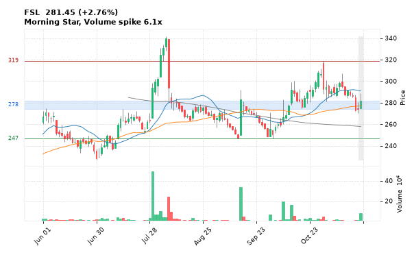

[🔔 Set alert on FSL](https://claude.ai/artifact/Ewc5hHTPX6WkU1nVcDNQzq?s=FSL&c=close%20above%20288.80) &nbsp;|&nbsp; [📈 Live chart (TradingView)](https://www.tradingview.com/chart/?symbol=NSE:FSL) &nbsp;|&nbsp; [alert by email](mailto:testthetpassword@123?subject=ALERT%20FSL&body=Alert%20me%20when%3A%20close%20above%20288.80%0A%0AEdit%20the%20line%20above%20if%20you%20want%2C%20then%20press%20Send.%20Checked%20on%20every%20day%27s%20closing%20data%3B%20a%20triggered%20alert%20appears%20at%20the%20top%20of%20the%208%20AM%20Technical%20Analysis%20email.%0A%0AExamples%20you%20can%20write%3A%0A%20%20close%20above%201150%20%20%7C%20%20close%20below%201080%20%20%7C%20%20high%20above%201200%20%20%7C%20%20low%20below%201050%0A%20%20close%20crosses%20above%20200%20DMA%20%20%7C%20%20close%20below%2050%20DMA%20%20%7C%20%20RSI%20below%2030%20%20%7C%20%20RSI%20above%2070%0A%20%20volume%20above%202x%20%20%7C%20%20change%20above%205%25%20%20%7C%20%20change%20below%20-4%25%20%20%7C%20%2052-week%20high%20%20%7C%20%20golden%20cross%0A%20%20combine%20with%20%27and%27%2C%20e.g.%20%20close%20above%201150%20and%20volume%20above%201.5x%0A%0AReference%3A%20FSL%20closed%20281.45%20%28high%20288.80%2C%20low%20275.00%29.%0ATo%20cancel%20later%2C%20send%20an%20email%20with%20subject%3A%20CANCEL%20ALERT%20FSL)

---

## 2. AXISBANK - BULLISH
**1,446.00** (+4.72%) | vol 3.2x | RSI 78 | H 1,450.00 / L 1,368.80  
52-week high breakout, Volume spike 3.2x

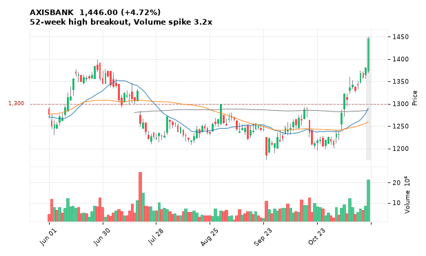

[🔔 Set alert on AXISBANK](https://claude.ai/artifact/Ewc5hHTPX6WkU1nVcDNQzq?s=AXISBANK&c=close%20above%201450.00) &nbsp;|&nbsp; [📈 Live chart (TradingView)](https://www.tradingview.com/chart/?symbol=NSE:AXISBANK) &nbsp;|&nbsp; [alert by email](mailto:testthetpassword@123?subject=ALERT%20AXISBANK&body=Alert%20me%20when%3A%20close%20above%201450.00%0A%0AEdit%20the%20line%20above%20if%20you%20want%2C%20then%20press%20Send.%20Checked%20on%20every%20day%27s%20closing%20data%3B%20a%20triggered%20alert%20appears%20at%20the%20top%20of%20the%208%20AM%20Technical%20Analysis%20email.%0A%0AExamples%20you%20can%20write%3A%0A%20%20close%20above%201150%20%20%7C%20%20close%20below%201080%20%20%7C%20%20high%20above%201200%20%20%7C%20%20low%20below%201050%0A%20%20close%20crosses%20above%20200%20DMA%20%20%7C%20%20close%20below%2050%20DMA%20%20%7C%20%20RSI%20below%2030%20%20%7C%20%20RSI%20above%2070%0A%20%20volume%20above%202x%20%20%7C%20%20change%20above%205%25%20%20%7C%20%20change%20below%20-4%25%20%20%7C%20%2052-week%20high%20%20%7C%20%20golden%20cross%0A%20%20combine%20with%20%27and%27%2C%20e.g.%20%20close%20above%201150%20and%20volume%20above%201.5x%0A%0AReference%3A%20AXISBANK%20closed%201446.00%20%28high%201450.00%2C%20low%201368.80%29.%0ATo%20cancel%20later%2C%20send%20an%20email%20with%20subject%3A%20CANCEL%20ALERT%20AXISBANK)

---

## 3. APOLLOHOSP - BULLISH
**9,200.00** (+5.29%) | vol 2.7x | RSI 70 | H 9,282.50 / L 8,800.00  
52-week high breakout, Volume spike 2.7x

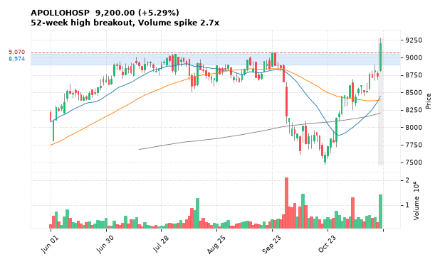

[🔔 Set alert on APOLLOHOSP](https://claude.ai/artifact/Ewc5hHTPX6WkU1nVcDNQzq?s=APOLLOHOSP&c=close%20above%209282.50) &nbsp;|&nbsp; [📈 Live chart (TradingView)](https://www.tradingview.com/chart/?symbol=NSE:APOLLOHOSP) &nbsp;|&nbsp; [alert by email](mailto:testthetpassword@123?subject=ALERT%20APOLLOHOSP&body=Alert%20me%20when%3A%20close%20above%209282.50%0A%0AEdit%20the%20line%20above%20if%20you%20want%2C%20then%20press%20Send.%20Checked%20on%20every%20day%27s%20closing%20data%3B%20a%20triggered%20alert%20appears%20at%20the%20top%20of%20the%208%20AM%20Technical%20Analysis%20email.%0A%0AExamples%20you%20can%20write%3A%0A%20%20close%20above%201150%20%20%7C%20%20close%20below%201080%20%20%7C%20%20high%20above%201200%20%20%7C%20%20low%20below%201050%0A%20%20close%20crosses%20above%20200%20DMA%20%20%7C%20%20close%20below%2050%20DMA%20%20%7C%20%20RSI%20below%2030%20%20%7C%20%20RSI%20above%2070%0A%20%20volume%20above%202x%20%20%7C%20%20change%20above%205%25%20%20%7C%20%20change%20below%20-4%25%20%20%7C%20%2052-week%20high%20%20%7C%20%20golden%20cross%0A%20%20combine%20with%20%27and%27%2C%20e.g.%20%20close%20above%201150%20and%20volume%20above%201.5x%0A%0AReference%3A%20APOLLOHOSP%20closed%209200.00%20%28high%209282.50%2C%20low%208800.00%29.%0ATo%20cancel%20later%2C%20send%20an%20email%20with%20subject%3A%20CANCEL%20ALERT%20APOLLOHOSP)

---

## 4. POONAWALLA - BULLISH
**518.40** (+2.70%) | vol 2.0x | RSI 72 | H 522.00 / L 489.00  
52-week high breakout, Volume spike 2.0x

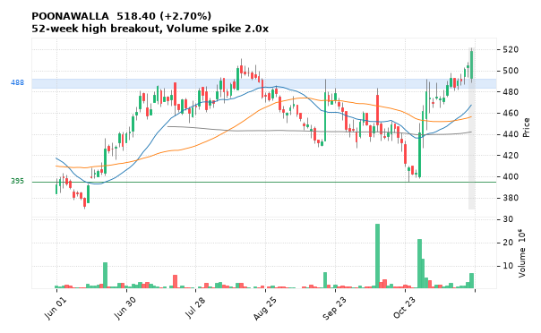

[🔔 Set alert on POONAWALLA](https://claude.ai/artifact/Ewc5hHTPX6WkU1nVcDNQzq?s=POONAWALLA&c=close%20above%20522.00) &nbsp;|&nbsp; [📈 Live chart (TradingView)](https://www.tradingview.com/chart/?symbol=NSE:POONAWALLA) &nbsp;|&nbsp; [alert by email](mailto:testthetpassword@123?subject=ALERT%20POONAWALLA&body=Alert%20me%20when%3A%20close%20above%20522.00%0A%0AEdit%20the%20line%20above%20if%20you%20want%2C%20then%20press%20Send.%20Checked%20on%20every%20day%27s%20closing%20data%3B%20a%20triggered%20alert%20appears%20at%20the%20top%20of%20the%208%20AM%20Technical%20Analysis%20email.%0A%0AExamples%20you%20can%20write%3A%0A%20%20close%20above%201150%20%20%7C%20%20close%20below%201080%20%20%7C%20%20high%20above%201200%20%20%7C%20%20low%20below%201050%0A%20%20close%20crosses%20above%20200%20DMA%20%20%7C%20%20close%20below%2050%20DMA%20%20%7C%20%20RSI%20below%2030%20%20%7C%20%20RSI%20above%2070%0A%20%20volume%20above%202x%20%20%7C%20%20change%20above%205%25%20%20%7C%20%20change%20below%20-4%25%20%20%7C%20%2052-week%20high%20%20%7C%20%20golden%20cross%0A%20%20combine%20with%20%27and%27%2C%20e.g.%20%20close%20above%201150%20and%20volume%20above%201.5x%0A%0AReference%3A%20POONAWALLA%20closed%20518.40%20%28high%20522.00%2C%20low%20489.00%29.%0ATo%20cancel%20later%2C%20send%20an%20email%20with%20subject%3A%20CANCEL%20ALERT%20POONAWALLA)

---

## 5. KOTAKBANK - BULLISH
**515.80** (+2.54%) | vol 0.9x | RSI 81 | H 516.60 / L 499.00  
Bullish Marubozu, 52-week high breakout

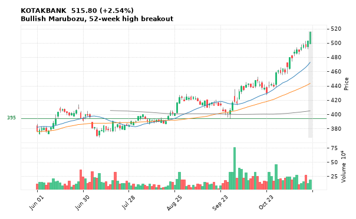

[🔔 Set alert on KOTAKBANK](https://claude.ai/artifact/Ewc5hHTPX6WkU1nVcDNQzq?s=KOTAKBANK&c=close%20above%20516.60) &nbsp;|&nbsp; [📈 Live chart (TradingView)](https://www.tradingview.com/chart/?symbol=NSE:KOTAKBANK) &nbsp;|&nbsp; [alert by email](mailto:testthetpassword@123?subject=ALERT%20KOTAKBANK&body=Alert%20me%20when%3A%20close%20above%20516.60%0A%0AEdit%20the%20line%20above%20if%20you%20want%2C%20then%20press%20Send.%20Checked%20on%20every%20day%27s%20closing%20data%3B%20a%20triggered%20alert%20appears%20at%20the%20top%20of%20the%208%20AM%20Technical%20Analysis%20email.%0A%0AExamples%20you%20can%20write%3A%0A%20%20close%20above%201150%20%20%7C%20%20close%20below%201080%20%20%7C%20%20high%20above%201200%20%20%7C%20%20low%20below%201050%0A%20%20close%20crosses%20above%20200%20DMA%20%20%7C%20%20close%20below%2050%20DMA%20%20%7C%20%20RSI%20below%2030%20%20%7C%20%20RSI%20above%2070%0A%20%20volume%20above%202x%20%20%7C%20%20change%20above%205%25%20%20%7C%20%20change%20below%20-4%25%20%20%7C%20%2052-week%20high%20%20%7C%20%20golden%20cross%0A%20%20combine%20with%20%27and%27%2C%20e.g.%20%20close%20above%201150%20and%20volume%20above%201.5x%0A%0AReference%3A%20KOTAKBANK%20closed%20515.80%20%28high%20516.60%2C%20low%20499.00%29.%0ATo%20cancel%20later%2C%20send%20an%20email%20with%20subject%3A%20CANCEL%20ALERT%20KOTAKBANK)

---

## 6. TORNTPHARM - BULLISH
**4,689.50** (+1.70%) | vol 0.6x | RSI 51 | H 4,689.50 / L 4,611.20  
Bullish Marubozu, Morning Star

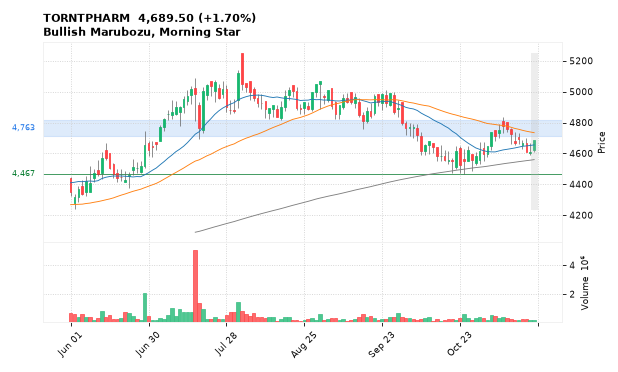

[🔔 Set alert on TORNTPHARM](https://claude.ai/artifact/Ewc5hHTPX6WkU1nVcDNQzq?s=TORNTPHARM&c=close%20above%204689.50) &nbsp;|&nbsp; [📈 Live chart (TradingView)](https://www.tradingview.com/chart/?symbol=NSE:TORNTPHARM) &nbsp;|&nbsp; [alert by email](mailto:testthetpassword@123?subject=ALERT%20TORNTPHARM&body=Alert%20me%20when%3A%20close%20above%204689.50%0A%0AEdit%20the%20line%20above%20if%20you%20want%2C%20then%20press%20Send.%20Checked%20on%20every%20day%27s%20closing%20data%3B%20a%20triggered%20alert%20appears%20at%20the%20top%20of%20the%208%20AM%20Technical%20Analysis%20email.%0A%0AExamples%20you%20can%20write%3A%0A%20%20close%20above%201150%20%20%7C%20%20close%20below%201080%20%20%7C%20%20high%20above%201200%20%20%7C%20%20low%20below%201050%0A%20%20close%20crosses%20above%20200%20DMA%20%20%7C%20%20close%20below%2050%20DMA%20%20%7C%20%20RSI%20below%2030%20%20%7C%20%20RSI%20above%2070%0A%20%20volume%20above%202x%20%20%7C%20%20change%20above%205%25%20%20%7C%20%20change%20below%20-4%25%20%20%7C%20%2052-week%20high%20%20%7C%20%20golden%20cross%0A%20%20combine%20with%20%27and%27%2C%20e.g.%20%20close%20above%201150%20and%20volume%20above%201.5x%0A%0AReference%3A%20TORNTPHARM%20closed%204689.50%20%28high%204689.50%2C%20low%204611.20%29.%0ATo%20cancel%20later%2C%20send%20an%20email%20with%20subject%3A%20CANCEL%20ALERT%20TORNTPHARM)

---

## 7. EIHOTEL - BULLISH
**334.15** (+7.79%) | vol 17.4x | RSI 71 | H 337.25 / L 309.00  
Close above 200 DMA, Volume spike 17.4x

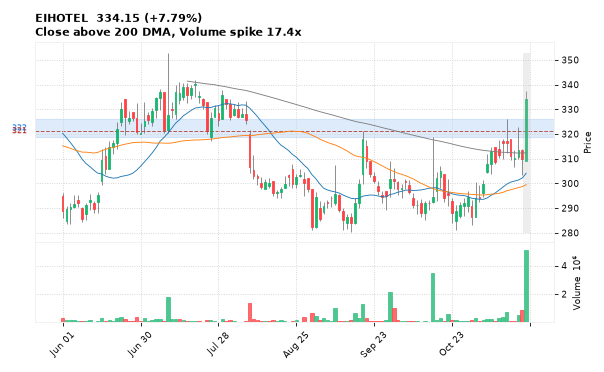

[🔔 Set alert on EIHOTEL](https://claude.ai/artifact/Ewc5hHTPX6WkU1nVcDNQzq?s=EIHOTEL&c=close%20above%20337.25) &nbsp;|&nbsp; [📈 Live chart (TradingView)](https://www.tradingview.com/chart/?symbol=NSE:EIHOTEL) &nbsp;|&nbsp; [alert by email](mailto:testthetpassword@123?subject=ALERT%20EIHOTEL&body=Alert%20me%20when%3A%20close%20above%20337.25%0A%0AEdit%20the%20line%20above%20if%20you%20want%2C%20then%20press%20Send.%20Checked%20on%20every%20day%27s%20closing%20data%3B%20a%20triggered%20alert%20appears%20at%20the%20top%20of%20the%208%20AM%20Technical%20Analysis%20email.%0A%0AExamples%20you%20can%20write%3A%0A%20%20close%20above%201150%20%20%7C%20%20close%20below%201080%20%20%7C%20%20high%20above%201200%20%20%7C%20%20low%20below%201050%0A%20%20close%20crosses%20above%20200%20DMA%20%20%7C%20%20close%20below%2050%20DMA%20%20%7C%20%20RSI%20below%2030%20%20%7C%20%20RSI%20above%2070%0A%20%20volume%20above%202x%20%20%7C%20%20change%20above%205%25%20%20%7C%20%20change%20below%20-4%25%20%20%7C%20%2052-week%20high%20%20%7C%20%20golden%20cross%0A%20%20combine%20with%20%27and%27%2C%20e.g.%20%20close%20above%201150%20and%20volume%20above%201.5x%0A%0AReference%3A%20EIHOTEL%20closed%20334.15%20%28high%20337.25%2C%20low%20309.00%29.%0ATo%20cancel%20later%2C%20send%20an%20email%20with%20subject%3A%20CANCEL%20ALERT%20EIHOTEL)

---

## 8. INDUSINDBK - BULLISH
**1,003.00** (+8.59%) | vol 6.0x | RSI 70 | H 1,003.00 / L 906.00  
Bullish Marubozu, Volume spike 6.0x

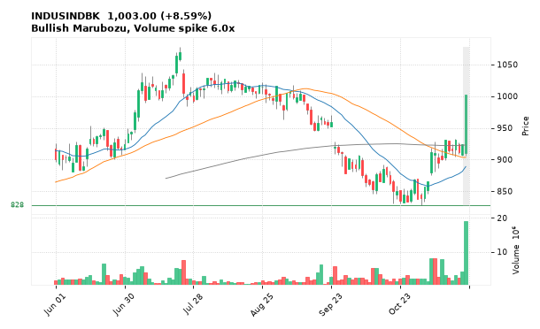

[🔔 Set alert on INDUSINDBK](https://claude.ai/artifact/Ewc5hHTPX6WkU1nVcDNQzq?s=INDUSINDBK&c=close%20above%201003.00) &nbsp;|&nbsp; [📈 Live chart (TradingView)](https://www.tradingview.com/chart/?symbol=NSE:INDUSINDBK) &nbsp;|&nbsp; [alert by email](mailto:testthetpassword@123?subject=ALERT%20INDUSINDBK&body=Alert%20me%20when%3A%20close%20above%201003.00%0A%0AEdit%20the%20line%20above%20if%20you%20want%2C%20then%20press%20Send.%20Checked%20on%20every%20day%27s%20closing%20data%3B%20a%20triggered%20alert%20appears%20at%20the%20top%20of%20the%208%20AM%20Technical%20Analysis%20email.%0A%0AExamples%20you%20can%20write%3A%0A%20%20close%20above%201150%20%20%7C%20%20close%20below%201080%20%20%7C%20%20high%20above%201200%20%20%7C%20%20low%20below%201050%0A%20%20close%20crosses%20above%20200%20DMA%20%20%7C%20%20close%20below%2050%20DMA%20%20%7C%20%20RSI%20below%2030%20%20%7C%20%20RSI%20above%2070%0A%20%20volume%20above%202x%20%20%7C%20%20change%20above%205%25%20%20%7C%20%20change%20below%20-4%25%20%20%7C%20%2052-week%20high%20%20%7C%20%20golden%20cross%0A%20%20combine%20with%20%27and%27%2C%20e.g.%20%20close%20above%201150%20and%20volume%20above%201.5x%0A%0AReference%3A%20INDUSINDBK%20closed%201003.00%20%28high%201003.00%2C%20low%20906.00%29.%0ATo%20cancel%20later%2C%20send%20an%20email%20with%20subject%3A%20CANCEL%20ALERT%20INDUSINDBK)

---

## 9. CCL - BULLISH
**953.05** (+0.89%) | vol 2.2x | RSI 42 | H 960.80 / L 936.45  
Bullish Engulfing

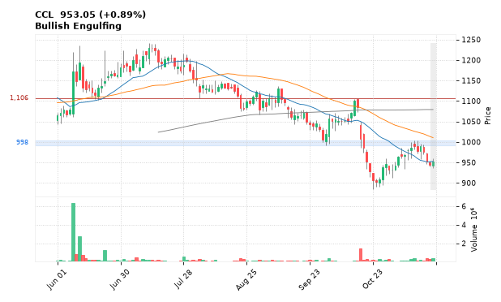

[🔔 Set alert on CCL](https://claude.ai/artifact/Ewc5hHTPX6WkU1nVcDNQzq?s=CCL&c=close%20above%20960.80) &nbsp;|&nbsp; [📈 Live chart (TradingView)](https://www.tradingview.com/chart/?symbol=NSE:CCL) &nbsp;|&nbsp; [alert by email](mailto:testthetpassword@123?subject=ALERT%20CCL&body=Alert%20me%20when%3A%20close%20above%20960.80%0A%0AEdit%20the%20line%20above%20if%20you%20want%2C%20then%20press%20Send.%20Checked%20on%20every%20day%27s%20closing%20data%3B%20a%20triggered%20alert%20appears%20at%20the%20top%20of%20the%208%20AM%20Technical%20Analysis%20email.%0A%0AExamples%20you%20can%20write%3A%0A%20%20close%20above%201150%20%20%7C%20%20close%20below%201080%20%20%7C%20%20high%20above%201200%20%20%7C%20%20low%20below%201050%0A%20%20close%20crosses%20above%20200%20DMA%20%20%7C%20%20close%20below%2050%20DMA%20%20%7C%20%20RSI%20below%2030%20%20%7C%20%20RSI%20above%2070%0A%20%20volume%20above%202x%20%20%7C%20%20change%20above%205%25%20%20%7C%20%20change%20below%20-4%25%20%20%7C%20%2052-week%20high%20%20%7C%20%20golden%20cross%0A%20%20combine%20with%20%27and%27%2C%20e.g.%20%20close%20above%201150%20and%20volume%20above%201.5x%0A%0AReference%3A%20CCL%20closed%20953.05%20%28high%20960.80%2C%20low%20936.45%29.%0ATo%20cancel%20later%2C%20send%20an%20email%20with%20subject%3A%20CANCEL%20ALERT%20CCL)

---

## 10. WELSPUNLIV - BULLISH
**268.78** (+6.18%) | vol 1.9x | RSI 64 | H 274.00 / L 249.50  
52-week high breakout

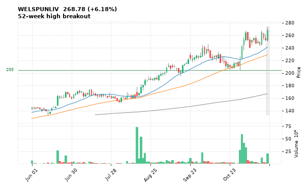

[🔔 Set alert on WELSPUNLIV](https://claude.ai/artifact/Ewc5hHTPX6WkU1nVcDNQzq?s=WELSPUNLIV&c=close%20above%20274.00) &nbsp;|&nbsp; [📈 Live chart (TradingView)](https://www.tradingview.com/chart/?symbol=NSE:WELSPUNLIV) &nbsp;|&nbsp; [alert by email](mailto:testthetpassword@123?subject=ALERT%20WELSPUNLIV&body=Alert%20me%20when%3A%20close%20above%20274.00%0A%0AEdit%20the%20line%20above%20if%20you%20want%2C%20then%20press%20Send.%20Checked%20on%20every%20day%27s%20closing%20data%3B%20a%20triggered%20alert%20appears%20at%20the%20top%20of%20the%208%20AM%20Technical%20Analysis%20email.%0A%0AExamples%20you%20can%20write%3A%0A%20%20close%20above%201150%20%20%7C%20%20close%20below%201080%20%20%7C%20%20high%20above%201200%20%20%7C%20%20low%20below%201050%0A%20%20close%20crosses%20above%20200%20DMA%20%20%7C%20%20close%20below%2050%20DMA%20%20%7C%20%20RSI%20below%2030%20%20%7C%20%20RSI%20above%2070%0A%20%20volume%20above%202x%20%20%7C%20%20change%20above%205%25%20%20%7C%20%20change%20below%20-4%25%20%20%7C%20%2052-week%20high%20%20%7C%20%20golden%20cross%0A%20%20combine%20with%20%27and%27%2C%20e.g.%20%20close%20above%201150%20and%20volume%20above%201.5x%0A%0AReference%3A%20WELSPUNLIV%20closed%20268.78%20%28high%20274.00%2C%20low%20249.50%29.%0ATo%20cancel%20later%2C%20send%20an%20email%20with%20subject%3A%20CANCEL%20ALERT%20WELSPUNLIV)

---

## 11. DLF - BULLISH
**785.00** (+2.21%) | vol 1.6x | RSI 74 | H 792.00 / L 761.00  
52-week high breakout

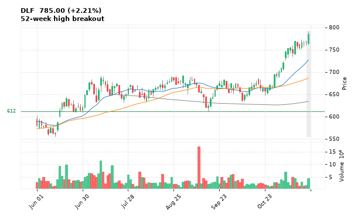

[🔔 Set alert on DLF](https://claude.ai/artifact/Ewc5hHTPX6WkU1nVcDNQzq?s=DLF&c=close%20above%20792.00) &nbsp;|&nbsp; [📈 Live chart (TradingView)](https://www.tradingview.com/chart/?symbol=NSE:DLF) &nbsp;|&nbsp; [alert by email](mailto:testthetpassword@123?subject=ALERT%20DLF&body=Alert%20me%20when%3A%20close%20above%20792.00%0A%0AEdit%20the%20line%20above%20if%20you%20want%2C%20then%20press%20Send.%20Checked%20on%20every%20day%27s%20closing%20data%3B%20a%20triggered%20alert%20appears%20at%20the%20top%20of%20the%208%20AM%20Technical%20Analysis%20email.%0A%0AExamples%20you%20can%20write%3A%0A%20%20close%20above%201150%20%20%7C%20%20close%20below%201080%20%20%7C%20%20high%20above%201200%20%20%7C%20%20low%20below%201050%0A%20%20close%20crosses%20above%20200%20DMA%20%20%7C%20%20close%20below%2050%20DMA%20%20%7C%20%20RSI%20below%2030%20%20%7C%20%20RSI%20above%2070%0A%20%20volume%20above%202x%20%20%7C%20%20change%20above%205%25%20%20%7C%20%20change%20below%20-4%25%20%20%7C%20%2052-week%20high%20%20%7C%20%20golden%20cross%0A%20%20combine%20with%20%27and%27%2C%20e.g.%20%20close%20above%201150%20and%20volume%20above%201.5x%0A%0AReference%3A%20DLF%20closed%20785.00%20%28high%20792.00%2C%20low%20761.00%29.%0ATo%20cancel%20later%2C%20send%20an%20email%20with%20subject%3A%20CANCEL%20ALERT%20DLF)

---

## 12. UNIONBANK - BULLISH
**218.85** (+4.21%) | vol 1.5x | RSI 83 | H 219.10 / L 206.76  
52-week high breakout

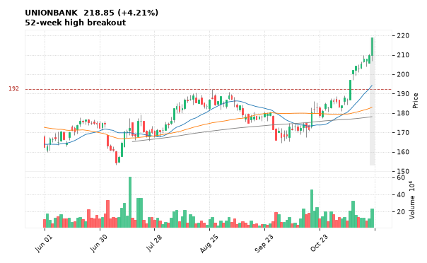

[🔔 Set alert on UNIONBANK](https://claude.ai/artifact/Ewc5hHTPX6WkU1nVcDNQzq?s=UNIONBANK&c=close%20above%20219.10) &nbsp;|&nbsp; [📈 Live chart (TradingView)](https://www.tradingview.com/chart/?symbol=NSE:UNIONBANK) &nbsp;|&nbsp; [alert by email](mailto:testthetpassword@123?subject=ALERT%20UNIONBANK&body=Alert%20me%20when%3A%20close%20above%20219.10%0A%0AEdit%20the%20line%20above%20if%20you%20want%2C%20then%20press%20Send.%20Checked%20on%20every%20day%27s%20closing%20data%3B%20a%20triggered%20alert%20appears%20at%20the%20top%20of%20the%208%20AM%20Technical%20Analysis%20email.%0A%0AExamples%20you%20can%20write%3A%0A%20%20close%20above%201150%20%20%7C%20%20close%20below%201080%20%20%7C%20%20high%20above%201200%20%20%7C%20%20low%20below%201050%0A%20%20close%20crosses%20above%20200%20DMA%20%20%7C%20%20close%20below%2050%20DMA%20%20%7C%20%20RSI%20below%2030%20%20%7C%20%20RSI%20above%2070%0A%20%20volume%20above%202x%20%20%7C%20%20change%20above%205%25%20%20%7C%20%20change%20below%20-4%25%20%20%7C%20%2052-week%20high%20%20%7C%20%20golden%20cross%0A%20%20combine%20with%20%27and%27%2C%20e.g.%20%20close%20above%201150%20and%20volume%20above%201.5x%0A%0AReference%3A%20UNIONBANK%20closed%20218.85%20%28high%20219.10%2C%20low%20206.76%29.%0ATo%20cancel%20later%2C%20send%20an%20email%20with%20subject%3A%20CANCEL%20ALERT%20UNIONBANK)

---

## 13. MAHABANK - BULLISH
**99.45** (+1.50%) | vol 1.4x | RSI 79 | H 99.60 / L 95.68  
52-week high breakout

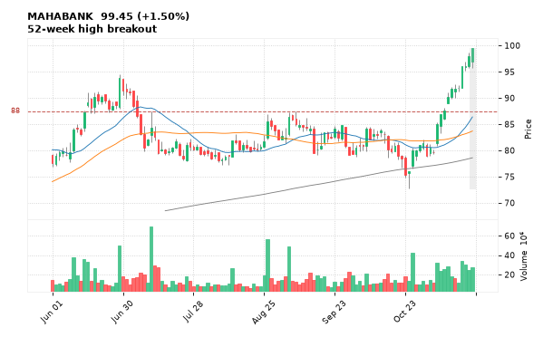

[🔔 Set alert on MAHABANK](https://claude.ai/artifact/Ewc5hHTPX6WkU1nVcDNQzq?s=MAHABANK&c=close%20above%2099.60) &nbsp;|&nbsp; [📈 Live chart (TradingView)](https://www.tradingview.com/chart/?symbol=NSE:MAHABANK) &nbsp;|&nbsp; [alert by email](mailto:testthetpassword@123?subject=ALERT%20MAHABANK&body=Alert%20me%20when%3A%20close%20above%2099.60%0A%0AEdit%20the%20line%20above%20if%20you%20want%2C%20then%20press%20Send.%20Checked%20on%20every%20day%27s%20closing%20data%3B%20a%20triggered%20alert%20appears%20at%20the%20top%20of%20the%208%20AM%20Technical%20Analysis%20email.%0A%0AExamples%20you%20can%20write%3A%0A%20%20close%20above%201150%20%20%7C%20%20close%20below%201080%20%20%7C%20%20high%20above%201200%20%20%7C%20%20low%20below%201050%0A%20%20close%20crosses%20above%20200%20DMA%20%20%7C%20%20close%20below%2050%20DMA%20%20%7C%20%20RSI%20below%2030%20%20%7C%20%20RSI%20above%2070%0A%20%20volume%20above%202x%20%20%7C%20%20change%20above%205%25%20%20%7C%20%20change%20below%20-4%25%20%20%7C%20%2052-week%20high%20%20%7C%20%20golden%20cross%0A%20%20combine%20with%20%27and%27%2C%20e.g.%20%20close%20above%201150%20and%20volume%20above%201.5x%0A%0AReference%3A%20MAHABANK%20closed%2099.45%20%28high%2099.60%2C%20low%2095.68%29.%0ATo%20cancel%20later%2C%20send%20an%20email%20with%20subject%3A%20CANCEL%20ALERT%20MAHABANK)

---

## 14. MPHASIS - BULLISH
**2,420.00** (+2.72%) | vol 1.4x | RSI 48 | H 2,459.00 / L 2,338.00  
Bullish Engulfing

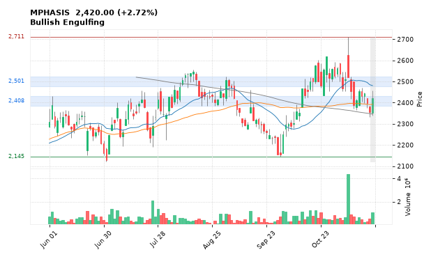

[🔔 Set alert on MPHASIS](https://claude.ai/artifact/Ewc5hHTPX6WkU1nVcDNQzq?s=MPHASIS&c=close%20above%202459.00) &nbsp;|&nbsp; [📈 Live chart (TradingView)](https://www.tradingview.com/chart/?symbol=NSE:MPHASIS) &nbsp;|&nbsp; [alert by email](mailto:testthetpassword@123?subject=ALERT%20MPHASIS&body=Alert%20me%20when%3A%20close%20above%202459.00%0A%0AEdit%20the%20line%20above%20if%20you%20want%2C%20then%20press%20Send.%20Checked%20on%20every%20day%27s%20closing%20data%3B%20a%20triggered%20alert%20appears%20at%20the%20top%20of%20the%208%20AM%20Technical%20Analysis%20email.%0A%0AExamples%20you%20can%20write%3A%0A%20%20close%20above%201150%20%20%7C%20%20close%20below%201080%20%20%7C%20%20high%20above%201200%20%20%7C%20%20low%20below%201050%0A%20%20close%20crosses%20above%20200%20DMA%20%20%7C%20%20close%20below%2050%20DMA%20%20%7C%20%20RSI%20below%2030%20%20%7C%20%20RSI%20above%2070%0A%20%20volume%20above%202x%20%20%7C%20%20change%20above%205%25%20%20%7C%20%20change%20below%20-4%25%20%20%7C%20%2052-week%20high%20%20%7C%20%20golden%20cross%0A%20%20combine%20with%20%27and%27%2C%20e.g.%20%20close%20above%201150%20and%20volume%20above%201.5x%0A%0AReference%3A%20MPHASIS%20closed%202420.00%20%28high%202459.00%2C%20low%202338.00%29.%0ATo%20cancel%20later%2C%20send%20an%20email%20with%20subject%3A%20CANCEL%20ALERT%20MPHASIS)

---

## 15. FEDERALBNK - BULLISH
**373.50** (+2.47%) | vol 1.3x | RSI 70 | H 374.30 / L 360.55  
52-week high breakout

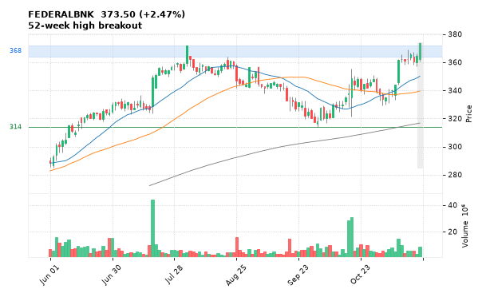

[🔔 Set alert on FEDERALBNK](https://claude.ai/artifact/Ewc5hHTPX6WkU1nVcDNQzq?s=FEDERALBNK&c=close%20above%20374.30) &nbsp;|&nbsp; [📈 Live chart (TradingView)](https://www.tradingview.com/chart/?symbol=NSE:FEDERALBNK) &nbsp;|&nbsp; [alert by email](mailto:testthetpassword@123?subject=ALERT%20FEDERALBNK&body=Alert%20me%20when%3A%20close%20above%20374.30%0A%0AEdit%20the%20line%20above%20if%20you%20want%2C%20then%20press%20Send.%20Checked%20on%20every%20day%27s%20closing%20data%3B%20a%20triggered%20alert%20appears%20at%20the%20top%20of%20the%208%20AM%20Technical%20Analysis%20email.%0A%0AExamples%20you%20can%20write%3A%0A%20%20close%20above%201150%20%20%7C%20%20close%20below%201080%20%20%7C%20%20high%20above%201200%20%20%7C%20%20low%20below%201050%0A%20%20close%20crosses%20above%20200%20DMA%20%20%7C%20%20close%20below%2050%20DMA%20%20%7C%20%20RSI%20below%2030%20%20%7C%20%20RSI%20above%2070%0A%20%20volume%20above%202x%20%20%7C%20%20change%20above%205%25%20%20%7C%20%20change%20below%20-4%25%20%20%7C%20%2052-week%20high%20%20%7C%20%20golden%20cross%0A%20%20combine%20with%20%27and%27%2C%20e.g.%20%20close%20above%201150%20and%20volume%20above%201.5x%0A%0AReference%3A%20FEDERALBNK%20closed%20373.50%20%28high%20374.30%2C%20low%20360.55%29.%0ATo%20cancel%20later%2C%20send%20an%20email%20with%20subject%3A%20CANCEL%20ALERT%20FEDERALBNK)

---

## 16. CRAFTSMAN - BEARISH
**11,723.00** (-1.74%) | vol 0.5x | RSI 65 | H 12,084.00 / L 11,665.00  
Shooting Star, RSI down through 70, Inside Bar

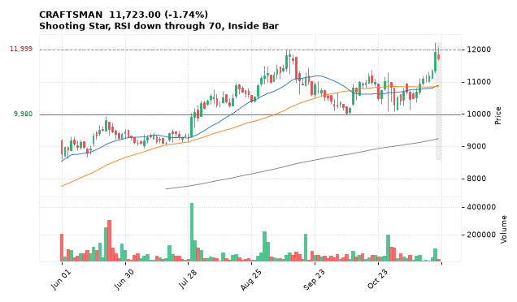

[🔔 Set alert on CRAFTSMAN](https://claude.ai/artifact/Ewc5hHTPX6WkU1nVcDNQzq?s=CRAFTSMAN&c=close%20below%2011665.00) &nbsp;|&nbsp; [📈 Live chart (TradingView)](https://www.tradingview.com/chart/?symbol=NSE:CRAFTSMAN) &nbsp;|&nbsp; [alert by email](mailto:testthetpassword@123?subject=ALERT%20CRAFTSMAN&body=Alert%20me%20when%3A%20close%20below%2011665.00%0A%0AEdit%20the%20line%20above%20if%20you%20want%2C%20then%20press%20Send.%20Checked%20on%20every%20day%27s%20closing%20data%3B%20a%20triggered%20alert%20appears%20at%20the%20top%20of%20the%208%20AM%20Technical%20Analysis%20email.%0A%0AExamples%20you%20can%20write%3A%0A%20%20close%20above%201150%20%20%7C%20%20close%20below%201080%20%20%7C%20%20high%20above%201200%20%20%7C%20%20low%20below%201050%0A%20%20close%20crosses%20above%20200%20DMA%20%20%7C%20%20close%20below%2050%20DMA%20%20%7C%20%20RSI%20below%2030%20%20%7C%20%20RSI%20above%2070%0A%20%20volume%20above%202x%20%20%7C%20%20change%20above%205%25%20%20%7C%20%20change%20below%20-4%25%20%20%7C%20%2052-week%20high%20%20%7C%20%20golden%20cross%0A%20%20combine%20with%20%27and%27%2C%20e.g.%20%20close%20above%201150%20and%20volume%20above%201.5x%0A%0AReference%3A%20CRAFTSMAN%20closed%2011723.00%20%28high%2012084.00%2C%20low%2011665.00%29.%0ATo%20cancel%20later%2C%20send%20an%20email%20with%20subject%3A%20CANCEL%20ALERT%20CRAFTSMAN)

---

## 17. GODREJCP - BEARISH
**919.50** (-1.08%) | vol 1.0x | RSI 66 | H 931.00 / L 917.95  
Bearish Harami, RSI down through 70, Inside Bar, NR7 (narrowest range in 7)

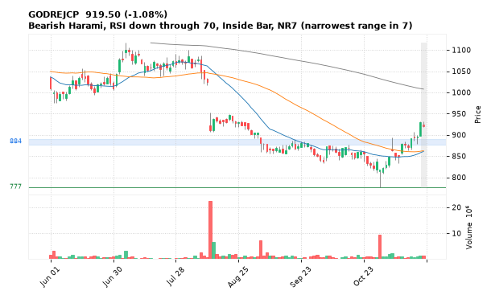

[🔔 Set alert on GODREJCP](https://claude.ai/artifact/Ewc5hHTPX6WkU1nVcDNQzq?s=GODREJCP&c=close%20below%20917.95) &nbsp;|&nbsp; [📈 Live chart (TradingView)](https://www.tradingview.com/chart/?symbol=NSE:GODREJCP) &nbsp;|&nbsp; [alert by email](mailto:testthetpassword@123?subject=ALERT%20GODREJCP&body=Alert%20me%20when%3A%20close%20below%20917.95%0A%0AEdit%20the%20line%20above%20if%20you%20want%2C%20then%20press%20Send.%20Checked%20on%20every%20day%27s%20closing%20data%3B%20a%20triggered%20alert%20appears%20at%20the%20top%20of%20the%208%20AM%20Technical%20Analysis%20email.%0A%0AExamples%20you%20can%20write%3A%0A%20%20close%20above%201150%20%20%7C%20%20close%20below%201080%20%20%7C%20%20high%20above%201200%20%20%7C%20%20low%20below%201050%0A%20%20close%20crosses%20above%20200%20DMA%20%20%7C%20%20close%20below%2050%20DMA%20%20%7C%20%20RSI%20below%2030%20%20%7C%20%20RSI%20above%2070%0A%20%20volume%20above%202x%20%20%7C%20%20change%20above%205%25%20%20%7C%20%20change%20below%20-4%25%20%20%7C%20%2052-week%20high%20%20%7C%20%20golden%20cross%0A%20%20combine%20with%20%27and%27%2C%20e.g.%20%20close%20above%201150%20and%20volume%20above%201.5x%0A%0AReference%3A%20GODREJCP%20closed%20919.50%20%28high%20931.00%2C%20low%20917.95%29.%0ATo%20cancel%20later%2C%20send%20an%20email%20with%20subject%3A%20CANCEL%20ALERT%20GODREJCP)

---

## 18. USHAMART - BEARISH
**461.15** (-2.84%) | vol 0.7x | RSI 43 | H 473.40 / L 458.50  
Close below 200 DMA, MACD bearish cross

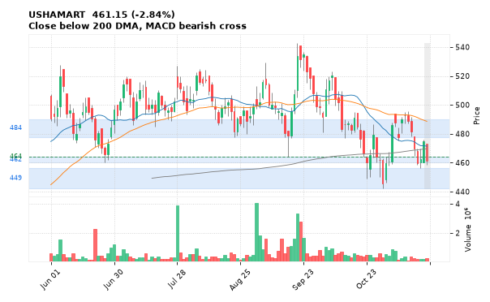

[🔔 Set alert on USHAMART](https://claude.ai/artifact/Ewc5hHTPX6WkU1nVcDNQzq?s=USHAMART&c=close%20below%20458.50) &nbsp;|&nbsp; [📈 Live chart (TradingView)](https://www.tradingview.com/chart/?symbol=NSE:USHAMART) &nbsp;|&nbsp; [alert by email](mailto:testthetpassword@123?subject=ALERT%20USHAMART&body=Alert%20me%20when%3A%20close%20below%20458.50%0A%0AEdit%20the%20line%20above%20if%20you%20want%2C%20then%20press%20Send.%20Checked%20on%20every%20day%27s%20closing%20data%3B%20a%20triggered%20alert%20appears%20at%20the%20top%20of%20the%208%20AM%20Technical%20Analysis%20email.%0A%0AExamples%20you%20can%20write%3A%0A%20%20close%20above%201150%20%20%7C%20%20close%20below%201080%20%20%7C%20%20high%20above%201200%20%20%7C%20%20low%20below%201050%0A%20%20close%20crosses%20above%20200%20DMA%20%20%7C%20%20close%20below%2050%20DMA%20%20%7C%20%20RSI%20below%2030%20%20%7C%20%20RSI%20above%2070%0A%20%20volume%20above%202x%20%20%7C%20%20change%20above%205%25%20%20%7C%20%20change%20below%20-4%25%20%20%7C%20%2052-week%20high%20%20%7C%20%20golden%20cross%0A%20%20combine%20with%20%27and%27%2C%20e.g.%20%20close%20above%201150%20and%20volume%20above%201.5x%0A%0AReference%3A%20USHAMART%20closed%20461.15%20%28high%20473.40%2C%20low%20458.50%29.%0ATo%20cancel%20later%2C%20send%20an%20email%20with%20subject%3A%20CANCEL%20ALERT%20USHAMART)

---

## 19. IFCI - BEARISH
**59.82** (-2.54%) | vol 0.6x | RSI 41 | H 60.90 / L 59.50  
Death Cross (50/200 DMA)

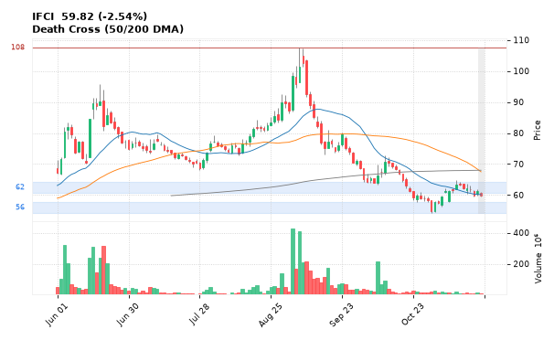

[🔔 Set alert on IFCI](https://claude.ai/artifact/Ewc5hHTPX6WkU1nVcDNQzq?s=IFCI&c=close%20below%2059.50) &nbsp;|&nbsp; [📈 Live chart (TradingView)](https://www.tradingview.com/chart/?symbol=NSE:IFCI) &nbsp;|&nbsp; [alert by email](mailto:testthetpassword@123?subject=ALERT%20IFCI&body=Alert%20me%20when%3A%20close%20below%2059.50%0A%0AEdit%20the%20line%20above%20if%20you%20want%2C%20then%20press%20Send.%20Checked%20on%20every%20day%27s%20closing%20data%3B%20a%20triggered%20alert%20appears%20at%20the%20top%20of%20the%208%20AM%20Technical%20Analysis%20email.%0A%0AExamples%20you%20can%20write%3A%0A%20%20close%20above%201150%20%20%7C%20%20close%20below%201080%20%20%7C%20%20high%20above%201200%20%20%7C%20%20low%20below%201050%0A%20%20close%20crosses%20above%20200%20DMA%20%20%7C%20%20close%20below%2050%20DMA%20%20%7C%20%20RSI%20below%2030%20%20%7C%20%20RSI%20above%2070%0A%20%20volume%20above%202x%20%20%7C%20%20change%20above%205%25%20%20%7C%20%20change%20below%20-4%25%20%20%7C%20%2052-week%20high%20%20%7C%20%20golden%20cross%0A%20%20combine%20with%20%27and%27%2C%20e.g.%20%20close%20above%201150%20and%20volume%20above%201.5x%0A%0AReference%3A%20IFCI%20closed%2059.82%20%28high%2060.90%2C%20low%2059.50%29.%0ATo%20cancel%20later%2C%20send%20an%20email%20with%20subject%3A%20CANCEL%20ALERT%20IFCI)

---

## 20. NATCOPHARM - BEARISH
**814.30** (-0.93%) | vol 0.6x | RSI 54 | H 831.60 / L 810.00  
Bearish Engulfing

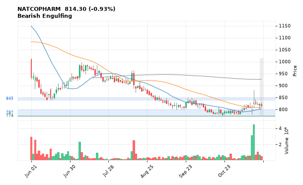

[🔔 Set alert on NATCOPHARM](https://claude.ai/artifact/Ewc5hHTPX6WkU1nVcDNQzq?s=NATCOPHARM&c=close%20below%20810.00) &nbsp;|&nbsp; [📈 Live chart (TradingView)](https://www.tradingview.com/chart/?symbol=NSE:NATCOPHARM) &nbsp;|&nbsp; [alert by email](mailto:testthetpassword@123?subject=ALERT%20NATCOPHARM&body=Alert%20me%20when%3A%20close%20below%20810.00%0A%0AEdit%20the%20line%20above%20if%20you%20want%2C%20then%20press%20Send.%20Checked%20on%20every%20day%27s%20closing%20data%3B%20a%20triggered%20alert%20appears%20at%20the%20top%20of%20the%208%20AM%20Technical%20Analysis%20email.%0A%0AExamples%20you%20can%20write%3A%0A%20%20close%20above%201150%20%20%7C%20%20close%20below%201080%20%20%7C%20%20high%20above%201200%20%20%7C%20%20low%20below%201050%0A%20%20close%20crosses%20above%20200%20DMA%20%20%7C%20%20close%20below%2050%20DMA%20%20%7C%20%20RSI%20below%2030%20%20%7C%20%20RSI%20above%2070%0A%20%20volume%20above%202x%20%20%7C%20%20change%20above%205%25%20%20%7C%20%20change%20below%20-4%25%20%20%7C%20%2052-week%20high%20%20%7C%20%20golden%20cross%0A%20%20combine%20with%20%27and%27%2C%20e.g.%20%20close%20above%201150%20and%20volume%20above%201.5x%0A%0AReference%3A%20NATCOPHARM%20closed%20814.30%20%28high%20831.60%2C%20low%20810.00%29.%0ATo%20cancel%20later%2C%20send%20an%20email%20with%20subject%3A%20CANCEL%20ALERT%20NATCOPHARM)

---

## 21. ACE - BEARISH
**1,170.35** (-1.31%) | vol 0.4x | RSI 57 | H 1,192.65 / L 1,165.00  
Evening Star

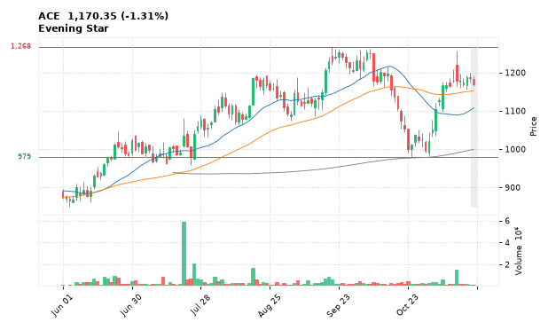

[🔔 Set alert on ACE](https://claude.ai/artifact/Ewc5hHTPX6WkU1nVcDNQzq?s=ACE&c=close%20below%201165.00) &nbsp;|&nbsp; [📈 Live chart (TradingView)](https://www.tradingview.com/chart/?symbol=NSE:ACE) &nbsp;|&nbsp; [alert by email](mailto:testthetpassword@123?subject=ALERT%20ACE&body=Alert%20me%20when%3A%20close%20below%201165.00%0A%0AEdit%20the%20line%20above%20if%20you%20want%2C%20then%20press%20Send.%20Checked%20on%20every%20day%27s%20closing%20data%3B%20a%20triggered%20alert%20appears%20at%20the%20top%20of%20the%208%20AM%20Technical%20Analysis%20email.%0A%0AExamples%20you%20can%20write%3A%0A%20%20close%20above%201150%20%20%7C%20%20close%20below%201080%20%20%7C%20%20high%20above%201200%20%20%7C%20%20low%20below%201050%0A%20%20close%20crosses%20above%20200%20DMA%20%20%7C%20%20close%20below%2050%20DMA%20%20%7C%20%20RSI%20below%2030%20%20%7C%20%20RSI%20above%2070%0A%20%20volume%20above%202x%20%20%7C%20%20change%20above%205%25%20%20%7C%20%20change%20below%20-4%25%20%20%7C%20%2052-week%20high%20%20%7C%20%20golden%20cross%0A%20%20combine%20with%20%27and%27%2C%20e.g.%20%20close%20above%201150%20and%20volume%20above%201.5x%0A%0AReference%3A%20ACE%20closed%201170.35%20%28high%201192.65%2C%20low%201165.00%29.%0ATo%20cancel%20later%2C%20send%20an%20email%20with%20subject%3A%20CANCEL%20ALERT%20ACE)

---

## 22. BALRAMCHIN - BEARISH
**618.60** (-3.27%) | vol 0.4x | RSI 40 | H 637.00 / L 617.00  
Bearish Marubozu, MACD bearish cross

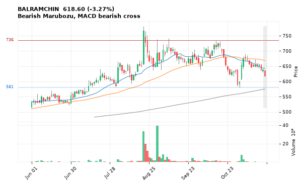

[🔔 Set alert on BALRAMCHIN](https://claude.ai/artifact/Ewc5hHTPX6WkU1nVcDNQzq?s=BALRAMCHIN&c=close%20below%20617.00) &nbsp;|&nbsp; [📈 Live chart (TradingView)](https://www.tradingview.com/chart/?symbol=NSE:BALRAMCHIN) &nbsp;|&nbsp; [alert by email](mailto:testthetpassword@123?subject=ALERT%20BALRAMCHIN&body=Alert%20me%20when%3A%20close%20below%20617.00%0A%0AEdit%20the%20line%20above%20if%20you%20want%2C%20then%20press%20Send.%20Checked%20on%20every%20day%27s%20closing%20data%3B%20a%20triggered%20alert%20appears%20at%20the%20top%20of%20the%208%20AM%20Technical%20Analysis%20email.%0A%0AExamples%20you%20can%20write%3A%0A%20%20close%20above%201150%20%20%7C%20%20close%20below%201080%20%20%7C%20%20high%20above%201200%20%20%7C%20%20low%20below%201050%0A%20%20close%20crosses%20above%20200%20DMA%20%20%7C%20%20close%20below%2050%20DMA%20%20%7C%20%20RSI%20below%2030%20%20%7C%20%20RSI%20above%2070%0A%20%20volume%20above%202x%20%20%7C%20%20change%20above%205%25%20%20%7C%20%20change%20below%20-4%25%20%20%7C%20%2052-week%20high%20%20%7C%20%20golden%20cross%0A%20%20combine%20with%20%27and%27%2C%20e.g.%20%20close%20above%201150%20and%20volume%20above%201.5x%0A%0AReference%3A%20BALRAMCHIN%20closed%20618.60%20%28high%20637.00%2C%20low%20617.00%29.%0ATo%20cancel%20later%2C%20send%20an%20email%20with%20subject%3A%20CANCEL%20ALERT%20BALRAMCHIN)

---

## 23. IGIL - BEARISH
**422.20** (-3.45%) | vol 0.4x | RSI 61 | H 436.75 / L 418.00  
RSI down through 70, MACD bearish cross

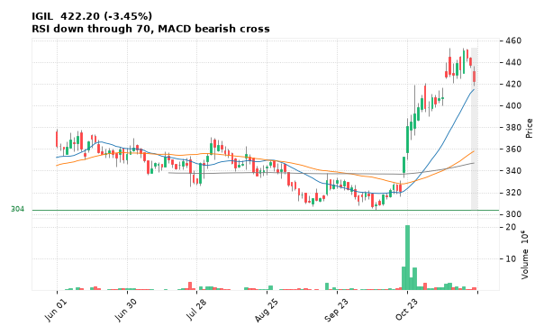

[🔔 Set alert on IGIL](https://claude.ai/artifact/Ewc5hHTPX6WkU1nVcDNQzq?s=IGIL&c=close%20below%20418.00) &nbsp;|&nbsp; [📈 Live chart (TradingView)](https://www.tradingview.com/chart/?symbol=NSE:IGIL) &nbsp;|&nbsp; [alert by email](mailto:testthetpassword@123?subject=ALERT%20IGIL&body=Alert%20me%20when%3A%20close%20below%20418.00%0A%0AEdit%20the%20line%20above%20if%20you%20want%2C%20then%20press%20Send.%20Checked%20on%20every%20day%27s%20closing%20data%3B%20a%20triggered%20alert%20appears%20at%20the%20top%20of%20the%208%20AM%20Technical%20Analysis%20email.%0A%0AExamples%20you%20can%20write%3A%0A%20%20close%20above%201150%20%20%7C%20%20close%20below%201080%20%20%7C%20%20high%20above%201200%20%20%7C%20%20low%20below%201050%0A%20%20close%20crosses%20above%20200%20DMA%20%20%7C%20%20close%20below%2050%20DMA%20%20%7C%20%20RSI%20below%2030%20%20%7C%20%20RSI%20above%2070%0A%20%20volume%20above%202x%20%20%7C%20%20change%20above%205%25%20%20%7C%20%20change%20below%20-4%25%20%20%7C%20%2052-week%20high%20%20%7C%20%20golden%20cross%0A%20%20combine%20with%20%27and%27%2C%20e.g.%20%20close%20above%201150%20and%20volume%20above%201.5x%0A%0AReference%3A%20IGIL%20closed%20422.20%20%28high%20436.75%2C%20low%20418.00%29.%0ATo%20cancel%20later%2C%20send%20an%20email%20with%20subject%3A%20CANCEL%20ALERT%20IGIL)

---

## 24. NETWEB - BEARISH
**4,095.50** (-2.61%) | vol 0.4x | RSI 43 | H 4,157.80 / L 4,080.00  
Gravestone Doji, Close below 200 DMA, NR7 (narrowest range in 7)

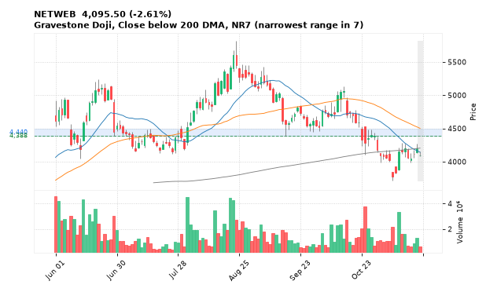

[🔔 Set alert on NETWEB](https://claude.ai/artifact/Ewc5hHTPX6WkU1nVcDNQzq?s=NETWEB&c=close%20below%204080.00) &nbsp;|&nbsp; [📈 Live chart (TradingView)](https://www.tradingview.com/chart/?symbol=NSE:NETWEB) &nbsp;|&nbsp; [alert by email](mailto:testthetpassword@123?subject=ALERT%20NETWEB&body=Alert%20me%20when%3A%20close%20below%204080.00%0A%0AEdit%20the%20line%20above%20if%20you%20want%2C%20then%20press%20Send.%20Checked%20on%20every%20day%27s%20closing%20data%3B%20a%20triggered%20alert%20appears%20at%20the%20top%20of%20the%208%20AM%20Technical%20Analysis%20email.%0A%0AExamples%20you%20can%20write%3A%0A%20%20close%20above%201150%20%20%7C%20%20close%20below%201080%20%20%7C%20%20high%20above%201200%20%20%7C%20%20low%20below%201050%0A%20%20close%20crosses%20above%20200%20DMA%20%20%7C%20%20close%20below%2050%20DMA%20%20%7C%20%20RSI%20below%2030%20%20%7C%20%20RSI%20above%2070%0A%20%20volume%20above%202x%20%20%7C%20%20change%20above%205%25%20%20%7C%20%20change%20below%20-4%25%20%20%7C%20%2052-week%20high%20%20%7C%20%20golden%20cross%0A%20%20combine%20with%20%27and%27%2C%20e.g.%20%20close%20above%201150%20and%20volume%20above%201.5x%0A%0AReference%3A%20NETWEB%20closed%204095.50%20%28high%204157.80%2C%20low%204080.00%29.%0ATo%20cancel%20later%2C%20send%20an%20email%20with%20subject%3A%20CANCEL%20ALERT%20NETWEB)

---

## 25. PIIND - BEARISH
**1,597.40** (-2.00%) | vol 0.4x | RSI 23 | H 1,632.30 / L 1,595.00  
52-week low breakdown

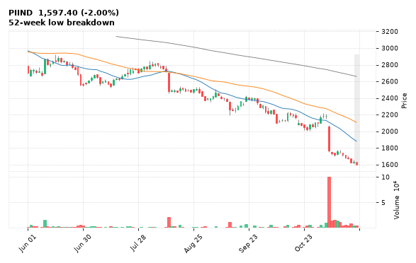

[🔔 Set alert on PIIND](https://claude.ai/artifact/Ewc5hHTPX6WkU1nVcDNQzq?s=PIIND&c=close%20below%201595.00) &nbsp;|&nbsp; [📈 Live chart (TradingView)](https://www.tradingview.com/chart/?symbol=NSE:PIIND) &nbsp;|&nbsp; [alert by email](mailto:testthetpassword@123?subject=ALERT%20PIIND&body=Alert%20me%20when%3A%20close%20below%201595.00%0A%0AEdit%20the%20line%20above%20if%20you%20want%2C%20then%20press%20Send.%20Checked%20on%20every%20day%27s%20closing%20data%3B%20a%20triggered%20alert%20appears%20at%20the%20top%20of%20the%208%20AM%20Technical%20Analysis%20email.%0A%0AExamples%20you%20can%20write%3A%0A%20%20close%20above%201150%20%20%7C%20%20close%20below%201080%20%20%7C%20%20high%20above%201200%20%20%7C%20%20low%20below%201050%0A%20%20close%20crosses%20above%20200%20DMA%20%20%7C%20%20close%20below%2050%20DMA%20%20%7C%20%20RSI%20below%2030%20%20%7C%20%20RSI%20above%2070%0A%20%20volume%20above%202x%20%20%7C%20%20change%20above%205%25%20%20%7C%20%20change%20below%20-4%25%20%20%7C%20%2052-week%20high%20%20%7C%20%20golden%20cross%0A%20%20combine%20with%20%27and%27%2C%20e.g.%20%20close%20above%201150%20and%20volume%20above%201.5x%0A%0AReference%3A%20PIIND%20closed%201597.40%20%28high%201632.30%2C%20low%201595.00%29.%0ATo%20cancel%20later%2C%20send%20an%20email%20with%20subject%3A%20CANCEL%20ALERT%20PIIND)

---

## 26. OLAELEC - BEARISH
**32.59** (-0.85%) | vol 0.2x | RSI 42 | H 32.94 / L 32.46  
Doji (indecision), Death Cross (50/200 DMA), Inside Bar, NR7 (narrowest range in 7)

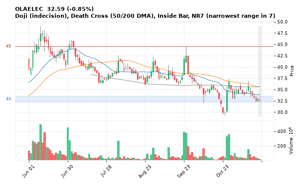

[🔔 Set alert on OLAELEC](https://claude.ai/artifact/Ewc5hHTPX6WkU1nVcDNQzq?s=OLAELEC&c=close%20below%2032.46) &nbsp;|&nbsp; [📈 Live chart (TradingView)](https://www.tradingview.com/chart/?symbol=NSE:OLAELEC) &nbsp;|&nbsp; [alert by email](mailto:testthetpassword@123?subject=ALERT%20OLAELEC&body=Alert%20me%20when%3A%20close%20below%2032.46%0A%0AEdit%20the%20line%20above%20if%20you%20want%2C%20then%20press%20Send.%20Checked%20on%20every%20day%27s%20closing%20data%3B%20a%20triggered%20alert%20appears%20at%20the%20top%20of%20the%208%20AM%20Technical%20Analysis%20email.%0A%0AExamples%20you%20can%20write%3A%0A%20%20close%20above%201150%20%20%7C%20%20close%20below%201080%20%20%7C%20%20high%20above%201200%20%20%7C%20%20low%20below%201050%0A%20%20close%20crosses%20above%20200%20DMA%20%20%7C%20%20close%20below%2050%20DMA%20%20%7C%20%20RSI%20below%2030%20%20%7C%20%20RSI%20above%2070%0A%20%20volume%20above%202x%20%20%7C%20%20change%20above%205%25%20%20%7C%20%20change%20below%20-4%25%20%20%7C%20%2052-week%20high%20%20%7C%20%20golden%20cross%0A%20%20combine%20with%20%27and%27%2C%20e.g.%20%20close%20above%201150%20and%20volume%20above%201.5x%0A%0AReference%3A%20OLAELEC%20closed%2032.59%20%28high%2032.94%2C%20low%2032.46%29.%0ATo%20cancel%20later%2C%20send%20an%20email%20with%20subject%3A%20CANCEL%20ALERT%20OLAELEC)

---

## 27. ENDURANCE - BEARISH
**2,560.90** (-1.27%) | vol 2.4x | RSI 58 | H 2,635.00 / L 2,523.50  
Close below 200 DMA

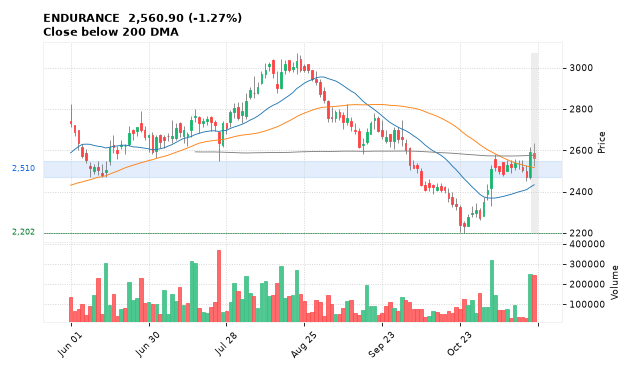

[🔔 Set alert on ENDURANCE](https://claude.ai/artifact/Ewc5hHTPX6WkU1nVcDNQzq?s=ENDURANCE&c=close%20below%202523.50) &nbsp;|&nbsp; [📈 Live chart (TradingView)](https://www.tradingview.com/chart/?symbol=NSE:ENDURANCE) &nbsp;|&nbsp; [alert by email](mailto:testthetpassword@123?subject=ALERT%20ENDURANCE&body=Alert%20me%20when%3A%20close%20below%202523.50%0A%0AEdit%20the%20line%20above%20if%20you%20want%2C%20then%20press%20Send.%20Checked%20on%20every%20day%27s%20closing%20data%3B%20a%20triggered%20alert%20appears%20at%20the%20top%20of%20the%208%20AM%20Technical%20Analysis%20email.%0A%0AExamples%20you%20can%20write%3A%0A%20%20close%20above%201150%20%20%7C%20%20close%20below%201080%20%20%7C%20%20high%20above%201200%20%20%7C%20%20low%20below%201050%0A%20%20close%20crosses%20above%20200%20DMA%20%20%7C%20%20close%20below%2050%20DMA%20%20%7C%20%20RSI%20below%2030%20%20%7C%20%20RSI%20above%2070%0A%20%20volume%20above%202x%20%20%7C%20%20change%20above%205%25%20%20%7C%20%20change%20below%20-4%25%20%20%7C%20%2052-week%20high%20%20%7C%20%20golden%20cross%0A%20%20combine%20with%20%27and%27%2C%20e.g.%20%20close%20above%201150%20and%20volume%20above%201.5x%0A%0AReference%3A%20ENDURANCE%20closed%202560.90%20%28high%202635.00%2C%20low%202523.50%29.%0ATo%20cancel%20later%2C%20send%20an%20email%20with%20subject%3A%20CANCEL%20ALERT%20ENDURANCE)

---

## 28. IIFL - BEARISH
**611.95** (-5.04%) | vol 2.1x | RSI 50 | H 633.00 / L 610.00  
Volume spike 2.1x

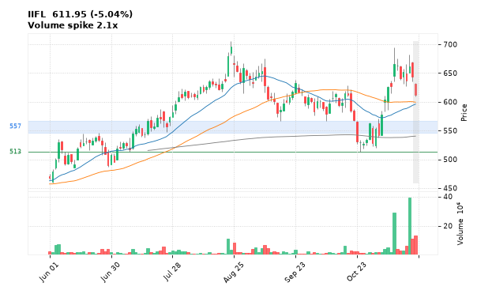

[🔔 Set alert on IIFL](https://claude.ai/artifact/Ewc5hHTPX6WkU1nVcDNQzq?s=IIFL&c=close%20below%20610.00) &nbsp;|&nbsp; [📈 Live chart (TradingView)](https://www.tradingview.com/chart/?symbol=NSE:IIFL) &nbsp;|&nbsp; [alert by email](mailto:testthetpassword@123?subject=ALERT%20IIFL&body=Alert%20me%20when%3A%20close%20below%20610.00%0A%0AEdit%20the%20line%20above%20if%20you%20want%2C%20then%20press%20Send.%20Checked%20on%20every%20day%27s%20closing%20data%3B%20a%20triggered%20alert%20appears%20at%20the%20top%20of%20the%208%20AM%20Technical%20Analysis%20email.%0A%0AExamples%20you%20can%20write%3A%0A%20%20close%20above%201150%20%20%7C%20%20close%20below%201080%20%20%7C%20%20high%20above%201200%20%20%7C%20%20low%20below%201050%0A%20%20close%20crosses%20above%20200%20DMA%20%20%7C%20%20close%20below%2050%20DMA%20%20%7C%20%20RSI%20below%2030%20%20%7C%20%20RSI%20above%2070%0A%20%20volume%20above%202x%20%20%7C%20%20change%20above%205%25%20%20%7C%20%20change%20below%20-4%25%20%20%7C%20%2052-week%20high%20%20%7C%20%20golden%20cross%0A%20%20combine%20with%20%27and%27%2C%20e.g.%20%20close%20above%201150%20and%20volume%20above%201.5x%0A%0AReference%3A%20IIFL%20closed%20611.95%20%28high%20633.00%2C%20low%20610.00%29.%0ATo%20cancel%20later%2C%20send%20an%20email%20with%20subject%3A%20CANCEL%20ALERT%20IIFL)

---

## 29. ABDL - BEARISH
**794.30** (-1.72%) | vol 1.3x | RSI 69 | H 808.45 / L 783.25  
RSI down through 70, Inside Bar

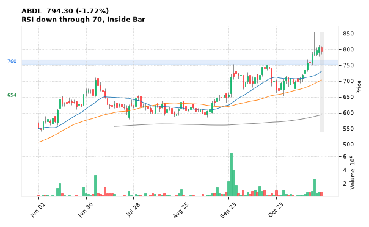

[🔔 Set alert on ABDL](https://claude.ai/artifact/Ewc5hHTPX6WkU1nVcDNQzq?s=ABDL&c=close%20below%20783.25) &nbsp;|&nbsp; [📈 Live chart (TradingView)](https://www.tradingview.com/chart/?symbol=NSE:ABDL) &nbsp;|&nbsp; [alert by email](mailto:testthetpassword@123?subject=ALERT%20ABDL&body=Alert%20me%20when%3A%20close%20below%20783.25%0A%0AEdit%20the%20line%20above%20if%20you%20want%2C%20then%20press%20Send.%20Checked%20on%20every%20day%27s%20closing%20data%3B%20a%20triggered%20alert%20appears%20at%20the%20top%20of%20the%208%20AM%20Technical%20Analysis%20email.%0A%0AExamples%20you%20can%20write%3A%0A%20%20close%20above%201150%20%20%7C%20%20close%20below%201080%20%20%7C%20%20high%20above%201200%20%20%7C%20%20low%20below%201050%0A%20%20close%20crosses%20above%20200%20DMA%20%20%7C%20%20close%20below%2050%20DMA%20%20%7C%20%20RSI%20below%2030%20%20%7C%20%20RSI%20above%2070%0A%20%20volume%20above%202x%20%20%7C%20%20change%20above%205%25%20%20%7C%20%20change%20below%20-4%25%20%20%7C%20%2052-week%20high%20%20%7C%20%20golden%20cross%0A%20%20combine%20with%20%27and%27%2C%20e.g.%20%20close%20above%201150%20and%20volume%20above%201.5x%0A%0AReference%3A%20ABDL%20closed%20794.30%20%28high%20808.45%2C%20low%20783.25%29.%0ATo%20cancel%20later%2C%20send%20an%20email%20with%20subject%3A%20CANCEL%20ALERT%20ABDL)

---

## 30. NAVINFLUOR - BEARISH
**10,077.00** (-1.23%) | vol 1.2x | RSI 69 | H 10,308.00 / L 10,009.00  
Doji (indecision), RSI down through 70

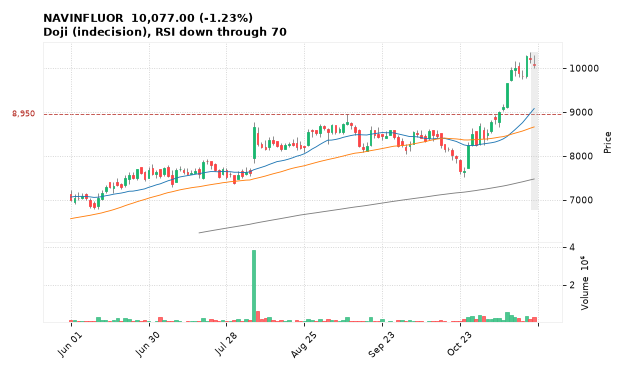

[🔔 Set alert on NAVINFLUOR](https://claude.ai/artifact/Ewc5hHTPX6WkU1nVcDNQzq?s=NAVINFLUOR&c=close%20below%2010009.00) &nbsp;|&nbsp; [📈 Live chart (TradingView)](https://www.tradingview.com/chart/?symbol=NSE:NAVINFLUOR) &nbsp;|&nbsp; [alert by email](mailto:testthetpassword@123?subject=ALERT%20NAVINFLUOR&body=Alert%20me%20when%3A%20close%20below%2010009.00%0A%0AEdit%20the%20line%20above%20if%20you%20want%2C%20then%20press%20Send.%20Checked%20on%20every%20day%27s%20closing%20data%3B%20a%20triggered%20alert%20appears%20at%20the%20top%20of%20the%208%20AM%20Technical%20Analysis%20email.%0A%0AExamples%20you%20can%20write%3A%0A%20%20close%20above%201150%20%20%7C%20%20close%20below%201080%20%20%7C%20%20high%20above%201200%20%20%7C%20%20low%20below%201050%0A%20%20close%20crosses%20above%20200%20DMA%20%20%7C%20%20close%20below%2050%20DMA%20%20%7C%20%20RSI%20below%2030%20%20%7C%20%20RSI%20above%2070%0A%20%20volume%20above%202x%20%20%7C%20%20change%20above%205%25%20%20%7C%20%20change%20below%20-4%25%20%20%7C%20%2052-week%20high%20%20%7C%20%20golden%20cross%0A%20%20combine%20with%20%27and%27%2C%20e.g.%20%20close%20above%201150%20and%20volume%20above%201.5x%0A%0AReference%3A%20NAVINFLUOR%20closed%2010077.00%20%28high%2010308.00%2C%20low%2010009.00%29.%0ATo%20cancel%20later%2C%20send%20an%20email%20with%20subject%3A%20CANCEL%20ALERT%20NAVINFLUOR)

---

## 31. 360ONE - LEVEL TEST
**1,208.10** (+0.85%) | vol 1.2x | RSI 68 | H 1,224.60 / L 1,191.55  
Level test

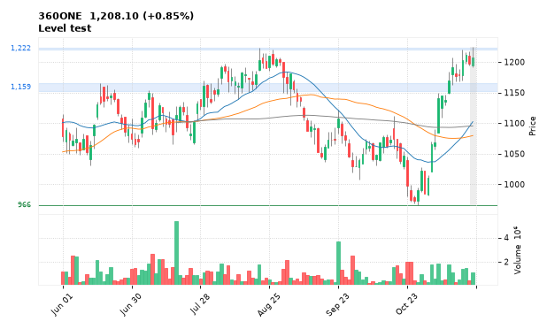

[🔔 Set alert on 360ONE](https://claude.ai/artifact/Ewc5hHTPX6WkU1nVcDNQzq?s=360ONE&c=close%20below%201191.55) &nbsp;|&nbsp; [📈 Live chart (TradingView)](https://www.tradingview.com/chart/?symbol=NSE:360ONE) &nbsp;|&nbsp; [alert by email](mailto:testthetpassword@123?subject=ALERT%20360ONE&body=Alert%20me%20when%3A%20close%20above%201224.60%0A%0AEdit%20the%20line%20above%20if%20you%20want%2C%20then%20press%20Send.%20Checked%20on%20every%20day%27s%20closing%20data%3B%20a%20triggered%20alert%20appears%20at%20the%20top%20of%20the%208%20AM%20Technical%20Analysis%20email.%0A%0AExamples%20you%20can%20write%3A%0A%20%20close%20above%201150%20%20%7C%20%20close%20below%201080%20%20%7C%20%20high%20above%201200%20%20%7C%20%20low%20below%201050%0A%20%20close%20crosses%20above%20200%20DMA%20%20%7C%20%20close%20below%2050%20DMA%20%20%7C%20%20RSI%20below%2030%20%20%7C%20%20RSI%20above%2070%0A%20%20volume%20above%202x%20%20%7C%20%20change%20above%205%25%20%20%7C%20%20change%20below%20-4%25%20%20%7C%20%2052-week%20high%20%20%7C%20%20golden%20cross%0A%20%20combine%20with%20%27and%27%2C%20e.g.%20%20close%20above%201150%20and%20volume%20above%201.5x%0A%0AReference%3A%20360ONE%20closed%201208.10%20%28high%201224.60%2C%20low%201191.55%29.%0ATo%20cancel%20later%2C%20send%20an%20email%20with%20subject%3A%20CANCEL%20ALERT%20360ONE)

---

## 32. ACMESOLAR - LEVEL TEST
**405.40** (-0.92%) | vol 0.7x | RSI 48 | H 409.90 / L 398.65  
Level test

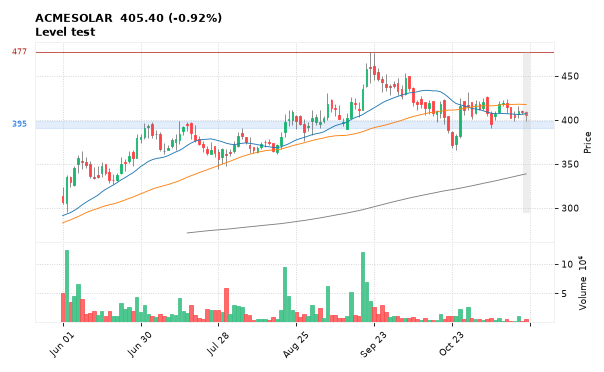

[🔔 Set alert on ACMESOLAR](https://claude.ai/artifact/Ewc5hHTPX6WkU1nVcDNQzq?s=ACMESOLAR&c=close%20below%20398.65) &nbsp;|&nbsp; [📈 Live chart (TradingView)](https://www.tradingview.com/chart/?symbol=NSE:ACMESOLAR) &nbsp;|&nbsp; [alert by email](mailto:testthetpassword@123?subject=ALERT%20ACMESOLAR&body=Alert%20me%20when%3A%20close%20above%20409.90%0A%0AEdit%20the%20line%20above%20if%20you%20want%2C%20then%20press%20Send.%20Checked%20on%20every%20day%27s%20closing%20data%3B%20a%20triggered%20alert%20appears%20at%20the%20top%20of%20the%208%20AM%20Technical%20Analysis%20email.%0A%0AExamples%20you%20can%20write%3A%0A%20%20close%20above%201150%20%20%7C%20%20close%20below%201080%20%20%7C%20%20high%20above%201200%20%20%7C%20%20low%20below%201050%0A%20%20close%20crosses%20above%20200%20DMA%20%20%7C%20%20close%20below%2050%20DMA%20%20%7C%20%20RSI%20below%2030%20%20%7C%20%20RSI%20above%2070%0A%20%20volume%20above%202x%20%20%7C%20%20change%20above%205%25%20%20%7C%20%20change%20below%20-4%25%20%20%7C%20%2052-week%20high%20%20%7C%20%20golden%20cross%0A%20%20combine%20with%20%27and%27%2C%20e.g.%20%20close%20above%201150%20and%20volume%20above%201.5x%0A%0AReference%3A%20ACMESOLAR%20closed%20405.40%20%28high%20409.90%2C%20low%20398.65%29.%0ATo%20cancel%20later%2C%20send%20an%20email%20with%20subject%3A%20CANCEL%20ALERT%20ACMESOLAR)

---

## 33. AUBANK - LEVEL TEST
**984.90** (+0.10%) | vol 0.7x | RSI 57 | H 992.05 / L 964.15  
Level test

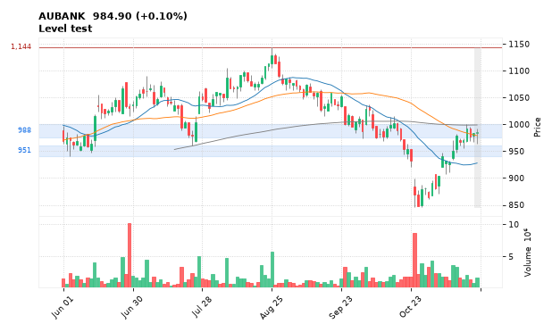

[🔔 Set alert on AUBANK](https://claude.ai/artifact/Ewc5hHTPX6WkU1nVcDNQzq?s=AUBANK&c=close%20below%20964.15) &nbsp;|&nbsp; [📈 Live chart (TradingView)](https://www.tradingview.com/chart/?symbol=NSE:AUBANK) &nbsp;|&nbsp; [alert by email](mailto:testthetpassword@123?subject=ALERT%20AUBANK&body=Alert%20me%20when%3A%20close%20above%20992.05%0A%0AEdit%20the%20line%20above%20if%20you%20want%2C%20then%20press%20Send.%20Checked%20on%20every%20day%27s%20closing%20data%3B%20a%20triggered%20alert%20appears%20at%20the%20top%20of%20the%208%20AM%20Technical%20Analysis%20email.%0A%0AExamples%20you%20can%20write%3A%0A%20%20close%20above%201150%20%20%7C%20%20close%20below%201080%20%20%7C%20%20high%20above%201200%20%20%7C%20%20low%20below%201050%0A%20%20close%20crosses%20above%20200%20DMA%20%20%7C%20%20close%20below%2050%20DMA%20%20%7C%20%20RSI%20below%2030%20%20%7C%20%20RSI%20above%2070%0A%20%20volume%20above%202x%20%20%7C%20%20change%20above%205%25%20%20%7C%20%20change%20below%20-4%25%20%20%7C%20%2052-week%20high%20%20%7C%20%20golden%20cross%0A%20%20combine%20with%20%27and%27%2C%20e.g.%20%20close%20above%201150%20and%20volume%20above%201.5x%0A%0AReference%3A%20AUBANK%20closed%20984.90%20%28high%20992.05%2C%20low%20964.15%29.%0ATo%20cancel%20later%2C%20send%20an%20email%20with%20subject%3A%20CANCEL%20ALERT%20AUBANK)

---

## 34. AADHARHFC - LEVEL TEST
**416.90** (+0.47%) | vol 4.7x | RSI 40 | H 422.20 / L 411.20  
Level test

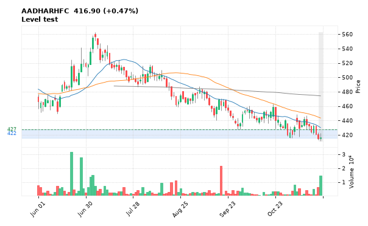

[🔔 Set alert on AADHARHFC](https://claude.ai/artifact/Ewc5hHTPX6WkU1nVcDNQzq?s=AADHARHFC&c=close%20below%20411.20) &nbsp;|&nbsp; [📈 Live chart (TradingView)](https://www.tradingview.com/chart/?symbol=NSE:AADHARHFC) &nbsp;|&nbsp; [alert by email](mailto:testthetpassword@123?subject=ALERT%20AADHARHFC&body=Alert%20me%20when%3A%20close%20above%20422.20%0A%0AEdit%20the%20line%20above%20if%20you%20want%2C%20then%20press%20Send.%20Checked%20on%20every%20day%27s%20closing%20data%3B%20a%20triggered%20alert%20appears%20at%20the%20top%20of%20the%208%20AM%20Technical%20Analysis%20email.%0A%0AExamples%20you%20can%20write%3A%0A%20%20close%20above%201150%20%20%7C%20%20close%20below%201080%20%20%7C%20%20high%20above%201200%20%20%7C%20%20low%20below%201050%0A%20%20close%20crosses%20above%20200%20DMA%20%20%7C%20%20close%20below%2050%20DMA%20%20%7C%20%20RSI%20below%2030%20%20%7C%20%20RSI%20above%2070%0A%20%20volume%20above%202x%20%20%7C%20%20change%20above%205%25%20%20%7C%20%20change%20below%20-4%25%20%20%7C%20%2052-week%20high%20%20%7C%20%20golden%20cross%0A%20%20combine%20with%20%27and%27%2C%20e.g.%20%20close%20above%201150%20and%20volume%20above%201.5x%0A%0AReference%3A%20AADHARHFC%20closed%20416.90%20%28high%20422.20%2C%20low%20411.20%29.%0ATo%20cancel%20later%2C%20send%20an%20email%20with%20subject%3A%20CANCEL%20ALERT%20AADHARHFC)

---

## 35. AARTIIND - LEVEL TEST
**449.50** (-1.61%) | vol 0.5x | RSI 44 | H 460.90 / L 448.10  
Level test

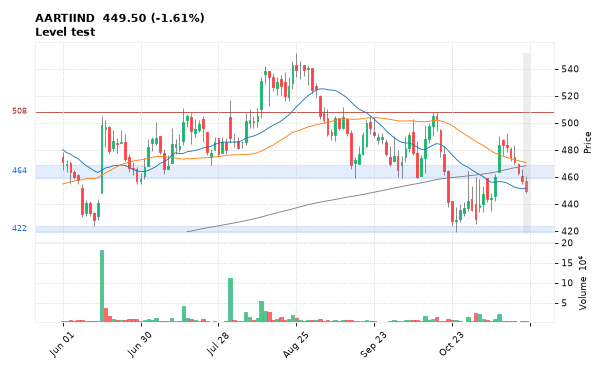

[🔔 Set alert on AARTIIND](https://claude.ai/artifact/Ewc5hHTPX6WkU1nVcDNQzq?s=AARTIIND&c=close%20below%20448.10) &nbsp;|&nbsp; [📈 Live chart (TradingView)](https://www.tradingview.com/chart/?symbol=NSE:AARTIIND) &nbsp;|&nbsp; [alert by email](mailto:testthetpassword@123?subject=ALERT%20AARTIIND&body=Alert%20me%20when%3A%20close%20above%20460.90%0A%0AEdit%20the%20line%20above%20if%20you%20want%2C%20then%20press%20Send.%20Checked%20on%20every%20day%27s%20closing%20data%3B%20a%20triggered%20alert%20appears%20at%20the%20top%20of%20the%208%20AM%20Technical%20Analysis%20email.%0A%0AExamples%20you%20can%20write%3A%0A%20%20close%20above%201150%20%20%7C%20%20close%20below%201080%20%20%7C%20%20high%20above%201200%20%20%7C%20%20low%20below%201050%0A%20%20close%20crosses%20above%20200%20DMA%20%20%7C%20%20close%20below%2050%20DMA%20%20%7C%20%20RSI%20below%2030%20%20%7C%20%20RSI%20above%2070%0A%20%20volume%20above%202x%20%20%7C%20%20change%20above%205%25%20%20%7C%20%20change%20below%20-4%25%20%20%7C%20%2052-week%20high%20%20%7C%20%20golden%20cross%0A%20%20combine%20with%20%27and%27%2C%20e.g.%20%20close%20above%201150%20and%20volume%20above%201.5x%0A%0AReference%3A%20AARTIIND%20closed%20449.50%20%28high%20460.90%2C%20low%20448.10%29.%0ATo%20cancel%20later%2C%20send%20an%20email%20with%20subject%3A%20CANCEL%20ALERT%20AARTIIND)

---

## 36. ABBOTINDIA - LEVEL TEST
**26,525.00** (+3.23%) | vol 1.2x | RSI 54 | H 26,670.00 / L 25,635.00  
Level test

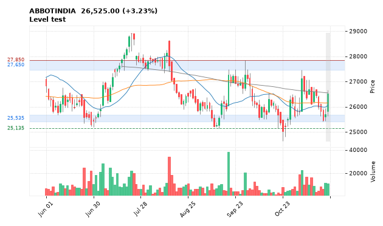

[🔔 Set alert on ABBOTINDIA](https://claude.ai/artifact/Ewc5hHTPX6WkU1nVcDNQzq?s=ABBOTINDIA&c=close%20below%2025635.00) &nbsp;|&nbsp; [📈 Live chart (TradingView)](https://www.tradingview.com/chart/?symbol=NSE:ABBOTINDIA) &nbsp;|&nbsp; [alert by email](mailto:testthetpassword@123?subject=ALERT%20ABBOTINDIA&body=Alert%20me%20when%3A%20close%20above%2026670.00%0A%0AEdit%20the%20line%20above%20if%20you%20want%2C%20then%20press%20Send.%20Checked%20on%20every%20day%27s%20closing%20data%3B%20a%20triggered%20alert%20appears%20at%20the%20top%20of%20the%208%20AM%20Technical%20Analysis%20email.%0A%0AExamples%20you%20can%20write%3A%0A%20%20close%20above%201150%20%20%7C%20%20close%20below%201080%20%20%7C%20%20high%20above%201200%20%20%7C%20%20low%20below%201050%0A%20%20close%20crosses%20above%20200%20DMA%20%20%7C%20%20close%20below%2050%20DMA%20%20%7C%20%20RSI%20below%2030%20%20%7C%20%20RSI%20above%2070%0A%20%20volume%20above%202x%20%20%7C%20%20change%20above%205%25%20%20%7C%20%20change%20below%20-4%25%20%20%7C%20%2052-week%20high%20%20%7C%20%20golden%20cross%0A%20%20combine%20with%20%27and%27%2C%20e.g.%20%20close%20above%201150%20and%20volume%20above%201.5x%0A%0AReference%3A%20ABBOTINDIA%20closed%2026525.00%20%28high%2026670.00%2C%20low%2025635.00%29.%0ATo%20cancel%20later%2C%20send%20an%20email%20with%20subject%3A%20CANCEL%20ALERT%20ABBOTINDIA)

---

## 37. ADANIENSOL - LEVEL TEST
**1,491.80** (+1.25%) | vol 1.0x | RSI 63 | H 1,497.90 / L 1,462.90  
Level test

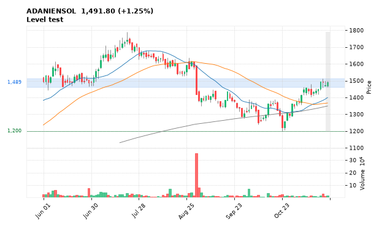

[🔔 Set alert on ADANIENSOL](https://claude.ai/artifact/Ewc5hHTPX6WkU1nVcDNQzq?s=ADANIENSOL&c=close%20below%201462.90) &nbsp;|&nbsp; [📈 Live chart (TradingView)](https://www.tradingview.com/chart/?symbol=NSE:ADANIENSOL) &nbsp;|&nbsp; [alert by email](mailto:testthetpassword@123?subject=ALERT%20ADANIENSOL&body=Alert%20me%20when%3A%20close%20above%201497.90%0A%0AEdit%20the%20line%20above%20if%20you%20want%2C%20then%20press%20Send.%20Checked%20on%20every%20day%27s%20closing%20data%3B%20a%20triggered%20alert%20appears%20at%20the%20top%20of%20the%208%20AM%20Technical%20Analysis%20email.%0A%0AExamples%20you%20can%20write%3A%0A%20%20close%20above%201150%20%20%7C%20%20close%20below%201080%20%20%7C%20%20high%20above%201200%20%20%7C%20%20low%20below%201050%0A%20%20close%20crosses%20above%20200%20DMA%20%20%7C%20%20close%20below%2050%20DMA%20%20%7C%20%20RSI%20below%2030%20%20%7C%20%20RSI%20above%2070%0A%20%20volume%20above%202x%20%20%7C%20%20change%20above%205%25%20%20%7C%20%20change%20below%20-4%25%20%20%7C%20%2052-week%20high%20%20%7C%20%20golden%20cross%0A%20%20combine%20with%20%27and%27%2C%20e.g.%20%20close%20above%201150%20and%20volume%20above%201.5x%0A%0AReference%3A%20ADANIENSOL%20closed%201491.80%20%28high%201497.90%2C%20low%201462.90%29.%0ATo%20cancel%20later%2C%20send%20an%20email%20with%20subject%3A%20CANCEL%20ALERT%20ADANIENSOL)

---

## 38. ABCAPITAL - LEVEL TEST
**423.00** (+1.43%) | vol 0.8x | RSI 69 | H 423.05 / L 411.20  
Level test

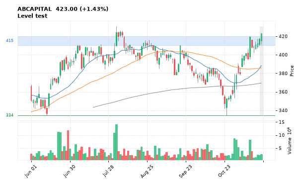

[🔔 Set alert on ABCAPITAL](https://claude.ai/artifact/Ewc5hHTPX6WkU1nVcDNQzq?s=ABCAPITAL&c=close%20below%20411.20) &nbsp;|&nbsp; [📈 Live chart (TradingView)](https://www.tradingview.com/chart/?symbol=NSE:ABCAPITAL) &nbsp;|&nbsp; [alert by email](mailto:testthetpassword@123?subject=ALERT%20ABCAPITAL&body=Alert%20me%20when%3A%20close%20above%20423.05%0A%0AEdit%20the%20line%20above%20if%20you%20want%2C%20then%20press%20Send.%20Checked%20on%20every%20day%27s%20closing%20data%3B%20a%20triggered%20alert%20appears%20at%20the%20top%20of%20the%208%20AM%20Technical%20Analysis%20email.%0A%0AExamples%20you%20can%20write%3A%0A%20%20close%20above%201150%20%20%7C%20%20close%20below%201080%20%20%7C%20%20high%20above%201200%20%20%7C%20%20low%20below%201050%0A%20%20close%20crosses%20above%20200%20DMA%20%20%7C%20%20close%20below%2050%20DMA%20%20%7C%20%20RSI%20below%2030%20%20%7C%20%20RSI%20above%2070%0A%20%20volume%20above%202x%20%20%7C%20%20change%20above%205%25%20%20%7C%20%20change%20below%20-4%25%20%20%7C%20%2052-week%20high%20%20%7C%20%20golden%20cross%0A%20%20combine%20with%20%27and%27%2C%20e.g.%20%20close%20above%201150%20and%20volume%20above%201.5x%0A%0AReference%3A%20ABCAPITAL%20closed%20423.00%20%28high%20423.05%2C%20low%20411.20%29.%0ATo%20cancel%20later%2C%20send%20an%20email%20with%20subject%3A%20CANCEL%20ALERT%20ABCAPITAL)

---

## 39. ABSLAMC - LEVEL TEST
**935.50** (+0.16%) | vol 0.5x | RSI 54 | H 943.00 / L 926.25  
Level test

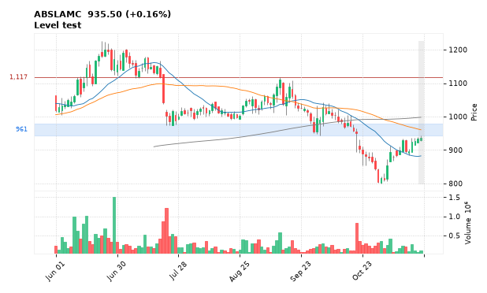

[🔔 Set alert on ABSLAMC](https://claude.ai/artifact/Ewc5hHTPX6WkU1nVcDNQzq?s=ABSLAMC&c=close%20below%20926.25) &nbsp;|&nbsp; [📈 Live chart (TradingView)](https://www.tradingview.com/chart/?symbol=NSE:ABSLAMC) &nbsp;|&nbsp; [alert by email](mailto:testthetpassword@123?subject=ALERT%20ABSLAMC&body=Alert%20me%20when%3A%20close%20above%20943.00%0A%0AEdit%20the%20line%20above%20if%20you%20want%2C%20then%20press%20Send.%20Checked%20on%20every%20day%27s%20closing%20data%3B%20a%20triggered%20alert%20appears%20at%20the%20top%20of%20the%208%20AM%20Technical%20Analysis%20email.%0A%0AExamples%20you%20can%20write%3A%0A%20%20close%20above%201150%20%20%7C%20%20close%20below%201080%20%20%7C%20%20high%20above%201200%20%20%7C%20%20low%20below%201050%0A%20%20close%20crosses%20above%20200%20DMA%20%20%7C%20%20close%20below%2050%20DMA%20%20%7C%20%20RSI%20below%2030%20%20%7C%20%20RSI%20above%2070%0A%20%20volume%20above%202x%20%20%7C%20%20change%20above%205%25%20%20%7C%20%20change%20below%20-4%25%20%20%7C%20%2052-week%20high%20%20%7C%20%20golden%20cross%0A%20%20combine%20with%20%27and%27%2C%20e.g.%20%20close%20above%201150%20and%20volume%20above%201.5x%0A%0AReference%3A%20ABSLAMC%20closed%20935.50%20%28high%20943.00%2C%20low%20926.25%29.%0ATo%20cancel%20later%2C%20send%20an%20email%20with%20subject%3A%20CANCEL%20ALERT%20ABSLAMC)

---

## 40. AEGISLOG - LEVEL TEST
**1,184.80** (+1.33%) | vol 0.7x | RSI 44 | H 1,203.30 / L 1,140.00  
Level test

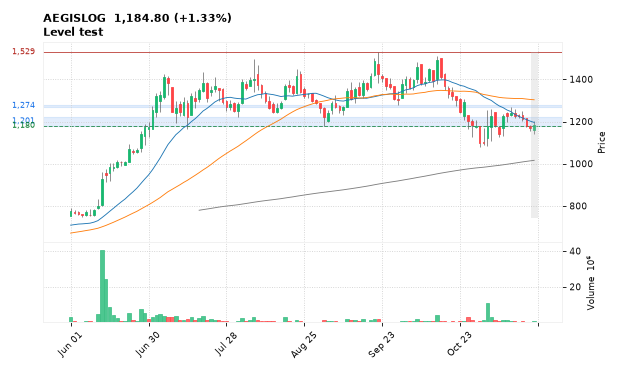

[🔔 Set alert on AEGISLOG](https://claude.ai/artifact/Ewc5hHTPX6WkU1nVcDNQzq?s=AEGISLOG&c=close%20below%201140.00) &nbsp;|&nbsp; [📈 Live chart (TradingView)](https://www.tradingview.com/chart/?symbol=NSE:AEGISLOG) &nbsp;|&nbsp; [alert by email](mailto:testthetpassword@123?subject=ALERT%20AEGISLOG&body=Alert%20me%20when%3A%20close%20above%201203.30%0A%0AEdit%20the%20line%20above%20if%20you%20want%2C%20then%20press%20Send.%20Checked%20on%20every%20day%27s%20closing%20data%3B%20a%20triggered%20alert%20appears%20at%20the%20top%20of%20the%208%20AM%20Technical%20Analysis%20email.%0A%0AExamples%20you%20can%20write%3A%0A%20%20close%20above%201150%20%20%7C%20%20close%20below%201080%20%20%7C%20%20high%20above%201200%20%20%7C%20%20low%20below%201050%0A%20%20close%20crosses%20above%20200%20DMA%20%20%7C%20%20close%20below%2050%20DMA%20%20%7C%20%20RSI%20below%2030%20%20%7C%20%20RSI%20above%2070%0A%20%20volume%20above%202x%20%20%7C%20%20change%20above%205%25%20%20%7C%20%20change%20below%20-4%25%20%20%7C%20%2052-week%20high%20%20%7C%20%20golden%20cross%0A%20%20combine%20with%20%27and%27%2C%20e.g.%20%20close%20above%201150%20and%20volume%20above%201.5x%0A%0AReference%3A%20AEGISLOG%20closed%201184.80%20%28high%201203.30%2C%20low%201140.00%29.%0ATo%20cancel%20later%2C%20send%20an%20email%20with%20subject%3A%20CANCEL%20ALERT%20AEGISLOG)

---

## 41. AJANTPHARM - LEVEL TEST
**3,317.70** (+1.45%) | vol 0.4x | RSI 47 | H 3,325.00 / L 3,260.60  
Level test

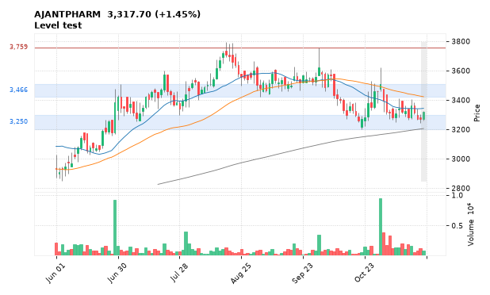

[🔔 Set alert on AJANTPHARM](https://claude.ai/artifact/Ewc5hHTPX6WkU1nVcDNQzq?s=AJANTPHARM&c=close%20below%203260.60) &nbsp;|&nbsp; [📈 Live chart (TradingView)](https://www.tradingview.com/chart/?symbol=NSE:AJANTPHARM) &nbsp;|&nbsp; [alert by email](mailto:testthetpassword@123?subject=ALERT%20AJANTPHARM&body=Alert%20me%20when%3A%20close%20above%203325.00%0A%0AEdit%20the%20line%20above%20if%20you%20want%2C%20then%20press%20Send.%20Checked%20on%20every%20day%27s%20closing%20data%3B%20a%20triggered%20alert%20appears%20at%20the%20top%20of%20the%208%20AM%20Technical%20Analysis%20email.%0A%0AExamples%20you%20can%20write%3A%0A%20%20close%20above%201150%20%20%7C%20%20close%20below%201080%20%20%7C%20%20high%20above%201200%20%20%7C%20%20low%20below%201050%0A%20%20close%20crosses%20above%20200%20DMA%20%20%7C%20%20close%20below%2050%20DMA%20%20%7C%20%20RSI%20below%2030%20%20%7C%20%20RSI%20above%2070%0A%20%20volume%20above%202x%20%20%7C%20%20change%20above%205%25%20%20%7C%20%20change%20below%20-4%25%20%20%7C%20%2052-week%20high%20%20%7C%20%20golden%20cross%0A%20%20combine%20with%20%27and%27%2C%20e.g.%20%20close%20above%201150%20and%20volume%20above%201.5x%0A%0AReference%3A%20AJANTPHARM%20closed%203317.70%20%28high%203325.00%2C%20low%203260.60%29.%0ATo%20cancel%20later%2C%20send%20an%20email%20with%20subject%3A%20CANCEL%20ALERT%20AJANTPHARM)

---

## 42. ALKEM - LEVEL TEST
**5,185.00** (+0.78%) | vol 0.4x | RSI 49 | H 5,185.00 / L 5,114.00  
Level test

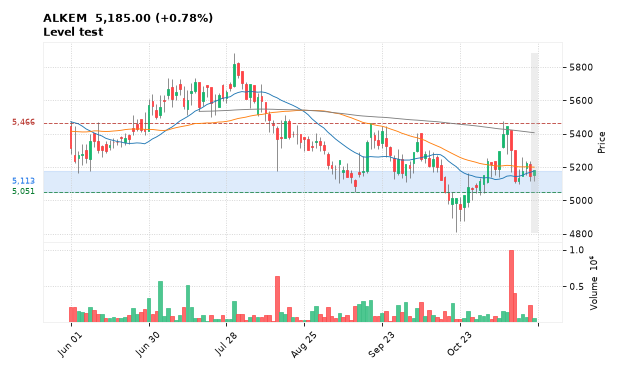

[🔔 Set alert on ALKEM](https://claude.ai/artifact/Ewc5hHTPX6WkU1nVcDNQzq?s=ALKEM&c=close%20below%205114.00) &nbsp;|&nbsp; [📈 Live chart (TradingView)](https://www.tradingview.com/chart/?symbol=NSE:ALKEM) &nbsp;|&nbsp; [alert by email](mailto:testthetpassword@123?subject=ALERT%20ALKEM&body=Alert%20me%20when%3A%20close%20above%205185.00%0A%0AEdit%20the%20line%20above%20if%20you%20want%2C%20then%20press%20Send.%20Checked%20on%20every%20day%27s%20closing%20data%3B%20a%20triggered%20alert%20appears%20at%20the%20top%20of%20the%208%20AM%20Technical%20Analysis%20email.%0A%0AExamples%20you%20can%20write%3A%0A%20%20close%20above%201150%20%20%7C%20%20close%20below%201080%20%20%7C%20%20high%20above%201200%20%20%7C%20%20low%20below%201050%0A%20%20close%20crosses%20above%20200%20DMA%20%20%7C%20%20close%20below%2050%20DMA%20%20%7C%20%20RSI%20below%2030%20%20%7C%20%20RSI%20above%2070%0A%20%20volume%20above%202x%20%20%7C%20%20change%20above%205%25%20%20%7C%20%20change%20below%20-4%25%20%20%7C%20%2052-week%20high%20%20%7C%20%20golden%20cross%0A%20%20combine%20with%20%27and%27%2C%20e.g.%20%20close%20above%201150%20and%20volume%20above%201.5x%0A%0AReference%3A%20ALKEM%20closed%205185.00%20%28high%205185.00%2C%20low%205114.00%29.%0ATo%20cancel%20later%2C%20send%20an%20email%20with%20subject%3A%20CANCEL%20ALERT%20ALKEM)

---

## 43. ASIANPAINT - LEVEL TEST
**2,608.30** (+0.51%) | vol 0.4x | RSI 66 | H 2,610.90 / L 2,577.10  
Level test

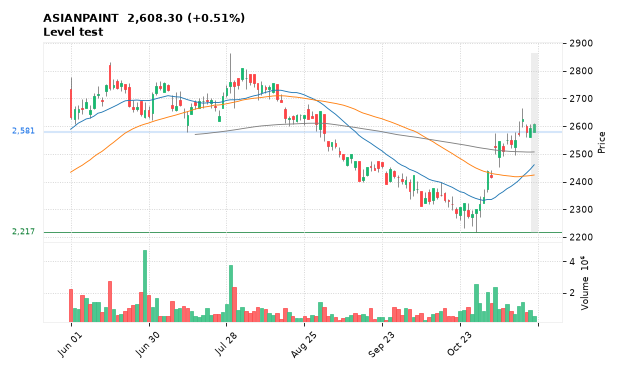

[🔔 Set alert on ASIANPAINT](https://claude.ai/artifact/Ewc5hHTPX6WkU1nVcDNQzq?s=ASIANPAINT&c=close%20below%202577.10) &nbsp;|&nbsp; [📈 Live chart (TradingView)](https://www.tradingview.com/chart/?symbol=NSE:ASIANPAINT) &nbsp;|&nbsp; [alert by email](mailto:testthetpassword@123?subject=ALERT%20ASIANPAINT&body=Alert%20me%20when%3A%20close%20above%202610.90%0A%0AEdit%20the%20line%20above%20if%20you%20want%2C%20then%20press%20Send.%20Checked%20on%20every%20day%27s%20closing%20data%3B%20a%20triggered%20alert%20appears%20at%20the%20top%20of%20the%208%20AM%20Technical%20Analysis%20email.%0A%0AExamples%20you%20can%20write%3A%0A%20%20close%20above%201150%20%20%7C%20%20close%20below%201080%20%20%7C%20%20high%20above%201200%20%20%7C%20%20low%20below%201050%0A%20%20close%20crosses%20above%20200%20DMA%20%20%7C%20%20close%20below%2050%20DMA%20%20%7C%20%20RSI%20below%2030%20%20%7C%20%20RSI%20above%2070%0A%20%20volume%20above%202x%20%20%7C%20%20change%20above%205%25%20%20%7C%20%20change%20below%20-4%25%20%20%7C%20%2052-week%20high%20%20%7C%20%20golden%20cross%0A%20%20combine%20with%20%27and%27%2C%20e.g.%20%20close%20above%201150%20and%20volume%20above%201.5x%0A%0AReference%3A%20ASIANPAINT%20closed%202608.30%20%28high%202610.90%2C%20low%202577.10%29.%0ATo%20cancel%20later%2C%20send%20an%20email%20with%20subject%3A%20CANCEL%20ALERT%20ASIANPAINT)

---

## 44. ASTERDM - LEVEL TEST
**779.30** (+5.41%) | vol 2.6x | RSI 67 | H 781.85 / L 729.00  
Level test

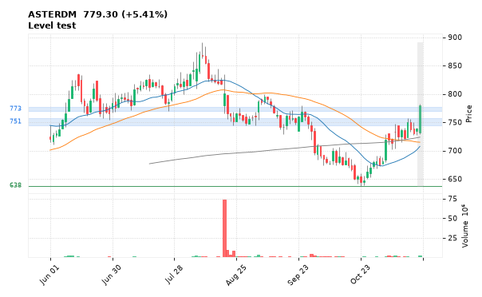

[🔔 Set alert on ASTERDM](https://claude.ai/artifact/Ewc5hHTPX6WkU1nVcDNQzq?s=ASTERDM&c=close%20below%20729.00) &nbsp;|&nbsp; [📈 Live chart (TradingView)](https://www.tradingview.com/chart/?symbol=NSE:ASTERDM) &nbsp;|&nbsp; [alert by email](mailto:testthetpassword@123?subject=ALERT%20ASTERDM&body=Alert%20me%20when%3A%20close%20above%20781.85%0A%0AEdit%20the%20line%20above%20if%20you%20want%2C%20then%20press%20Send.%20Checked%20on%20every%20day%27s%20closing%20data%3B%20a%20triggered%20alert%20appears%20at%20the%20top%20of%20the%208%20AM%20Technical%20Analysis%20email.%0A%0AExamples%20you%20can%20write%3A%0A%20%20close%20above%201150%20%20%7C%20%20close%20below%201080%20%20%7C%20%20high%20above%201200%20%20%7C%20%20low%20below%201050%0A%20%20close%20crosses%20above%20200%20DMA%20%20%7C%20%20close%20below%2050%20DMA%20%20%7C%20%20RSI%20below%2030%20%20%7C%20%20RSI%20above%2070%0A%20%20volume%20above%202x%20%20%7C%20%20change%20above%205%25%20%20%7C%20%20change%20below%20-4%25%20%20%7C%20%2052-week%20high%20%20%7C%20%20golden%20cross%0A%20%20combine%20with%20%27and%27%2C%20e.g.%20%20close%20above%201150%20and%20volume%20above%201.5x%0A%0AReference%3A%20ASTERDM%20closed%20779.30%20%28high%20781.85%2C%20low%20729.00%29.%0ATo%20cancel%20later%2C%20send%20an%20email%20with%20subject%3A%20CANCEL%20ALERT%20ASTERDM)

---

## 45. AZAD - LEVEL TEST
**2,341.30** (-2.86%) | vol 0.6x | RSI 37 | H 2,395.50 / L 2,330.00  
Level test

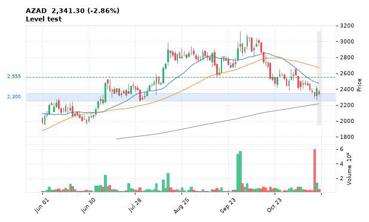

[🔔 Set alert on AZAD](https://claude.ai/artifact/Ewc5hHTPX6WkU1nVcDNQzq?s=AZAD&c=close%20below%202330.00) &nbsp;|&nbsp; [📈 Live chart (TradingView)](https://www.tradingview.com/chart/?symbol=NSE:AZAD) &nbsp;|&nbsp; [alert by email](mailto:testthetpassword@123?subject=ALERT%20AZAD&body=Alert%20me%20when%3A%20close%20above%202395.50%0A%0AEdit%20the%20line%20above%20if%20you%20want%2C%20then%20press%20Send.%20Checked%20on%20every%20day%27s%20closing%20data%3B%20a%20triggered%20alert%20appears%20at%20the%20top%20of%20the%208%20AM%20Technical%20Analysis%20email.%0A%0AExamples%20you%20can%20write%3A%0A%20%20close%20above%201150%20%20%7C%20%20close%20below%201080%20%20%7C%20%20high%20above%201200%20%20%7C%20%20low%20below%201050%0A%20%20close%20crosses%20above%20200%20DMA%20%20%7C%20%20close%20below%2050%20DMA%20%20%7C%20%20RSI%20below%2030%20%20%7C%20%20RSI%20above%2070%0A%20%20volume%20above%202x%20%20%7C%20%20change%20above%205%25%20%20%7C%20%20change%20below%20-4%25%20%20%7C%20%2052-week%20high%20%20%7C%20%20golden%20cross%0A%20%20combine%20with%20%27and%27%2C%20e.g.%20%20close%20above%201150%20and%20volume%20above%201.5x%0A%0AReference%3A%20AZAD%20closed%202341.30%20%28high%202395.50%2C%20low%202330.00%29.%0ATo%20cancel%20later%2C%20send%20an%20email%20with%20subject%3A%20CANCEL%20ALERT%20AZAD)

---

## 46. BAJAJ-AUTO - LEVEL TEST
**10,765.00** (-0.48%) | vol 1.6x | RSI 53 | H 10,931.00 / L 10,726.00  
Level test

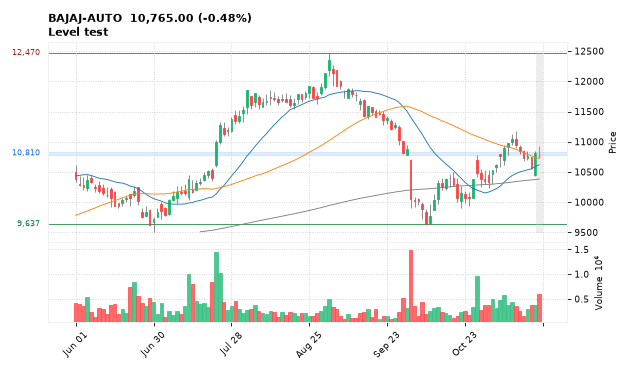

[🔔 Set alert on BAJAJ-AUTO](https://claude.ai/artifact/Ewc5hHTPX6WkU1nVcDNQzq?s=BAJAJ-AUTO&c=close%20below%2010726.00) &nbsp;|&nbsp; [📈 Live chart (TradingView)](https://www.tradingview.com/chart/?symbol=NSE:BAJAJ-AUTO) &nbsp;|&nbsp; [alert by email](mailto:testthetpassword@123?subject=ALERT%20BAJAJ-AUTO&body=Alert%20me%20when%3A%20close%20above%2010931.00%0A%0AEdit%20the%20line%20above%20if%20you%20want%2C%20then%20press%20Send.%20Checked%20on%20every%20day%27s%20closing%20data%3B%20a%20triggered%20alert%20appears%20at%20the%20top%20of%20the%208%20AM%20Technical%20Analysis%20email.%0A%0AExamples%20you%20can%20write%3A%0A%20%20close%20above%201150%20%20%7C%20%20close%20below%201080%20%20%7C%20%20high%20above%201200%20%20%7C%20%20low%20below%201050%0A%20%20close%20crosses%20above%20200%20DMA%20%20%7C%20%20close%20below%2050%20DMA%20%20%7C%20%20RSI%20below%2030%20%20%7C%20%20RSI%20above%2070%0A%20%20volume%20above%202x%20%20%7C%20%20change%20above%205%25%20%20%7C%20%20change%20below%20-4%25%20%20%7C%20%2052-week%20high%20%20%7C%20%20golden%20cross%0A%20%20combine%20with%20%27and%27%2C%20e.g.%20%20close%20above%201150%20and%20volume%20above%201.5x%0A%0AReference%3A%20BAJAJ-AUTO%20closed%2010765.00%20%28high%2010931.00%2C%20low%2010726.00%29.%0ATo%20cancel%20later%2C%20send%20an%20email%20with%20subject%3A%20CANCEL%20ALERT%20BAJAJ-AUTO)

---

## 47. BAJFINANCE - LEVEL TEST
**1,122.00** (+2.67%) | vol 1.0x | RSI 68 | H 1,125.00 / L 1,078.15  
Level test

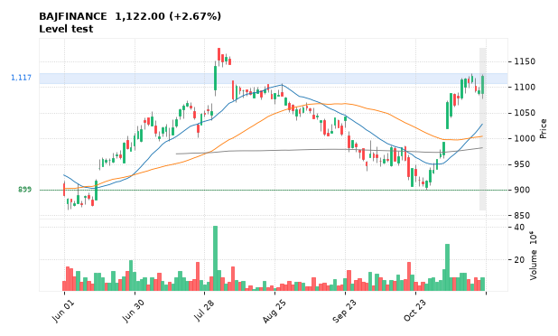

[🔔 Set alert on BAJFINANCE](https://claude.ai/artifact/Ewc5hHTPX6WkU1nVcDNQzq?s=BAJFINANCE&c=close%20below%201078.15) &nbsp;|&nbsp; [📈 Live chart (TradingView)](https://www.tradingview.com/chart/?symbol=NSE:BAJFINANCE) &nbsp;|&nbsp; [alert by email](mailto:testthetpassword@123?subject=ALERT%20BAJFINANCE&body=Alert%20me%20when%3A%20close%20above%201125.00%0A%0AEdit%20the%20line%20above%20if%20you%20want%2C%20then%20press%20Send.%20Checked%20on%20every%20day%27s%20closing%20data%3B%20a%20triggered%20alert%20appears%20at%20the%20top%20of%20the%208%20AM%20Technical%20Analysis%20email.%0A%0AExamples%20you%20can%20write%3A%0A%20%20close%20above%201150%20%20%7C%20%20close%20below%201080%20%20%7C%20%20high%20above%201200%20%20%7C%20%20low%20below%201050%0A%20%20close%20crosses%20above%20200%20DMA%20%20%7C%20%20close%20below%2050%20DMA%20%20%7C%20%20RSI%20below%2030%20%20%7C%20%20RSI%20above%2070%0A%20%20volume%20above%202x%20%20%7C%20%20change%20above%205%25%20%20%7C%20%20change%20below%20-4%25%20%20%7C%20%2052-week%20high%20%20%7C%20%20golden%20cross%0A%20%20combine%20with%20%27and%27%2C%20e.g.%20%20close%20above%201150%20and%20volume%20above%201.5x%0A%0AReference%3A%20BAJFINANCE%20closed%201122.00%20%28high%201125.00%2C%20low%201078.15%29.%0ATo%20cancel%20later%2C%20send%20an%20email%20with%20subject%3A%20CANCEL%20ALERT%20BAJFINANCE)

---

## 48. BAJAJFINSV - LEVEL TEST
**1,892.00** (+0.37%) | vol 1.4x | RSI 65 | H 1,913.40 / L 1,857.30  
Level test

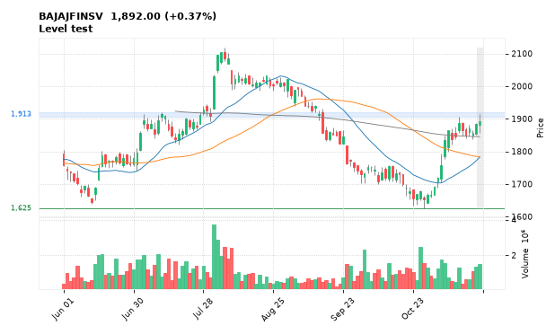

[🔔 Set alert on BAJAJFINSV](https://claude.ai/artifact/Ewc5hHTPX6WkU1nVcDNQzq?s=BAJAJFINSV&c=close%20below%201857.30) &nbsp;|&nbsp; [📈 Live chart (TradingView)](https://www.tradingview.com/chart/?symbol=NSE:BAJAJFINSV) &nbsp;|&nbsp; [alert by email](mailto:testthetpassword@123?subject=ALERT%20BAJAJFINSV&body=Alert%20me%20when%3A%20close%20above%201913.40%0A%0AEdit%20the%20line%20above%20if%20you%20want%2C%20then%20press%20Send.%20Checked%20on%20every%20day%27s%20closing%20data%3B%20a%20triggered%20alert%20appears%20at%20the%20top%20of%20the%208%20AM%20Technical%20Analysis%20email.%0A%0AExamples%20you%20can%20write%3A%0A%20%20close%20above%201150%20%20%7C%20%20close%20below%201080%20%20%7C%20%20high%20above%201200%20%20%7C%20%20low%20below%201050%0A%20%20close%20crosses%20above%20200%20DMA%20%20%7C%20%20close%20below%2050%20DMA%20%20%7C%20%20RSI%20below%2030%20%20%7C%20%20RSI%20above%2070%0A%20%20volume%20above%202x%20%20%7C%20%20change%20above%205%25%20%20%7C%20%20change%20below%20-4%25%20%20%7C%20%2052-week%20high%20%20%7C%20%20golden%20cross%0A%20%20combine%20with%20%27and%27%2C%20e.g.%20%20close%20above%201150%20and%20volume%20above%201.5x%0A%0AReference%3A%20BAJAJFINSV%20closed%201892.00%20%28high%201913.40%2C%20low%201857.30%29.%0ATo%20cancel%20later%2C%20send%20an%20email%20with%20subject%3A%20CANCEL%20ALERT%20BAJAJFINSV)

---

## 49. BAJAJHLDNG - LEVEL TEST
**11,669.00** (+3.16%) | vol 1.5x | RSI 64 | H 11,733.00 / L 11,195.00  
Level test

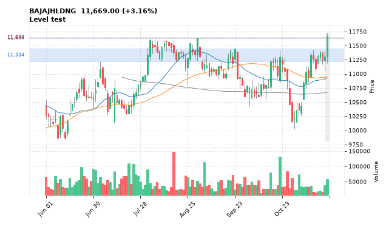

[🔔 Set alert on BAJAJHLDNG](https://claude.ai/artifact/Ewc5hHTPX6WkU1nVcDNQzq?s=BAJAJHLDNG&c=close%20below%2011195.00) &nbsp;|&nbsp; [📈 Live chart (TradingView)](https://www.tradingview.com/chart/?symbol=NSE:BAJAJHLDNG) &nbsp;|&nbsp; [alert by email](mailto:testthetpassword@123?subject=ALERT%20BAJAJHLDNG&body=Alert%20me%20when%3A%20close%20above%2011733.00%0A%0AEdit%20the%20line%20above%20if%20you%20want%2C%20then%20press%20Send.%20Checked%20on%20every%20day%27s%20closing%20data%3B%20a%20triggered%20alert%20appears%20at%20the%20top%20of%20the%208%20AM%20Technical%20Analysis%20email.%0A%0AExamples%20you%20can%20write%3A%0A%20%20close%20above%201150%20%20%7C%20%20close%20below%201080%20%20%7C%20%20high%20above%201200%20%20%7C%20%20low%20below%201050%0A%20%20close%20crosses%20above%20200%20DMA%20%20%7C%20%20close%20below%2050%20DMA%20%20%7C%20%20RSI%20below%2030%20%20%7C%20%20RSI%20above%2070%0A%20%20volume%20above%202x%20%20%7C%20%20change%20above%205%25%20%20%7C%20%20change%20below%20-4%25%20%20%7C%20%2052-week%20high%20%20%7C%20%20golden%20cross%0A%20%20combine%20with%20%27and%27%2C%20e.g.%20%20close%20above%201150%20and%20volume%20above%201.5x%0A%0AReference%3A%20BAJAJHLDNG%20closed%2011669.00%20%28high%2011733.00%2C%20low%2011195.00%29.%0ATo%20cancel%20later%2C%20send%20an%20email%20with%20subject%3A%20CANCEL%20ALERT%20BAJAJHLDNG)

---

## 50. BAJAJHFL - LEVEL TEST
**81.95** (+0.04%) | vol 0.8x | RSI 52 | H 82.46 / L 81.00  
Level test

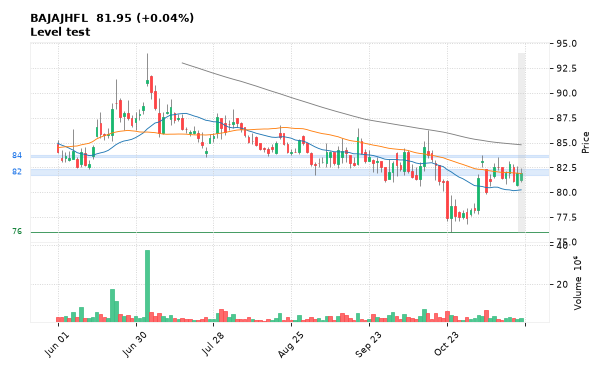

[🔔 Set alert on BAJAJHFL](https://claude.ai/artifact/Ewc5hHTPX6WkU1nVcDNQzq?s=BAJAJHFL&c=close%20below%2081.00) &nbsp;|&nbsp; [📈 Live chart (TradingView)](https://www.tradingview.com/chart/?symbol=NSE:BAJAJHFL) &nbsp;|&nbsp; [alert by email](mailto:testthetpassword@123?subject=ALERT%20BAJAJHFL&body=Alert%20me%20when%3A%20close%20above%2082.46%0A%0AEdit%20the%20line%20above%20if%20you%20want%2C%20then%20press%20Send.%20Checked%20on%20every%20day%27s%20closing%20data%3B%20a%20triggered%20alert%20appears%20at%20the%20top%20of%20the%208%20AM%20Technical%20Analysis%20email.%0A%0AExamples%20you%20can%20write%3A%0A%20%20close%20above%201150%20%20%7C%20%20close%20below%201080%20%20%7C%20%20high%20above%201200%20%20%7C%20%20low%20below%201050%0A%20%20close%20crosses%20above%20200%20DMA%20%20%7C%20%20close%20below%2050%20DMA%20%20%7C%20%20RSI%20below%2030%20%20%7C%20%20RSI%20above%2070%0A%20%20volume%20above%202x%20%20%7C%20%20change%20above%205%25%20%20%7C%20%20change%20below%20-4%25%20%20%7C%20%2052-week%20high%20%20%7C%20%20golden%20cross%0A%20%20combine%20with%20%27and%27%2C%20e.g.%20%20close%20above%201150%20and%20volume%20above%201.5x%0A%0AReference%3A%20BAJAJHFL%20closed%2081.95%20%28high%2082.46%2C%20low%2081.00%29.%0ATo%20cancel%20later%2C%20send%20an%20email%20with%20subject%3A%20CANCEL%20ALERT%20BAJAJHFL)

---

## 51. BALKRISIND - LEVEL TEST
**2,363.80** (+1.57%) | vol 0.3x | RSI 64 | H 2,369.00 / L 2,296.10  
Level test

[🔔 Set alert on BALKRISIND](https://claude.ai/artifact/Ewc5hHTPX6WkU1nVcDNQzq?s=BALKRISIND&c=close%20below%202296.10) &nbsp;|&nbsp; [📈 Live chart (TradingView)](https://www.tradingview.com/chart/?symbol=NSE:BALKRISIND) &nbsp;|&nbsp; [alert by email](mailto:testthetpassword@123?subject=ALERT%20BALKRISIND&body=Alert%20me%20when%3A%20close%20above%202369.00%0A%0AEdit%20the%20line%20above%20if%20you%20want%2C%20then%20press%20Send.%20Checked%20on%20every%20day%27s%20closing%20data%3B%20a%20triggered%20alert%20appears%20at%20the%20top%20of%20the%208%20AM%20Technical%20Analysis%20email.%0A%0AExamples%20you%20can%20write%3A%0A%20%20close%20above%201150%20%20%7C%20%20close%20below%201080%20%20%7C%20%20high%20above%201200%20%20%7C%20%20low%20below%201050%0A%20%20close%20crosses%20above%20200%20DMA%20%20%7C%20%20close%20below%2050%20DMA%20%20%7C%20%20RSI%20below%2030%20%20%7C%20%20RSI%20above%2070%0A%20%20volume%20above%202x%20%20%7C%20%20change%20above%205%25%20%20%7C%20%20change%20below%20-4%25%20%20%7C%20%2052-week%20high%20%20%7C%20%20golden%20cross%0A%20%20combine%20with%20%27and%27%2C%20e.g.%20%20close%20above%201150%20and%20volume%20above%201.5x%0A%0AReference%3A%20BALKRISIND%20closed%202363.80%20%28high%202369.00%2C%20low%202296.10%29.%0ATo%20cancel%20later%2C%20send%20an%20email%20with%20subject%3A%20CANCEL%20ALERT%20BALKRISIND)

---

## 52. BANDHANBNK - LEVEL TEST
**175.07** (+0.04%) | vol 1.2x | RSI 59 | H 177.40 / L 172.20  
Level test

[🔔 Set alert on BANDHANBNK](https://claude.ai/artifact/Ewc5hHTPX6WkU1nVcDNQzq?s=BANDHANBNK&c=close%20below%20172.20) &nbsp;|&nbsp; [📈 Live chart (TradingView)](https://www.tradingview.com/chart/?symbol=NSE:BANDHANBNK) &nbsp;|&nbsp; [alert by email](mailto:testthetpassword@123?subject=ALERT%20BANDHANBNK&body=Alert%20me%20when%3A%20close%20above%20177.40%0A%0AEdit%20the%20line%20above%20if%20you%20want%2C%20then%20press%20Send.%20Checked%20on%20every%20day%27s%20closing%20data%3B%20a%20triggered%20alert%20appears%20at%20the%20top%20of%20the%208%20AM%20Technical%20Analysis%20email.%0A%0AExamples%20you%20can%20write%3A%0A%20%20close%20above%201150%20%20%7C%20%20close%20below%201080%20%20%7C%20%20high%20above%201200%20%20%7C%20%20low%20below%201050%0A%20%20close%20crosses%20above%20200%20DMA%20%20%7C%20%20close%20below%2050%20DMA%20%20%7C%20%20RSI%20below%2030%20%20%7C%20%20RSI%20above%2070%0A%20%20volume%20above%202x%20%20%7C%20%20change%20above%205%25%20%20%7C%20%20change%20below%20-4%25%20%20%7C%20%2052-week%20high%20%20%7C%20%20golden%20cross%0A%20%20combine%20with%20%27and%27%2C%20e.g.%20%20close%20above%201150%20and%20volume%20above%201.5x%0A%0AReference%3A%20BANDHANBNK%20closed%20175.07%20%28high%20177.40%2C%20low%20172.20%29.%0ATo%20cancel%20later%2C%20send%20an%20email%20with%20subject%3A%20CANCEL%20ALERT%20BANDHANBNK)

---

## 53. BANKBARODA - LEVEL TEST
**287.00** (+0.38%) | vol 1.8x | RSI 79 | H 288.80 / L 281.50  
Level test

[🔔 Set alert on BANKBARODA](https://claude.ai/artifact/Ewc5hHTPX6WkU1nVcDNQzq?s=BANKBARODA&c=close%20below%20281.50) &nbsp;|&nbsp; [📈 Live chart (TradingView)](https://www.tradingview.com/chart/?symbol=NSE:BANKBARODA) &nbsp;|&nbsp; [alert by email](mailto:testthetpassword@123?subject=ALERT%20BANKBARODA&body=Alert%20me%20when%3A%20close%20above%20288.80%0A%0AEdit%20the%20line%20above%20if%20you%20want%2C%20then%20press%20Send.%20Checked%20on%20every%20day%27s%20closing%20data%3B%20a%20triggered%20alert%20appears%20at%20the%20top%20of%20the%208%20AM%20Technical%20Analysis%20email.%0A%0AExamples%20you%20can%20write%3A%0A%20%20close%20above%201150%20%20%7C%20%20close%20below%201080%20%20%7C%20%20high%20above%201200%20%20%7C%20%20low%20below%201050%0A%20%20close%20crosses%20above%20200%20DMA%20%20%7C%20%20close%20below%2050%20DMA%20%20%7C%20%20RSI%20below%2030%20%20%7C%20%20RSI%20above%2070%0A%20%20volume%20above%202x%20%20%7C%20%20change%20above%205%25%20%20%7C%20%20change%20below%20-4%25%20%20%7C%20%2052-week%20high%20%20%7C%20%20golden%20cross%0A%20%20combine%20with%20%27and%27%2C%20e.g.%20%20close%20above%201150%20and%20volume%20above%201.5x%0A%0AReference%3A%20BANKBARODA%20closed%20287.00%20%28high%20288.80%2C%20low%20281.50%29.%0ATo%20cancel%20later%2C%20send%20an%20email%20with%20subject%3A%20CANCEL%20ALERT%20BANKBARODA)

---

## 54. BERGEPAINT - LEVEL TEST
**464.45** (-0.35%) | vol 0.8x | RSI 45 | H 466.50 / L 460.35  
Level test

[🔔 Set alert on BERGEPAINT](https://claude.ai/artifact/Ewc5hHTPX6WkU1nVcDNQzq?s=BERGEPAINT&c=close%20below%20460.35) &nbsp;|&nbsp; [📈 Live chart (TradingView)](https://www.tradingview.com/chart/?symbol=NSE:BERGEPAINT) &nbsp;|&nbsp; [alert by email](mailto:testthetpassword@123?subject=ALERT%20BERGEPAINT&body=Alert%20me%20when%3A%20close%20above%20466.50%0A%0AEdit%20the%20line%20above%20if%20you%20want%2C%20then%20press%20Send.%20Checked%20on%20every%20day%27s%20closing%20data%3B%20a%20triggered%20alert%20appears%20at%20the%20top%20of%20the%208%20AM%20Technical%20Analysis%20email.%0A%0AExamples%20you%20can%20write%3A%0A%20%20close%20above%201150%20%20%7C%20%20close%20below%201080%20%20%7C%20%20high%20above%201200%20%20%7C%20%20low%20below%201050%0A%20%20close%20crosses%20above%20200%20DMA%20%20%7C%20%20close%20below%2050%20DMA%20%20%7C%20%20RSI%20below%2030%20%20%7C%20%20RSI%20above%2070%0A%20%20volume%20above%202x%20%20%7C%20%20change%20above%205%25%20%20%7C%20%20change%20below%20-4%25%20%20%7C%20%2052-week%20high%20%20%7C%20%20golden%20cross%0A%20%20combine%20with%20%27and%27%2C%20e.g.%20%20close%20above%201150%20and%20volume%20above%201.5x%0A%0AReference%3A%20BERGEPAINT%20closed%20464.45%20%28high%20466.50%2C%20low%20460.35%29.%0ATo%20cancel%20later%2C%20send%20an%20email%20with%20subject%3A%20CANCEL%20ALERT%20BERGEPAINT)

---

## 55. BEL - LEVEL TEST
**402.00** (-0.54%) | vol 0.4x | RSI 61 | H 403.20 / L 400.00  
Level test

[🔔 Set alert on BEL](https://claude.ai/artifact/Ewc5hHTPX6WkU1nVcDNQzq?s=BEL&c=close%20below%20400.00) &nbsp;|&nbsp; [📈 Live chart (TradingView)](https://www.tradingview.com/chart/?symbol=NSE:BEL) &nbsp;|&nbsp; [alert by email](mailto:testthetpassword@123?subject=ALERT%20BEL&body=Alert%20me%20when%3A%20close%20above%20403.20%0A%0AEdit%20the%20line%20above%20if%20you%20want%2C%20then%20press%20Send.%20Checked%20on%20every%20day%27s%20closing%20data%3B%20a%20triggered%20alert%20appears%20at%20the%20top%20of%20the%208%20AM%20Technical%20Analysis%20email.%0A%0AExamples%20you%20can%20write%3A%0A%20%20close%20above%201150%20%20%7C%20%20close%20below%201080%20%20%7C%20%20high%20above%201200%20%20%7C%20%20low%20below%201050%0A%20%20close%20crosses%20above%20200%20DMA%20%20%7C%20%20close%20below%2050%20DMA%20%20%7C%20%20RSI%20below%2030%20%20%7C%20%20RSI%20above%2070%0A%20%20volume%20above%202x%20%20%7C%20%20change%20above%205%25%20%20%7C%20%20change%20below%20-4%25%20%20%7C%20%2052-week%20high%20%20%7C%20%20golden%20cross%0A%20%20combine%20with%20%27and%27%2C%20e.g.%20%20close%20above%201150%20and%20volume%20above%201.5x%0A%0AReference%3A%20BEL%20closed%20402.00%20%28high%20403.20%2C%20low%20400.00%29.%0ATo%20cancel%20later%2C%20send%20an%20email%20with%20subject%3A%20CANCEL%20ALERT%20BEL)

---

## 56. BPCL - LEVEL TEST
**314.10** (+1.95%) | vol 0.7x | RSI 60 | H 314.10 / L 303.60  
Level test

[🔔 Set alert on BPCL](https://claude.ai/artifact/Ewc5hHTPX6WkU1nVcDNQzq?s=BPCL&c=close%20below%20303.60) &nbsp;|&nbsp; [📈 Live chart (TradingView)](https://www.tradingview.com/chart/?symbol=NSE:BPCL) &nbsp;|&nbsp; [alert by email](mailto:testthetpassword@123?subject=ALERT%20BPCL&body=Alert%20me%20when%3A%20close%20above%20314.10%0A%0AEdit%20the%20line%20above%20if%20you%20want%2C%20then%20press%20Send.%20Checked%20on%20every%20day%27s%20closing%20data%3B%20a%20triggered%20alert%20appears%20at%20the%20top%20of%20the%208%20AM%20Technical%20Analysis%20email.%0A%0AExamples%20you%20can%20write%3A%0A%20%20close%20above%201150%20%20%7C%20%20close%20below%201080%20%20%7C%20%20high%20above%201200%20%20%7C%20%20low%20below%201050%0A%20%20close%20crosses%20above%20200%20DMA%20%20%7C%20%20close%20below%2050%20DMA%20%20%7C%20%20RSI%20below%2030%20%20%7C%20%20RSI%20above%2070%0A%20%20volume%20above%202x%20%20%7C%20%20change%20above%205%25%20%20%7C%20%20change%20below%20-4%25%20%20%7C%20%2052-week%20high%20%20%7C%20%20golden%20cross%0A%20%20combine%20with%20%27and%27%2C%20e.g.%20%20close%20above%201150%20and%20volume%20above%201.5x%0A%0AReference%3A%20BPCL%20closed%20314.10%20%28high%20314.10%2C%20low%20303.60%29.%0ATo%20cancel%20later%2C%20send%20an%20email%20with%20subject%3A%20CANCEL%20ALERT%20BPCL)

---

## 57. BHARTIHEXA - LEVEL TEST
**1,631.40** (-0.48%) | vol 0.2x | RSI 50 | H 1,649.50 / L 1,607.00  
Level test

[🔔 Set alert on BHARTIHEXA](https://claude.ai/artifact/Ewc5hHTPX6WkU1nVcDNQzq?s=BHARTIHEXA&c=close%20below%201607.00) &nbsp;|&nbsp; [📈 Live chart (TradingView)](https://www.tradingview.com/chart/?symbol=NSE:BHARTIHEXA) &nbsp;|&nbsp; [alert by email](mailto:testthetpassword@123?subject=ALERT%20BHARTIHEXA&body=Alert%20me%20when%3A%20close%20above%201649.50%0A%0AEdit%20the%20line%20above%20if%20you%20want%2C%20then%20press%20Send.%20Checked%20on%20every%20day%27s%20closing%20data%3B%20a%20triggered%20alert%20appears%20at%20the%20top%20of%20the%208%20AM%20Technical%20Analysis%20email.%0A%0AExamples%20you%20can%20write%3A%0A%20%20close%20above%201150%20%20%7C%20%20close%20below%201080%20%20%7C%20%20high%20above%201200%20%20%7C%20%20low%20below%201050%0A%20%20close%20crosses%20above%20200%20DMA%20%20%7C%20%20close%20below%2050%20DMA%20%20%7C%20%20RSI%20below%2030%20%20%7C%20%20RSI%20above%2070%0A%20%20volume%20above%202x%20%20%7C%20%20change%20above%205%25%20%20%7C%20%20change%20below%20-4%25%20%20%7C%20%2052-week%20high%20%20%7C%20%20golden%20cross%0A%20%20combine%20with%20%27and%27%2C%20e.g.%20%20close%20above%201150%20and%20volume%20above%201.5x%0A%0AReference%3A%20BHARTIHEXA%20closed%201631.40%20%28high%201649.50%2C%20low%201607.00%29.%0ATo%20cancel%20later%2C%20send%20an%20email%20with%20subject%3A%20CANCEL%20ALERT%20BHARTIHEXA)

---

## 58. GROWW - LEVEL TEST
**224.57** (+1.67%) | vol 1.0x | RSI 65 | H 227.60 / L 218.22  
Level test

[🔔 Set alert on GROWW](https://claude.ai/artifact/Ewc5hHTPX6WkU1nVcDNQzq?s=GROWW&c=close%20below%20218.22) &nbsp;|&nbsp; [📈 Live chart (TradingView)](https://www.tradingview.com/chart/?symbol=NSE:GROWW) &nbsp;|&nbsp; [alert by email](mailto:testthetpassword@123?subject=ALERT%20GROWW&body=Alert%20me%20when%3A%20close%20above%20227.60%0A%0AEdit%20the%20line%20above%20if%20you%20want%2C%20then%20press%20Send.%20Checked%20on%20every%20day%27s%20closing%20data%3B%20a%20triggered%20alert%20appears%20at%20the%20top%20of%20the%208%20AM%20Technical%20Analysis%20email.%0A%0AExamples%20you%20can%20write%3A%0A%20%20close%20above%201150%20%20%7C%20%20close%20below%201080%20%20%7C%20%20high%20above%201200%20%20%7C%20%20low%20below%201050%0A%20%20close%20crosses%20above%20200%20DMA%20%20%7C%20%20close%20below%2050%20DMA%20%20%7C%20%20RSI%20below%2030%20%20%7C%20%20RSI%20above%2070%0A%20%20volume%20above%202x%20%20%7C%20%20change%20above%205%25%20%20%7C%20%20change%20below%20-4%25%20%20%7C%20%2052-week%20high%20%20%7C%20%20golden%20cross%0A%20%20combine%20with%20%27and%27%2C%20e.g.%20%20close%20above%201150%20and%20volume%20above%201.5x%0A%0AReference%3A%20GROWW%20closed%20224.57%20%28high%20227.60%2C%20low%20218.22%29.%0ATo%20cancel%20later%2C%20send%20an%20email%20with%20subject%3A%20CANCEL%20ALERT%20GROWW)

---

## 59. BSOFT - LEVEL TEST
**303.15** (+1.44%) | vol 1.0x | RSI 45 | H 311.80 / L 293.80  
Level test

[🔔 Set alert on BSOFT](https://claude.ai/artifact/Ewc5hHTPX6WkU1nVcDNQzq?s=BSOFT&c=close%20below%20293.80) &nbsp;|&nbsp; [📈 Live chart (TradingView)](https://www.tradingview.com/chart/?symbol=NSE:BSOFT) &nbsp;|&nbsp; [alert by email](mailto:testthetpassword@123?subject=ALERT%20BSOFT&body=Alert%20me%20when%3A%20close%20above%20311.80%0A%0AEdit%20the%20line%20above%20if%20you%20want%2C%20then%20press%20Send.%20Checked%20on%20every%20day%27s%20closing%20data%3B%20a%20triggered%20alert%20appears%20at%20the%20top%20of%20the%208%20AM%20Technical%20Analysis%20email.%0A%0AExamples%20you%20can%20write%3A%0A%20%20close%20above%201150%20%20%7C%20%20close%20below%201080%20%20%7C%20%20high%20above%201200%20%20%7C%20%20low%20below%201050%0A%20%20close%20crosses%20above%20200%20DMA%20%20%7C%20%20close%20below%2050%20DMA%20%20%7C%20%20RSI%20below%2030%20%20%7C%20%20RSI%20above%2070%0A%20%20volume%20above%202x%20%20%7C%20%20change%20above%205%25%20%20%7C%20%20change%20below%20-4%25%20%20%7C%20%2052-week%20high%20%20%7C%20%20golden%20cross%0A%20%20combine%20with%20%27and%27%2C%20e.g.%20%20close%20above%201150%20and%20volume%20above%201.5x%0A%0AReference%3A%20BSOFT%20closed%20303.15%20%28high%20311.80%2C%20low%20293.80%29.%0ATo%20cancel%20later%2C%20send%20an%20email%20with%20subject%3A%20CANCEL%20ALERT%20BSOFT)

---

## 60. BLUESTARCO - LEVEL TEST
**1,791.00** (+1.53%) | vol 1.9x | RSI 73 | H 1,820.00 / L 1,750.40  
Level test

[🔔 Set alert on BLUESTARCO](https://claude.ai/artifact/Ewc5hHTPX6WkU1nVcDNQzq?s=BLUESTARCO&c=close%20below%201750.40) &nbsp;|&nbsp; [📈 Live chart (TradingView)](https://www.tradingview.com/chart/?symbol=NSE:BLUESTARCO) &nbsp;|&nbsp; [alert by email](mailto:testthetpassword@123?subject=ALERT%20BLUESTARCO&body=Alert%20me%20when%3A%20close%20above%201820.00%0A%0AEdit%20the%20line%20above%20if%20you%20want%2C%20then%20press%20Send.%20Checked%20on%20every%20day%27s%20closing%20data%3B%20a%20triggered%20alert%20appears%20at%20the%20top%20of%20the%208%20AM%20Technical%20Analysis%20email.%0A%0AExamples%20you%20can%20write%3A%0A%20%20close%20above%201150%20%20%7C%20%20close%20below%201080%20%20%7C%20%20high%20above%201200%20%20%7C%20%20low%20below%201050%0A%20%20close%20crosses%20above%20200%20DMA%20%20%7C%20%20close%20below%2050%20DMA%20%20%7C%20%20RSI%20below%2030%20%20%7C%20%20RSI%20above%2070%0A%20%20volume%20above%202x%20%20%7C%20%20change%20above%205%25%20%20%7C%20%20change%20below%20-4%25%20%20%7C%20%2052-week%20high%20%20%7C%20%20golden%20cross%0A%20%20combine%20with%20%27and%27%2C%20e.g.%20%20close%20above%201150%20and%20volume%20above%201.5x%0A%0AReference%3A%20BLUESTARCO%20closed%201791.00%20%28high%201820.00%2C%20low%201750.40%29.%0ATo%20cancel%20later%2C%20send%20an%20email%20with%20subject%3A%20CANCEL%20ALERT%20BLUESTARCO)

---

## 61. BRIGADE - LEVEL TEST
**578.35** (+2.15%) | vol 1.6x | RSI 58 | H 581.00 / L 557.40  
Level test

[🔔 Set alert on BRIGADE](https://claude.ai/artifact/Ewc5hHTPX6WkU1nVcDNQzq?s=BRIGADE&c=close%20below%20557.40) &nbsp;|&nbsp; [📈 Live chart (TradingView)](https://www.tradingview.com/chart/?symbol=NSE:BRIGADE) &nbsp;|&nbsp; [alert by email](mailto:testthetpassword@123?subject=ALERT%20BRIGADE&body=Alert%20me%20when%3A%20close%20above%20581.00%0A%0AEdit%20the%20line%20above%20if%20you%20want%2C%20then%20press%20Send.%20Checked%20on%20every%20day%27s%20closing%20data%3B%20a%20triggered%20alert%20appears%20at%20the%20top%20of%20the%208%20AM%20Technical%20Analysis%20email.%0A%0AExamples%20you%20can%20write%3A%0A%20%20close%20above%201150%20%20%7C%20%20close%20below%201080%20%20%7C%20%20high%20above%201200%20%20%7C%20%20low%20below%201050%0A%20%20close%20crosses%20above%20200%20DMA%20%20%7C%20%20close%20below%2050%20DMA%20%20%7C%20%20RSI%20below%2030%20%20%7C%20%20RSI%20above%2070%0A%20%20volume%20above%202x%20%20%7C%20%20change%20above%205%25%20%20%7C%20%20change%20below%20-4%25%20%20%7C%20%2052-week%20high%20%20%7C%20%20golden%20cross%0A%20%20combine%20with%20%27and%27%2C%20e.g.%20%20close%20above%201150%20and%20volume%20above%201.5x%0A%0AReference%3A%20BRIGADE%20closed%20578.35%20%28high%20581.00%2C%20low%20557.40%29.%0ATo%20cancel%20later%2C%20send%20an%20email%20with%20subject%3A%20CANCEL%20ALERT%20BRIGADE)

---

## 62. CIEINDIA - LEVEL TEST
**368.45** (-0.09%) | vol 0.4x | RSI 51 | H 371.00 / L 363.00  
Level test

[🔔 Set alert on CIEINDIA](https://claude.ai/artifact/Ewc5hHTPX6WkU1nVcDNQzq?s=CIEINDIA&c=close%20below%20363.00) &nbsp;|&nbsp; [📈 Live chart (TradingView)](https://www.tradingview.com/chart/?symbol=NSE:CIEINDIA) &nbsp;|&nbsp; [alert by email](mailto:testthetpassword@123?subject=ALERT%20CIEINDIA&body=Alert%20me%20when%3A%20close%20above%20371.00%0A%0AEdit%20the%20line%20above%20if%20you%20want%2C%20then%20press%20Send.%20Checked%20on%20every%20day%27s%20closing%20data%3B%20a%20triggered%20alert%20appears%20at%20the%20top%20of%20the%208%20AM%20Technical%20Analysis%20email.%0A%0AExamples%20you%20can%20write%3A%0A%20%20close%20above%201150%20%20%7C%20%20close%20below%201080%20%20%7C%20%20high%20above%201200%20%20%7C%20%20low%20below%201050%0A%20%20close%20crosses%20above%20200%20DMA%20%20%7C%20%20close%20below%2050%20DMA%20%20%7C%20%20RSI%20below%2030%20%20%7C%20%20RSI%20above%2070%0A%20%20volume%20above%202x%20%20%7C%20%20change%20above%205%25%20%20%7C%20%20change%20below%20-4%25%20%20%7C%20%2052-week%20high%20%20%7C%20%20golden%20cross%0A%20%20combine%20with%20%27and%27%2C%20e.g.%20%20close%20above%201150%20and%20volume%20above%201.5x%0A%0AReference%3A%20CIEINDIA%20closed%20368.45%20%28high%20371.00%2C%20low%20363.00%29.%0ATo%20cancel%20later%2C%20send%20an%20email%20with%20subject%3A%20CANCEL%20ALERT%20CIEINDIA)

---

## 63. CARBORUNIV - LEVEL TEST
**999.00** (-0.29%) | vol 0.6x | RSI 37 | H 1,005.80 / L 982.90  
Level test

[🔔 Set alert on CARBORUNIV](https://claude.ai/artifact/Ewc5hHTPX6WkU1nVcDNQzq?s=CARBORUNIV&c=close%20below%20982.90) &nbsp;|&nbsp; [📈 Live chart (TradingView)](https://www.tradingview.com/chart/?symbol=NSE:CARBORUNIV) &nbsp;|&nbsp; [alert by email](mailto:testthetpassword@123?subject=ALERT%20CARBORUNIV&body=Alert%20me%20when%3A%20close%20above%201005.80%0A%0AEdit%20the%20line%20above%20if%20you%20want%2C%20then%20press%20Send.%20Checked%20on%20every%20day%27s%20closing%20data%3B%20a%20triggered%20alert%20appears%20at%20the%20top%20of%20the%208%20AM%20Technical%20Analysis%20email.%0A%0AExamples%20you%20can%20write%3A%0A%20%20close%20above%201150%20%20%7C%20%20close%20below%201080%20%20%7C%20%20high%20above%201200%20%20%7C%20%20low%20below%201050%0A%20%20close%20crosses%20above%20200%20DMA%20%20%7C%20%20close%20below%2050%20DMA%20%20%7C%20%20RSI%20below%2030%20%20%7C%20%20RSI%20above%2070%0A%20%20volume%20above%202x%20%20%7C%20%20change%20above%205%25%20%20%7C%20%20change%20below%20-4%25%20%20%7C%20%2052-week%20high%20%20%7C%20%20golden%20cross%0A%20%20combine%20with%20%27and%27%2C%20e.g.%20%20close%20above%201150%20and%20volume%20above%201.5x%0A%0AReference%3A%20CARBORUNIV%20closed%20999.00%20%28high%201005.80%2C%20low%20982.90%29.%0ATo%20cancel%20later%2C%20send%20an%20email%20with%20subject%3A%20CANCEL%20ALERT%20CARBORUNIV)

---

## 64. CARTRADE - LEVEL TEST
**2,655.70** (+0.53%) | vol 0.2x | RSI 48 | H 2,689.00 / L 2,610.90  
Level test

[🔔 Set alert on CARTRADE](https://claude.ai/artifact/Ewc5hHTPX6WkU1nVcDNQzq?s=CARTRADE&c=close%20below%202610.90) &nbsp;|&nbsp; [📈 Live chart (TradingView)](https://www.tradingview.com/chart/?symbol=NSE:CARTRADE) &nbsp;|&nbsp; [alert by email](mailto:testthetpassword@123?subject=ALERT%20CARTRADE&body=Alert%20me%20when%3A%20close%20above%202689.00%0A%0AEdit%20the%20line%20above%20if%20you%20want%2C%20then%20press%20Send.%20Checked%20on%20every%20day%27s%20closing%20data%3B%20a%20triggered%20alert%20appears%20at%20the%20top%20of%20the%208%20AM%20Technical%20Analysis%20email.%0A%0AExamples%20you%20can%20write%3A%0A%20%20close%20above%201150%20%20%7C%20%20close%20below%201080%20%20%7C%20%20high%20above%201200%20%20%7C%20%20low%20below%201050%0A%20%20close%20crosses%20above%20200%20DMA%20%20%7C%20%20close%20below%2050%20DMA%20%20%7C%20%20RSI%20below%2030%20%20%7C%20%20RSI%20above%2070%0A%20%20volume%20above%202x%20%20%7C%20%20change%20above%205%25%20%20%7C%20%20change%20below%20-4%25%20%20%7C%20%2052-week%20high%20%20%7C%20%20golden%20cross%0A%20%20combine%20with%20%27and%27%2C%20e.g.%20%20close%20above%201150%20and%20volume%20above%201.5x%0A%0AReference%3A%20CARTRADE%20closed%202655.70%20%28high%202689.00%2C%20low%202610.90%29.%0ATo%20cancel%20later%2C%20send%20an%20email%20with%20subject%3A%20CANCEL%20ALERT%20CARTRADE)

---

## 65. CEATLTD - LEVEL TEST
**3,543.00** (+0.04%) | vol 0.8x | RSI 61 | H 3,567.30 / L 3,483.00  
Level test

[🔔 Set alert on CEATLTD](https://claude.ai/artifact/Ewc5hHTPX6WkU1nVcDNQzq?s=CEATLTD&c=close%20below%203483.00) &nbsp;|&nbsp; [📈 Live chart (TradingView)](https://www.tradingview.com/chart/?symbol=NSE:CEATLTD) &nbsp;|&nbsp; [alert by email](mailto:testthetpassword@123?subject=ALERT%20CEATLTD&body=Alert%20me%20when%3A%20close%20above%203567.30%0A%0AEdit%20the%20line%20above%20if%20you%20want%2C%20then%20press%20Send.%20Checked%20on%20every%20day%27s%20closing%20data%3B%20a%20triggered%20alert%20appears%20at%20the%20top%20of%20the%208%20AM%20Technical%20Analysis%20email.%0A%0AExamples%20you%20can%20write%3A%0A%20%20close%20above%201150%20%20%7C%20%20close%20below%201080%20%20%7C%20%20high%20above%201200%20%20%7C%20%20low%20below%201050%0A%20%20close%20crosses%20above%20200%20DMA%20%20%7C%20%20close%20below%2050%20DMA%20%20%7C%20%20RSI%20below%2030%20%20%7C%20%20RSI%20above%2070%0A%20%20volume%20above%202x%20%20%7C%20%20change%20above%205%25%20%20%7C%20%20change%20below%20-4%25%20%20%7C%20%2052-week%20high%20%20%7C%20%20golden%20cross%0A%20%20combine%20with%20%27and%27%2C%20e.g.%20%20close%20above%201150%20and%20volume%20above%201.5x%0A%0AReference%3A%20CEATLTD%20closed%203543.00%20%28high%203567.30%2C%20low%203483.00%29.%0ATo%20cancel%20later%2C%20send%20an%20email%20with%20subject%3A%20CANCEL%20ALERT%20CEATLTD)

---

## 66. CEMPRO - LEVEL TEST
**1,415.90** (+2.71%) | vol 0.8x | RSI 70 | H 1,422.90 / L 1,351.80  
Level test

[🔔 Set alert on CEMPRO](https://claude.ai/artifact/Ewc5hHTPX6WkU1nVcDNQzq?s=CEMPRO&c=close%20below%201351.80) &nbsp;|&nbsp; [📈 Live chart (TradingView)](https://www.tradingview.com/chart/?symbol=NSE:CEMPRO) &nbsp;|&nbsp; [alert by email](mailto:testthetpassword@123?subject=ALERT%20CEMPRO&body=Alert%20me%20when%3A%20close%20above%201422.90%0A%0AEdit%20the%20line%20above%20if%20you%20want%2C%20then%20press%20Send.%20Checked%20on%20every%20day%27s%20closing%20data%3B%20a%20triggered%20alert%20appears%20at%20the%20top%20of%20the%208%20AM%20Technical%20Analysis%20email.%0A%0AExamples%20you%20can%20write%3A%0A%20%20close%20above%201150%20%20%7C%20%20close%20below%201080%20%20%7C%20%20high%20above%201200%20%20%7C%20%20low%20below%201050%0A%20%20close%20crosses%20above%20200%20DMA%20%20%7C%20%20close%20below%2050%20DMA%20%20%7C%20%20RSI%20below%2030%20%20%7C%20%20RSI%20above%2070%0A%20%20volume%20above%202x%20%20%7C%20%20change%20above%205%25%20%20%7C%20%20change%20below%20-4%25%20%20%7C%20%2052-week%20high%20%20%7C%20%20golden%20cross%0A%20%20combine%20with%20%27and%27%2C%20e.g.%20%20close%20above%201150%20and%20volume%20above%201.5x%0A%0AReference%3A%20CEMPRO%20closed%201415.90%20%28high%201422.90%2C%20low%201351.80%29.%0ATo%20cancel%20later%2C%20send%20an%20email%20with%20subject%3A%20CANCEL%20ALERT%20CEMPRO)

---

## 67. CHOLAHLDNG - LEVEL TEST
**1,400.80** (-0.81%) | vol 0.5x | RSI 49 | H 1,421.00 / L 1,388.00  
Level test

[🔔 Set alert on CHOLAHLDNG](https://claude.ai/artifact/Ewc5hHTPX6WkU1nVcDNQzq?s=CHOLAHLDNG&c=close%20below%201388.00) &nbsp;|&nbsp; [📈 Live chart (TradingView)](https://www.tradingview.com/chart/?symbol=NSE:CHOLAHLDNG) &nbsp;|&nbsp; [alert by email](mailto:testthetpassword@123?subject=ALERT%20CHOLAHLDNG&body=Alert%20me%20when%3A%20close%20above%201421.00%0A%0AEdit%20the%20line%20above%20if%20you%20want%2C%20then%20press%20Send.%20Checked%20on%20every%20day%27s%20closing%20data%3B%20a%20triggered%20alert%20appears%20at%20the%20top%20of%20the%208%20AM%20Technical%20Analysis%20email.%0A%0AExamples%20you%20can%20write%3A%0A%20%20close%20above%201150%20%20%7C%20%20close%20below%201080%20%20%7C%20%20high%20above%201200%20%20%7C%20%20low%20below%201050%0A%20%20close%20crosses%20above%20200%20DMA%20%20%7C%20%20close%20below%2050%20DMA%20%20%7C%20%20RSI%20below%2030%20%20%7C%20%20RSI%20above%2070%0A%20%20volume%20above%202x%20%20%7C%20%20change%20above%205%25%20%20%7C%20%20change%20below%20-4%25%20%20%7C%20%2052-week%20high%20%20%7C%20%20golden%20cross%0A%20%20combine%20with%20%27and%27%2C%20e.g.%20%20close%20above%201150%20and%20volume%20above%201.5x%0A%0AReference%3A%20CHOLAHLDNG%20closed%201400.80%20%28high%201421.00%2C%20low%201388.00%29.%0ATo%20cancel%20later%2C%20send%20an%20email%20with%20subject%3A%20CANCEL%20ALERT%20CHOLAHLDNG)

---

## 68. CHOLAFIN - LEVEL TEST
**1,874.60** (-0.02%) | vol 0.8x | RSI 71 | H 1,882.00 / L 1,839.40  
Level test

[🔔 Set alert on CHOLAFIN](https://claude.ai/artifact/Ewc5hHTPX6WkU1nVcDNQzq?s=CHOLAFIN&c=close%20below%201839.40) &nbsp;|&nbsp; [📈 Live chart (TradingView)](https://www.tradingview.com/chart/?symbol=NSE:CHOLAFIN) &nbsp;|&nbsp; [alert by email](mailto:testthetpassword@123?subject=ALERT%20CHOLAFIN&body=Alert%20me%20when%3A%20close%20above%201882.00%0A%0AEdit%20the%20line%20above%20if%20you%20want%2C%20then%20press%20Send.%20Checked%20on%20every%20day%27s%20closing%20data%3B%20a%20triggered%20alert%20appears%20at%20the%20top%20of%20the%208%20AM%20Technical%20Analysis%20email.%0A%0AExamples%20you%20can%20write%3A%0A%20%20close%20above%201150%20%20%7C%20%20close%20below%201080%20%20%7C%20%20high%20above%201200%20%20%7C%20%20low%20below%201050%0A%20%20close%20crosses%20above%20200%20DMA%20%20%7C%20%20close%20below%2050%20DMA%20%20%7C%20%20RSI%20below%2030%20%20%7C%20%20RSI%20above%2070%0A%20%20volume%20above%202x%20%20%7C%20%20change%20above%205%25%20%20%7C%20%20change%20below%20-4%25%20%20%7C%20%2052-week%20high%20%20%7C%20%20golden%20cross%0A%20%20combine%20with%20%27and%27%2C%20e.g.%20%20close%20above%201150%20and%20volume%20above%201.5x%0A%0AReference%3A%20CHOLAFIN%20closed%201874.60%20%28high%201882.00%2C%20low%201839.40%29.%0ATo%20cancel%20later%2C%20send%20an%20email%20with%20subject%3A%20CANCEL%20ALERT%20CHOLAFIN)

---

## 69. CIPLA - LEVEL TEST
**1,415.00** (-0.25%) | vol 0.9x | RSI 61 | H 1,428.00 / L 1,401.20  
Level test

[🔔 Set alert on CIPLA](https://claude.ai/artifact/Ewc5hHTPX6WkU1nVcDNQzq?s=CIPLA&c=close%20below%201401.20) &nbsp;|&nbsp; [📈 Live chart (TradingView)](https://www.tradingview.com/chart/?symbol=NSE:CIPLA) &nbsp;|&nbsp; [alert by email](mailto:testthetpassword@123?subject=ALERT%20CIPLA&body=Alert%20me%20when%3A%20close%20above%201428.00%0A%0AEdit%20the%20line%20above%20if%20you%20want%2C%20then%20press%20Send.%20Checked%20on%20every%20day%27s%20closing%20data%3B%20a%20triggered%20alert%20appears%20at%20the%20top%20of%20the%208%20AM%20Technical%20Analysis%20email.%0A%0AExamples%20you%20can%20write%3A%0A%20%20close%20above%201150%20%20%7C%20%20close%20below%201080%20%20%7C%20%20high%20above%201200%20%20%7C%20%20low%20below%201050%0A%20%20close%20crosses%20above%20200%20DMA%20%20%7C%20%20close%20below%2050%20DMA%20%20%7C%20%20RSI%20below%2030%20%20%7C%20%20RSI%20above%2070%0A%20%20volume%20above%202x%20%20%7C%20%20change%20above%205%25%20%20%7C%20%20change%20below%20-4%25%20%20%7C%20%2052-week%20high%20%20%7C%20%20golden%20cross%0A%20%20combine%20with%20%27and%27%2C%20e.g.%20%20close%20above%201150%20and%20volume%20above%201.5x%0A%0AReference%3A%20CIPLA%20closed%201415.00%20%28high%201428.00%2C%20low%201401.20%29.%0ATo%20cancel%20later%2C%20send%20an%20email%20with%20subject%3A%20CANCEL%20ALERT%20CIPLA)

---

## 70. CUB - LEVEL TEST
**248.80** (+6.25%) | vol 5.4x | RSI 67 | H 251.00 / L 230.15  
Level test

[🔔 Set alert on CUB](https://claude.ai/artifact/Ewc5hHTPX6WkU1nVcDNQzq?s=CUB&c=close%20below%20230.15) &nbsp;|&nbsp; [📈 Live chart (TradingView)](https://www.tradingview.com/chart/?symbol=NSE:CUB) &nbsp;|&nbsp; [alert by email](mailto:testthetpassword@123?subject=ALERT%20CUB&body=Alert%20me%20when%3A%20close%20above%20251.00%0A%0AEdit%20the%20line%20above%20if%20you%20want%2C%20then%20press%20Send.%20Checked%20on%20every%20day%27s%20closing%20data%3B%20a%20triggered%20alert%20appears%20at%20the%20top%20of%20the%208%20AM%20Technical%20Analysis%20email.%0A%0AExamples%20you%20can%20write%3A%0A%20%20close%20above%201150%20%20%7C%20%20close%20below%201080%20%20%7C%20%20high%20above%201200%20%20%7C%20%20low%20below%201050%0A%20%20close%20crosses%20above%20200%20DMA%20%20%7C%20%20close%20below%2050%20DMA%20%20%7C%20%20RSI%20below%2030%20%20%7C%20%20RSI%20above%2070%0A%20%20volume%20above%202x%20%20%7C%20%20change%20above%205%25%20%20%7C%20%20change%20below%20-4%25%20%20%7C%20%2052-week%20high%20%20%7C%20%20golden%20cross%0A%20%20combine%20with%20%27and%27%2C%20e.g.%20%20close%20above%201150%20and%20volume%20above%201.5x%0A%0AReference%3A%20CUB%20closed%20248.80%20%28high%20251.00%2C%20low%20230.15%29.%0ATo%20cancel%20later%2C%20send%20an%20email%20with%20subject%3A%20CANCEL%20ALERT%20CUB)

---

## 71. COCHINSHIP - LEVEL TEST
**1,125.00** (-1.16%) | vol 1.0x | RSI 37 | H 1,144.80 / L 1,122.00  
Level test

[🔔 Set alert on COCHINSHIP](https://claude.ai/artifact/Ewc5hHTPX6WkU1nVcDNQzq?s=COCHINSHIP&c=close%20below%201122.00) &nbsp;|&nbsp; [📈 Live chart (TradingView)](https://www.tradingview.com/chart/?symbol=NSE:COCHINSHIP) &nbsp;|&nbsp; [alert by email](mailto:testthetpassword@123?subject=ALERT%20COCHINSHIP&body=Alert%20me%20when%3A%20close%20above%201144.80%0A%0AEdit%20the%20line%20above%20if%20you%20want%2C%20then%20press%20Send.%20Checked%20on%20every%20day%27s%20closing%20data%3B%20a%20triggered%20alert%20appears%20at%20the%20top%20of%20the%208%20AM%20Technical%20Analysis%20email.%0A%0AExamples%20you%20can%20write%3A%0A%20%20close%20above%201150%20%20%7C%20%20close%20below%201080%20%20%7C%20%20high%20above%201200%20%20%7C%20%20low%20below%201050%0A%20%20close%20crosses%20above%20200%20DMA%20%20%7C%20%20close%20below%2050%20DMA%20%20%7C%20%20RSI%20below%2030%20%20%7C%20%20RSI%20above%2070%0A%20%20volume%20above%202x%20%20%7C%20%20change%20above%205%25%20%20%7C%20%20change%20below%20-4%25%20%20%7C%20%2052-week%20high%20%20%7C%20%20golden%20cross%0A%20%20combine%20with%20%27and%27%2C%20e.g.%20%20close%20above%201150%20and%20volume%20above%201.5x%0A%0AReference%3A%20COCHINSHIP%20closed%201125.00%20%28high%201144.80%2C%20low%201122.00%29.%0ATo%20cancel%20later%2C%20send%20an%20email%20with%20subject%3A%20CANCEL%20ALERT%20COCHINSHIP)

---

## 72. CAMS - LEVEL TEST
**724.65** (+1.53%) | vol 1.1x | RSI 55 | H 734.40 / L 711.35  
Level test

[🔔 Set alert on CAMS](https://claude.ai/artifact/Ewc5hHTPX6WkU1nVcDNQzq?s=CAMS&c=close%20below%20711.35) &nbsp;|&nbsp; [📈 Live chart (TradingView)](https://www.tradingview.com/chart/?symbol=NSE:CAMS) &nbsp;|&nbsp; [alert by email](mailto:testthetpassword@123?subject=ALERT%20CAMS&body=Alert%20me%20when%3A%20close%20above%20734.40%0A%0AEdit%20the%20line%20above%20if%20you%20want%2C%20then%20press%20Send.%20Checked%20on%20every%20day%27s%20closing%20data%3B%20a%20triggered%20alert%20appears%20at%20the%20top%20of%20the%208%20AM%20Technical%20Analysis%20email.%0A%0AExamples%20you%20can%20write%3A%0A%20%20close%20above%201150%20%20%7C%20%20close%20below%201080%20%20%7C%20%20high%20above%201200%20%20%7C%20%20low%20below%201050%0A%20%20close%20crosses%20above%20200%20DMA%20%20%7C%20%20close%20below%2050%20DMA%20%20%7C%20%20RSI%20below%2030%20%20%7C%20%20RSI%20above%2070%0A%20%20volume%20above%202x%20%20%7C%20%20change%20above%205%25%20%20%7C%20%20change%20below%20-4%25%20%20%7C%20%2052-week%20high%20%20%7C%20%20golden%20cross%0A%20%20combine%20with%20%27and%27%2C%20e.g.%20%20close%20above%201150%20and%20volume%20above%201.5x%0A%0AReference%3A%20CAMS%20closed%20724.65%20%28high%20734.40%2C%20low%20711.35%29.%0ATo%20cancel%20later%2C%20send%20an%20email%20with%20subject%3A%20CANCEL%20ALERT%20CAMS)

---

## 73. CONCOR - LEVEL TEST
**438.35** (-1.27%) | vol 0.4x | RSI 49 | H 441.90 / L 435.70  
Level test

[🔔 Set alert on CONCOR](https://claude.ai/artifact/Ewc5hHTPX6WkU1nVcDNQzq?s=CONCOR&c=close%20below%20435.70) &nbsp;|&nbsp; [📈 Live chart (TradingView)](https://www.tradingview.com/chart/?symbol=NSE:CONCOR) &nbsp;|&nbsp; [alert by email](mailto:testthetpassword@123?subject=ALERT%20CONCOR&body=Alert%20me%20when%3A%20close%20above%20441.90%0A%0AEdit%20the%20line%20above%20if%20you%20want%2C%20then%20press%20Send.%20Checked%20on%20every%20day%27s%20closing%20data%3B%20a%20triggered%20alert%20appears%20at%20the%20top%20of%20the%208%20AM%20Technical%20Analysis%20email.%0A%0AExamples%20you%20can%20write%3A%0A%20%20close%20above%201150%20%20%7C%20%20close%20below%201080%20%20%7C%20%20high%20above%201200%20%20%7C%20%20low%20below%201050%0A%20%20close%20crosses%20above%20200%20DMA%20%20%7C%20%20close%20below%2050%20DMA%20%20%7C%20%20RSI%20below%2030%20%20%7C%20%20RSI%20above%2070%0A%20%20volume%20above%202x%20%20%7C%20%20change%20above%205%25%20%20%7C%20%20change%20below%20-4%25%20%20%7C%20%2052-week%20high%20%20%7C%20%20golden%20cross%0A%20%20combine%20with%20%27and%27%2C%20e.g.%20%20close%20above%201150%20and%20volume%20above%201.5x%0A%0AReference%3A%20CONCOR%20closed%20438.35%20%28high%20441.90%2C%20low%20435.70%29.%0ATo%20cancel%20later%2C%20send%20an%20email%20with%20subject%3A%20CANCEL%20ALERT%20CONCOR)

---

## 74. COROMANDEL - LEVEL TEST
**1,996.00** (+1.22%) | vol 1.5x | RSI 64 | H 2,020.80 / L 1,947.60  
Level test

[🔔 Set alert on COROMANDEL](https://claude.ai/artifact/Ewc5hHTPX6WkU1nVcDNQzq?s=COROMANDEL&c=close%20below%201947.60) &nbsp;|&nbsp; [📈 Live chart (TradingView)](https://www.tradingview.com/chart/?symbol=NSE:COROMANDEL) &nbsp;|&nbsp; [alert by email](mailto:testthetpassword@123?subject=ALERT%20COROMANDEL&body=Alert%20me%20when%3A%20close%20above%202020.80%0A%0AEdit%20the%20line%20above%20if%20you%20want%2C%20then%20press%20Send.%20Checked%20on%20every%20day%27s%20closing%20data%3B%20a%20triggered%20alert%20appears%20at%20the%20top%20of%20the%208%20AM%20Technical%20Analysis%20email.%0A%0AExamples%20you%20can%20write%3A%0A%20%20close%20above%201150%20%20%7C%20%20close%20below%201080%20%20%7C%20%20high%20above%201200%20%20%7C%20%20low%20below%201050%0A%20%20close%20crosses%20above%20200%20DMA%20%20%7C%20%20close%20below%2050%20DMA%20%20%7C%20%20RSI%20below%2030%20%20%7C%20%20RSI%20above%2070%0A%20%20volume%20above%202x%20%20%7C%20%20change%20above%205%25%20%20%7C%20%20change%20below%20-4%25%20%20%7C%20%2052-week%20high%20%20%7C%20%20golden%20cross%0A%20%20combine%20with%20%27and%27%2C%20e.g.%20%20close%20above%201150%20and%20volume%20above%201.5x%0A%0AReference%3A%20COROMANDEL%20closed%201996.00%20%28high%202020.80%2C%20low%201947.60%29.%0ATo%20cancel%20later%2C%20send%20an%20email%20with%20subject%3A%20CANCEL%20ALERT%20COROMANDEL)

---

## 75. CROMPTON - LEVEL TEST
**223.40** (+1.55%) | vol 1.4x | RSI 61 | H 224.17 / L 217.03  
Level test

[🔔 Set alert on CROMPTON](https://claude.ai/artifact/Ewc5hHTPX6WkU1nVcDNQzq?s=CROMPTON&c=close%20below%20217.03) &nbsp;|&nbsp; [📈 Live chart (TradingView)](https://www.tradingview.com/chart/?symbol=NSE:CROMPTON) &nbsp;|&nbsp; [alert by email](mailto:testthetpassword@123?subject=ALERT%20CROMPTON&body=Alert%20me%20when%3A%20close%20above%20224.17%0A%0AEdit%20the%20line%20above%20if%20you%20want%2C%20then%20press%20Send.%20Checked%20on%20every%20day%27s%20closing%20data%3B%20a%20triggered%20alert%20appears%20at%20the%20top%20of%20the%208%20AM%20Technical%20Analysis%20email.%0A%0AExamples%20you%20can%20write%3A%0A%20%20close%20above%201150%20%20%7C%20%20close%20below%201080%20%20%7C%20%20high%20above%201200%20%20%7C%20%20low%20below%201050%0A%20%20close%20crosses%20above%20200%20DMA%20%20%7C%20%20close%20below%2050%20DMA%20%20%7C%20%20RSI%20below%2030%20%20%7C%20%20RSI%20above%2070%0A%20%20volume%20above%202x%20%20%7C%20%20change%20above%205%25%20%20%7C%20%20change%20below%20-4%25%20%20%7C%20%2052-week%20high%20%20%7C%20%20golden%20cross%0A%20%20combine%20with%20%27and%27%2C%20e.g.%20%20close%20above%201150%20and%20volume%20above%201.5x%0A%0AReference%3A%20CROMPTON%20closed%20223.40%20%28high%20224.17%2C%20low%20217.03%29.%0ATo%20cancel%20later%2C%20send%20an%20email%20with%20subject%3A%20CANCEL%20ALERT%20CROMPTON)

---

## 76. CUPID - LEVEL TEST
**365.65** (-0.08%) | vol 0.5x | RSI 61 | H 369.30 / L 362.00  
Level test

[🔔 Set alert on CUPID](https://claude.ai/artifact/Ewc5hHTPX6WkU1nVcDNQzq?s=CUPID&c=close%20below%20362.00) &nbsp;|&nbsp; [📈 Live chart (TradingView)](https://www.tradingview.com/chart/?symbol=NSE:CUPID) &nbsp;|&nbsp; [alert by email](mailto:testthetpassword@123?subject=ALERT%20CUPID&body=Alert%20me%20when%3A%20close%20above%20369.30%0A%0AEdit%20the%20line%20above%20if%20you%20want%2C%20then%20press%20Send.%20Checked%20on%20every%20day%27s%20closing%20data%3B%20a%20triggered%20alert%20appears%20at%20the%20top%20of%20the%208%20AM%20Technical%20Analysis%20email.%0A%0AExamples%20you%20can%20write%3A%0A%20%20close%20above%201150%20%20%7C%20%20close%20below%201080%20%20%7C%20%20high%20above%201200%20%20%7C%20%20low%20below%201050%0A%20%20close%20crosses%20above%20200%20DMA%20%20%7C%20%20close%20below%2050%20DMA%20%20%7C%20%20RSI%20below%2030%20%20%7C%20%20RSI%20above%2070%0A%20%20volume%20above%202x%20%20%7C%20%20change%20above%205%25%20%20%7C%20%20change%20below%20-4%25%20%20%7C%20%2052-week%20high%20%20%7C%20%20golden%20cross%0A%20%20combine%20with%20%27and%27%2C%20e.g.%20%20close%20above%201150%20and%20volume%20above%201.5x%0A%0AReference%3A%20CUPID%20closed%20365.65%20%28high%20369.30%2C%20low%20362.00%29.%0ATo%20cancel%20later%2C%20send%20an%20email%20with%20subject%3A%20CANCEL%20ALERT%20CUPID)

---

## 77. DOMS - LEVEL TEST
**2,151.90** (+2.27%) | vol 2.7x | RSI 68 | H 2,198.80 / L 2,081.60  
Level test

[🔔 Set alert on DOMS](https://claude.ai/artifact/Ewc5hHTPX6WkU1nVcDNQzq?s=DOMS&c=close%20below%202081.60) &nbsp;|&nbsp; [📈 Live chart (TradingView)](https://www.tradingview.com/chart/?symbol=NSE:DOMS) &nbsp;|&nbsp; [alert by email](mailto:testthetpassword@123?subject=ALERT%20DOMS&body=Alert%20me%20when%3A%20close%20above%202198.80%0A%0AEdit%20the%20line%20above%20if%20you%20want%2C%20then%20press%20Send.%20Checked%20on%20every%20day%27s%20closing%20data%3B%20a%20triggered%20alert%20appears%20at%20the%20top%20of%20the%208%20AM%20Technical%20Analysis%20email.%0A%0AExamples%20you%20can%20write%3A%0A%20%20close%20above%201150%20%20%7C%20%20close%20below%201080%20%20%7C%20%20high%20above%201200%20%20%7C%20%20low%20below%201050%0A%20%20close%20crosses%20above%20200%20DMA%20%20%7C%20%20close%20below%2050%20DMA%20%20%7C%20%20RSI%20below%2030%20%20%7C%20%20RSI%20above%2070%0A%20%20volume%20above%202x%20%20%7C%20%20change%20above%205%25%20%20%7C%20%20change%20below%20-4%25%20%20%7C%20%2052-week%20high%20%20%7C%20%20golden%20cross%0A%20%20combine%20with%20%27and%27%2C%20e.g.%20%20close%20above%201150%20and%20volume%20above%201.5x%0A%0AReference%3A%20DOMS%20closed%202151.90%20%28high%202198.80%2C%20low%202081.60%29.%0ATo%20cancel%20later%2C%20send%20an%20email%20with%20subject%3A%20CANCEL%20ALERT%20DOMS)

---

## 78. DABUR - LEVEL TEST
**393.10** (+0.63%) | vol 1.7x | RSI 59 | H 396.40 / L 390.35  
Level test

[🔔 Set alert on DABUR](https://claude.ai/artifact/Ewc5hHTPX6WkU1nVcDNQzq?s=DABUR&c=close%20below%20390.35) &nbsp;|&nbsp; [📈 Live chart (TradingView)](https://www.tradingview.com/chart/?symbol=NSE:DABUR) &nbsp;|&nbsp; [alert by email](mailto:testthetpassword@123?subject=ALERT%20DABUR&body=Alert%20me%20when%3A%20close%20above%20396.40%0A%0AEdit%20the%20line%20above%20if%20you%20want%2C%20then%20press%20Send.%20Checked%20on%20every%20day%27s%20closing%20data%3B%20a%20triggered%20alert%20appears%20at%20the%20top%20of%20the%208%20AM%20Technical%20Analysis%20email.%0A%0AExamples%20you%20can%20write%3A%0A%20%20close%20above%201150%20%20%7C%20%20close%20below%201080%20%20%7C%20%20high%20above%201200%20%20%7C%20%20low%20below%201050%0A%20%20close%20crosses%20above%20200%20DMA%20%20%7C%20%20close%20below%2050%20DMA%20%20%7C%20%20RSI%20below%2030%20%20%7C%20%20RSI%20above%2070%0A%20%20volume%20above%202x%20%20%7C%20%20change%20above%205%25%20%20%7C%20%20change%20below%20-4%25%20%20%7C%20%2052-week%20high%20%20%7C%20%20golden%20cross%0A%20%20combine%20with%20%27and%27%2C%20e.g.%20%20close%20above%201150%20and%20volume%20above%201.5x%0A%0AReference%3A%20DABUR%20closed%20393.10%20%28high%20396.40%2C%20low%20390.35%29.%0ATo%20cancel%20later%2C%20send%20an%20email%20with%20subject%3A%20CANCEL%20ALERT%20DABUR)

---

## 79. DATAPATTNS - LEVEL TEST
**4,215.00** (+2.48%) | vol 0.7x | RSI 54 | H 4,246.00 / L 4,040.00  
Level test

[🔔 Set alert on DATAPATTNS](https://claude.ai/artifact/Ewc5hHTPX6WkU1nVcDNQzq?s=DATAPATTNS&c=close%20below%204040.00) &nbsp;|&nbsp; [📈 Live chart (TradingView)](https://www.tradingview.com/chart/?symbol=NSE:DATAPATTNS) &nbsp;|&nbsp; [alert by email](mailto:testthetpassword@123?subject=ALERT%20DATAPATTNS&body=Alert%20me%20when%3A%20close%20above%204246.00%0A%0AEdit%20the%20line%20above%20if%20you%20want%2C%20then%20press%20Send.%20Checked%20on%20every%20day%27s%20closing%20data%3B%20a%20triggered%20alert%20appears%20at%20the%20top%20of%20the%208%20AM%20Technical%20Analysis%20email.%0A%0AExamples%20you%20can%20write%3A%0A%20%20close%20above%201150%20%20%7C%20%20close%20below%201080%20%20%7C%20%20high%20above%201200%20%20%7C%20%20low%20below%201050%0A%20%20close%20crosses%20above%20200%20DMA%20%20%7C%20%20close%20below%2050%20DMA%20%20%7C%20%20RSI%20below%2030%20%20%7C%20%20RSI%20above%2070%0A%20%20volume%20above%202x%20%20%7C%20%20change%20above%205%25%20%20%7C%20%20change%20below%20-4%25%20%20%7C%20%2052-week%20high%20%20%7C%20%20golden%20cross%0A%20%20combine%20with%20%27and%27%2C%20e.g.%20%20close%20above%201150%20and%20volume%20above%201.5x%0A%0AReference%3A%20DATAPATTNS%20closed%204215.00%20%28high%204246.00%2C%20low%204040.00%29.%0ATo%20cancel%20later%2C%20send%20an%20email%20with%20subject%3A%20CANCEL%20ALERT%20DATAPATTNS)

---

## 80. DELHIVERY - LEVEL TEST
**458.90** (+0.48%) | vol 0.6x | RSI 67 | H 463.20 / L 452.55  
Level test

[🔔 Set alert on DELHIVERY](https://claude.ai/artifact/Ewc5hHTPX6WkU1nVcDNQzq?s=DELHIVERY&c=close%20below%20452.55) &nbsp;|&nbsp; [📈 Live chart (TradingView)](https://www.tradingview.com/chart/?symbol=NSE:DELHIVERY) &nbsp;|&nbsp; [alert by email](mailto:testthetpassword@123?subject=ALERT%20DELHIVERY&body=Alert%20me%20when%3A%20close%20above%20463.20%0A%0AEdit%20the%20line%20above%20if%20you%20want%2C%20then%20press%20Send.%20Checked%20on%20every%20day%27s%20closing%20data%3B%20a%20triggered%20alert%20appears%20at%20the%20top%20of%20the%208%20AM%20Technical%20Analysis%20email.%0A%0AExamples%20you%20can%20write%3A%0A%20%20close%20above%201150%20%20%7C%20%20close%20below%201080%20%20%7C%20%20high%20above%201200%20%20%7C%20%20low%20below%201050%0A%20%20close%20crosses%20above%20200%20DMA%20%20%7C%20%20close%20below%2050%20DMA%20%20%7C%20%20RSI%20below%2030%20%20%7C%20%20RSI%20above%2070%0A%20%20volume%20above%202x%20%20%7C%20%20change%20above%205%25%20%20%7C%20%20change%20below%20-4%25%20%20%7C%20%2052-week%20high%20%20%7C%20%20golden%20cross%0A%20%20combine%20with%20%27and%27%2C%20e.g.%20%20close%20above%201150%20and%20volume%20above%201.5x%0A%0AReference%3A%20DELHIVERY%20closed%20458.90%20%28high%20463.20%2C%20low%20452.55%29.%0ATo%20cancel%20later%2C%20send%20an%20email%20with%20subject%3A%20CANCEL%20ALERT%20DELHIVERY)

---

## 81. DIXON - LEVEL TEST
**13,120.00** (+0.51%) | vol 0.6x | RSI 59 | H 13,205.00 / L 12,906.00  
Level test

[🔔 Set alert on DIXON](https://claude.ai/artifact/Ewc5hHTPX6WkU1nVcDNQzq?s=DIXON&c=close%20below%2012906.00) &nbsp;|&nbsp; [📈 Live chart (TradingView)](https://www.tradingview.com/chart/?symbol=NSE:DIXON) &nbsp;|&nbsp; [alert by email](mailto:testthetpassword@123?subject=ALERT%20DIXON&body=Alert%20me%20when%3A%20close%20above%2013205.00%0A%0AEdit%20the%20line%20above%20if%20you%20want%2C%20then%20press%20Send.%20Checked%20on%20every%20day%27s%20closing%20data%3B%20a%20triggered%20alert%20appears%20at%20the%20top%20of%20the%208%20AM%20Technical%20Analysis%20email.%0A%0AExamples%20you%20can%20write%3A%0A%20%20close%20above%201150%20%20%7C%20%20close%20below%201080%20%20%7C%20%20high%20above%201200%20%20%7C%20%20low%20below%201050%0A%20%20close%20crosses%20above%20200%20DMA%20%20%7C%20%20close%20below%2050%20DMA%20%20%7C%20%20RSI%20below%2030%20%20%7C%20%20RSI%20above%2070%0A%20%20volume%20above%202x%20%20%7C%20%20change%20above%205%25%20%20%7C%20%20change%20below%20-4%25%20%20%7C%20%2052-week%20high%20%20%7C%20%20golden%20cross%0A%20%20combine%20with%20%27and%27%2C%20e.g.%20%20close%20above%201150%20and%20volume%20above%201.5x%0A%0AReference%3A%20DIXON%20closed%2013120.00%20%28high%2013205.00%2C%20low%2012906.00%29.%0ATo%20cancel%20later%2C%20send%20an%20email%20with%20subject%3A%20CANCEL%20ALERT%20DIXON)

---

## 82. LALPATHLAB - LEVEL TEST
**2,006.00** (+2.18%) | vol 0.9x | RSI 58 | H 2,028.20 / L 1,940.00  
Level test

[🔔 Set alert on LALPATHLAB](https://claude.ai/artifact/Ewc5hHTPX6WkU1nVcDNQzq?s=LALPATHLAB&c=close%20below%201940.00) &nbsp;|&nbsp; [📈 Live chart (TradingView)](https://www.tradingview.com/chart/?symbol=NSE:LALPATHLAB) &nbsp;|&nbsp; [alert by email](mailto:testthetpassword@123?subject=ALERT%20LALPATHLAB&body=Alert%20me%20when%3A%20close%20above%202028.20%0A%0AEdit%20the%20line%20above%20if%20you%20want%2C%20then%20press%20Send.%20Checked%20on%20every%20day%27s%20closing%20data%3B%20a%20triggered%20alert%20appears%20at%20the%20top%20of%20the%208%20AM%20Technical%20Analysis%20email.%0A%0AExamples%20you%20can%20write%3A%0A%20%20close%20above%201150%20%20%7C%20%20close%20below%201080%20%20%7C%20%20high%20above%201200%20%20%7C%20%20low%20below%201050%0A%20%20close%20crosses%20above%20200%20DMA%20%20%7C%20%20close%20below%2050%20DMA%20%20%7C%20%20RSI%20below%2030%20%20%7C%20%20RSI%20above%2070%0A%20%20volume%20above%202x%20%20%7C%20%20change%20above%205%25%20%20%7C%20%20change%20below%20-4%25%20%20%7C%20%2052-week%20high%20%20%7C%20%20golden%20cross%0A%20%20combine%20with%20%27and%27%2C%20e.g.%20%20close%20above%201150%20and%20volume%20above%201.5x%0A%0AReference%3A%20LALPATHLAB%20closed%202006.00%20%28high%202028.20%2C%20low%201940.00%29.%0ATo%20cancel%20later%2C%20send%20an%20email%20with%20subject%3A%20CANCEL%20ALERT%20LALPATHLAB)

---

## 83. EMBASSY - LEVEL TEST
**422.01** (+0.48%) | vol 0.6x | RSI 50 | H 423.67 / L 417.01  
Level test

[🔔 Set alert on EMBASSY](https://claude.ai/artifact/Ewc5hHTPX6WkU1nVcDNQzq?s=EMBASSY&c=close%20below%20417.01) &nbsp;|&nbsp; [📈 Live chart (TradingView)](https://www.tradingview.com/chart/?symbol=NSE:EMBASSY) &nbsp;|&nbsp; [alert by email](mailto:testthetpassword@123?subject=ALERT%20EMBASSY&body=Alert%20me%20when%3A%20close%20above%20423.67%0A%0AEdit%20the%20line%20above%20if%20you%20want%2C%20then%20press%20Send.%20Checked%20on%20every%20day%27s%20closing%20data%3B%20a%20triggered%20alert%20appears%20at%20the%20top%20of%20the%208%20AM%20Technical%20Analysis%20email.%0A%0AExamples%20you%20can%20write%3A%0A%20%20close%20above%201150%20%20%7C%20%20close%20below%201080%20%20%7C%20%20high%20above%201200%20%20%7C%20%20low%20below%201050%0A%20%20close%20crosses%20above%20200%20DMA%20%20%7C%20%20close%20below%2050%20DMA%20%20%7C%20%20RSI%20below%2030%20%20%7C%20%20RSI%20above%2070%0A%20%20volume%20above%202x%20%20%7C%20%20change%20above%205%25%20%20%7C%20%20change%20below%20-4%25%20%20%7C%20%2052-week%20high%20%20%7C%20%20golden%20cross%0A%20%20combine%20with%20%27and%27%2C%20e.g.%20%20close%20above%201150%20and%20volume%20above%201.5x%0A%0AReference%3A%20EMBASSY%20closed%20422.01%20%28high%20423.67%2C%20low%20417.01%29.%0ATo%20cancel%20later%2C%20send%20an%20email%20with%20subject%3A%20CANCEL%20ALERT%20EMBASSY)

---

## 84. ELGIEQUIP - LEVEL TEST
**556.90** (-1.33%) | vol 0.3x | RSI 48 | H 565.50 / L 555.00  
Level test

[🔔 Set alert on ELGIEQUIP](https://claude.ai/artifact/Ewc5hHTPX6WkU1nVcDNQzq?s=ELGIEQUIP&c=close%20below%20555.00) &nbsp;|&nbsp; [📈 Live chart (TradingView)](https://www.tradingview.com/chart/?symbol=NSE:ELGIEQUIP) &nbsp;|&nbsp; [alert by email](mailto:testthetpassword@123?subject=ALERT%20ELGIEQUIP&body=Alert%20me%20when%3A%20close%20above%20565.50%0A%0AEdit%20the%20line%20above%20if%20you%20want%2C%20then%20press%20Send.%20Checked%20on%20every%20day%27s%20closing%20data%3B%20a%20triggered%20alert%20appears%20at%20the%20top%20of%20the%208%20AM%20Technical%20Analysis%20email.%0A%0AExamples%20you%20can%20write%3A%0A%20%20close%20above%201150%20%20%7C%20%20close%20below%201080%20%20%7C%20%20high%20above%201200%20%20%7C%20%20low%20below%201050%0A%20%20close%20crosses%20above%20200%20DMA%20%20%7C%20%20close%20below%2050%20DMA%20%20%7C%20%20RSI%20below%2030%20%20%7C%20%20RSI%20above%2070%0A%20%20volume%20above%202x%20%20%7C%20%20change%20above%205%25%20%20%7C%20%20change%20below%20-4%25%20%20%7C%20%2052-week%20high%20%20%7C%20%20golden%20cross%0A%20%20combine%20with%20%27and%27%2C%20e.g.%20%20close%20above%201150%20and%20volume%20above%201.5x%0A%0AReference%3A%20ELGIEQUIP%20closed%20556.90%20%28high%20565.50%2C%20low%20555.00%29.%0ATo%20cancel%20later%2C%20send%20an%20email%20with%20subject%3A%20CANCEL%20ALERT%20ELGIEQUIP)

---

## 85. FACT - LEVEL TEST
**757.30** (-2.33%) | vol 0.2x | RSI 51 | H 780.00 / L 755.00  
Level test

[🔔 Set alert on FACT](https://claude.ai/artifact/Ewc5hHTPX6WkU1nVcDNQzq?s=FACT&c=close%20below%20755.00) &nbsp;|&nbsp; [📈 Live chart (TradingView)](https://www.tradingview.com/chart/?symbol=NSE:FACT) &nbsp;|&nbsp; [alert by email](mailto:testthetpassword@123?subject=ALERT%20FACT&body=Alert%20me%20when%3A%20close%20above%20780.00%0A%0AEdit%20the%20line%20above%20if%20you%20want%2C%20then%20press%20Send.%20Checked%20on%20every%20day%27s%20closing%20data%3B%20a%20triggered%20alert%20appears%20at%20the%20top%20of%20the%208%20AM%20Technical%20Analysis%20email.%0A%0AExamples%20you%20can%20write%3A%0A%20%20close%20above%201150%20%20%7C%20%20close%20below%201080%20%20%7C%20%20high%20above%201200%20%20%7C%20%20low%20below%201050%0A%20%20close%20crosses%20above%20200%20DMA%20%20%7C%20%20close%20below%2050%20DMA%20%20%7C%20%20RSI%20below%2030%20%20%7C%20%20RSI%20above%2070%0A%20%20volume%20above%202x%20%20%7C%20%20change%20above%205%25%20%20%7C%20%20change%20below%20-4%25%20%20%7C%20%2052-week%20high%20%20%7C%20%20golden%20cross%0A%20%20combine%20with%20%27and%27%2C%20e.g.%20%20close%20above%201150%20and%20volume%20above%201.5x%0A%0AReference%3A%20FACT%20closed%20757.30%20%28high%20780.00%2C%20low%20755.00%29.%0ATo%20cancel%20later%2C%20send%20an%20email%20with%20subject%3A%20CANCEL%20ALERT%20FACT)

---

## 86. FINCABLES - LEVEL TEST
**1,200.00** (-0.89%) | vol 0.5x | RSI 46 | H 1,218.60 / L 1,190.00  
Level test

[🔔 Set alert on FINCABLES](https://claude.ai/artifact/Ewc5hHTPX6WkU1nVcDNQzq?s=FINCABLES&c=close%20below%201190.00) &nbsp;|&nbsp; [📈 Live chart (TradingView)](https://www.tradingview.com/chart/?symbol=NSE:FINCABLES) &nbsp;|&nbsp; [alert by email](mailto:testthetpassword@123?subject=ALERT%20FINCABLES&body=Alert%20me%20when%3A%20close%20above%201218.60%0A%0AEdit%20the%20line%20above%20if%20you%20want%2C%20then%20press%20Send.%20Checked%20on%20every%20day%27s%20closing%20data%3B%20a%20triggered%20alert%20appears%20at%20the%20top%20of%20the%208%20AM%20Technical%20Analysis%20email.%0A%0AExamples%20you%20can%20write%3A%0A%20%20close%20above%201150%20%20%7C%20%20close%20below%201080%20%20%7C%20%20high%20above%201200%20%20%7C%20%20low%20below%201050%0A%20%20close%20crosses%20above%20200%20DMA%20%20%7C%20%20close%20below%2050%20DMA%20%20%7C%20%20RSI%20below%2030%20%20%7C%20%20RSI%20above%2070%0A%20%20volume%20above%202x%20%20%7C%20%20change%20above%205%25%20%20%7C%20%20change%20below%20-4%25%20%20%7C%20%2052-week%20high%20%20%7C%20%20golden%20cross%0A%20%20combine%20with%20%27and%27%2C%20e.g.%20%20close%20above%201150%20and%20volume%20above%201.5x%0A%0AReference%3A%20FINCABLES%20closed%201200.00%20%28high%201218.60%2C%20low%201190.00%29.%0ATo%20cancel%20later%2C%20send%20an%20email%20with%20subject%3A%20CANCEL%20ALERT%20FINCABLES)

---

## 87. GVT&D - LEVEL TEST
**4,235.00** (-2.63%) | vol 0.8x | RSI 52 | H 4,357.40 / L 4,144.00  
Level test

[🔔 Set alert on GVT&D](https://claude.ai/artifact/Ewc5hHTPX6WkU1nVcDNQzq?s=GVT%26D&c=close%20below%204144.00) &nbsp;|&nbsp; [📈 Live chart (TradingView)](https://www.tradingview.com/chart/?symbol=NSE:GVT%26D) &nbsp;|&nbsp; [alert by email](mailto:testthetpassword@123?subject=ALERT%20GVT%26D&body=Alert%20me%20when%3A%20close%20above%204357.40%0A%0AEdit%20the%20line%20above%20if%20you%20want%2C%20then%20press%20Send.%20Checked%20on%20every%20day%27s%20closing%20data%3B%20a%20triggered%20alert%20appears%20at%20the%20top%20of%20the%208%20AM%20Technical%20Analysis%20email.%0A%0AExamples%20you%20can%20write%3A%0A%20%20close%20above%201150%20%20%7C%20%20close%20below%201080%20%20%7C%20%20high%20above%201200%20%20%7C%20%20low%20below%201050%0A%20%20close%20crosses%20above%20200%20DMA%20%20%7C%20%20close%20below%2050%20DMA%20%20%7C%20%20RSI%20below%2030%20%20%7C%20%20RSI%20above%2070%0A%20%20volume%20above%202x%20%20%7C%20%20change%20above%205%25%20%20%7C%20%20change%20below%20-4%25%20%20%7C%20%2052-week%20high%20%20%7C%20%20golden%20cross%0A%20%20combine%20with%20%27and%27%2C%20e.g.%20%20close%20above%201150%20and%20volume%20above%201.5x%0A%0AReference%3A%20GVT%26D%20closed%204235.00%20%28high%204357.40%2C%20low%204144.00%29.%0ATo%20cancel%20later%2C%20send%20an%20email%20with%20subject%3A%20CANCEL%20ALERT%20GVT%26D)

---

## 88. GMRAIRPORT - LEVEL TEST
**105.00** (+0.96%) | vol 0.8x | RSI 70 | H 105.21 / L 101.31  
Level test

[🔔 Set alert on GMRAIRPORT](https://claude.ai/artifact/Ewc5hHTPX6WkU1nVcDNQzq?s=GMRAIRPORT&c=close%20below%20101.31) &nbsp;|&nbsp; [📈 Live chart (TradingView)](https://www.tradingview.com/chart/?symbol=NSE:GMRAIRPORT) &nbsp;|&nbsp; [alert by email](mailto:testthetpassword@123?subject=ALERT%20GMRAIRPORT&body=Alert%20me%20when%3A%20close%20above%20105.21%0A%0AEdit%20the%20line%20above%20if%20you%20want%2C%20then%20press%20Send.%20Checked%20on%20every%20day%27s%20closing%20data%3B%20a%20triggered%20alert%20appears%20at%20the%20top%20of%20the%208%20AM%20Technical%20Analysis%20email.%0A%0AExamples%20you%20can%20write%3A%0A%20%20close%20above%201150%20%20%7C%20%20close%20below%201080%20%20%7C%20%20high%20above%201200%20%20%7C%20%20low%20below%201050%0A%20%20close%20crosses%20above%20200%20DMA%20%20%7C%20%20close%20below%2050%20DMA%20%20%7C%20%20RSI%20below%2030%20%20%7C%20%20RSI%20above%2070%0A%20%20volume%20above%202x%20%20%7C%20%20change%20above%205%25%20%20%7C%20%20change%20below%20-4%25%20%20%7C%20%2052-week%20high%20%20%7C%20%20golden%20cross%0A%20%20combine%20with%20%27and%27%2C%20e.g.%20%20close%20above%201150%20and%20volume%20above%201.5x%0A%0AReference%3A%20GMRAIRPORT%20closed%20105.00%20%28high%20105.21%2C%20low%20101.31%29.%0ATo%20cancel%20later%2C%20send%20an%20email%20with%20subject%3A%20CANCEL%20ALERT%20GMRAIRPORT)

---

## 89. GABRIEL - LEVEL TEST
**1,559.80** (-1.60%) | vol 0.5x | RSI 59 | H 1,595.70 / L 1,550.00  
Level test

[🔔 Set alert on GABRIEL](https://claude.ai/artifact/Ewc5hHTPX6WkU1nVcDNQzq?s=GABRIEL&c=close%20below%201550.00) &nbsp;|&nbsp; [📈 Live chart (TradingView)](https://www.tradingview.com/chart/?symbol=NSE:GABRIEL) &nbsp;|&nbsp; [alert by email](mailto:testthetpassword@123?subject=ALERT%20GABRIEL&body=Alert%20me%20when%3A%20close%20above%201595.70%0A%0AEdit%20the%20line%20above%20if%20you%20want%2C%20then%20press%20Send.%20Checked%20on%20every%20day%27s%20closing%20data%3B%20a%20triggered%20alert%20appears%20at%20the%20top%20of%20the%208%20AM%20Technical%20Analysis%20email.%0A%0AExamples%20you%20can%20write%3A%0A%20%20close%20above%201150%20%20%7C%20%20close%20below%201080%20%20%7C%20%20high%20above%201200%20%20%7C%20%20low%20below%201050%0A%20%20close%20crosses%20above%20200%20DMA%20%20%7C%20%20close%20below%2050%20DMA%20%20%7C%20%20RSI%20below%2030%20%20%7C%20%20RSI%20above%2070%0A%20%20volume%20above%202x%20%20%7C%20%20change%20above%205%25%20%20%7C%20%20change%20below%20-4%25%20%20%7C%20%2052-week%20high%20%20%7C%20%20golden%20cross%0A%20%20combine%20with%20%27and%27%2C%20e.g.%20%20close%20above%201150%20and%20volume%20above%201.5x%0A%0AReference%3A%20GABRIEL%20closed%201559.80%20%28high%201595.70%2C%20low%201550.00%29.%0ATo%20cancel%20later%2C%20send%20an%20email%20with%20subject%3A%20CANCEL%20ALERT%20GABRIEL)

---

## 90. MEDANTA - LEVEL TEST
**1,480.20** (+0.13%) | vol 0.8x | RSI 68 | H 1,509.30 / L 1,472.20  
Level test

[🔔 Set alert on MEDANTA](https://claude.ai/artifact/Ewc5hHTPX6WkU1nVcDNQzq?s=MEDANTA&c=close%20below%201472.20) &nbsp;|&nbsp; [📈 Live chart (TradingView)](https://www.tradingview.com/chart/?symbol=NSE:MEDANTA) &nbsp;|&nbsp; [alert by email](mailto:testthetpassword@123?subject=ALERT%20MEDANTA&body=Alert%20me%20when%3A%20close%20above%201509.30%0A%0AEdit%20the%20line%20above%20if%20you%20want%2C%20then%20press%20Send.%20Checked%20on%20every%20day%27s%20closing%20data%3B%20a%20triggered%20alert%20appears%20at%20the%20top%20of%20the%208%20AM%20Technical%20Analysis%20email.%0A%0AExamples%20you%20can%20write%3A%0A%20%20close%20above%201150%20%20%7C%20%20close%20below%201080%20%20%7C%20%20high%20above%201200%20%20%7C%20%20low%20below%201050%0A%20%20close%20crosses%20above%20200%20DMA%20%20%7C%20%20close%20below%2050%20DMA%20%20%7C%20%20RSI%20below%2030%20%20%7C%20%20RSI%20above%2070%0A%20%20volume%20above%202x%20%20%7C%20%20change%20above%205%25%20%20%7C%20%20change%20below%20-4%25%20%20%7C%20%2052-week%20high%20%20%7C%20%20golden%20cross%0A%20%20combine%20with%20%27and%27%2C%20e.g.%20%20close%20above%201150%20and%20volume%20above%201.5x%0A%0AReference%3A%20MEDANTA%20closed%201480.20%20%28high%201509.30%2C%20low%201472.20%29.%0ATo%20cancel%20later%2C%20send%20an%20email%20with%20subject%3A%20CANCEL%20ALERT%20MEDANTA)

---

## 91. GPIL - LEVEL TEST
**226.69** (-0.75%) | vol 0.5x | RSI 64 | H 228.39 / L 224.00  
Level test

[🔔 Set alert on GPIL](https://claude.ai/artifact/Ewc5hHTPX6WkU1nVcDNQzq?s=GPIL&c=close%20below%20224.00) &nbsp;|&nbsp; [📈 Live chart (TradingView)](https://www.tradingview.com/chart/?symbol=NSE:GPIL) &nbsp;|&nbsp; [alert by email](mailto:testthetpassword@123?subject=ALERT%20GPIL&body=Alert%20me%20when%3A%20close%20above%20228.39%0A%0AEdit%20the%20line%20above%20if%20you%20want%2C%20then%20press%20Send.%20Checked%20on%20every%20day%27s%20closing%20data%3B%20a%20triggered%20alert%20appears%20at%20the%20top%20of%20the%208%20AM%20Technical%20Analysis%20email.%0A%0AExamples%20you%20can%20write%3A%0A%20%20close%20above%201150%20%20%7C%20%20close%20below%201080%20%20%7C%20%20high%20above%201200%20%20%7C%20%20low%20below%201050%0A%20%20close%20crosses%20above%20200%20DMA%20%20%7C%20%20close%20below%2050%20DMA%20%20%7C%20%20RSI%20below%2030%20%20%7C%20%20RSI%20above%2070%0A%20%20volume%20above%202x%20%20%7C%20%20change%20above%205%25%20%20%7C%20%20change%20below%20-4%25%20%20%7C%20%2052-week%20high%20%20%7C%20%20golden%20cross%0A%20%20combine%20with%20%27and%27%2C%20e.g.%20%20close%20above%201150%20and%20volume%20above%201.5x%0A%0AReference%3A%20GPIL%20closed%20226.69%20%28high%20228.39%2C%20low%20224.00%29.%0ATo%20cancel%20later%2C%20send%20an%20email%20with%20subject%3A%20CANCEL%20ALERT%20GPIL)

---

## 92. GODREJPROP - LEVEL TEST
**1,930.20** (+2.62%) | vol 0.8x | RSI 71 | H 1,942.00 / L 1,848.60  
Level test

[🔔 Set alert on GODREJPROP](https://claude.ai/artifact/Ewc5hHTPX6WkU1nVcDNQzq?s=GODREJPROP&c=close%20below%201848.60) &nbsp;|&nbsp; [📈 Live chart (TradingView)](https://www.tradingview.com/chart/?symbol=NSE:GODREJPROP) &nbsp;|&nbsp; [alert by email](mailto:testthetpassword@123?subject=ALERT%20GODREJPROP&body=Alert%20me%20when%3A%20close%20above%201942.00%0A%0AEdit%20the%20line%20above%20if%20you%20want%2C%20then%20press%20Send.%20Checked%20on%20every%20day%27s%20closing%20data%3B%20a%20triggered%20alert%20appears%20at%20the%20top%20of%20the%208%20AM%20Technical%20Analysis%20email.%0A%0AExamples%20you%20can%20write%3A%0A%20%20close%20above%201150%20%20%7C%20%20close%20below%201080%20%20%7C%20%20high%20above%201200%20%20%7C%20%20low%20below%201050%0A%20%20close%20crosses%20above%20200%20DMA%20%20%7C%20%20close%20below%2050%20DMA%20%20%7C%20%20RSI%20below%2030%20%20%7C%20%20RSI%20above%2070%0A%20%20volume%20above%202x%20%20%7C%20%20change%20above%205%25%20%20%7C%20%20change%20below%20-4%25%20%20%7C%20%2052-week%20high%20%20%7C%20%20golden%20cross%0A%20%20combine%20with%20%27and%27%2C%20e.g.%20%20close%20above%201150%20and%20volume%20above%201.5x%0A%0AReference%3A%20GODREJPROP%20closed%201930.20%20%28high%201942.00%2C%20low%201848.60%29.%0ATo%20cancel%20later%2C%20send%20an%20email%20with%20subject%3A%20CANCEL%20ALERT%20GODREJPROP)

---

## 93. GRANULES - LEVEL TEST
**822.65** (+2.68%) | vol 1.1x | RSI 52 | H 831.95 / L 795.70  
Level test

[🔔 Set alert on GRANULES](https://claude.ai/artifact/Ewc5hHTPX6WkU1nVcDNQzq?s=GRANULES&c=close%20below%20795.70) &nbsp;|&nbsp; [📈 Live chart (TradingView)](https://www.tradingview.com/chart/?symbol=NSE:GRANULES) &nbsp;|&nbsp; [alert by email](mailto:testthetpassword@123?subject=ALERT%20GRANULES&body=Alert%20me%20when%3A%20close%20above%20831.95%0A%0AEdit%20the%20line%20above%20if%20you%20want%2C%20then%20press%20Send.%20Checked%20on%20every%20day%27s%20closing%20data%3B%20a%20triggered%20alert%20appears%20at%20the%20top%20of%20the%208%20AM%20Technical%20Analysis%20email.%0A%0AExamples%20you%20can%20write%3A%0A%20%20close%20above%201150%20%20%7C%20%20close%20below%201080%20%20%7C%20%20high%20above%201200%20%20%7C%20%20low%20below%201050%0A%20%20close%20crosses%20above%20200%20DMA%20%20%7C%20%20close%20below%2050%20DMA%20%20%7C%20%20RSI%20below%2030%20%20%7C%20%20RSI%20above%2070%0A%20%20volume%20above%202x%20%20%7C%20%20change%20above%205%25%20%20%7C%20%20change%20below%20-4%25%20%20%7C%20%2052-week%20high%20%20%7C%20%20golden%20cross%0A%20%20combine%20with%20%27and%27%2C%20e.g.%20%20close%20above%201150%20and%20volume%20above%201.5x%0A%0AReference%3A%20GRANULES%20closed%20822.65%20%28high%20831.95%2C%20low%20795.70%29.%0ATo%20cancel%20later%2C%20send%20an%20email%20with%20subject%3A%20CANCEL%20ALERT%20GRANULES)

---

## 94. GRAPHITE - LEVEL TEST
**765.55** (-2.51%) | vol 0.6x | RSI 49 | H 786.45 / L 760.00  
Level test

[🔔 Set alert on GRAPHITE](https://claude.ai/artifact/Ewc5hHTPX6WkU1nVcDNQzq?s=GRAPHITE&c=close%20below%20760.00) &nbsp;|&nbsp; [📈 Live chart (TradingView)](https://www.tradingview.com/chart/?symbol=NSE:GRAPHITE) &nbsp;|&nbsp; [alert by email](mailto:testthetpassword@123?subject=ALERT%20GRAPHITE&body=Alert%20me%20when%3A%20close%20above%20786.45%0A%0AEdit%20the%20line%20above%20if%20you%20want%2C%20then%20press%20Send.%20Checked%20on%20every%20day%27s%20closing%20data%3B%20a%20triggered%20alert%20appears%20at%20the%20top%20of%20the%208%20AM%20Technical%20Analysis%20email.%0A%0AExamples%20you%20can%20write%3A%0A%20%20close%20above%201150%20%20%7C%20%20close%20below%201080%20%20%7C%20%20high%20above%201200%20%20%7C%20%20low%20below%201050%0A%20%20close%20crosses%20above%20200%20DMA%20%20%7C%20%20close%20below%2050%20DMA%20%20%7C%20%20RSI%20below%2030%20%20%7C%20%20RSI%20above%2070%0A%20%20volume%20above%202x%20%20%7C%20%20change%20above%205%25%20%20%7C%20%20change%20below%20-4%25%20%20%7C%20%2052-week%20high%20%20%7C%20%20golden%20cross%0A%20%20combine%20with%20%27and%27%2C%20e.g.%20%20close%20above%201150%20and%20volume%20above%201.5x%0A%0AReference%3A%20GRAPHITE%20closed%20765.55%20%28high%20786.45%2C%20low%20760.00%29.%0ATo%20cancel%20later%2C%20send%20an%20email%20with%20subject%3A%20CANCEL%20ALERT%20GRAPHITE)

---

## 95. GRASIM - LEVEL TEST
**3,103.70** (-0.24%) | vol 1.7x | RSI 54 | H 3,115.40 / L 3,059.00  
Level test

[🔔 Set alert on GRASIM](https://claude.ai/artifact/Ewc5hHTPX6WkU1nVcDNQzq?s=GRASIM&c=close%20below%203059.00) &nbsp;|&nbsp; [📈 Live chart (TradingView)](https://www.tradingview.com/chart/?symbol=NSE:GRASIM) &nbsp;|&nbsp; [alert by email](mailto:testthetpassword@123?subject=ALERT%20GRASIM&body=Alert%20me%20when%3A%20close%20above%203115.40%0A%0AEdit%20the%20line%20above%20if%20you%20want%2C%20then%20press%20Send.%20Checked%20on%20every%20day%27s%20closing%20data%3B%20a%20triggered%20alert%20appears%20at%20the%20top%20of%20the%208%20AM%20Technical%20Analysis%20email.%0A%0AExamples%20you%20can%20write%3A%0A%20%20close%20above%201150%20%20%7C%20%20close%20below%201080%20%20%7C%20%20high%20above%201200%20%20%7C%20%20low%20below%201050%0A%20%20close%20crosses%20above%20200%20DMA%20%20%7C%20%20close%20below%2050%20DMA%20%20%7C%20%20RSI%20below%2030%20%20%7C%20%20RSI%20above%2070%0A%20%20volume%20above%202x%20%20%7C%20%20change%20above%205%25%20%20%7C%20%20change%20below%20-4%25%20%20%7C%20%2052-week%20high%20%20%7C%20%20golden%20cross%0A%20%20combine%20with%20%27and%27%2C%20e.g.%20%20close%20above%201150%20and%20volume%20above%201.5x%0A%0AReference%3A%20GRASIM%20closed%203103.70%20%28high%203115.40%2C%20low%203059.00%29.%0ATo%20cancel%20later%2C%20send%20an%20email%20with%20subject%3A%20CANCEL%20ALERT%20GRASIM)

---

## 96. GESHIP - LEVEL TEST
**1,531.60** (-1.51%) | vol 0.4x | RSI 53 | H 1,553.10 / L 1,529.00  
Level test

[🔔 Set alert on GESHIP](https://claude.ai/artifact/Ewc5hHTPX6WkU1nVcDNQzq?s=GESHIP&c=close%20below%201529.00) &nbsp;|&nbsp; [📈 Live chart (TradingView)](https://www.tradingview.com/chart/?symbol=NSE:GESHIP) &nbsp;|&nbsp; [alert by email](mailto:testthetpassword@123?subject=ALERT%20GESHIP&body=Alert%20me%20when%3A%20close%20above%201553.10%0A%0AEdit%20the%20line%20above%20if%20you%20want%2C%20then%20press%20Send.%20Checked%20on%20every%20day%27s%20closing%20data%3B%20a%20triggered%20alert%20appears%20at%20the%20top%20of%20the%208%20AM%20Technical%20Analysis%20email.%0A%0AExamples%20you%20can%20write%3A%0A%20%20close%20above%201150%20%20%7C%20%20close%20below%201080%20%20%7C%20%20high%20above%201200%20%20%7C%20%20low%20below%201050%0A%20%20close%20crosses%20above%20200%20DMA%20%20%7C%20%20close%20below%2050%20DMA%20%20%7C%20%20RSI%20below%2030%20%20%7C%20%20RSI%20above%2070%0A%20%20volume%20above%202x%20%20%7C%20%20change%20above%205%25%20%20%7C%20%20change%20below%20-4%25%20%20%7C%20%2052-week%20high%20%20%7C%20%20golden%20cross%0A%20%20combine%20with%20%27and%27%2C%20e.g.%20%20close%20above%201150%20and%20volume%20above%201.5x%0A%0AReference%3A%20GESHIP%20closed%201531.60%20%28high%201553.10%2C%20low%201529.00%29.%0ATo%20cancel%20later%2C%20send%20an%20email%20with%20subject%3A%20CANCEL%20ALERT%20GESHIP)

---

## 97. FLUOROCHEM - LEVEL TEST
**4,932.70** (-0.92%) | vol 0.9x | RSI 64 | H 5,018.90 / L 4,877.00  
Level test

[🔔 Set alert on FLUOROCHEM](https://claude.ai/artifact/Ewc5hHTPX6WkU1nVcDNQzq?s=FLUOROCHEM&c=close%20below%204877.00) &nbsp;|&nbsp; [📈 Live chart (TradingView)](https://www.tradingview.com/chart/?symbol=NSE:FLUOROCHEM) &nbsp;|&nbsp; [alert by email](mailto:testthetpassword@123?subject=ALERT%20FLUOROCHEM&body=Alert%20me%20when%3A%20close%20above%205018.90%0A%0AEdit%20the%20line%20above%20if%20you%20want%2C%20then%20press%20Send.%20Checked%20on%20every%20day%27s%20closing%20data%3B%20a%20triggered%20alert%20appears%20at%20the%20top%20of%20the%208%20AM%20Technical%20Analysis%20email.%0A%0AExamples%20you%20can%20write%3A%0A%20%20close%20above%201150%20%20%7C%20%20close%20below%201080%20%20%7C%20%20high%20above%201200%20%20%7C%20%20low%20below%201050%0A%20%20close%20crosses%20above%20200%20DMA%20%20%7C%20%20close%20below%2050%20DMA%20%20%7C%20%20RSI%20below%2030%20%20%7C%20%20RSI%20above%2070%0A%20%20volume%20above%202x%20%20%7C%20%20change%20above%205%25%20%20%7C%20%20change%20below%20-4%25%20%20%7C%20%2052-week%20high%20%20%7C%20%20golden%20cross%0A%20%20combine%20with%20%27and%27%2C%20e.g.%20%20close%20above%201150%20and%20volume%20above%201.5x%0A%0AReference%3A%20FLUOROCHEM%20closed%204932.70%20%28high%205018.90%2C%20low%204877.00%29.%0ATo%20cancel%20later%2C%20send%20an%20email%20with%20subject%3A%20CANCEL%20ALERT%20FLUOROCHEM)

---

## 98. HDFCAMC - LEVEL TEST
**2,697.00** (+0.29%) | vol 0.9x | RSI 65 | H 2,730.00 / L 2,651.00  
Level test

[🔔 Set alert on HDFCAMC](https://claude.ai/artifact/Ewc5hHTPX6WkU1nVcDNQzq?s=HDFCAMC&c=close%20below%202651.00) &nbsp;|&nbsp; [📈 Live chart (TradingView)](https://www.tradingview.com/chart/?symbol=NSE:HDFCAMC) &nbsp;|&nbsp; [alert by email](mailto:testthetpassword@123?subject=ALERT%20HDFCAMC&body=Alert%20me%20when%3A%20close%20above%202730.00%0A%0AEdit%20the%20line%20above%20if%20you%20want%2C%20then%20press%20Send.%20Checked%20on%20every%20day%27s%20closing%20data%3B%20a%20triggered%20alert%20appears%20at%20the%20top%20of%20the%208%20AM%20Technical%20Analysis%20email.%0A%0AExamples%20you%20can%20write%3A%0A%20%20close%20above%201150%20%20%7C%20%20close%20below%201080%20%20%7C%20%20high%20above%201200%20%20%7C%20%20low%20below%201050%0A%20%20close%20crosses%20above%20200%20DMA%20%20%7C%20%20close%20below%2050%20DMA%20%20%7C%20%20RSI%20below%2030%20%20%7C%20%20RSI%20above%2070%0A%20%20volume%20above%202x%20%20%7C%20%20change%20above%205%25%20%20%7C%20%20change%20below%20-4%25%20%20%7C%20%2052-week%20high%20%20%7C%20%20golden%20cross%0A%20%20combine%20with%20%27and%27%2C%20e.g.%20%20close%20above%201150%20and%20volume%20above%201.5x%0A%0AReference%3A%20HDFCAMC%20closed%202697.00%20%28high%202730.00%2C%20low%202651.00%29.%0ATo%20cancel%20later%2C%20send%20an%20email%20with%20subject%3A%20CANCEL%20ALERT%20HDFCAMC)

---

## 99. HDFCLIFE - LEVEL TEST
**588.65** (+2.01%) | vol 1.7x | RSI 62 | H 589.90 / L 567.65  
Level test

[🔔 Set alert on HDFCLIFE](https://claude.ai/artifact/Ewc5hHTPX6WkU1nVcDNQzq?s=HDFCLIFE&c=close%20below%20567.65) &nbsp;|&nbsp; [📈 Live chart (TradingView)](https://www.tradingview.com/chart/?symbol=NSE:HDFCLIFE) &nbsp;|&nbsp; [alert by email](mailto:testthetpassword@123?subject=ALERT%20HDFCLIFE&body=Alert%20me%20when%3A%20close%20above%20589.90%0A%0AEdit%20the%20line%20above%20if%20you%20want%2C%20then%20press%20Send.%20Checked%20on%20every%20day%27s%20closing%20data%3B%20a%20triggered%20alert%20appears%20at%20the%20top%20of%20the%208%20AM%20Technical%20Analysis%20email.%0A%0AExamples%20you%20can%20write%3A%0A%20%20close%20above%201150%20%20%7C%20%20close%20below%201080%20%20%7C%20%20high%20above%201200%20%20%7C%20%20low%20below%201050%0A%20%20close%20crosses%20above%20200%20DMA%20%20%7C%20%20close%20below%2050%20DMA%20%20%7C%20%20RSI%20below%2030%20%20%7C%20%20RSI%20above%2070%0A%20%20volume%20above%202x%20%20%7C%20%20change%20above%205%25%20%20%7C%20%20change%20below%20-4%25%20%20%7C%20%2052-week%20high%20%20%7C%20%20golden%20cross%0A%20%20combine%20with%20%27and%27%2C%20e.g.%20%20close%20above%201150%20and%20volume%20above%201.5x%0A%0AReference%3A%20HDFCLIFE%20closed%20588.65%20%28high%20589.90%2C%20low%20567.65%29.%0ATo%20cancel%20later%2C%20send%20an%20email%20with%20subject%3A%20CANCEL%20ALERT%20HDFCLIFE)

---

## 100. HAVELLS - LEVEL TEST
**1,211.00** (+0.85%) | vol 1.2x | RSI 68 | H 1,221.30 / L 1,189.00  
Level test

[🔔 Set alert on HAVELLS](https://claude.ai/artifact/Ewc5hHTPX6WkU1nVcDNQzq?s=HAVELLS&c=close%20below%201189.00) &nbsp;|&nbsp; [📈 Live chart (TradingView)](https://www.tradingview.com/chart/?symbol=NSE:HAVELLS) &nbsp;|&nbsp; [alert by email](mailto:testthetpassword@123?subject=ALERT%20HAVELLS&body=Alert%20me%20when%3A%20close%20above%201221.30%0A%0AEdit%20the%20line%20above%20if%20you%20want%2C%20then%20press%20Send.%20Checked%20on%20every%20day%27s%20closing%20data%3B%20a%20triggered%20alert%20appears%20at%20the%20top%20of%20the%208%20AM%20Technical%20Analysis%20email.%0A%0AExamples%20you%20can%20write%3A%0A%20%20close%20above%201150%20%20%7C%20%20close%20below%201080%20%20%7C%20%20high%20above%201200%20%20%7C%20%20low%20below%201050%0A%20%20close%20crosses%20above%20200%20DMA%20%20%7C%20%20close%20below%2050%20DMA%20%20%7C%20%20RSI%20below%2030%20%20%7C%20%20RSI%20above%2070%0A%20%20volume%20above%202x%20%20%7C%20%20change%20above%205%25%20%20%7C%20%20change%20below%20-4%25%20%20%7C%20%2052-week%20high%20%20%7C%20%20golden%20cross%0A%20%20combine%20with%20%27and%27%2C%20e.g.%20%20close%20above%201150%20and%20volume%20above%201.5x%0A%0AReference%3A%20HAVELLS%20closed%201211.00%20%28high%201221.30%2C%20low%201189.00%29.%0ATo%20cancel%20later%2C%20send%20an%20email%20with%20subject%3A%20CANCEL%20ALERT%20HAVELLS)

---

## 101. HINDZINC - LEVEL TEST
**521.60** (-1.40%) | vol 2.2x | RSI 41 | H 525.50 / L 503.00  
Level test

[🔔 Set alert on HINDZINC](https://claude.ai/artifact/Ewc5hHTPX6WkU1nVcDNQzq?s=HINDZINC&c=close%20below%20503.00) &nbsp;|&nbsp; [📈 Live chart (TradingView)](https://www.tradingview.com/chart/?symbol=NSE:HINDZINC) &nbsp;|&nbsp; [alert by email](mailto:testthetpassword@123?subject=ALERT%20HINDZINC&body=Alert%20me%20when%3A%20close%20above%20525.50%0A%0AEdit%20the%20line%20above%20if%20you%20want%2C%20then%20press%20Send.%20Checked%20on%20every%20day%27s%20closing%20data%3B%20a%20triggered%20alert%20appears%20at%20the%20top%20of%20the%208%20AM%20Technical%20Analysis%20email.%0A%0AExamples%20you%20can%20write%3A%0A%20%20close%20above%201150%20%20%7C%20%20close%20below%201080%20%20%7C%20%20high%20above%201200%20%20%7C%20%20low%20below%201050%0A%20%20close%20crosses%20above%20200%20DMA%20%20%7C%20%20close%20below%2050%20DMA%20%20%7C%20%20RSI%20below%2030%20%20%7C%20%20RSI%20above%2070%0A%20%20volume%20above%202x%20%20%7C%20%20change%20above%205%25%20%20%7C%20%20change%20below%20-4%25%20%20%7C%20%2052-week%20high%20%20%7C%20%20golden%20cross%0A%20%20combine%20with%20%27and%27%2C%20e.g.%20%20close%20above%201150%20and%20volume%20above%201.5x%0A%0AReference%3A%20HINDZINC%20closed%20521.60%20%28high%20525.50%2C%20low%20503.00%29.%0ATo%20cancel%20later%2C%20send%20an%20email%20with%20subject%3A%20CANCEL%20ALERT%20HINDZINC)

---

## 102. POWERINDIA - LEVEL TEST
**30,150.00** (-1.95%) | vol 0.8x | RSI 53 | H 30,370.00 / L 29,675.00  
Level test

[🔔 Set alert on POWERINDIA](https://claude.ai/artifact/Ewc5hHTPX6WkU1nVcDNQzq?s=POWERINDIA&c=close%20below%2029675.00) &nbsp;|&nbsp; [📈 Live chart (TradingView)](https://www.tradingview.com/chart/?symbol=NSE:POWERINDIA) &nbsp;|&nbsp; [alert by email](mailto:testthetpassword@123?subject=ALERT%20POWERINDIA&body=Alert%20me%20when%3A%20close%20above%2030370.00%0A%0AEdit%20the%20line%20above%20if%20you%20want%2C%20then%20press%20Send.%20Checked%20on%20every%20day%27s%20closing%20data%3B%20a%20triggered%20alert%20appears%20at%20the%20top%20of%20the%208%20AM%20Technical%20Analysis%20email.%0A%0AExamples%20you%20can%20write%3A%0A%20%20close%20above%201150%20%20%7C%20%20close%20below%201080%20%20%7C%20%20high%20above%201200%20%20%7C%20%20low%20below%201050%0A%20%20close%20crosses%20above%20200%20DMA%20%20%7C%20%20close%20below%2050%20DMA%20%20%7C%20%20RSI%20below%2030%20%20%7C%20%20RSI%20above%2070%0A%20%20volume%20above%202x%20%20%7C%20%20change%20above%205%25%20%20%7C%20%20change%20below%20-4%25%20%20%7C%20%2052-week%20high%20%20%7C%20%20golden%20cross%0A%20%20combine%20with%20%27and%27%2C%20e.g.%20%20close%20above%201150%20and%20volume%20above%201.5x%0A%0AReference%3A%20POWERINDIA%20closed%2030150.00%20%28high%2030370.00%2C%20low%2029675.00%29.%0ATo%20cancel%20later%2C%20send%20an%20email%20with%20subject%3A%20CANCEL%20ALERT%20POWERINDIA)

---

## 103. HYUNDAI - LEVEL TEST
**2,215.00** (-0.19%) | vol 1.4x | RSI 66 | H 2,247.70 / L 2,201.80  
Level test

[🔔 Set alert on HYUNDAI](https://claude.ai/artifact/Ewc5hHTPX6WkU1nVcDNQzq?s=HYUNDAI&c=close%20below%202201.80) &nbsp;|&nbsp; [📈 Live chart (TradingView)](https://www.tradingview.com/chart/?symbol=NSE:HYUNDAI) &nbsp;|&nbsp; [alert by email](mailto:testthetpassword@123?subject=ALERT%20HYUNDAI&body=Alert%20me%20when%3A%20close%20above%202247.70%0A%0AEdit%20the%20line%20above%20if%20you%20want%2C%20then%20press%20Send.%20Checked%20on%20every%20day%27s%20closing%20data%3B%20a%20triggered%20alert%20appears%20at%20the%20top%20of%20the%208%20AM%20Technical%20Analysis%20email.%0A%0AExamples%20you%20can%20write%3A%0A%20%20close%20above%201150%20%20%7C%20%20close%20below%201080%20%20%7C%20%20high%20above%201200%20%20%7C%20%20low%20below%201050%0A%20%20close%20crosses%20above%20200%20DMA%20%20%7C%20%20close%20below%2050%20DMA%20%20%7C%20%20RSI%20below%2030%20%20%7C%20%20RSI%20above%2070%0A%20%20volume%20above%202x%20%20%7C%20%20change%20above%205%25%20%20%7C%20%20change%20below%20-4%25%20%20%7C%20%2052-week%20high%20%20%7C%20%20golden%20cross%0A%20%20combine%20with%20%27and%27%2C%20e.g.%20%20close%20above%201150%20and%20volume%20above%201.5x%0A%0AReference%3A%20HYUNDAI%20closed%202215.00%20%28high%202247.70%2C%20low%202201.80%29.%0ATo%20cancel%20later%2C%20send%20an%20email%20with%20subject%3A%20CANCEL%20ALERT%20HYUNDAI)

---

## 104. ICICILIFE - LEVEL TEST
**462.00** (+1.32%) | vol 0.9x | RSI 59 | H 467.25 / L 451.20  
Level test

[🔔 Set alert on ICICILIFE](https://claude.ai/artifact/Ewc5hHTPX6WkU1nVcDNQzq?s=ICICILIFE&c=close%20below%20451.20) &nbsp;|&nbsp; [📈 Live chart (TradingView)](https://www.tradingview.com/chart/?symbol=NSE:ICICILIFE) &nbsp;|&nbsp; [alert by email](mailto:testthetpassword@123?subject=ALERT%20ICICILIFE&body=Alert%20me%20when%3A%20close%20above%20467.25%0A%0AEdit%20the%20line%20above%20if%20you%20want%2C%20then%20press%20Send.%20Checked%20on%20every%20day%27s%20closing%20data%3B%20a%20triggered%20alert%20appears%20at%20the%20top%20of%20the%208%20AM%20Technical%20Analysis%20email.%0A%0AExamples%20you%20can%20write%3A%0A%20%20close%20above%201150%20%20%7C%20%20close%20below%201080%20%20%7C%20%20high%20above%201200%20%20%7C%20%20low%20below%201050%0A%20%20close%20crosses%20above%20200%20DMA%20%20%7C%20%20close%20below%2050%20DMA%20%20%7C%20%20RSI%20below%2030%20%20%7C%20%20RSI%20above%2070%0A%20%20volume%20above%202x%20%20%7C%20%20change%20above%205%25%20%20%7C%20%20change%20below%20-4%25%20%20%7C%20%2052-week%20high%20%20%7C%20%20golden%20cross%0A%20%20combine%20with%20%27and%27%2C%20e.g.%20%20close%20above%201150%20and%20volume%20above%201.5x%0A%0AReference%3A%20ICICILIFE%20closed%20462.00%20%28high%20467.25%2C%20low%20451.20%29.%0ATo%20cancel%20later%2C%20send%20an%20email%20with%20subject%3A%20CANCEL%20ALERT%20ICICILIFE)

---

## 105. ICICIGI - LEVEL TEST
**1,736.00** (+2.84%) | vol 1.6x | RSI 64 | H 1,740.30 / L 1,677.30  
Level test

[🔔 Set alert on ICICIGI](https://claude.ai/artifact/Ewc5hHTPX6WkU1nVcDNQzq?s=ICICIGI&c=close%20below%201677.30) &nbsp;|&nbsp; [📈 Live chart (TradingView)](https://www.tradingview.com/chart/?symbol=NSE:ICICIGI) &nbsp;|&nbsp; [alert by email](mailto:testthetpassword@123?subject=ALERT%20ICICIGI&body=Alert%20me%20when%3A%20close%20above%201740.30%0A%0AEdit%20the%20line%20above%20if%20you%20want%2C%20then%20press%20Send.%20Checked%20on%20every%20day%27s%20closing%20data%3B%20a%20triggered%20alert%20appears%20at%20the%20top%20of%20the%208%20AM%20Technical%20Analysis%20email.%0A%0AExamples%20you%20can%20write%3A%0A%20%20close%20above%201150%20%20%7C%20%20close%20below%201080%20%20%7C%20%20high%20above%201200%20%20%7C%20%20low%20below%201050%0A%20%20close%20crosses%20above%20200%20DMA%20%20%7C%20%20close%20below%2050%20DMA%20%20%7C%20%20RSI%20below%2030%20%20%7C%20%20RSI%20above%2070%0A%20%20volume%20above%202x%20%20%7C%20%20change%20above%205%25%20%20%7C%20%20change%20below%20-4%25%20%20%7C%20%2052-week%20high%20%20%7C%20%20golden%20cross%0A%20%20combine%20with%20%27and%27%2C%20e.g.%20%20close%20above%201150%20and%20volume%20above%201.5x%0A%0AReference%3A%20ICICIGI%20closed%201736.00%20%28high%201740.30%2C%20low%201677.30%29.%0ATo%20cancel%20later%2C%20send%20an%20email%20with%20subject%3A%20CANCEL%20ALERT%20ICICIGI)

---

## 106. ICICIAMC - LEVEL TEST
**2,961.40** (+0.36%) | vol 1.3x | RSI 51 | H 2,988.00 / L 2,934.00  
Level test

[🔔 Set alert on ICICIAMC](https://claude.ai/artifact/Ewc5hHTPX6WkU1nVcDNQzq?s=ICICIAMC&c=close%20below%202934.00) &nbsp;|&nbsp; [📈 Live chart (TradingView)](https://www.tradingview.com/chart/?symbol=NSE:ICICIAMC) &nbsp;|&nbsp; [alert by email](mailto:testthetpassword@123?subject=ALERT%20ICICIAMC&body=Alert%20me%20when%3A%20close%20above%202988.00%0A%0AEdit%20the%20line%20above%20if%20you%20want%2C%20then%20press%20Send.%20Checked%20on%20every%20day%27s%20closing%20data%3B%20a%20triggered%20alert%20appears%20at%20the%20top%20of%20the%208%20AM%20Technical%20Analysis%20email.%0A%0AExamples%20you%20can%20write%3A%0A%20%20close%20above%201150%20%20%7C%20%20close%20below%201080%20%20%7C%20%20high%20above%201200%20%20%7C%20%20low%20below%201050%0A%20%20close%20crosses%20above%20200%20DMA%20%20%7C%20%20close%20below%2050%20DMA%20%20%7C%20%20RSI%20below%2030%20%20%7C%20%20RSI%20above%2070%0A%20%20volume%20above%202x%20%20%7C%20%20change%20above%205%25%20%20%7C%20%20change%20below%20-4%25%20%20%7C%20%2052-week%20high%20%20%7C%20%20golden%20cross%0A%20%20combine%20with%20%27and%27%2C%20e.g.%20%20close%20above%201150%20and%20volume%20above%201.5x%0A%0AReference%3A%20ICICIAMC%20closed%202961.40%20%28high%202988.00%2C%20low%202934.00%29.%0ATo%20cancel%20later%2C%20send%20an%20email%20with%20subject%3A%20CANCEL%20ALERT%20ICICIAMC)

---

## 107. IDBI - LEVEL TEST
**79.98** (+0.49%) | vol 1.1x | RSI 48 | H 80.04 / L 78.82  
Level test

[🔔 Set alert on IDBI](https://claude.ai/artifact/Ewc5hHTPX6WkU1nVcDNQzq?s=IDBI&c=close%20below%2078.82) &nbsp;|&nbsp; [📈 Live chart (TradingView)](https://www.tradingview.com/chart/?symbol=NSE:IDBI) &nbsp;|&nbsp; [alert by email](mailto:testthetpassword@123?subject=ALERT%20IDBI&body=Alert%20me%20when%3A%20close%20above%2080.04%0A%0AEdit%20the%20line%20above%20if%20you%20want%2C%20then%20press%20Send.%20Checked%20on%20every%20day%27s%20closing%20data%3B%20a%20triggered%20alert%20appears%20at%20the%20top%20of%20the%208%20AM%20Technical%20Analysis%20email.%0A%0AExamples%20you%20can%20write%3A%0A%20%20close%20above%201150%20%20%7C%20%20close%20below%201080%20%20%7C%20%20high%20above%201200%20%20%7C%20%20low%20below%201050%0A%20%20close%20crosses%20above%20200%20DMA%20%20%7C%20%20close%20below%2050%20DMA%20%20%7C%20%20RSI%20below%2030%20%20%7C%20%20RSI%20above%2070%0A%20%20volume%20above%202x%20%20%7C%20%20change%20above%205%25%20%20%7C%20%20change%20below%20-4%25%20%20%7C%20%2052-week%20high%20%20%7C%20%20golden%20cross%0A%20%20combine%20with%20%27and%27%2C%20e.g.%20%20close%20above%201150%20and%20volume%20above%201.5x%0A%0AReference%3A%20IDBI%20closed%2079.98%20%28high%2080.04%2C%20low%2078.82%29.%0ATo%20cancel%20later%2C%20send%20an%20email%20with%20subject%3A%20CANCEL%20ALERT%20IDBI)

---

## 108. INOXINDIA - LEVEL TEST
**2,120.70** (-0.32%) | vol 1.1x | RSI 62 | H 2,162.10 / L 2,066.00  
Level test

[🔔 Set alert on INOXINDIA](https://claude.ai/artifact/Ewc5hHTPX6WkU1nVcDNQzq?s=INOXINDIA&c=close%20below%202066.00) &nbsp;|&nbsp; [📈 Live chart (TradingView)](https://www.tradingview.com/chart/?symbol=NSE:INOXINDIA) &nbsp;|&nbsp; [alert by email](mailto:testthetpassword@123?subject=ALERT%20INOXINDIA&body=Alert%20me%20when%3A%20close%20above%202162.10%0A%0AEdit%20the%20line%20above%20if%20you%20want%2C%20then%20press%20Send.%20Checked%20on%20every%20day%27s%20closing%20data%3B%20a%20triggered%20alert%20appears%20at%20the%20top%20of%20the%208%20AM%20Technical%20Analysis%20email.%0A%0AExamples%20you%20can%20write%3A%0A%20%20close%20above%201150%20%20%7C%20%20close%20below%201080%20%20%7C%20%20high%20above%201200%20%20%7C%20%20low%20below%201050%0A%20%20close%20crosses%20above%20200%20DMA%20%20%7C%20%20close%20below%2050%20DMA%20%20%7C%20%20RSI%20below%2030%20%20%7C%20%20RSI%20above%2070%0A%20%20volume%20above%202x%20%20%7C%20%20change%20above%205%25%20%20%7C%20%20change%20below%20-4%25%20%20%7C%20%2052-week%20high%20%20%7C%20%20golden%20cross%0A%20%20combine%20with%20%27and%27%2C%20e.g.%20%20close%20above%201150%20and%20volume%20above%201.5x%0A%0AReference%3A%20INOXINDIA%20closed%202120.70%20%28high%202162.10%2C%20low%202066.00%29.%0ATo%20cancel%20later%2C%20send%20an%20email%20with%20subject%3A%20CANCEL%20ALERT%20INOXINDIA)

---

## 109. ITC - LEVEL TEST
**299.10** (-0.63%) | vol 1.3x | RSI 72 | H 301.00 / L 294.30  
Level test

[🔔 Set alert on ITC](https://claude.ai/artifact/Ewc5hHTPX6WkU1nVcDNQzq?s=ITC&c=close%20below%20294.30) &nbsp;|&nbsp; [📈 Live chart (TradingView)](https://www.tradingview.com/chart/?symbol=NSE:ITC) &nbsp;|&nbsp; [alert by email](mailto:testthetpassword@123?subject=ALERT%20ITC&body=Alert%20me%20when%3A%20close%20above%20301.00%0A%0AEdit%20the%20line%20above%20if%20you%20want%2C%20then%20press%20Send.%20Checked%20on%20every%20day%27s%20closing%20data%3B%20a%20triggered%20alert%20appears%20at%20the%20top%20of%20the%208%20AM%20Technical%20Analysis%20email.%0A%0AExamples%20you%20can%20write%3A%0A%20%20close%20above%201150%20%20%7C%20%20close%20below%201080%20%20%7C%20%20high%20above%201200%20%20%7C%20%20low%20below%201050%0A%20%20close%20crosses%20above%20200%20DMA%20%20%7C%20%20close%20below%2050%20DMA%20%20%7C%20%20RSI%20below%2030%20%20%7C%20%20RSI%20above%2070%0A%20%20volume%20above%202x%20%20%7C%20%20change%20above%205%25%20%20%7C%20%20change%20below%20-4%25%20%20%7C%20%2052-week%20high%20%20%7C%20%20golden%20cross%0A%20%20combine%20with%20%27and%27%2C%20e.g.%20%20close%20above%201150%20and%20volume%20above%201.5x%0A%0AReference%3A%20ITC%20closed%20299.10%20%28high%20301.00%2C%20low%20294.30%29.%0ATo%20cancel%20later%2C%20send%20an%20email%20with%20subject%3A%20CANCEL%20ALERT%20ITC)

---

## 110. IOC - LEVEL TEST
**150.50** (+1.83%) | vol 1.1x | RSI 71 | H 150.50 / L 145.44  
Level test

[🔔 Set alert on IOC](https://claude.ai/artifact/Ewc5hHTPX6WkU1nVcDNQzq?s=IOC&c=close%20below%20145.44) &nbsp;|&nbsp; [📈 Live chart (TradingView)](https://www.tradingview.com/chart/?symbol=NSE:IOC) &nbsp;|&nbsp; [alert by email](mailto:testthetpassword@123?subject=ALERT%20IOC&body=Alert%20me%20when%3A%20close%20above%20150.50%0A%0AEdit%20the%20line%20above%20if%20you%20want%2C%20then%20press%20Send.%20Checked%20on%20every%20day%27s%20closing%20data%3B%20a%20triggered%20alert%20appears%20at%20the%20top%20of%20the%208%20AM%20Technical%20Analysis%20email.%0A%0AExamples%20you%20can%20write%3A%0A%20%20close%20above%201150%20%20%7C%20%20close%20below%201080%20%20%7C%20%20high%20above%201200%20%20%7C%20%20low%20below%201050%0A%20%20close%20crosses%20above%20200%20DMA%20%20%7C%20%20close%20below%2050%20DMA%20%20%7C%20%20RSI%20below%2030%20%20%7C%20%20RSI%20above%2070%0A%20%20volume%20above%202x%20%20%7C%20%20change%20above%205%25%20%20%7C%20%20change%20below%20-4%25%20%20%7C%20%2052-week%20high%20%20%7C%20%20golden%20cross%0A%20%20combine%20with%20%27and%27%2C%20e.g.%20%20close%20above%201150%20and%20volume%20above%201.5x%0A%0AReference%3A%20IOC%20closed%20150.50%20%28high%20150.50%2C%20low%20145.44%29.%0ATo%20cancel%20later%2C%20send%20an%20email%20with%20subject%3A%20CANCEL%20ALERT%20IOC)

---

## 111. IOB - LEVEL TEST
**31.99** (+1.59%) | vol 3.6x | RSI 59 | H 32.69 / L 31.00  
Level test

[🔔 Set alert on IOB](https://claude.ai/artifact/Ewc5hHTPX6WkU1nVcDNQzq?s=IOB&c=close%20below%2031.00) &nbsp;|&nbsp; [📈 Live chart (TradingView)](https://www.tradingview.com/chart/?symbol=NSE:IOB) &nbsp;|&nbsp; [alert by email](mailto:testthetpassword@123?subject=ALERT%20IOB&body=Alert%20me%20when%3A%20close%20above%2032.69%0A%0AEdit%20the%20line%20above%20if%20you%20want%2C%20then%20press%20Send.%20Checked%20on%20every%20day%27s%20closing%20data%3B%20a%20triggered%20alert%20appears%20at%20the%20top%20of%20the%208%20AM%20Technical%20Analysis%20email.%0A%0AExamples%20you%20can%20write%3A%0A%20%20close%20above%201150%20%20%7C%20%20close%20below%201080%20%20%7C%20%20high%20above%201200%20%20%7C%20%20low%20below%201050%0A%20%20close%20crosses%20above%20200%20DMA%20%20%7C%20%20close%20below%2050%20DMA%20%20%7C%20%20RSI%20below%2030%20%20%7C%20%20RSI%20above%2070%0A%20%20volume%20above%202x%20%20%7C%20%20change%20above%205%25%20%20%7C%20%20change%20below%20-4%25%20%20%7C%20%2052-week%20high%20%20%7C%20%20golden%20cross%0A%20%20combine%20with%20%27and%27%2C%20e.g.%20%20close%20above%201150%20and%20volume%20above%201.5x%0A%0AReference%3A%20IOB%20closed%2031.99%20%28high%2032.69%2C%20low%2031.00%29.%0ATo%20cancel%20later%2C%20send%20an%20email%20with%20subject%3A%20CANCEL%20ALERT%20IOB)

---

## 112. IRCTC - LEVEL TEST
**448.05** (-0.41%) | vol 0.5x | RSI 45 | H 449.10 / L 443.60  
Level test

[🔔 Set alert on IRCTC](https://claude.ai/artifact/Ewc5hHTPX6WkU1nVcDNQzq?s=IRCTC&c=close%20below%20443.60) &nbsp;|&nbsp; [📈 Live chart (TradingView)](https://www.tradingview.com/chart/?symbol=NSE:IRCTC) &nbsp;|&nbsp; [alert by email](mailto:testthetpassword@123?subject=ALERT%20IRCTC&body=Alert%20me%20when%3A%20close%20above%20449.10%0A%0AEdit%20the%20line%20above%20if%20you%20want%2C%20then%20press%20Send.%20Checked%20on%20every%20day%27s%20closing%20data%3B%20a%20triggered%20alert%20appears%20at%20the%20top%20of%20the%208%20AM%20Technical%20Analysis%20email.%0A%0AExamples%20you%20can%20write%3A%0A%20%20close%20above%201150%20%20%7C%20%20close%20below%201080%20%20%7C%20%20high%20above%201200%20%20%7C%20%20low%20below%201050%0A%20%20close%20crosses%20above%20200%20DMA%20%20%7C%20%20close%20below%2050%20DMA%20%20%7C%20%20RSI%20below%2030%20%20%7C%20%20RSI%20above%2070%0A%20%20volume%20above%202x%20%20%7C%20%20change%20above%205%25%20%20%7C%20%20change%20below%20-4%25%20%20%7C%20%2052-week%20high%20%20%7C%20%20golden%20cross%0A%20%20combine%20with%20%27and%27%2C%20e.g.%20%20close%20above%201150%20and%20volume%20above%201.5x%0A%0AReference%3A%20IRCTC%20closed%20448.05%20%28high%20449.10%2C%20low%20443.60%29.%0ATo%20cancel%20later%2C%20send%20an%20email%20with%20subject%3A%20CANCEL%20ALERT%20IRCTC)

---

## 113. IREDA - LEVEL TEST
**131.70** (+1.46%) | vol 2.6x | RSI 77 | H 133.60 / L 128.01  
Level test

[🔔 Set alert on IREDA](https://claude.ai/artifact/Ewc5hHTPX6WkU1nVcDNQzq?s=IREDA&c=close%20below%20128.01) &nbsp;|&nbsp; [📈 Live chart (TradingView)](https://www.tradingview.com/chart/?symbol=NSE:IREDA) &nbsp;|&nbsp; [alert by email](mailto:testthetpassword@123?subject=ALERT%20IREDA&body=Alert%20me%20when%3A%20close%20above%20133.60%0A%0AEdit%20the%20line%20above%20if%20you%20want%2C%20then%20press%20Send.%20Checked%20on%20every%20day%27s%20closing%20data%3B%20a%20triggered%20alert%20appears%20at%20the%20top%20of%20the%208%20AM%20Technical%20Analysis%20email.%0A%0AExamples%20you%20can%20write%3A%0A%20%20close%20above%201150%20%20%7C%20%20close%20below%201080%20%20%7C%20%20high%20above%201200%20%20%7C%20%20low%20below%201050%0A%20%20close%20crosses%20above%20200%20DMA%20%20%7C%20%20close%20below%2050%20DMA%20%20%7C%20%20RSI%20below%2030%20%20%7C%20%20RSI%20above%2070%0A%20%20volume%20above%202x%20%20%7C%20%20change%20above%205%25%20%20%7C%20%20change%20below%20-4%25%20%20%7C%20%2052-week%20high%20%20%7C%20%20golden%20cross%0A%20%20combine%20with%20%27and%27%2C%20e.g.%20%20close%20above%201150%20and%20volume%20above%201.5x%0A%0AReference%3A%20IREDA%20closed%20131.70%20%28high%20133.60%2C%20low%20128.01%29.%0ATo%20cancel%20later%2C%20send%20an%20email%20with%20subject%3A%20CANCEL%20ALERT%20IREDA)

---

## 114. INDIGO - LEVEL TEST
**5,587.60** (+2.06%) | vol 0.6x | RSI 67 | H 5,594.90 / L 5,409.00  
Level test

[🔔 Set alert on INDIGO](https://claude.ai/artifact/Ewc5hHTPX6WkU1nVcDNQzq?s=INDIGO&c=close%20below%205409.00) &nbsp;|&nbsp; [📈 Live chart (TradingView)](https://www.tradingview.com/chart/?symbol=NSE:INDIGO) &nbsp;|&nbsp; [alert by email](mailto:testthetpassword@123?subject=ALERT%20INDIGO&body=Alert%20me%20when%3A%20close%20above%205594.90%0A%0AEdit%20the%20line%20above%20if%20you%20want%2C%20then%20press%20Send.%20Checked%20on%20every%20day%27s%20closing%20data%3B%20a%20triggered%20alert%20appears%20at%20the%20top%20of%20the%208%20AM%20Technical%20Analysis%20email.%0A%0AExamples%20you%20can%20write%3A%0A%20%20close%20above%201150%20%20%7C%20%20close%20below%201080%20%20%7C%20%20high%20above%201200%20%20%7C%20%20low%20below%201050%0A%20%20close%20crosses%20above%20200%20DMA%20%20%7C%20%20close%20below%2050%20DMA%20%20%7C%20%20RSI%20below%2030%20%20%7C%20%20RSI%20above%2070%0A%20%20volume%20above%202x%20%20%7C%20%20change%20above%205%25%20%20%7C%20%20change%20below%20-4%25%20%20%7C%20%2052-week%20high%20%20%7C%20%20golden%20cross%0A%20%20combine%20with%20%27and%27%2C%20e.g.%20%20close%20above%201150%20and%20volume%20above%201.5x%0A%0AReference%3A%20INDIGO%20closed%205587.60%20%28high%205594.90%2C%20low%205409.00%29.%0ATo%20cancel%20later%2C%20send%20an%20email%20with%20subject%3A%20CANCEL%20ALERT%20INDIGO)

---

## 115. IKS - LEVEL TEST
**1,640.80** (+2.17%) | vol 0.8x | RSI 44 | H 1,648.00 / L 1,590.90  
Level test

[🔔 Set alert on IKS](https://claude.ai/artifact/Ewc5hHTPX6WkU1nVcDNQzq?s=IKS&c=close%20below%201590.90) &nbsp;|&nbsp; [📈 Live chart (TradingView)](https://www.tradingview.com/chart/?symbol=NSE:IKS) &nbsp;|&nbsp; [alert by email](mailto:testthetpassword@123?subject=ALERT%20IKS&body=Alert%20me%20when%3A%20close%20above%201648.00%0A%0AEdit%20the%20line%20above%20if%20you%20want%2C%20then%20press%20Send.%20Checked%20on%20every%20day%27s%20closing%20data%3B%20a%20triggered%20alert%20appears%20at%20the%20top%20of%20the%208%20AM%20Technical%20Analysis%20email.%0A%0AExamples%20you%20can%20write%3A%0A%20%20close%20above%201150%20%20%7C%20%20close%20below%201080%20%20%7C%20%20high%20above%201200%20%20%7C%20%20low%20below%201050%0A%20%20close%20crosses%20above%20200%20DMA%20%20%7C%20%20close%20below%2050%20DMA%20%20%7C%20%20RSI%20below%2030%20%20%7C%20%20RSI%20above%2070%0A%20%20volume%20above%202x%20%20%7C%20%20change%20above%205%25%20%20%7C%20%20change%20below%20-4%25%20%20%7C%20%2052-week%20high%20%20%7C%20%20golden%20cross%0A%20%20combine%20with%20%27and%27%2C%20e.g.%20%20close%20above%201150%20and%20volume%20above%201.5x%0A%0AReference%3A%20IKS%20closed%201640.80%20%28high%201648.00%2C%20low%201590.90%29.%0ATo%20cancel%20later%2C%20send%20an%20email%20with%20subject%3A%20CANCEL%20ALERT%20IKS)

---

## 116. JKCEMENT - LEVEL TEST
**5,438.70** (+2.22%) | vol 2.6x | RSI 63 | H 5,590.00 / L 5,261.20  
Level test

[🔔 Set alert on JKCEMENT](https://claude.ai/artifact/Ewc5hHTPX6WkU1nVcDNQzq?s=JKCEMENT&c=close%20below%205261.20) &nbsp;|&nbsp; [📈 Live chart (TradingView)](https://www.tradingview.com/chart/?symbol=NSE:JKCEMENT) &nbsp;|&nbsp; [alert by email](mailto:testthetpassword@123?subject=ALERT%20JKCEMENT&body=Alert%20me%20when%3A%20close%20above%205590.00%0A%0AEdit%20the%20line%20above%20if%20you%20want%2C%20then%20press%20Send.%20Checked%20on%20every%20day%27s%20closing%20data%3B%20a%20triggered%20alert%20appears%20at%20the%20top%20of%20the%208%20AM%20Technical%20Analysis%20email.%0A%0AExamples%20you%20can%20write%3A%0A%20%20close%20above%201150%20%20%7C%20%20close%20below%201080%20%20%7C%20%20high%20above%201200%20%20%7C%20%20low%20below%201050%0A%20%20close%20crosses%20above%20200%20DMA%20%20%7C%20%20close%20below%2050%20DMA%20%20%7C%20%20RSI%20below%2030%20%20%7C%20%20RSI%20above%2070%0A%20%20volume%20above%202x%20%20%7C%20%20change%20above%205%25%20%20%7C%20%20change%20below%20-4%25%20%20%7C%20%2052-week%20high%20%20%7C%20%20golden%20cross%0A%20%20combine%20with%20%27and%27%2C%20e.g.%20%20close%20above%201150%20and%20volume%20above%201.5x%0A%0AReference%3A%20JKCEMENT%20closed%205438.70%20%28high%205590.00%2C%20low%205261.20%29.%0ATo%20cancel%20later%2C%20send%20an%20email%20with%20subject%3A%20CANCEL%20ALERT%20JKCEMENT)

---

## 117. JSWINFRA - LEVEL TEST
**341.25** (+1.22%) | vol 1.3x | RSI 54 | H 346.80 / L 335.25  
Level test

[🔔 Set alert on JSWINFRA](https://claude.ai/artifact/Ewc5hHTPX6WkU1nVcDNQzq?s=JSWINFRA&c=close%20below%20335.25) &nbsp;|&nbsp; [📈 Live chart (TradingView)](https://www.tradingview.com/chart/?symbol=NSE:JSWINFRA) &nbsp;|&nbsp; [alert by email](mailto:testthetpassword@123?subject=ALERT%20JSWINFRA&body=Alert%20me%20when%3A%20close%20above%20346.80%0A%0AEdit%20the%20line%20above%20if%20you%20want%2C%20then%20press%20Send.%20Checked%20on%20every%20day%27s%20closing%20data%3B%20a%20triggered%20alert%20appears%20at%20the%20top%20of%20the%208%20AM%20Technical%20Analysis%20email.%0A%0AExamples%20you%20can%20write%3A%0A%20%20close%20above%201150%20%20%7C%20%20close%20below%201080%20%20%7C%20%20high%20above%201200%20%20%7C%20%20low%20below%201050%0A%20%20close%20crosses%20above%20200%20DMA%20%20%7C%20%20close%20below%2050%20DMA%20%20%7C%20%20RSI%20below%2030%20%20%7C%20%20RSI%20above%2070%0A%20%20volume%20above%202x%20%20%7C%20%20change%20above%205%25%20%20%7C%20%20change%20below%20-4%25%20%20%7C%20%2052-week%20high%20%20%7C%20%20golden%20cross%0A%20%20combine%20with%20%27and%27%2C%20e.g.%20%20close%20above%201150%20and%20volume%20above%201.5x%0A%0AReference%3A%20JSWINFRA%20closed%20341.25%20%28high%20346.80%2C%20low%20335.25%29.%0ATo%20cancel%20later%2C%20send%20an%20email%20with%20subject%3A%20CANCEL%20ALERT%20JSWINFRA)

---

## 118. JSWSTEEL - LEVEL TEST
**1,337.00** (+0.01%) | vol 1.1x | RSI 60 | H 1,337.00 / L 1,284.10  
Level test

[🔔 Set alert on JSWSTEEL](https://claude.ai/artifact/Ewc5hHTPX6WkU1nVcDNQzq?s=JSWSTEEL&c=close%20below%201284.10) &nbsp;|&nbsp; [📈 Live chart (TradingView)](https://www.tradingview.com/chart/?symbol=NSE:JSWSTEEL) &nbsp;|&nbsp; [alert by email](mailto:testthetpassword@123?subject=ALERT%20JSWSTEEL&body=Alert%20me%20when%3A%20close%20above%201337.00%0A%0AEdit%20the%20line%20above%20if%20you%20want%2C%20then%20press%20Send.%20Checked%20on%20every%20day%27s%20closing%20data%3B%20a%20triggered%20alert%20appears%20at%20the%20top%20of%20the%208%20AM%20Technical%20Analysis%20email.%0A%0AExamples%20you%20can%20write%3A%0A%20%20close%20above%201150%20%20%7C%20%20close%20below%201080%20%20%7C%20%20high%20above%201200%20%20%7C%20%20low%20below%201050%0A%20%20close%20crosses%20above%20200%20DMA%20%20%7C%20%20close%20below%2050%20DMA%20%20%7C%20%20RSI%20below%2030%20%20%7C%20%20RSI%20above%2070%0A%20%20volume%20above%202x%20%20%7C%20%20change%20above%205%25%20%20%7C%20%20change%20below%20-4%25%20%20%7C%20%2052-week%20high%20%20%7C%20%20golden%20cross%0A%20%20combine%20with%20%27and%27%2C%20e.g.%20%20close%20above%201150%20and%20volume%20above%201.5x%0A%0AReference%3A%20JSWSTEEL%20closed%201337.00%20%28high%201337.00%2C%20low%201284.10%29.%0ATo%20cancel%20later%2C%20send%20an%20email%20with%20subject%3A%20CANCEL%20ALERT%20JSWSTEEL)

---

## 119. J&KBANK - LEVEL TEST
**149.73** (+2.18%) | vol 0.8x | RSI 70 | H 150.06 / L 144.07  
Level test

[🔔 Set alert on J&KBANK](https://claude.ai/artifact/Ewc5hHTPX6WkU1nVcDNQzq?s=J%26KBANK&c=close%20below%20144.07) &nbsp;|&nbsp; [📈 Live chart (TradingView)](https://www.tradingview.com/chart/?symbol=NSE:J%26KBANK) &nbsp;|&nbsp; [alert by email](mailto:testthetpassword@123?subject=ALERT%20J%26KBANK&body=Alert%20me%20when%3A%20close%20above%20150.06%0A%0AEdit%20the%20line%20above%20if%20you%20want%2C%20then%20press%20Send.%20Checked%20on%20every%20day%27s%20closing%20data%3B%20a%20triggered%20alert%20appears%20at%20the%20top%20of%20the%208%20AM%20Technical%20Analysis%20email.%0A%0AExamples%20you%20can%20write%3A%0A%20%20close%20above%201150%20%20%7C%20%20close%20below%201080%20%20%7C%20%20high%20above%201200%20%20%7C%20%20low%20below%201050%0A%20%20close%20crosses%20above%20200%20DMA%20%20%7C%20%20close%20below%2050%20DMA%20%20%7C%20%20RSI%20below%2030%20%20%7C%20%20RSI%20above%2070%0A%20%20volume%20above%202x%20%20%7C%20%20change%20above%205%25%20%20%7C%20%20change%20below%20-4%25%20%20%7C%20%2052-week%20high%20%20%7C%20%20golden%20cross%0A%20%20combine%20with%20%27and%27%2C%20e.g.%20%20close%20above%201150%20and%20volume%20above%201.5x%0A%0AReference%3A%20J%26KBANK%20closed%20149.73%20%28high%20150.06%2C%20low%20144.07%29.%0ATo%20cancel%20later%2C%20send%20an%20email%20with%20subject%3A%20CANCEL%20ALERT%20J%26KBANK)

---

## 120. JINDALSAW - LEVEL TEST
**246.42** (-1.40%) | vol 0.5x | RSI 43 | H 248.00 / L 243.55  
Level test

[🔔 Set alert on JINDALSAW](https://claude.ai/artifact/Ewc5hHTPX6WkU1nVcDNQzq?s=JINDALSAW&c=close%20below%20243.55) &nbsp;|&nbsp; [📈 Live chart (TradingView)](https://www.tradingview.com/chart/?symbol=NSE:JINDALSAW) &nbsp;|&nbsp; [alert by email](mailto:testthetpassword@123?subject=ALERT%20JINDALSAW&body=Alert%20me%20when%3A%20close%20above%20248.00%0A%0AEdit%20the%20line%20above%20if%20you%20want%2C%20then%20press%20Send.%20Checked%20on%20every%20day%27s%20closing%20data%3B%20a%20triggered%20alert%20appears%20at%20the%20top%20of%20the%208%20AM%20Technical%20Analysis%20email.%0A%0AExamples%20you%20can%20write%3A%0A%20%20close%20above%201150%20%20%7C%20%20close%20below%201080%20%20%7C%20%20high%20above%201200%20%20%7C%20%20low%20below%201050%0A%20%20close%20crosses%20above%20200%20DMA%20%20%7C%20%20close%20below%2050%20DMA%20%20%7C%20%20RSI%20below%2030%20%20%7C%20%20RSI%20above%2070%0A%20%20volume%20above%202x%20%20%7C%20%20change%20above%205%25%20%20%7C%20%20change%20below%20-4%25%20%20%7C%20%2052-week%20high%20%20%7C%20%20golden%20cross%0A%20%20combine%20with%20%27and%27%2C%20e.g.%20%20close%20above%201150%20and%20volume%20above%201.5x%0A%0AReference%3A%20JINDALSAW%20closed%20246.42%20%28high%20248.00%2C%20low%20243.55%29.%0ATo%20cancel%20later%2C%20send%20an%20email%20with%20subject%3A%20CANCEL%20ALERT%20JINDALSAW)

---

## 121. JUBLFOOD - LEVEL TEST
**424.70** (+0.81%) | vol 0.4x | RSI 45 | H 427.15 / L 418.75  
Level test

[🔔 Set alert on JUBLFOOD](https://claude.ai/artifact/Ewc5hHTPX6WkU1nVcDNQzq?s=JUBLFOOD&c=close%20below%20418.75) &nbsp;|&nbsp; [📈 Live chart (TradingView)](https://www.tradingview.com/chart/?symbol=NSE:JUBLFOOD) &nbsp;|&nbsp; [alert by email](mailto:testthetpassword@123?subject=ALERT%20JUBLFOOD&body=Alert%20me%20when%3A%20close%20above%20427.15%0A%0AEdit%20the%20line%20above%20if%20you%20want%2C%20then%20press%20Send.%20Checked%20on%20every%20day%27s%20closing%20data%3B%20a%20triggered%20alert%20appears%20at%20the%20top%20of%20the%208%20AM%20Technical%20Analysis%20email.%0A%0AExamples%20you%20can%20write%3A%0A%20%20close%20above%201150%20%20%7C%20%20close%20below%201080%20%20%7C%20%20high%20above%201200%20%20%7C%20%20low%20below%201050%0A%20%20close%20crosses%20above%20200%20DMA%20%20%7C%20%20close%20below%2050%20DMA%20%20%7C%20%20RSI%20below%2030%20%20%7C%20%20RSI%20above%2070%0A%20%20volume%20above%202x%20%20%7C%20%20change%20above%205%25%20%20%7C%20%20change%20below%20-4%25%20%20%7C%20%2052-week%20high%20%20%7C%20%20golden%20cross%0A%20%20combine%20with%20%27and%27%2C%20e.g.%20%20close%20above%201150%20and%20volume%20above%201.5x%0A%0AReference%3A%20JUBLFOOD%20closed%20424.70%20%28high%20427.15%2C%20low%20418.75%29.%0ATo%20cancel%20later%2C%20send%20an%20email%20with%20subject%3A%20CANCEL%20ALERT%20JUBLFOOD)

---

## 122. KPRMILL - LEVEL TEST
**1,191.30** (+0.16%) | vol 1.8x | RSI 62 | H 1,205.00 / L 1,170.00  
Level test

[🔔 Set alert on KPRMILL](https://claude.ai/artifact/Ewc5hHTPX6WkU1nVcDNQzq?s=KPRMILL&c=close%20below%201170.00) &nbsp;|&nbsp; [📈 Live chart (TradingView)](https://www.tradingview.com/chart/?symbol=NSE:KPRMILL) &nbsp;|&nbsp; [alert by email](mailto:testthetpassword@123?subject=ALERT%20KPRMILL&body=Alert%20me%20when%3A%20close%20above%201205.00%0A%0AEdit%20the%20line%20above%20if%20you%20want%2C%20then%20press%20Send.%20Checked%20on%20every%20day%27s%20closing%20data%3B%20a%20triggered%20alert%20appears%20at%20the%20top%20of%20the%208%20AM%20Technical%20Analysis%20email.%0A%0AExamples%20you%20can%20write%3A%0A%20%20close%20above%201150%20%20%7C%20%20close%20below%201080%20%20%7C%20%20high%20above%201200%20%20%7C%20%20low%20below%201050%0A%20%20close%20crosses%20above%20200%20DMA%20%20%7C%20%20close%20below%2050%20DMA%20%20%7C%20%20RSI%20below%2030%20%20%7C%20%20RSI%20above%2070%0A%20%20volume%20above%202x%20%20%7C%20%20change%20above%205%25%20%20%7C%20%20change%20below%20-4%25%20%20%7C%20%2052-week%20high%20%20%7C%20%20golden%20cross%0A%20%20combine%20with%20%27and%27%2C%20e.g.%20%20close%20above%201150%20and%20volume%20above%201.5x%0A%0AReference%3A%20KPRMILL%20closed%201191.30%20%28high%201205.00%2C%20low%201170.00%29.%0ATo%20cancel%20later%2C%20send%20an%20email%20with%20subject%3A%20CANCEL%20ALERT%20KPRMILL)

---

## 123. KPIL - LEVEL TEST
**1,325.60** (+0.36%) | vol 0.5x | RSI 43 | H 1,329.30 / L 1,307.70  
Level test

[🔔 Set alert on KPIL](https://claude.ai/artifact/Ewc5hHTPX6WkU1nVcDNQzq?s=KPIL&c=close%20below%201307.70) &nbsp;|&nbsp; [📈 Live chart (TradingView)](https://www.tradingview.com/chart/?symbol=NSE:KPIL) &nbsp;|&nbsp; [alert by email](mailto:testthetpassword@123?subject=ALERT%20KPIL&body=Alert%20me%20when%3A%20close%20above%201329.30%0A%0AEdit%20the%20line%20above%20if%20you%20want%2C%20then%20press%20Send.%20Checked%20on%20every%20day%27s%20closing%20data%3B%20a%20triggered%20alert%20appears%20at%20the%20top%20of%20the%208%20AM%20Technical%20Analysis%20email.%0A%0AExamples%20you%20can%20write%3A%0A%20%20close%20above%201150%20%20%7C%20%20close%20below%201080%20%20%7C%20%20high%20above%201200%20%20%7C%20%20low%20below%201050%0A%20%20close%20crosses%20above%20200%20DMA%20%20%7C%20%20close%20below%2050%20DMA%20%20%7C%20%20RSI%20below%2030%20%20%7C%20%20RSI%20above%2070%0A%20%20volume%20above%202x%20%20%7C%20%20change%20above%205%25%20%20%7C%20%20change%20below%20-4%25%20%20%7C%20%2052-week%20high%20%20%7C%20%20golden%20cross%0A%20%20combine%20with%20%27and%27%2C%20e.g.%20%20close%20above%201150%20and%20volume%20above%201.5x%0A%0AReference%3A%20KPIL%20closed%201325.60%20%28high%201329.30%2C%20low%201307.70%29.%0ATo%20cancel%20later%2C%20send%20an%20email%20with%20subject%3A%20CANCEL%20ALERT%20KPIL)

---

## 124. KALYANKJIL - LEVEL TEST
**638.70** (-3.37%) | vol 1.4x | RSI 57 | H 648.90 / L 617.00  
Level test

[🔔 Set alert on KALYANKJIL](https://claude.ai/artifact/Ewc5hHTPX6WkU1nVcDNQzq?s=KALYANKJIL&c=close%20below%20617.00) &nbsp;|&nbsp; [📈 Live chart (TradingView)](https://www.tradingview.com/chart/?symbol=NSE:KALYANKJIL) &nbsp;|&nbsp; [alert by email](mailto:testthetpassword@123?subject=ALERT%20KALYANKJIL&body=Alert%20me%20when%3A%20close%20above%20648.90%0A%0AEdit%20the%20line%20above%20if%20you%20want%2C%20then%20press%20Send.%20Checked%20on%20every%20day%27s%20closing%20data%3B%20a%20triggered%20alert%20appears%20at%20the%20top%20of%20the%208%20AM%20Technical%20Analysis%20email.%0A%0AExamples%20you%20can%20write%3A%0A%20%20close%20above%201150%20%20%7C%20%20close%20below%201080%20%20%7C%20%20high%20above%201200%20%20%7C%20%20low%20below%201050%0A%20%20close%20crosses%20above%20200%20DMA%20%20%7C%20%20close%20below%2050%20DMA%20%20%7C%20%20RSI%20below%2030%20%20%7C%20%20RSI%20above%2070%0A%20%20volume%20above%202x%20%20%7C%20%20change%20above%205%25%20%20%7C%20%20change%20below%20-4%25%20%20%7C%20%2052-week%20high%20%20%7C%20%20golden%20cross%0A%20%20combine%20with%20%27and%27%2C%20e.g.%20%20close%20above%201150%20and%20volume%20above%201.5x%0A%0AReference%3A%20KALYANKJIL%20closed%20638.70%20%28high%20648.90%2C%20low%20617.00%29.%0ATo%20cancel%20later%2C%20send%20an%20email%20with%20subject%3A%20CANCEL%20ALERT%20KALYANKJIL)

---

## 125. KEC - LEVEL TEST
**300.15** (-2.12%) | vol 0.9x | RSI 32 | H 306.30 / L 299.00  
Level test

[🔔 Set alert on KEC](https://claude.ai/artifact/Ewc5hHTPX6WkU1nVcDNQzq?s=KEC&c=close%20below%20299.00) &nbsp;|&nbsp; [📈 Live chart (TradingView)](https://www.tradingview.com/chart/?symbol=NSE:KEC) &nbsp;|&nbsp; [alert by email](mailto:testthetpassword@123?subject=ALERT%20KEC&body=Alert%20me%20when%3A%20close%20above%20306.30%0A%0AEdit%20the%20line%20above%20if%20you%20want%2C%20then%20press%20Send.%20Checked%20on%20every%20day%27s%20closing%20data%3B%20a%20triggered%20alert%20appears%20at%20the%20top%20of%20the%208%20AM%20Technical%20Analysis%20email.%0A%0AExamples%20you%20can%20write%3A%0A%20%20close%20above%201150%20%20%7C%20%20close%20below%201080%20%20%7C%20%20high%20above%201200%20%20%7C%20%20low%20below%201050%0A%20%20close%20crosses%20above%20200%20DMA%20%20%7C%20%20close%20below%2050%20DMA%20%20%7C%20%20RSI%20below%2030%20%20%7C%20%20RSI%20above%2070%0A%20%20volume%20above%202x%20%20%7C%20%20change%20above%205%25%20%20%7C%20%20change%20below%20-4%25%20%20%7C%20%2052-week%20high%20%20%7C%20%20golden%20cross%0A%20%20combine%20with%20%27and%27%2C%20e.g.%20%20close%20above%201150%20and%20volume%20above%201.5x%0A%0AReference%3A%20KEC%20closed%20300.15%20%28high%20306.30%2C%20low%20299.00%29.%0ATo%20cancel%20later%2C%20send%20an%20email%20with%20subject%3A%20CANCEL%20ALERT%20KEC)

---

## 126. KFINTECH - LEVEL TEST
**934.90** (-0.12%) | vol 0.6x | RSI 57 | H 945.80 / L 914.70  
Level test

[🔔 Set alert on KFINTECH](https://claude.ai/artifact/Ewc5hHTPX6WkU1nVcDNQzq?s=KFINTECH&c=close%20below%20914.70) &nbsp;|&nbsp; [📈 Live chart (TradingView)](https://www.tradingview.com/chart/?symbol=NSE:KFINTECH) &nbsp;|&nbsp; [alert by email](mailto:testthetpassword@123?subject=ALERT%20KFINTECH&body=Alert%20me%20when%3A%20close%20above%20945.80%0A%0AEdit%20the%20line%20above%20if%20you%20want%2C%20then%20press%20Send.%20Checked%20on%20every%20day%27s%20closing%20data%3B%20a%20triggered%20alert%20appears%20at%20the%20top%20of%20the%208%20AM%20Technical%20Analysis%20email.%0A%0AExamples%20you%20can%20write%3A%0A%20%20close%20above%201150%20%20%7C%20%20close%20below%201080%20%20%7C%20%20high%20above%201200%20%20%7C%20%20low%20below%201050%0A%20%20close%20crosses%20above%20200%20DMA%20%20%7C%20%20close%20below%2050%20DMA%20%20%7C%20%20RSI%20below%2030%20%20%7C%20%20RSI%20above%2070%0A%20%20volume%20above%202x%20%20%7C%20%20change%20above%205%25%20%20%7C%20%20change%20below%20-4%25%20%20%7C%20%2052-week%20high%20%20%7C%20%20golden%20cross%0A%20%20combine%20with%20%27and%27%2C%20e.g.%20%20close%20above%201150%20and%20volume%20above%201.5x%0A%0AReference%3A%20KFINTECH%20closed%20934.90%20%28high%20945.80%2C%20low%20914.70%29.%0ATo%20cancel%20later%2C%20send%20an%20email%20with%20subject%3A%20CANCEL%20ALERT%20KFINTECH)

---

## 127. KIRLOSBROS - LEVEL TEST
**1,626.10** (+2.26%) | vol 1.9x | RSI 46 | H 1,668.00 / L 1,555.00  
Level test

[🔔 Set alert on KIRLOSBROS](https://claude.ai/artifact/Ewc5hHTPX6WkU1nVcDNQzq?s=KIRLOSBROS&c=close%20below%201555.00) &nbsp;|&nbsp; [📈 Live chart (TradingView)](https://www.tradingview.com/chart/?symbol=NSE:KIRLOSBROS) &nbsp;|&nbsp; [alert by email](mailto:testthetpassword@123?subject=ALERT%20KIRLOSBROS&body=Alert%20me%20when%3A%20close%20above%201668.00%0A%0AEdit%20the%20line%20above%20if%20you%20want%2C%20then%20press%20Send.%20Checked%20on%20every%20day%27s%20closing%20data%3B%20a%20triggered%20alert%20appears%20at%20the%20top%20of%20the%208%20AM%20Technical%20Analysis%20email.%0A%0AExamples%20you%20can%20write%3A%0A%20%20close%20above%201150%20%20%7C%20%20close%20below%201080%20%20%7C%20%20high%20above%201200%20%20%7C%20%20low%20below%201050%0A%20%20close%20crosses%20above%20200%20DMA%20%20%7C%20%20close%20below%2050%20DMA%20%20%7C%20%20RSI%20below%2030%20%20%7C%20%20RSI%20above%2070%0A%20%20volume%20above%202x%20%20%7C%20%20change%20above%205%25%20%20%7C%20%20change%20below%20-4%25%20%20%7C%20%2052-week%20high%20%20%7C%20%20golden%20cross%0A%20%20combine%20with%20%27and%27%2C%20e.g.%20%20close%20above%201150%20and%20volume%20above%201.5x%0A%0AReference%3A%20KIRLOSBROS%20closed%201626.10%20%28high%201668.00%2C%20low%201555.00%29.%0ATo%20cancel%20later%2C%20send%20an%20email%20with%20subject%3A%20CANCEL%20ALERT%20KIRLOSBROS)

---

## 128. KIMS - LEVEL TEST
**795.60** (+3.62%) | vol 2.4x | RSI 72 | H 801.50 / L 760.70  
Level test

[🔔 Set alert on KIMS](https://claude.ai/artifact/Ewc5hHTPX6WkU1nVcDNQzq?s=KIMS&c=close%20below%20760.70) &nbsp;|&nbsp; [📈 Live chart (TradingView)](https://www.tradingview.com/chart/?symbol=NSE:KIMS) &nbsp;|&nbsp; [alert by email](mailto:testthetpassword@123?subject=ALERT%20KIMS&body=Alert%20me%20when%3A%20close%20above%20801.50%0A%0AEdit%20the%20line%20above%20if%20you%20want%2C%20then%20press%20Send.%20Checked%20on%20every%20day%27s%20closing%20data%3B%20a%20triggered%20alert%20appears%20at%20the%20top%20of%20the%208%20AM%20Technical%20Analysis%20email.%0A%0AExamples%20you%20can%20write%3A%0A%20%20close%20above%201150%20%20%7C%20%20close%20below%201080%20%20%7C%20%20high%20above%201200%20%20%7C%20%20low%20below%201050%0A%20%20close%20crosses%20above%20200%20DMA%20%20%7C%20%20close%20below%2050%20DMA%20%20%7C%20%20RSI%20below%2030%20%20%7C%20%20RSI%20above%2070%0A%20%20volume%20above%202x%20%20%7C%20%20change%20above%205%25%20%20%7C%20%20change%20below%20-4%25%20%20%7C%20%2052-week%20high%20%20%7C%20%20golden%20cross%0A%20%20combine%20with%20%27and%27%2C%20e.g.%20%20close%20above%201150%20and%20volume%20above%201.5x%0A%0AReference%3A%20KIMS%20closed%20795.60%20%28high%20801.50%2C%20low%20760.70%29.%0ATo%20cancel%20later%2C%20send%20an%20email%20with%20subject%3A%20CANCEL%20ALERT%20KIMS)

---

## 129. LTM - LEVEL TEST
**4,166.40** (+2.12%) | vol 2.5x | RSI 48 | H 4,292.00 / L 4,060.00  
Level test

[🔔 Set alert on LTM](https://claude.ai/artifact/Ewc5hHTPX6WkU1nVcDNQzq?s=LTM&c=close%20below%204060.00) &nbsp;|&nbsp; [📈 Live chart (TradingView)](https://www.tradingview.com/chart/?symbol=NSE:LTM) &nbsp;|&nbsp; [alert by email](mailto:testthetpassword@123?subject=ALERT%20LTM&body=Alert%20me%20when%3A%20close%20above%204292.00%0A%0AEdit%20the%20line%20above%20if%20you%20want%2C%20then%20press%20Send.%20Checked%20on%20every%20day%27s%20closing%20data%3B%20a%20triggered%20alert%20appears%20at%20the%20top%20of%20the%208%20AM%20Technical%20Analysis%20email.%0A%0AExamples%20you%20can%20write%3A%0A%20%20close%20above%201150%20%20%7C%20%20close%20below%201080%20%20%7C%20%20high%20above%201200%20%20%7C%20%20low%20below%201050%0A%20%20close%20crosses%20above%20200%20DMA%20%20%7C%20%20close%20below%2050%20DMA%20%20%7C%20%20RSI%20below%2030%20%20%7C%20%20RSI%20above%2070%0A%20%20volume%20above%202x%20%20%7C%20%20change%20above%205%25%20%20%7C%20%20change%20below%20-4%25%20%20%7C%20%2052-week%20high%20%20%7C%20%20golden%20cross%0A%20%20combine%20with%20%27and%27%2C%20e.g.%20%20close%20above%201150%20and%20volume%20above%201.5x%0A%0AReference%3A%20LTM%20closed%204166.40%20%28high%204292.00%2C%20low%204060.00%29.%0ATo%20cancel%20later%2C%20send%20an%20email%20with%20subject%3A%20CANCEL%20ALERT%20LTM)

---

## 130. LT - LEVEL TEST
**4,209.10** (-0.05%) | vol 0.9x | RSI 73 | H 4,210.10 / L 4,129.10  
Level test

[🔔 Set alert on LT](https://claude.ai/artifact/Ewc5hHTPX6WkU1nVcDNQzq?s=LT&c=close%20below%204129.10) &nbsp;|&nbsp; [📈 Live chart (TradingView)](https://www.tradingview.com/chart/?symbol=NSE:LT) &nbsp;|&nbsp; [alert by email](mailto:testthetpassword@123?subject=ALERT%20LT&body=Alert%20me%20when%3A%20close%20above%204210.10%0A%0AEdit%20the%20line%20above%20if%20you%20want%2C%20then%20press%20Send.%20Checked%20on%20every%20day%27s%20closing%20data%3B%20a%20triggered%20alert%20appears%20at%20the%20top%20of%20the%208%20AM%20Technical%20Analysis%20email.%0A%0AExamples%20you%20can%20write%3A%0A%20%20close%20above%201150%20%20%7C%20%20close%20below%201080%20%20%7C%20%20high%20above%201200%20%20%7C%20%20low%20below%201050%0A%20%20close%20crosses%20above%20200%20DMA%20%20%7C%20%20close%20below%2050%20DMA%20%20%7C%20%20RSI%20below%2030%20%20%7C%20%20RSI%20above%2070%0A%20%20volume%20above%202x%20%20%7C%20%20change%20above%205%25%20%20%7C%20%20change%20below%20-4%25%20%20%7C%20%2052-week%20high%20%20%7C%20%20golden%20cross%0A%20%20combine%20with%20%27and%27%2C%20e.g.%20%20close%20above%201150%20and%20volume%20above%201.5x%0A%0AReference%3A%20LT%20closed%204209.10%20%28high%204210.10%2C%20low%204129.10%29.%0ATo%20cancel%20later%2C%20send%20an%20email%20with%20subject%3A%20CANCEL%20ALERT%20LT)

---

## 131. LEMONTREE - LEVEL TEST
**127.54** (+2.17%) | vol 1.3x | RSI 75 | H 128.30 / L 123.30  
Level test

[🔔 Set alert on LEMONTREE](https://claude.ai/artifact/Ewc5hHTPX6WkU1nVcDNQzq?s=LEMONTREE&c=close%20below%20123.30) &nbsp;|&nbsp; [📈 Live chart (TradingView)](https://www.tradingview.com/chart/?symbol=NSE:LEMONTREE) &nbsp;|&nbsp; [alert by email](mailto:testthetpassword@123?subject=ALERT%20LEMONTREE&body=Alert%20me%20when%3A%20close%20above%20128.30%0A%0AEdit%20the%20line%20above%20if%20you%20want%2C%20then%20press%20Send.%20Checked%20on%20every%20day%27s%20closing%20data%3B%20a%20triggered%20alert%20appears%20at%20the%20top%20of%20the%208%20AM%20Technical%20Analysis%20email.%0A%0AExamples%20you%20can%20write%3A%0A%20%20close%20above%201150%20%20%7C%20%20close%20below%201080%20%20%7C%20%20high%20above%201200%20%20%7C%20%20low%20below%201050%0A%20%20close%20crosses%20above%20200%20DMA%20%20%7C%20%20close%20below%2050%20DMA%20%20%7C%20%20RSI%20below%2030%20%20%7C%20%20RSI%20above%2070%0A%20%20volume%20above%202x%20%20%7C%20%20change%20above%205%25%20%20%7C%20%20change%20below%20-4%25%20%20%7C%20%2052-week%20high%20%20%7C%20%20golden%20cross%0A%20%20combine%20with%20%27and%27%2C%20e.g.%20%20close%20above%201150%20and%20volume%20above%201.5x%0A%0AReference%3A%20LEMONTREE%20closed%20127.54%20%28high%20128.30%2C%20low%20123.30%29.%0ATo%20cancel%20later%2C%20send%20an%20email%20with%20subject%3A%20CANCEL%20ALERT%20LEMONTREE)

---

## 132. LINDEINDIA - LEVEL TEST
**6,572.00** (-2.52%) | vol 0.4x | RSI 56 | H 6,740.00 / L 6,540.00  
Level test

[🔔 Set alert on LINDEINDIA](https://claude.ai/artifact/Ewc5hHTPX6WkU1nVcDNQzq?s=LINDEINDIA&c=close%20below%206540.00) &nbsp;|&nbsp; [📈 Live chart (TradingView)](https://www.tradingview.com/chart/?symbol=NSE:LINDEINDIA) &nbsp;|&nbsp; [alert by email](mailto:testthetpassword@123?subject=ALERT%20LINDEINDIA&body=Alert%20me%20when%3A%20close%20above%206740.00%0A%0AEdit%20the%20line%20above%20if%20you%20want%2C%20then%20press%20Send.%20Checked%20on%20every%20day%27s%20closing%20data%3B%20a%20triggered%20alert%20appears%20at%20the%20top%20of%20the%208%20AM%20Technical%20Analysis%20email.%0A%0AExamples%20you%20can%20write%3A%0A%20%20close%20above%201150%20%20%7C%20%20close%20below%201080%20%20%7C%20%20high%20above%201200%20%20%7C%20%20low%20below%201050%0A%20%20close%20crosses%20above%20200%20DMA%20%20%7C%20%20close%20below%2050%20DMA%20%20%7C%20%20RSI%20below%2030%20%20%7C%20%20RSI%20above%2070%0A%20%20volume%20above%202x%20%20%7C%20%20change%20above%205%25%20%20%7C%20%20change%20below%20-4%25%20%20%7C%20%2052-week%20high%20%20%7C%20%20golden%20cross%0A%20%20combine%20with%20%27and%27%2C%20e.g.%20%20close%20above%201150%20and%20volume%20above%201.5x%0A%0AReference%3A%20LINDEINDIA%20closed%206572.00%20%28high%206740.00%2C%20low%206540.00%29.%0ATo%20cancel%20later%2C%20send%20an%20email%20with%20subject%3A%20CANCEL%20ALERT%20LINDEINDIA)

---

## 133. LLOYDSME - LEVEL TEST
**1,723.80** (-0.55%) | vol 2.0x | RSI 36 | H 1,736.10 / L 1,689.40  
Level test

[🔔 Set alert on LLOYDSME](https://claude.ai/artifact/Ewc5hHTPX6WkU1nVcDNQzq?s=LLOYDSME&c=close%20below%201689.40) &nbsp;|&nbsp; [📈 Live chart (TradingView)](https://www.tradingview.com/chart/?symbol=NSE:LLOYDSME) &nbsp;|&nbsp; [alert by email](mailto:testthetpassword@123?subject=ALERT%20LLOYDSME&body=Alert%20me%20when%3A%20close%20above%201736.10%0A%0AEdit%20the%20line%20above%20if%20you%20want%2C%20then%20press%20Send.%20Checked%20on%20every%20day%27s%20closing%20data%3B%20a%20triggered%20alert%20appears%20at%20the%20top%20of%20the%208%20AM%20Technical%20Analysis%20email.%0A%0AExamples%20you%20can%20write%3A%0A%20%20close%20above%201150%20%20%7C%20%20close%20below%201080%20%20%7C%20%20high%20above%201200%20%20%7C%20%20low%20below%201050%0A%20%20close%20crosses%20above%20200%20DMA%20%20%7C%20%20close%20below%2050%20DMA%20%20%7C%20%20RSI%20below%2030%20%20%7C%20%20RSI%20above%2070%0A%20%20volume%20above%202x%20%20%7C%20%20change%20above%205%25%20%20%7C%20%20change%20below%20-4%25%20%20%7C%20%2052-week%20high%20%20%7C%20%20golden%20cross%0A%20%20combine%20with%20%27and%27%2C%20e.g.%20%20close%20above%201150%20and%20volume%20above%201.5x%0A%0AReference%3A%20LLOYDSME%20closed%201723.80%20%28high%201736.10%2C%20low%201689.40%29.%0ATo%20cancel%20later%2C%20send%20an%20email%20with%20subject%3A%20CANCEL%20ALERT%20LLOYDSME)

---

## 134. MRF - LEVEL TEST
**130,885.00** (+1.31%) | vol 1.0x | RSI 74 | H 131,200.00 / L 128,605.00  
Level test

[🔔 Set alert on MRF](https://claude.ai/artifact/Ewc5hHTPX6WkU1nVcDNQzq?s=MRF&c=close%20below%20128605.00) &nbsp;|&nbsp; [📈 Live chart (TradingView)](https://www.tradingview.com/chart/?symbol=NSE:MRF) &nbsp;|&nbsp; [alert by email](mailto:testthetpassword@123?subject=ALERT%20MRF&body=Alert%20me%20when%3A%20close%20above%20131200.00%0A%0AEdit%20the%20line%20above%20if%20you%20want%2C%20then%20press%20Send.%20Checked%20on%20every%20day%27s%20closing%20data%3B%20a%20triggered%20alert%20appears%20at%20the%20top%20of%20the%208%20AM%20Technical%20Analysis%20email.%0A%0AExamples%20you%20can%20write%3A%0A%20%20close%20above%201150%20%20%7C%20%20close%20below%201080%20%20%7C%20%20high%20above%201200%20%20%7C%20%20low%20below%201050%0A%20%20close%20crosses%20above%20200%20DMA%20%20%7C%20%20close%20below%2050%20DMA%20%20%7C%20%20RSI%20below%2030%20%20%7C%20%20RSI%20above%2070%0A%20%20volume%20above%202x%20%20%7C%20%20change%20above%205%25%20%20%7C%20%20change%20below%20-4%25%20%20%7C%20%2052-week%20high%20%20%7C%20%20golden%20cross%0A%20%20combine%20with%20%27and%27%2C%20e.g.%20%20close%20above%201150%20and%20volume%20above%201.5x%0A%0AReference%3A%20MRF%20closed%20130885.00%20%28high%20131200.00%2C%20low%20128605.00%29.%0ATo%20cancel%20later%2C%20send%20an%20email%20with%20subject%3A%20CANCEL%20ALERT%20MRF)

---

## 135. MGL - LEVEL TEST
**1,115.30** (+1.09%) | vol 0.2x | RSI 56 | H 1,121.60 / L 1,094.10  
Level test

[🔔 Set alert on MGL](https://claude.ai/artifact/Ewc5hHTPX6WkU1nVcDNQzq?s=MGL&c=close%20below%201094.10) &nbsp;|&nbsp; [📈 Live chart (TradingView)](https://www.tradingview.com/chart/?symbol=NSE:MGL) &nbsp;|&nbsp; [alert by email](mailto:testthetpassword@123?subject=ALERT%20MGL&body=Alert%20me%20when%3A%20close%20above%201121.60%0A%0AEdit%20the%20line%20above%20if%20you%20want%2C%20then%20press%20Send.%20Checked%20on%20every%20day%27s%20closing%20data%3B%20a%20triggered%20alert%20appears%20at%20the%20top%20of%20the%208%20AM%20Technical%20Analysis%20email.%0A%0AExamples%20you%20can%20write%3A%0A%20%20close%20above%201150%20%20%7C%20%20close%20below%201080%20%20%7C%20%20high%20above%201200%20%20%7C%20%20low%20below%201050%0A%20%20close%20crosses%20above%20200%20DMA%20%20%7C%20%20close%20below%2050%20DMA%20%20%7C%20%20RSI%20below%2030%20%20%7C%20%20RSI%20above%2070%0A%20%20volume%20above%202x%20%20%7C%20%20change%20above%205%25%20%20%7C%20%20change%20below%20-4%25%20%20%7C%20%2052-week%20high%20%20%7C%20%20golden%20cross%0A%20%20combine%20with%20%27and%27%2C%20e.g.%20%20close%20above%201150%20and%20volume%20above%201.5x%0A%0AReference%3A%20MGL%20closed%201115.30%20%28high%201121.60%2C%20low%201094.10%29.%0ATo%20cancel%20later%2C%20send%20an%20email%20with%20subject%3A%20CANCEL%20ALERT%20MGL)

---

## 136. MANAPPURAM - LEVEL TEST
**280.50** (-0.83%) | vol 1.5x | RSI 34 | H 282.15 / L 270.50  
Level test

[🔔 Set alert on MANAPPURAM](https://claude.ai/artifact/Ewc5hHTPX6WkU1nVcDNQzq?s=MANAPPURAM&c=close%20below%20270.50) &nbsp;|&nbsp; [📈 Live chart (TradingView)](https://www.tradingview.com/chart/?symbol=NSE:MANAPPURAM) &nbsp;|&nbsp; [alert by email](mailto:testthetpassword@123?subject=ALERT%20MANAPPURAM&body=Alert%20me%20when%3A%20close%20above%20282.15%0A%0AEdit%20the%20line%20above%20if%20you%20want%2C%20then%20press%20Send.%20Checked%20on%20every%20day%27s%20closing%20data%3B%20a%20triggered%20alert%20appears%20at%20the%20top%20of%20the%208%20AM%20Technical%20Analysis%20email.%0A%0AExamples%20you%20can%20write%3A%0A%20%20close%20above%201150%20%20%7C%20%20close%20below%201080%20%20%7C%20%20high%20above%201200%20%20%7C%20%20low%20below%201050%0A%20%20close%20crosses%20above%20200%20DMA%20%20%7C%20%20close%20below%2050%20DMA%20%20%7C%20%20RSI%20below%2030%20%20%7C%20%20RSI%20above%2070%0A%20%20volume%20above%202x%20%20%7C%20%20change%20above%205%25%20%20%7C%20%20change%20below%20-4%25%20%20%7C%20%2052-week%20high%20%20%7C%20%20golden%20cross%0A%20%20combine%20with%20%27and%27%2C%20e.g.%20%20close%20above%201150%20and%20volume%20above%201.5x%0A%0AReference%3A%20MANAPPURAM%20closed%20280.50%20%28high%20282.15%2C%20low%20270.50%29.%0ATo%20cancel%20later%2C%20send%20an%20email%20with%20subject%3A%20CANCEL%20ALERT%20MANAPPURAM)

---

## 137. MANKIND - LEVEL TEST
**2,665.00** (+1.37%) | vol 0.6x | RSI 66 | H 2,669.90 / L 2,620.20  
Level test

[🔔 Set alert on MANKIND](https://claude.ai/artifact/Ewc5hHTPX6WkU1nVcDNQzq?s=MANKIND&c=close%20below%202620.20) &nbsp;|&nbsp; [📈 Live chart (TradingView)](https://www.tradingview.com/chart/?symbol=NSE:MANKIND) &nbsp;|&nbsp; [alert by email](mailto:testthetpassword@123?subject=ALERT%20MANKIND&body=Alert%20me%20when%3A%20close%20above%202669.90%0A%0AEdit%20the%20line%20above%20if%20you%20want%2C%20then%20press%20Send.%20Checked%20on%20every%20day%27s%20closing%20data%3B%20a%20triggered%20alert%20appears%20at%20the%20top%20of%20the%208%20AM%20Technical%20Analysis%20email.%0A%0AExamples%20you%20can%20write%3A%0A%20%20close%20above%201150%20%20%7C%20%20close%20below%201080%20%20%7C%20%20high%20above%201200%20%20%7C%20%20low%20below%201050%0A%20%20close%20crosses%20above%20200%20DMA%20%20%7C%20%20close%20below%2050%20DMA%20%20%7C%20%20RSI%20below%2030%20%20%7C%20%20RSI%20above%2070%0A%20%20volume%20above%202x%20%20%7C%20%20change%20above%205%25%20%20%7C%20%20change%20below%20-4%25%20%20%7C%20%2052-week%20high%20%20%7C%20%20golden%20cross%0A%20%20combine%20with%20%27and%27%2C%20e.g.%20%20close%20above%201150%20and%20volume%20above%201.5x%0A%0AReference%3A%20MANKIND%20closed%202665.00%20%28high%202669.90%2C%20low%202620.20%29.%0ATo%20cancel%20later%2C%20send%20an%20email%20with%20subject%3A%20CANCEL%20ALERT%20MANKIND)

---

## 138. MAXHEALTH - LEVEL TEST
**1,081.00** (+3.88%) | vol 2.3x | RSI 79 | H 1,090.00 / L 1,050.05  
Level test

[🔔 Set alert on MAXHEALTH](https://claude.ai/artifact/Ewc5hHTPX6WkU1nVcDNQzq?s=MAXHEALTH&c=close%20below%201050.05) &nbsp;|&nbsp; [📈 Live chart (TradingView)](https://www.tradingview.com/chart/?symbol=NSE:MAXHEALTH) &nbsp;|&nbsp; [alert by email](mailto:testthetpassword@123?subject=ALERT%20MAXHEALTH&body=Alert%20me%20when%3A%20close%20above%201090.00%0A%0AEdit%20the%20line%20above%20if%20you%20want%2C%20then%20press%20Send.%20Checked%20on%20every%20day%27s%20closing%20data%3B%20a%20triggered%20alert%20appears%20at%20the%20top%20of%20the%208%20AM%20Technical%20Analysis%20email.%0A%0AExamples%20you%20can%20write%3A%0A%20%20close%20above%201150%20%20%7C%20%20close%20below%201080%20%20%7C%20%20high%20above%201200%20%20%7C%20%20low%20below%201050%0A%20%20close%20crosses%20above%20200%20DMA%20%20%7C%20%20close%20below%2050%20DMA%20%20%7C%20%20RSI%20below%2030%20%20%7C%20%20RSI%20above%2070%0A%20%20volume%20above%202x%20%20%7C%20%20change%20above%205%25%20%20%7C%20%20change%20below%20-4%25%20%20%7C%20%2052-week%20high%20%20%7C%20%20golden%20cross%0A%20%20combine%20with%20%27and%27%2C%20e.g.%20%20close%20above%201150%20and%20volume%20above%201.5x%0A%0AReference%3A%20MAXHEALTH%20closed%201081.00%20%28high%201090.00%2C%20low%201050.05%29.%0ATo%20cancel%20later%2C%20send%20an%20email%20with%20subject%3A%20CANCEL%20ALERT%20MAXHEALTH)

---

## 139. MSUMI - LEVEL TEST
**42.71** (+3.54%) | vol 1.5x | RSI 81 | H 42.95 / L 41.00  
Level test

[🔔 Set alert on MSUMI](https://claude.ai/artifact/Ewc5hHTPX6WkU1nVcDNQzq?s=MSUMI&c=close%20below%2041.00) &nbsp;|&nbsp; [📈 Live chart (TradingView)](https://www.tradingview.com/chart/?symbol=NSE:MSUMI) &nbsp;|&nbsp; [alert by email](mailto:testthetpassword@123?subject=ALERT%20MSUMI&body=Alert%20me%20when%3A%20close%20above%2042.95%0A%0AEdit%20the%20line%20above%20if%20you%20want%2C%20then%20press%20Send.%20Checked%20on%20every%20day%27s%20closing%20data%3B%20a%20triggered%20alert%20appears%20at%20the%20top%20of%20the%208%20AM%20Technical%20Analysis%20email.%0A%0AExamples%20you%20can%20write%3A%0A%20%20close%20above%201150%20%20%7C%20%20close%20below%201080%20%20%7C%20%20high%20above%201200%20%20%7C%20%20low%20below%201050%0A%20%20close%20crosses%20above%20200%20DMA%20%20%7C%20%20close%20below%2050%20DMA%20%20%7C%20%20RSI%20below%2030%20%20%7C%20%20RSI%20above%2070%0A%20%20volume%20above%202x%20%20%7C%20%20change%20above%205%25%20%20%7C%20%20change%20below%20-4%25%20%20%7C%20%2052-week%20high%20%20%7C%20%20golden%20cross%0A%20%20combine%20with%20%27and%27%2C%20e.g.%20%20close%20above%201150%20and%20volume%20above%201.5x%0A%0AReference%3A%20MSUMI%20closed%2042.71%20%28high%2042.95%2C%20low%2041.00%29.%0ATo%20cancel%20later%2C%20send%20an%20email%20with%20subject%3A%20CANCEL%20ALERT%20MSUMI)

---

## 140. NCC - LEVEL TEST
**131.69** (-2.22%) | vol 1.1x | RSI 55 | H 134.35 / L 130.32  
Level test

[🔔 Set alert on NCC](https://claude.ai/artifact/Ewc5hHTPX6WkU1nVcDNQzq?s=NCC&c=close%20below%20130.32) &nbsp;|&nbsp; [📈 Live chart (TradingView)](https://www.tradingview.com/chart/?symbol=NSE:NCC) &nbsp;|&nbsp; [alert by email](mailto:testthetpassword@123?subject=ALERT%20NCC&body=Alert%20me%20when%3A%20close%20above%20134.35%0A%0AEdit%20the%20line%20above%20if%20you%20want%2C%20then%20press%20Send.%20Checked%20on%20every%20day%27s%20closing%20data%3B%20a%20triggered%20alert%20appears%20at%20the%20top%20of%20the%208%20AM%20Technical%20Analysis%20email.%0A%0AExamples%20you%20can%20write%3A%0A%20%20close%20above%201150%20%20%7C%20%20close%20below%201080%20%20%7C%20%20high%20above%201200%20%20%7C%20%20low%20below%201050%0A%20%20close%20crosses%20above%20200%20DMA%20%20%7C%20%20close%20below%2050%20DMA%20%20%7C%20%20RSI%20below%2030%20%20%7C%20%20RSI%20above%2070%0A%20%20volume%20above%202x%20%20%7C%20%20change%20above%205%25%20%20%7C%20%20change%20below%20-4%25%20%20%7C%20%2052-week%20high%20%20%7C%20%20golden%20cross%0A%20%20combine%20with%20%27and%27%2C%20e.g.%20%20close%20above%201150%20and%20volume%20above%201.5x%0A%0AReference%3A%20NCC%20closed%20131.69%20%28high%20134.35%2C%20low%20130.32%29.%0ATo%20cancel%20later%2C%20send%20an%20email%20with%20subject%3A%20CANCEL%20ALERT%20NCC)

---

## 141. NH - LEVEL TEST
**1,943.70** (+3.77%) | vol 4.6x | RSI 64 | H 1,960.00 / L 1,868.00  
Level test

[🔔 Set alert on NH](https://claude.ai/artifact/Ewc5hHTPX6WkU1nVcDNQzq?s=NH&c=close%20below%201868.00) &nbsp;|&nbsp; [📈 Live chart (TradingView)](https://www.tradingview.com/chart/?symbol=NSE:NH) &nbsp;|&nbsp; [alert by email](mailto:testthetpassword@123?subject=ALERT%20NH&body=Alert%20me%20when%3A%20close%20above%201960.00%0A%0AEdit%20the%20line%20above%20if%20you%20want%2C%20then%20press%20Send.%20Checked%20on%20every%20day%27s%20closing%20data%3B%20a%20triggered%20alert%20appears%20at%20the%20top%20of%20the%208%20AM%20Technical%20Analysis%20email.%0A%0AExamples%20you%20can%20write%3A%0A%20%20close%20above%201150%20%20%7C%20%20close%20below%201080%20%20%7C%20%20high%20above%201200%20%20%7C%20%20low%20below%201050%0A%20%20close%20crosses%20above%20200%20DMA%20%20%7C%20%20close%20below%2050%20DMA%20%20%7C%20%20RSI%20below%2030%20%20%7C%20%20RSI%20above%2070%0A%20%20volume%20above%202x%20%20%7C%20%20change%20above%205%25%20%20%7C%20%20change%20below%20-4%25%20%20%7C%20%2052-week%20high%20%20%7C%20%20golden%20cross%0A%20%20combine%20with%20%27and%27%2C%20e.g.%20%20close%20above%201150%20and%20volume%20above%201.5x%0A%0AReference%3A%20NH%20closed%201943.70%20%28high%201960.00%2C%20low%201868.00%29.%0ATo%20cancel%20later%2C%20send%20an%20email%20with%20subject%3A%20CANCEL%20ALERT%20NH)

---

## 142. NAVA - LEVEL TEST
**563.95** (+6.30%) | vol 3.7x | RSI 58 | H 571.25 / L 520.95  
Level test

[🔔 Set alert on NAVA](https://claude.ai/artifact/Ewc5hHTPX6WkU1nVcDNQzq?s=NAVA&c=close%20below%20520.95) &nbsp;|&nbsp; [📈 Live chart (TradingView)](https://www.tradingview.com/chart/?symbol=NSE:NAVA) &nbsp;|&nbsp; [alert by email](mailto:testthetpassword@123?subject=ALERT%20NAVA&body=Alert%20me%20when%3A%20close%20above%20571.25%0A%0AEdit%20the%20line%20above%20if%20you%20want%2C%20then%20press%20Send.%20Checked%20on%20every%20day%27s%20closing%20data%3B%20a%20triggered%20alert%20appears%20at%20the%20top%20of%20the%208%20AM%20Technical%20Analysis%20email.%0A%0AExamples%20you%20can%20write%3A%0A%20%20close%20above%201150%20%20%7C%20%20close%20below%201080%20%20%7C%20%20high%20above%201200%20%20%7C%20%20low%20below%201050%0A%20%20close%20crosses%20above%20200%20DMA%20%20%7C%20%20close%20below%2050%20DMA%20%20%7C%20%20RSI%20below%2030%20%20%7C%20%20RSI%20above%2070%0A%20%20volume%20above%202x%20%20%7C%20%20change%20above%205%25%20%20%7C%20%20change%20below%20-4%25%20%20%7C%20%2052-week%20high%20%20%7C%20%20golden%20cross%0A%20%20combine%20with%20%27and%27%2C%20e.g.%20%20close%20above%201150%20and%20volume%20above%201.5x%0A%0AReference%3A%20NAVA%20closed%20563.95%20%28high%20571.25%2C%20low%20520.95%29.%0ATo%20cancel%20later%2C%20send%20an%20email%20with%20subject%3A%20CANCEL%20ALERT%20NAVA)

---

## 143. NAM-INDIA - LEVEL TEST
**1,050.00** (-0.19%) | vol 1.1x | RSI 51 | H 1,054.65 / L 1,029.95  
Level test

[🔔 Set alert on NAM-INDIA](https://claude.ai/artifact/Ewc5hHTPX6WkU1nVcDNQzq?s=NAM-INDIA&c=close%20below%201029.95) &nbsp;|&nbsp; [📈 Live chart (TradingView)](https://www.tradingview.com/chart/?symbol=NSE:NAM-INDIA) &nbsp;|&nbsp; [alert by email](mailto:testthetpassword@123?subject=ALERT%20NAM-INDIA&body=Alert%20me%20when%3A%20close%20above%201054.65%0A%0AEdit%20the%20line%20above%20if%20you%20want%2C%20then%20press%20Send.%20Checked%20on%20every%20day%27s%20closing%20data%3B%20a%20triggered%20alert%20appears%20at%20the%20top%20of%20the%208%20AM%20Technical%20Analysis%20email.%0A%0AExamples%20you%20can%20write%3A%0A%20%20close%20above%201150%20%20%7C%20%20close%20below%201080%20%20%7C%20%20high%20above%201200%20%20%7C%20%20low%20below%201050%0A%20%20close%20crosses%20above%20200%20DMA%20%20%7C%20%20close%20below%2050%20DMA%20%20%7C%20%20RSI%20below%2030%20%20%7C%20%20RSI%20above%2070%0A%20%20volume%20above%202x%20%20%7C%20%20change%20above%205%25%20%20%7C%20%20change%20below%20-4%25%20%20%7C%20%2052-week%20high%20%20%7C%20%20golden%20cross%0A%20%20combine%20with%20%27and%27%2C%20e.g.%20%20close%20above%201150%20and%20volume%20above%201.5x%0A%0AReference%3A%20NAM-INDIA%20closed%201050.00%20%28high%201054.65%2C%20low%201029.95%29.%0ATo%20cancel%20later%2C%20send%20an%20email%20with%20subject%3A%20CANCEL%20ALERT%20NAM-INDIA)

---

## 144. NUVOCO - LEVEL TEST
**358.50** (+2.96%) | vol 42.8x | RSI 65 | H 375.25 / L 347.60  
Level test

[🔔 Set alert on NUVOCO](https://claude.ai/artifact/Ewc5hHTPX6WkU1nVcDNQzq?s=NUVOCO&c=close%20below%20347.60) &nbsp;|&nbsp; [📈 Live chart (TradingView)](https://www.tradingview.com/chart/?symbol=NSE:NUVOCO) &nbsp;|&nbsp; [alert by email](mailto:testthetpassword@123?subject=ALERT%20NUVOCO&body=Alert%20me%20when%3A%20close%20above%20375.25%0A%0AEdit%20the%20line%20above%20if%20you%20want%2C%20then%20press%20Send.%20Checked%20on%20every%20day%27s%20closing%20data%3B%20a%20triggered%20alert%20appears%20at%20the%20top%20of%20the%208%20AM%20Technical%20Analysis%20email.%0A%0AExamples%20you%20can%20write%3A%0A%20%20close%20above%201150%20%20%7C%20%20close%20below%201080%20%20%7C%20%20high%20above%201200%20%20%7C%20%20low%20below%201050%0A%20%20close%20crosses%20above%20200%20DMA%20%20%7C%20%20close%20below%2050%20DMA%20%20%7C%20%20RSI%20below%2030%20%20%7C%20%20RSI%20above%2070%0A%20%20volume%20above%202x%20%20%7C%20%20change%20above%205%25%20%20%7C%20%20change%20below%20-4%25%20%20%7C%20%2052-week%20high%20%20%7C%20%20golden%20cross%0A%20%20combine%20with%20%27and%27%2C%20e.g.%20%20close%20above%201150%20and%20volume%20above%201.5x%0A%0AReference%3A%20NUVOCO%20closed%20358.50%20%28high%20375.25%2C%20low%20347.60%29.%0ATo%20cancel%20later%2C%20send%20an%20email%20with%20subject%3A%20CANCEL%20ALERT%20NUVOCO)

---

## 145. OBEROIRLTY - LEVEL TEST
**1,843.00** (+1.82%) | vol 1.2x | RSI 64 | H 1,854.00 / L 1,782.70  
Level test

[🔔 Set alert on OBEROIRLTY](https://claude.ai/artifact/Ewc5hHTPX6WkU1nVcDNQzq?s=OBEROIRLTY&c=close%20below%201782.70) &nbsp;|&nbsp; [📈 Live chart (TradingView)](https://www.tradingview.com/chart/?symbol=NSE:OBEROIRLTY) &nbsp;|&nbsp; [alert by email](mailto:testthetpassword@123?subject=ALERT%20OBEROIRLTY&body=Alert%20me%20when%3A%20close%20above%201854.00%0A%0AEdit%20the%20line%20above%20if%20you%20want%2C%20then%20press%20Send.%20Checked%20on%20every%20day%27s%20closing%20data%3B%20a%20triggered%20alert%20appears%20at%20the%20top%20of%20the%208%20AM%20Technical%20Analysis%20email.%0A%0AExamples%20you%20can%20write%3A%0A%20%20close%20above%201150%20%20%7C%20%20close%20below%201080%20%20%7C%20%20high%20above%201200%20%20%7C%20%20low%20below%201050%0A%20%20close%20crosses%20above%20200%20DMA%20%20%7C%20%20close%20below%2050%20DMA%20%20%7C%20%20RSI%20below%2030%20%20%7C%20%20RSI%20above%2070%0A%20%20volume%20above%202x%20%20%7C%20%20change%20above%205%25%20%20%7C%20%20change%20below%20-4%25%20%20%7C%20%2052-week%20high%20%20%7C%20%20golden%20cross%0A%20%20combine%20with%20%27and%27%2C%20e.g.%20%20close%20above%201150%20and%20volume%20above%201.5x%0A%0AReference%3A%20OBEROIRLTY%20closed%201843.00%20%28high%201854.00%2C%20low%201782.70%29.%0ATo%20cancel%20later%2C%20send%20an%20email%20with%20subject%3A%20CANCEL%20ALERT%20OBEROIRLTY)

---

## 146. ONGC - LEVEL TEST
**223.46** (-0.47%) | vol 1.1x | RSI 44 | H 224.90 / L 221.95  
Level test

[🔔 Set alert on ONGC](https://claude.ai/artifact/Ewc5hHTPX6WkU1nVcDNQzq?s=ONGC&c=close%20below%20221.95) &nbsp;|&nbsp; [📈 Live chart (TradingView)](https://www.tradingview.com/chart/?symbol=NSE:ONGC) &nbsp;|&nbsp; [alert by email](mailto:testthetpassword@123?subject=ALERT%20ONGC&body=Alert%20me%20when%3A%20close%20above%20224.90%0A%0AEdit%20the%20line%20above%20if%20you%20want%2C%20then%20press%20Send.%20Checked%20on%20every%20day%27s%20closing%20data%3B%20a%20triggered%20alert%20appears%20at%20the%20top%20of%20the%208%20AM%20Technical%20Analysis%20email.%0A%0AExamples%20you%20can%20write%3A%0A%20%20close%20above%201150%20%20%7C%20%20close%20below%201080%20%20%7C%20%20high%20above%201200%20%20%7C%20%20low%20below%201050%0A%20%20close%20crosses%20above%20200%20DMA%20%20%7C%20%20close%20below%2050%20DMA%20%20%7C%20%20RSI%20below%2030%20%20%7C%20%20RSI%20above%2070%0A%20%20volume%20above%202x%20%20%7C%20%20change%20above%205%25%20%20%7C%20%20change%20below%20-4%25%20%20%7C%20%2052-week%20high%20%20%7C%20%20golden%20cross%0A%20%20combine%20with%20%27and%27%2C%20e.g.%20%20close%20above%201150%20and%20volume%20above%201.5x%0A%0AReference%3A%20ONGC%20closed%20223.46%20%28high%20224.90%2C%20low%20221.95%29.%0ATo%20cancel%20later%2C%20send%20an%20email%20with%20subject%3A%20CANCEL%20ALERT%20ONGC)

---

## 147. OIL - LEVEL TEST
**432.00** (-1.35%) | vol 1.0x | RSI 39 | H 432.05 / L 426.40  
Level test

[🔔 Set alert on OIL](https://claude.ai/artifact/Ewc5hHTPX6WkU1nVcDNQzq?s=OIL&c=close%20below%20426.40) &nbsp;|&nbsp; [📈 Live chart (TradingView)](https://www.tradingview.com/chart/?symbol=NSE:OIL) &nbsp;|&nbsp; [alert by email](mailto:testthetpassword@123?subject=ALERT%20OIL&body=Alert%20me%20when%3A%20close%20above%20432.05%0A%0AEdit%20the%20line%20above%20if%20you%20want%2C%20then%20press%20Send.%20Checked%20on%20every%20day%27s%20closing%20data%3B%20a%20triggered%20alert%20appears%20at%20the%20top%20of%20the%208%20AM%20Technical%20Analysis%20email.%0A%0AExamples%20you%20can%20write%3A%0A%20%20close%20above%201150%20%20%7C%20%20close%20below%201080%20%20%7C%20%20high%20above%201200%20%20%7C%20%20low%20below%201050%0A%20%20close%20crosses%20above%20200%20DMA%20%20%7C%20%20close%20below%2050%20DMA%20%20%7C%20%20RSI%20below%2030%20%20%7C%20%20RSI%20above%2070%0A%20%20volume%20above%202x%20%20%7C%20%20change%20above%205%25%20%20%7C%20%20change%20below%20-4%25%20%20%7C%20%2052-week%20high%20%20%7C%20%20golden%20cross%0A%20%20combine%20with%20%27and%27%2C%20e.g.%20%20close%20above%201150%20and%20volume%20above%201.5x%0A%0AReference%3A%20OIL%20closed%20432.00%20%28high%20432.05%2C%20low%20426.40%29.%0ATo%20cancel%20later%2C%20send%20an%20email%20with%20subject%3A%20CANCEL%20ALERT%20OIL)

---

## 148. OFSS - LEVEL TEST
**9,766.00** (-0.72%) | vol 1.6x | RSI 40 | H 9,937.00 / L 9,757.00  
Level test

[🔔 Set alert on OFSS](https://claude.ai/artifact/Ewc5hHTPX6WkU1nVcDNQzq?s=OFSS&c=close%20below%209757.00) &nbsp;|&nbsp; [📈 Live chart (TradingView)](https://www.tradingview.com/chart/?symbol=NSE:OFSS) &nbsp;|&nbsp; [alert by email](mailto:testthetpassword@123?subject=ALERT%20OFSS&body=Alert%20me%20when%3A%20close%20above%209937.00%0A%0AEdit%20the%20line%20above%20if%20you%20want%2C%20then%20press%20Send.%20Checked%20on%20every%20day%27s%20closing%20data%3B%20a%20triggered%20alert%20appears%20at%20the%20top%20of%20the%208%20AM%20Technical%20Analysis%20email.%0A%0AExamples%20you%20can%20write%3A%0A%20%20close%20above%201150%20%20%7C%20%20close%20below%201080%20%20%7C%20%20high%20above%201200%20%20%7C%20%20low%20below%201050%0A%20%20close%20crosses%20above%20200%20DMA%20%20%7C%20%20close%20below%2050%20DMA%20%20%7C%20%20RSI%20below%2030%20%20%7C%20%20RSI%20above%2070%0A%20%20volume%20above%202x%20%20%7C%20%20change%20above%205%25%20%20%7C%20%20change%20below%20-4%25%20%20%7C%20%2052-week%20high%20%20%7C%20%20golden%20cross%0A%20%20combine%20with%20%27and%27%2C%20e.g.%20%20close%20above%201150%20and%20volume%20above%201.5x%0A%0AReference%3A%20OFSS%20closed%209766.00%20%28high%209937.00%2C%20low%209757.00%29.%0ATo%20cancel%20later%2C%20send%20an%20email%20with%20subject%3A%20CANCEL%20ALERT%20OFSS)

---

## 149. PCBL - LEVEL TEST
**270.80** (-0.28%) | vol 0.7x | RSI 35 | H 271.90 / L 267.60  
Level test

[🔔 Set alert on PCBL](https://claude.ai/artifact/Ewc5hHTPX6WkU1nVcDNQzq?s=PCBL&c=close%20below%20267.60) &nbsp;|&nbsp; [📈 Live chart (TradingView)](https://www.tradingview.com/chart/?symbol=NSE:PCBL) &nbsp;|&nbsp; [alert by email](mailto:testthetpassword@123?subject=ALERT%20PCBL&body=Alert%20me%20when%3A%20close%20above%20271.90%0A%0AEdit%20the%20line%20above%20if%20you%20want%2C%20then%20press%20Send.%20Checked%20on%20every%20day%27s%20closing%20data%3B%20a%20triggered%20alert%20appears%20at%20the%20top%20of%20the%208%20AM%20Technical%20Analysis%20email.%0A%0AExamples%20you%20can%20write%3A%0A%20%20close%20above%201150%20%20%7C%20%20close%20below%201080%20%20%7C%20%20high%20above%201200%20%20%7C%20%20low%20below%201050%0A%20%20close%20crosses%20above%20200%20DMA%20%20%7C%20%20close%20below%2050%20DMA%20%20%7C%20%20RSI%20below%2030%20%20%7C%20%20RSI%20above%2070%0A%20%20volume%20above%202x%20%20%7C%20%20change%20above%205%25%20%20%7C%20%20change%20below%20-4%25%20%20%7C%20%2052-week%20high%20%20%7C%20%20golden%20cross%0A%20%20combine%20with%20%27and%27%2C%20e.g.%20%20close%20above%201150%20and%20volume%20above%201.5x%0A%0AReference%3A%20PCBL%20closed%20270.80%20%28high%20271.90%2C%20low%20267.60%29.%0ATo%20cancel%20later%2C%20send%20an%20email%20with%20subject%3A%20CANCEL%20ALERT%20PCBL)

---

## 150. PGEL - LEVEL TEST
**588.70** (+1.81%) | vol 1.1x | RSI 65 | H 590.60 / L 569.50  
Level test

[🔔 Set alert on PGEL](https://claude.ai/artifact/Ewc5hHTPX6WkU1nVcDNQzq?s=PGEL&c=close%20below%20569.50) &nbsp;|&nbsp; [📈 Live chart (TradingView)](https://www.tradingview.com/chart/?symbol=NSE:PGEL) &nbsp;|&nbsp; [alert by email](mailto:testthetpassword@123?subject=ALERT%20PGEL&body=Alert%20me%20when%3A%20close%20above%20590.60%0A%0AEdit%20the%20line%20above%20if%20you%20want%2C%20then%20press%20Send.%20Checked%20on%20every%20day%27s%20closing%20data%3B%20a%20triggered%20alert%20appears%20at%20the%20top%20of%20the%208%20AM%20Technical%20Analysis%20email.%0A%0AExamples%20you%20can%20write%3A%0A%20%20close%20above%201150%20%20%7C%20%20close%20below%201080%20%20%7C%20%20high%20above%201200%20%20%7C%20%20low%20below%201050%0A%20%20close%20crosses%20above%20200%20DMA%20%20%7C%20%20close%20below%2050%20DMA%20%20%7C%20%20RSI%20below%2030%20%20%7C%20%20RSI%20above%2070%0A%20%20volume%20above%202x%20%20%7C%20%20change%20above%205%25%20%20%7C%20%20change%20below%20-4%25%20%20%7C%20%2052-week%20high%20%20%7C%20%20golden%20cross%0A%20%20combine%20with%20%27and%27%2C%20e.g.%20%20close%20above%201150%20and%20volume%20above%201.5x%0A%0AReference%3A%20PGEL%20closed%20588.70%20%28high%20590.60%2C%20low%20569.50%29.%0ATo%20cancel%20later%2C%20send%20an%20email%20with%20subject%3A%20CANCEL%20ALERT%20PGEL)

---

## 151. PERSISTENT - LEVEL TEST
**6,124.00** (+4.15%) | vol 3.2x | RSI 62 | H 6,215.00 / L 5,831.00  
Level test

[🔔 Set alert on PERSISTENT](https://claude.ai/artifact/Ewc5hHTPX6WkU1nVcDNQzq?s=PERSISTENT&c=close%20below%205831.00) &nbsp;|&nbsp; [📈 Live chart (TradingView)](https://www.tradingview.com/chart/?symbol=NSE:PERSISTENT) &nbsp;|&nbsp; [alert by email](mailto:testthetpassword@123?subject=ALERT%20PERSISTENT&body=Alert%20me%20when%3A%20close%20above%206215.00%0A%0AEdit%20the%20line%20above%20if%20you%20want%2C%20then%20press%20Send.%20Checked%20on%20every%20day%27s%20closing%20data%3B%20a%20triggered%20alert%20appears%20at%20the%20top%20of%20the%208%20AM%20Technical%20Analysis%20email.%0A%0AExamples%20you%20can%20write%3A%0A%20%20close%20above%201150%20%20%7C%20%20close%20below%201080%20%20%7C%20%20high%20above%201200%20%20%7C%20%20low%20below%201050%0A%20%20close%20crosses%20above%20200%20DMA%20%20%7C%20%20close%20below%2050%20DMA%20%20%7C%20%20RSI%20below%2030%20%20%7C%20%20RSI%20above%2070%0A%20%20volume%20above%202x%20%20%7C%20%20change%20above%205%25%20%20%7C%20%20change%20below%20-4%25%20%20%7C%20%2052-week%20high%20%20%7C%20%20golden%20cross%0A%20%20combine%20with%20%27and%27%2C%20e.g.%20%20close%20above%201150%20and%20volume%20above%201.5x%0A%0AReference%3A%20PERSISTENT%20closed%206124.00%20%28high%206215.00%2C%20low%205831.00%29.%0ATo%20cancel%20later%2C%20send%20an%20email%20with%20subject%3A%20CANCEL%20ALERT%20PERSISTENT)

---

## 152. PIDILITIND - LEVEL TEST
**1,620.00** (+2.50%) | vol 1.2x | RSI 64 | H 1,620.00 / L 1,572.30  
Level test

[🔔 Set alert on PIDILITIND](https://claude.ai/artifact/Ewc5hHTPX6WkU1nVcDNQzq?s=PIDILITIND&c=close%20below%201572.30) &nbsp;|&nbsp; [📈 Live chart (TradingView)](https://www.tradingview.com/chart/?symbol=NSE:PIDILITIND) &nbsp;|&nbsp; [alert by email](mailto:testthetpassword@123?subject=ALERT%20PIDILITIND&body=Alert%20me%20when%3A%20close%20above%201620.00%0A%0AEdit%20the%20line%20above%20if%20you%20want%2C%20then%20press%20Send.%20Checked%20on%20every%20day%27s%20closing%20data%3B%20a%20triggered%20alert%20appears%20at%20the%20top%20of%20the%208%20AM%20Technical%20Analysis%20email.%0A%0AExamples%20you%20can%20write%3A%0A%20%20close%20above%201150%20%20%7C%20%20close%20below%201080%20%20%7C%20%20high%20above%201200%20%20%7C%20%20low%20below%201050%0A%20%20close%20crosses%20above%20200%20DMA%20%20%7C%20%20close%20below%2050%20DMA%20%20%7C%20%20RSI%20below%2030%20%20%7C%20%20RSI%20above%2070%0A%20%20volume%20above%202x%20%20%7C%20%20change%20above%205%25%20%20%7C%20%20change%20below%20-4%25%20%20%7C%20%2052-week%20high%20%20%7C%20%20golden%20cross%0A%20%20combine%20with%20%27and%27%2C%20e.g.%20%20close%20above%201150%20and%20volume%20above%201.5x%0A%0AReference%3A%20PIDILITIND%20closed%201620.00%20%28high%201620.00%2C%20low%201572.30%29.%0ATo%20cancel%20later%2C%20send%20an%20email%20with%20subject%3A%20CANCEL%20ALERT%20PIDILITIND)

---

## 153. PINELABS - LEVEL TEST
**159.75** (-0.92%) | vol 0.9x | RSI 44 | H 167.50 / L 159.30  
Level test

[🔔 Set alert on PINELABS](https://claude.ai/artifact/Ewc5hHTPX6WkU1nVcDNQzq?s=PINELABS&c=close%20below%20159.30) &nbsp;|&nbsp; [📈 Live chart (TradingView)](https://www.tradingview.com/chart/?symbol=NSE:PINELABS) &nbsp;|&nbsp; [alert by email](mailto:testthetpassword@123?subject=ALERT%20PINELABS&body=Alert%20me%20when%3A%20close%20above%20167.50%0A%0AEdit%20the%20line%20above%20if%20you%20want%2C%20then%20press%20Send.%20Checked%20on%20every%20day%27s%20closing%20data%3B%20a%20triggered%20alert%20appears%20at%20the%20top%20of%20the%208%20AM%20Technical%20Analysis%20email.%0A%0AExamples%20you%20can%20write%3A%0A%20%20close%20above%201150%20%20%7C%20%20close%20below%201080%20%20%7C%20%20high%20above%201200%20%20%7C%20%20low%20below%201050%0A%20%20close%20crosses%20above%20200%20DMA%20%20%7C%20%20close%20below%2050%20DMA%20%20%7C%20%20RSI%20below%2030%20%20%7C%20%20RSI%20above%2070%0A%20%20volume%20above%202x%20%20%7C%20%20change%20above%205%25%20%20%7C%20%20change%20below%20-4%25%20%20%7C%20%2052-week%20high%20%20%7C%20%20golden%20cross%0A%20%20combine%20with%20%27and%27%2C%20e.g.%20%20close%20above%201150%20and%20volume%20above%201.5x%0A%0AReference%3A%20PINELABS%20closed%20159.75%20%28high%20167.50%2C%20low%20159.30%29.%0ATo%20cancel%20later%2C%20send%20an%20email%20with%20subject%3A%20CANCEL%20ALERT%20PINELABS)

---

## 154. PREMIERENE - LEVEL TEST
**834.50** (+0.59%) | vol 0.5x | RSI 38 | H 841.90 / L 820.85  
Level test

[🔔 Set alert on PREMIERENE](https://claude.ai/artifact/Ewc5hHTPX6WkU1nVcDNQzq?s=PREMIERENE&c=close%20below%20820.85) &nbsp;|&nbsp; [📈 Live chart (TradingView)](https://www.tradingview.com/chart/?symbol=NSE:PREMIERENE) &nbsp;|&nbsp; [alert by email](mailto:testthetpassword@123?subject=ALERT%20PREMIERENE&body=Alert%20me%20when%3A%20close%20above%20841.90%0A%0AEdit%20the%20line%20above%20if%20you%20want%2C%20then%20press%20Send.%20Checked%20on%20every%20day%27s%20closing%20data%3B%20a%20triggered%20alert%20appears%20at%20the%20top%20of%20the%208%20AM%20Technical%20Analysis%20email.%0A%0AExamples%20you%20can%20write%3A%0A%20%20close%20above%201150%20%20%7C%20%20close%20below%201080%20%20%7C%20%20high%20above%201200%20%20%7C%20%20low%20below%201050%0A%20%20close%20crosses%20above%20200%20DMA%20%20%7C%20%20close%20below%2050%20DMA%20%20%7C%20%20RSI%20below%2030%20%20%7C%20%20RSI%20above%2070%0A%20%20volume%20above%202x%20%20%7C%20%20change%20above%205%25%20%20%7C%20%20change%20below%20-4%25%20%20%7C%20%2052-week%20high%20%20%7C%20%20golden%20cross%0A%20%20combine%20with%20%27and%27%2C%20e.g.%20%20close%20above%201150%20and%20volume%20above%201.5x%0A%0AReference%3A%20PREMIERENE%20closed%20834.50%20%28high%20841.90%2C%20low%20820.85%29.%0ATo%20cancel%20later%2C%20send%20an%20email%20with%20subject%3A%20CANCEL%20ALERT%20PREMIERENE)

---

## 155. PFOCUS - LEVEL TEST
**252.70** (-5.41%) | vol 1.1x | RSI 37 | H 269.20 / L 248.00  
Level test

[🔔 Set alert on PFOCUS](https://claude.ai/artifact/Ewc5hHTPX6WkU1nVcDNQzq?s=PFOCUS&c=close%20below%20248.00) &nbsp;|&nbsp; [📈 Live chart (TradingView)](https://www.tradingview.com/chart/?symbol=NSE:PFOCUS) &nbsp;|&nbsp; [alert by email](mailto:testthetpassword@123?subject=ALERT%20PFOCUS&body=Alert%20me%20when%3A%20close%20above%20269.20%0A%0AEdit%20the%20line%20above%20if%20you%20want%2C%20then%20press%20Send.%20Checked%20on%20every%20day%27s%20closing%20data%3B%20a%20triggered%20alert%20appears%20at%20the%20top%20of%20the%208%20AM%20Technical%20Analysis%20email.%0A%0AExamples%20you%20can%20write%3A%0A%20%20close%20above%201150%20%20%7C%20%20close%20below%201080%20%20%7C%20%20high%20above%201200%20%20%7C%20%20low%20below%201050%0A%20%20close%20crosses%20above%20200%20DMA%20%20%7C%20%20close%20below%2050%20DMA%20%20%7C%20%20RSI%20below%2030%20%20%7C%20%20RSI%20above%2070%0A%20%20volume%20above%202x%20%20%7C%20%20change%20above%205%25%20%20%7C%20%20change%20below%20-4%25%20%20%7C%20%2052-week%20high%20%20%7C%20%20golden%20cross%0A%20%20combine%20with%20%27and%27%2C%20e.g.%20%20close%20above%201150%20and%20volume%20above%201.5x%0A%0AReference%3A%20PFOCUS%20closed%20252.70%20%28high%20269.20%2C%20low%20248.00%29.%0ATo%20cancel%20later%2C%20send%20an%20email%20with%20subject%3A%20CANCEL%20ALERT%20PFOCUS)

---

## 156. PRIVISCL - LEVEL TEST
**3,565.50** (+0.86%) | vol 0.5x | RSI 60 | H 3,571.00 / L 3,501.00  
Level test

[🔔 Set alert on PRIVISCL](https://claude.ai/artifact/Ewc5hHTPX6WkU1nVcDNQzq?s=PRIVISCL&c=close%20below%203501.00) &nbsp;|&nbsp; [📈 Live chart (TradingView)](https://www.tradingview.com/chart/?symbol=NSE:PRIVISCL) &nbsp;|&nbsp; [alert by email](mailto:testthetpassword@123?subject=ALERT%20PRIVISCL&body=Alert%20me%20when%3A%20close%20above%203571.00%0A%0AEdit%20the%20line%20above%20if%20you%20want%2C%20then%20press%20Send.%20Checked%20on%20every%20day%27s%20closing%20data%3B%20a%20triggered%20alert%20appears%20at%20the%20top%20of%20the%208%20AM%20Technical%20Analysis%20email.%0A%0AExamples%20you%20can%20write%3A%0A%20%20close%20above%201150%20%20%7C%20%20close%20below%201080%20%20%7C%20%20high%20above%201200%20%20%7C%20%20low%20below%201050%0A%20%20close%20crosses%20above%20200%20DMA%20%20%7C%20%20close%20below%2050%20DMA%20%20%7C%20%20RSI%20below%2030%20%20%7C%20%20RSI%20above%2070%0A%20%20volume%20above%202x%20%20%7C%20%20change%20above%205%25%20%20%7C%20%20change%20below%20-4%25%20%20%7C%20%2052-week%20high%20%20%7C%20%20golden%20cross%0A%20%20combine%20with%20%27and%27%2C%20e.g.%20%20close%20above%201150%20and%20volume%20above%201.5x%0A%0AReference%3A%20PRIVISCL%20closed%203565.50%20%28high%203571.00%2C%20low%203501.00%29.%0ATo%20cancel%20later%2C%20send%20an%20email%20with%20subject%3A%20CANCEL%20ALERT%20PRIVISCL)

---

## 157. RBLBANK - LEVEL TEST
**398.30** (+2.42%) | vol 1.2x | RSI 61 | H 402.00 / L 380.20  
Level test

[🔔 Set alert on RBLBANK](https://claude.ai/artifact/Ewc5hHTPX6WkU1nVcDNQzq?s=RBLBANK&c=close%20below%20380.20) &nbsp;|&nbsp; [📈 Live chart (TradingView)](https://www.tradingview.com/chart/?symbol=NSE:RBLBANK) &nbsp;|&nbsp; [alert by email](mailto:testthetpassword@123?subject=ALERT%20RBLBANK&body=Alert%20me%20when%3A%20close%20above%20402.00%0A%0AEdit%20the%20line%20above%20if%20you%20want%2C%20then%20press%20Send.%20Checked%20on%20every%20day%27s%20closing%20data%3B%20a%20triggered%20alert%20appears%20at%20the%20top%20of%20the%208%20AM%20Technical%20Analysis%20email.%0A%0AExamples%20you%20can%20write%3A%0A%20%20close%20above%201150%20%20%7C%20%20close%20below%201080%20%20%7C%20%20high%20above%201200%20%20%7C%20%20low%20below%201050%0A%20%20close%20crosses%20above%20200%20DMA%20%20%7C%20%20close%20below%2050%20DMA%20%20%7C%20%20RSI%20below%2030%20%20%7C%20%20RSI%20above%2070%0A%20%20volume%20above%202x%20%20%7C%20%20change%20above%205%25%20%20%7C%20%20change%20below%20-4%25%20%20%7C%20%2052-week%20high%20%20%7C%20%20golden%20cross%0A%20%20combine%20with%20%27and%27%2C%20e.g.%20%20close%20above%201150%20and%20volume%20above%201.5x%0A%0AReference%3A%20RBLBANK%20closed%20398.30%20%28high%20402.00%2C%20low%20380.20%29.%0ATo%20cancel%20later%2C%20send%20an%20email%20with%20subject%3A%20CANCEL%20ALERT%20RBLBANK)

---

## 158. RHIM - LEVEL TEST
**351.25** (-0.11%) | vol 0.5x | RSI 46 | H 354.80 / L 348.00  
Level test

[🔔 Set alert on RHIM](https://claude.ai/artifact/Ewc5hHTPX6WkU1nVcDNQzq?s=RHIM&c=close%20below%20348.00) &nbsp;|&nbsp; [📈 Live chart (TradingView)](https://www.tradingview.com/chart/?symbol=NSE:RHIM) &nbsp;|&nbsp; [alert by email](mailto:testthetpassword@123?subject=ALERT%20RHIM&body=Alert%20me%20when%3A%20close%20above%20354.80%0A%0AEdit%20the%20line%20above%20if%20you%20want%2C%20then%20press%20Send.%20Checked%20on%20every%20day%27s%20closing%20data%3B%20a%20triggered%20alert%20appears%20at%20the%20top%20of%20the%208%20AM%20Technical%20Analysis%20email.%0A%0AExamples%20you%20can%20write%3A%0A%20%20close%20above%201150%20%20%7C%20%20close%20below%201080%20%20%7C%20%20high%20above%201200%20%20%7C%20%20low%20below%201050%0A%20%20close%20crosses%20above%20200%20DMA%20%20%7C%20%20close%20below%2050%20DMA%20%20%7C%20%20RSI%20below%2030%20%20%7C%20%20RSI%20above%2070%0A%20%20volume%20above%202x%20%20%7C%20%20change%20above%205%25%20%20%7C%20%20change%20below%20-4%25%20%20%7C%20%2052-week%20high%20%20%7C%20%20golden%20cross%0A%20%20combine%20with%20%27and%27%2C%20e.g.%20%20close%20above%201150%20and%20volume%20above%201.5x%0A%0AReference%3A%20RHIM%20closed%20351.25%20%28high%20354.80%2C%20low%20348.00%29.%0ATo%20cancel%20later%2C%20send%20an%20email%20with%20subject%3A%20CANCEL%20ALERT%20RHIM)

---

## 159. RITES - LEVEL TEST
**187.02** (-1.04%) | vol 1.1x | RSI 38 | H 189.86 / L 186.35  
Level test

[🔔 Set alert on RITES](https://claude.ai/artifact/Ewc5hHTPX6WkU1nVcDNQzq?s=RITES&c=close%20below%20186.35) &nbsp;|&nbsp; [📈 Live chart (TradingView)](https://www.tradingview.com/chart/?symbol=NSE:RITES) &nbsp;|&nbsp; [alert by email](mailto:testthetpassword@123?subject=ALERT%20RITES&body=Alert%20me%20when%3A%20close%20above%20189.86%0A%0AEdit%20the%20line%20above%20if%20you%20want%2C%20then%20press%20Send.%20Checked%20on%20every%20day%27s%20closing%20data%3B%20a%20triggered%20alert%20appears%20at%20the%20top%20of%20the%208%20AM%20Technical%20Analysis%20email.%0A%0AExamples%20you%20can%20write%3A%0A%20%20close%20above%201150%20%20%7C%20%20close%20below%201080%20%20%7C%20%20high%20above%201200%20%20%7C%20%20low%20below%201050%0A%20%20close%20crosses%20above%20200%20DMA%20%20%7C%20%20close%20below%2050%20DMA%20%20%7C%20%20RSI%20below%2030%20%20%7C%20%20RSI%20above%2070%0A%20%20volume%20above%202x%20%20%7C%20%20change%20above%205%25%20%20%7C%20%20change%20below%20-4%25%20%20%7C%20%2052-week%20high%20%20%7C%20%20golden%20cross%0A%20%20combine%20with%20%27and%27%2C%20e.g.%20%20close%20above%201150%20and%20volume%20above%201.5x%0A%0AReference%3A%20RITES%20closed%20187.02%20%28high%20189.86%2C%20low%20186.35%29.%0ATo%20cancel%20later%2C%20send%20an%20email%20with%20subject%3A%20CANCEL%20ALERT%20RITES)

---

## 160. RADICO - LEVEL TEST
**4,665.00** (+0.11%) | vol 0.4x | RSI 61 | H 4,666.20 / L 4,594.60  
Level test

[🔔 Set alert on RADICO](https://claude.ai/artifact/Ewc5hHTPX6WkU1nVcDNQzq?s=RADICO&c=close%20below%204594.60) &nbsp;|&nbsp; [📈 Live chart (TradingView)](https://www.tradingview.com/chart/?symbol=NSE:RADICO) &nbsp;|&nbsp; [alert by email](mailto:testthetpassword@123?subject=ALERT%20RADICO&body=Alert%20me%20when%3A%20close%20above%204666.20%0A%0AEdit%20the%20line%20above%20if%20you%20want%2C%20then%20press%20Send.%20Checked%20on%20every%20day%27s%20closing%20data%3B%20a%20triggered%20alert%20appears%20at%20the%20top%20of%20the%208%20AM%20Technical%20Analysis%20email.%0A%0AExamples%20you%20can%20write%3A%0A%20%20close%20above%201150%20%20%7C%20%20close%20below%201080%20%20%7C%20%20high%20above%201200%20%20%7C%20%20low%20below%201050%0A%20%20close%20crosses%20above%20200%20DMA%20%20%7C%20%20close%20below%2050%20DMA%20%20%7C%20%20RSI%20below%2030%20%20%7C%20%20RSI%20above%2070%0A%20%20volume%20above%202x%20%20%7C%20%20change%20above%205%25%20%20%7C%20%20change%20below%20-4%25%20%20%7C%20%2052-week%20high%20%20%7C%20%20golden%20cross%0A%20%20combine%20with%20%27and%27%2C%20e.g.%20%20close%20above%201150%20and%20volume%20above%201.5x%0A%0AReference%3A%20RADICO%20closed%204665.00%20%28high%204666.20%2C%20low%204594.60%29.%0ATo%20cancel%20later%2C%20send%20an%20email%20with%20subject%3A%20CANCEL%20ALERT%20RADICO)

---

## 161. RAINBOW - LEVEL TEST
**1,259.70** (+1.52%) | vol 3.6x | RSI 49 | H 1,300.00 / L 1,238.00  
Level test

[🔔 Set alert on RAINBOW](https://claude.ai/artifact/Ewc5hHTPX6WkU1nVcDNQzq?s=RAINBOW&c=close%20below%201238.00) &nbsp;|&nbsp; [📈 Live chart (TradingView)](https://www.tradingview.com/chart/?symbol=NSE:RAINBOW) &nbsp;|&nbsp; [alert by email](mailto:testthetpassword@123?subject=ALERT%20RAINBOW&body=Alert%20me%20when%3A%20close%20above%201300.00%0A%0AEdit%20the%20line%20above%20if%20you%20want%2C%20then%20press%20Send.%20Checked%20on%20every%20day%27s%20closing%20data%3B%20a%20triggered%20alert%20appears%20at%20the%20top%20of%20the%208%20AM%20Technical%20Analysis%20email.%0A%0AExamples%20you%20can%20write%3A%0A%20%20close%20above%201150%20%20%7C%20%20close%20below%201080%20%20%7C%20%20high%20above%201200%20%20%7C%20%20low%20below%201050%0A%20%20close%20crosses%20above%20200%20DMA%20%20%7C%20%20close%20below%2050%20DMA%20%20%7C%20%20RSI%20below%2030%20%20%7C%20%20RSI%20above%2070%0A%20%20volume%20above%202x%20%20%7C%20%20change%20above%205%25%20%20%7C%20%20change%20below%20-4%25%20%20%7C%20%2052-week%20high%20%20%7C%20%20golden%20cross%0A%20%20combine%20with%20%27and%27%2C%20e.g.%20%20close%20above%201150%20and%20volume%20above%201.5x%0A%0AReference%3A%20RAINBOW%20closed%201259.70%20%28high%201300.00%2C%20low%201238.00%29.%0ATo%20cancel%20later%2C%20send%20an%20email%20with%20subject%3A%20CANCEL%20ALERT%20RAINBOW)

---

## 162. SBICARD - LEVEL TEST
**579.25** (+1.15%) | vol 0.7x | RSI 53 | H 580.60 / L 565.45  
Level test

[🔔 Set alert on SBICARD](https://claude.ai/artifact/Ewc5hHTPX6WkU1nVcDNQzq?s=SBICARD&c=close%20below%20565.45) &nbsp;|&nbsp; [📈 Live chart (TradingView)](https://www.tradingview.com/chart/?symbol=NSE:SBICARD) &nbsp;|&nbsp; [alert by email](mailto:testthetpassword@123?subject=ALERT%20SBICARD&body=Alert%20me%20when%3A%20close%20above%20580.60%0A%0AEdit%20the%20line%20above%20if%20you%20want%2C%20then%20press%20Send.%20Checked%20on%20every%20day%27s%20closing%20data%3B%20a%20triggered%20alert%20appears%20at%20the%20top%20of%20the%208%20AM%20Technical%20Analysis%20email.%0A%0AExamples%20you%20can%20write%3A%0A%20%20close%20above%201150%20%20%7C%20%20close%20below%201080%20%20%7C%20%20high%20above%201200%20%20%7C%20%20low%20below%201050%0A%20%20close%20crosses%20above%20200%20DMA%20%20%7C%20%20close%20below%2050%20DMA%20%20%7C%20%20RSI%20below%2030%20%20%7C%20%20RSI%20above%2070%0A%20%20volume%20above%202x%20%20%7C%20%20change%20above%205%25%20%20%7C%20%20change%20below%20-4%25%20%20%7C%20%2052-week%20high%20%20%7C%20%20golden%20cross%0A%20%20combine%20with%20%27and%27%2C%20e.g.%20%20close%20above%201150%20and%20volume%20above%201.5x%0A%0AReference%3A%20SBICARD%20closed%20579.25%20%28high%20580.60%2C%20low%20565.45%29.%0ATo%20cancel%20later%2C%20send%20an%20email%20with%20subject%3A%20CANCEL%20ALERT%20SBICARD)

---

## 163. SAGILITY - LEVEL TEST
**45.25** (+0.87%) | vol 0.6x | RSI 56 | H 45.88 / L 44.10  
Level test

[🔔 Set alert on SAGILITY](https://claude.ai/artifact/Ewc5hHTPX6WkU1nVcDNQzq?s=SAGILITY&c=close%20below%2044.10) &nbsp;|&nbsp; [📈 Live chart (TradingView)](https://www.tradingview.com/chart/?symbol=NSE:SAGILITY) &nbsp;|&nbsp; [alert by email](mailto:testthetpassword@123?subject=ALERT%20SAGILITY&body=Alert%20me%20when%3A%20close%20above%2045.88%0A%0AEdit%20the%20line%20above%20if%20you%20want%2C%20then%20press%20Send.%20Checked%20on%20every%20day%27s%20closing%20data%3B%20a%20triggered%20alert%20appears%20at%20the%20top%20of%20the%208%20AM%20Technical%20Analysis%20email.%0A%0AExamples%20you%20can%20write%3A%0A%20%20close%20above%201150%20%20%7C%20%20close%20below%201080%20%20%7C%20%20high%20above%201200%20%20%7C%20%20low%20below%201050%0A%20%20close%20crosses%20above%20200%20DMA%20%20%7C%20%20close%20below%2050%20DMA%20%20%7C%20%20RSI%20below%2030%20%20%7C%20%20RSI%20above%2070%0A%20%20volume%20above%202x%20%20%7C%20%20change%20above%205%25%20%20%7C%20%20change%20below%20-4%25%20%20%7C%20%2052-week%20high%20%20%7C%20%20golden%20cross%0A%20%20combine%20with%20%27and%27%2C%20e.g.%20%20close%20above%201150%20and%20volume%20above%201.5x%0A%0AReference%3A%20SAGILITY%20closed%2045.25%20%28high%2045.88%2C%20low%2044.10%29.%0ATo%20cancel%20later%2C%20send%20an%20email%20with%20subject%3A%20CANCEL%20ALERT%20SAGILITY)

---

## 164. MOTHERSON - LEVEL TEST
**166.53** (+0.66%) | vol 0.9x | RSI 55 | H 167.22 / L 162.45  
Level test

[🔔 Set alert on MOTHERSON](https://claude.ai/artifact/Ewc5hHTPX6WkU1nVcDNQzq?s=MOTHERSON&c=close%20below%20162.45) &nbsp;|&nbsp; [📈 Live chart (TradingView)](https://www.tradingview.com/chart/?symbol=NSE:MOTHERSON) &nbsp;|&nbsp; [alert by email](mailto:testthetpassword@123?subject=ALERT%20MOTHERSON&body=Alert%20me%20when%3A%20close%20above%20167.22%0A%0AEdit%20the%20line%20above%20if%20you%20want%2C%20then%20press%20Send.%20Checked%20on%20every%20day%27s%20closing%20data%3B%20a%20triggered%20alert%20appears%20at%20the%20top%20of%20the%208%20AM%20Technical%20Analysis%20email.%0A%0AExamples%20you%20can%20write%3A%0A%20%20close%20above%201150%20%20%7C%20%20close%20below%201080%20%20%7C%20%20high%20above%201200%20%20%7C%20%20low%20below%201050%0A%20%20close%20crosses%20above%20200%20DMA%20%20%7C%20%20close%20below%2050%20DMA%20%20%7C%20%20RSI%20below%2030%20%20%7C%20%20RSI%20above%2070%0A%20%20volume%20above%202x%20%20%7C%20%20change%20above%205%25%20%20%7C%20%20change%20below%20-4%25%20%20%7C%20%2052-week%20high%20%20%7C%20%20golden%20cross%0A%20%20combine%20with%20%27and%27%2C%20e.g.%20%20close%20above%201150%20and%20volume%20above%201.5x%0A%0AReference%3A%20MOTHERSON%20closed%20166.53%20%28high%20167.22%2C%20low%20162.45%29.%0ATo%20cancel%20later%2C%20send%20an%20email%20with%20subject%3A%20CANCEL%20ALERT%20MOTHERSON)

---

## 165. SANSERA - LEVEL TEST
**4,798.40** (+1.64%) | vol 0.9x | RSI 64 | H 4,838.90 / L 4,651.80  
Level test

[🔔 Set alert on SANSERA](https://claude.ai/artifact/Ewc5hHTPX6WkU1nVcDNQzq?s=SANSERA&c=close%20below%204651.80) &nbsp;|&nbsp; [📈 Live chart (TradingView)](https://www.tradingview.com/chart/?symbol=NSE:SANSERA) &nbsp;|&nbsp; [alert by email](mailto:testthetpassword@123?subject=ALERT%20SANSERA&body=Alert%20me%20when%3A%20close%20above%204838.90%0A%0AEdit%20the%20line%20above%20if%20you%20want%2C%20then%20press%20Send.%20Checked%20on%20every%20day%27s%20closing%20data%3B%20a%20triggered%20alert%20appears%20at%20the%20top%20of%20the%208%20AM%20Technical%20Analysis%20email.%0A%0AExamples%20you%20can%20write%3A%0A%20%20close%20above%201150%20%20%7C%20%20close%20below%201080%20%20%7C%20%20high%20above%201200%20%20%7C%20%20low%20below%201050%0A%20%20close%20crosses%20above%20200%20DMA%20%20%7C%20%20close%20below%2050%20DMA%20%20%7C%20%20RSI%20below%2030%20%20%7C%20%20RSI%20above%2070%0A%20%20volume%20above%202x%20%20%7C%20%20change%20above%205%25%20%20%7C%20%20change%20below%20-4%25%20%20%7C%20%2052-week%20high%20%20%7C%20%20golden%20cross%0A%20%20combine%20with%20%27and%27%2C%20e.g.%20%20close%20above%201150%20and%20volume%20above%201.5x%0A%0AReference%3A%20SANSERA%20closed%204798.40%20%28high%204838.90%2C%20low%204651.80%29.%0ATo%20cancel%20later%2C%20send%20an%20email%20with%20subject%3A%20CANCEL%20ALERT%20SANSERA)

---

## 166. SCHNEIDER - LEVEL TEST
**1,042.40** (+3.36%) | vol 1.7x | RSI 40 | H 1,045.90 / L 990.00  
Level test

[🔔 Set alert on SCHNEIDER](https://claude.ai/artifact/Ewc5hHTPX6WkU1nVcDNQzq?s=SCHNEIDER&c=close%20below%20990.00) &nbsp;|&nbsp; [📈 Live chart (TradingView)](https://www.tradingview.com/chart/?symbol=NSE:SCHNEIDER) &nbsp;|&nbsp; [alert by email](mailto:testthetpassword@123?subject=ALERT%20SCHNEIDER&body=Alert%20me%20when%3A%20close%20above%201045.90%0A%0AEdit%20the%20line%20above%20if%20you%20want%2C%20then%20press%20Send.%20Checked%20on%20every%20day%27s%20closing%20data%3B%20a%20triggered%20alert%20appears%20at%20the%20top%20of%20the%208%20AM%20Technical%20Analysis%20email.%0A%0AExamples%20you%20can%20write%3A%0A%20%20close%20above%201150%20%20%7C%20%20close%20below%201080%20%20%7C%20%20high%20above%201200%20%20%7C%20%20low%20below%201050%0A%20%20close%20crosses%20above%20200%20DMA%20%20%7C%20%20close%20below%2050%20DMA%20%20%7C%20%20RSI%20below%2030%20%20%7C%20%20RSI%20above%2070%0A%20%20volume%20above%202x%20%20%7C%20%20change%20above%205%25%20%20%7C%20%20change%20below%20-4%25%20%20%7C%20%2052-week%20high%20%20%7C%20%20golden%20cross%0A%20%20combine%20with%20%27and%27%2C%20e.g.%20%20close%20above%201150%20and%20volume%20above%201.5x%0A%0AReference%3A%20SCHNEIDER%20closed%201042.40%20%28high%201045.90%2C%20low%20990.00%29.%0ATo%20cancel%20later%2C%20send%20an%20email%20with%20subject%3A%20CANCEL%20ALERT%20SCHNEIDER)

---

## 167. SHREECEM - LEVEL TEST
**25,475.00** (+1.43%) | vol 3.9x | RSI 70 | H 25,505.00 / L 24,970.00  
Level test

[🔔 Set alert on SHREECEM](https://claude.ai/artifact/Ewc5hHTPX6WkU1nVcDNQzq?s=SHREECEM&c=close%20below%2024970.00) &nbsp;|&nbsp; [📈 Live chart (TradingView)](https://www.tradingview.com/chart/?symbol=NSE:SHREECEM) &nbsp;|&nbsp; [alert by email](mailto:testthetpassword@123?subject=ALERT%20SHREECEM&body=Alert%20me%20when%3A%20close%20above%2025505.00%0A%0AEdit%20the%20line%20above%20if%20you%20want%2C%20then%20press%20Send.%20Checked%20on%20every%20day%27s%20closing%20data%3B%20a%20triggered%20alert%20appears%20at%20the%20top%20of%20the%208%20AM%20Technical%20Analysis%20email.%0A%0AExamples%20you%20can%20write%3A%0A%20%20close%20above%201150%20%20%7C%20%20close%20below%201080%20%20%7C%20%20high%20above%201200%20%20%7C%20%20low%20below%201050%0A%20%20close%20crosses%20above%20200%20DMA%20%20%7C%20%20close%20below%2050%20DMA%20%20%7C%20%20RSI%20below%2030%20%20%7C%20%20RSI%20above%2070%0A%20%20volume%20above%202x%20%20%7C%20%20change%20above%205%25%20%20%7C%20%20change%20below%20-4%25%20%20%7C%20%2052-week%20high%20%20%7C%20%20golden%20cross%0A%20%20combine%20with%20%27and%27%2C%20e.g.%20%20close%20above%201150%20and%20volume%20above%201.5x%0A%0AReference%3A%20SHREECEM%20closed%2025475.00%20%28high%2025505.00%2C%20low%2024970.00%29.%0ATo%20cancel%20later%2C%20send%20an%20email%20with%20subject%3A%20CANCEL%20ALERT%20SHREECEM)

---

## 168. SIEMENS - LEVEL TEST
**3,582.60** (-0.76%) | vol 0.7x | RSI 51 | H 3,635.00 / L 3,500.20  
Level test

[🔔 Set alert on SIEMENS](https://claude.ai/artifact/Ewc5hHTPX6WkU1nVcDNQzq?s=SIEMENS&c=close%20below%203500.20) &nbsp;|&nbsp; [📈 Live chart (TradingView)](https://www.tradingview.com/chart/?symbol=NSE:SIEMENS) &nbsp;|&nbsp; [alert by email](mailto:testthetpassword@123?subject=ALERT%20SIEMENS&body=Alert%20me%20when%3A%20close%20above%203635.00%0A%0AEdit%20the%20line%20above%20if%20you%20want%2C%20then%20press%20Send.%20Checked%20on%20every%20day%27s%20closing%20data%3B%20a%20triggered%20alert%20appears%20at%20the%20top%20of%20the%208%20AM%20Technical%20Analysis%20email.%0A%0AExamples%20you%20can%20write%3A%0A%20%20close%20above%201150%20%20%7C%20%20close%20below%201080%20%20%7C%20%20high%20above%201200%20%20%7C%20%20low%20below%201050%0A%20%20close%20crosses%20above%20200%20DMA%20%20%7C%20%20close%20below%2050%20DMA%20%20%7C%20%20RSI%20below%2030%20%20%7C%20%20RSI%20above%2070%0A%20%20volume%20above%202x%20%20%7C%20%20change%20above%205%25%20%20%7C%20%20change%20below%20-4%25%20%20%7C%20%2052-week%20high%20%20%7C%20%20golden%20cross%0A%20%20combine%20with%20%27and%27%2C%20e.g.%20%20close%20above%201150%20and%20volume%20above%201.5x%0A%0AReference%3A%20SIEMENS%20closed%203582.60%20%28high%203635.00%2C%20low%203500.20%29.%0ATo%20cancel%20later%2C%20send%20an%20email%20with%20subject%3A%20CANCEL%20ALERT%20SIEMENS)

---

## 169. SIGNATURE - LEVEL TEST
**859.40** (+1.21%) | vol 0.7x | RSI 76 | H 865.00 / L 845.20  
Level test

[🔔 Set alert on SIGNATURE](https://claude.ai/artifact/Ewc5hHTPX6WkU1nVcDNQzq?s=SIGNATURE&c=close%20below%20845.20) &nbsp;|&nbsp; [📈 Live chart (TradingView)](https://www.tradingview.com/chart/?symbol=NSE:SIGNATURE) &nbsp;|&nbsp; [alert by email](mailto:testthetpassword@123?subject=ALERT%20SIGNATURE&body=Alert%20me%20when%3A%20close%20above%20865.00%0A%0AEdit%20the%20line%20above%20if%20you%20want%2C%20then%20press%20Send.%20Checked%20on%20every%20day%27s%20closing%20data%3B%20a%20triggered%20alert%20appears%20at%20the%20top%20of%20the%208%20AM%20Technical%20Analysis%20email.%0A%0AExamples%20you%20can%20write%3A%0A%20%20close%20above%201150%20%20%7C%20%20close%20below%201080%20%20%7C%20%20high%20above%201200%20%20%7C%20%20low%20below%201050%0A%20%20close%20crosses%20above%20200%20DMA%20%20%7C%20%20close%20below%2050%20DMA%20%20%7C%20%20RSI%20below%2030%20%20%7C%20%20RSI%20above%2070%0A%20%20volume%20above%202x%20%20%7C%20%20change%20above%205%25%20%20%7C%20%20change%20below%20-4%25%20%20%7C%20%2052-week%20high%20%20%7C%20%20golden%20cross%0A%20%20combine%20with%20%27and%27%2C%20e.g.%20%20close%20above%201150%20and%20volume%20above%201.5x%0A%0AReference%3A%20SIGNATURE%20closed%20859.40%20%28high%20865.00%2C%20low%20845.20%29.%0ATo%20cancel%20later%2C%20send%20an%20email%20with%20subject%3A%20CANCEL%20ALERT%20SIGNATURE)

---

## 170. SOLARINDS - LEVEL TEST
**18,710.00** (-0.74%) | vol 0.3x | RSI 45 | H 18,800.00 / L 18,552.00  
Level test

[🔔 Set alert on SOLARINDS](https://claude.ai/artifact/Ewc5hHTPX6WkU1nVcDNQzq?s=SOLARINDS&c=close%20below%2018552.00) &nbsp;|&nbsp; [📈 Live chart (TradingView)](https://www.tradingview.com/chart/?symbol=NSE:SOLARINDS) &nbsp;|&nbsp; [alert by email](mailto:testthetpassword@123?subject=ALERT%20SOLARINDS&body=Alert%20me%20when%3A%20close%20above%2018800.00%0A%0AEdit%20the%20line%20above%20if%20you%20want%2C%20then%20press%20Send.%20Checked%20on%20every%20day%27s%20closing%20data%3B%20a%20triggered%20alert%20appears%20at%20the%20top%20of%20the%208%20AM%20Technical%20Analysis%20email.%0A%0AExamples%20you%20can%20write%3A%0A%20%20close%20above%201150%20%20%7C%20%20close%20below%201080%20%20%7C%20%20high%20above%201200%20%20%7C%20%20low%20below%201050%0A%20%20close%20crosses%20above%20200%20DMA%20%20%7C%20%20close%20below%2050%20DMA%20%20%7C%20%20RSI%20below%2030%20%20%7C%20%20RSI%20above%2070%0A%20%20volume%20above%202x%20%20%7C%20%20change%20above%205%25%20%20%7C%20%20change%20below%20-4%25%20%20%7C%20%2052-week%20high%20%20%7C%20%20golden%20cross%0A%20%20combine%20with%20%27and%27%2C%20e.g.%20%20close%20above%201150%20and%20volume%20above%201.5x%0A%0AReference%3A%20SOLARINDS%20closed%2018710.00%20%28high%2018800.00%2C%20low%2018552.00%29.%0ATo%20cancel%20later%2C%20send%20an%20email%20with%20subject%3A%20CANCEL%20ALERT%20SOLARINDS)

---

## 171. SUNDARMFIN - LEVEL TEST
**4,322.40** (-0.87%) | vol 1.2x | RSI 55 | H 4,423.80 / L 4,305.70  
Level test

[🔔 Set alert on SUNDARMFIN](https://claude.ai/artifact/Ewc5hHTPX6WkU1nVcDNQzq?s=SUNDARMFIN&c=close%20below%204305.70) &nbsp;|&nbsp; [📈 Live chart (TradingView)](https://www.tradingview.com/chart/?symbol=NSE:SUNDARMFIN) &nbsp;|&nbsp; [alert by email](mailto:testthetpassword@123?subject=ALERT%20SUNDARMFIN&body=Alert%20me%20when%3A%20close%20above%204423.80%0A%0AEdit%20the%20line%20above%20if%20you%20want%2C%20then%20press%20Send.%20Checked%20on%20every%20day%27s%20closing%20data%3B%20a%20triggered%20alert%20appears%20at%20the%20top%20of%20the%208%20AM%20Technical%20Analysis%20email.%0A%0AExamples%20you%20can%20write%3A%0A%20%20close%20above%201150%20%20%7C%20%20close%20below%201080%20%20%7C%20%20high%20above%201200%20%20%7C%20%20low%20below%201050%0A%20%20close%20crosses%20above%20200%20DMA%20%20%7C%20%20close%20below%2050%20DMA%20%20%7C%20%20RSI%20below%2030%20%20%7C%20%20RSI%20above%2070%0A%20%20volume%20above%202x%20%20%7C%20%20change%20above%205%25%20%20%7C%20%20change%20below%20-4%25%20%20%7C%20%2052-week%20high%20%20%7C%20%20golden%20cross%0A%20%20combine%20with%20%27and%27%2C%20e.g.%20%20close%20above%201150%20and%20volume%20above%201.5x%0A%0AReference%3A%20SUNDARMFIN%20closed%204322.40%20%28high%204423.80%2C%20low%204305.70%29.%0ATo%20cancel%20later%2C%20send%20an%20email%20with%20subject%3A%20CANCEL%20ALERT%20SUNDARMFIN)

---

## 172. SYNGENE - LEVEL TEST
**451.70** (+3.28%) | vol 1.0x | RSI 68 | H 456.00 / L 434.05  
Level test

[🔔 Set alert on SYNGENE](https://claude.ai/artifact/Ewc5hHTPX6WkU1nVcDNQzq?s=SYNGENE&c=close%20below%20434.05) &nbsp;|&nbsp; [📈 Live chart (TradingView)](https://www.tradingview.com/chart/?symbol=NSE:SYNGENE) &nbsp;|&nbsp; [alert by email](mailto:testthetpassword@123?subject=ALERT%20SYNGENE&body=Alert%20me%20when%3A%20close%20above%20456.00%0A%0AEdit%20the%20line%20above%20if%20you%20want%2C%20then%20press%20Send.%20Checked%20on%20every%20day%27s%20closing%20data%3B%20a%20triggered%20alert%20appears%20at%20the%20top%20of%20the%208%20AM%20Technical%20Analysis%20email.%0A%0AExamples%20you%20can%20write%3A%0A%20%20close%20above%201150%20%20%7C%20%20close%20below%201080%20%20%7C%20%20high%20above%201200%20%20%7C%20%20low%20below%201050%0A%20%20close%20crosses%20above%20200%20DMA%20%20%7C%20%20close%20below%2050%20DMA%20%20%7C%20%20RSI%20below%2030%20%20%7C%20%20RSI%20above%2070%0A%20%20volume%20above%202x%20%20%7C%20%20change%20above%205%25%20%20%7C%20%20change%20below%20-4%25%20%20%7C%20%2052-week%20high%20%20%7C%20%20golden%20cross%0A%20%20combine%20with%20%27and%27%2C%20e.g.%20%20close%20above%201150%20and%20volume%20above%201.5x%0A%0AReference%3A%20SYNGENE%20closed%20451.70%20%28high%20456.00%2C%20low%20434.05%29.%0ATo%20cancel%20later%2C%20send%20an%20email%20with%20subject%3A%20CANCEL%20ALERT%20SYNGENE)

---

## 173. SYRMA - LEVEL TEST
**1,515.60** (-0.09%) | vol 0.6x | RSI 48 | H 1,535.00 / L 1,489.70  
Level test

[🔔 Set alert on SYRMA](https://claude.ai/artifact/Ewc5hHTPX6WkU1nVcDNQzq?s=SYRMA&c=close%20below%201489.70) &nbsp;|&nbsp; [📈 Live chart (TradingView)](https://www.tradingview.com/chart/?symbol=NSE:SYRMA) &nbsp;|&nbsp; [alert by email](mailto:testthetpassword@123?subject=ALERT%20SYRMA&body=Alert%20me%20when%3A%20close%20above%201535.00%0A%0AEdit%20the%20line%20above%20if%20you%20want%2C%20then%20press%20Send.%20Checked%20on%20every%20day%27s%20closing%20data%3B%20a%20triggered%20alert%20appears%20at%20the%20top%20of%20the%208%20AM%20Technical%20Analysis%20email.%0A%0AExamples%20you%20can%20write%3A%0A%20%20close%20above%201150%20%20%7C%20%20close%20below%201080%20%20%7C%20%20high%20above%201200%20%20%7C%20%20low%20below%201050%0A%20%20close%20crosses%20above%20200%20DMA%20%20%7C%20%20close%20below%2050%20DMA%20%20%7C%20%20RSI%20below%2030%20%20%7C%20%20RSI%20above%2070%0A%20%20volume%20above%202x%20%20%7C%20%20change%20above%205%25%20%20%7C%20%20change%20below%20-4%25%20%20%7C%20%2052-week%20high%20%20%7C%20%20golden%20cross%0A%20%20combine%20with%20%27and%27%2C%20e.g.%20%20close%20above%201150%20and%20volume%20above%201.5x%0A%0AReference%3A%20SYRMA%20closed%201515.60%20%28high%201535.00%2C%20low%201489.70%29.%0ATo%20cancel%20later%2C%20send%20an%20email%20with%20subject%3A%20CANCEL%20ALERT%20SYRMA)

---

## 174. TBOTEK - LEVEL TEST
**1,547.40** (-1.17%) | vol 1.1x | RSI 43 | H 1,576.50 / L 1,531.70  
Level test

[🔔 Set alert on TBOTEK](https://claude.ai/artifact/Ewc5hHTPX6WkU1nVcDNQzq?s=TBOTEK&c=close%20below%201531.70) &nbsp;|&nbsp; [📈 Live chart (TradingView)](https://www.tradingview.com/chart/?symbol=NSE:TBOTEK) &nbsp;|&nbsp; [alert by email](mailto:testthetpassword@123?subject=ALERT%20TBOTEK&body=Alert%20me%20when%3A%20close%20above%201576.50%0A%0AEdit%20the%20line%20above%20if%20you%20want%2C%20then%20press%20Send.%20Checked%20on%20every%20day%27s%20closing%20data%3B%20a%20triggered%20alert%20appears%20at%20the%20top%20of%20the%208%20AM%20Technical%20Analysis%20email.%0A%0AExamples%20you%20can%20write%3A%0A%20%20close%20above%201150%20%20%7C%20%20close%20below%201080%20%20%7C%20%20high%20above%201200%20%20%7C%20%20low%20below%201050%0A%20%20close%20crosses%20above%20200%20DMA%20%20%7C%20%20close%20below%2050%20DMA%20%20%7C%20%20RSI%20below%2030%20%20%7C%20%20RSI%20above%2070%0A%20%20volume%20above%202x%20%20%7C%20%20change%20above%205%25%20%20%7C%20%20change%20below%20-4%25%20%20%7C%20%2052-week%20high%20%20%7C%20%20golden%20cross%0A%20%20combine%20with%20%27and%27%2C%20e.g.%20%20close%20above%201150%20and%20volume%20above%201.5x%0A%0AReference%3A%20TBOTEK%20closed%201547.40%20%28high%201576.50%2C%20low%201531.70%29.%0ATo%20cancel%20later%2C%20send%20an%20email%20with%20subject%3A%20CANCEL%20ALERT%20TBOTEK)

---

## 175. TATACAP - LEVEL TEST
**345.25** (-0.09%) | vol 0.3x | RSI 55 | H 347.35 / L 339.55  
Level test

[🔔 Set alert on TATACAP](https://claude.ai/artifact/Ewc5hHTPX6WkU1nVcDNQzq?s=TATACAP&c=close%20below%20339.55) &nbsp;|&nbsp; [📈 Live chart (TradingView)](https://www.tradingview.com/chart/?symbol=NSE:TATACAP) &nbsp;|&nbsp; [alert by email](mailto:testthetpassword@123?subject=ALERT%20TATACAP&body=Alert%20me%20when%3A%20close%20above%20347.35%0A%0AEdit%20the%20line%20above%20if%20you%20want%2C%20then%20press%20Send.%20Checked%20on%20every%20day%27s%20closing%20data%3B%20a%20triggered%20alert%20appears%20at%20the%20top%20of%20the%208%20AM%20Technical%20Analysis%20email.%0A%0AExamples%20you%20can%20write%3A%0A%20%20close%20above%201150%20%20%7C%20%20close%20below%201080%20%20%7C%20%20high%20above%201200%20%20%7C%20%20low%20below%201050%0A%20%20close%20crosses%20above%20200%20DMA%20%20%7C%20%20close%20below%2050%20DMA%20%20%7C%20%20RSI%20below%2030%20%20%7C%20%20RSI%20above%2070%0A%20%20volume%20above%202x%20%20%7C%20%20change%20above%205%25%20%20%7C%20%20change%20below%20-4%25%20%20%7C%20%2052-week%20high%20%20%7C%20%20golden%20cross%0A%20%20combine%20with%20%27and%27%2C%20e.g.%20%20close%20above%201150%20and%20volume%20above%201.5x%0A%0AReference%3A%20TATACAP%20closed%20345.25%20%28high%20347.35%2C%20low%20339.55%29.%0ATo%20cancel%20later%2C%20send%20an%20email%20with%20subject%3A%20CANCEL%20ALERT%20TATACAP)

---

## 176. TATACHEM - LEVEL TEST
**639.30** (-1.65%) | vol 2.0x | RSI 56 | H 678.60 / L 636.95  
Level test

[🔔 Set alert on TATACHEM](https://claude.ai/artifact/Ewc5hHTPX6WkU1nVcDNQzq?s=TATACHEM&c=close%20below%20636.95) &nbsp;|&nbsp; [📈 Live chart (TradingView)](https://www.tradingview.com/chart/?symbol=NSE:TATACHEM) &nbsp;|&nbsp; [alert by email](mailto:testthetpassword@123?subject=ALERT%20TATACHEM&body=Alert%20me%20when%3A%20close%20above%20678.60%0A%0AEdit%20the%20line%20above%20if%20you%20want%2C%20then%20press%20Send.%20Checked%20on%20every%20day%27s%20closing%20data%3B%20a%20triggered%20alert%20appears%20at%20the%20top%20of%20the%208%20AM%20Technical%20Analysis%20email.%0A%0AExamples%20you%20can%20write%3A%0A%20%20close%20above%201150%20%20%7C%20%20close%20below%201080%20%20%7C%20%20high%20above%201200%20%20%7C%20%20low%20below%201050%0A%20%20close%20crosses%20above%20200%20DMA%20%20%7C%20%20close%20below%2050%20DMA%20%20%7C%20%20RSI%20below%2030%20%20%7C%20%20RSI%20above%2070%0A%20%20volume%20above%202x%20%20%7C%20%20change%20above%205%25%20%20%7C%20%20change%20below%20-4%25%20%20%7C%20%2052-week%20high%20%20%7C%20%20golden%20cross%0A%20%20combine%20with%20%27and%27%2C%20e.g.%20%20close%20above%201150%20and%20volume%20above%201.5x%0A%0AReference%3A%20TATACHEM%20closed%20639.30%20%28high%20678.60%2C%20low%20636.95%29.%0ATo%20cancel%20later%2C%20send%20an%20email%20with%20subject%3A%20CANCEL%20ALERT%20TATACHEM)

---

## 177. TCS - LEVEL TEST
**2,376.20** (+1.43%) | vol 0.8x | RSI 47 | H 2,414.80 / L 2,317.00  
Level test

[🔔 Set alert on TCS](https://claude.ai/artifact/Ewc5hHTPX6WkU1nVcDNQzq?s=TCS&c=close%20below%202317.00) &nbsp;|&nbsp; [📈 Live chart (TradingView)](https://www.tradingview.com/chart/?symbol=NSE:TCS) &nbsp;|&nbsp; [alert by email](mailto:testthetpassword@123?subject=ALERT%20TCS&body=Alert%20me%20when%3A%20close%20above%202414.80%0A%0AEdit%20the%20line%20above%20if%20you%20want%2C%20then%20press%20Send.%20Checked%20on%20every%20day%27s%20closing%20data%3B%20a%20triggered%20alert%20appears%20at%20the%20top%20of%20the%208%20AM%20Technical%20Analysis%20email.%0A%0AExamples%20you%20can%20write%3A%0A%20%20close%20above%201150%20%20%7C%20%20close%20below%201080%20%20%7C%20%20high%20above%201200%20%20%7C%20%20low%20below%201050%0A%20%20close%20crosses%20above%20200%20DMA%20%20%7C%20%20close%20below%2050%20DMA%20%20%7C%20%20RSI%20below%2030%20%20%7C%20%20RSI%20above%2070%0A%20%20volume%20above%202x%20%20%7C%20%20change%20above%205%25%20%20%7C%20%20change%20below%20-4%25%20%20%7C%20%2052-week%20high%20%20%7C%20%20golden%20cross%0A%20%20combine%20with%20%27and%27%2C%20e.g.%20%20close%20above%201150%20and%20volume%20above%201.5x%0A%0AReference%3A%20TCS%20closed%202376.20%20%28high%202414.80%2C%20low%202317.00%29.%0ATo%20cancel%20later%2C%20send%20an%20email%20with%20subject%3A%20CANCEL%20ALERT%20TCS)

---

## 178. TATACONSUM - LEVEL TEST
**1,155.90** (+1.04%) | vol 1.2x | RSI 77 | H 1,158.80 / L 1,132.40  
Level test

[🔔 Set alert on TATACONSUM](https://claude.ai/artifact/Ewc5hHTPX6WkU1nVcDNQzq?s=TATACONSUM&c=close%20below%201132.40) &nbsp;|&nbsp; [📈 Live chart (TradingView)](https://www.tradingview.com/chart/?symbol=NSE:TATACONSUM) &nbsp;|&nbsp; [alert by email](mailto:testthetpassword@123?subject=ALERT%20TATACONSUM&body=Alert%20me%20when%3A%20close%20above%201158.80%0A%0AEdit%20the%20line%20above%20if%20you%20want%2C%20then%20press%20Send.%20Checked%20on%20every%20day%27s%20closing%20data%3B%20a%20triggered%20alert%20appears%20at%20the%20top%20of%20the%208%20AM%20Technical%20Analysis%20email.%0A%0AExamples%20you%20can%20write%3A%0A%20%20close%20above%201150%20%20%7C%20%20close%20below%201080%20%20%7C%20%20high%20above%201200%20%20%7C%20%20low%20below%201050%0A%20%20close%20crosses%20above%20200%20DMA%20%20%7C%20%20close%20below%2050%20DMA%20%20%7C%20%20RSI%20below%2030%20%20%7C%20%20RSI%20above%2070%0A%20%20volume%20above%202x%20%20%7C%20%20change%20above%205%25%20%20%7C%20%20change%20below%20-4%25%20%20%7C%20%2052-week%20high%20%20%7C%20%20golden%20cross%0A%20%20combine%20with%20%27and%27%2C%20e.g.%20%20close%20above%201150%20and%20volume%20above%201.5x%0A%0AReference%3A%20TATACONSUM%20closed%201155.90%20%28high%201158.80%2C%20low%201132.40%29.%0ATo%20cancel%20later%2C%20send%20an%20email%20with%20subject%3A%20CANCEL%20ALERT%20TATACONSUM)

---

## 179. TATAELXSI - LEVEL TEST
**3,850.00** (+3.36%) | vol 3.8x | RSI 59 | H 3,939.00 / L 3,680.10  
Level test

[🔔 Set alert on TATAELXSI](https://claude.ai/artifact/Ewc5hHTPX6WkU1nVcDNQzq?s=TATAELXSI&c=close%20below%203680.10) &nbsp;|&nbsp; [📈 Live chart (TradingView)](https://www.tradingview.com/chart/?symbol=NSE:TATAELXSI) &nbsp;|&nbsp; [alert by email](mailto:testthetpassword@123?subject=ALERT%20TATAELXSI&body=Alert%20me%20when%3A%20close%20above%203939.00%0A%0AEdit%20the%20line%20above%20if%20you%20want%2C%20then%20press%20Send.%20Checked%20on%20every%20day%27s%20closing%20data%3B%20a%20triggered%20alert%20appears%20at%20the%20top%20of%20the%208%20AM%20Technical%20Analysis%20email.%0A%0AExamples%20you%20can%20write%3A%0A%20%20close%20above%201150%20%20%7C%20%20close%20below%201080%20%20%7C%20%20high%20above%201200%20%20%7C%20%20low%20below%201050%0A%20%20close%20crosses%20above%20200%20DMA%20%20%7C%20%20close%20below%2050%20DMA%20%20%7C%20%20RSI%20below%2030%20%20%7C%20%20RSI%20above%2070%0A%20%20volume%20above%202x%20%20%7C%20%20change%20above%205%25%20%20%7C%20%20change%20below%20-4%25%20%20%7C%20%2052-week%20high%20%20%7C%20%20golden%20cross%0A%20%20combine%20with%20%27and%27%2C%20e.g.%20%20close%20above%201150%20and%20volume%20above%201.5x%0A%0AReference%3A%20TATAELXSI%20closed%203850.00%20%28high%203939.00%2C%20low%203680.10%29.%0ATo%20cancel%20later%2C%20send%20an%20email%20with%20subject%3A%20CANCEL%20ALERT%20TATAELXSI)

---

## 180. TMCV - LEVEL TEST
**456.75** (+2.44%) | vol 0.6x | RSI 63 | H 458.75 / L 440.25  
Level test

[🔔 Set alert on TMCV](https://claude.ai/artifact/Ewc5hHTPX6WkU1nVcDNQzq?s=TMCV&c=close%20below%20440.25) &nbsp;|&nbsp; [📈 Live chart (TradingView)](https://www.tradingview.com/chart/?symbol=NSE:TMCV) &nbsp;|&nbsp; [alert by email](mailto:testthetpassword@123?subject=ALERT%20TMCV&body=Alert%20me%20when%3A%20close%20above%20458.75%0A%0AEdit%20the%20line%20above%20if%20you%20want%2C%20then%20press%20Send.%20Checked%20on%20every%20day%27s%20closing%20data%3B%20a%20triggered%20alert%20appears%20at%20the%20top%20of%20the%208%20AM%20Technical%20Analysis%20email.%0A%0AExamples%20you%20can%20write%3A%0A%20%20close%20above%201150%20%20%7C%20%20close%20below%201080%20%20%7C%20%20high%20above%201200%20%20%7C%20%20low%20below%201050%0A%20%20close%20crosses%20above%20200%20DMA%20%20%7C%20%20close%20below%2050%20DMA%20%20%7C%20%20RSI%20below%2030%20%20%7C%20%20RSI%20above%2070%0A%20%20volume%20above%202x%20%20%7C%20%20change%20above%205%25%20%20%7C%20%20change%20below%20-4%25%20%20%7C%20%2052-week%20high%20%20%7C%20%20golden%20cross%0A%20%20combine%20with%20%27and%27%2C%20e.g.%20%20close%20above%201150%20and%20volume%20above%201.5x%0A%0AReference%3A%20TMCV%20closed%20456.75%20%28high%20458.75%2C%20low%20440.25%29.%0ATo%20cancel%20later%2C%20send%20an%20email%20with%20subject%3A%20CANCEL%20ALERT%20TMCV)

---

## 181. RAMCOCEM - LEVEL TEST
**836.65** (+1.07%) | vol 1.4x | RSI 60 | H 846.00 / L 819.05  
Level test

[🔔 Set alert on RAMCOCEM](https://claude.ai/artifact/Ewc5hHTPX6WkU1nVcDNQzq?s=RAMCOCEM&c=close%20below%20819.05) &nbsp;|&nbsp; [📈 Live chart (TradingView)](https://www.tradingview.com/chart/?symbol=NSE:RAMCOCEM) &nbsp;|&nbsp; [alert by email](mailto:testthetpassword@123?subject=ALERT%20RAMCOCEM&body=Alert%20me%20when%3A%20close%20above%20846.00%0A%0AEdit%20the%20line%20above%20if%20you%20want%2C%20then%20press%20Send.%20Checked%20on%20every%20day%27s%20closing%20data%3B%20a%20triggered%20alert%20appears%20at%20the%20top%20of%20the%208%20AM%20Technical%20Analysis%20email.%0A%0AExamples%20you%20can%20write%3A%0A%20%20close%20above%201150%20%20%7C%20%20close%20below%201080%20%20%7C%20%20high%20above%201200%20%20%7C%20%20low%20below%201050%0A%20%20close%20crosses%20above%20200%20DMA%20%20%7C%20%20close%20below%2050%20DMA%20%20%7C%20%20RSI%20below%2030%20%20%7C%20%20RSI%20above%2070%0A%20%20volume%20above%202x%20%20%7C%20%20change%20above%205%25%20%20%7C%20%20change%20below%20-4%25%20%20%7C%20%2052-week%20high%20%20%7C%20%20golden%20cross%0A%20%20combine%20with%20%27and%27%2C%20e.g.%20%20close%20above%201150%20and%20volume%20above%201.5x%0A%0AReference%3A%20RAMCOCEM%20closed%20836.65%20%28high%20846.00%2C%20low%20819.05%29.%0ATo%20cancel%20later%2C%20send%20an%20email%20with%20subject%3A%20CANCEL%20ALERT%20RAMCOCEM)

---

## 182. TIMKEN - LEVEL TEST
**3,100.80** (+0.13%) | vol 2.1x | RSI 57 | H 3,122.90 / L 3,069.00  
Level test

[🔔 Set alert on TIMKEN](https://claude.ai/artifact/Ewc5hHTPX6WkU1nVcDNQzq?s=TIMKEN&c=close%20below%203069.00) &nbsp;|&nbsp; [📈 Live chart (TradingView)](https://www.tradingview.com/chart/?symbol=NSE:TIMKEN) &nbsp;|&nbsp; [alert by email](mailto:testthetpassword@123?subject=ALERT%20TIMKEN&body=Alert%20me%20when%3A%20close%20above%203122.90%0A%0AEdit%20the%20line%20above%20if%20you%20want%2C%20then%20press%20Send.%20Checked%20on%20every%20day%27s%20closing%20data%3B%20a%20triggered%20alert%20appears%20at%20the%20top%20of%20the%208%20AM%20Technical%20Analysis%20email.%0A%0AExamples%20you%20can%20write%3A%0A%20%20close%20above%201150%20%20%7C%20%20close%20below%201080%20%20%7C%20%20high%20above%201200%20%20%7C%20%20low%20below%201050%0A%20%20close%20crosses%20above%20200%20DMA%20%20%7C%20%20close%20below%2050%20DMA%20%20%7C%20%20RSI%20below%2030%20%20%7C%20%20RSI%20above%2070%0A%20%20volume%20above%202x%20%20%7C%20%20change%20above%205%25%20%20%7C%20%20change%20below%20-4%25%20%20%7C%20%2052-week%20high%20%20%7C%20%20golden%20cross%0A%20%20combine%20with%20%27and%27%2C%20e.g.%20%20close%20above%201150%20and%20volume%20above%201.5x%0A%0AReference%3A%20TIMKEN%20closed%203100.80%20%28high%203122.90%2C%20low%203069.00%29.%0ATo%20cancel%20later%2C%20send%20an%20email%20with%20subject%3A%20CANCEL%20ALERT%20TIMKEN)

---

## 183. TITAN - LEVEL TEST
**4,620.00** (-1.70%) | vol 1.4x | RSI 46 | H 4,620.00 / L 4,524.00  
Level test

[🔔 Set alert on TITAN](https://claude.ai/artifact/Ewc5hHTPX6WkU1nVcDNQzq?s=TITAN&c=close%20below%204524.00) &nbsp;|&nbsp; [📈 Live chart (TradingView)](https://www.tradingview.com/chart/?symbol=NSE:TITAN) &nbsp;|&nbsp; [alert by email](mailto:testthetpassword@123?subject=ALERT%20TITAN&body=Alert%20me%20when%3A%20close%20above%204620.00%0A%0AEdit%20the%20line%20above%20if%20you%20want%2C%20then%20press%20Send.%20Checked%20on%20every%20day%27s%20closing%20data%3B%20a%20triggered%20alert%20appears%20at%20the%20top%20of%20the%208%20AM%20Technical%20Analysis%20email.%0A%0AExamples%20you%20can%20write%3A%0A%20%20close%20above%201150%20%20%7C%20%20close%20below%201080%20%20%7C%20%20high%20above%201200%20%20%7C%20%20low%20below%201050%0A%20%20close%20crosses%20above%20200%20DMA%20%20%7C%20%20close%20below%2050%20DMA%20%20%7C%20%20RSI%20below%2030%20%20%7C%20%20RSI%20above%2070%0A%20%20volume%20above%202x%20%20%7C%20%20change%20above%205%25%20%20%7C%20%20change%20below%20-4%25%20%20%7C%20%2052-week%20high%20%20%7C%20%20golden%20cross%0A%20%20combine%20with%20%27and%27%2C%20e.g.%20%20close%20above%201150%20and%20volume%20above%201.5x%0A%0AReference%3A%20TITAN%20closed%204620.00%20%28high%204620.00%2C%20low%204524.00%29.%0ATo%20cancel%20later%2C%20send%20an%20email%20with%20subject%3A%20CANCEL%20ALERT%20TITAN)

---

## 184. TRENT - LEVEL TEST
**3,256.10** (+0.96%) | vol 1.2x | RSI 70 | H 3,277.30 / L 3,183.40  
Level test

[🔔 Set alert on TRENT](https://claude.ai/artifact/Ewc5hHTPX6WkU1nVcDNQzq?s=TRENT&c=close%20below%203183.40) &nbsp;|&nbsp; [📈 Live chart (TradingView)](https://www.tradingview.com/chart/?symbol=NSE:TRENT) &nbsp;|&nbsp; [alert by email](mailto:testthetpassword@123?subject=ALERT%20TRENT&body=Alert%20me%20when%3A%20close%20above%203277.30%0A%0AEdit%20the%20line%20above%20if%20you%20want%2C%20then%20press%20Send.%20Checked%20on%20every%20day%27s%20closing%20data%3B%20a%20triggered%20alert%20appears%20at%20the%20top%20of%20the%208%20AM%20Technical%20Analysis%20email.%0A%0AExamples%20you%20can%20write%3A%0A%20%20close%20above%201150%20%20%7C%20%20close%20below%201080%20%20%7C%20%20high%20above%201200%20%20%7C%20%20low%20below%201050%0A%20%20close%20crosses%20above%20200%20DMA%20%20%7C%20%20close%20below%2050%20DMA%20%20%7C%20%20RSI%20below%2030%20%20%7C%20%20RSI%20above%2070%0A%20%20volume%20above%202x%20%20%7C%20%20change%20above%205%25%20%20%7C%20%20change%20below%20-4%25%20%20%7C%20%2052-week%20high%20%20%7C%20%20golden%20cross%0A%20%20combine%20with%20%27and%27%2C%20e.g.%20%20close%20above%201150%20and%20volume%20above%201.5x%0A%0AReference%3A%20TRENT%20closed%203256.10%20%28high%203277.30%2C%20low%203183.40%29.%0ATo%20cancel%20later%2C%20send%20an%20email%20with%20subject%3A%20CANCEL%20ALERT%20TRENT)

---

## 185. TRIDENT - LEVEL TEST
**23.39** (-0.26%) | vol 0.2x | RSI 56 | H 23.54 / L 23.14  
Level test

[🔔 Set alert on TRIDENT](https://claude.ai/artifact/Ewc5hHTPX6WkU1nVcDNQzq?s=TRIDENT&c=close%20below%2023.14) &nbsp;|&nbsp; [📈 Live chart (TradingView)](https://www.tradingview.com/chart/?symbol=NSE:TRIDENT) &nbsp;|&nbsp; [alert by email](mailto:testthetpassword@123?subject=ALERT%20TRIDENT&body=Alert%20me%20when%3A%20close%20above%2023.54%0A%0AEdit%20the%20line%20above%20if%20you%20want%2C%20then%20press%20Send.%20Checked%20on%20every%20day%27s%20closing%20data%3B%20a%20triggered%20alert%20appears%20at%20the%20top%20of%20the%208%20AM%20Technical%20Analysis%20email.%0A%0AExamples%20you%20can%20write%3A%0A%20%20close%20above%201150%20%20%7C%20%20close%20below%201080%20%20%7C%20%20high%20above%201200%20%20%7C%20%20low%20below%201050%0A%20%20close%20crosses%20above%20200%20DMA%20%20%7C%20%20close%20below%2050%20DMA%20%20%7C%20%20RSI%20below%2030%20%20%7C%20%20RSI%20above%2070%0A%20%20volume%20above%202x%20%20%7C%20%20change%20above%205%25%20%20%7C%20%20change%20below%20-4%25%20%20%7C%20%2052-week%20high%20%20%7C%20%20golden%20cross%0A%20%20combine%20with%20%27and%27%2C%20e.g.%20%20close%20above%201150%20and%20volume%20above%201.5x%0A%0AReference%3A%20TRIDENT%20closed%2023.39%20%28high%2023.54%2C%20low%2023.14%29.%0ATo%20cancel%20later%2C%20send%20an%20email%20with%20subject%3A%20CANCEL%20ALERT%20TRIDENT)

---

## 186. UCOBANK - LEVEL TEST
**25.42** (+1.36%) | vol 2.4x | RSI 66 | H 25.78 / L 24.66  
Level test

[🔔 Set alert on UCOBANK](https://claude.ai/artifact/Ewc5hHTPX6WkU1nVcDNQzq?s=UCOBANK&c=close%20below%2024.66) &nbsp;|&nbsp; [📈 Live chart (TradingView)](https://www.tradingview.com/chart/?symbol=NSE:UCOBANK) &nbsp;|&nbsp; [alert by email](mailto:testthetpassword@123?subject=ALERT%20UCOBANK&body=Alert%20me%20when%3A%20close%20above%2025.78%0A%0AEdit%20the%20line%20above%20if%20you%20want%2C%20then%20press%20Send.%20Checked%20on%20every%20day%27s%20closing%20data%3B%20a%20triggered%20alert%20appears%20at%20the%20top%20of%20the%208%20AM%20Technical%20Analysis%20email.%0A%0AExamples%20you%20can%20write%3A%0A%20%20close%20above%201150%20%20%7C%20%20close%20below%201080%20%20%7C%20%20high%20above%201200%20%20%7C%20%20low%20below%201050%0A%20%20close%20crosses%20above%20200%20DMA%20%20%7C%20%20close%20below%2050%20DMA%20%20%7C%20%20RSI%20below%2030%20%20%7C%20%20RSI%20above%2070%0A%20%20volume%20above%202x%20%20%7C%20%20change%20above%205%25%20%20%7C%20%20change%20below%20-4%25%20%20%7C%20%2052-week%20high%20%20%7C%20%20golden%20cross%0A%20%20combine%20with%20%27and%27%2C%20e.g.%20%20close%20above%201150%20and%20volume%20above%201.5x%0A%0AReference%3A%20UCOBANK%20closed%2025.42%20%28high%2025.78%2C%20low%2024.66%29.%0ATo%20cancel%20later%2C%20send%20an%20email%20with%20subject%3A%20CANCEL%20ALERT%20UCOBANK)

---

## 187. UBL - LEVEL TEST
**1,244.50** (-2.13%) | vol 0.4x | RSI 58 | H 1,283.00 / L 1,240.00  
Level test

[🔔 Set alert on UBL](https://claude.ai/artifact/Ewc5hHTPX6WkU1nVcDNQzq?s=UBL&c=close%20below%201240.00) &nbsp;|&nbsp; [📈 Live chart (TradingView)](https://www.tradingview.com/chart/?symbol=NSE:UBL) &nbsp;|&nbsp; [alert by email](mailto:testthetpassword@123?subject=ALERT%20UBL&body=Alert%20me%20when%3A%20close%20above%201283.00%0A%0AEdit%20the%20line%20above%20if%20you%20want%2C%20then%20press%20Send.%20Checked%20on%20every%20day%27s%20closing%20data%3B%20a%20triggered%20alert%20appears%20at%20the%20top%20of%20the%208%20AM%20Technical%20Analysis%20email.%0A%0AExamples%20you%20can%20write%3A%0A%20%20close%20above%201150%20%20%7C%20%20close%20below%201080%20%20%7C%20%20high%20above%201200%20%20%7C%20%20low%20below%201050%0A%20%20close%20crosses%20above%20200%20DMA%20%20%7C%20%20close%20below%2050%20DMA%20%20%7C%20%20RSI%20below%2030%20%20%7C%20%20RSI%20above%2070%0A%20%20volume%20above%202x%20%20%7C%20%20change%20above%205%25%20%20%7C%20%20change%20below%20-4%25%20%20%7C%20%2052-week%20high%20%20%7C%20%20golden%20cross%0A%20%20combine%20with%20%27and%27%2C%20e.g.%20%20close%20above%201150%20and%20volume%20above%201.5x%0A%0AReference%3A%20UBL%20closed%201244.50%20%28high%201283.00%2C%20low%201240.00%29.%0ATo%20cancel%20later%2C%20send%20an%20email%20with%20subject%3A%20CANCEL%20ALERT%20UBL)

---

## 188. VIJAYA - LEVEL TEST
**1,572.30** (+4.08%) | vol 3.0x | RSI 65 | H 1,587.00 / L 1,500.30  
Level test

[🔔 Set alert on VIJAYA](https://claude.ai/artifact/Ewc5hHTPX6WkU1nVcDNQzq?s=VIJAYA&c=close%20below%201500.30) &nbsp;|&nbsp; [📈 Live chart (TradingView)](https://www.tradingview.com/chart/?symbol=NSE:VIJAYA) &nbsp;|&nbsp; [alert by email](mailto:testthetpassword@123?subject=ALERT%20VIJAYA&body=Alert%20me%20when%3A%20close%20above%201587.00%0A%0AEdit%20the%20line%20above%20if%20you%20want%2C%20then%20press%20Send.%20Checked%20on%20every%20day%27s%20closing%20data%3B%20a%20triggered%20alert%20appears%20at%20the%20top%20of%20the%208%20AM%20Technical%20Analysis%20email.%0A%0AExamples%20you%20can%20write%3A%0A%20%20close%20above%201150%20%20%7C%20%20close%20below%201080%20%20%7C%20%20high%20above%201200%20%20%7C%20%20low%20below%201050%0A%20%20close%20crosses%20above%20200%20DMA%20%20%7C%20%20close%20below%2050%20DMA%20%20%7C%20%20RSI%20below%2030%20%20%7C%20%20RSI%20above%2070%0A%20%20volume%20above%202x%20%20%7C%20%20change%20above%205%25%20%20%7C%20%20change%20below%20-4%25%20%20%7C%20%2052-week%20high%20%20%7C%20%20golden%20cross%0A%20%20combine%20with%20%27and%27%2C%20e.g.%20%20close%20above%201150%20and%20volume%20above%201.5x%0A%0AReference%3A%20VIJAYA%20closed%201572.30%20%28high%201587.00%2C%20low%201500.30%29.%0ATo%20cancel%20later%2C%20send%20an%20email%20with%20subject%3A%20CANCEL%20ALERT%20VIJAYA)

---

## 189. WHIRLPOOL - LEVEL TEST
**819.50** (-1.30%) | vol 1.0x | RSI 48 | H 846.90 / L 815.00  
Level test

[🔔 Set alert on WHIRLPOOL](https://claude.ai/artifact/Ewc5hHTPX6WkU1nVcDNQzq?s=WHIRLPOOL&c=close%20below%20815.00) &nbsp;|&nbsp; [📈 Live chart (TradingView)](https://www.tradingview.com/chart/?symbol=NSE:WHIRLPOOL) &nbsp;|&nbsp; [alert by email](mailto:testthetpassword@123?subject=ALERT%20WHIRLPOOL&body=Alert%20me%20when%3A%20close%20above%20846.90%0A%0AEdit%20the%20line%20above%20if%20you%20want%2C%20then%20press%20Send.%20Checked%20on%20every%20day%27s%20closing%20data%3B%20a%20triggered%20alert%20appears%20at%20the%20top%20of%20the%208%20AM%20Technical%20Analysis%20email.%0A%0AExamples%20you%20can%20write%3A%0A%20%20close%20above%201150%20%20%7C%20%20close%20below%201080%20%20%7C%20%20high%20above%201200%20%20%7C%20%20low%20below%201050%0A%20%20close%20crosses%20above%20200%20DMA%20%20%7C%20%20close%20below%2050%20DMA%20%20%7C%20%20RSI%20below%2030%20%20%7C%20%20RSI%20above%2070%0A%20%20volume%20above%202x%20%20%7C%20%20change%20above%205%25%20%20%7C%20%20change%20below%20-4%25%20%20%7C%20%2052-week%20high%20%20%7C%20%20golden%20cross%0A%20%20combine%20with%20%27and%27%2C%20e.g.%20%20close%20above%201150%20and%20volume%20above%201.5x%0A%0AReference%3A%20WHIRLPOOL%20closed%20819.50%20%28high%20846.90%2C%20low%20815.00%29.%0ATo%20cancel%20later%2C%20send%20an%20email%20with%20subject%3A%20CANCEL%20ALERT%20WHIRLPOOL)

---

## 190. WIPRO - LEVEL TEST
**185.70** (+0.96%) | vol 1.0x | RSI 47 | H 187.81 / L 181.00  
Level test

[🔔 Set alert on WIPRO](https://claude.ai/artifact/Ewc5hHTPX6WkU1nVcDNQzq?s=WIPRO&c=close%20below%20181.00) &nbsp;|&nbsp; [📈 Live chart (TradingView)](https://www.tradingview.com/chart/?symbol=NSE:WIPRO) &nbsp;|&nbsp; [alert by email](mailto:testthetpassword@123?subject=ALERT%20WIPRO&body=Alert%20me%20when%3A%20close%20above%20187.81%0A%0AEdit%20the%20line%20above%20if%20you%20want%2C%20then%20press%20Send.%20Checked%20on%20every%20day%27s%20closing%20data%3B%20a%20triggered%20alert%20appears%20at%20the%20top%20of%20the%208%20AM%20Technical%20Analysis%20email.%0A%0AExamples%20you%20can%20write%3A%0A%20%20close%20above%201150%20%20%7C%20%20close%20below%201080%20%20%7C%20%20high%20above%201200%20%20%7C%20%20low%20below%201050%0A%20%20close%20crosses%20above%20200%20DMA%20%20%7C%20%20close%20below%2050%20DMA%20%20%7C%20%20RSI%20below%2030%20%20%7C%20%20RSI%20above%2070%0A%20%20volume%20above%202x%20%20%7C%20%20change%20above%205%25%20%20%7C%20%20change%20below%20-4%25%20%20%7C%20%2052-week%20high%20%20%7C%20%20golden%20cross%0A%20%20combine%20with%20%27and%27%2C%20e.g.%20%20close%20above%201150%20and%20volume%20above%201.5x%0A%0AReference%3A%20WIPRO%20closed%20185.70%20%28high%20187.81%2C%20low%20181.00%29.%0ATo%20cancel%20later%2C%20send%20an%20email%20with%20subject%3A%20CANCEL%20ALERT%20WIPRO)

---

## 191. ZYDUSLIFE - LEVEL TEST
**1,200.00** (-0.24%) | vol 0.5x | RSI 55 | H 1,208.50 / L 1,193.50  
Level test

[🔔 Set alert on ZYDUSLIFE](https://claude.ai/artifact/Ewc5hHTPX6WkU1nVcDNQzq?s=ZYDUSLIFE&c=close%20below%201193.50) &nbsp;|&nbsp; [📈 Live chart (TradingView)](https://www.tradingview.com/chart/?symbol=NSE:ZYDUSLIFE) &nbsp;|&nbsp; [alert by email](mailto:testthetpassword@123?subject=ALERT%20ZYDUSLIFE&body=Alert%20me%20when%3A%20close%20above%201208.50%0A%0AEdit%20the%20line%20above%20if%20you%20want%2C%20then%20press%20Send.%20Checked%20on%20every%20day%27s%20closing%20data%3B%20a%20triggered%20alert%20appears%20at%20the%20top%20of%20the%208%20AM%20Technical%20Analysis%20email.%0A%0AExamples%20you%20can%20write%3A%0A%20%20close%20above%201150%20%20%7C%20%20close%20below%201080%20%20%7C%20%20high%20above%201200%20%20%7C%20%20low%20below%201050%0A%20%20close%20crosses%20above%20200%20DMA%20%20%7C%20%20close%20below%2050%20DMA%20%20%7C%20%20RSI%20below%2030%20%20%7C%20%20RSI%20above%2070%0A%20%20volume%20above%202x%20%20%7C%20%20change%20above%205%25%20%20%7C%20%20change%20below%20-4%25%20%20%7C%20%2052-week%20high%20%20%7C%20%20golden%20cross%0A%20%20combine%20with%20%27and%27%2C%20e.g.%20%20close%20above%201150%20and%20volume%20above%201.5x%0A%0AReference%3A%20ZYDUSLIFE%20closed%201200.00%20%28high%201208.50%2C%20low%201193.50%29.%0ATo%20cancel%20later%2C%20send%20an%20email%20with%20subject%3A%20CANCEL%20ALERT%20ZYDUSLIFE)

---
